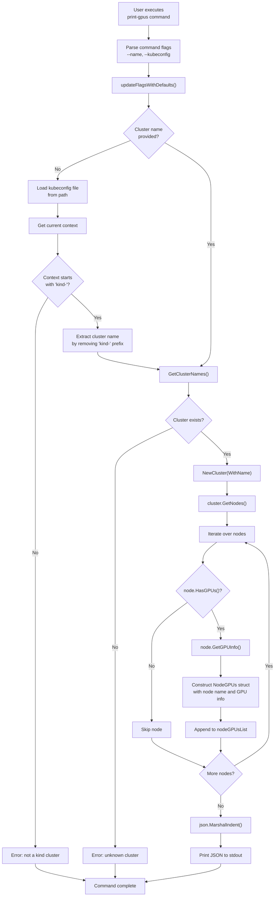
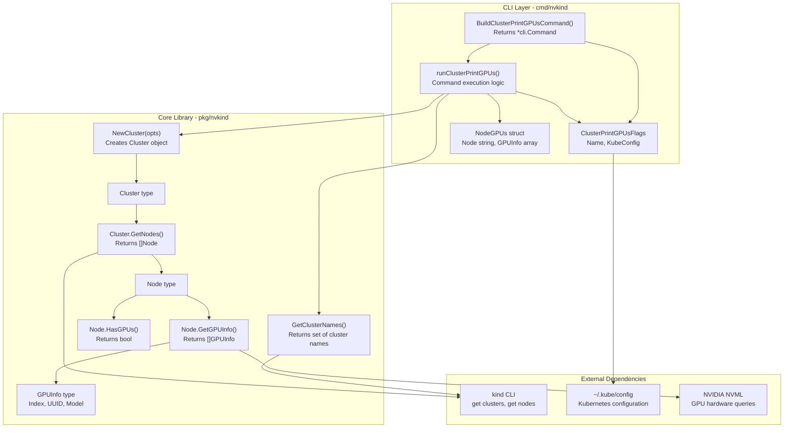
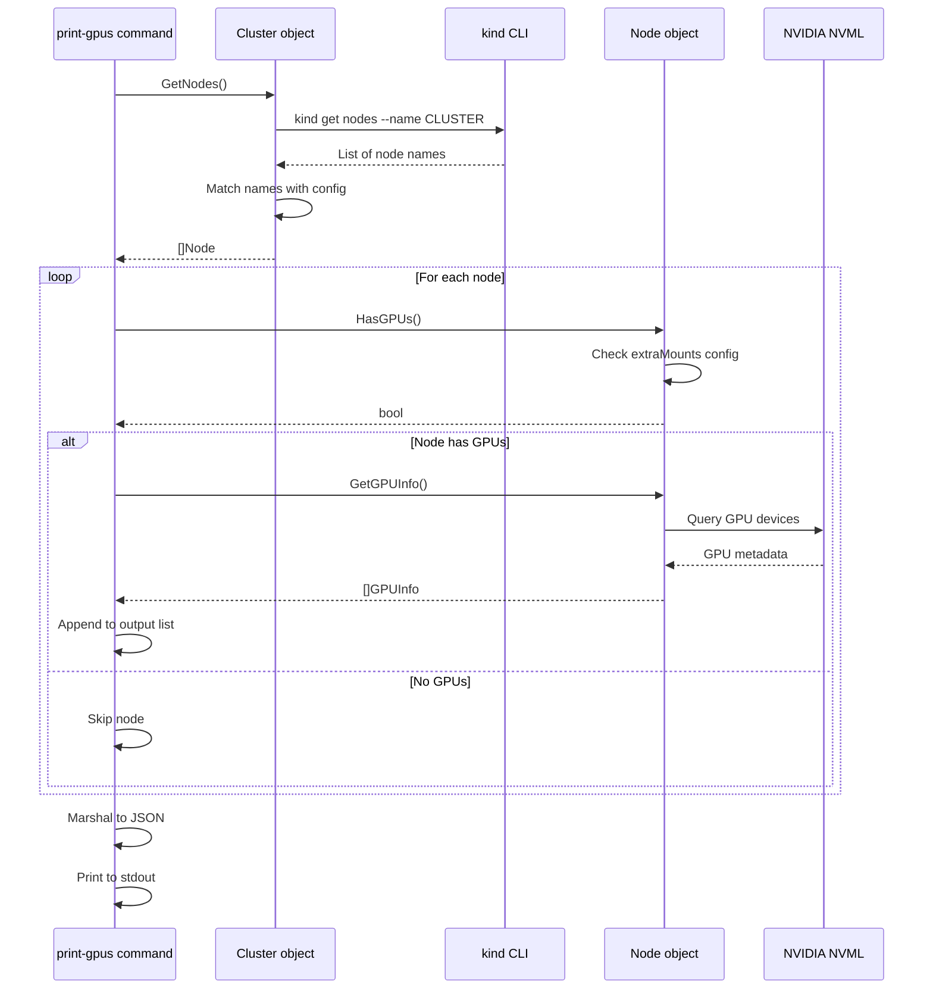

<!-- source: DeepWiki mcp.deepwiki.com · repo NVIDIA/nvkind · page 3.3 Viewing GPU Information · fetched 2026-10-26 -->

# Viewing GPU Information

<details>
<summary>Relevant source files</summary>

The following files were used as context for generating this wiki page:

- [cmd/nvkind/cluster_print_gpus.go](cmd/nvkind/cluster_print_gpus.go)
- [pkg/nvkind/cluster.go](pkg/nvkind/cluster.go)

</details>


This page documents the `nvkind cluster print-gpus` command, which displays information about NVIDIA GPUs allocated to nodes in a KIND cluster. This command is useful for verifying GPU distribution after cluster creation and troubleshooting GPU visibility issues.

For information about creating clusters with GPU allocation, see [Creating Clusters](#3.1). For details on GPU distribution strategies, see [GPU Distribution Patterns](#3.4).

## Command Overview

The `print-gpus` command queries an existing nvkind cluster and outputs JSON-formatted information about which GPUs are visible to each node. The command introspects each node's configuration and queries the NVIDIA Management Library (NVML) to retrieve GPU metadata.

**Command Syntax:**
```bash
nvkind cluster print-gpus [--name CLUSTER_NAME] [--kubeconfig PATH]
```

**Sources:** [cmd/nvkind/cluster_print_gpus.go:41-67]()

## Command Flags

| Flag | Environment Variable | Default | Description |
|------|---------------------|---------|-------------|
| `--name` | `KIND_CLUSTER_NAME` | Current kubeconfig context | Name of the cluster to inspect |
| `--kubeconfig` | `KUBECONFIG` | `~/.kube/config` | Path to kubeconfig file |

### Automatic Cluster Name Resolution

If the `--name` flag is not specified, the command automatically determines the cluster name by:
1. Loading the kubeconfig file from the specified path or default location
2. Reading the current context
3. Verifying the context name starts with `kind-` prefix
4. Extracting the cluster name by removing the `kind-` prefix

This allows you to run `nvkind cluster print-gpus` without arguments when working with a single cluster.

**Sources:** [cmd/nvkind/cluster_print_gpus.go:118-145]()

## Output Format

The command outputs a JSON array where each element represents a node with GPU access. Nodes without GPUs are excluded from the output.

### JSON Schema

```json
[
  {
    "node": "string",
    "gpus": [
      {
        "index": 0,
        "uuid": "string",
        "model": "string"
      }
    ]
  }
]
```

### Field Descriptions

| Field | Type | Description |
|-------|------|-------------|
| `node` | string | Kubernetes node name (e.g., `nvkind-worker`, `nvkind-worker2`) |
| `gpus` | array | List of GPU devices visible to this node |
| `gpus[].index` | integer | GPU device index |
| `gpus[].uuid` | string | GPU Universally Unique Identifier |
| `gpus[].model` | string | GPU model name |

**Sources:** [cmd/nvkind/cluster_print_gpus.go:31-34](), [cmd/nvkind/cluster_print_gpus.go:93-107]()

## Usage Examples

### Basic Usage

Print GPUs for the cluster associated with the current kubeconfig context:
```bash
nvkind cluster print-gpus
```

### Specify Cluster Name

Print GPUs for a specific cluster:
```bash
nvkind cluster print-gpus --name my-gpu-cluster
```

### Use Environment Variables

```bash
export KIND_CLUSTER_NAME=my-gpu-cluster
nvkind cluster print-gpus
```

### Example Output

For a cluster with three worker nodes, each assigned one GPU:
```json
[
    {
        "node": "nvkind-worker",
        "gpus": [
            {
                "index": 0,
                "uuid": "GPU-12345678-1234-1234-1234-123456789abc",
                "model": "NVIDIA A100-SXM4-40GB"
            }
        ]
    },
    {
        "node": "nvkind-worker2",
        "gpus": [
            {
                "index": 1,
                "uuid": "GPU-87654321-4321-4321-4321-cba987654321",
                "model": "NVIDIA A100-SXM4-40GB"
            }
        ]
    },
    {
        "node": "nvkind-worker3",
        "gpus": [
            {
                "index": 2,
                "uuid": "GPU-abcdefab-abcd-abcd-abcd-abcdefabcdef",
                "model": "NVIDIA A100-SXM4-40GB"
            }
        ]
    }
]
```

**Sources:** [cmd/nvkind/cluster_print_gpus.go:109-113]()

## Command Execution Flow



**Sources:** [cmd/nvkind/cluster_print_gpus.go:69-116]()

## Internal Architecture

### Command Structure



**Sources:** [cmd/nvkind/cluster_print_gpus.go:41-67](), [cmd/nvkind/cluster_print_gpus.go:69-116]()

### Node GPU Detection Process

The command uses the following process to determine which GPUs are visible to each node:



**Sources:** [cmd/nvkind/cluster_print_gpus.go:88-107](), [pkg/nvkind/cluster.go:189-250]()

### Type Definitions

The `NodeGPUs` struct is defined specifically for the `print-gpus` command output:

```go
type NodeGPUs struct {
    Node    string           `json:"node"`
    GPUInfo []nvkind.GPUInfo `json:"gpus"`
}
```

This structure aggregates:
- **Node**: The Kubernetes node name from the cluster
- **GPUInfo**: An array of `nvkind.GPUInfo` objects, each containing GPU index, UUID, and model information

The `GPUInfo` type is defined in the core library and represents metadata for a single GPU device.

**Sources:** [cmd/nvkind/cluster_print_gpus.go:31-34]()

## Error Handling

The command performs validation at multiple stages:

### Cluster Validation
- **Unknown cluster error**: Occurs when the specified cluster name does not exist in the KIND cluster list
- **Invalid context error**: Occurs when the current kubeconfig context is not a KIND cluster (doesn't start with `kind-` prefix)
- **No current context error**: Occurs when no kubeconfig context is set

### Runtime Errors
- **Getting cluster names**: Failure to execute `kind get clusters` command
- **Creating cluster object**: Failure to construct cluster representation
- **Getting nodes**: Failure to retrieve node list from cluster
- **Getting GPU info**: Failure to query NVML for GPU metadata on a specific node
- **JSON marshaling**: Failure to serialize output to JSON format

All errors are propagated with context using `fmt.Errorf()` wrapping to provide clear error messages.

**Sources:** [cmd/nvkind/cluster_print_gpus.go:70-116]()

## Integration with Core Library

The `print-gpus` command demonstrates the separation between CLI and library layers:

### CLI Layer Responsibilities
- Flag parsing and validation
- Default value resolution (kubeconfig path, cluster name)
- Output formatting (JSON marshaling and printing)
- User-facing error messages

### Core Library Responsibilities  
- Cluster existence verification via `GetClusterNames()`
- Cluster object construction via `NewCluster()`
- Node list retrieval via `Cluster.GetNodes()`
- GPU detection via `Node.HasGPUs()` and `Node.GetGPUInfo()`
- NVML integration for hardware queries

This separation enables the core library to be reused in other contexts (e.g., programmatic usage, alternative CLI tools, web services) while the CLI provides a user-friendly interface.

**Sources:** [cmd/nvkind/cluster_print_gpus.go:69-116](), [pkg/nvkind/cluster.go:189-250]()

---

