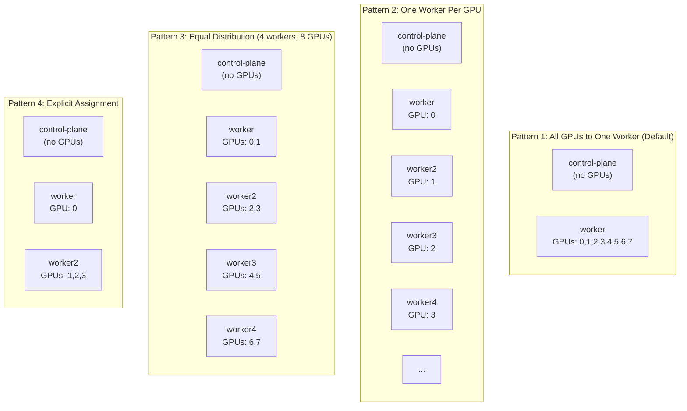
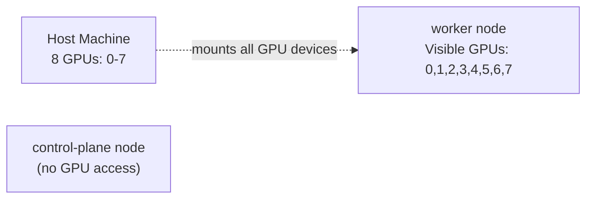
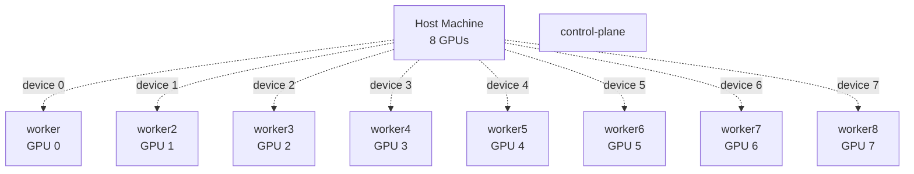
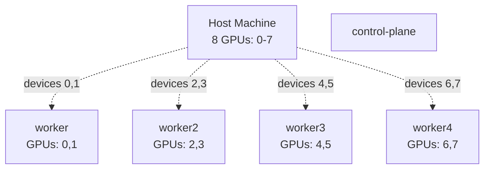
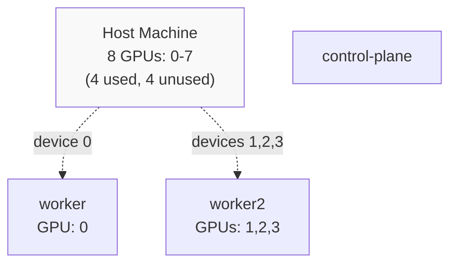
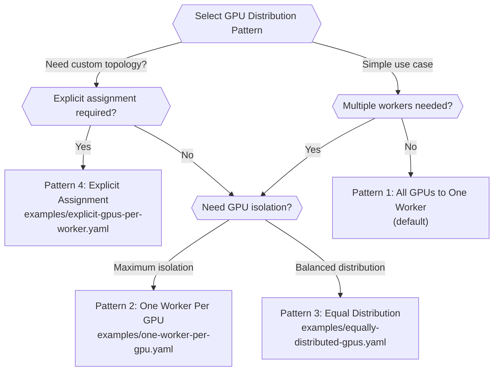

<!-- source: DeepWiki mcp.deepwiki.com · repo NVIDIA/nvkind · page 3.4 GPU Distribution Patterns · fetched 2026-10-26 -->

# GPU Distribution Patterns

<details>
<summary>Relevant source files</summary>

The following files were used as context for generating this wiki page:

- [README.md](README.md)
- [examples/equally-distributed-gpus.yaml](examples/equally-distributed-gpus.yaml)
- [examples/explicit-gpus-per-worker.yaml](examples/explicit-gpus-per-worker.yaml)
- [examples/one-worker-per-gpu.yaml](examples/one-worker-per-gpu.yaml)

</details>


## Purpose and Scope

This page describes the four GPU distribution strategies supported by nvkind for allocating GPUs across worker nodes in a KIND cluster. Each pattern addresses different use cases, from simple single-node GPU access to complex multi-node GPU topologies.

For details on the template system that implements these patterns, see [Configuration Template System](#4.1). For step-by-step instructions on creating clusters with these patterns, see [Creating Clusters](#3.1). To verify GPU allocation after cluster creation, see [Viewing GPU Information](#3.3).

---

## Overview of Distribution Patterns

nvkind supports four GPU distribution patterns through configuration templates:

| Pattern | Template File | Use Case | Configuration Complexity |
|---------|---------------|----------|-------------------------|
| All GPUs to One Worker | Default (embedded) | Simple GPU access, development, testing | Low |
| One Worker Per GPU | `examples/one-worker-per-gpu.yaml` | GPU isolation, multi-tenant scenarios | Low |
| Equal Distribution | `examples/equally-distributed-gpus.yaml` | Balanced multi-node workloads | Medium |
| Explicit Assignment | `examples/explicit-gpus-per-worker.yaml` | Custom topologies, heterogeneous configurations | High |

The pattern is selected by specifying the `--config-template` flag when creating a cluster. Additional configuration values can be provided via `--config-values` for patterns that require parameters.

**Sources:** [README.md:126-169](), [README.md:221-226]()

---

## Pattern Comparison Diagram



**Sources:** [README.md:126-169]()

---

## Pattern 1: All GPUs to One Worker (Default)

### Description

The default pattern creates a cluster with a single worker node that has access to all GPUs available on the host machine. This is the simplest configuration and requires no template specification.

### When to Use

- Development and testing environments
- Single-node GPU workloads
- Simplicity over isolation
- Maximum GPU count per pod (all GPUs accessible from one node)

### Creation Command

```bash
./nvkind cluster create
```

This uses the embedded default template with no additional configuration required.

### GPU Topology

On a host with 8 GPUs, this pattern creates:



### Technical Implementation

The default template embeds `extraMounts` configuration that mounts all GPU device references via the nvidia-container-runtime volume mount mechanism. The template uses the `numGPUs` function to determine the total GPU count and iterates over all devices.

**Sources:** [README.md:126-131](), [README.md:221-226]()

---

## Pattern 2: One Worker Per GPU

### Description

This pattern creates one dedicated worker node for each GPU available on the host. Each worker node has exclusive access to exactly one GPU, providing maximum isolation between GPUs.

### When to Use

- Multi-tenant scenarios requiring GPU isolation
- Testing GPU-specific behavior across multiple nodes
- Simulating distributed GPU environments
- Scenarios where workload scheduling must be GPU-aware

### Creation Command

```bash
./nvkind cluster create \
  --config-template=examples/one-worker-per-gpu.yaml
```

### GPU Topology

On a host with 8 GPUs, this pattern creates 8 worker nodes:



### Template Implementation

The template [examples/one-worker-per-gpu.yaml:19-27]() uses a range iterator over `numGPUs` to generate worker node definitions. Each iteration creates a worker with a single `extraMount` pointing to `/var/run/nvidia-container-devices/<gpu_index>`.

```yaml
{{- range $gpu := until numGPUs }}
- role: worker
  extraMounts:
    - hostPath: /dev/null
      containerPath: /var/run/nvidia-container-devices/{{ $gpu }}
{{- end }}
```

**Sources:** [README.md:133-139](), [examples/one-worker-per-gpu.yaml:1-28]()

---

## Pattern 3: Equal Distribution

### Description

This pattern distributes GPUs evenly across a specified number of worker nodes. The number of GPUs per worker is calculated as `total_gpus / num_workers`. This pattern requires the `numWorkers` parameter to be specified via `--config-values`.

### When to Use

- Balanced multi-node GPU workloads
- Simulating multi-node GPU clusters with controlled GPU density
- Testing distributed training scenarios with uniform GPU allocation
- When you need multiple GPUs per node but want even distribution

### Creation Command

```bash
./nvkind cluster create \
  --name=evenly-distributed-2-by-4 \
  --config-template=examples/equally-distributed-gpus.yaml \
  --config-values=- \
<<EOF
numWorkers: 4
EOF
```

This example creates 4 worker nodes on a host with 8 GPUs, resulting in 2 GPUs per worker.

### GPU Topology

With `numWorkers: 4` on an 8-GPU host:



### Template Implementation

The template [examples/equally-distributed-gpus.yaml:15-44]() calculates the GPU range for each worker using division and stepping functions:

```yaml
{{- $gpus_per_worker := div numGPUs $.numWorkers }}
{{- range $worker := until $.numWorkers }}
  {{- $gpu_beg_id := mul $worker $gpus_per_worker | int }}
  {{- $gpu_end_id := add $gpu_beg_id $gpus_per_worker | int }}
  {{- $gpus := untilStep $gpu_beg_id $gpu_end_id 1 }}
  {{- range $gpu := $gpus }}
    - hostPath: /dev/null
      containerPath: /var/run/nvidia-container-devices/{{ $gpu }}
  {{- end }}
{{- end }}
```

The template divides the total GPU count by the requested number of workers and assigns consecutive GPU indices to each worker.

### Configuration Parameters

| Parameter | Type | Required | Description |
|-----------|------|----------|-------------|
| `numWorkers` | integer | Yes | Number of worker nodes to create |
| `name` | string | No | Cluster name (can also be set via `--name` flag) |
| `image` | string | No | Node image (can also be set via `--image` flag) |

**Sources:** [README.md:141-153](), [examples/equally-distributed-gpus.yaml:1-45]()

---

## Pattern 4: Explicit GPU Assignment

### Description

This pattern provides complete control over GPU-to-worker mapping. Each worker can be assigned an arbitrary set of GPU devices, allowing for heterogeneous configurations where different workers have different GPU counts.

### When to Use

- Custom GPU topologies required by specific workloads
- Heterogeneous node configurations (e.g., one worker with 1 GPU, another with 3 GPUs)
- Testing specific GPU allocation scenarios
- Simulating real-world cluster configurations with uneven GPU distribution

### Creation Command

```bash
./nvkind cluster create \
  --name=explicit-gpus \
  --config-template=examples/explicit-gpus-per-worker.yaml \
  --config-values=- \
<<EOF
workers:
- devices: 0
- devices: [1, 2, 3]
EOF
```

This example creates two workers: the first with GPU 0, the second with GPUs 1, 2, and 3.

### GPU Topology

With the configuration above:



### Template Implementation

The template [examples/explicit-gpus-per-worker.yaml:25-45]() iterates over the `workers` array in the configuration values. Each worker entry can specify a `devices` field containing either a single GPU index or an array of indices:

```yaml
{{- range $.workers }}
- role: worker
  {{- if hasKey . "devices" }}
  {{- $devices := .devices }}
  {{- if not (kindIs "slice" $devices) }}
    {{- $devices = list .devices }}
  {{- end }}
  extraMounts:
    {{- range $d := $devices }}
    - hostPath: /dev/null
      containerPath: /var/run/nvidia-container-devices/{{ $d }}
    {{- end }}
  {{- end }}
{{- end }}
```

The template handles both scalar and array device specifications by normalizing single values into a list.

### Configuration Parameters

| Parameter | Type | Required | Description |
|-----------|------|----------|-------------|
| `workers` | array | Yes | List of worker configurations |
| `workers[].devices` | int or array | No | GPU device index/indices for this worker (omit for no GPUs) |
| `name` | string | No | Cluster name (can also be set via `--name` flag) |
| `image` | string | No | Node image (can also be set via `--image` flag) |

### Examples of Device Specifications

```yaml
# Single GPU
workers:
- devices: 0

# Multiple GPUs (array syntax)
workers:
- devices: [0, 1, 2]

# Mixed configuration
workers:
- devices: 0           # Worker 1: GPU 0
- devices: [1, 2]      # Worker 2: GPUs 1, 2
- {}                   # Worker 3: No GPUs

# Non-contiguous GPUs
workers:
- devices: [0, 3, 7]   # Worker 1: GPUs 0, 3, 7
```

**Sources:** [README.md:155-219](), [examples/explicit-gpus-per-worker.yaml:1-46]()

---

## Pattern Selection Guide

### Decision Matrix



### Comparison Table

| Criteria | Default | One Per GPU | Equal Distribution | Explicit |
|----------|---------|-------------|-------------------|----------|
| Worker count | 1 | = GPU count | Configurable | Configurable |
| GPUs per worker | All | 1 | `total_gpus / num_workers` | Per-worker specification |
| Configuration complexity | None | None | Requires `numWorkers` | Requires `workers` array |
| GPU isolation | None | Maximum | Moderate | Configurable |
| Use case | Development | Multi-tenant | Balanced workloads | Custom topologies |
| Command flags | None | `--config-template` | `--config-template` + `--config-values` | `--config-template` + `--config-values` |

**Sources:** [README.md:126-169]()

---

## GPU Device Injection Mechanism

All patterns use the same underlying mechanism for injecting GPU access into worker nodes. This mechanism leverages the nvidia-container-runtime's volume mount feature.

### Volume Mount Pattern


### Technical Details

Each GPU is made visible to a worker node by adding an `extraMount` entry:

```yaml
extraMounts:
  - hostPath: /dev/null
    containerPath: /var/run/nvidia-container-devices/<gpu_index>
```

The nvidia-container-runtime detects these volume mounts and interprets the GPU index, making the corresponding GPU device available inside the container. This requires the `accept-nvidia-visible-devices-as-volume-mounts` configuration flag to be enabled in `/etc/nvidia-container-runtime/config.toml`.

For details on the runtime configuration, see [Prerequisites and Installation](#2.1).

**Sources:** [examples/one-worker-per-gpu.yaml:21-26](), [examples/equally-distributed-gpus.yaml:36-43](), [examples/explicit-gpus-per-worker.yaml:36-43](), [README.md:79-105]()

---

## Verification

After creating a cluster with any GPU distribution pattern, use the `print-gpus` command to verify the GPU allocation:

```bash
./nvkind cluster print-gpus --name=<cluster-name>
```

Example output for an explicit assignment pattern:

```json
[
    {
        "node": "explicit-gpus-worker",
        "gpus": [
            {
                "Index": "0",
                "Name": "NVIDIA A100-SXM4-40GB",
                "UUID": "GPU-4cf8db2d-06c0-7d70-1a51-e59b25b2c16c"
            }
        ]
    },
    {
        "node": "explicit-gpus-worker2",
        "gpus": [
            {
                "Index": "0",
                "Name": "NVIDIA A100-SXM4-40GB",
                "UUID": "GPU-4404041a-04cf-1ccf-9e70-f139a9b1e23c"
            },
            {
                "Index": "1",
                "Name": "NVIDIA A100-SXM4-40GB",
                "UUID": "GPU-79a2ba02-a537-ccbf-2965-8e9d90c0bd54"
            },
            {
                "Index": "2",
                "Name": "NVIDIA A100-SXM4-40GB",
                "UUID": "GPU-662077db-fa3f-0d8f-9502-21ab0ef058a2"
            }
        ]
    }
]
```

Note that GPU indices within each node are renumbered starting from 0, regardless of their host indices. The UUID field provides the mapping back to host GPUs.

For details on the `print-gpus` command, see [Viewing GPU Information](#3.3).

**Sources:** [README.md:172-219]()

---

