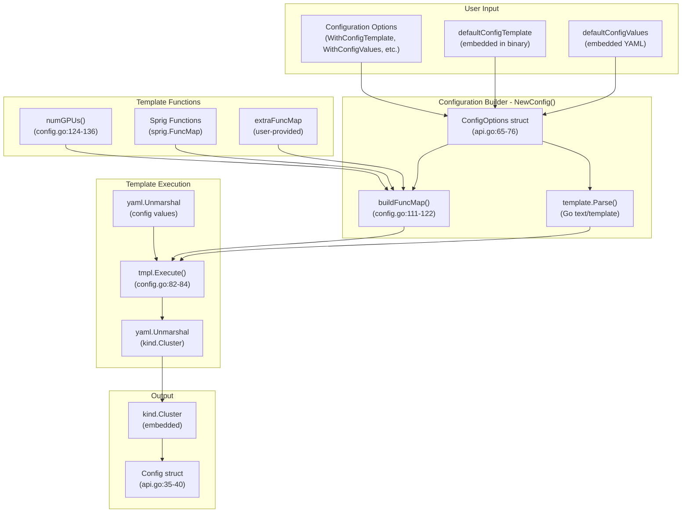
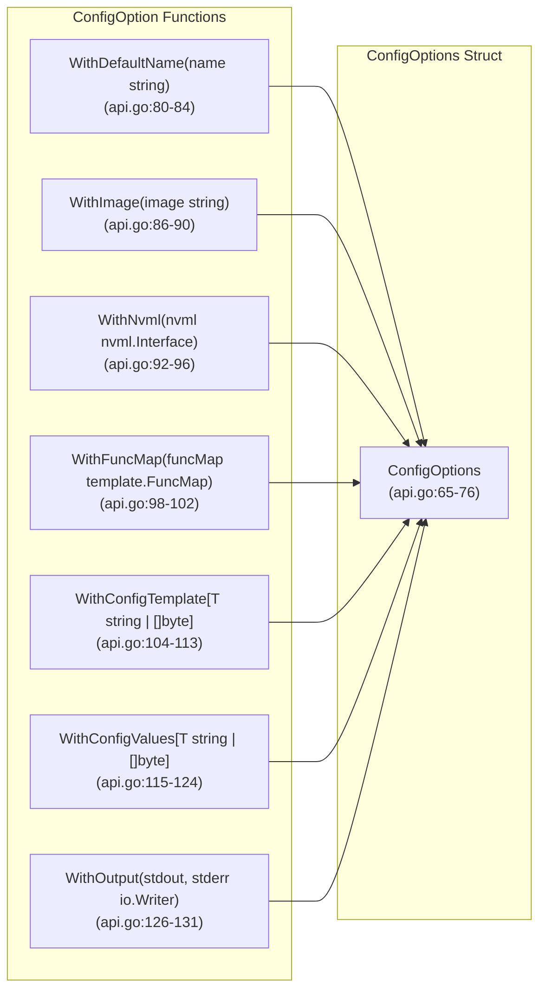
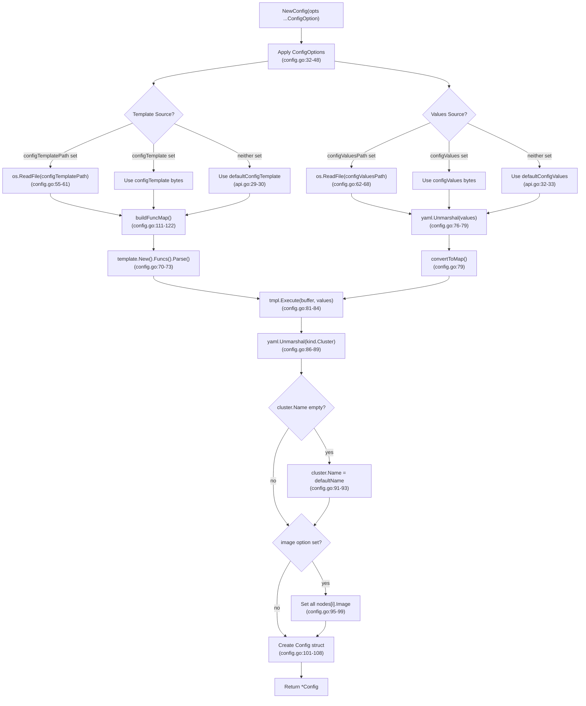
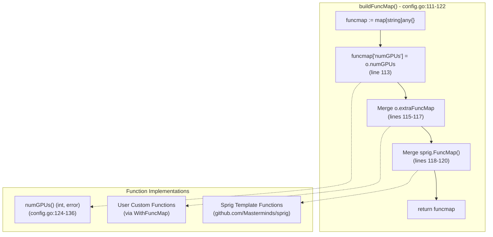
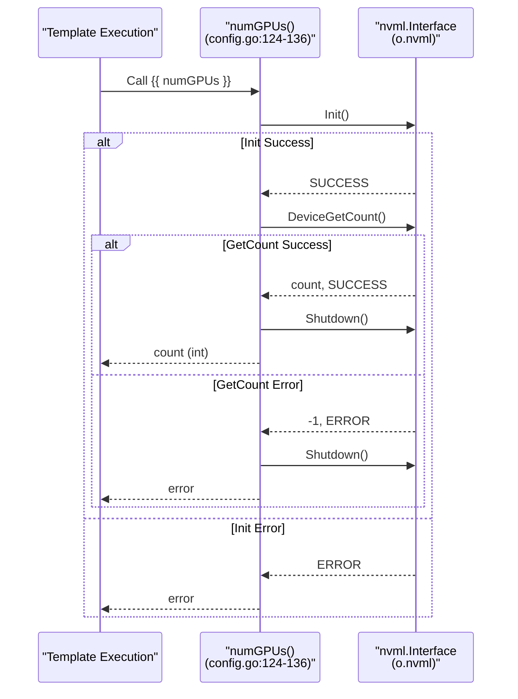
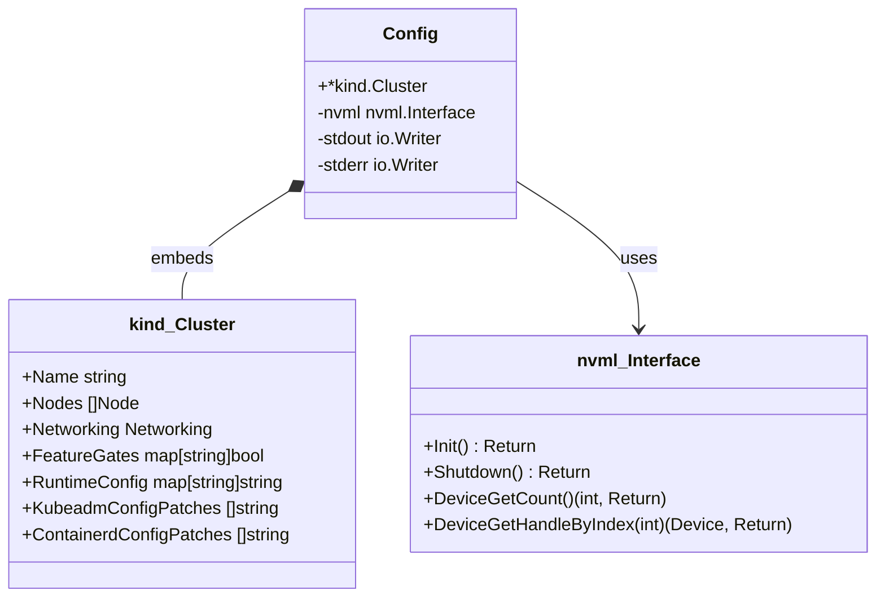
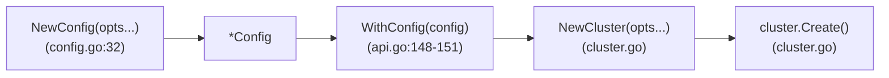
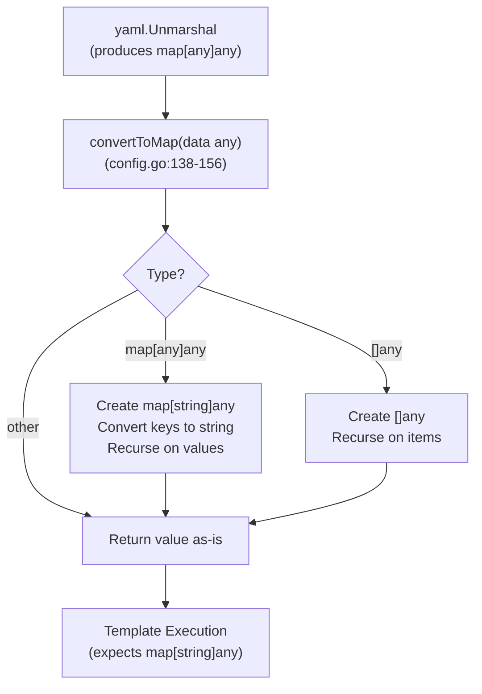

<!-- source: DeepWiki mcp.deepwiki.com · repo NVIDIA/nvkind · page 4 Configuration Guide · fetched 2026-10-26 -->

# Configuration Guide

Relevant source files

The following files were used as context for generating this wiki page:

- [pkg/nvkind/api.go](pkg/nvkind/api.go)
- [pkg/nvkind/config.go](pkg/nvkind/config.go)

## Purpose and Scope

This guide provides a comprehensive overview of nvkind's configuration system, which uses Go templates to generate KIND cluster configurations with GPU support. The configuration system enables flexible GPU allocation strategies through a template-based approach that queries NVIDIA hardware at configuration time.

This page covers the configuration architecture, the functional options pattern used for configuration, and how templates are processed to produce KIND cluster specifications. For detailed information about specific template patterns, see [Built-in Template Examples](#4.2). For creating your own templates, see [Creating Custom Configurations](#4.3). For the underlying template system mechanics, see [Configuration Template System](#4.1).

---

## Configuration Architecture Overview

The nvkind configuration system is built on three core components: the `Config` struct that represents a cluster configuration, the `ConfigOptions` builder that assembles configuration parameters, and a template processing pipeline that generates KIND-compatible YAML.

**Sources:** [pkg/nvkind/api.go:29-40](), [pkg/nvkind/config.go:32-109]()

---

## Configuration Options and Builder Pattern

The configuration system uses a functional options pattern implemented through `ConfigOption` functions that modify a `ConfigOptions` struct. This pattern provides a flexible API for customizing configuration behavior.

### ConfigOptions Structure

The `ConfigOptions` struct contains all parameters needed to build a configuration:

| Field | Type | Purpose |
|-------|------|---------|
| `defaultName` | `string` | Default cluster name if not specified in template |
| `image` | `string` | Kubernetes node image to use for all nodes |
| `nvml` | `nvml.Interface` | NVML interface for GPU discovery |
| `stdout`, `stderr` | `io.Writer` | Output writers for logging |
| `extraFuncMap` | `template.FuncMap` | Additional template functions |
| `configTemplatePath` | `string` | Path to template file |
| `configTemplate` | `[]byte` | Template content (in-memory) |
| `configValuesPath` | `string` | Path to values file |
| `configValues` | `[]byte` | Values content (in-memory) |

**Sources:** [pkg/nvkind/api.go:65-76]()

### Available Configuration Options

**Sources:** [pkg/nvkind/api.go:78-131]()

### Configuration Defaults

When `NewConfig()` is called, the following defaults are applied if not specified:

| Parameter | Default Value | Source |
|-----------|---------------|--------|
| Cluster name | `nvkind-{random}` (5 characters) | [config.go:37-39]() |
| NVML interface | `nvml.New()` | [config.go:40-42]() |
| stdout/stderr | `os.Stdout`/`os.Stderr` | [config.go:43-48]() |
| Template | `defaultConfigTemplate` (embedded) | [config.go:49-51]() |
| Values | `defaultConfigValues` (embedded) | [config.go:52-54]() |

**Sources:** [pkg/nvkind/config.go:32-68]()

---

## Template Processing Pipeline

The configuration system processes templates through a multi-stage pipeline that combines Go's `text/template` engine with custom functions and YAML processing.

**Sources:** [pkg/nvkind/config.go:32-109]()

### Template Function Map Construction

The `buildFuncMap()` method assembles template functions in priority order:

1. **Custom `numGPUs` function** - Queries NVML for GPU count
2. **Extra functions** - User-provided via `WithFuncMap()`
3. **Sprig functions** - Comprehensive template utilities from Sprig library

**Sources:** [pkg/nvkind/config.go:111-122]()

---

## GPU Discovery Integration

The `numGPUs()` template function provides runtime GPU detection by querying NVML during template execution. This enables templates to dynamically adjust based on available hardware.

### numGPUs() Function Flow

**Implementation Details:**

| Step | Code Reference | Description |
|------|----------------|-------------|
| Initialize NVML | [config.go:125-127]() | Calls `o.nvml.Init()` to initialize NVIDIA Management Library |
| Ensure cleanup | [config.go:128]() | Deferred `Shutdown()` ensures NVML is properly cleaned up |
| Get device count | [config.go:130-133]() | Calls `o.nvml.DeviceGetCount()` to query GPU count |
| Return result | [config.go:135]() | Returns GPU count or error |

**Sources:** [pkg/nvkind/config.go:124-136]()

---

## Configuration Output

The `Config` struct embeds a `kind.Cluster` object and maintains references to dependencies needed for cluster operations.

### Config Structure

**Field Purposes:**

| Field | Type | Visibility | Purpose |
|-------|------|------------|---------|
| `Cluster` | `*kind.Cluster` | Embedded (public) | KIND cluster specification generated from template |
| `nvml` | `nvml.Interface` | Private | NVML interface for GPU operations during cluster creation |
| `stdout` | `io.Writer` | Private | Output writer for user-facing messages |
| `stderr` | `io.Writer` | Private | Output writer for error messages |

**Sources:** [pkg/nvkind/api.go:35-40]()

### Usage in Cluster Creation

The `Config` struct is passed to cluster creation via the `WithConfig()` option:

The embedded `kind.Cluster` is extracted and used to generate KIND configuration YAML, while the private fields provide access to NVML and I/O during cluster operations.

**Sources:** [pkg/nvkind/api.go:35-40](), [pkg/nvkind/api.go:148-151]()

---

## Template and Values Loading Priority

The configuration system supports multiple sources for templates and values, with a clear precedence order:

| Priority | Template Source | Values Source | Specified By |
|----------|-----------------|---------------|--------------|
| 1 | In-memory bytes | In-memory bytes | `WithConfigTemplate([]byte)`, `WithConfigValues([]byte)` |
| 2 | File path | File path | `WithConfigTemplate(string)`, `WithConfigValues(string)` |
| 3 | Embedded default | Embedded default | Built-in (no option specified) |

**Loading Logic:**

1. If `configTemplate` bytes are set → use directly
2. Else if `configTemplatePath` is set → read file via `os.ReadFile()`
3. Else → use `defaultConfigTemplate` (embedded at compile time)

The same logic applies for values. This design allows:
- **CLI usage**: Load from files using paths
- **Library usage**: Pass templates as byte slices
- **Default behavior**: Use embedded defaults with no configuration

**Sources:** [pkg/nvkind/config.go:49-68]()

---

## Advanced: Map Conversion for Template Compatibility

The `convertToMap()` function transforms YAML-unmarshaled data (which uses `map[any]any`) to `map[string]any` for template compatibility:

This recursive conversion ensures that nested YAML structures are properly formatted for Go template execution, which requires string keys in maps.

**Sources:** [pkg/nvkind/config.go:138-156]()

---

## Summary

The nvkind configuration system provides a flexible, template-based approach to generating KIND cluster configurations with GPU support. Key characteristics:

- **Functional Options Pattern**: Clean API for configuration via `ConfigOption` functions
- **Template Engine**: Go `text/template` with Sprig extensions and custom `numGPUs()` function
- **Multi-Source Support**: Templates and values from embedded defaults, files, or in-memory bytes
- **Runtime GPU Discovery**: NVML integration allows templates to query hardware at configuration time
- **KIND Integration**: Output is a `kind.Cluster` object ready for cluster creation

For specific template patterns and examples, see [Built-in Template Examples](#4.2). For creating custom configurations, see [Creating Custom Configurations](#4.3).

---

