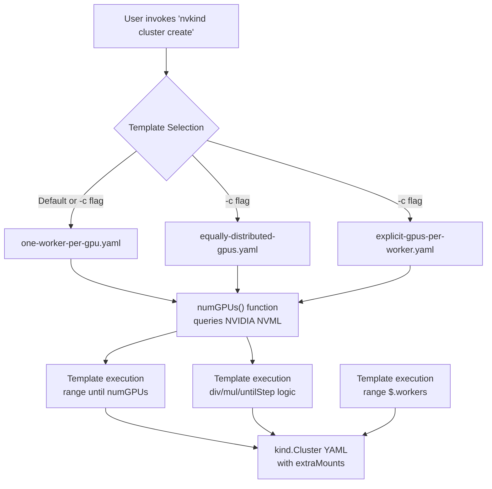
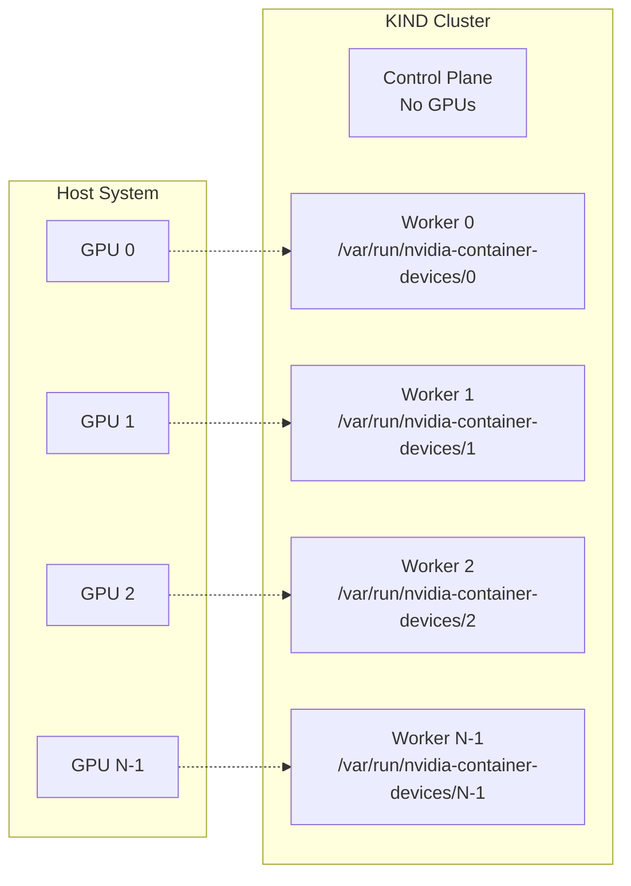
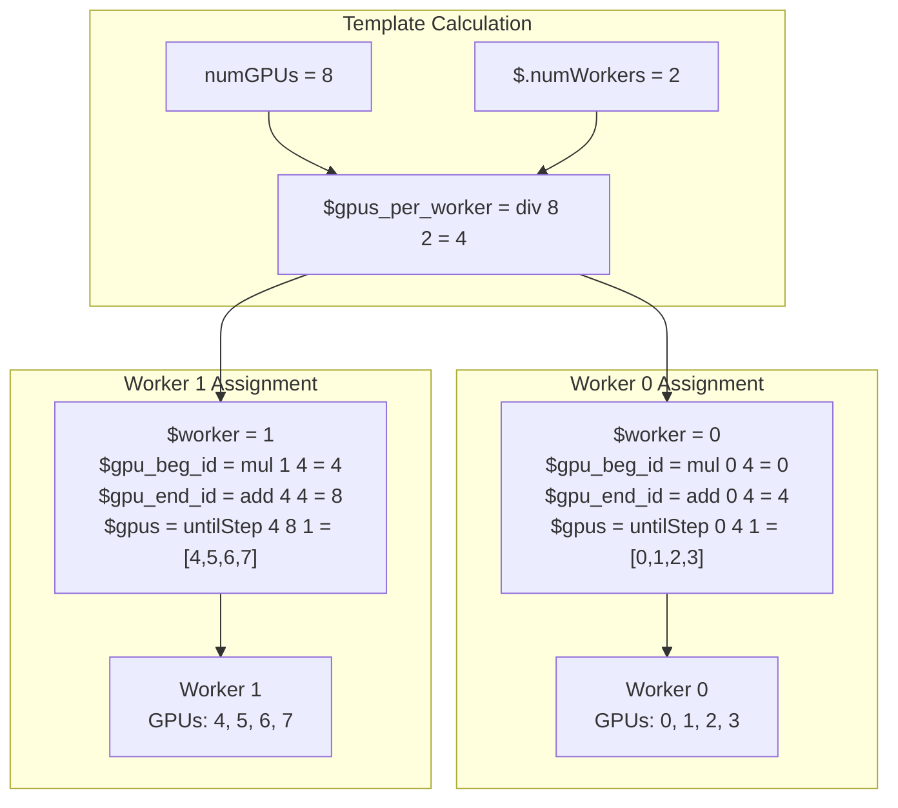
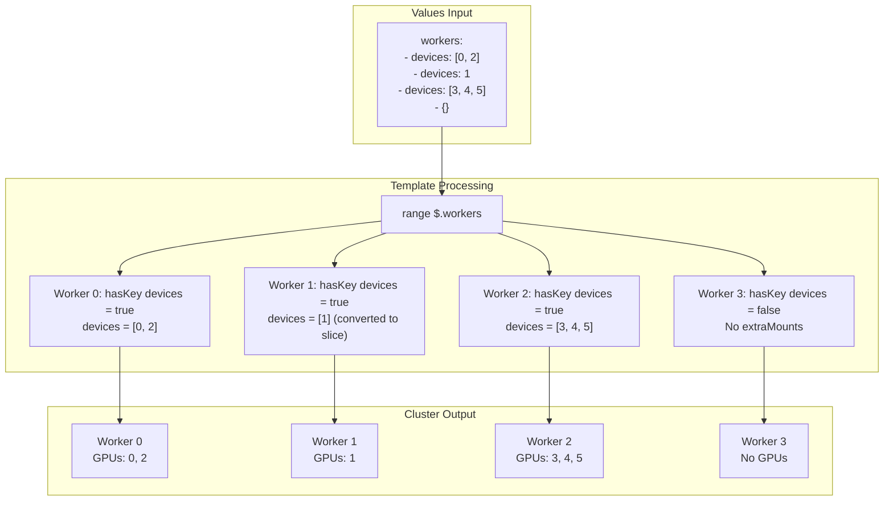
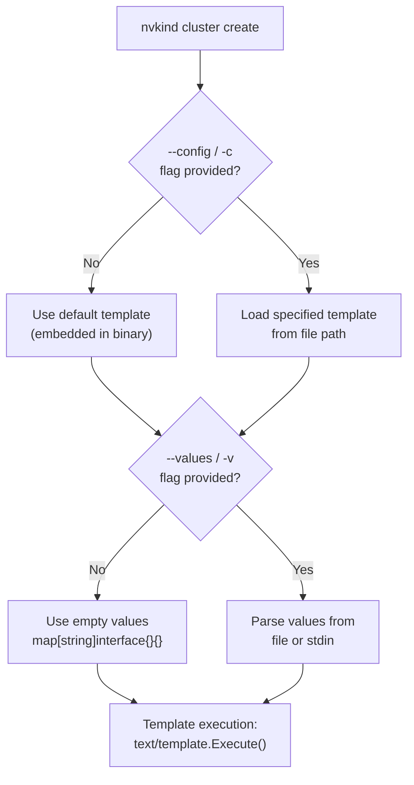

<!-- source: DeepWiki mcp.deepwiki.com · repo NVIDIA/nvkind · page 4.2 Built-in Template Examples · fetched 2026-10-26 -->

# Built-in Template Examples

<details>
<summary>Relevant source files</summary>

The following files were used as context for generating this wiki page:

- [examples/equally-distributed-gpus.yaml](examples/equally-distributed-gpus.yaml)
- [examples/explicit-gpus-per-worker.yaml](examples/explicit-gpus-per-worker.yaml)
- [examples/one-worker-per-gpu.yaml](examples/one-worker-per-gpu.yaml)

</details>


## Purpose and Scope

This document details the three built-in configuration templates provided with nvkind for different GPU allocation patterns. Each template demonstrates a specific strategy for distributing GPUs across worker nodes in a KIND cluster. For information about the underlying template system architecture and custom function support, see [Configuration Template System](#4.1). For guidance on creating your own custom templates, see [Creating Custom Configurations](#4.3).

The three built-in templates are:
- **one-worker-per-gpu.yaml**: One worker node per GPU
- **equally-distributed-gpus.yaml**: Equal GPU distribution across N workers
- **explicit-gpus-per-worker.yaml**: Manual GPU-to-worker assignment

## Template Comparison

The following table summarizes the characteristics and use cases for each built-in template:

| Template | Input Parameters | GPU Distribution | Best Use Case | Complexity |
|----------|-----------------|------------------|---------------|------------|
| `one-worker-per-gpu.yaml` | None | 1 GPU per worker | Testing GPU isolation, parallel workloads | Low |
| `equally-distributed-gpus.yaml` | `numWorkers` | Equal split across workers | Balanced multi-GPU workloads | Medium |
| `explicit-gpus-per-worker.yaml` | `workers[]` with `devices[]` | User-specified | Asymmetric topologies, specific GPU selection | High |

Sources: [examples/one-worker-per-gpu.yaml](), [examples/equally-distributed-gpus.yaml](), [examples/explicit-gpus-per-worker.yaml]()

## Template Processing Flow



Sources: [examples/one-worker-per-gpu.yaml:19-26](), [examples/equally-distributed-gpus.yaml:15-44](), [examples/explicit-gpus-per-worker.yaml:25-45]()

## one-worker-per-gpu.yaml

### Overview

This template creates a cluster with one worker node per available GPU, where each worker receives exactly one GPU. It is the simplest template and requires no input parameters.

### Template Structure

The template uses the `numGPUs` function to determine the total GPU count, then iterates to create one worker per GPU:

```yaml
{{- range $gpu := until numGPUs }}
- role: worker
  extraMounts:
    - hostPath: /dev/null
      containerPath: /var/run/nvidia-container-devices/{{ $gpu }}
{{- end }}
```

The `extraMounts` configuration injects GPU device visibility using the nvidia-container-runtime mechanism, where the `containerPath` specifies the GPU index (0, 1, 2, etc.).

**Sources:** [examples/one-worker-per-gpu.yaml:19-27]()

### GPU Assignment Pattern



Sources: [examples/one-worker-per-gpu.yaml:19-27]()

### Usage Example

```bash
# Uses one-worker-per-gpu.yaml by default
nvkind cluster create --name gpu-test

# Explicit specification (same result)
nvkind cluster create --name gpu-test \
  -c examples/one-worker-per-gpu.yaml
```

### When to Use

- **GPU isolation testing**: Each GPU operates in its own node environment
- **Parallel experimentation**: Run independent workloads on each GPU
- **Maximum worker count**: Create as many workers as available GPUs
- **Simple topology**: No configuration required

Sources: [examples/one-worker-per-gpu.yaml]()

## equally-distributed-gpus.yaml

### Overview

This template distributes GPUs equally across a specified number of worker nodes. It requires the `numWorkers` parameter and calculates the GPU-per-worker ratio automatically.

### Template Structure

The template performs integer division to determine GPUs per worker, then assigns contiguous GPU ranges:

```yaml
{{- $gpus_per_worker := div numGPUs $.numWorkers }}

{{- range $worker := until $.numWorkers }}
- role: worker
  {{- $gpu_beg_id := mul $worker $gpus_per_worker | int }}
  {{- $gpu_end_id := add $gpu_beg_id $gpus_per_worker | int }}
  {{- $gpus := untilStep $gpu_beg_id $gpu_end_id 1 }}
  extraMounts:
    {{- range $gpu := $gpus }}
    - hostPath: /dev/null
      containerPath: /var/run/nvidia-container-devices/{{ $gpu }}
    {{- end }}
{{- end }}
```

**Key template variables:**
- `$gpus_per_worker`: GPUs allocated to each worker (integer division)
- `$gpu_beg_id`: Starting GPU index for current worker
- `$gpu_end_id`: Ending GPU index (exclusive)
- `$gpus`: Range of GPU indices using Sprig's `untilStep` function

**Sources:** [examples/equally-distributed-gpus.yaml:15-44]()

### GPU Assignment Pattern



Sources: [examples/equally-distributed-gpus.yaml:15-44]()

### Usage Example

Create a cluster with 3 workers sharing 6 GPUs (2 GPUs per worker):

```bash
nvkind cluster create --name multi-gpu \
  -c examples/equally-distributed-gpus.yaml \
  -v numWorkers=3
```

Create with custom values file:

```yaml
# values.yaml
numWorkers: 4
name: balanced-cluster
image: kindest/node:v1.28.0
```

```bash
nvkind cluster create -c examples/equally-distributed-gpus.yaml \
  -v values.yaml
```

### When to Use

- **Balanced workloads**: Each worker receives equal GPU resources
- **Multi-GPU training**: Distribute model replicas across workers
- **Resource efficiency**: Control worker count independent of GPU count
- **Controlled topology**: Specify exact number of workers needed

### Limitations

- **Integer division**: Remainder GPUs are not allocated (e.g., 7 GPUs / 3 workers = 2 per worker, 1 unused)
- **Contiguous assignment**: GPUs are assigned in sequential blocks

Sources: [examples/equally-distributed-gpus.yaml]()

## explicit-gpus-per-worker.yaml

### Overview

This template provides maximum flexibility by allowing explicit specification of which GPUs are assigned to each worker. It requires a `workers` array in the values, where each worker can define its own `devices` list.

### Template Structure

The template iterates over a user-provided `workers` array and conditionally creates `extraMounts` based on the `devices` field:

```yaml
{{- range $.workers }}
- role: worker
  {{- if hasKey . "devices" }}
  {{- $devices := .devices }}
  {{- if not (kindIs "slice" $devices) }}
    {{- $devices = list .devices }}
  {{- end }}
  extraMounts:
    {{- range $d := $devices }}
    - hostPath: /dev/null
      containerPath: /var/run/nvidia-container-devices/{{ $d }}
    {{- end }}
  {{- end }}
{{- end }}
```

**Key template logic:**
- `hasKey . "devices"`: Checks if worker specifies GPU devices
- `kindIs "slice" $devices`: Handles both single device and device arrays
- `list .devices`: Converts single device to array for uniform processing

**Sources:** [examples/explicit-gpus-per-worker.yaml:25-45]()

### GPU Assignment Pattern



Sources: [examples/explicit-gpus-per-worker.yaml:25-45]()

### Usage Example

Create an asymmetric cluster with custom GPU assignments:

```yaml
# custom-topology.yaml
name: asymmetric-cluster
workers:
  - devices: [0, 1]      # Worker 0: GPUs 0 and 1
  - devices: 2           # Worker 1: GPU 2 only
  - devices: [3, 4, 5]   # Worker 2: GPUs 3, 4, 5
  - {}                   # Worker 3: No GPUs (CPU-only)
```

```bash
nvkind cluster create -c examples/explicit-gpus-per-worker.yaml \
  -v custom-topology.yaml
```

### When to Use

- **Asymmetric topologies**: Different GPU counts per worker
- **Specific GPU selection**: Target particular GPU models or capabilities
- **Mixed workloads**: Combine GPU and CPU-only workers
- **Advanced testing**: Simulate complex production topologies
- **GPU exclusion**: Deliberately skip certain GPUs

### Device Specification Formats

The template accepts both single device and array formats:

| Format | Example | Result |
|--------|---------|--------|
| Single integer | `devices: 2` | Converted to `[2]` |
| Array | `devices: [0, 1, 3]` | Used as-is |
| Omitted | `{}` (no devices key) | No GPUs assigned |

**Sources:** [examples/explicit-gpus-per-worker.yaml:31-35]()

## Template Selection Logic



Sources: [examples/one-worker-per-gpu.yaml](), [examples/equally-distributed-gpus.yaml](), [examples/explicit-gpus-per-worker.yaml]()

## Common Template Patterns

### extraMounts Configuration

All three templates use the same `extraMounts` mechanism to inject GPU device visibility:

```yaml
extraMounts:
  - hostPath: /dev/null
    containerPath: /var/run/nvidia-container-devices/{{ $gpu }}
```

**Key points:**
- `hostPath: /dev/null`: Placeholder; actual device binding handled by nvidia-container-runtime
- `containerPath`: Uses special path recognized by nvidia-container-runtime
- `{{ $gpu }}`: GPU index (0-based integer)
- Requires `accept-nvidia-visible-devices-as-volume-mounts = true` in `/etc/nvidia-container-runtime/config.toml`

**Sources:** [examples/one-worker-per-gpu.yaml:21-26](), [examples/equally-distributed-gpus.yaml:36-43](), [examples/explicit-gpus-per-worker.yaml:36-43]()

### Optional Image Specification

All templates support optional node image specification:

```yaml
{{- if hasKey $ "image" }}
image: {{ $.image }}
{{- end }}
```

This allows specifying the Kubernetes version via KIND node images:

```bash
nvkind cluster create -c examples/one-worker-per-gpu.yaml \
  -v image=kindest/node:v1.29.0
```

**Sources:** [examples/equally-distributed-gpus.yaml:24-26](), [examples/explicit-gpus-per-worker.yaml:22-24]()

### Optional Cluster Name

Templates check for and use the `name` field if provided:

```yaml
{{- if hasKey $ "name" }}
name: {{ $.name }}
{{- end }}
```

If omitted, KIND generates a default name (`kind-<timestamp>`).

**Sources:** [examples/one-worker-per-gpu.yaml:17-20](), [examples/equally-distributed-gpus.yaml:19-21](), [examples/explicit-gpus-per-worker.yaml:17-19]()

## Template Function Reference

### Built-in Functions

| Function | Source | Description | Example |
|----------|--------|-------------|---------|
| `numGPUs` | nvkind custom | Returns total GPU count from NVML | `until numGPUs` |
| `div` | Sprig | Integer division | `div numGPUs $.numWorkers` |
| `mul` | Sprig | Multiplication | `mul $worker $gpus_per_worker` |
| `add` | Sprig | Addition | `add $gpu_beg_id $gpus_per_worker` |
| `int` | Sprig | Convert to integer | `mul $worker $gpus_per_worker \| int` |
| `until` | Sprig | Create range [0, N) | `until numGPUs` |
| `untilStep` | Sprig | Create range with step | `untilStep $beg $end 1` |
| `hasKey` | Sprig | Check map key existence | `hasKey $ "name"` |
| `kindIs` | Sprig | Check type | `kindIs "slice" $devices` |
| `list` | Sprig | Create list | `list .devices` |
| `range` | Go template | Iterate collection | `range $.workers` |

For complete template system details, see [Configuration Template System](#4.1).

Sources: [examples/one-worker-per-gpu.yaml:19](), [examples/equally-distributed-gpus.yaml:15-35](), [examples/explicit-gpus-per-worker.yaml:31-35]()

---

