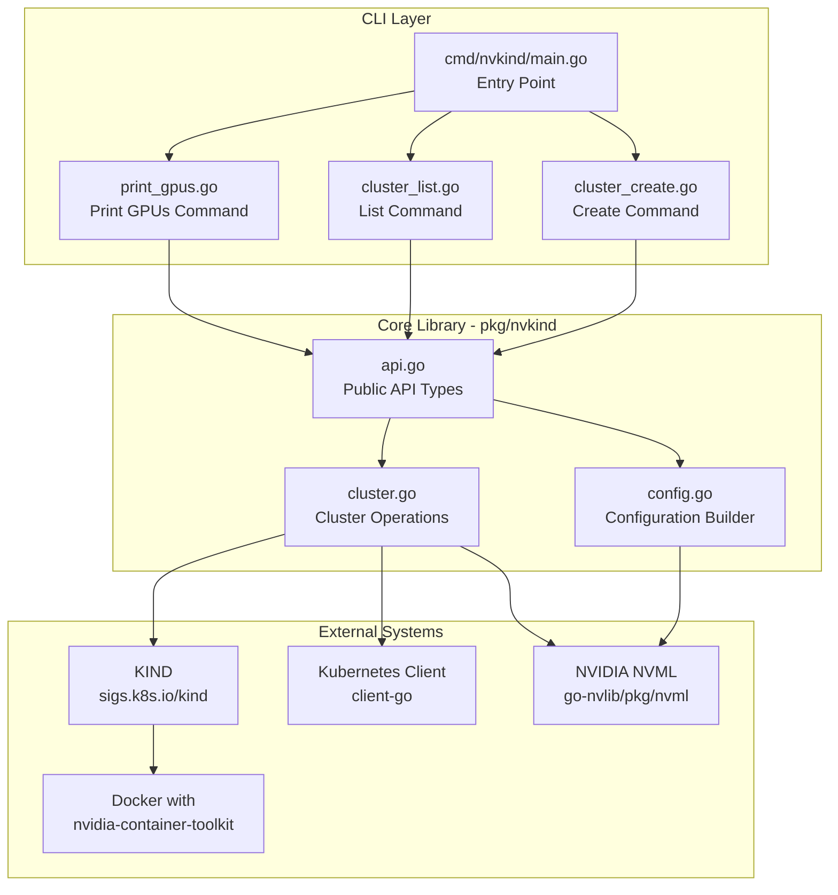
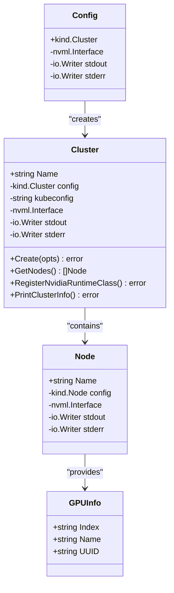
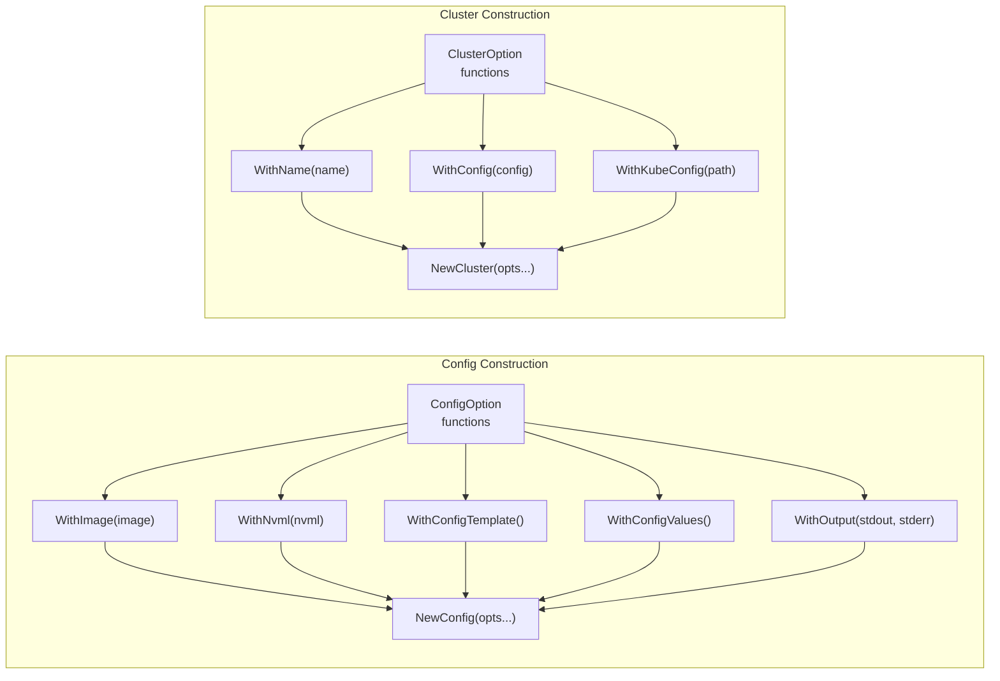
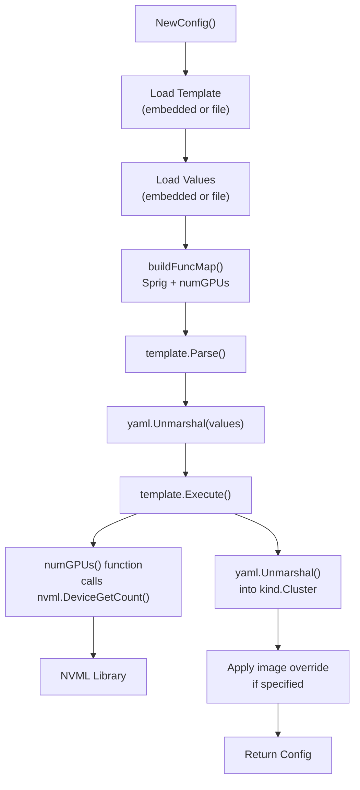
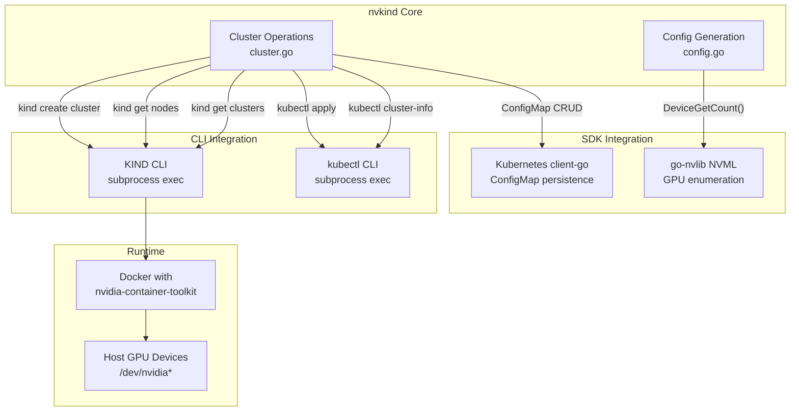
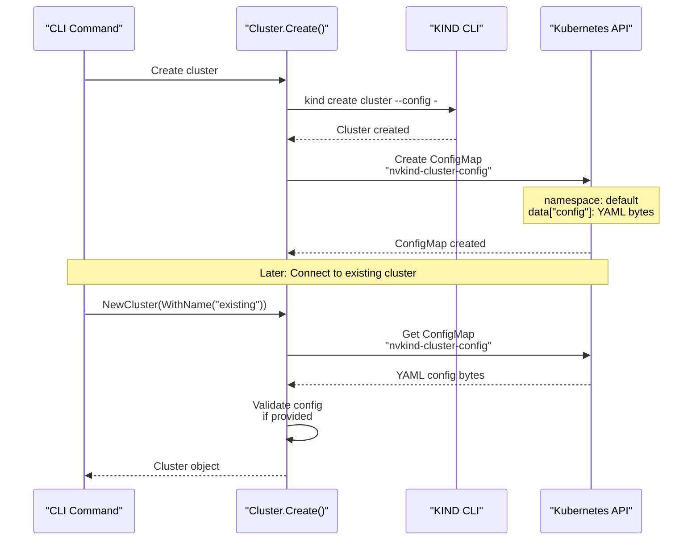

<!-- source: DeepWiki mcp.deepwiki.com · repo NVIDIA/nvkind · page 5 Architecture · fetched 2026-10-26 -->

# Architecture

Relevant source files

The following files were used as context for generating this wiki page:

- [pkg/nvkind/api.go](pkg/nvkind/api.go)
- [pkg/nvkind/cluster.go](pkg/nvkind/cluster.go)
- [pkg/nvkind/config.go](pkg/nvkind/config.go)

This document provides a technical overview of nvkind's internal architecture, including its layered design, core abstractions, and integration mechanisms. It explains how the system is structured to enable GPU-enabled KIND cluster creation through clean separation of concerns and well-defined interfaces.

For detailed information about specific architectural components, see:
- System component interactions and data flows: [System Overview](#5.1)
- Core library API and implementation details: [Core Library (pkg/nvkind)](#5.2)
- CLI command structure and flag processing: [CLI Tool (cmd/nvkind)](#5.3)
- NVIDIA GPU integration mechanisms: [GPU Integration Mechanism](#5.4)

## Architectural Overview

nvkind follows a **layered architecture** with clear separation between the user-facing CLI and the reusable core library. This design enables the core library to be consumed programmatically by other Go applications while providing a convenient command-line interface for direct user interaction.

**Sources:** [pkg/nvkind/api.go:1-177](), [pkg/nvkind/cluster.go:1-378](), [pkg/nvkind/config.go:1-157]()

## Core Abstractions

The architecture is built around four primary abstractions defined in [pkg/nvkind/api.go:35-63]():

| Type | Purpose | Key Responsibilities |
|------|---------|---------------------|
| `Config` | Configuration builder | Template processing, GPU detection, KIND cluster configuration generation |
| `Cluster` | Cluster lifecycle manager | Cluster creation, node discovery, RuntimeClass registration, configuration persistence |
| `Node` | Node representation | Individual node operations and GPU information retrieval |
| `GPUInfo` | GPU metadata | Stores GPU index, name, and UUID for display and debugging |

**Sources:** [pkg/nvkind/api.go:35-63](), [pkg/nvkind/cluster.go:68-95]()

## Functional Options Pattern

nvkind uses the **functional options pattern** extensively to provide flexible, extensible configuration without breaking API compatibility. This pattern is implemented through option types and constructor functions.

**Example option type definitions:**

| Option Type | Definition Location | Purpose |
|-------------|-------------------|---------|
| `ConfigOption` | [pkg/nvkind/api.go:78]() | Customize configuration generation behavior |
| `ClusterOption` | [pkg/nvkind/api.go:139]() | Customize cluster construction parameters |
| `ClusterCreateOption` | [pkg/nvkind/api.go:164]() | Customize cluster creation behavior (retain, wait) |

**Sources:** [pkg/nvkind/api.go:65-176](), [pkg/nvkind/config.go:32-109](), [pkg/nvkind/cluster.go:68-95]()

## Template Processing Architecture

The configuration system uses Go's `text/template` engine with custom functions to generate KIND cluster configurations dynamically based on GPU availability.

**Function map composition** ([pkg/nvkind/config.go:111-122]()):
1. Custom `numGPUs` function queries NVML for GPU count
2. User-provided `extraFuncMap` for extensibility
3. Sprig template functions for general-purpose operations

**Sources:** [pkg/nvkind/config.go:32-156](), [pkg/nvkind/api.go:29-33]()

## Integration Architecture

nvkind integrates with external systems through well-defined boundaries, using subprocess execution for CLI tools and Go SDKs for programmatic APIs.

**Integration methods:**

| System | Integration Method | Key Functions |
|--------|-------------------|---------------|
| KIND | Subprocess execution | [cluster.go:54-66]() `GetClusterNames()`, [cluster.go:97-134]() `Create()` |
| kubectl | Subprocess execution | [cluster.go:161-173]() `RegisterNvidiaRuntimeClass()` |
| Kubernetes API | client-go SDK | [cluster.go:294-326]() `addConfigBytesToExistingCluster()` |
| NVIDIA NVML | go-nvlib SDK | [config.go:124-136]() `numGPUs()` |

**Sources:** [pkg/nvkind/cluster.go:54-377](), [pkg/nvkind/config.go:124-136]()

## Configuration Persistence

nvkind persists cluster configuration in a Kubernetes ConfigMap to enable retrieval and validation when connecting to existing clusters.

**ConfigMap structure:**
- Name: `nvkind-cluster-config` (constant defined at [cluster.go:43]())
- Namespace: `default`
- Data key: `config` containing marshaled `kind.Cluster` YAML

**Sources:** [pkg/nvkind/cluster.go:42-44](), [cluster.go:294-348]()

## Dependency Injection

The architecture uses **dependency injection** for testability and flexibility, particularly for the NVML interface and I/O streams.

**Injectable dependencies:**

| Dependency | Interface/Type | Purpose | Default Value |
|------------|---------------|---------|---------------|
| NVML | `nvml.Interface` | GPU detection and enumeration | `nvml.New()` [config.go:40-42]() |
| stdout | `io.Writer` | Standard output stream | `os.Stdout` [config.go:43-45]() |
| stderr | `io.Writer` | Standard error stream | `os.Stderr` [config.go:46-48]() |

This enables:
- **Unit testing** with mock NVML implementations
- **Output capture** for testing and automation
- **Runtime flexibility** without modifying core logic

**Sources:** [pkg/nvkind/api.go:92-96](), [pkg/nvkind/config.go:40-48]()

## Error Handling Strategy

nvkind follows Go's idiomatic error handling with structured error wrapping using `fmt.Errorf` with `%w` verb for error chain preservation.

**Common error patterns:**
- Template processing errors: [config.go:70-89]()
- Subprocess execution errors: [cluster.go:120-127]()
- Kubernetes API errors: [cluster.go:317-323]()
- NVML operation errors: [config.go:125-133]()

All errors are wrapped with contextual information to provide clear error messages and enable error inspection via `errors.Is()` and `errors.As()`.

**Sources:** [pkg/nvkind/cluster.go:1-378](), [pkg/nvkind/config.go:1-157]()

---

