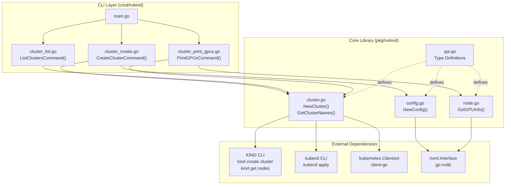
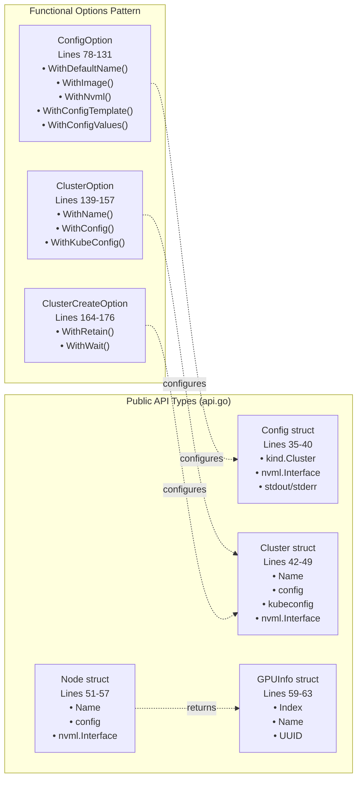
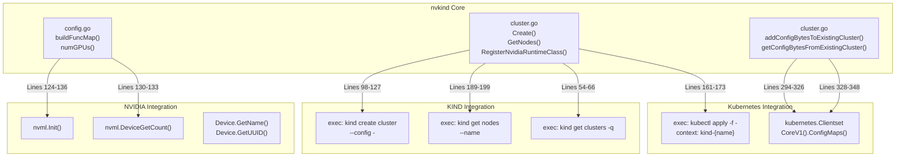
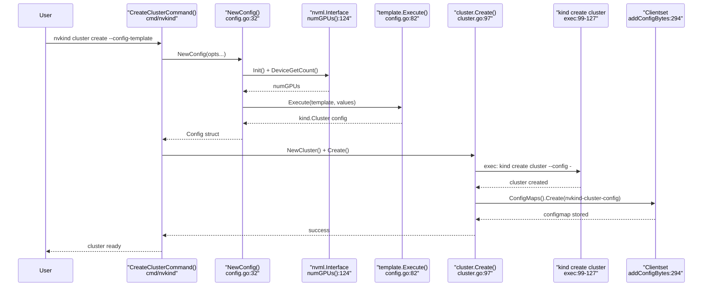
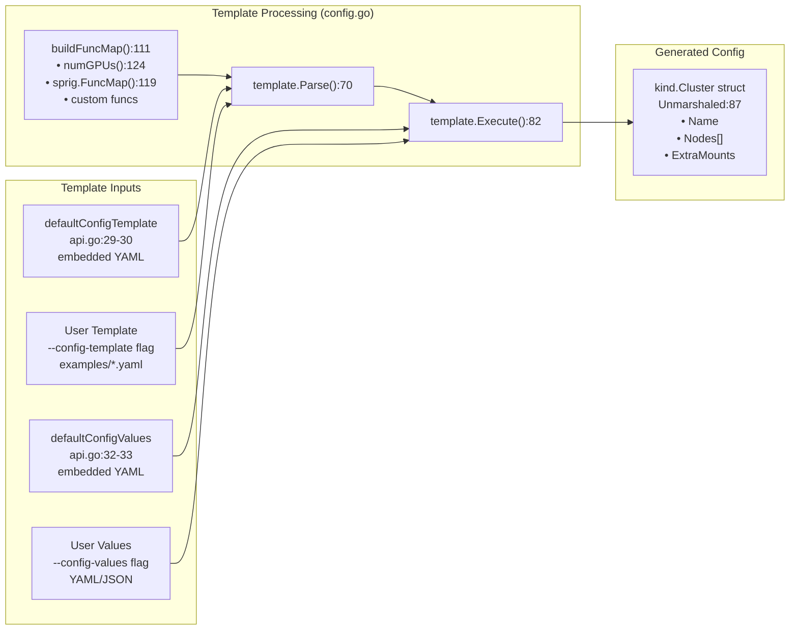
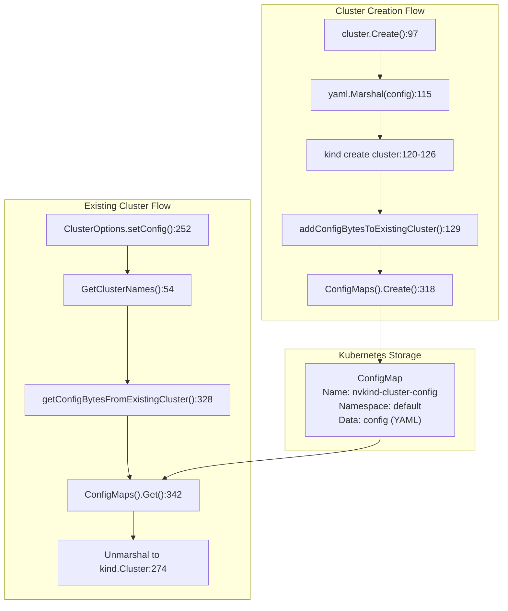

<!-- source: DeepWiki mcp.deepwiki.com · repo NVIDIA/nvkind · page 5.1 System Overview · fetched 2026-10-26 -->

# System Overview

Relevant source files

The following files were used as context for generating this wiki page:

- [README.md](README.md)
- [pkg/nvkind/api.go](pkg/nvkind/api.go)
- [pkg/nvkind/cluster.go](pkg/nvkind/cluster.go)
- [pkg/nvkind/config.go](pkg/nvkind/config.go)

## Purpose and Scope

This document provides a high-level architectural overview of the nvkind system, describing how the major components fit together and interact with external dependencies. It covers the core abstractions, integration points, and data flow patterns that enable nvkind to create KIND clusters with NVIDIA GPU support.

For detailed documentation of the core library internals, see [Core Library (pkg/nvkind)](#5.2). For CLI-specific architecture, see [CLI Tool (cmd/nvkind)](#5.3). For GPU injection mechanisms, see [GPU Integration Mechanism](#5.4).

## Component Architecture

nvkind is structured as a two-layer system: a reusable core library (`pkg/nvkind`) and a command-line interface (`cmd/nvkind`) that consumes it. The library orchestrates interactions with KIND, Kubernetes, and NVIDIA libraries to enable GPU support in KIND clusters.

**Sources:** [pkg/nvkind/api.go:35-63](), [pkg/nvkind/cluster.go:54-66](), [pkg/nvkind/config.go:32-109](), [README.md:1-14]()

## Core Abstractions

The library defines three primary abstractions exposed through [pkg/nvkind/api.go]():

**Sources:** [pkg/nvkind/api.go:35-177]()

| Abstraction | Purpose | Key Methods |
|-------------|---------|-------------|
| `Config` | Builds `kind.Cluster` configurations using Go templates and GPU detection | `NewConfig()` in [config.go:32]() |
| `Cluster` | Manages cluster lifecycle and Kubernetes resource operations | `NewCluster()`, `Create()`, `GetNodes()` in [cluster.go:68-250]() |
| `Node` | Represents individual cluster nodes with GPU information | `GetGPUInfo()` in [node.go]() |
| `GPUInfo` | Contains GPU metadata (Index, Name, UUID) | Returned by node GPU queries |

**Sources:** [pkg/nvkind/api.go:35-63](), [pkg/nvkind/cluster.go:68-250]()

## External Integration Points

nvkind integrates with four external systems through well-defined boundaries:

**Sources:** [pkg/nvkind/config.go:124-136](), [pkg/nvkind/cluster.go:54-173](), [pkg/nvkind/cluster.go:294-348]()

### Integration Mechanisms

| System | Integration Method | Purpose | Implementation |
|--------|-------------------|---------|----------------|
| **NVIDIA NVML** | `nvml.Interface` dependency injection | GPU detection and metadata retrieval | [config.go:124-136](), [node.go]() |
| **KIND** | Subprocess execution via `exec.Command` | Cluster creation and node management | [cluster.go:98-127, 189-199]() |
| **kubectl** | Subprocess execution via `exec.Command` | RuntimeClass registration | [cluster.go:161-173]() |
| **Kubernetes API** | `client-go` SDK (`kubernetes.Clientset`) | ConfigMap persistence for cluster metadata | [cluster.go:294-348]() |

**Sources:** [pkg/nvkind/cluster.go:98-378](), [pkg/nvkind/config.go:111-136]()

## Cluster Creation Data Flow

The following diagram illustrates the complete data flow during cluster creation, mapping the process to specific code functions:

**Sources:** [pkg/nvkind/config.go:32-109](), [pkg/nvkind/cluster.go:97-134](), [pkg/nvkind/cluster.go:294-326]()

### Key Steps

1. **Configuration Building** ([config.go:32-109]()): `NewConfig()` loads template and values, queries GPU count via `numGPUs()`, executes Go template with Sprig functions, unmarshals result to `kind.Cluster`

2. **Cluster Provisioning** ([cluster.go:97-127]()): `Create()` marshals config to YAML, pipes to `kind create cluster` subprocess with `--config -` flag

3. **Config Persistence** ([cluster.go:294-326]()): `addConfigBytesToExistingCluster()` stores original config in `nvkind-cluster-config` ConfigMap for later retrieval

4. **RuntimeClass Registration** ([cluster.go:161-173]()): `RegisterNvidiaRuntimeClass()` applies nvidia RuntimeClass YAML via kubectl

**Sources:** [pkg/nvkind/config.go:32-136](), [pkg/nvkind/cluster.go:97-326]()

## Configuration Template System

The configuration system uses Go's `text/template` engine to generate `kind.Cluster` configurations with GPU-aware logic:

**Sources:** [pkg/nvkind/api.go:29-33](), [pkg/nvkind/config.go:32-109]()

### Template Function Map

The `buildFuncMap()` function at [config.go:111-122]() constructs a template function map by merging:

| Function Source | Purpose | Example |
|----------------|---------|---------|
| `numGPUs()` | Custom function querying NVML for GPU count | `{{ numGPUs }}` |
| `sprig.FuncMap()` | Masterminds/sprig utility functions | `{{ div (numGPUs) 2 }}` |
| `extraFuncMap` | User-provided functions via `WithFuncMap()` | Custom logic |

**Sources:** [pkg/nvkind/config.go:111-136](), [README.md:221-226]()

### GPU Device Injection

Templates leverage the `numGPUs` function and Sprig functions to dynamically configure GPU distribution via `extraMounts` in the KIND node configuration. The actual device injection occurs through volume mounts that trigger the nvidia-container-toolkit, as detailed in [GPU Integration Mechanism](#5.4).

**Sources:** [pkg/nvkind/config.go:111-136](), [README.md:77-105]()

## Configuration Persistence

nvkind persists cluster configurations in Kubernetes ConfigMaps to support operations on existing clusters:

**Sources:** [pkg/nvkind/cluster.go:97-134](), [pkg/nvkind/cluster.go:252-292](), [pkg/nvkind/cluster.go:294-348]()

The ConfigMap named `nvkind-cluster-config` (defined at [cluster.go:43]()) stores the original KIND configuration YAML. This enables:

- **Idempotency**: `NewCluster()` can retrieve configs from existing clusters without re-specifying
- **Print Operations**: `print-gpus` command reconstructs node GPU mappings from stored config
- **Config Validation**: Prevents modification of existing cluster configs (deep equality check at [cluster.go:277]())

**Sources:** [pkg/nvkind/cluster.go:42-44](), [pkg/nvkind/cluster.go:252-348]()

---

