<!-- source: DeepWiki mcp.deepwiki.com · repo NVIDIA/nvkind · page 5.2 Core Library (pkg/nvkind) · fetched 2026-10-26 -->

# Core Library (pkg/nvkind)

<details>
<summary>Relevant source files</summary>

The following files were used as context for generating this wiki page:

- [pkg/nvkind/api.go](pkg/nvkind/api.go)
- [pkg/nvkind/cluster.go](pkg/nvkind/cluster.go)
- [pkg/nvkind/config.go](pkg/nvkind/config.go)

</details>


## Purpose and Scope

The `pkg/nvkind` package is the core reusable library that implements nvkind's primary functionality. This library provides programmatic APIs for creating KIND clusters with NVIDIA GPU support, managing cluster configurations, and interacting with GPU hardware through NVML. The package is designed to be used both by the nvkind CLI tool and as an embeddable library in other Go applications.

For information about how the CLI tool uses this library, see [CLI Tool (cmd/nvkind)](#5.3). For details on GPU integration mechanisms at the container runtime level, see [GPU Integration Mechanism](#5.4).

## Module Structure and Core Types

The library is organized into three main files that define distinct responsibilities:

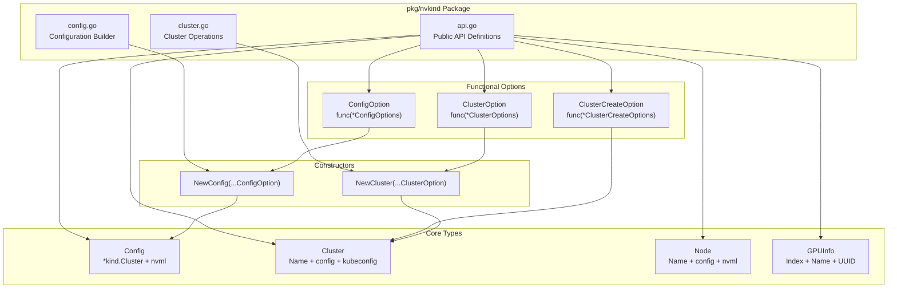

**Sources:** [pkg/nvkind/api.go:35-177](), [pkg/nvkind/config.go:32-109](), [pkg/nvkind/cluster.go:68-95]()

### Public API Types

The library exposes four primary types for external consumption:

| Type | Definition | Purpose |
|------|------------|---------|
| `Config` | `*kind.Cluster` + NVML interface + I/O writers | Configuration object for KIND cluster with GPU support |
| `Cluster` | Name + config + kubeconfig + NVML + I/O | Abstraction for a running KIND cluster with operations |
| `Node` | Name + config + NVML + I/O | Individual node within a cluster |
| `GPUInfo` | Index + Name + UUID | GPU metadata for display and querying |

**Sources:** [pkg/nvkind/api.go:35-63]()

## Configuration System

### NewConfig Constructor and Template Processing

The `NewConfig` function builds a `Config` object by processing Go templates with NVML-queried GPU data:

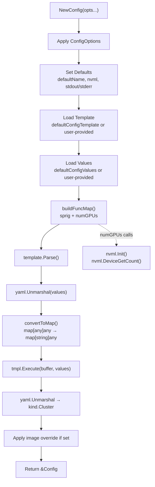

**Sources:** [pkg/nvkind/config.go:32-109](), [pkg/nvkind/config.go:111-136]()

### Template Function Map

The configuration system extends Go's `text/template` with three categories of functions:

| Category | Functions | Source |
|----------|-----------|--------|
| NVML Integration | `numGPUs()` | Custom implementation querying `nvml.DeviceGetCount()` |
| Sprig Library | `default`, `toJson`, `indent`, etc. | Masterminds/sprig/v3 |
| User Extensions | Via `WithFuncMap()` option | Caller-provided |

The function map is built in priority order: custom functions, user extensions, then Sprig functions.

**Sources:** [pkg/nvkind/config.go:111-122](), [pkg/nvkind/config.go:124-136]()

### Embedded Defaults

The library embeds default templates and values at compile time:

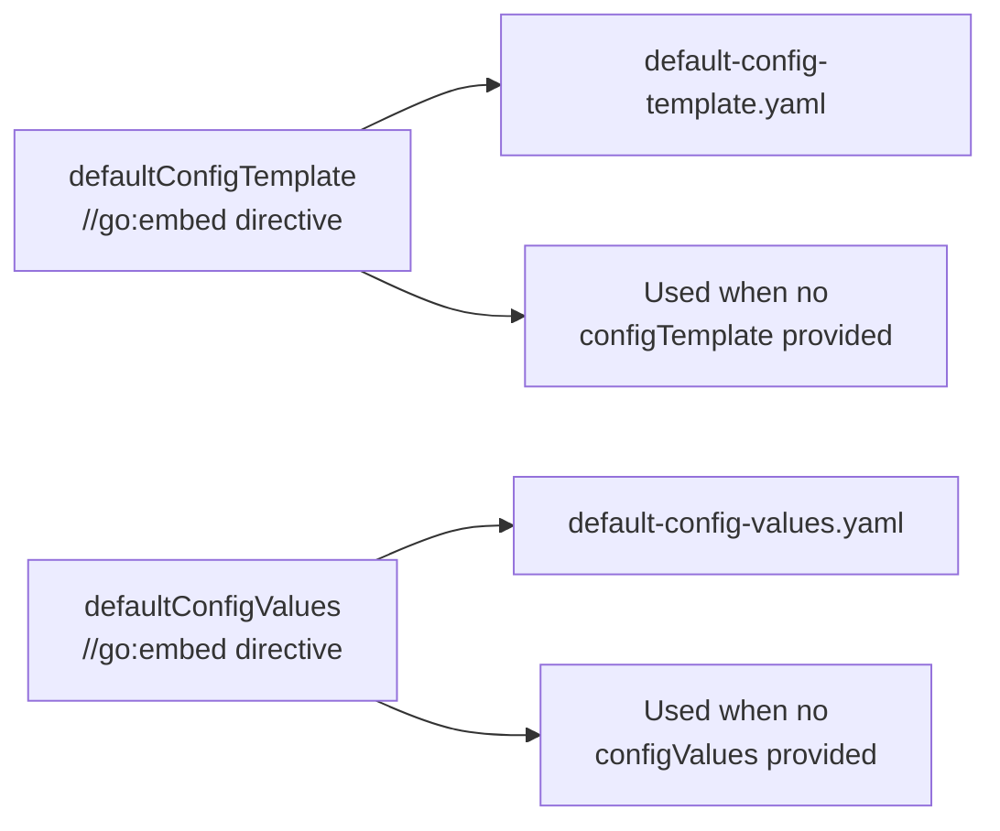

**Sources:** [pkg/nvkind/api.go:29-33]()

## Cluster Operations

### NewCluster Constructor

The `NewCluster` function creates a `Cluster` object with intelligent defaults and configuration handling:

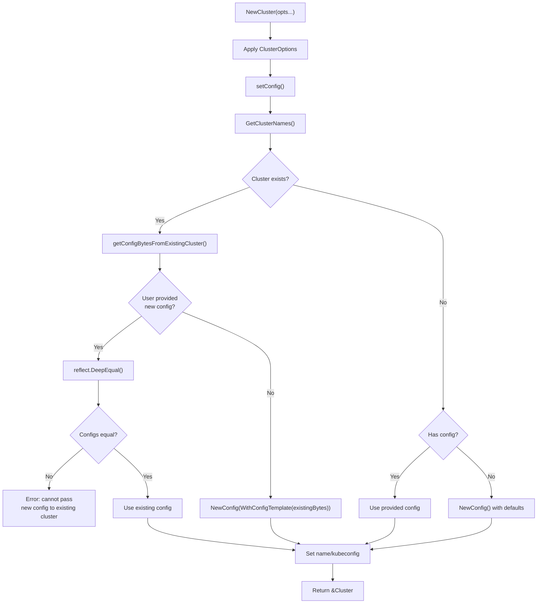

**Sources:** [pkg/nvkind/cluster.go:68-95](), [pkg/nvkind/cluster.go:252-292]()

### Cluster.Create Method

The `Create` method orchestrates cluster creation via KIND CLI:

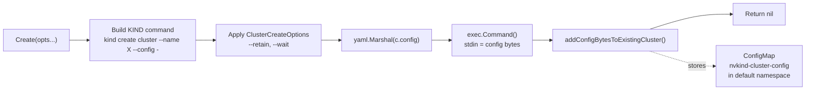

**Sources:** [pkg/nvkind/cluster.go:97-134](), [pkg/nvkind/cluster.go:294-326]()

### ConfigMap Persistence

The library persists cluster configuration in Kubernetes for later retrieval:

| Operation | Function | Purpose |
|-----------|----------|---------|
| Store | `addConfigBytesToExistingCluster()` | Saves config YAML to ConfigMap after cluster creation |
| Retrieve | `getConfigBytesFromExistingCluster()` | Loads config YAML from ConfigMap for existing clusters |
| ConfigMap Name | `nvkindClusterConfigName` | Constant: `"nvkind-cluster-config"` |
| Namespace | `"default"` | Fixed namespace for config storage |

**Sources:** [pkg/nvkind/cluster.go:42-44](), [pkg/nvkind/cluster.go:294-348]()

### Cluster.GetNodes Method

The `GetNodes` method maps KIND node names to configuration objects:

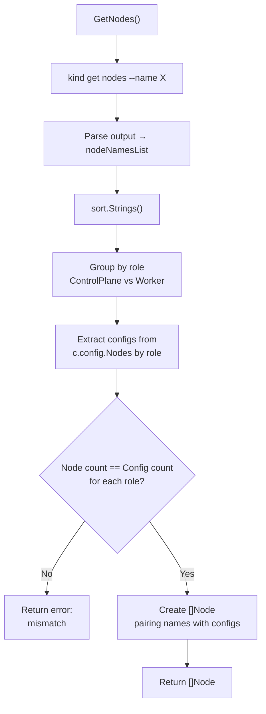

**Sources:** [pkg/nvkind/cluster.go:189-250]()

### Runtime Class Registration

The library registers NVIDIA runtime class for GPU pod scheduling:

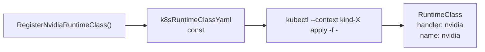

The runtime class YAML is defined as:

```yaml
apiVersion: node.k8s.io/v1
handler: nvidia
kind: RuntimeClass
metadata:
  name: nvidia
```

**Sources:** [pkg/nvkind/cluster.go:46-52](), [pkg/nvkind/cluster.go:161-173]()

## Functional Options Pattern

The library uses functional options extensively for flexible, testable APIs:

### ConfigOption Pattern

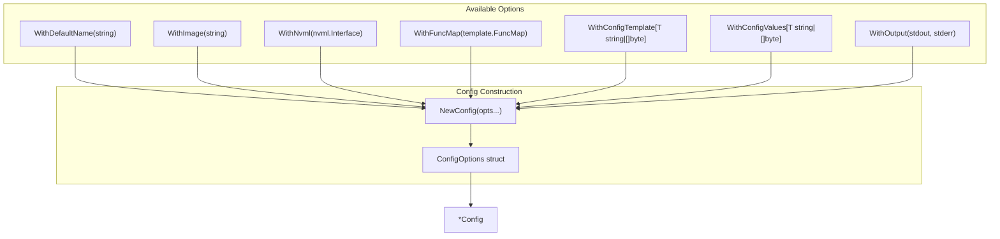

**Sources:** [pkg/nvkind/api.go:65-131]()

### ClusterOption Pattern

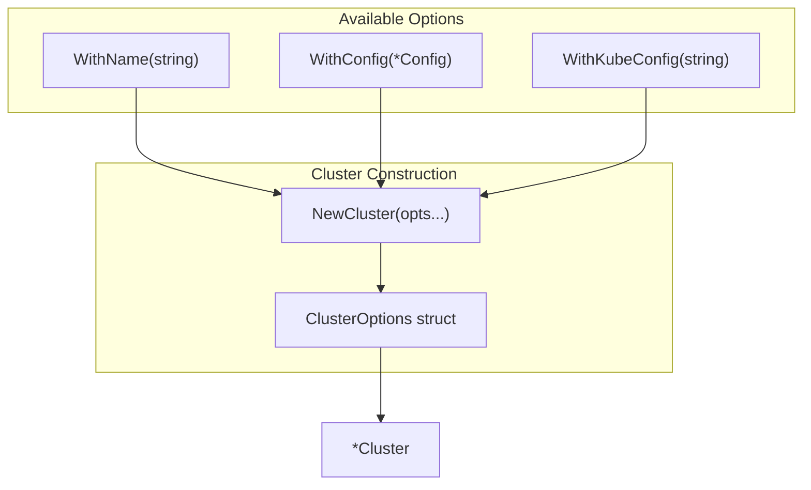

**Sources:** [pkg/nvkind/api.go:133-157]()

### ClusterCreateOption Pattern

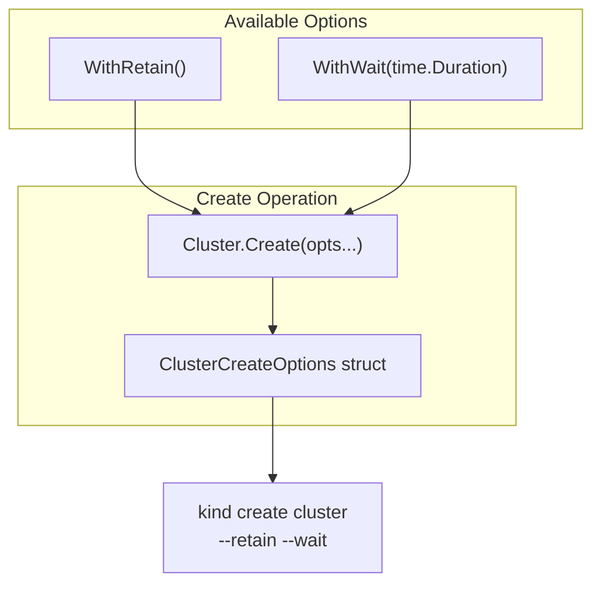

**Sources:** [pkg/nvkind/api.go:159-176]()

## External System Integration

### Integration Architecture

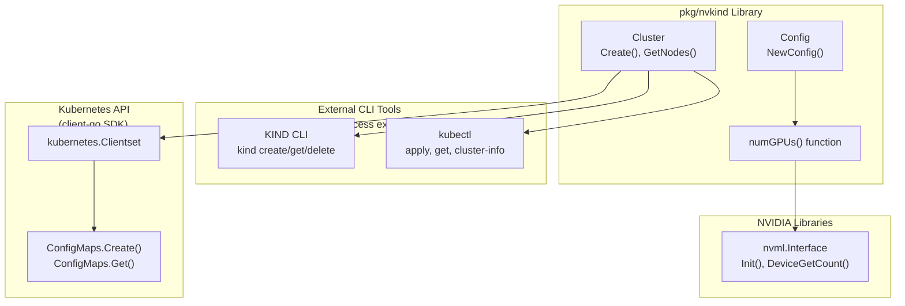

**Sources:** [pkg/nvkind/config.go:124-136](), [pkg/nvkind/cluster.go:97-134](), [pkg/nvkind/cluster.go:161-173](), [pkg/nvkind/cluster.go:294-348]()

### KIND Integration via Subprocess

The library interacts with KIND exclusively through subprocess execution:

| Operation | Function | Command Pattern |
|-----------|----------|-----------------|
| Get cluster names | `GetClusterNames()` | `kind get clusters -q` |
| Create cluster | `Cluster.Create()` | `kind create cluster --name X --config -` |
| Get nodes | `Cluster.GetNodes()` | `kind get nodes --name X` |
| Delete cluster | `Cluster.Delete()` | `kind delete cluster --name X` |

The `runChildProcess()` helper manages subprocess I/O and error handling.

**Sources:** [pkg/nvkind/cluster.go:54-66](), [pkg/nvkind/cluster.go:97-134](), [pkg/nvkind/cluster.go:189-250](), [pkg/nvkind/cluster.go:176-187](), [pkg/nvkind/cluster.go:350-377]()

### Kubernetes API Integration

Direct Kubernetes API access is used for ConfigMap operations:

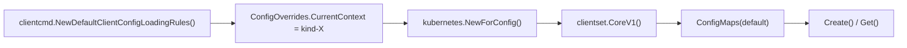

The library uses `retry.RetryOnConflict()` for resilient ConfigMap creation.

**Sources:** [pkg/nvkind/cluster.go:294-326](), [pkg/nvkind/cluster.go:328-348]()

### NVML Integration via Interface

GPU detection uses the `nvml.Interface` for testability:

```go
type Config struct {
    *kind.Cluster
    nvml   nvml.Interface  // Injected via WithNvml() or defaults to nvml.New()
    // ...
}
```

The `numGPUs()` template function demonstrates the integration:

1. `nvml.Init()` - Initialize NVML library
2. `nvml.DeviceGetCount()` - Query GPU count
3. `nvml.Shutdown()` - Cleanup (deferred)

**Sources:** [pkg/nvkind/api.go:35-40](), [pkg/nvkind/api.go:92-96](), [pkg/nvkind/config.go:40-42](), [pkg/nvkind/config.go:124-136]()

## Design Patterns and Principles

### Dependency Injection

All external dependencies are injectable for testing:

| Dependency | Interface/Type | Injection Method |
|------------|----------------|------------------|
| NVML | `nvml.Interface` | `WithNvml(nvml.Interface)` |
| Output streams | `io.Writer` | `WithOutput(stdout, stderr)` |
| Template functions | `template.FuncMap` | `WithFuncMap(funcMap)` |
| Configuration data | `string` or `[]byte` | `WithConfigTemplate()`, `WithConfigValues()` |

**Sources:** [pkg/nvkind/api.go:92-131]()

### Error Handling

The library consistently wraps errors with context using `fmt.Errorf`:

```go
if err := yaml.Unmarshal(buffer.Bytes(), &cluster); err != nil {
    return nil, fmt.Errorf("unmarshaling YAML: %w", err)
}
```

This pattern appears throughout for subprocess execution, file I/O, and API calls.

**Sources:** [pkg/nvkind/config.go:87-89](), [pkg/nvkind/cluster.go:116-118]()

### Immutability for Existing Clusters

When connecting to existing clusters, the library validates configuration immutability:

```go
if !reflect.DeepEqual(&existingConfig, o.config.Cluster) {
    return fmt.Errorf("cannot pass new config to existing cluster")
}
```

This prevents accidental modification of running cluster configurations.

**Sources:** [pkg/nvkind/cluster.go:277-280]()

### Context-Aware kubectl Commands

All `kubectl` invocations explicitly specify context to prevent race conditions:

```bash
kubectl --context kind-<cluster-name> <command>
```

This design supports concurrent nvkind operations without context conflicts.

**Sources:** [pkg/nvkind/cluster.go:136-157]()

---

