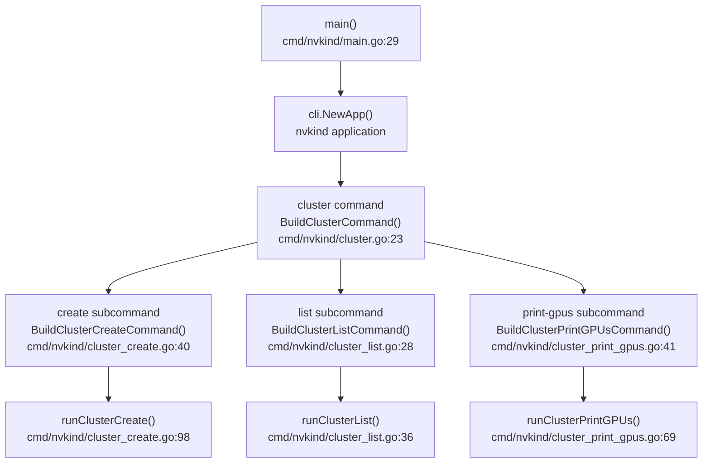
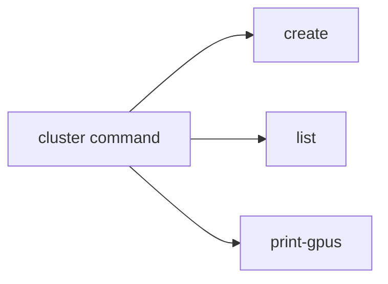
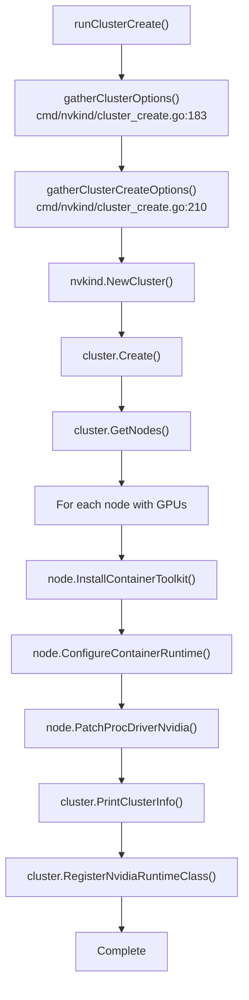
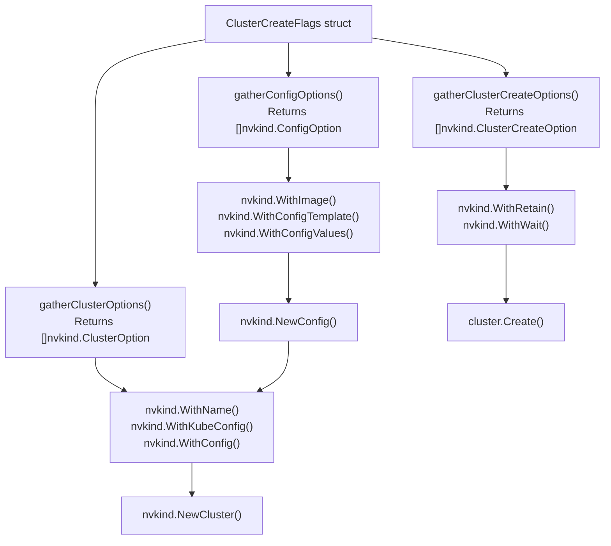
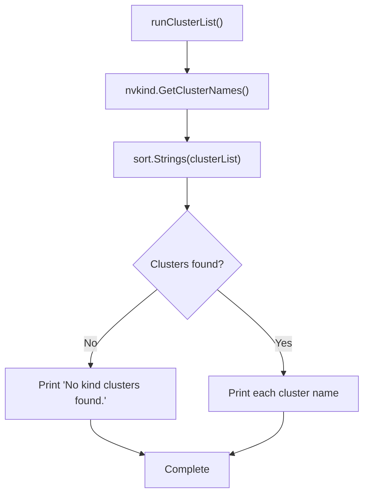

<!-- source: DeepWiki mcp.deepwiki.com · repo NVIDIA/nvkind · page 5.3 CLI Tool (cmd/nvkind) · fetched 2026-10-26 -->

# CLI Tool (cmd/nvkind)

<details>
<summary>Relevant source files</summary>

The following files were used as context for generating this wiki page:

- [cmd/nvkind/cluster.go](cmd/nvkind/cluster.go)
- [cmd/nvkind/cluster_create.go](cmd/nvkind/cluster_create.go)
- [cmd/nvkind/cluster_list.go](cmd/nvkind/cluster_list.go)
- [cmd/nvkind/cluster_print_gpus.go](cmd/nvkind/cluster_print_gpus.go)
- [cmd/nvkind/main.go](cmd/nvkind/main.go)

</details>


## Purpose and Scope

This document provides a technical deep dive into the CLI layer of nvkind, located in the `cmd/nvkind` directory. It covers the command structure, flag processing, and how the CLI delegates operations to the core library.

For information about the core library that the CLI uses, see [Core Library (pkg/nvkind)](#5.2). For high-level architecture context, see [System Overview](#5.1).

## Architecture Overview

The nvkind CLI is built using the [urfave/cli/v2](https://github.com/urfave/cli) framework. It acts as a thin wrapper around the core library (`pkg/nvkind`), providing a user-friendly command-line interface for cluster operations. The CLI follows a hierarchical command structure with a single top-level `cluster` command containing three subcommands.

### Command Structure



**Sources:** [cmd/nvkind/main.go:29-47](), [cmd/nvkind/cluster.go:23-33](), [cmd/nvkind/cluster_create.go:40-96](), [cmd/nvkind/cluster_list.go:28-34](), [cmd/nvkind/cluster_print_gpus.go:41-67]()

## Entry Point

The CLI application starts in `main()`, which creates and configures the root `cli.App` instance:

| Component | Value | Location |
|-----------|-------|----------|
| Application Name | `nvkind` | [cmd/nvkind/main.go:32]() |
| Usage Description | `kind for use with NVIDIA GPUs` | [cmd/nvkind/main.go:33]() |
| Version | `Version` variable (overridable at build time) | [cmd/nvkind/main.go:27]() |
| Bash Completion | Enabled | [cmd/nvkind/main.go:35]() |

The main function registers the `cluster` command as the only top-level command and delegates execution to the urfave/cli framework via `c.Run(os.Args)`.

**Sources:** [cmd/nvkind/main.go:29-47]()

## Command Hierarchy

### Cluster Command

The `cluster` command is defined by `BuildClusterCommand()` and serves as a grouping command for all cluster operations. It has no action of its own and exists solely to organize subcommands.



**Sources:** [cmd/nvkind/cluster.go:23-33]()

## Command Implementations

### Create Command

The `create` command is the most complex, responsible for creating GPU-enabled KIND clusters. It follows a multi-step process:



**Sources:** [cmd/nvkind/cluster_create.go:98-147]()

#### Flags and Options

The create command defines the `ClusterCreateFlags` struct to hold flag values:

| Flag | Type | Environment Variable | Purpose |
|------|------|---------------------|---------|
| `name` | string | `KIND_CLUSTER_NAME` | Cluster name (default: nvkind-<random>) |
| `image` | string | `KIND_CLUSTER_IMAGE` | Node Docker image |
| `retain` | bool | `KIND_CLUSTER_RETAIN` | Retain nodes on failure for debugging |
| `wait` | duration | `KIND_CLUSTER_RETAIN` | Wait for control plane readiness |
| `config-template` | string | `KIND_CLUSTER_CONFIG_TEMPLATE` | Path to custom KIND config template |
| `config-values` | string | `KIND_CLUSTER_CONFIG_VALUES` | Path to template values file (or `-` for stdin) |
| `kubeconfig` | string | `KUBECONFIG` | Path to kubeconfig file |

**Sources:** [cmd/nvkind/cluster_create.go:30-93]()

#### Option Gathering Pattern

The create command uses a three-tier option gathering pattern:



This pattern separates configuration-level options (template, values, image) from cluster-level options (name, kubeconfig) and create-time options (retain, wait). Configuration options are first used to create a `Config` object, which is then passed as a cluster option.

**Sources:** [cmd/nvkind/cluster_create.go:149-222]()

##### Configuration Values Handling

The `config-values` flag supports reading from a file or stdin (when set to `-`):

- **File mode**: Values are read using `os.ReadFile()` [cmd/nvkind/cluster_create.go:171-174]()
- **Stdin mode**: Values are read line-by-line using `bufio.Scanner` [cmd/nvkind/cluster_create.go:165-169]()

This allows both `--config-values values.yaml` and `cat values.yaml | nvkind cluster create --config-values -` workflows.

**Sources:** [cmd/nvkind/cluster_create.go:160-178]()

### List Command

The `list` command is a simple read-only operation that displays all KIND clusters:



The command has no flags and simply delegates to `nvkind.GetClusterNames()`, sorts the results alphabetically, and prints them to stdout.

**Sources:** [cmd/nvkind/cluster_list.go:28-54]()

### Print-GPUs Command

The `print-gpus` command outputs JSON-formatted GPU information for a specified cluster:

```mermaid
flowchart TD
    Start["runClusterPrintGPUs()"]
    UpdateDefaults["updateFlagsWithDefaults()"]
    GetNames["nvkind.GetClusterNames()"]
    Validate{Cluster exists?}
    Error["Return error:<br/>'unknown cluster'"]
    
    NewCluster["nvkind.NewCluster()"]
    GetNodes["cluster.GetNodes()"]
    
    Loop["For each node"]
    CheckGPU{node.HasGPUs()?}
    GetGPUInfo["node.GetGPUInfo()"]
    Append["Append to nodeGPUsList"]
    
    Marshal["json.MarshalIndent()"]
    Print["Print JSON to stdout"]
    Done["Complete"]
    
    Start --> UpdateDefaults
    UpdateDefaults --> GetNames
    GetNames --> Validate
    Validate -->|No| Error
    Validate -->|Yes| NewCluster
    NewCluster --> GetNodes
    GetNodes --> Loop
    Loop --> CheckGPU
    CheckGPU -->|No| Loop
    CheckGPU -->|Yes| GetGPUInfo
    GetGPUInfo --> Append
    Append --> Loop
    Loop --> Marshal
    Marshal --> Print
    Print --> Done
```

**Sources:** [cmd/nvkind/cluster_print_gpus.go:69-116]()

#### Flags and Default Resolution

| Flag | Environment Variable | Default Behavior |
|------|---------------------|------------------|
| `name` | `KIND_CLUSTER_NAME` | Derived from current kubeconfig context if not specified |
| `kubeconfig` | `KUBECONFIG` | `~/.kube/config` if home directory available |

The `updateFlagsWithDefaults()` method implements intelligent default resolution:

1. If `kubeconfig` is empty, defaults to `~/.kube/config`
2. If `name` is empty:
   - Loads the kubeconfig file
   - Extracts the current context
   - Verifies it's a KIND cluster (prefix: `kind-`)
   - Strips the `kind-` prefix to get the cluster name

**Sources:** [cmd/nvkind/cluster_print_gpus.go:118-145]()

#### Output Format

The command outputs a JSON array of `NodeGPUs` structures:

| Field | Type | Description |
|-------|------|-------------|
| `node` | string | Node name |
| `gpus` | []nvkind.GPUInfo | Array of GPU information objects |

**Sources:** [cmd/nvkind/cluster_print_gpus.go:31-34]()

## Integration with Core Library

The CLI layer maintains a strict separation from business logic by delegating all operations to the `pkg/nvkind` library:

| CLI Function | Core Library Call | Purpose |
|--------------|------------------|---------|
| `runClusterCreate()` | `nvkind.NewCluster()`, `cluster.Create()` | Cluster creation orchestration |
| `runClusterList()` | `nvkind.GetClusterNames()` | List all KIND clusters |
| `runClusterPrintGPUs()` | `nvkind.NewCluster()`, `cluster.GetNodes()`, `node.GetGPUInfo()` | Query GPU information |

This design allows the core library to be used independently (e.g., in Go programs) while the CLI provides a convenient command-line interface.

**Sources:** [cmd/nvkind/cluster_create.go:98-147](), [cmd/nvkind/cluster_list.go:36-54](), [cmd/nvkind/cluster_print_gpus.go:69-116]()

## Error Handling

All commands use Go's standard error wrapping with `fmt.Errorf()` to provide context:

```
gathering cluster options: %w
creating cluster: %w
getting cluster names: %w
```

Errors are propagated up to the urfave/cli framework, which prints them and exits with a non-zero status code via `klog.Fatalf()` in `main()`.

**Sources:** [cmd/nvkind/main.go:43-46](), [cmd/nvkind/cluster_create.go:98-147](), [cmd/nvkind/cluster_list.go:36-54](), [cmd/nvkind/cluster_print_gpus.go:69-116]()

## Design Patterns

### Functional Options Pattern

The CLI extensively uses the functional options pattern when calling core library functions:

```go
// Configuration options
nvkind.WithImage(f.Image)
nvkind.WithConfigTemplate(f.ConfigTemplate)
nvkind.WithConfigValues(configValues)

// Cluster options
nvkind.WithName(f.Name)
nvkind.WithKubeConfig(f.KubeConfig)
nvkind.WithConfig(config)

// Create options
nvkind.WithRetain()
nvkind.WithWait(f.Wait)
```

This pattern provides flexibility and clarity when translating CLI flags to library options.

**Sources:** [cmd/nvkind/cluster_create.go:149-222]()

### Builder Functions

Each command is constructed using a `Build*Command()` function that returns a `*cli.Command`:

- `BuildClusterCommand()` [cmd/nvkind/cluster.go:23]()
- `BuildClusterCreateCommand()` [cmd/nvkind/cluster_create.go:40]()
- `BuildClusterListCommand()` [cmd/nvkind/cluster_list.go:28]()
- `BuildClusterPrintGPUsCommand()` [cmd/nvkind/cluster_print_gpus.go:41]()

This pattern isolates command construction logic and makes the command hierarchy easier to maintain.

**Sources:** [cmd/nvkind/cluster.go:23-33](), [cmd/nvkind/cluster_create.go:40-96](), [cmd/nvkind/cluster_list.go:28-34](), [cmd/nvkind/cluster_print_gpus.go:41-67]()

---

