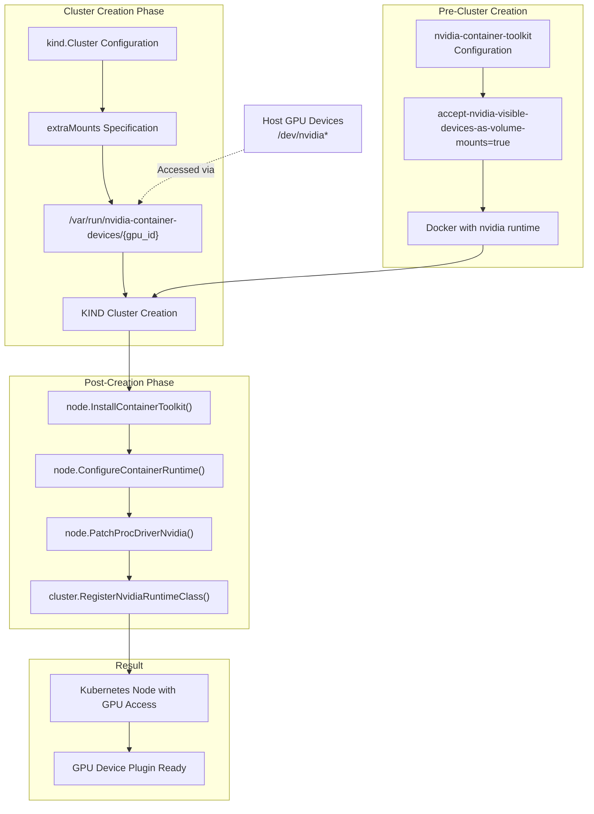
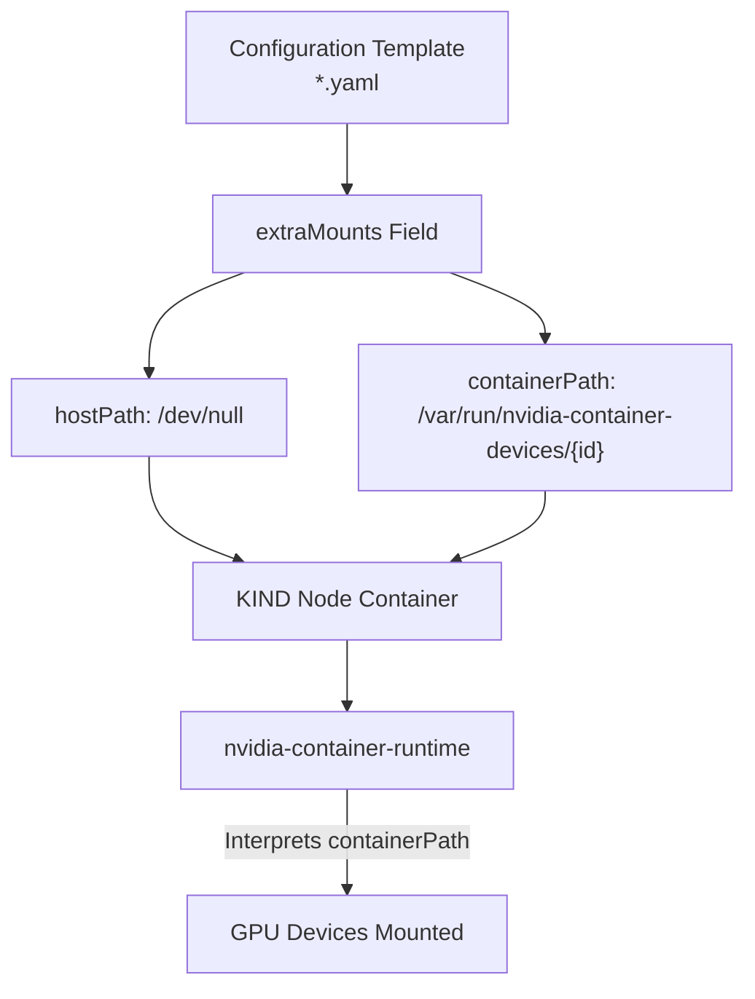
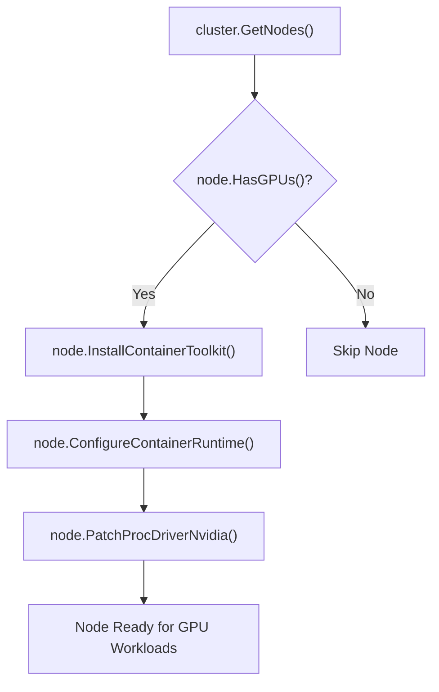
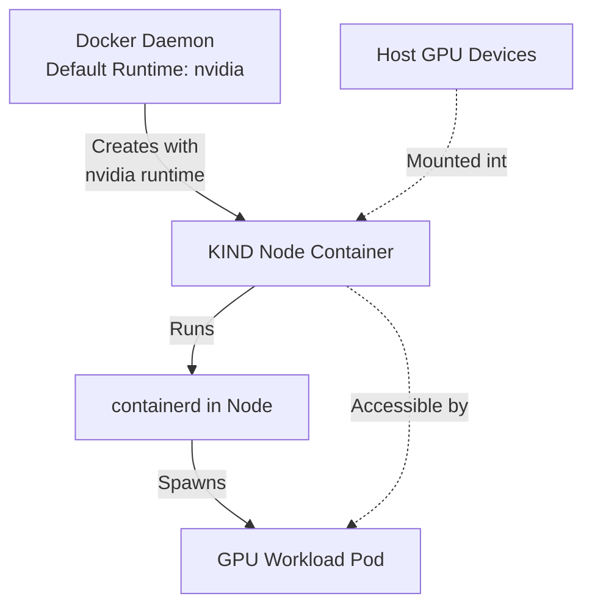
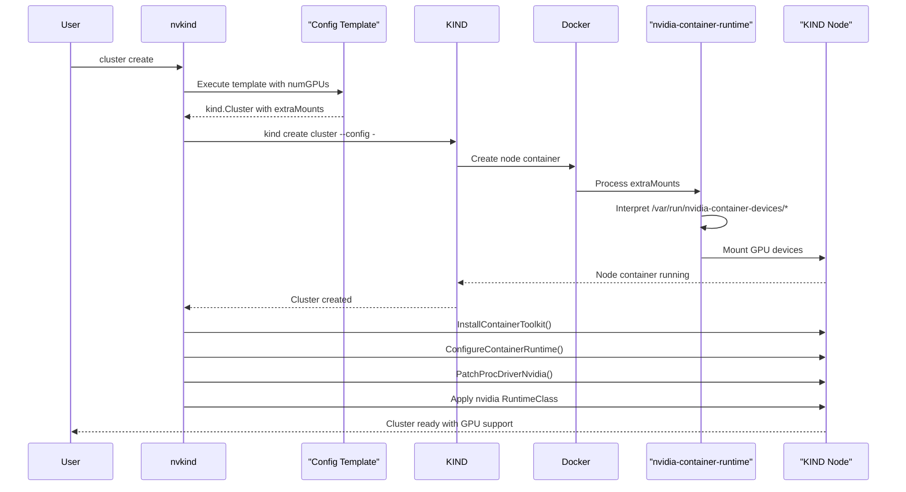

<!-- source: DeepWiki mcp.deepwiki.com · repo NVIDIA/nvkind · page 5.4 GPU Integration Mechanism · fetched 2026-10-26 -->

# GPU Integration Mechanism

<details>
<summary>Relevant source files</summary>

The following files were used as context for generating this wiki page:

- [README.md](README.md)
- [cmd/nvkind/cluster_create.go](cmd/nvkind/cluster_create.go)
- [examples/one-worker-per-gpu.yaml](examples/one-worker-per-gpu.yaml)
- [pkg/nvkind/cluster.go](pkg/nvkind/cluster.go)

</details>


## Purpose and Scope

This document explains how nvkind injects NVIDIA GPU support into KIND (Kubernetes in Docker) clusters. It covers the technical mechanisms used to expose host GPUs to containerized Kubernetes nodes, the required nvidia-container-toolkit configuration, and the post-creation setup steps that make GPUs accessible to Kubernetes workloads.

For information about the configuration template system that determines GPU allocation patterns, see [Configuration Template System](#4.1). For details on the core library architecture, see [Core Library (pkg/nvkind)](#5.2).

## Overview of GPU Injection Architecture

nvkind employs a multi-stage approach to enable GPU support in KIND clusters, leveraging a feature of nvidia-container-toolkit that allows volume mount paths to control GPU visibility.



**Sources:** [README.md:1-106](), [cmd/nvkind/cluster_create.go:97-147]()

## nvidia-container-toolkit Volume Mount Feature

### Feature Flag Configuration

The core mechanism relies on a feature flag in nvidia-container-toolkit that interprets specific volume mount paths as GPU visibility directives.

**Configuration Command:**
```bash
nvidia-ctk config --set accept-nvidia-visible-devices-as-volume-mounts=true --in-place
```

When this flag is enabled, mounting a volume with `containerPath` of `/var/run/nvidia-container-devices/<gpu_id>` makes the specified GPU(s) visible to the container, regardless of the `hostPath` value.

| Volume Mount Pattern | Effect |
|---------------------|--------|
| `/var/run/nvidia-container-devices/all` | All GPUs visible |
| `/var/run/nvidia-container-devices/0` | GPU 0 visible |
| `/var/run/nvidia-devices/1,2` | GPUs 1 and 2 visible |
| `/var/run/nvidia-container-devices/GPU-<uuid>` | Specific GPU by UUID visible |

**Sources:** [README.md:74-105](), [examples/one-worker-per-gpu.yaml:22-26]()

### How extraMounts Triggers GPU Injection

The KIND configuration's `extraMounts` field is used to specify volume mounts that will be applied to the node container. nvkind templates use this to inject GPU visibility:



**Example from template:**
```yaml
extraMounts:
  - hostPath: /dev/null
    containerPath: /var/run/nvidia-container-devices/0
```

The `hostPath` is arbitrary (commonly `/dev/null`) because nvidia-container-runtime ignores it when the feature flag is enabled. Only the `containerPath` matters for GPU selection.

**Sources:** [examples/one-worker-per-gpu.yaml:15-27]()

## Cluster Creation Flow with GPU Injection

### Configuration-to-Cluster Pipeline

```mermaid
flowchart LR
    subgraph "nvkind.NewConfig()"
        ConfigOpts["ConfigOption"]
        Template["Load Template"]
        NumGPUs["numGPUs Function"]
        Execute["Template Execution"]
        KindCluster["kind.Cluster Object"]
    end
    
    subgraph "nvkind.NewCluster()"
        ClusterOpts["ClusterOption"]
        ClusterObj["Cluster Object"]
    end
    
    subgraph "cluster.Create()"
        MarshalYAML["yaml.Marshal(config)"]
        KindCLI["kind create cluster --config -"]
        PersistConfig["addConfigBytesToExistingCluster()"]
    end
    
    ConfigOpts --> Template
    Template --> NumGPUs
    NumGPUs --> Execute
    Execute --> KindCluster
    
    KindCluster --> ClusterOpts
    ClusterOpts --> ClusterObj
    
    ClusterObj --> MarshalYAML
    MarshalYAML --> KindCLI
    KindCLI --> PersistConfig
```



The `cluster.Create()` method at [pkg/nvkind/cluster.go:97-134]() executes the KIND CLI with the templated configuration piped to stdin:

```bash
kind create cluster --name <name> --config -
```

The YAML configuration (including `extraMounts` specifications) is marshaled and provided via stdin, ensuring GPU mount directives are passed to KIND.

**Sources:** [pkg/nvkind/cluster.go:97-134]()

## Post-Creation Node Configuration

After cluster creation, nvkind performs three critical configuration steps on each GPU-enabled node. This happens in [cmd/nvkind/cluster_create.go:118-136]():



### Configuration Steps

| Step | Method | Purpose |
|------|--------|---------|
| 1 | `node.InstallContainerToolkit()` | Installs nvidia-container-toolkit inside the KIND node container |
| 2 | `node.ConfigureContainerRuntime()` | Configures containerd to use nvidia runtime for GPU containers |
| 3 | `node.PatchProcDriverNvidia()` | Ensures `/proc/driver/nvidia` is accessible inside the node |

These steps are only executed for nodes where `node.HasGPUs()` returns true, which is determined by checking if the node's `extraMounts` configuration includes any `/var/run/nvidia-container-devices/` paths.

**Sources:** [cmd/nvkind/cluster_create.go:118-136]()

### Node Filtering Logic

The `cluster.GetNodes()` method at [pkg/nvkind/cluster.go:189-250]() retrieves node information by:

1. Executing `kind get nodes --name <cluster_name>` to get node container names
2. Matching node names to their configuration from `kind.Cluster.Nodes`
3. Creating `Node` objects that encapsulate both the runtime name and configuration

Each `Node` object contains a reference to its `kind.Node` configuration, which includes the `extraMounts` field used to determine GPU availability.

**Sources:** [pkg/nvkind/cluster.go:189-250]()

## RuntimeClass Registration

After node configuration, nvkind registers a Kubernetes RuntimeClass to enable workloads to explicitly request the nvidia runtime.

### RuntimeClass Definition

The RuntimeClass YAML is defined at [pkg/nvkind/cluster.go:46-52]():

```yaml
apiVersion: node.k8s.io/v1
handler: nvidia
kind: RuntimeClass
metadata:
  name: nvidia
```

This resource is applied via `kubectl apply -f -` in the `cluster.RegisterNvidiaRuntimeClass()` method at [pkg/nvkind/cluster.go:161-173]().

### Usage in Workloads

With the RuntimeClass registered, Kubernetes workloads can specify `runtimeClassName: nvidia` to ensure pods run with the nvidia container runtime, which is necessary for GPU access:

```yaml
spec:
  runtimeClassName: nvidia
  containers:
  - name: gpu-container
    resources:
      limits:
        nvidia.com/gpu: 1
```

This is particularly useful when deploying GPU device plugins like k8s-device-plugin, which can be configured to use this runtime class.

**Sources:** [pkg/nvkind/cluster.go:46-52](), [pkg/nvkind/cluster.go:161-173](), [README.md:234-259]()

## Integration with KIND Architecture

### Docker Runtime Configuration

nvkind requires Docker to be configured with the nvidia runtime as the default runtime. This is configured via:

```bash
nvidia-ctk runtime configure --runtime=docker --set-as-default
```

This ensures that all containers created by KIND (including the node containers) inherit GPU access capabilities.



**Sources:** [README.md:74-84]()

### Configuration Persistence

The cluster configuration (including GPU mount specifications) is persisted to a ConfigMap in the cluster at [pkg/nvkind/cluster.go:294-326]():

- **ConfigMap Name:** `nvkind-cluster-config`
- **Namespace:** `default`
- **Data Key:** `config`

This allows nvkind to retrieve the configuration when connecting to an existing cluster, ensuring consistency when performing operations on GPU-enabled clusters.

The `getConfigBytesFromExistingCluster()` function at [pkg/nvkind/cluster.go:328-348]() retrieves this stored configuration using the Kubernetes client-go API.

**Sources:** [pkg/nvkind/cluster.go:42-44](), [pkg/nvkind/cluster.go:294-348]()

## End-to-End GPU Visibility Flow



**Sources:** [cmd/nvkind/cluster_create.go:98-147](), [pkg/nvkind/cluster.go:97-134]()

## Key Constraints and Requirements

### Prerequisites for GPU Integration

1. **nvidia-driver:** Installed on host system
2. **nvidia-container-toolkit:** Installed and configured for Docker
3. **Feature flag enabled:** `accept-nvidia-visible-devices-as-volume-mounts=true` in `/etc/nvidia-container-runtime/config.toml`
4. **Docker runtime:** nvidia runtime set as default

### Validation Commands

Test nvidia-container-toolkit configuration:
```bash
docker run -v /dev/null:/var/run/nvidia-container-devices/all ubuntu:20.04 nvidia-smi -L
```

This should display all host GPUs, confirming the volume mount feature is working.

**Sources:** [README.md:16-105]()

## GPU Isolation Between Nodes

The `extraMounts` mechanism enables GPU isolation by allowing different worker nodes to have different GPU device specifications:

| Node | extraMounts containerPath | GPUs Visible |
|------|---------------------------|--------------|
| worker | `/var/run/nvidia-container-devices/0` | GPU 0 only |
| worker2 | `/var/run/nvidia-container-devices/1,2` | GPUs 1 and 2 |
| worker3 | `/var/run/nvidia-container-devices/3` | GPU 3 only |

Each node container only sees the GPUs specified in its mount configuration, providing isolation at the Docker container level. This isolation persists to Kubernetes workloads running on those nodes.

**Sources:** [examples/one-worker-per-gpu.yaml:15-27](), [README.md:157-169]()

---

