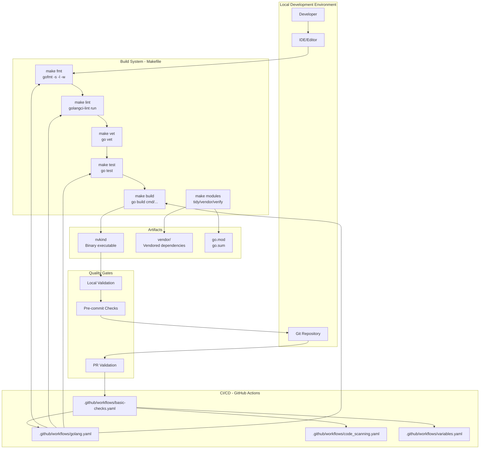
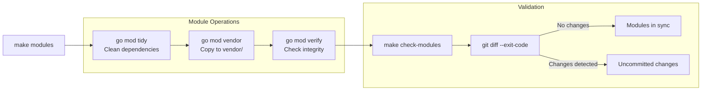
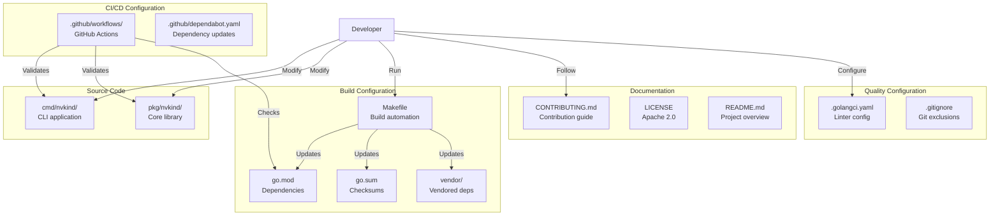

<!-- source: DeepWiki mcp.deepwiki.com · repo NVIDIA/nvkind · page 6 Development Guide · fetched 2026-10-26 -->

# Development Guide

<details>
<summary>Relevant source files</summary>

The following files were used as context for generating this wiki page:

- [CONTRIBUTING.md](CONTRIBUTING.md)
- [Makefile](Makefile)

</details>


This guide is for developers and contributors working on nvkind itself. It covers the development environment, build system, testing workflow, and contribution process for the nvkind codebase.

For information on using nvkind as an end-user, see the [User Guide](#3). For architectural details about how nvkind is designed internally, see [Architecture](#5).

## Scope and Organization

This Development Guide is organized into four main sections:

- **[Building from Source](#6.1)**: Instructions for compiling nvkind locally, including Makefile targets and build dependencies
- **[Development Workflow](#6.2)**: Day-to-day development practices including formatting, linting, testing, and local validation
- **[CI/CD Pipeline](#6.3)**: Detailed documentation of GitHub Actions workflows and automated quality gates
- **[Contributing](#6.4)**: Contribution guidelines, DCO requirements, and patch submission process

## Development Environment Overview

nvkind is a Go-based project with a comprehensive build and validation system. The development environment consists of:

- **Build System**: Makefile-based build automation with targets for common development tasks
- **Quality Tools**: `gofmt`, `golangci-lint`, and `go vet` for code quality enforcement
- **Testing Framework**: Go's standard testing package with unit tests throughout the codebase
- **CI/CD Pipeline**: GitHub Actions workflows that mirror local development checks
- **Dependency Management**: Go modules with vendoring support for reproducible builds

### Development Ecosystem



**Figure 1: Development Ecosystem - Local Tools to CI/CD**

This diagram shows how local development tools mirror CI/CD checks, enabling developers to catch issues early before submitting pull requests.

Sources: [Makefile](), [.github/workflows/basic-checks.yaml](), [.github/workflows/golang.yaml](), [.github/workflows/code_scanning.yaml](), [.github/workflows/variables.yaml]()

## Build System Architecture

The build system is implemented in a Makefile that provides standardized targets for all development tasks. The primary entry point is the `all` target, which runs `vendor`, `fmt`, and `build` in sequence [Makefile:17]().

### Makefile Targets and Dependencies

| Target | Command | Purpose |
|--------|---------|---------|
| `fmt` | `gofmt -s -l -w` | Format all Go code according to standard conventions [Makefile:22-24]() |
| `lint` | `golangci-lint run ./...` | Run comprehensive linting checks [Makefile:26-27]() |
| `vet` | `go vet` | Run Go's built-in code analysis tool [Makefile:29-30]() |
| `test` | `go test` | Execute all unit tests [Makefile:32-33]() |
| `build` | `go build cmd/...` | Compile all binaries in cmd/ [Makefile:35-36]() |
| `run` | `go run` | Build and execute nvkind in one step [Makefile:38-39]() |
| `modules` | `tidy/vendor/verify` | Update and verify Go module dependencies [Makefile:43-63]() |
| `check-modules` | `git diff` | Verify modules are in sync with git [Makefile:65-69]() |

### Module Management Workflow

The `modules` target performs three operations across all Go modules in the repository:



**Figure 2: Module Management Workflow**

The `check-modules` target [Makefile:65-69]() is used in CI to ensure that `go.mod`, `go.sum`, and the `vendor/` directory are synchronized with the committed state. This prevents issues where local module changes are not properly committed.

Sources: [Makefile:42-69]()

## Quality Assurance Tools

nvkind enforces code quality through multiple layers of automated checks:

### Code Formatting

- **Tool**: `gofmt` with simplification flag (`-s`)
- **Target**: [Makefile:22-24]()
- **Scope**: All packages under `github.com/NVIDIA/nvkind`
- **Operation**: Formats code in-place with `-w` flag

### Linting

- **Tool**: `golangci-lint`
- **Target**: [Makefile:26-27]()
- **Configuration**: [.golangci.yaml]() (if present)
- **Operation**: Runs comprehensive static analysis across all packages

### Static Analysis

- **Tool**: `go vet`
- **Target**: [Makefile:29-30]()
- **Operation**: Detects suspicious constructs and potential bugs

### Testing

- **Tool**: Go's built-in testing framework
- **Target**: [Makefile:32-33]()
- **Operation**: Executes all `*_test.go` files in the module

## Contribution Requirements

All contributions to nvkind must adhere to the Developer Certificate of Origin (DCO). This requirement is documented in [CONTRIBUTING.md:1-61]().

### DCO Sign-off Process

Every git commit must include a `Signed-off-by` line [CONTRIBUTING.md:52-54]():

```
Signed-off-by: Joe Smith <joe.smith@email.com>
```

This can be added automatically using:

```bash
git commit -s
```

The DCO certifies that contributors have the right to submit their changes under the project's Apache 2.0 license [CONTRIBUTING.md:27-49]().

### Code Quality Standards

Before submitting a pull request, contributors should:

1. Run `make fmt` to ensure code formatting compliance
2. Run `make lint` to catch linting issues
3. Run `make test` to verify all tests pass
4. Run `make modules` to synchronize dependencies
5. Verify the build succeeds with `make build`

These checks are automatically enforced in CI through the GitHub Actions workflows (see [CI/CD Pipeline](#6.3)).

Sources: [CONTRIBUTING.md](), [Makefile]()

## Development File Structure

Understanding where different types of development occurs:



**Figure 3: Development File Structure**

This diagram maps file locations to their roles in the development process.

Sources: Project directory structure

## Next Steps

For detailed information on specific development topics:

- **Building the Project**: See [Building from Source](#6.1) for complete build instructions and troubleshooting
- **Daily Development**: See [Development Workflow](#6.2) for formatting, linting, testing practices
- **Understanding CI**: See [CI/CD Pipeline](#6.3) for comprehensive workflow documentation
- **Submitting Changes**: See [Contributing](#6.4) for the complete contribution process

---

**Quick Reference Commands**

```bash
# Format code
make fmt

# Run linter
make lint

# Run tests
make test

# Build binary
make build

# Update dependencies
make modules

# Verify everything
make all && make check-modules
```

Sources: [Makefile](), [CONTRIBUTING.md]()

---

