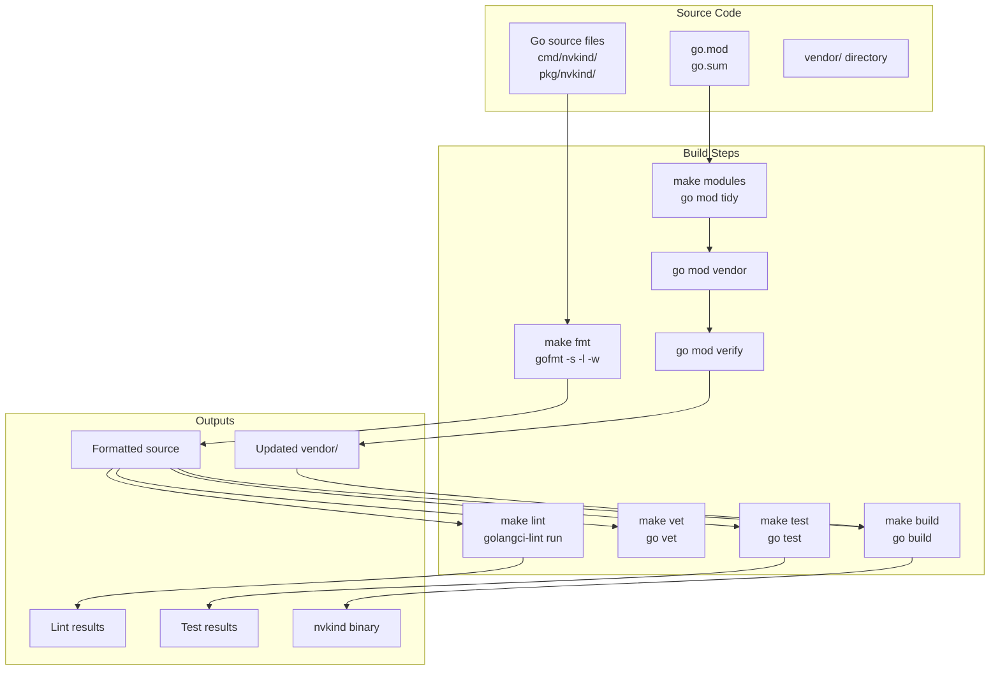
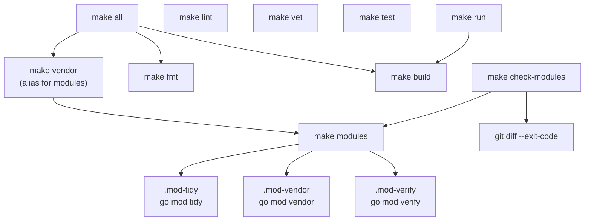

<!-- source: DeepWiki mcp.deepwiki.com · repo NVIDIA/nvkind · page 6.1 Building from Source · fetched 2026-10-26 -->

# Building from Source

<details>
<summary>Relevant source files</summary>

The following files were used as context for generating this wiki page:

- [Makefile](Makefile)
- [deployments/devel/Dockerfile](deployments/devel/Dockerfile)
- [hack/golang-version.sh](hack/golang-version.sh)

</details>


This page provides instructions for building the nvkind binary from source code. It covers the build prerequisites, the Makefile-based build system, and the available build targets. This documentation is intended for developers who want to compile nvkind locally for development, testing, or custom deployment scenarios.

For information about setting up a development environment and local development workflows, see [Development Workflow](#6.2). For instructions on installing pre-built nvkind binaries, see [Prerequisites and Installation](#2.1).

## Build Prerequisites

Building nvkind from source requires the following tools installed on your system:

| Prerequisite | Purpose | Version Requirement |
|--------------|---------|---------------------|
| Go compiler | Core build toolchain | 1.22.1 (specified in [deployments/devel/Dockerfile:17]()) |
| make | Build orchestration | Any recent version |
| gofmt | Code formatting (for `make fmt`) | Bundled with Go |
| golangci-lint | Code linting (for `make lint`) | Latest recommended |
| git | Source control for cloning repository | Any recent version |

The Go version requirement is defined in [deployments/devel/Dockerfile:17]() and can be extracted programmatically using [hack/golang-version.sh:20]().

**Sources:** [deployments/devel/Dockerfile:17](), [hack/golang-version.sh:16-22]()

## Cloning the Repository

First, clone the nvkind repository from GitHub:

```bash
git clone https://github.com/NVIDIA/nvkind.git
cd nvkind
```

The repository includes a vendored copy of all Go module dependencies in the `vendor/` directory, so building does not require network access to fetch dependencies.

## Makefile Build System

The nvkind build system is implemented using a Makefile at the repository root. The Makefile defines the module name as `github.com/NVIDIA/nvkind` in [Makefile:15]() and provides several targets for different build operations.

### Primary Build Targets

The following table describes the main Makefile targets available for building and validating nvkind:

| Target | Command | Purpose | Implementation |
|--------|---------|---------|----------------|
| `fmt` | `make fmt` | Format all Go source files using `gofmt` | [Makefile:22-24]() |
| `lint` | `make lint` | Run `golangci-lint` on all packages | [Makefile:26-27]() |
| `vet` | `make vet` | Run `go vet` static analysis | [Makefile:29-30]() |
| `test` | `make test` | Execute all unit tests | [Makefile:32-33]() |
| `build` | `make build` | Compile the nvkind binary | [Makefile:35-36]() |
| `run` | `make run` | Build and run nvkind | [Makefile:38-39]() |
| `all` | `make all` | Run `vendor`, `fmt`, and `build` in sequence | [Makefile:17]() |

**Sources:** [Makefile:17-40]()

### Build Target Details

#### Building the Binary

The `build` target is the primary compilation target. It invokes the Go compiler to build all commands in the `cmd/` directory:

```bash
make build
```

This executes `go build github.com/NVIDIA/nvkind/cmd/...` as defined in [Makefile:35-36](). The resulting binary is named `nvkind` and is placed in the repository root directory.

The build process compiles:
- Main package: `cmd/nvkind/main.go`
- All subcommand packages under `cmd/nvkind/`

**Sources:** [Makefile:35-36]()

#### Formatting Code

The `fmt` target applies standard Go formatting to all source files:

```bash
make fmt
```

This target uses `go list` to find all package directories, then runs `gofmt -s -l -w` on each, as shown in [Makefile:22-24](). The `-s` flag simplifies code, `-l` lists files that differ from gofmt's style, and `-w` writes changes back to files.

**Sources:** [Makefile:22-24]()

#### Linting

The `lint` target runs static analysis using golangci-lint:

```bash
make lint
```

This executes `golangci-lint run ./...` as defined in [Makefile:26-27](). The linter configuration is controlled by `.golangci.yaml` in the repository root.

**Sources:** [Makefile:26-27]()

#### Running Tests

The `test` target executes all unit tests:

```bash
make test
```

This runs `go test github.com/NVIDIA/nvkind/...` as shown in [Makefile:32-33](), which discovers and executes all test files (`*_test.go`) in the repository.

**Sources:** [Makefile:32-33]()

## Go Module Management

The Makefile provides targets for managing Go module dependencies. These targets ensure that `go.mod`, `go.sum`, and the `vendor/` directory remain synchronized.

### Module Targets

| Target | Purpose | Operations |
|--------|---------|------------|
| `modules` | Update and vendor all dependencies | Runs `.mod-tidy`, `.mod-vendor`, `.mod-verify` |
| `check-modules` | Verify module files are synchronized | Runs `modules` then checks for git diff |

**Sources:** [Makefile:42-69]()

### Module Update Process

The `modules` target performs three operations in sequence:

1. **Tidy** (`.mod-tidy` in [Makefile:44-49]()): Runs `go mod tidy` in all module directories to add missing and remove unused dependencies
2. **Vendor** (`.mod-vendor` in [Makefile:51-56]()): Runs `go mod vendor` to copy dependencies into the `vendor/` directory
3. **Verify** (`.mod-verify` in [Makefile:58-63]()): Runs `go mod verify` to ensure downloaded dependencies match checksums

Each operation iterates over all `go.mod` files in the repository, excluding `testdata/`, `third_party/`, and `deployments/` directories.

**Sources:** [Makefile:44-63]()

### Module Verification

The `check-modules` target is used in CI/CD to ensure that module files are synchronized with the source repository:

```bash
make check-modules
```

This target first runs `make modules`, then uses `git diff --exit-code` to verify that no files were modified, as shown in [Makefile:65-69](). If any module files are out of sync, the command exits with a non-zero status.

**Sources:** [Makefile:65-69]()

## Build Process Flow

The following diagram illustrates the complete build process from source code to executable binary, showing how different Makefile targets interact:

**Build Process Execution Flow**



**Sources:** [Makefile:17-40](), [Makefile:42-63]()

## Makefile Target Dependencies

The following diagram shows the relationships between Makefile targets and their execution order:

**Makefile Target Dependency Graph**



**Sources:** [Makefile:17](), [Makefile:19-20](), [Makefile:42-69]()

## Build Output

After running `make build`, the compiled binary is created in the repository root directory:

```
nvkind/
├── nvkind          # Compiled binary (executable)
├── cmd/
│   └── nvkind/
│       └── ...     # Source files
├── pkg/
│   └── nvkind/
│       └── ...     # Library source files
└── ...
```

The binary can be executed directly from this location:

```bash
./nvkind --help
```

Or installed to your system PATH:

```bash
sudo install nvkind /usr/local/bin/
```

**Sources:** [Makefile:35-36]()

## Go Version Management

The Go version used for building nvkind is defined in [deployments/devel/Dockerfile:17](). This approach allows Dependabot to automatically manage Go version updates through pull requests.

The version can be extracted programmatically using the `hack/golang-version.sh` script:

```bash
bash hack/golang-version.sh
# Outputs: 1.22.1
```

The script parses the `FROM golang:` directive in [deployments/devel/Dockerfile:17]() and extracts the version number using grep, as implemented in [hack/golang-version.sh:20]().

**Sources:** [deployments/devel/Dockerfile:15-17](), [hack/golang-version.sh:16-22]()

## Complete Build Workflow

For a complete build including all quality checks, execute the following commands in sequence:

```bash
# Ensure dependencies are current
make modules

# Format code
make fmt

# Run linter
make lint

# Run static analysis
make vet

# Execute tests
make test

# Build binary
make build
```

Alternatively, use the `all` target for a streamlined build:

```bash
make all
```

This executes `vendor`, `fmt`, and `build` in sequence as defined in [Makefile:17]().

**Sources:** [Makefile:17-40]()

## CI/CD Build Process

The build process used in continuous integration mirrors the local build workflow. The GitHub Actions workflows use the same Makefile targets to ensure consistency between local and CI builds. For detailed information about the CI/CD pipeline, see [CI/CD Pipeline](#6.3).

The CI workflow verifies module synchronization using `make check-modules` to ensure that `go.mod`, `go.sum`, and `vendor/` are properly maintained, as shown in [Makefile:65-69]().

**Sources:** [Makefile:65-69]()

---

