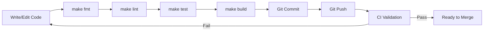
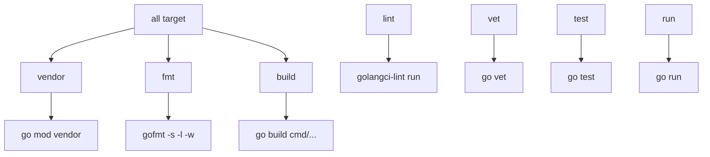
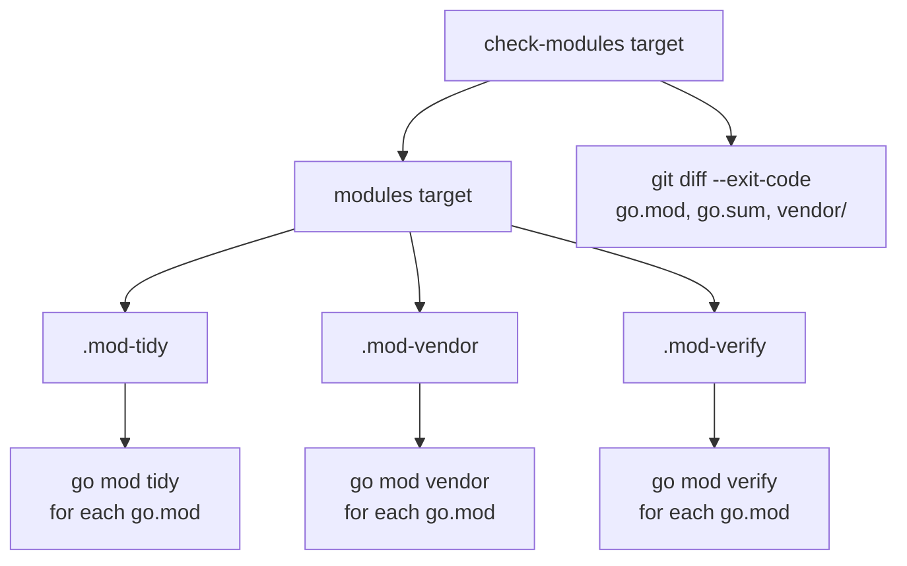
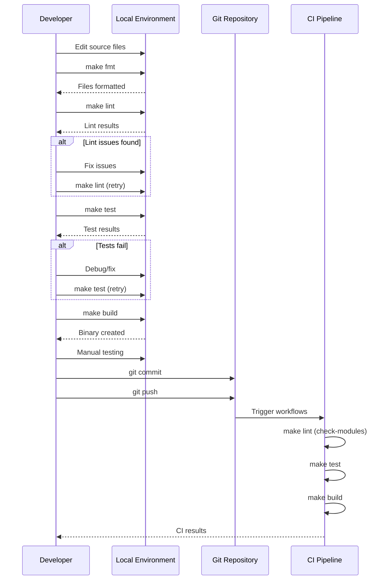
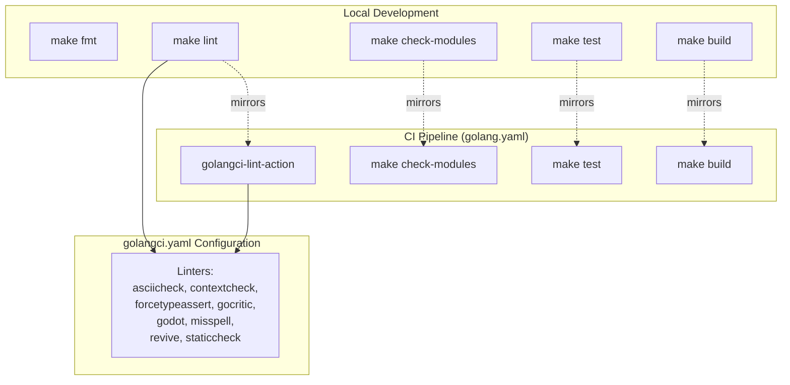

<!-- source: DeepWiki mcp.deepwiki.com · repo NVIDIA/nvkind · page 6.2 Development Workflow · fetched 2026-10-26 -->

# Development Workflow

<details>
<summary>Relevant source files</summary>

The following files were used as context for generating this wiki page:

- [.github/workflows/golang.yaml](.github/workflows/golang.yaml)
- [.golangci.yaml](.golangci.yaml)
- [Makefile](Makefile)

</details>


## Purpose and Scope

This page documents the local development workflow for contributors working on nvkind source code. It covers the use of Makefile targets for code formatting, linting, testing, and module management, as well as the integration between local development tools and CI validation.

For instructions on building nvkind from source, see [Building from Source](#6.1). For details on the CI/CD pipeline that validates changes, see [CI/CD Pipeline](#6.3). For contribution guidelines and code quality standards, see [Contributing](#6.4).

## Development Workflow Overview

The nvkind development workflow is designed around the principle of "shift-left" quality assurance, where developers run the same checks locally that will be executed in CI. This approach catches issues early in the development cycle and ensures smooth integration.



**Development Cycle Flow**

The standard development cycle follows a sequential validation approach where each step must pass before proceeding to the next. This mirrors the CI pipeline structure.

Sources: [Makefile:1-70](), [.github/workflows/golang.yaml:1-70]()

## Makefile Targets

The [Makefile:1-70]() provides targets for all common development tasks. These targets are organized into primary development commands and module management commands.

### Primary Development Targets



**Makefile Target Dependency Graph**

| Target | Command | Purpose |
|--------|---------|---------|
| `all` | Composite | Runs `vendor`, `fmt`, and `build` in sequence |
| `fmt` | `gofmt -s -l -w` | Formats all Go source files with simplification |
| `lint` | `golangci-lint run` | Runs static analysis checks |
| `vet` | `go vet` | Runs Go's built-in static analyzer |
| `test` | `go test` | Executes unit tests across all packages |
| `build` | `go build` | Compiles the nvkind binary from [cmd/nvkind/]() |
| `run` | `go run` | Builds and executes nvkind |

Sources: [Makefile:17-40]()

### Code Formatting: `make fmt`

The `fmt` target applies consistent formatting across the codebase using `gofmt`:

```bash
make fmt
```

The implementation [Makefile:22-24]() runs `gofmt -s -l -w` on all Go packages:
- `-s`: Simplify code (e.g., replace `[]string{string("a")}` with `[]string{"a"}`)
- `-l`: List files with formatting differences
- `-w`: Write changes back to files

The target uses `go list -f '{{.Dir}}'` to enumerate all package directories under `github.com/NVIDIA/nvkind`, then pipes them to `gofmt`.

Sources: [Makefile:22-24]()

### Static Analysis: `make lint`

The `lint` target runs `golangci-lint`, a meta-linter that aggregates multiple Go linters:

```bash
make lint
```

The implementation [Makefile:26-27]() executes `golangci-lint run ./...` using configuration from [.golangci.yaml:1-52](). 

#### Linter Configuration

The [.golangci.yaml]() enables the following linters:

| Linter | Purpose |
|--------|---------|
| `asciicheck` | Detects non-ASCII identifiers |
| `contextcheck` | Validates context.Context usage patterns |
| `forcetypeassert` | Catches unsafe type assertions |
| `gocritic` | Provides opinionated code suggestions |
| `godot` | Enforces comment punctuation |
| `misspell` | Detects common spelling errors |
| `revive` | Replacement for deprecated golint |
| `staticcheck` | Advanced static analysis |

The configuration also enables formatters:
- `gofmt`: Standard Go formatting (redundant with `make fmt`)
- `goimports`: Manages import statements with local prefix `github.com/NVIDIA/nvkind` [.golangci.yaml:43-45]()

Sources: [Makefile:26-27](), [.golangci.yaml:15-51]()

### Testing: `make test`

The `test` target runs the unit test suite:

```bash
make test
```

The implementation [Makefile:32-33]() executes `go test` across all packages. This command discovers and runs all `*_test.go` files.

Sources: [Makefile:32-33]()

### Building: `make build`

The `build` target compiles the nvkind binary:

```bash
make build
```

The implementation [Makefile:35-36]() runs `go build github.com/NVIDIA/nvkind/cmd/...`, which builds all commands under [cmd/]() (currently only [cmd/nvkind/]()). The binary is output to the current directory as `nvkind`.

Sources: [Makefile:35-36]()

## Module Management

Go module management ensures dependency consistency across development and CI environments. The Makefile provides composite targets for synchronizing `go.mod`, `go.sum`, and the `vendor/` directory.



**Module Management Target Flow**

### `make modules`

The `modules` target synchronizes all Go modules:

```bash
make modules
```

This composite target [Makefile:43]() executes three sub-targets in order:

1. **`.mod-tidy`** [Makefile:44-49](): Runs `go mod tidy` for each `go.mod` file, updating dependencies to match imports
2. **`.mod-vendor`** [Makefile:51-56](): Runs `go mod vendor` to copy dependencies into `vendor/`
3. **`.mod-verify`** [Makefile:58-63](): Runs `go mod verify` to validate checksums in `go.sum`

Each target iterates over all `go.mod` files found by `find`, excluding `testdata/`, `third_party/`, and (for vendor) `deployments/` directories.

Sources: [Makefile:43-63]()

### `make check-modules`

The `check-modules` target validates that module files are synchronized with git:

```bash
make check-modules
```

This target [Makefile:65-69]() first runs `make modules`, then uses `git diff --exit-code` to verify that `go.mod`, `go.sum`, and `vendor/` have no uncommitted changes. This check ensures developers have committed all module updates and is mirrored in CI [.github/workflows/golang.yaml:43-45]().

Sources: [Makefile:65-69](), [.github/workflows/golang.yaml:43-45]()

## Local Development Loop

A typical development session follows this pattern:



**Typical Development Workflow Sequence**

### Step-by-Step Workflow

1. **Make changes** to source files in [pkg/nvkind/]() or [cmd/nvkind/]()

2. **Format code**:
   ```bash
   make fmt
   ```

3. **Run linter**:
   ```bash
   make lint
   ```
   Fix any issues reported by the linters configured in [.golangci.yaml]()

4. **Run tests**:
   ```bash
   make test
   ```
   Verify all unit tests pass

5. **Build binary**:
   ```bash
   make build
   ```
   Produces `./nvkind` executable

6. **Test manually** (optional):
   ```bash
   ./nvkind cluster create --config examples/one-worker-per-gpu.yaml
   ```

7. **Update modules** (if dependencies changed):
   ```bash
   make modules
   git add go.mod go.sum vendor/
   ```

8. **Commit and push**:
   ```bash
   git commit -s -m "Description of changes"
   git push origin feature-branch
   ```

Sources: [Makefile:17-40]()

## CI Validation Mirror

The local development tools mirror the CI validation pipeline, ensuring consistency between environments.



**Local and CI Validation Mapping**

### CI Workflow Integration

The [.github/workflows/golang.yaml]() workflow defines three jobs that correspond to local Makefile targets:

| CI Job | Makefile Equivalent | Purpose |
|--------|---------------------|---------|
| `check` → Lint step [golang.yaml:36-41]() | `make lint` | Static analysis using golangci-lint |
| `check` → Check modules [golang.yaml:43-45]() | `make check-modules` | Verify module synchronization |
| `test` [golang.yaml:47-57]() | `make test` | Run unit tests |
| `build` [golang.yaml:59-69]() | `make build` | Compile binaries |

The CI workflow uses the same configuration:
- **Go version**: Extracted from `go.mod` by [variables.yaml]() workflow
- **Linter config**: [.golangci.yaml]() with `--timeout 5m` [golang.yaml:40]()
- **Module paths**: Same exclusions as Makefile (testdata, third_party)

Sources: [.github/workflows/golang.yaml:24-69](), [Makefile:26-36](), [.golangci.yaml:1-52]()

## Advanced Makefile Features

### Multi-Module Support

The module management targets support repositories with multiple `go.mod` files using shell loops:

```bash
for mod in $(find . -name go.mod -not -path "./testdata/*" ...); do
    cd $(dirname $mod) && go mod tidy
done
```

This pattern [Makefile:45-48]() enables nvkind to potentially support nested modules in the future without Makefile changes.

### Error Propagation

All Makefile targets use `|| exit 1` to ensure failures propagate correctly:

```bash
cd $(dirname $mod) && go mod tidy \
) || exit 1;
```

This ensures that CI workflows fail immediately when any module operation fails [Makefile:48]().

Sources: [Makefile:44-63]()

## Tool Versions and Installation

The development workflow assumes the following tools are installed:

| Tool | Purpose | Installation |
|------|---------|--------------|
| `go` | Go toolchain | https://golang.org/dl/ |
| `gofmt` | Code formatter | Included with Go |
| `golangci-lint` | Meta-linter | https://golangci-lint.run/usage/install/ |
| `make` | Build automation | System package manager |

The CI workflow [.github/workflows/golang.yaml:31-34]() uses `actions/setup-go` with the version from `go.mod`, and golangci-lint-action [golang.yaml:37-38]() with `version: latest`.

For local development, it's recommended to match the Go version specified in `go.mod` and use a recent version of golangci-lint (the CI uses the latest version).

Sources: [.github/workflows/golang.yaml:31-41]()

---

