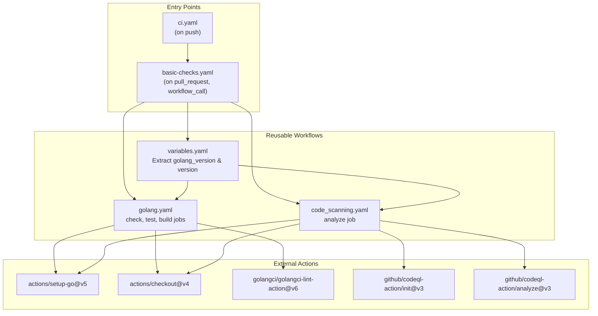
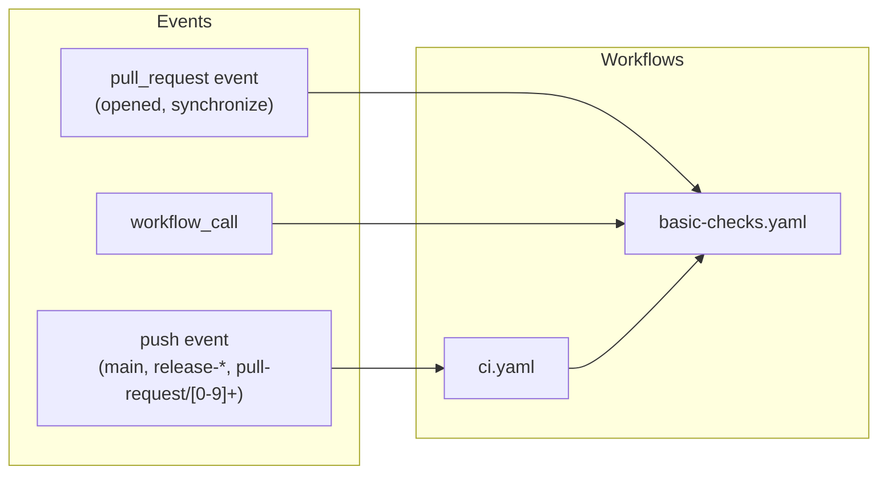
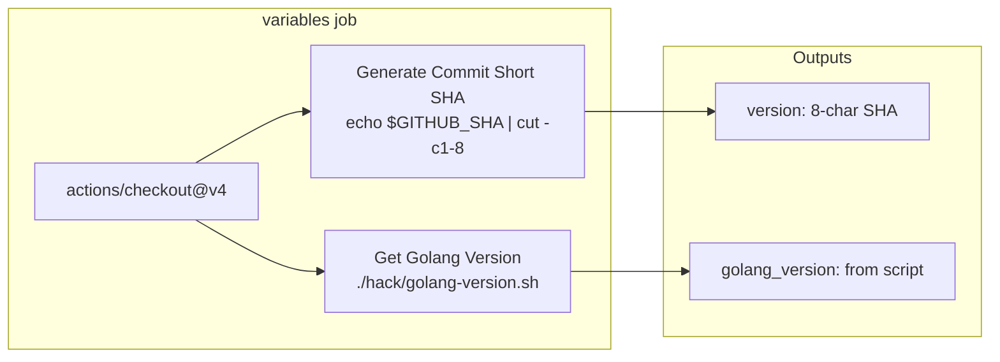
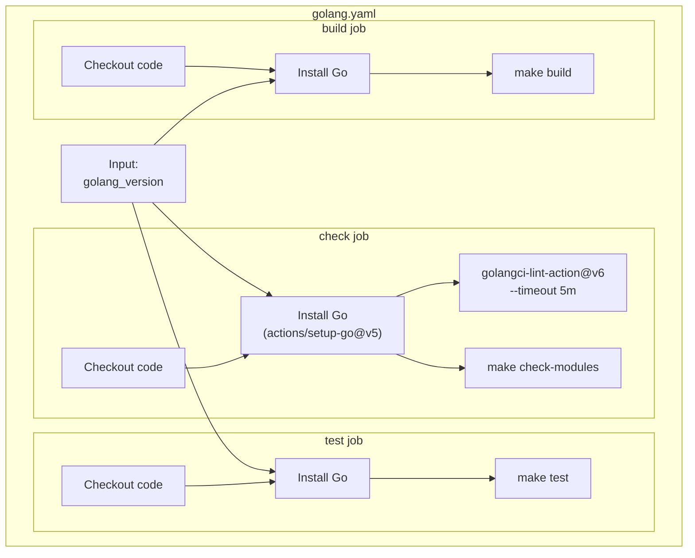
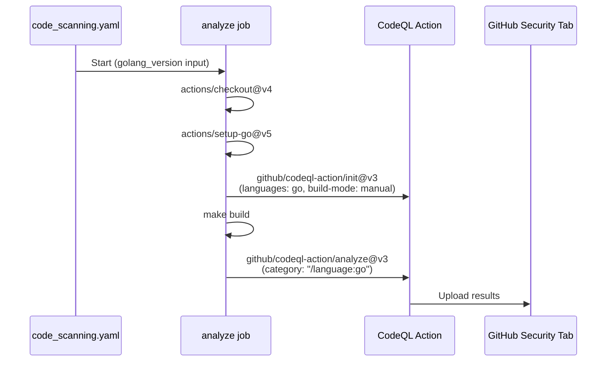
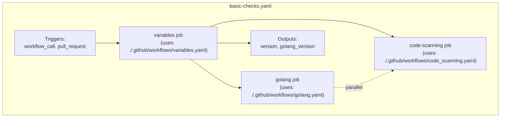
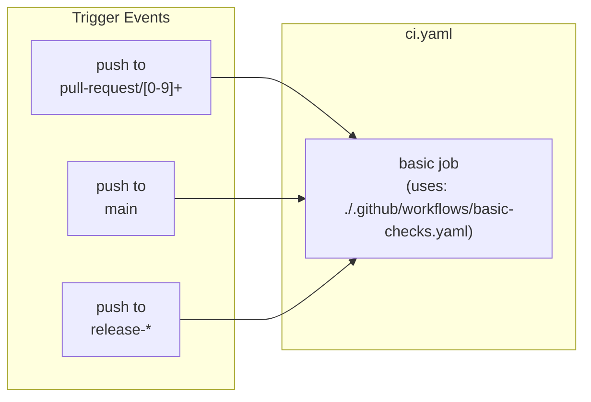
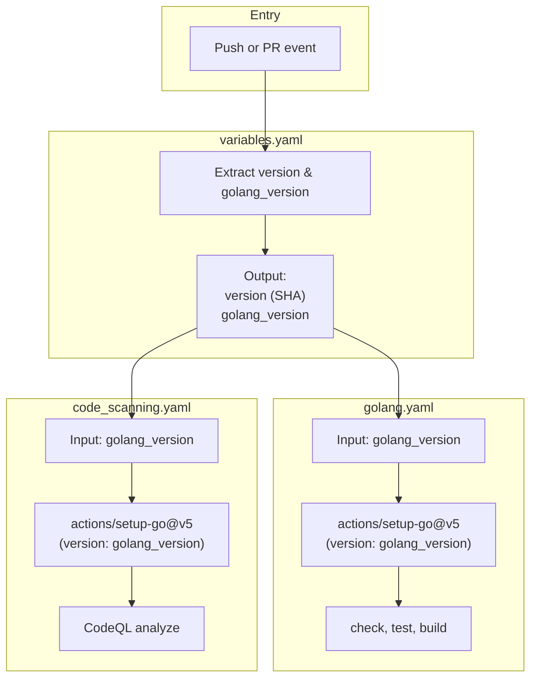

<!-- source: DeepWiki mcp.deepwiki.com · repo NVIDIA/nvkind · page 6.3 CI/CD Pipeline · fetched 2026-10-26 -->

# CI/CD Pipeline

<details>
<summary>Relevant source files</summary>

The following files were used as context for generating this wiki page:

- [.github/workflows/basic-checks.yaml](.github/workflows/basic-checks.yaml)
- [.github/workflows/ci.yaml](.github/workflows/ci.yaml)
- [.github/workflows/code_scanning.yaml](.github/workflows/code_scanning.yaml)
- [.github/workflows/golang.yaml](.github/workflows/golang.yaml)
- [.github/workflows/variables.yaml](.github/workflows/variables.yaml)

</details>


## Purpose and Scope

This document describes the GitHub Actions-based CI/CD pipeline used by nvkind to ensure code quality, security, and correctness. It covers the five workflow files that orchestrate automated checks on pull requests and pushes, including Go code validation, security scanning, and version management.

For information about local development workflows and Makefile targets that mirror these CI checks, see [Development Workflow](#6.2). For build process details, see [Building from Source](#6.1).

## Pipeline Architecture

The nvkind CI/CD system uses a modular architecture with reusable workflows that can be invoked independently or as part of larger pipelines. This design promotes maintainability and allows workflows to be called from multiple entry points.

**CI/CD Workflow Organization**



**Sources:** [.github/workflows/ci.yaml:1-26](), [.github/workflows/basic-checks.yaml:1-50](), [.github/workflows/variables.yaml:1-45](), [.github/workflows/golang.yaml:1-70](), [.github/workflows/code_scanning.yaml:1-54]()

## Workflow Triggers

The pipeline is triggered by three types of events, each targeting specific workflows based on the event type and branch patterns.

| Workflow | Trigger Events | Branch Patterns | Notes |
|----------|---------------|-----------------|-------|
| `ci.yaml` | `push` | `main`, `release-*`, `pull-request/[0-9]+` | Main entry for pushes [.github/workflows/ci.yaml:16-21]() |
| `basic-checks.yaml` | `pull_request` (opened, synchronize), `workflow_call` | `main`, `release-*` | Can be called by other workflows [.github/workflows/basic-checks.yaml:16-31]() |
| `variables.yaml` | `workflow_call` | N/A | Reusable only [.github/workflows/variables.yaml:15-23]() |
| `golang.yaml` | `workflow_call` | N/A | Reusable only [.github/workflows/golang.yaml:17-22]() |
| `code_scanning.yaml` | `workflow_call` | N/A | Reusable only [.github/workflows/code_scanning.yaml:16-21]() |

**Trigger Event Flow**



**Sources:** [.github/workflows/ci.yaml:16-21](), [.github/workflows/basic-checks.yaml:16-31]()

## Reusable Workflow Pattern

All workflows except `ci.yaml` use the `workflow_call` trigger, making them reusable components. This pattern allows workflows to accept inputs and produce outputs, enabling data flow between workflows without code duplication.

**Workflow Call Interface Example (variables.yaml)**

The `variables` workflow demonstrates the reusable pattern with typed outputs:

```yaml
on:
  workflow_call:
    outputs:
      version:
        description: "The short SHA to use as a version string"
        value: ${{ jobs.variables.outputs.version }}
      golang_version:
        description: "The golang version for this project"
        value: ${{ jobs.variables.outputs.golang_version }}
```

These outputs are consumed by dependent workflows using the `needs` context:

```yaml
jobs:
  variables:
    uses: ./.github/workflows/variables.yaml
  
  golang:
    needs:
    - variables
    uses: ./.github/workflows/golang.yaml
    with:
      golang_version: ${{ needs.variables.outputs.golang_version }}
```

**Sources:** [.github/workflows/variables.yaml:15-23](), [.github/workflows/basic-checks.yaml:34-42]()

## Variables Workflow

The `variables.yaml` workflow extracts build-time variables required by other workflows. It runs as the first job in the pipeline and provides outputs to dependent jobs.

**Variables Workflow Execution**



| Step | Action | Purpose | Output |
|------|--------|---------|--------|
| Check out code | `actions/checkout@v4` | Clone repository | N/A |
| Generate Commit Short SHA | Shell script | Extract first 8 characters of `$GITHUB_SHA` | `version` |
| Get Golang Version | `./hack/golang-version.sh` | Retrieve Go version from project configuration | `golang_version` |

**Sources:** [.github/workflows/variables.yaml:25-45]()

## Golang Workflow

The `golang.yaml` workflow performs Go-specific quality checks across three parallel jobs: code quality checking, unit testing, and building.

**Golang Workflow Jobs**



### Check Job

The `check` job validates code formatting and module integrity:

| Step | Command/Action | Purpose | Source |
|------|----------------|---------|--------|
| Checkout code | `actions/checkout@v4` | Clone repository | [.github/workflows/golang.yaml:28]() |
| Install Go | `actions/setup-go@v5` | Set up Go toolchain | [.github/workflows/golang.yaml:31-34]() |
| Lint | `golangci/golangci-lint-action@v6` | Run `golangci-lint` with 5-minute timeout | [.github/workflows/golang.yaml:36-41]() |
| Check golang modules | `make check-modules` | Verify `go.mod` and `go.sum` consistency | [.github/workflows/golang.yaml:43-45]() |

### Test Job

The `test` job executes unit tests:

```bash
make test
```

This runs the test suite defined in the Makefile, ensuring code correctness.

**Sources:** [.github/workflows/golang.yaml:47-57]()

### Build Job

The `build` job verifies the project compiles successfully:

```bash
make build
```

This builds the `nvkind` binary to catch compilation errors.

**Sources:** [.github/workflows/golang.yaml:59-69]()

## Code Scanning Workflow

The `code_scanning.yaml` workflow performs static security analysis using GitHub CodeQL. Results are uploaded to the repository's Security tab.

**CodeQL Analysis Flow**



**Analyze Job Steps**

| Step | Action | Configuration | Purpose |
|------|--------|---------------|---------|
| Checkout repository | `actions/checkout@v4` | N/A | Clone source code |
| Install Go | `actions/setup-go@v5` | Version from input | Set up Go toolchain |
| Initialize CodeQL | `github/codeql-action/init@v3` | `languages: go`, `build-mode: manual` | Prepare CodeQL database |
| Build | Shell: `make build` | N/A | Compile code for analysis |
| Perform CodeQL Analysis | `github/codeql-action/analyze@v3` | `category: "/language:go"` | Analyze and upload results |

**Permissions Required:**
- `security-events: write` - Upload results to Security tab
- `packages: read` - Access GitHub packages if needed

**Sources:** [.github/workflows/code_scanning.yaml:1-54]()

## Basic Checks Workflow

The `basic-checks.yaml` workflow serves as the main orchestrator, coordinating the execution of `variables`, `golang`, and `code_scanning` workflows. It acts as a reusable workflow that can be called by `ci.yaml` or triggered directly by pull requests.

**Basic Checks Orchestration**



**Job Dependencies**

```yaml
jobs:
  variables:
    uses: ./.github/workflows/variables.yaml

  golang:
    needs:
    - variables
    uses: ./.github/workflows/golang.yaml
    with:
      golang_version: ${{ needs.variables.outputs.golang_version }}

  code-scanning:
    needs:
    - variables
    uses: ./.github/workflows/code_scanning.yaml
    with:
      golang_version: ${{ needs.variables.outputs.golang_version }}
```

The `golang` and `code-scanning` jobs run in parallel after `variables` completes, maximizing pipeline efficiency.

**Workflow Outputs**

The `basic-checks` workflow exposes outputs for use by calling workflows:

- `version`: The 8-character short SHA from the commit
- `golang_version`: The Go version extracted by `./hack/golang-version.sh`

**Sources:** [.github/workflows/basic-checks.yaml:1-50]()

## CI Pipeline Workflow

The `ci.yaml` workflow serves as the main entry point for push events. It is intentionally minimal, delegating all work to `basic-checks.yaml`.

**CI Pipeline Structure**



This design allows pull requests and pushes to use the same validation logic, ensuring consistency across different triggering events.

**Sources:** [.github/workflows/ci.yaml:1-26]()

## Workflow Data Flow

The following diagram shows how data flows through the workflow dependency graph, from variable extraction to final checks.

**Data Flow Between Workflows**



**Key Data Points:**

| Variable | Source | Consumers | Purpose |
|----------|--------|-----------|---------|
| `golang_version` | `./hack/golang-version.sh` in `variables.yaml` | `golang.yaml`, `code_scanning.yaml` | Ensures consistent Go version across all jobs |
| `version` | `$GITHUB_SHA` in `variables.yaml` | Currently unused, available for future use | Provides unique version identifier per commit |

**Sources:** [.github/workflows/variables.yaml:15-45](), [.github/workflows/golang.yaml:17-22](), [.github/workflows/code_scanning.yaml:16-21](), [.github/workflows/basic-checks.yaml:16-50]()

## CI/CD Job Execution Matrix

The following table summarizes all jobs executed across the pipeline:

| Workflow | Job Name | Runner | Timeout | Key Actions | Makefile Target |
|----------|----------|--------|---------|-------------|-----------------|
| `variables.yaml` | `variables` | `ubuntu-latest` | Default | Version extraction | N/A |
| `golang.yaml` | `check` | `ubuntu-latest` | Default | Lint, module check | `check-modules` |
| `golang.yaml` | `test` | `ubuntu-latest` | Default | Unit tests | `test` |
| `golang.yaml` | `build` | `ubuntu-latest` | Default | Binary compilation | `build` |
| `code_scanning.yaml` | `analyze` | `ubuntu-latest` | 360 min | CodeQL security scan | `build` |

**Sources:** [.github/workflows/variables.yaml:26-44](), [.github/workflows/golang.yaml:24-69](), [.github/workflows/code_scanning.yaml:23-54]()

## Integration with Local Development

The CI/CD pipeline mirrors the Makefile targets used in local development, ensuring that developers can catch issues before pushing code:

| CI Check | Makefile Equivalent | Description |
|----------|---------------------|-------------|
| `golangci-lint-action` | `make lint` | Run `golangci-lint` |
| `make check-modules` | `make check-modules` | Verify Go module consistency |
| `make test` | `make test` | Execute unit tests |
| `make build` | `make build` | Compile binary |

Developers should run these Makefile targets locally before creating pull requests to avoid CI failures. See [Development Workflow](#6.2) for detailed local development practices.

**Sources:** [.github/workflows/golang.yaml:36-45]()

## Security Scanning Configuration

CodeQL scanning is configured to analyze Go code using manual build mode, allowing the workflow to control the build process through `make build`.

**CodeQL Configuration Details:**

```yaml
- name: Initialize CodeQL
  uses: github/codeql-action/init@v3
  with:
    languages: go
    build-mode: manual

- shell: bash
  run: |
    make build

- name: Perform CodeQL Analysis
  uses: github/codeql-action/analyze@v3
  with:
    category: "/language:go"
```

Results are categorized as `/language:go` and appear in the repository's Security → Code scanning alerts tab. The workflow requires `security-events: write` permission to upload results.

**Sources:** [.github/workflows/code_scanning.yaml:40-53]()

---

