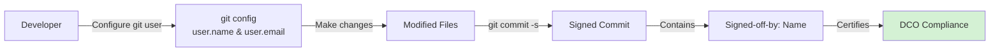
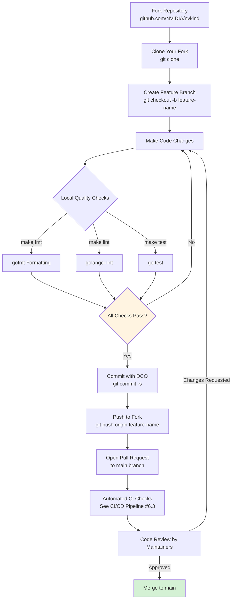
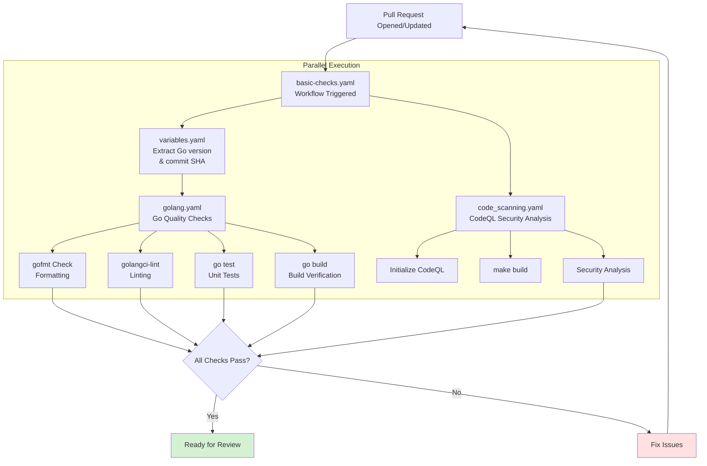
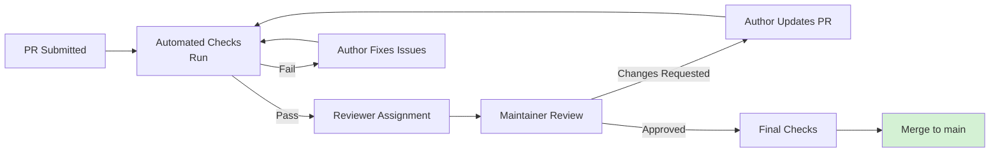

<!-- source: DeepWiki mcp.deepwiki.com · repo NVIDIA/nvkind · page 6.4 Contributing · fetched 2026-10-26 -->

# Contributing

<details>
<summary>Relevant source files</summary>

The following files were used as context for generating this wiki page:

- [.github/dependabot.yml](.github/dependabot.yml)
- [.golangci.yaml](.golangci.yaml)
- [CONTRIBUTING.md](CONTRIBUTING.md)
- [LICENSE](LICENSE)

</details>


This document provides guidelines for contributing to nvkind, including legal requirements, code quality standards, and the contribution workflow. For information about building and testing nvkind locally, see [Development Workflow](#6.2). For details about the automated CI/CD checks that run on contributions, see [CI/CD Pipeline](#6.3). For license information, see [License and Legal](#7.3).

## Purpose and Scope

This page covers:
- Developer Certificate of Origin (DCO) requirements and how to sign commits
- Code quality standards enforced by linting and formatting tools
- Step-by-step contribution workflow from fork to pull request
- Automated quality gates and review process
- Legal and licensing requirements for contributions

## Developer Certificate of Origin

All contributions to nvkind must be signed to certify compliance with the Developer Certificate of Origin (DCO) v1.1. This requirement ensures that contributors have the legal right to submit their code under the Apache 2.0 license.

### DCO Requirements

The DCO certification is defined in [CONTRIBUTING.md:14-49]() and requires contributors to certify that:

| Certification | Description |
|--------------|-------------|
| (a) Original Work | The contribution was created by you with the right to submit under the project's open source license |
| (b) Derived Work | The contribution is based on appropriately licensed previous work that you have the right to modify and submit |
| (c) Third-Party Work | The contribution was provided by someone who certified (a) or (b) and you have not modified it |
| (d) Public Record | You understand the contribution and your personal information become part of the public project record |

### Signing Commits

Each git commit must include a sign-off line as specified in [CONTRIBUTING.md:52-54]():

```
Signed-off-by: Joe Smith <joe.smith@email.com>
```

**Important Requirements**:
- Use your real name (pseudonyms and anonymous contributions are not accepted per [CONTRIBUTING.md:56]())
- Sign-off line must match your git configuration

**Automatic Signing**:
Configure git to sign commits automatically using [CONTRIBUTING.md:58-59]():

```bash
git config user.name "Your Name"
git config user.email "your.email@example.com"
git commit -s
```

The `-s` flag adds the `Signed-off-by` line automatically.



**Diagram: DCO Signing Process**

Sources: [CONTRIBUTING.md:1-60]()

## Code Quality Standards

nvkind enforces strict code quality standards through automated linting and formatting tools. All contributions must pass these checks before being merged.

### Linting Configuration

The project uses `golangci-lint` with configuration defined in [.golangci.yaml:15-51](). The following linters are enabled:

| Linter | Purpose | Configuration Location |
|--------|---------|----------------------|
| `asciicheck` | Ensures no non-ASCII characters in identifiers | [.golangci.yaml:20]() |
| `contextcheck` | Validates proper context.Context usage | [.golangci.yaml:21]() |
| `forcetypeassert` | Flags unchecked type assertions | [.golangci.yaml:22]() |
| `gocritic` | Performance and style checks | [.golangci.yaml:23]() |
| `godot` | Validates comment formatting | [.golangci.yaml:24]() |
| `misspell` | Catches common spelling mistakes | [.golangci.yaml:25]() |
| `revive` | General Go code linting | [.golangci.yaml:26]() |
| `staticcheck` | Advanced static analysis | [.golangci.yaml:27]() |

### Formatting Standards

Code formatting is enforced through [.golangci.yaml:38-51]():

| Tool | Requirement | Configuration |
|------|------------|---------------|
| `gofmt` | Standard Go formatting | Enabled at [.golangci.yaml:40]() |
| `goimports` | Import organization with local prefixes | Local prefix: `github.com/NVIDIA/nvkind` at [.golangci.yaml:44-45]() |

### Exclusions

The following paths are excluded from linting and formatting checks per [.golangci.yaml:34-37]() and [.golangci.yaml:48-51]():
- `third_party$` - Third-party vendored code
- `builtin$` - Built-in generated code
- `examples$` - Example configuration files

### Running Quality Checks Locally

Before submitting a contribution, run local quality checks as documented in [Development Workflow](#6.2):

```bash
make fmt      # Format code with gofmt
make lint     # Run golangci-lint
make test     # Run tests
make build    # Build binary
```

Sources: [.golangci.yaml:1-52]()

## Contribution Workflow

The following workflow outlines the complete process from preparing a contribution to having it merged into the main branch.



**Diagram: Contribution Workflow from Fork to Merge**

### Step-by-Step Process

**1. Fork and Clone**
```bash
# Fork the repository on GitHub
# Then clone your fork
git clone https://github.com/YOUR_USERNAME/nvkind.git
cd nvkind
```

**2. Create a Feature Branch**
```bash
git checkout -b feature/your-feature-name
# or
git checkout -b fix/bug-description
```

**3. Make Changes**
- Implement your feature or fix
- Add or update tests as needed
- Update documentation if applicable

**4. Run Local Quality Checks**
```bash
make fmt      # Must pass before commit
make lint     # Must pass before commit
make test     # Must pass before commit
make build    # Verify build succeeds
```

**5. Commit with DCO Sign-off**
```bash
git add .
git commit -s -m "Description of changes

Detailed explanation if needed.

Signed-off-by: Your Name <your.email@example.com>"
```

**6. Push and Create Pull Request**
```bash
git push origin feature/your-feature-name
# Open pull request on GitHub
```

Sources: [CONTRIBUTING.md:1-60]()

## Automated Quality Gates

All pull requests must pass automated quality gates before they can be merged. These checks are defined in the CI/CD workflows documented in [CI/CD Pipeline](#6.3).

### Required Checks



**Diagram: Automated CI Quality Gates**

### Quality Check Details

| Check | Workflow File | Purpose | Configuration |
|-------|--------------|---------|---------------|
| Code Formatting | `.github/workflows/golang.yaml` | Ensures consistent code formatting with `gofmt` | [.golangci.yaml:40]() |
| Linting | `.github/workflows/golang.yaml` | Runs `golangci-lint` with project configuration | [.golangci.yaml:18-27]() |
| Unit Tests | `.github/workflows/golang.yaml` | Executes `go test` across all packages | See [Development Workflow](#6.2) |
| Build Verification | `.github/workflows/golang.yaml` | Verifies clean build with `make build` | See [Building from Source](#6.1) |
| Security Scanning | `.github/workflows/code_scanning.yaml` | CodeQL analysis for security vulnerabilities | Documented in [CI/CD Pipeline](#6.3) |

### Dependency Updates

The project uses Dependabot for automated dependency updates as configured in [.github/dependabot.yml:1-26]():

| Ecosystem | Schedule | Target Branch | Special Rules |
|-----------|----------|---------------|---------------|
| Go Modules (`gomod`) | Weekly (Sunday) | `main` | Ignores `k8s.io/*` updates per [.github/dependabot.yml:13]() |
| Docker Images | Daily | `main` | Monitors `/deployments/devel` directory per [.github/dependabot.yml:21]() |

All Dependabot PRs are automatically labeled with `dependencies` per [.github/dependabot.yml:15,25]() and must pass the same quality gates as manual contributions.

Sources: [.github/dependabot.yml:1-26](), [.golangci.yaml:1-52]()

## Pull Request Guidelines

### PR Title and Description

- Use clear, descriptive titles that summarize the change
- Include context and motivation in the description
- Reference any related issues using `Fixes #123` or `Relates to #456`
- Explain what was changed and why

### Commit Messages

- First line should be a concise summary (50 characters or less)
- Include detailed explanation in the body if needed
- Must include DCO sign-off line per [CONTRIBUTING.md:52-59]()
- Reference issues in commit messages when applicable

### Code Review Process



**Diagram: Code Review and Merge Process**

### Review Criteria

Reviewers evaluate contributions based on:

| Criterion | Requirements |
|-----------|-------------|
| **Functionality** | Code works as intended and solves the stated problem |
| **Code Quality** | Follows Go best practices and project conventions |
| **Tests** | Adequate test coverage for new functionality or bug fixes |
| **Documentation** | User-facing changes include documentation updates |
| **Compatibility** | Changes don't break existing functionality |
| **DCO Compliance** | All commits are properly signed per [CONTRIBUTING.md:52-59]() |
| **CI Checks** | All automated checks pass |

### Addressing Review Feedback

When changes are requested:

1. Make the requested modifications
2. Commit with DCO sign-off: `git commit -s`
3. Push updates: `git push origin feature-name`
4. Respond to review comments explaining changes
5. Re-request review when ready

Sources: [CONTRIBUTING.md:1-60]()

## License Compliance

All contributions must comply with the Apache 2.0 license as specified in [LICENSE:1-203](). Key requirements:

### Contribution License

Per [LICENSE:131-137](), any contribution submitted for inclusion is automatically licensed under the Apache 2.0 License without additional terms or conditions.

### Copyright Headers

All new source files should include the Apache 2.0 copyright header as shown in [.golangci.yaml:1-13]():

```go
// Copyright 2024 NVIDIA CORPORATION.
//
// Licensed under the Apache License, Version 2.0 (the "License");
// you may not use this file except in compliance with the License.
// You may obtain a copy of the License at
//
//     http://www.apache.org/licenses/LICENSE-2.0
//
// Unless required by applicable law or agreed to in writing, software
// distributed under the License is distributed on an "AS IS" BASIS,
// WITHOUT WARRANTIES OR CONDITIONS OF ANY KIND, either express or implied.
// See the License for the specific language governing permissions and
// limitations under the License.
```

### Third-Party Dependencies

When adding new dependencies:
- Ensure they use compatible open source licenses
- Document the dependency purpose and license
- Add to `go.mod` through standard Go module commands
- Dependabot will track updates per [.github/dependabot.yml:6-15]()

For complete license terms and conditions, see [License and Legal](#7.3).

Sources: [LICENSE:1-203](), [.golangci.yaml:1-13](), [.github/dependabot.yml:6-15]()

## Summary

Contributing to nvkind requires:

1. **DCO Compliance**: All commits signed with `git commit -s` per [CONTRIBUTING.md:52-59]()
2. **Code Quality**: Pass `gofmt`, `golangci-lint`, and tests per [.golangci.yaml:18-51]()
3. **License Compliance**: Apache 2.0 headers on new files per [LICENSE:1-203]()
4. **CI Checks**: All automated quality gates must pass
5. **Code Review**: Approval from project maintainers

For development setup and testing, see [Development Workflow](#6.2). For CI/CD details, see [CI/CD Pipeline](#6.3).

Sources: [CONTRIBUTING.md:1-60](), [LICENSE:1-203](), [.golangci.yaml:1-52](), [.github/dependabot.yml:1-26]()

---

