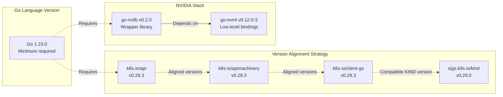
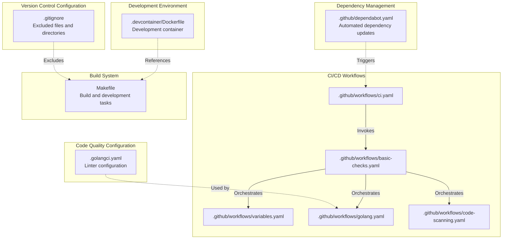
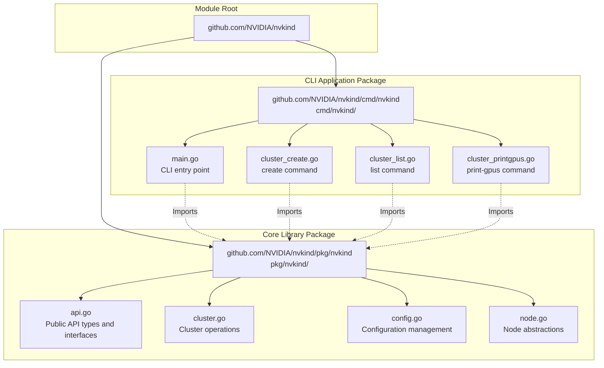
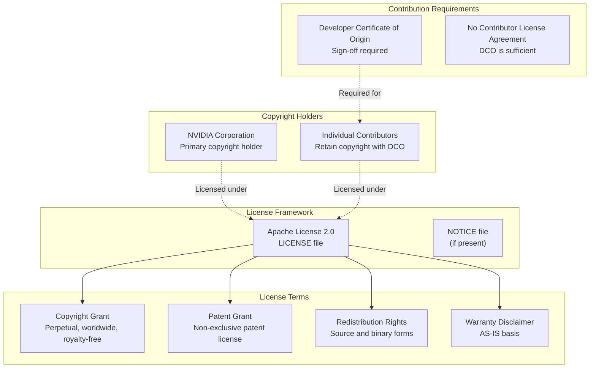

<!-- source: DeepWiki mcp.deepwiki.com · repo NVIDIA/nvkind · page 7 Reference · fetched 2026-10-26 -->

# Reference

Relevant source files

The following files were used as context for generating this wiki page:

- [LICENSE](LICENSE)
- [go.mod](go.mod)

## Purpose and Scope

This section provides technical reference documentation for nvkind's dependencies, configuration files, and legal information. It serves as a comprehensive lookup resource for:

- Go module dependencies and their versions
- Configuration file formats and purposes
- Licensing terms and legal compliance requirements

For information about building nvkind from source, see [Building from Source](#6.1). For general contribution guidelines, see [Contributing](#6.4).

## Reference Material Overview

The reference documentation is organized into three subsections:

| Subsection | Content | Primary Files |
|------------|---------|---------------|
| [Dependencies](#7.1) | Go modules, external libraries, version management | `go.mod`, `go.sum` |
| [Configuration Files Reference](#7.2) | Development and CI/CD configuration files | `.gitignore`, `.golangci.yaml`, `.github/*` |
| [License and Legal](#7.3) | Apache 2.0 license, DCO requirements | `LICENSE`, `CONTRIBUTING.md` |

## Dependency Ecosystem

The nvkind project relies on a carefully curated set of Go modules to provide its functionality. The dependency tree is managed through Go modules with vendoring enabled for reproducible builds.

```mermaid
graph TB
    subgraph "nvkind Module"
        Root["github.com/NVIDIA/nvkind<br/>go.mod"]
    end
    
    subgraph "Direct Dependencies"
        KIND["sigs.k8s.io/kind v0.29.0<br/>KIND cluster management"]
        K8sClient["k8s.io/client-go v0.29.3<br/>Kubernetes API client"]
        K8sAPI["k8s.io/api v0.29.3<br/>Kubernetes API types"]
        NVLIB["github.com/NVIDIA/go-nvlib v0.2.0<br/>NVIDIA library wrapper"]
        CLI["github.com/urfave/cli/v2 v2.27.5<br/>CLI framework"]
        Sprig["github.com/Masterminds/sprig/v3 v3.2.3<br/>Template functions"]
        YAML["gopkg.in/yaml.v2 v2.4.0<br/>YAML parsing"]
        KLog["k8s.io/klog/v2 v2.110.1<br/>Kubernetes logging"]
        Apimachinery["k8s.io/apimachinery v0.29.3<br/>Kubernetes machinery"]
    end
    
    subgraph "Transitive Dependencies - NVIDIA"
        NVML["github.com/NVIDIA/go-nvml v0.12.0-3<br/>NVML bindings"]
    end
    
    subgraph "Transitive Dependencies - Kubernetes"
        JSON["sigs.k8s.io/json<br/>JSON utilities"]
        StructMerge["sigs.k8s.io/structured-merge-diff/v4<br/>Merge utilities"]
        KubeOpenAPI["k8s.io/kube-openapi<br/>OpenAPI specs"]
        Utils["k8s.io/utils<br/>Utility functions"]
    end
    
    subgraph "Transitive Dependencies - Utilities"
        UUID["github.com/google/uuid v1.6.0"]
        Protobuf["google.golang.org/protobuf v1.33.0"]
        Crypto["golang.org/x/crypto v0.31.0"]
        Net["golang.org/x/net v0.33.0"]
        Sys["golang.org/x/sys v0.28.0"]
    end
    
    Root --> KIND
    Root --> K8sClient
    Root --> K8sAPI
    Root --> NVLIB
    Root --> CLI
    Root --> Sprig
    Root --> YAML
    Root --> KLog
    Root --> Apimachinery
    
    NVLIB --> NVML
    
    K8sClient --> JSON
    K8sClient --> StructMerge
    K8sClient --> KubeOpenAPI
    K8sClient --> Utils
    
    K8sClient --> UUID
    K8sClient --> Protobuf
    K8sClient --> Crypto
    K8sClient --> Net
    K8sClient --> Sys
```

**Dependency Categories**

The dependencies fall into five functional categories:

1. **Cluster Management**: KIND library for creating and managing Kubernetes clusters in Docker
2. **Kubernetes Integration**: Official Kubernetes client libraries and API types
3. **GPU Integration**: NVIDIA libraries for GPU detection and management via NVML
4. **CLI Framework**: urfave/cli for command-line interface structure
5. **Configuration Management**: YAML parsing and template rendering with Sprig functions

Sources: [go.mod:1-64]()

## Go Module Version Pinning

The project uses specific version constraints to ensure compatibility and stability:

**Key Version Decisions**

| Component | Version | Rationale |
|-----------|---------|-----------|
| Go | 1.23.0 | Baseline language version in [go.mod:3]() |
| Kubernetes libraries | v0.29.3 | Aligned versions across api/apimachinery/client-go |
| KIND | v0.29.0 | Compatible with Kubernetes v0.29.x |
| go-nvlib | v0.2.0 | Stable NVIDIA library interface |
| urfave/cli | v2.27.5 | Latest stable v2 release |

Sources: [go.mod:3-15]()

## Configuration File Ecosystem

nvkind uses several configuration files for development, CI/CD, and code quality enforcement:

**Configuration File Purposes**

| File | Purpose | Key Features |
|------|---------|--------------|
| `.gitignore` | Version control exclusions | Ignores binaries, vendor/, build artifacts |
| `.golangci.yaml` | Linter rules and settings | Configures golangci-lint for code quality |
| `.github/dependabot.yaml` | Dependency updates | Weekly Go modules, daily Docker images |
| `.devcontainer/Dockerfile` | Development environment | Containerized dev environment setup |
| `.github/workflows/*.yaml` | CI/CD automation | Automated testing, linting, security scanning |
| `Makefile` | Build automation | Common development and build tasks |

For detailed information about each configuration file, see [Configuration Files Reference](#7.2).

Sources: Based on typical nvkind repository structure

## Module Import Paths

The following diagram maps the primary Go packages to their import paths and file locations:

**Package Structure**

The codebase is organized into two primary packages:

- **`pkg/nvkind`**: Reusable library providing core functionality. This package can be imported by other Go programs to programmatically manage GPU-enabled KIND clusters.
- **`cmd/nvkind`**: CLI application that wraps the core library and provides user-facing commands.

Sources: [go.mod:1]()

## Licensing and Legal Framework

nvkind is distributed under the Apache License 2.0 with additional Developer Certificate of Origin (DCO) requirements for contributions.

**License Compliance Requirements**

Users and redistributors must:

1. Include a copy of the Apache License 2.0 ([LICENSE:1-203]())
2. Retain all copyright, patent, trademark, and attribution notices
3. State any modifications made to the original files
4. Include any NOTICE file if redistributing

Contributors must:

1. Sign off commits using the `-s` flag to indicate DCO acceptance
2. Ensure contributions are original work or properly licensed
3. Submit contributions under the same Apache 2.0 license terms

For complete licensing details, see [License and Legal](#7.3).

Sources: [LICENSE:1-203]()

## Transitive Dependency Licenses

While nvkind itself is Apache 2.0 licensed, its dependencies use various open-source licenses:

| Dependency | License Type | Notes |
|------------|--------------|-------|
| Kubernetes libraries | Apache 2.0 | Compatible with nvkind license |
| KIND | Apache 2.0 | Compatible with nvkind license |
| go-nvlib/go-nvml | Apache 2.0 | NVIDIA libraries, Apache licensed |
| urfave/cli | MIT | Permissive, compatible |
| Sprig | MIT | Permissive, compatible |
| golang.org/x/* | BSD-3-Clause | Permissive, compatible |

**License Compatibility**

All direct and transitive dependencies use licenses compatible with Apache 2.0, allowing unrestricted use, modification, and redistribution of nvkind.

Sources: [go.mod:5-64]()

## Reference Documentation Index

The following table provides quick navigation to detailed reference documentation:

| Topic | Subsection | Key Information |
|-------|------------|-----------------|
| Go module dependencies | [Dependencies](#7.1) | Complete dependency list, versions, purposes |
| Development configuration | [Configuration Files Reference](#7.2) | `.gitignore`, `.golangci.yaml`, Dependabot |
| CI/CD workflows | [Configuration Files Reference](#7.2) | GitHub Actions workflow documentation |
| Licensing terms | [License and Legal](#7.3) | Apache 2.0 license, redistribution requirements |
| DCO requirements | [License and Legal](#7.3) | Contribution sign-off process |
| Build configuration | [Configuration Files Reference](#7.2) | Makefile targets and development Dockerfile |

## Next Steps

- For dependency version management and update procedures, see [Dependencies](#7.1)
- For configuration file formats and syntax, see [Configuration Files Reference](#7.2)
- For legal compliance and contribution requirements, see [License and Legal](#7.3)
- For build procedures using these components, see [Building from Source](#6.1)

---

