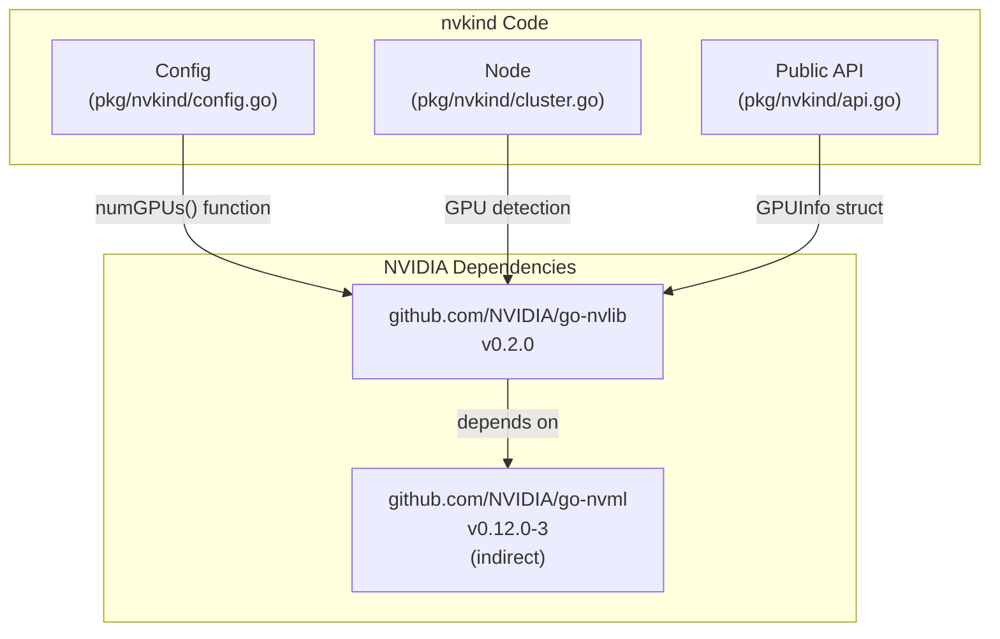
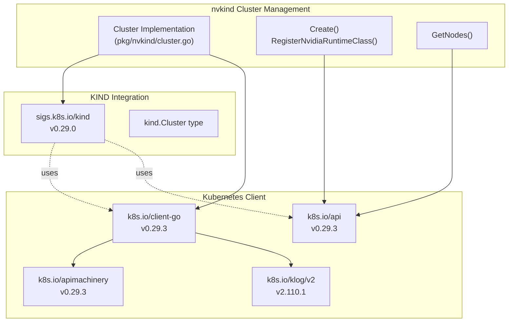
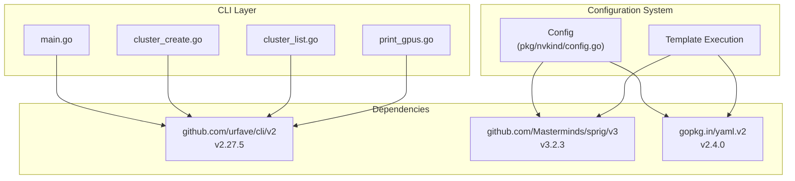
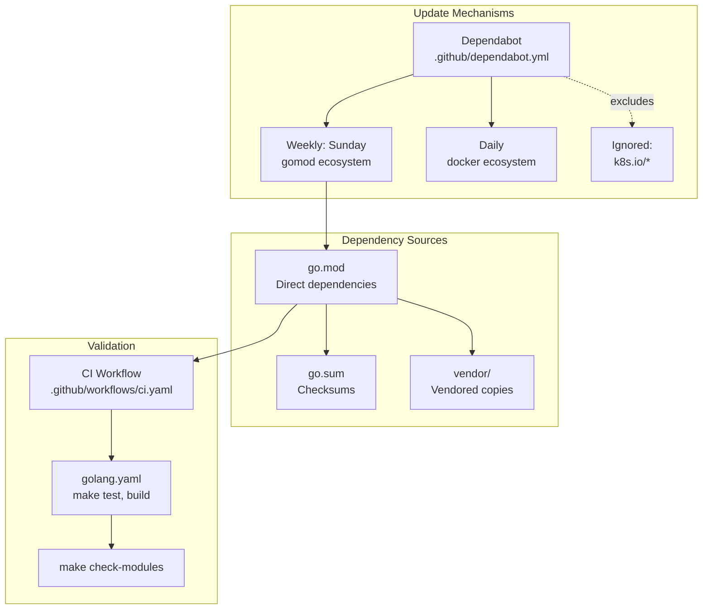
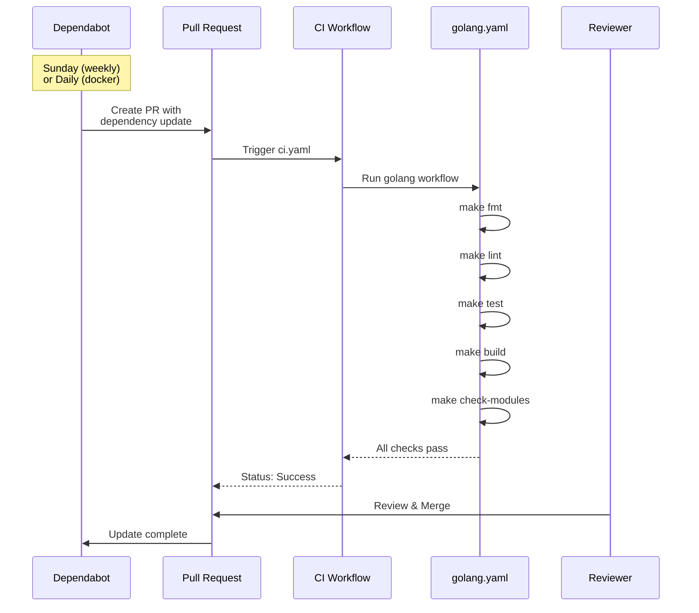
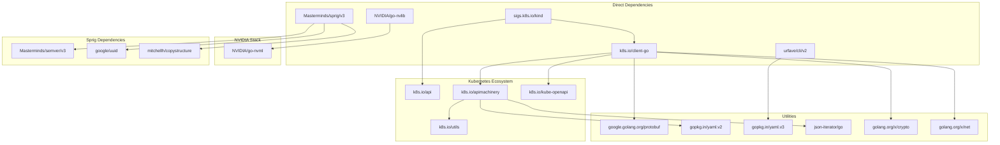

<!-- source: DeepWiki mcp.deepwiki.com · repo NVIDIA/nvkind · page 7.1 Dependencies · fetched 2026-10-26 -->

# Dependencies

<details>
<summary>Relevant source files</summary>

The following files were used as context for generating this wiki page:

- [.github/dependabot.yml](.github/dependabot.yml)
- [go.mod](go.mod)
- [go.sum](go.sum)

</details>


This page provides a comprehensive reference for all Go module dependencies used by nvkind, their purposes, version management strategy, and how they integrate with the codebase. For information about building nvkind from source, see [Building from Source](#6.1). For details about the CI/CD pipeline that validates dependency updates, see [CI/CD Pipeline](#6.3).

**Sources:** [go.mod:1-65](), [.github/dependabot.yml:1-26]()

## Overview

nvkind relies on external dependencies in three major categories: NVIDIA GPU libraries for hardware interaction, Kubernetes ecosystem libraries for cluster management, and utility libraries for CLI and configuration handling. The project uses Go modules for dependency management with automated weekly updates via Dependabot for most packages, while Kubernetes dependencies are intentionally pinned to maintain compatibility with specific KIND versions.

**Sources:** [go.mod:1-65](), [.github/dependabot.yml:1-26]()

## Direct Dependencies

The following table lists all direct dependencies declared in `go.mod`:

| Dependency | Version | Category | Purpose |
|------------|---------|----------|---------|
| `github.com/Masterminds/sprig/v3` | v3.2.3 | Templating | Extended template functions for Go templates |
| `github.com/NVIDIA/go-nvlib` | v0.2.0 | GPU | High-level NVIDIA library wrapper |
| `github.com/urfave/cli/v2` | v2.27.5 | CLI | Command-line interface framework |
| `gopkg.in/yaml.v2` | v2.4.0 | Serialization | YAML parsing and marshaling |
| `k8s.io/api` | v0.29.3 | Kubernetes | Kubernetes API type definitions |
| `k8s.io/apimachinery` | v0.29.3 | Kubernetes | Kubernetes schema and conversion machinery |
| `k8s.io/client-go` | v0.29.3 | Kubernetes | Kubernetes Go client library |
| `k8s.io/klog/v2` | v2.110.1 | Logging | Kubernetes structured logging |
| `sigs.k8s.io/kind` | v0.29.0 | Cluster | KIND cluster management library |

**Sources:** [go.mod:5-15]()

## Dependency Categories and Usage

### NVIDIA GPU Libraries



**NVIDIA Library Stack:**

- **`github.com/NVIDIA/go-nvlib` (v0.2.0)**: Primary interface for GPU operations. Provides higher-level abstractions over NVML including device discovery and capability querying. Used in [pkg/nvkind/config.go]() for the `numGPUs` template function and in [pkg/nvkind/cluster.go]() for node GPU information.

- **`github.com/NVIDIA/go-nvml` (v0.12.0-3, indirect)**: Low-level NVIDIA Management Library bindings. Automatically pulled as a transitive dependency of `go-nvlib`. Provides direct access to NVML C API for GPU management.

**Sources:** [go.mod:7](), [go.mod:20]()

### Kubernetes Ecosystem



**Kubernetes Library Components:**

- **`sigs.k8s.io/kind` (v0.29.0)**: Core KIND library used as an API rather than just a CLI tool. Provides `kind.Cluster` configuration types and cluster management functions. nvkind uses this for programmatic cluster creation in [pkg/nvkind/cluster.go:143-165]().

- **`k8s.io/client-go` (v0.29.3)**: Official Kubernetes Go client. Used for interacting with Kubernetes API server to create ConfigMaps, register RuntimeClasses, and query node information. Primary usage in [pkg/nvkind/cluster.go]() for cluster operations.

- **`k8s.io/api` (v0.29.3)**: Kubernetes API type definitions (Pod, ConfigMap, RuntimeClass, etc.). Used throughout nvkind to construct Kubernetes resources.

- **`k8s.io/apimachinery` (v0.29.3)**: Kubernetes schema, conversion, and encoding machinery. Provides meta types like `metav1.ObjectMeta` and runtime type utilities.

- **`k8s.io/klog/v2` (v2.110.1)**: Structured logging library used by Kubernetes components. nvkind inherits this from client-go dependencies.

**Version Pinning:** All `k8s.io/*` dependencies are pinned to v0.29.3 to match KIND v0.29.0's Kubernetes version compatibility. These are explicitly ignored in Dependabot configuration to prevent automatic updates that could break compatibility.

**Sources:** [go.mod:10-14](), [.github/dependabot.yml:13-13]()

### CLI and Configuration



**CLI and Configuration Libraries:**

- **`github.com/urfave/cli/v2` (v2.27.5)**: Modern CLI framework for Go. Provides command definition, flag parsing, and help generation. All nvkind commands in [cmd/nvkind]() are built using this framework. Key usage includes the `cli.App` struct in [cmd/nvkind/main.go]() and command definitions in cluster operation files.

- **`github.com/Masterminds/sprig/v3` (v3.2.3)**: Template function library extending Go's `text/template`. Provides 100+ template functions (string manipulation, math, date, etc.). nvkind extends the default template function map with Sprig functions in [pkg/nvkind/config.go]() to enable powerful configuration templates.

- **`gopkg.in/yaml.v2` (v2.4.0)**: YAML v1.1 parser and encoder. Used to unmarshal configuration files and KIND cluster configurations. Primary usage in [pkg/nvkind/config.go]() for parsing template outputs into `kind.Cluster` structs.

**Sources:** [go.mod:6](), [go.mod:8](), [go.mod:9]()

### Key Indirect Dependencies

The following indirect dependencies serve critical supporting roles:

| Dependency | Version | Purpose | Required By |
|------------|---------|---------|-------------|
| `github.com/Masterminds/semver/v3` | v3.2.0 | Semantic version parsing | sprig/v3 |
| `github.com/google/uuid` | v1.6.0 | UUID generation | sprig/v3, KIND |
| `golang.org/x/crypto` | v0.31.0 | Cryptographic operations | Kubernetes client |
| `golang.org/x/net` | v0.33.0 | Network utilities | Kubernetes client |
| `golang.org/x/sys` | v0.28.0 | System calls | go-nvml |
| `google.golang.org/protobuf` | v1.33.0 | Protocol buffer support | Kubernetes API |

**Sources:** [go.mod:17-64]()

## Dependency Management Strategy



### Automated Updates

nvkind uses GitHub Dependabot to automatically create pull requests for dependency updates:

**Go Module Updates (Weekly):**
- **Schedule:** Every Sunday
- **Target:** `main` branch
- **Scope:** All Go dependencies except `k8s.io/*`
- **Labels:** `dependencies`

Configuration in [.github/dependabot.yml:5-15]():
```yaml
- package-ecosystem: "gomod"
  target-branch: main
  directory: "/"
  schedule:
    interval: "weekly"
    day: "sunday"
  ignore:
  - dependency-name: k8s.io/*
```

**Docker Image Updates (Daily):**
- **Schedule:** Daily
- **Target:** Development Dockerfile
- **Directory:** `/deployments/devel`
- **Labels:** `dependencies`

**Sources:** [.github/dependabot.yml:1-26]()

### Version Pinning Strategy

**Kubernetes Dependencies (Pinned):**
The project pins all `k8s.io/*` dependencies to v0.29.3 to maintain compatibility with KIND v0.29.0. Kubernetes libraries have strict version alignment requirements, and mismatched versions can cause API incompatibilities or runtime errors.

**Rationale:**
- KIND v0.29.0 creates Kubernetes v1.29 clusters
- client-go v0.29.x is the compatible client library version
- All k8s.io/* dependencies must align to the same minor version

**Other Dependencies (Auto-Updated):**
Non-Kubernetes dependencies are automatically updated weekly. This includes:
- NVIDIA libraries (security and feature updates)
- CLI framework (bug fixes and improvements)
- Template libraries (new template functions)
- Utility libraries (performance and security)

**Sources:** [go.mod:10-14](), [.github/dependabot.yml:13-13]()

### Module Verification

The project uses Go module vendoring and verification:

**Vendoring Process:**
```bash
make modules  # Runs: go mod tidy && go mod vendor && go mod verify
```

**CI Validation:**
The CI pipeline checks for module drift with `make check-modules`, which fails if:
- `go.mod` or `go.sum` are out of sync
- `vendor/` directory doesn't match `go.mod`
- Module checksums don't verify

This ensures all pull requests (including Dependabot updates) maintain module integrity.

**Sources:** [Makefile referenced in 6.2]()

## Dependency Update Workflow



**Workflow Steps:**

1. **Detection:** Dependabot scans for new versions weekly (Go modules) or daily (Docker images)
2. **PR Creation:** Dependabot opens a pull request with updated `go.mod` and `go.sum`
3. **CI Validation:** GitHub Actions run the full test suite
   - Code formatting check
   - Linting with golangci-lint
   - Unit tests
   - Build verification
   - Module integrity check
4. **Review:** Human review for breaking changes or security implications
5. **Merge:** Approved updates are merged to main branch

**Sources:** [.github/dependabot.yml:1-26](), [.github/workflows referenced in 6.3]()

## Transitive Dependency Tree

The following diagram shows major transitive dependency relationships:



**Sources:** [go.mod:17-64]()

## Security and Maintenance

**Security Scanning:**
All dependencies are scanned by GitHub CodeQL and Dependabot security alerts. Critical security updates trigger immediate Dependabot PRs regardless of the weekly schedule.

**Maintenance Considerations:**
- **Breaking Changes:** Major version updates require manual review and testing
- **Kubernetes Alignment:** k8s.io/* updates must be coordinated with KIND version updates
- **NVIDIA Driver Compatibility:** go-nvml versions must support the minimum NVIDIA driver version required by the project
- **API Stability:** Dependencies with unstable APIs (v0.x.x versions) may introduce breaking changes in minor updates

**Sources:** [.github/dependabot.yml:1-26](), [Referenced in 6.3 for CodeQL workflow]()

---

