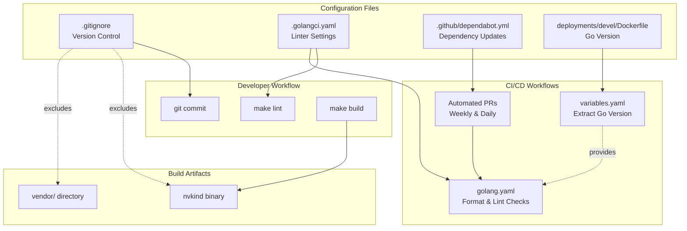
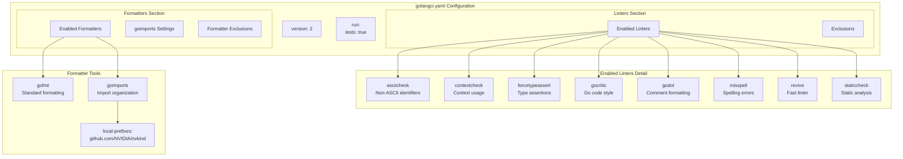
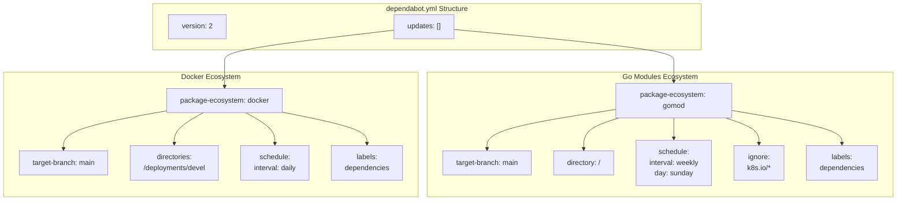
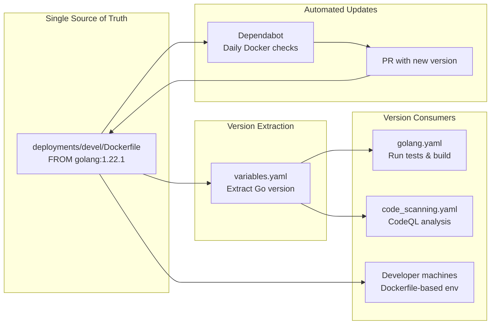
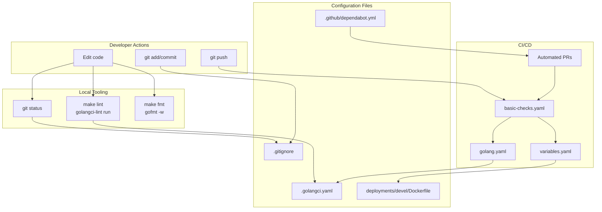

<!-- source: DeepWiki mcp.deepwiki.com · repo NVIDIA/nvkind · page 7.2 Configuration Files Reference · fetched 2026-10-26 -->

# Configuration Files Reference

<details>
<summary>Relevant source files</summary>

The following files were used as context for generating this wiki page:

- [.github/dependabot.yml](.github/dependabot.yml)
- [.gitignore](.gitignore)
- [.golangci.yaml](.golangci.yaml)
- [deployments/devel/Dockerfile](deployments/devel/Dockerfile)

</details>


This document provides reference documentation for all configuration files used in the nvkind project. These files control development tooling, code quality, dependency management, and build environment settings.

For information about nvkind's configuration template system for GPU allocation in KIND clusters, see [Configuration Guide](#4). For CI/CD workflow configuration, see [CI/CD Pipeline](#6.3).

## Scope

This reference covers four categories of configuration files:
- **Git configuration**: `.gitignore` for version control exclusions
- **Linter configuration**: `.golangci.yaml` for code quality enforcement
- **Dependency management**: `.github/dependabot.yml` for automated updates
- **Build environment**: `deployments/devel/Dockerfile` for Go version standardization

---

## Configuration Files Overview

The following diagram shows how configuration files are used throughout the development and CI/CD lifecycle:



**Sources:** [.gitignore:1-4](), [.golangci.yaml:1-52](), [.github/dependabot.yml:1-26](), [deployments/devel/Dockerfile:1-18]()

---

## .gitignore

The `.gitignore` file specifies intentionally untracked files that Git should ignore.

### File Structure

| Pattern | Purpose |
|---------|---------|
| `*.swp` | Vim swap files |
| `*.swo` | Vim swap files (alternate) |
| `/nvkind` | Compiled binary output from `make build` |

### Details

**Location:** [.gitignore:1-4]()

The configuration is minimal, excluding only:
- **Editor temporary files**: `*.swp` and `*.swo` patterns exclude Vim editor swap files
- **Build output**: `/nvkind` excludes the compiled binary from version control

The leading `/` in `/nvkind` ensures only the root-level binary is ignored, not any directory or file named `nvkind` in subdirectories.

**Sources:** [.gitignore:1-4]()

---

## .golangci.yaml

The `.golangci.yaml` file configures `golangci-lint`, the linter used for enforcing code quality standards. This configuration is version 2 format.

### Configuration Overview



### Run Configuration

**Location:** [.golangci.yaml:16-17]()

| Setting | Value | Purpose |
|---------|-------|---------|
| `tests` | `true` | Run linters on test files in addition to source files |

### Enabled Linters

**Location:** [.golangci.yaml:18-27]()

| Linter | Purpose |
|--------|---------|
| `asciicheck` | Ensures all identifiers are ASCII characters |
| `contextcheck` | Validates proper context.Context usage |
| `forcetypeassert` | Detects type assertions that could panic |
| `gocritic` | Comprehensive Go code style checker |
| `godot` | Checks comment formatting (periods at end of sentences) |
| `misspell` | Detects spelling mistakes in strings and comments |
| `revive` | Fast, configurable, extensible linter |
| `staticcheck` | Advanced static analysis tool |

### Linter Exclusions

**Location:** [.golangci.yaml:28-37]()

| Exclusion Type | Value | Purpose |
|----------------|-------|---------|
| `generated` | `lax` | Relaxed rules for generated code |
| `presets` | `common-false-positives` | Ignore known false positives |
| `presets` | `legacy` | Ignore legacy code patterns |
| `presets` | `std-error-handling` | Standard error handling patterns |
| `paths` | `third_party$` | Exclude third-party code |
| `paths` | `builtin$` | Exclude builtin packages |
| `paths` | `examples$` | Exclude example code |

### Formatters

**Location:** [.golangci.yaml:38-51]()

| Formatter | Configuration | Purpose |
|-----------|--------------|---------|
| `gofmt` | Default | Standard Go formatting |
| `goimports` | `local-prefixes: github.com/NVIDIA/nvkind` | Import organization with local packages grouped separately |

The `goimports` formatter is configured to recognize `github.com/NVIDIA/nvkind` as a local package prefix, ensuring imports are organized with local packages separated from standard library and external dependencies.

### Formatter Exclusions

The formatters have the same exclusion rules as linters, excluding generated code and specific paths from formatting checks.

### Usage in CI/CD

This configuration file is referenced by:
- **Local development**: `make lint` target
- **CI/CD**: [.github/workflows/golang.yaml]() workflow's `golangci-lint` step

**Sources:** [.golangci.yaml:1-52]()

---

## .github/dependabot.yml

The Dependabot configuration automates dependency updates for Go modules and Docker images.

### File Structure



### Go Modules Configuration

**Location:** [.github/dependabot.yml:6-15]()

| Setting | Value | Purpose |
|---------|-------|---------|
| `package-ecosystem` | `gomod` | Monitor Go module dependencies |
| `target-branch` | `main` | Create PRs against main branch |
| `directory` | `/` | Scan root directory for go.mod |
| `schedule.interval` | `weekly` | Check for updates weekly |
| `schedule.day` | `sunday` | Run checks on Sundays |
| `ignore` | `k8s.io/*` | Exclude Kubernetes dependencies from automatic updates |
| `labels` | `dependencies` | Add `dependencies` label to PRs |

**Rationale for ignoring `k8s.io/*`**: Kubernetes dependencies often require coordinated version updates across multiple packages and may have breaking changes. Manual review is required for these updates.

### Docker Images Configuration

**Location:** [.github/dependabot.yml:17-25]()

| Setting | Value | Purpose |
|---------|-------|---------|
| `package-ecosystem` | `docker` | Monitor Docker base images |
| `target-branch` | `main` | Create PRs against main branch |
| `directories` | `/deployments/devel` | Scan development Dockerfile |
| `schedule.interval` | `daily` | Check for updates daily |
| `labels` | `dependencies` | Add `dependencies` label to PRs |

**Purpose**: The Docker configuration monitors the base `golang` image in `deployments/devel/Dockerfile`. Since this file defines the Go version used throughout the project, daily checks ensure timely security patches.

### Automated Workflow Integration

Dependabot PRs automatically trigger the [basic-checks.yaml workflow](#6.3), which runs:
- Go formatting checks
- Linting via `.golangci.yaml`
- Unit tests
- Build verification
- CodeQL security scanning

This ensures all dependency updates are validated before merge.

**Sources:** [.github/dependabot.yml:1-26]()

---

## deployments/devel/Dockerfile

The development Dockerfile serves a dual purpose: defining the Go version used in CI/CD and providing a containerized development environment.

### File Contents

**Location:** [deployments/devel/Dockerfile:1-18]()

```dockerfile
FROM golang:1.22.1
```

This single-line Dockerfile (excluding copyright header) specifies the Go version used throughout the project.

### Purpose and Usage

| Use Case | Description |
|----------|-------------|
| **CI/CD Go version** | The [variables.yaml workflow](#6.3) extracts `1.22.1` from this file to configure GitHub Actions Go setup |
| **Dependabot monitoring** | Dependabot checks daily for updates to the `golang:1.22.1` base image |
| **Development environment** | Can be used to create a consistent development container |

### Go Version Management Strategy



### Architecture Decision

The project uses a Dockerfile as the canonical Go version specification rather than hard-coding versions in workflow files. This design provides:

1. **Single source of truth**: Only one file needs updating when changing Go versions
2. **Automated monitoring**: Dependabot can automatically propose updates
3. **Consistency**: Same Go version in CI/CD and local development
4. **Traceability**: Git history shows exactly when and why Go version changed

The [variables.yaml workflow]() reads this file and outputs the Go version for use by other workflows, ensuring all CI/CD jobs use the same Go version.

**Sources:** [deployments/devel/Dockerfile:1-18]()

---

## Configuration File Relationships

The following diagram shows how configuration files interact with the development workflow:



**Sources:** [.gitignore:1-4](), [.golangci.yaml:1-52](), [.github/dependabot.yml:1-26](), [deployments/devel/Dockerfile:1-18]()

---

## Configuration Best Practices

The nvkind project follows these configuration management practices:

### Version Control

- **Exclude build artifacts**: The `.gitignore` file excludes compiled binaries and editor temporary files but includes all configuration files in version control
- **Minimal exclusions**: Only essential patterns are ignored to ensure all important files are tracked

### Code Quality

- **Consistent linting**: `.golangci.yaml` configuration is used by both `make lint` and CI/CD workflows
- **Path-based exclusions**: Example code and third-party dependencies are excluded from linting
- **Formatter configuration**: `goimports` is configured with local package prefix awareness

### Dependency Management

- **Automated but controlled**: Dependabot provides automated dependency updates with manual review required
- **Different cadences**: Weekly for Go modules (safer, coordinated updates) and daily for Docker images (security patches)
- **Selective ignoring**: Kubernetes dependencies require manual updates due to breaking change risk

### Build Consistency

- **Single Go version source**: The Dockerfile approach ensures consistency across all environments
- **Automated extraction**: Workflows extract the version programmatically rather than duplicating it
- **Daily monitoring**: Docker base image updates are checked daily for security patches

**Sources:** [.gitignore:1-4](), [.golangci.yaml:1-52](), [.github/dependabot.yml:1-26](), [deployments/devel/Dockerfile:1-18]()

---

