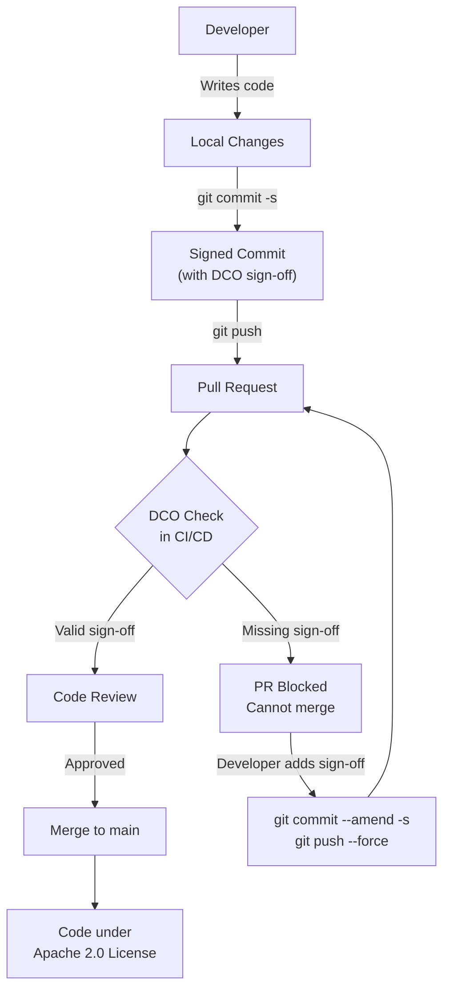
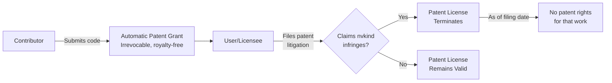
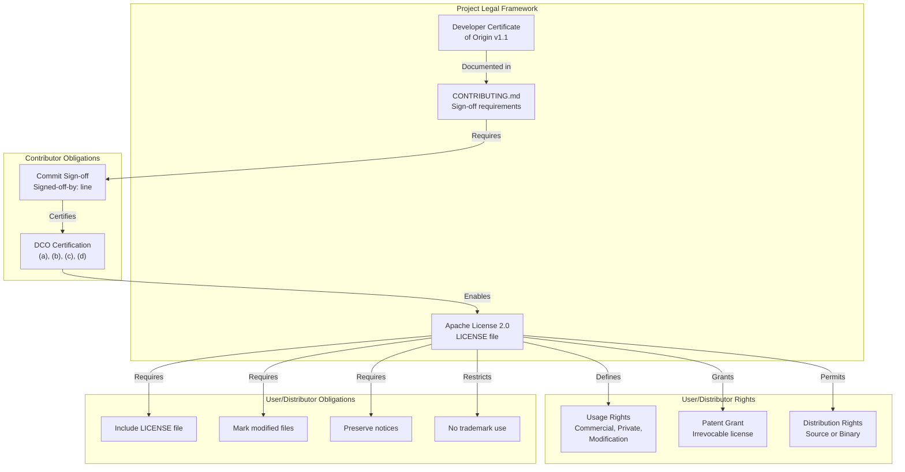

<!-- source: DeepWiki mcp.deepwiki.com · repo NVIDIA/nvkind · page 7.3 License and Legal · fetched 2026-10-26 -->

# License and Legal

<details>
<summary>Relevant source files</summary>

The following files were used as context for generating this wiki page:

- [CONTRIBUTING.md](CONTRIBUTING.md)
- [LICENSE](LICENSE)

</details>


This page documents the licensing terms, legal requirements, and compliance procedures for the nvkind project. It covers the Apache 2.0 license under which nvkind is distributed, the Developer Certificate of Origin (DCO) requirements for contributions, and practical guidance for legal compliance.

For information about contributing code and development practices, see [Contributing](#6.4). For dependency licenses, see [Dependencies](#7.1).

---

## Apache 2.0 License

nvkind is licensed under the **Apache License, Version 2.0**. The complete license text is available in [LICENSE:1-203]().

### License Summary

The Apache 2.0 license grants users broad permissions while providing clear terms for usage, modification, and distribution:

| Permission | Description |
|------------|-------------|
| **Commercial Use** | Use the software for commercial purposes |
| **Modification** | Modify the source code |
| **Distribution** | Distribute original or modified versions |
| **Patent Grant** | Explicit grant of patent rights from contributors |
| **Private Use** | Use and modify privately without distribution requirements |

### Key Terms and Conditions

**Redistribution Requirements** ([LICENSE:90-129]()):

1. Include a copy of the Apache 2.0 license with any distribution
2. Clearly mark any modified files
3. Preserve copyright, patent, trademark, and attribution notices
4. Include the NOTICE file contents if present (in at least one of: NOTICE file, source documentation, or generated displays)

**Patent Grant** ([LICENSE:74-88]()):

Contributors grant an irrevocable, royalty-free patent license for their contributions. This license terminates if you file patent litigation against the project claiming infringement.

**Warranty Disclaimer** ([LICENSE:144-152]()):

The software is provided "AS IS" without warranties of any kind, including merchantability, fitness for a particular purpose, or non-infringement.

**Liability Limitation** ([LICENSE:154-165]()):

Contributors are not liable for damages arising from use of the software, except as required by applicable law.

Sources: [LICENSE:1-203]()

---

## Developer Certificate of Origin (DCO)

All contributions to nvkind must be signed off using the **Developer Certificate of Origin (DCO)**, version 1.1. This certifies that contributors have the legal right to submit their code under the project's open source license.

### DCO Requirements

The DCO certification ([CONTRIBUTING.md:13-50]()):

```
Developer's Certificate of Origin 1.1

By making a contribution to this project, I certify that:

(a) The contribution was created in whole or in part by me and I
    have the right to submit it under the open source license
    indicated in the file; or

(b) The contribution is based upon previous work that, to the best
    of my knowledge, is covered under an appropriate open source
    license and I have the right under that license to submit that
    work with modifications, whether created in whole or in part
    by me, under the same open source license (unless I am
    permitted to submit under a different license), as indicated
    in the file; or

(c) The contribution was provided directly to me by some other
    person who certified (a), (b) or (c) and I have not modified
    it.

(d) I understand and agree that this project and the contribution
    are public and that a record of the contribution (including all
    personal information I submit with it, including my sign-off) is
    maintained indefinitely and may be redistributed consistent with
    this project or the open source license(s) involved.
```

### Sign-Off Mechanism

**Manual Sign-Off** ([CONTRIBUTING.md:52-54]()):

Add this line to every git commit message:
```
Signed-off-by: Joe Smith <joe.smith@email.com>
```

**Automatic Sign-Off** ([CONTRIBUTING.md:58-59]()):

Configure git and use the `-s` flag:
```bash
git config user.name "Your Name"
git config user.email "your.email@example.com"
git commit -s -m "Your commit message"
```

**Requirements** ([CONTRIBUTING.md:56]()):
- Must use real name (no pseudonyms or anonymous contributions)
- Email must be valid and associated with the contribution

Sources: [CONTRIBUTING.md:1-61]()

---

## Contribution Legal Workflow

### Contribution Process with DCO



**Sign-Off Verification Process**

The DCO sign-off appears in commit messages and is automatically verified:

1. Developer commits with `-s` flag: `git commit -s`
2. Git appends `Signed-off-by: Name <email>` to commit message
3. CI/CD checks verify DCO presence on all commits in PR
4. Missing DCO blocks merge until corrected

Sources: [CONTRIBUTING.md:52-59]()

---

## Legal Compliance for Users and Distributors

### Using nvkind

**As an End User:**
- No special obligations for private use
- Apache 2.0 permits commercial and non-commercial use
- No requirement to release modifications if not distributing

**As a Distributor:**

When redistributing nvkind (original or modified):

| Requirement | Implementation |
|-------------|----------------|
| Include license | Provide [LICENSE:1-203]() file with distribution |
| Mark modifications | Add prominent notices to changed files ([LICENSE:98-99]()) |
| Preserve notices | Retain copyright, patent, and attribution notices ([LICENSE:101-105]()) |
| Attribution | Include NOTICE file contents if present ([LICENSE:107-122]()) |

### Derivative Works

Creating derivative works ([LICENSE:41-47]()):

1. **Definition**: Works based on or derived from nvkind that represent original authorship through modifications
2. **Allowed**: Modification and distribution under Apache 2.0 terms
3. **Requirements**: 
   - Comply with all redistribution requirements
   - May add own copyright to modifications
   - May offer different license for modifications, but must still comply with Apache 2.0 for original work

Sources: [LICENSE:90-129]()

---

## Patent and Trademark Provisions

### Patent Grant and Termination



**Patent License Details** ([LICENSE:74-88]()):

- **Scope**: Covers patent claims necessarily infringed by contributions
- **Termination**: License terminates if licensee files patent litigation claiming the work infringes
- **Effect**: Provides defensive protection against patent assertions by licensees

### Trademark Usage

**Restrictions** ([LICENSE:139-142]()):

The Apache 2.0 license does **not** grant permission to use:
- Trade names of NVIDIA or other contributors
- Trademarks
- Service marks  
- Product names

**Permitted Use**: Only for reasonable and customary description of the work's origin and reproducing NOTICE file content

Sources: [LICENSE:74-88](), [LICENSE:139-142]()

---

## Legal Compliance Checklist

### For Contributors

- [ ] Configure git with real name and email ([CONTRIBUTING.md:58-59]())
- [ ] Sign all commits using `git commit -s` ([CONTRIBUTING.md:58-59]())
- [ ] Verify DCO sign-off appears in commit messages
- [ ] Certify compliance with DCO terms (a), (b), (c), and (d) ([CONTRIBUTING.md:27-49]())
- [ ] Ensure you have rights to contribute the code under Apache 2.0

### For Distributors

- [ ] Include complete [LICENSE:1-203]() file
- [ ] Preserve all copyright notices from source files
- [ ] Mark modified files with prominent change notices ([LICENSE:98-99]())
- [ ] Include NOTICE file if present ([LICENSE:107-122]())
- [ ] Document any additional warranty or liability you're offering ([LICENSE:166-175]())

### For Derivative Works

- [ ] Retain original Apache 2.0 license for nvkind code
- [ ] Add own copyright notices to modifications ([LICENSE:124-129]())
- [ ] Comply with all redistribution requirements
- [ ] Do not use NVIDIA trademarks without permission ([LICENSE:139-142]())
- [ ] Include readable copy of attribution notices ([LICENSE:108-122]())

Sources: [LICENSE:1-203](), [CONTRIBUTING.md:1-61]()

---

## Legal Component Relationship



**Key Relationships:**

1. **Apache 2.0** is the foundational license granting rights and imposing obligations
2. **DCO** ensures contributors have legal authority to submit code under Apache 2.0
3. **CONTRIBUTING.md** implements DCO through commit sign-off requirements
4. **Sign-off** creates a permanent certification record in git history

Sources: [LICENSE:1-203](), [CONTRIBUTING.md:1-61]()

---

## Frequently Asked Legal Questions

**Q: Can I use nvkind in a commercial product?**  
A: Yes. Apache 2.0 explicitly permits commercial use without royalties ([LICENSE:67-72]()).

**Q: Must I open source my modifications?**  
A: Only if you distribute them. Private modifications require no disclosure ([LICENSE:131-137]()).

**Q: What if I forget to sign off a commit?**  
A: Amend the commit: `git commit --amend -s && git push --force` ([CONTRIBUTING.md:58-59]()).

**Q: Can I use the "NVIDIA" or "nvkind" names in my product?**  
A: The license does not grant trademark rights. Use only for factual description ([LICENSE:139-142]()).

**Q: Does the patent grant cover all my uses?**  
A: It covers patent claims necessarily infringed by the contributions, but terminates if you file patent litigation against the project ([LICENSE:74-88]()).

**Q: Can I relicense nvkind under a different license?**  
A: No. You can add your own license to your modifications, but the original nvkind code remains under Apache 2.0 ([LICENSE:124-129]()).

Sources: [LICENSE:1-203](), [CONTRIBUTING.md:1-61]()