# Page: Overview

# Overview

<details>
<summary>Relevant source files</summary>

The following files were used as context for generating this wiki page:

- [README.md](README.md)
- [cmd/nvkind/main.go](cmd/nvkind/main.go)
- [go.mod](go.mod)

</details>


This document provides a high-level introduction to nvkind, its architecture, and core capabilities. For detailed usage instructions, see [Getting Started](#2). For in-depth architectural details, see [Architecture](#5).

## Purpose and Scope

nvkind is a tool that extends [KIND (Kubernetes in Docker)](https://kind.sigs.k8s.io/) to support NVIDIA GPU-enabled clusters. KIND is a popular tool for running local Kubernetes clusters using Docker containers as nodes, but it lacks native GPU support. nvkind bridges this gap by automating the complex setup required to inject GPU devices into KIND worker nodes and configure the NVIDIA container runtime.

This overview covers the tool's purpose, high-level architecture, key components, and core features. It does not cover installation procedures (see [Prerequisites and Installation](#2.1)), detailed command usage (see [User Guide](#3)), or contribution guidelines (see [Development Guide](#6)).

## What is nvkind?

nvkind addresses the challenge that running KIND clusters with GPU access is non-trivial. There is no standard mechanism to inject GPU support into KIND worker nodes, and even with workarounds, significant post-processing is required to isolate different GPU sets to different worker nodes.

The tool provides two primary interfaces:
- **CLI Application** (`cmd/nvkind`): Command-line interface for creating and managing GPU-enabled KIND clusters
- **Go Library** (`pkg/nvkind`): Reusable package that can be imported into other Go applications

**Sources:** [README.md:1-14](), [cmd/nvkind/main.go:1-48]()

## High-Level Architecture

The nvkind system consists of three primary layers:

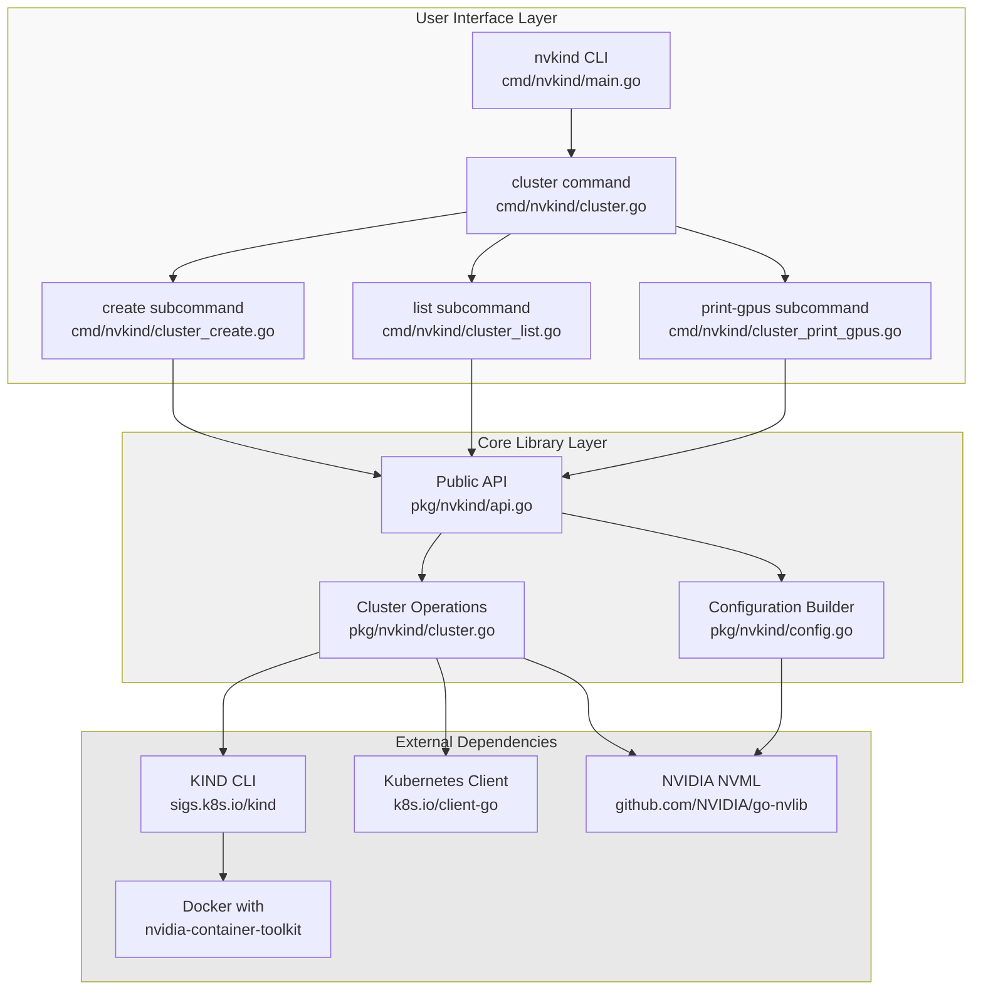

**Sources:** [cmd/nvkind/main.go:29-47](), [go.mod:1-64]()

### Architecture Layers

| Layer | Purpose | Key Components |
|-------|---------|----------------|
| **User Interface** | Provides command-line interface for end users | `main.go`, `cluster.go`, `cluster_create.go`, `cluster_list.go`, `cluster_print_gpus.go` |
| **Core Library** | Implements reusable cluster and configuration logic | `api.go`, `cluster.go`, `config.go` |
| **External Dependencies** | Third-party systems and libraries | KIND, Kubernetes client-go, NVIDIA NVML, Docker runtime |

The separation between CLI and core library allows developers to either use the `nvkind` binary directly or import `pkg/nvkind` as a library for custom tooling.

**Sources:** [README.md:1-14](), [cmd/nvkind/main.go:1-48]()

## Key Components

### CLI Application (cmd/nvkind)

The CLI is built using the `urfave/cli/v2` framework and provides a hierarchical command structure:

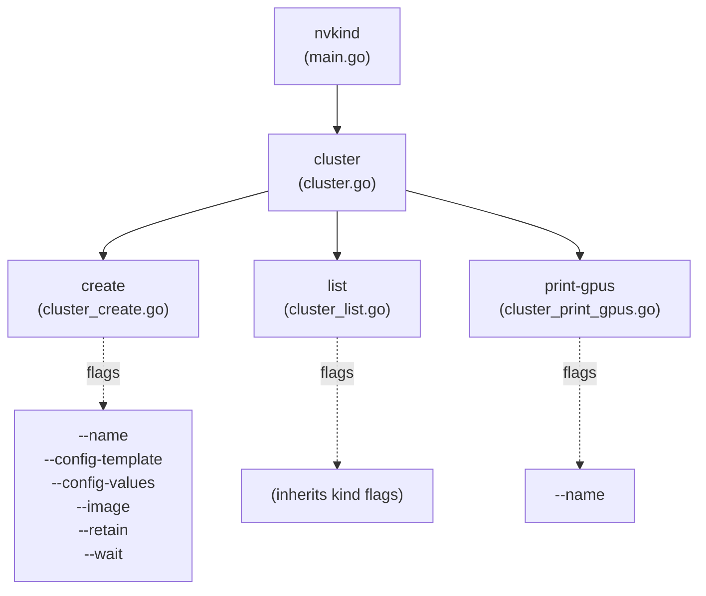

Each command in `cmd/nvkind` delegates to the core library (`pkg/nvkind`) for actual functionality, acting as a thin wrapper that handles flag parsing and user interaction.

**Sources:** [cmd/nvkind/main.go:29-47](), [README.md:228-232]()

### Core Library (pkg/nvkind)

The core library exposes three primary types through `api.go`:

| Type | Purpose | Key Methods |
|------|---------|-------------|
| `Config` | Builds KIND cluster configurations from templates | `NewConfig()`, template execution with GPU awareness |
| `Cluster` | Manages cluster lifecycle and operations | `GetClusterNames()`, `Create()`, `GetNodes()` |
| `Node` | Represents individual cluster nodes | GPU information retrieval |

The library uses a **functional options pattern** for configuration, allowing flexible initialization:
- `ConfigOption` functions modify `Config` creation
- `ClusterOption` functions modify `Cluster` creation

**Sources:** [README.md:12-14]()

### External Dependencies

nvkind integrates with several external systems:

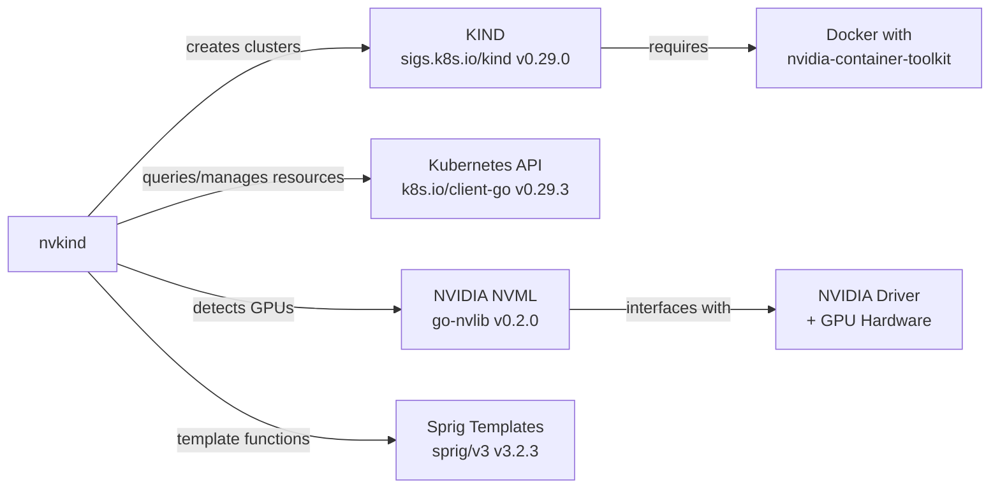

**Sources:** [go.mod:5-15](), [README.md:16-36]()

## Core Features

### 1. GPU Detection and Allocation

nvkind uses NVIDIA NVML (NVIDIA Management Library) to detect available GPUs on the host system. This information is exposed through:
- The `numGPUs` template function available in configuration templates
- The `cluster print-gpus` command for inspecting GPU allocation across nodes

### 2. Template-Based Configuration

Configuration uses Go's `text/template` engine extended with [Sprig functions](https://masterminds.github.io/sprig/) and a custom `numGPUs` function. This allows dynamic cluster configurations based on available hardware.

Example template usage from the README:

```yaml
# Template can use {{ numGPUs }} to get total GPU count
# and distribute them across workers dynamically
```

**Sources:** [README.md:221-227](), [go.mod:6]()

### 3. GPU Distribution Patterns

nvkind supports multiple strategies for distributing GPUs across worker nodes:

| Pattern | Description | Example Template |
|---------|-------------|-----------------|
| **All GPUs to One Worker** | Default behavior, single worker gets all GPUs | Built-in default |
| **One Worker Per GPU** | Creates N workers for N GPUs | `examples/one-worker-per-gpu.yaml` |
| **Equal Distribution** | Evenly distributes GPUs across specified workers | `examples/equally-distributed-gpus.yaml` |
| **Explicit Assignment** | Manually specify GPU indices per worker | `examples/explicit-gpus-per-worker.yaml` |

For detailed information on these patterns, see [GPU Distribution Patterns](#3.4).

**Sources:** [README.md:126-169]()

## How It Works

The following diagram shows the high-level flow when creating a GPU-enabled cluster:

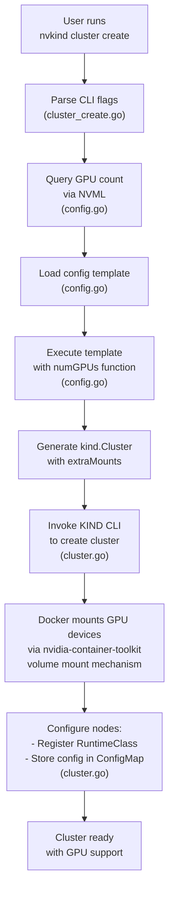

**Key Mechanism:** nvkind leverages the `nvidia-container-toolkit`'s feature `accept-nvidia-visible-devices-as-volume-mounts`, which allows GPU access to be injected by mounting `/var/run/nvidia-container-devices/<device-spec>` as a volume. This is configured through KIND's `extraMounts` in the cluster configuration.

**Sources:** [README.md:79-90](), [README.md:95-105]()

## Use Cases

nvkind is designed for scenarios where local GPU-enabled Kubernetes testing is required:

| Use Case | Description |
|----------|-------------|
| **Local Development** | Develop and test GPU workloads locally before deploying to production |
| **CI/CD Testing** | Automated testing of GPU-dependent applications in ephemeral clusters |
| **Multi-GPU Applications** | Test workloads that require specific GPU topology or distribution |
| **k8s-device-plugin Testing** | Test NVIDIA device plugin or GPU operator in local environments |

Example from the README shows deploying the `k8s-device-plugin` on an nvkind cluster to verify GPU resource allocation and scheduling.

**Sources:** [README.md:234-318]()

## Prerequisites

nvkind requires the following to be installed and configured on the host system:

**Build and Runtime Tools:**
- Go (for building from source)
- make
- Docker
- KIND
- kubectl

**NVIDIA Components:**
- NVIDIA GPU driver
- `nvidia-container-toolkit` configured for Docker with:
  - `nvidia` runtime set as default
  - `accept-nvidia-visible-devices-as-volume-mounts=true` feature flag enabled

For detailed setup instructions, see [Prerequisites and Installation](#2.1).

**Sources:** [README.md:16-72]()

## Next Steps

- **Installation:** See [Prerequisites and Installation](#2.1) for setup instructions
- **Quick Start:** See [Quick Start Guide](#2.2) for creating your first cluster
- **Usage:** See [User Guide](#3) for detailed command documentation
- **Configuration:** See [Configuration Guide](#4) for template customization
- **Architecture:** See [Architecture](#5) for implementation details
- **Development:** See [Development Guide](#6) for contributing to nvkind

**Sources:** [README.md:1-326]()

---

# Page: Getting Started

# Getting Started

<details>
<summary>Relevant source files</summary>

The following files were used as context for generating this wiki page:

- [README.md](README.md)

</details>


This page provides an overview of the steps required to get nvkind installed and running on your system. It covers the prerequisites, installation process, and basic verification steps to ensure your environment is properly configured for creating KIND clusters with GPU support.

For detailed prerequisite installation instructions and system configuration, see [Prerequisites and Installation](#2.1). For a complete walkthrough of creating your first GPU-enabled cluster, see [Quick Start Guide](#2.2).

## Overview

Getting started with nvkind involves three main phases:

1. **Prerequisites Setup**: Install required tools and configure the NVIDIA container runtime
2. **nvkind Installation**: Build or install the nvkind binary
3. **Verification**: Confirm that GPU access works correctly before creating clusters

The following diagram shows the dependency chain and setup flow:

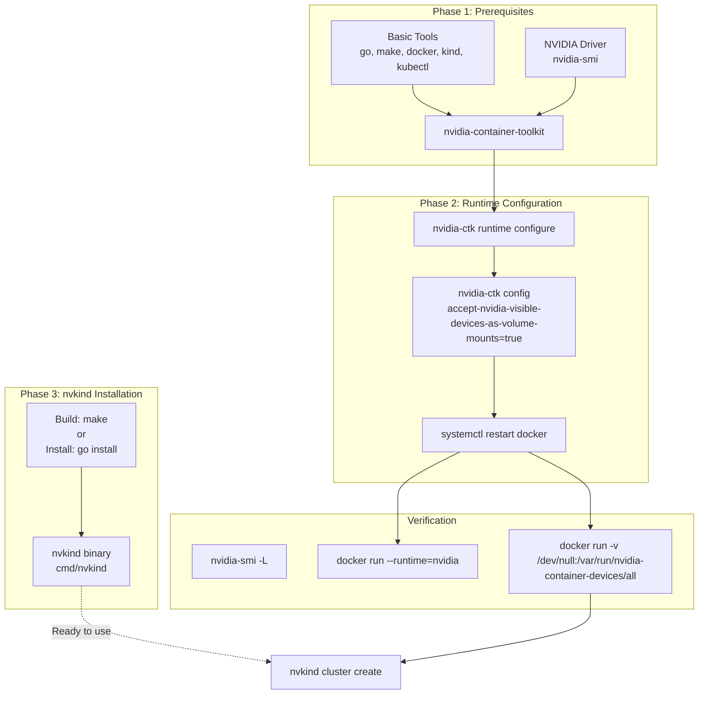

**Installation and Configuration Flow**

Sources: [README.md:16-112]()

## Prerequisites Summary

The following table summarizes the required and recommended tools:

| Component | Purpose | Installation Guide |
|-----------|---------|-------------------|
| **go** | Build nvkind from source | [Prerequisites and Installation](#2.1) |
| **make** | Execute build commands | [Prerequisites and Installation](#2.1) |
| **docker** | Container runtime for KIND | [Prerequisites and Installation](#2.1) |
| **kind** | Kubernetes in Docker | [Prerequisites and Installation](#2.1) |
| **kubectl** | Kubernetes CLI | [Prerequisites and Installation](#2.1) |
| **nvidia-driver** | GPU driver (must already be installed) | [Prerequisites and Installation](#2.1) |
| **nvidia-container-toolkit** | GPU support in containers | [Prerequisites and Installation](#2.1) |

**Note**: The NVIDIA driver and nvidia-container-toolkit are critical for GPU functionality. Without proper configuration, nvkind will not be able to expose GPUs to cluster nodes.

Sources: [README.md:16-37]()

## Installation Methods

nvkind can be installed using two methods:

### Method 1: Install with go install

```bash
go install github.com/NVIDIA/nvkind/cmd/nvkind@latest
```

This installs the latest released version to your `$GOPATH/bin` directory.

### Method 2: Build from Source

```bash
git clone https://github.com/NVIDIA/nvkind
cd nvkind
make
```

This builds the `nvkind` binary in the current directory using the [Makefile]() targets. The binary is produced from [cmd/nvkind/main.go]().

Sources: [README.md:106-124]()

## Critical Configuration Steps

Before nvkind can create GPU-enabled clusters, the nvidia-container-toolkit must be configured with specific settings that enable GPU injection into KIND worker nodes:

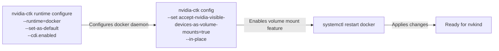

**nvidia-container-toolkit Configuration Sequence**

The second command enables a critical feature flag that allows GPU devices to be injected via volume mounts rather than environment variables. This mechanism is leveraged by nvkind's configuration system to mount specific GPUs into specific worker nodes.

Sources: [README.md:74-91]()

## Verification Process

After installation and configuration, verify each component independently:

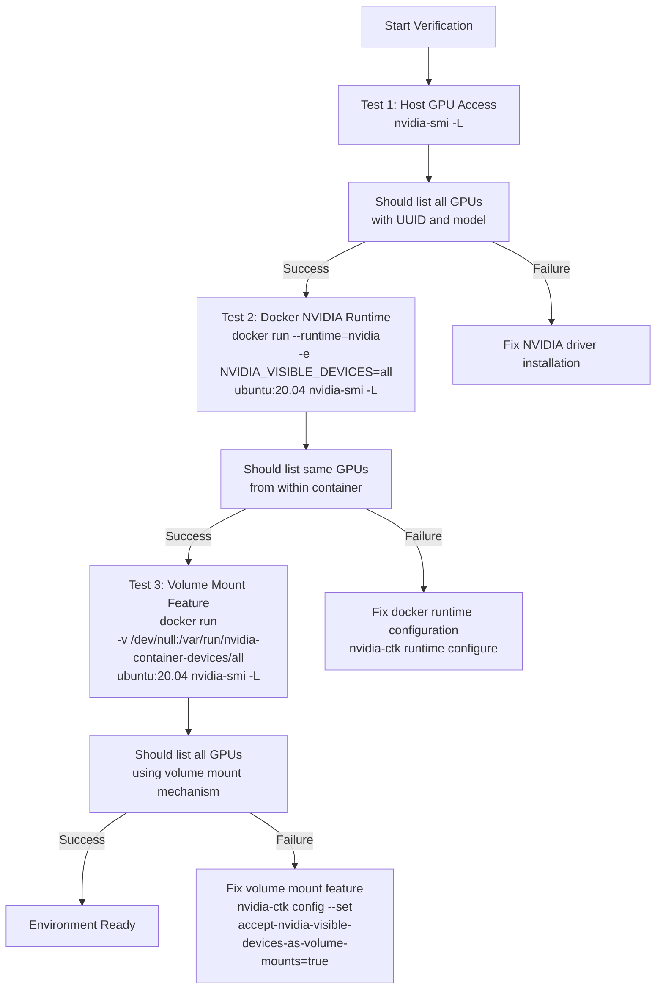

**Component Verification Flow**

### Example Verification Output

When properly configured, `nvidia-smi -L` should produce output like:

```
GPU 0: NVIDIA A100-SXM4-40GB (UUID: GPU-4cf8db2d-06c0-7d70-1a51-e59b25b2c16c)
GPU 1: NVIDIA A100-SXM4-40GB (UUID: GPU-4404041a-04cf-1ccf-9e70-f139a9b1e23c)
GPU 2: NVIDIA A100-SXM4-40GB (UUID: GPU-79a2ba02-a537-ccbf-2965-8e9d90c0bd54)
...
```

The docker commands in Test 2 and Test 3 should produce identical output, confirming both the NVIDIA runtime and volume mount feature are working correctly.

Sources: [README.md:38-105]()

## Creating Your First Cluster

Once verification is complete, create a basic cluster with GPU support:

```bash
nvkind cluster create
```

This creates a default KIND cluster named `kind` with a single worker node that has access to all GPUs on the host machine. The command executes the following sequence:

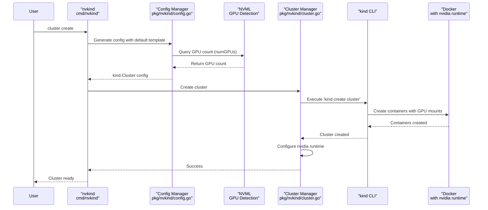

**Default Cluster Creation Flow**

The default configuration uses an embedded template that allocates all GPUs to a single worker node via the volume mount mechanism at `/var/run/nvidia-container-devices/all`. The `numGPUs` template function queries NVML to determine available GPU count.

Sources: [README.md:114-131](), [cmd/nvkind/cluster_create.go](), [pkg/nvkind/config.go](), [pkg/nvkind/cluster.go]()

## Verifying Cluster GPU Access

After cluster creation, verify GPU access within the cluster:

```bash
nvkind cluster print-gpus
```

This command executes `nvidia-smi` on each cluster node and returns a JSON structure showing GPU allocation:

```json
[
    {
        "node": "kind-worker",
        "gpus": [
            {
                "Index": "0",
                "Name": "NVIDIA A100-SXM4-40GB",
                "UUID": "GPU-4cf8db2d-06c0-7d70-1a51-e59b25b2c16c"
            },
            {
                "Index": "1",
                "Name": "NVIDIA A100-SXM4-40GB",
                "UUID": "GPU-4404041a-04cf-1ccf-9e70-f139a9b1e23c"
            }
        ]
    }
]
```

The `print-gpus` command is implemented in [cmd/nvkind/cluster_print_gpus.go]() and uses the `GetNodeGPUs()` method from [pkg/nvkind/cluster.go]() to query GPU information from each node.

Sources: [README.md:172-219](), [cmd/nvkind/cluster_print_gpus.go]()

## Next Steps

Now that you have nvkind installed and verified:

1. **For detailed prerequisite installation** (NVIDIA driver, nvidia-container-toolkit, development tools), see [Prerequisites and Installation](#2.1)

2. **For a complete quick start walkthrough** including multiple cluster configurations and GPU distribution patterns, see [Quick Start Guide](#2.2)

3. **To understand GPU distribution strategies** (one worker per GPU, equal distribution, explicit assignment), see [GPU Distribution Patterns](#3.4)

4. **To learn about configuration templates** and how to customize GPU allocation, see [Configuration Template System](#4.1)

The default cluster created above uses the simplest configuration (all GPUs on one worker). More sophisticated GPU distribution patterns are available through configuration templates in the [examples/]() directory, documented in detail in the User Guide.

Sources: [README.md:1-326]()

---

# Page: Prerequisites and Installation

# Prerequisites and Installation

<details>
<summary>Relevant source files</summary>

The following files were used as context for generating this wiki page:

- [README.md](README.md)
- [deployments/devel/Dockerfile](deployments/devel/Dockerfile)
- [go.mod](go.mod)

</details>


## Purpose and Scope

This document details the system requirements, prerequisite software, and installation procedures for nvkind. It covers hardware requirements, NVIDIA driver setup, nvidia-container-toolkit configuration, and nvkind installation methods.

For information about using nvkind after installation, see [Quick Start Guide](#2.2). For building nvkind from source for development purposes, see [Building from Source](#6.1).

## System Requirements

### Hardware Requirements

- An NVIDIA GPU with compatible driver support
- Sufficient system resources to run Docker containers and Kubernetes nodes

### Software Prerequisites

The following table lists all required software dependencies:

| Prerequisite | Purpose | Installation Link |
|--------------|---------|-------------------|
| go | Building nvkind from source and running go install | https://go.dev/doc/install |
| make | Building nvkind using Makefile | https://www.gnu.org/software/make/#download |
| docker | Container runtime for KIND clusters | https://docs.docker.com/get-docker/ |
| kind | Kubernetes in Docker | https://kind.sigs.k8s.io/docs/user/quick-start/#installation |
| kubectl | Kubernetes command-line tool | https://kubernetes.io/docs/tasks/tools/ |
| nvidia-driver | NVIDIA GPU driver | https://www.nvidia.com/download/index.aspx |
| nvidia-container-toolkit | Container runtime GPU support | https://docs.nvidia.com/datacenter/cloud-native/container-toolkit/latest/install-guide.html |

Optional dependencies:

| Prerequisite | Purpose | Installation Link |
|--------------|---------|-------------------|
| helm | Installing k8s-device-plugin and GPU operators | https://helm.sh/docs/intro/install/ |

**Sources:** [README.md:16-36]()

### Dependency Hierarchy

**Prerequisite Dependency Graph**

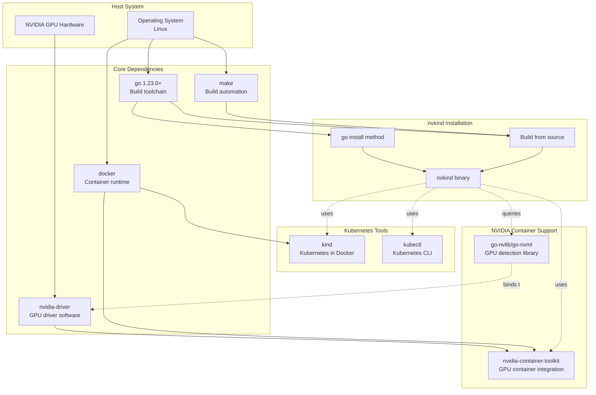

This diagram illustrates the dependency hierarchy for nvkind. The nvkind binary uses `kind` and `kubectl` as external CLI tools, `nvidia-container-toolkit` for GPU container integration, and `go-nvlib`/`go-nvml` for GPU detection. All dependencies ultimately rely on the host OS and NVIDIA GPU hardware.

**Sources:** [README.md:16-36](), [go.mod:1-64]()

## NVIDIA Driver Installation

The NVIDIA driver provides the kernel-level interface to NVIDIA GPU hardware. Without a functioning driver, no GPU operations are possible.

### Verification

Verify that the NVIDIA driver is correctly installed by running:

```bash
nvidia-smi -L
```

Expected output should list all available GPUs:

```
GPU 0: NVIDIA A100-SXM4-40GB (UUID: GPU-4cf8db2d-06c0-7d70-1a51-e59b25b2c16c)
GPU 1: NVIDIA A100-SXM4-40GB (UUID: GPU-4404041a-04cf-1ccf-9e70-f139a9b1e23c)
GPU 2: NVIDIA A100-SXM4-40GB (UUID: GPU-79a2ba02-a537-ccbf-2965-8e9d90c0bd54)
...
```

The exact GPU models and count will vary based on your hardware configuration.

**Sources:** [README.md:38-51]()

## nvidia-container-toolkit Configuration

The `nvidia-container-toolkit` enables Docker containers to access NVIDIA GPUs. nvkind relies on specific features of this toolkit to inject GPU support into KIND worker nodes.

### Installation

Install the `nvidia-container-toolkit` following the official NVIDIA documentation: https://docs.nvidia.com/datacenter/cloud-native/container-toolkit/latest/install-guide.html

### Configuration for nvkind

After installing the toolkit, configure it specifically for nvkind usage with the following commands:

```bash
sudo nvidia-ctk runtime configure --runtime=docker --set-as-default --cdi.enabled
sudo nvidia-ctk config --set accept-nvidia-visible-devices-as-volume-mounts=true --in-place
sudo systemctl restart docker
```

**Configuration commands explained:**

| Command | Purpose |
|---------|---------|
| `nvidia-ctk runtime configure --runtime=docker --set-as-default --cdi.enabled` | Configures Docker to use the NVIDIA runtime as default and enables CDI support |
| `nvidia-ctk config --set accept-nvidia-visible-devices-as-volume-mounts=true --in-place` | Enables volume mount feature required for GPU injection into KIND nodes |
| `systemctl restart docker` | Applies configuration changes |

The `accept-nvidia-visible-devices-as-volume-mounts` flag is critical for nvkind's GPU injection mechanism. This feature allows nvkind to mount special volume paths (such as `/var/run/nvidia-container-devices/<gpu-uuid>`) that signal to the NVIDIA container runtime which GPUs should be visible in each KIND worker node.

**Sources:** [README.md:74-91]()

### nvidia-container-toolkit Configuration Flow

**nvidia-container-toolkit Setup Workflow**

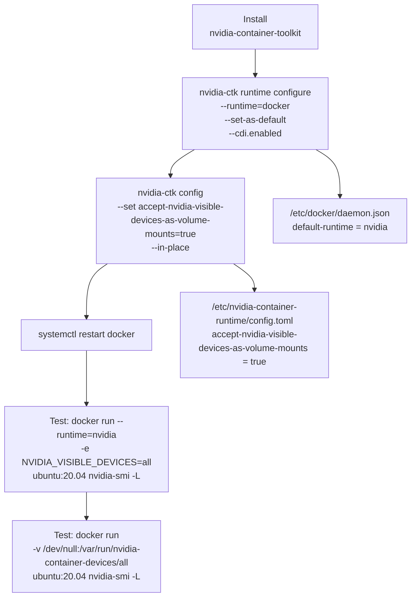

This diagram shows the complete configuration process for nvidia-container-toolkit, including the configuration files modified (`/etc/docker/daemon.json` and `/etc/nvidia-container-runtime/config.toml`) and verification steps.

**Sources:** [README.md:74-105]()

### Verification

#### Test 1: Runtime-based GPU Access

Verify basic NVIDIA runtime functionality:

```bash
docker run --runtime=nvidia -e NVIDIA_VISIBLE_DEVICES=all ubuntu:20.04 nvidia-smi -L
```

This should produce the same output as the host `nvidia-smi -L` command, listing all available GPUs.

#### Test 2: Volume-based GPU Access

Verify the volume mount feature required by nvkind:

```bash
docker run -v /dev/null:/var/run/nvidia-container-devices/all ubuntu:20.04 nvidia-smi -L
```

This should also produce the same GPU list. **If this command fails**, the `accept-nvidia-visible-devices-as-volume-mounts` feature is not properly enabled, and nvkind will not function correctly.

**Sources:** [README.md:53-105]()

## nvkind Installation

nvkind can be installed using `go install` or built from source using the provided Makefile.

### Installation Method 1: go install

The simplest installation method uses Go's built-in package manager:

```bash
go install github.com/NVIDIA/nvkind/cmd/nvkind@latest
```

This downloads, builds, and installs the latest version of nvkind to `$GOPATH/bin/nvkind` (typically `~/go/bin/nvkind`). Ensure `$GOPATH/bin` is in your `PATH`.

**Sources:** [README.md:106-112]()

### Installation Method 2: Build from Source

To build nvkind from source:

```bash
git clone https://github.com/NVIDIA/nvkind.git
cd nvkind
make
```

The built binary will be located at `./nvkind`.

The Makefile provides additional targets for development tasks. See [Development Workflow](#6.2) for details on available make targets.

**Sources:** [README.md:121-124]()

### Build Process and Dependencies

**Build Dependency Mapping**

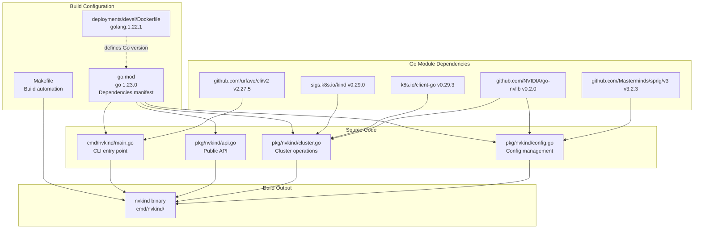

This diagram maps the build process from source files to the final binary, showing the relationship between code components ([cmd/nvkind/main.go](), [pkg/nvkind/api.go](), [pkg/nvkind/cluster.go](), [pkg/nvkind/config.go]()) and their dependencies as defined in [go.mod]().

**Sources:** [go.mod:1-64](), [README.md:121-124](), [deployments/devel/Dockerfile:1-18]()

### Version Requirements

The minimum Go version required for building nvkind is specified in multiple locations:

- [go.mod:3]() specifies `go 1.23.0`
- [deployments/devel/Dockerfile:17]() uses `golang:1.22.1` for CI/CD development environment

The development Dockerfile version is managed by Dependabot and may differ from the go.mod version. When building locally, ensure your Go installation meets the version specified in [go.mod:3]().

**Sources:** [go.mod:3](), [deployments/devel/Dockerfile:15-17]()

## Post-Installation Verification

After installing nvkind, verify the installation:

```bash
nvkind --version
```

Or display available commands:

```bash
nvkind --help
```

Expected output includes available commands as defined in [cmd/nvkind/main.go]():
- `cluster create` - Create a KIND cluster with GPU support
- `cluster list` - List existing KIND clusters
- `cluster print-gpus` - Display GPU allocation across cluster nodes

For next steps on using nvkind to create GPU-enabled clusters, see [Quick Start Guide](#2.2).

**Sources:** [README.md:114-232]()

## Complete Installation Workflow

**Complete Installation Decision Tree**

```mermaid
flowchart TD
    Start["Start Installation"]
    
    CheckGPU{"NVIDIA GPU<br/>Available?"}
    CheckDriver{"nvidia-smi -L<br/>Works?"}
    InstallDriver["Install NVIDIA Driver<br/>nvidia.com/drivers"]
    
    CheckDocker{"Docker<br/>Installed?"}
    InstallDocker["Install Docker<br/>docs.docker.com/get-docker"]
    
    CheckNCT{"nvidia-container-toolkit<br/>Installed?"}
    InstallNCT["Install nvidia-container-toolkit<br/>NVIDIA docs"]
    
    ConfigNCT["Configure nvidia-container-toolkit<br/>nvidia-ctk runtime configure<br/>nvidia-ctk config --set accept-nvidia-visible-devices-as-volume-mounts=true"]
    
    RestartDocker["sudo systemctl restart docker"]
    
    VerifyNCT["Verify: docker run -v /dev/null:/var/run/nvidia-container-devices/all<br/>ubuntu:20.04 nvidia-smi -L"]
    
    CheckTools{"kind, kubectl<br/>Installed?"}
    InstallTools["Install kind and kubectl<br/>kind.sigs.k8s.io<br/>kubernetes.io/docs/tasks/tools"]
    
    CheckGo{"Go 1.23+<br/>Installed?"}
    InstallGo["Install Go<br/>go.dev/doc/install"]
    
    ChooseMethod{"Installation<br/>Method?"}
    
    GoInstall["go install github.com/NVIDIA/nvkind/cmd/nvkind@latest"]
    
    CloneRepo["git clone https://github.com/NVIDIA/nvkind.git"]
    MakeBuild["make"]
    
    VerifyNvkind["Verify: nvkind --version"]
    
    Complete["Installation Complete<br/>See Quick Start Guide"]
    
    Start --> CheckGPU
    CheckGPU -->|"No"| InstallDriver
    CheckGPU -->|"Yes"| CheckDriver
    CheckDriver -->|"No"| InstallDriver
    CheckDriver -->|"Yes"| CheckDocker
    
    InstallDriver --> CheckDriver
    
    CheckDocker -->|"No"| InstallDocker
    CheckDocker -->|"Yes"| CheckNCT
    InstallDocker --> CheckNCT
    
    CheckNCT -->|"No"| InstallNCT
    CheckNCT -->|"Yes"| ConfigNCT
    InstallNCT --> ConfigNCT
    
    ConfigNCT --> RestartDocker
    RestartDocker --> VerifyNCT
    VerifyNCT --> CheckTools
    
    CheckTools -->|"No"| InstallTools
    CheckTools -->|"Yes"| CheckGo
    InstallTools --> CheckGo
    
    CheckGo -->|"No"| InstallGo
    CheckGo -->|"Yes"| ChooseMethod
    InstallGo --> ChooseMethod
    
    ChooseMethod -->|"go install"| GoInstall
    ChooseMethod -->|"Build from source"| CloneRepo
    
    GoInstall --> VerifyNvkind
    
    CloneRepo --> MakeBuild
    MakeBuild --> VerifyNvkind
    
    VerifyNvkind --> Complete
```

This diagram shows the complete installation workflow as a decision tree, guiding users through all prerequisite checks and installation steps.

**Sources:** [README.md:16-124]()

## Troubleshooting Common Issues

### Issue: nvidia-smi not found

**Cause:** NVIDIA driver not installed or not in PATH  
**Solution:** Install NVIDIA driver from https://www.nvidia.com/download/index.aspx

### Issue: docker run with --runtime=nvidia fails

**Cause:** nvidia-container-toolkit not properly configured for Docker  
**Solution:** Run configuration commands:
```bash
sudo nvidia-ctk runtime configure --runtime=docker --set-as-default
sudo systemctl restart docker
```

### Issue: Volume mount test fails

**Cause:** `accept-nvidia-visible-devices-as-volume-mounts` feature not enabled  
**Solution:** Run:
```bash
sudo nvidia-ctk config --set accept-nvidia-visible-devices-as-volume-mounts=true --in-place
sudo systemctl restart docker
```

Verify the configuration is applied in `/etc/nvidia-container-runtime/config.toml`.

### Issue: go install fails

**Cause:** Go not installed or wrong version  
**Solution:** Install Go 1.23.0 or later from https://go.dev/doc/install

### Issue: make command not found

**Cause:** Build tools not installed  
**Solution:** Install make (on Ubuntu/Debian: `sudo apt-get install build-essential`)

**Sources:** [README.md:69-105]()

## Installation Summary

To successfully install and run nvkind, ensure the following components are in place:

1. **Hardware**: NVIDIA GPU with compatible driver
2. **NVIDIA Software**: nvidia-driver and nvidia-container-toolkit with volume mounts enabled
3. **Container Runtime**: Docker configured with NVIDIA runtime
4. **Kubernetes Tools**: kind and kubectl
5. **Build Tools**: Go 1.23.0+ (and make for building from source)
6. **nvkind**: Installed via `go install` or built from source

After completing these installation steps, proceed to [Quick Start Guide](#2.2) to create your first GPU-enabled KIND cluster.

**Sources:** [README.md:16-124]()

---

# Page: Quick Start Guide

# Quick Start Guide

<details>
<summary>Relevant source files</summary>

The following files were used as context for generating this wiki page:

- [README.md](README.md)
- [cmd/nvkind/cluster_create.go](cmd/nvkind/cluster_create.go)
- [examples/one-worker-per-gpu.yaml](examples/one-worker-per-gpu.yaml)

</details>


This guide provides a practical walkthrough to create your first GPU-enabled KIND cluster using nvkind and verify that GPU support is working correctly. It assumes you have completed all prerequisites and installation steps from [Prerequisites and Installation](#2.1). For detailed documentation of individual commands and advanced configuration options, see the [User Guide](#3).

**Scope**: This guide covers the essential steps to build nvkind, create a basic GPU-enabled cluster, and verify GPU access. It does not cover custom configurations, GPU distribution patterns, or integration with Kubernetes GPU workloads, which are addressed in later sections.

## Overview of the Quick Start Process

The following diagram illustrates the complete quick start workflow from building nvkind to verifying GPU access:

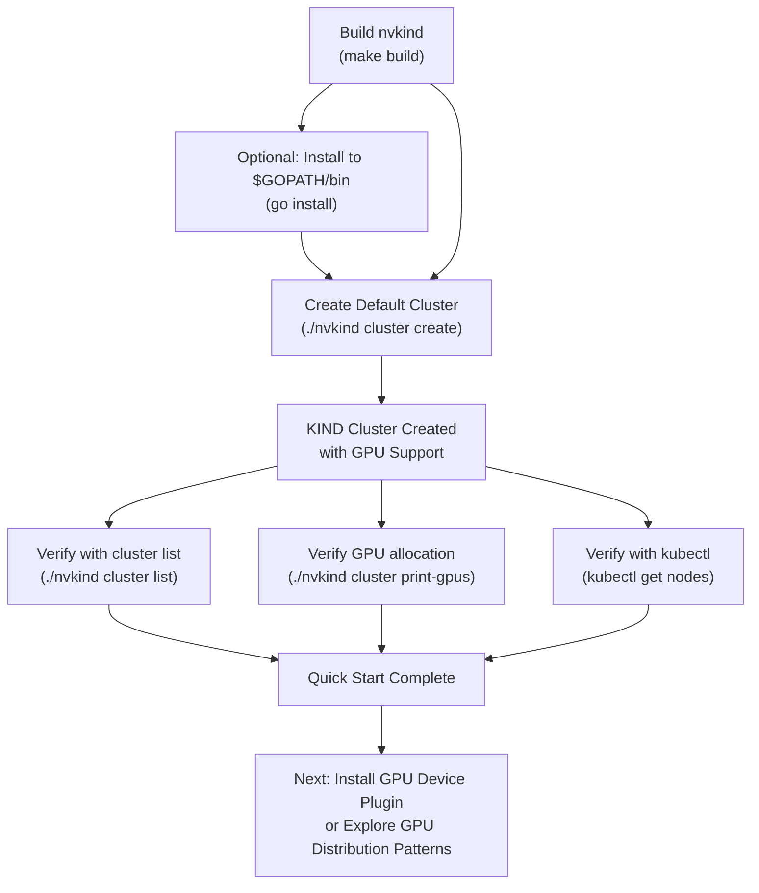

**Sources**: [README.md:114-183]()

## Step 1: Build nvkind

Build the nvkind binary from source using the provided Makefile:

```bash
make
```

This executes the `build` target in the Makefile, which compiles the nvkind CLI application and places the binary in the current directory as `./nvkind`.

Alternatively, if you prefer to install nvkind to your `$GOPATH/bin` directory for system-wide access:

```bash
go install github.com/NVIDIA/nvkind/cmd/nvkind@latest
```

After installation, the `nvkind` command will be available in your PATH (assuming `$GOPATH/bin` is in your PATH).

**Sources**: [README.md:121-124](), [README.md:106-112]()

## Step 2: Create Your First Cluster

Create a default GPU-enabled cluster with a single worker node that has access to all GPUs on the host machine:

```bash
./nvkind cluster create
```

This command invokes the `create` subcommand of the `cluster` command group. Without any flags, it creates a cluster with default settings:
- **Cluster name**: Auto-generated as `nvkind-<random>`
- **Worker nodes**: 1 worker node
- **GPU allocation**: All available GPUs assigned to the single worker node
- **Configuration**: Uses the default embedded configuration template

### What Happens During Cluster Creation

The following diagram shows the key code entities and operations involved in cluster creation:

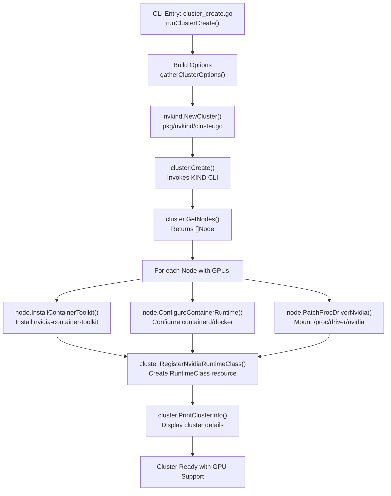

**Sources**: [cmd/nvkind/cluster_create.go:98-147]()

### Common Create Flags

The `cluster create` command supports the following flags for basic usage:

| Flag | Description | Environment Variable | Default |
|------|-------------|---------------------|---------|
| `--name` | Cluster name | `KIND_CLUSTER_NAME` | `nvkind-<random>` |
| `--image` | Node Docker image | `KIND_CLUSTER_IMAGE` | KIND default |
| `--retain` | Retain nodes on failure | `KIND_CLUSTER_RETAIN` | `false` |
| `--wait` | Wait duration for control plane | `KIND_CLUSTER_WAIT` | No wait |
| `--kubeconfig` | Path to kubeconfig file | `KUBECONFIG` | `~/.kube/config` |

For advanced configuration options including `--config-template` and `--config-values`, see [GPU Distribution Patterns](#3.4) and [Configuration Template System](#4.1).

**Sources**: [cmd/nvkind/cluster_create.go:50-93]()

## Step 3: Verify Cluster Creation

After the cluster is created, verify it exists and inspect its GPU configuration.

### List All Clusters

View all nvkind-created clusters:

```bash
./nvkind cluster list
```

This command uses the KIND CLI to enumerate all existing KIND clusters. Expected output:

```
nvkind-12abc34d
```

**Sources**: [README.md:173-176]()

### Inspect GPU Allocation

Display the GPU allocation for all nodes in the cluster:

```bash
./nvkind cluster print-gpus
```

For a default cluster with 8 GPUs, the output will show all GPUs assigned to the single worker node:

```json
[
    {
        "node": "nvkind-12abc34d-worker",
        "gpus": [
            {
                "Index": "0",
                "Name": "NVIDIA A100-SXM4-40GB",
                "UUID": "GPU-4cf8db2d-06c0-7d70-1a51-e59b25b2c16c"
            },
            {
                "Index": "1",
                "Name": "NVIDIA A100-SXM4-40GB",
                "UUID": "GPU-4404041a-04cf-1ccf-9e70-f139a9b1e23c"
            }
            // ... remaining GPUs ...
        ]
    }
]
```

The command queries each node using NVML through the nvkind library to enumerate visible GPUs. You can optionally specify a cluster name with `--name` or omit it to use the current kubectl context.

**Sources**: [README.md:177-219]()

### Verify with kubectl

Confirm the cluster is accessible via kubectl:

```bash
kubectl get nodes
```

Expected output showing control plane and worker nodes:

```
NAME                        STATUS   ROLES           AGE   VERSION
nvkind-12abc34d-control-plane   Ready    control-plane   1m    v1.27.3
nvkind-12abc34d-worker          Ready    <none>          1m    v1.27.3
```

**Sources**: [README.md:114-183]()

## Step 4: Understanding GPU Injection

The following diagram illustrates how nvkind injects GPU support into KIND cluster nodes through volume mounts and runtime configuration:

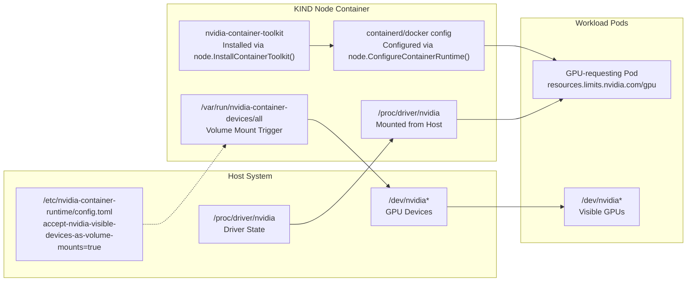

**Key Mechanisms**:
1. **Volume Mount Injection**: The configuration template specifies `extraMounts` with paths like `/var/run/nvidia-container-devices/all`, which triggers the nvidia-container-runtime to expose GPU devices
2. **Toolkit Installation**: `node.InstallContainerToolkit()` installs the nvidia-container-toolkit inside the KIND node
3. **Runtime Configuration**: `node.ConfigureContainerRuntime()` configures the container runtime to use the NVIDIA runtime
4. **Driver State**: `node.PatchProcDriverNvidia()` ensures `/proc/driver/nvidia` is accessible for driver communication

**Sources**: [cmd/nvkind/cluster_create.go:123-136](), [README.md:74-105](), [examples/one-worker-per-gpu.yaml:21-26]()

## Next Steps

Now that you have a working GPU-enabled cluster, you can:

1. **Install the NVIDIA Device Plugin**: Deploy the k8s-device-plugin to enable GPU resource scheduling. See the README section on [Installing the k8s-device-plugin](README.md#install-the-k8s-device-plugin) for detailed instructions.

2. **Explore GPU Distribution Patterns**: Create clusters with different GPU allocation strategies:
   - One worker node per GPU: `./nvkind cluster create --config-template=examples/one-worker-per-gpu.yaml`
   - Evenly distributed GPUs across workers: See [GPU Distribution Patterns](#3.4)
   - Explicit GPU assignment per worker: See [Creating Custom Configurations](#4.3)

3. **Deploy GPU Workloads**: Run containerized applications that require GPU resources. See [Creating Clusters](#3.1) for examples of deploying GPU-enabled pods.

4. **Clean Up**: To delete all KIND clusters when finished:
   ```bash
   for cluster in $(kind get clusters); do kind delete cluster --name=${cluster}; done
   ```

**Sources**: [README.md:234-259](), [README.md:127-169](), [README.md:319-325]()

## Troubleshooting Quick Start Issues

If cluster creation fails or GPUs are not visible, verify the following:

| Issue | Verification Command | Expected Result |
|-------|---------------------|-----------------|
| NVIDIA driver installed | `nvidia-smi -L` | Lists all host GPUs |
| nvidia-container-toolkit configured | `docker run --runtime=nvidia -e NVIDIA_VISIBLE_DEVICES=all ubuntu:20.04 nvidia-smi -L` | Lists all host GPUs |
| Volume mount feature enabled | `docker run -v /dev/null:/var/run/nvidia-container-devices/all ubuntu:20.04 nvidia-smi -L` | Lists all host GPUs |

If the volume mount test fails, re-run the setup commands from [Prerequisites and Installation](#2.1):

```bash
sudo nvidia-ctk runtime configure --runtime=docker --set-as-default --cdi.enabled
sudo nvidia-ctk config --set accept-nvidia-visible-devices-as-volume-mounts=true --in-place
sudo systemctl restart docker
```

**Sources**: [README.md:38-105]()

---

# Page: User Guide

# User Guide

<details>
<summary>Relevant source files</summary>

The following files were used as context for generating this wiki page:

- [README.md](README.md)
- [cmd/nvkind/cluster.go](cmd/nvkind/cluster.go)

</details>


This guide provides comprehensive documentation for using the `nvkind` CLI tool to create and manage KIND clusters with NVIDIA GPU support. It covers the available commands, their options, and common usage patterns.

For installation instructions and system setup, see [Getting Started](#2). For details on the configuration system and custom templates, see [Configuration Guide](#4). For information about the internal architecture and how GPU support is integrated, see [Architecture](#5).

## Overview

The `nvkind` CLI provides a set of commands under the `cluster` subcommand for managing GPU-enabled KIND clusters. The tool wraps the standard KIND cluster creation workflow with GPU detection, device allocation, and container runtime configuration to enable NVIDIA GPU support.

### Command Structure

The `nvkind` CLI follows a hierarchical command structure where all cluster operations are grouped under the `cluster` parent command:

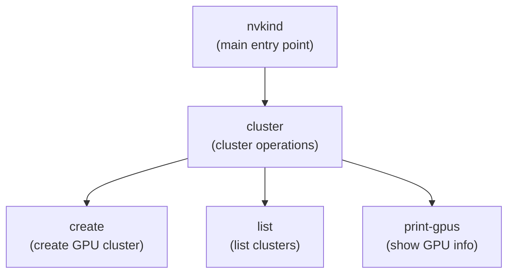

**Command Hierarchy**

Sources: [cmd/nvkind/cluster.go:23-33]()

The command structure is defined in [cmd/nvkind/cluster.go:23-33](), where `BuildClusterCommand()` constructs the parent `cluster` command with three subcommands: `list`, `create`, and `print-gpus`.

### Available Commands

The following table summarizes the available commands:

| Command | Purpose | Detailed Documentation |
|---------|---------|----------------------|
| `nvkind cluster create` | Create a new KIND cluster with GPU support | [Creating Clusters](#3.1) |
| `nvkind cluster list` | List all existing KIND clusters | [Listing Clusters](#3.2) |
| `nvkind cluster print-gpus` | Display GPU allocation for cluster nodes | [Viewing GPU Information](#3.3) |

## Typical Workflows

The following diagram illustrates common user workflows with `nvkind`:

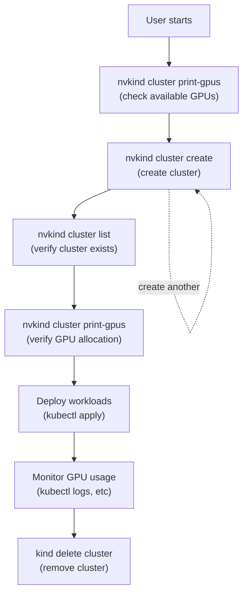

**Typical nvkind workflow from cluster creation to cleanup**

Sources: [README.md:114-184]()

## Command Categories

### Cluster Lifecycle Management

Commands for creating and discovering clusters:

- **`create`**: Creates a new KIND cluster with GPU support configured according to a template. Supports various GPU distribution patterns through configuration templates. See [Creating Clusters](#3.1) for detailed usage.

- **`list`**: Lists all KIND clusters on the system. This is a convenience wrapper around `kind get clusters` that provides consistent output formatting. See [Listing Clusters](#3.2) for details.

### GPU Inspection

Commands for viewing GPU allocation and configuration:

- **`print-gpus`**: Queries each node in a cluster and reports which GPUs are visible within that node's container. Returns structured JSON output showing the GPU index, name, and UUID for each device. See [Viewing GPU Information](#3.3) for details.

Sources: [cmd/nvkind/cluster.go:23-33](), [README.md:171-219]()

## Common Options

The `create` command shares several options with the standard `kind create cluster` command:

| Option | Description | Default |
|--------|-------------|---------|
| `--name` | Cluster name | `kind` |
| `--image` | Node container image | KIND default |
| `--retain` | Retain nodes on failure | `false` |
| `--wait` | Wait for control plane to be ready | `0s` |

Additional `nvkind`-specific options for configuration:

| Option | Description | Default |
|--------|-------------|---------|
| `--config-template` | Path to configuration template file | Built-in default |
| `--config-values` | YAML values for template (file path or `-` for stdin) | None |

Sources: [README.md:228-231]()

## Basic Usage Examples

### Create Default Cluster

Create a cluster with one worker node having access to all GPUs:

```bash
nvkind cluster create
```

This uses the built-in default configuration template that allocates all available GPUs to a single worker node.

### Create Named Cluster

Create a cluster with a specific name:

```bash
nvkind cluster create --name=my-gpu-cluster
```

### Create Cluster with Custom Configuration

Create a cluster using a custom configuration template and values:

```bash
nvkind cluster create \
  --name=custom-cluster \
  --config-template=my-template.yaml \
  --config-values=my-values.yaml
```

### List All Clusters

Display all KIND clusters:

```bash
nvkind cluster list
```

### View GPU Allocation

Display GPU information for the cluster in current kubecontext:

```bash
nvkind cluster print-gpus
```

Display GPU information for a specific cluster:

```bash
nvkind cluster print-gpus --name=my-gpu-cluster
```

Sources: [README.md:126-183]()

## GPU Distribution Patterns

One of the key features of `nvkind` is the ability to configure different GPU distribution patterns across worker nodes. The tool provides several built-in templates for common patterns:

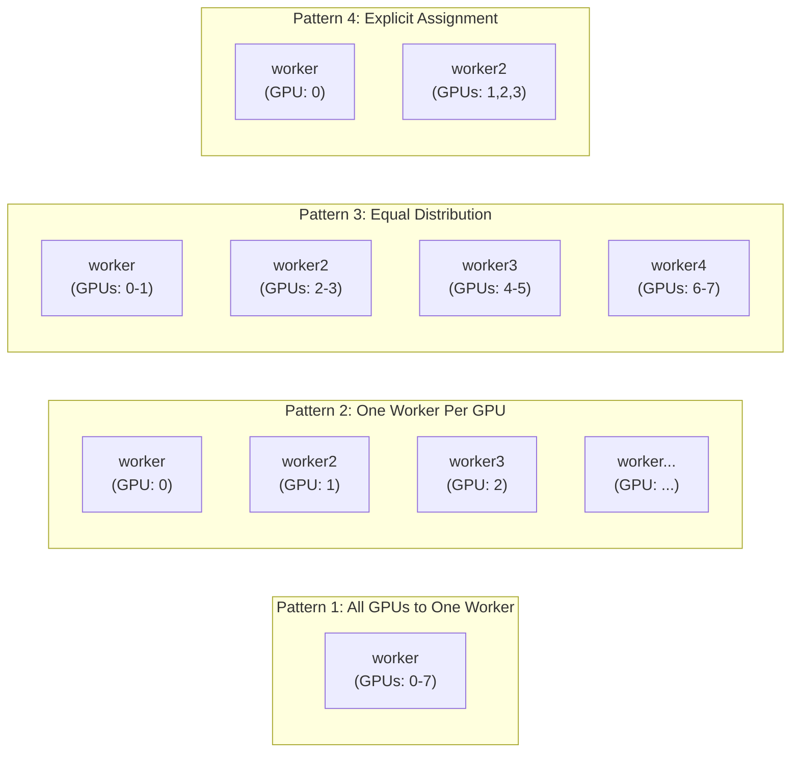

**Four GPU distribution patterns supported by nvkind**

The following table summarizes the available patterns:

| Pattern | Description | Template File | Use Case |
|---------|-------------|---------------|----------|
| All GPUs to one worker | Single worker with all GPUs | Built-in default | Simple testing, single-tenant workloads |
| One worker per GPU | Separate worker for each GPU | `examples/one-worker-per-gpu.yaml` | Maximum isolation, multi-tenant scenarios |
| Equal distribution | GPUs evenly distributed across workers | `examples/equally-distributed-gpus.yaml` | Balanced multi-worker clusters |
| Explicit assignment | Custom GPU-to-worker mapping | `examples/explicit-gpus-per-worker.yaml` | Complex topologies, heterogeneous workloads |

For detailed information about each pattern, including configuration examples and use cases, see [GPU Distribution Patterns](#3.4).

Sources: [README.md:126-169](), [README.md:221-227]()

## Integration with Template System

Commands interact with the configuration template system to generate KIND cluster configurations:

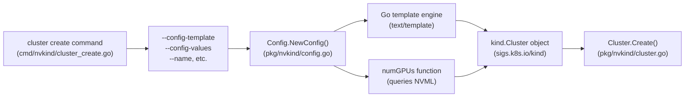

**How CLI commands use the template system to generate cluster configurations**

Sources: [cmd/nvkind/cluster.go:23-33](), [README.md:221-227]()

The template system supports both built-in templates (embedded in the binary) and external template files. Templates can reference the `numGPUs` function to dynamically query the number of available GPUs at cluster creation time. For more details on the template system, see [Configuration Template System](#4.1).

## Next Steps

For detailed information on specific commands and features:

- **Creating Clusters**: See [Creating Clusters](#3.1) for complete documentation of the `create` command, including all flags and options
- **Listing Clusters**: See [Listing Clusters](#3.2) for the `list` command usage
- **Viewing GPU Information**: See [Viewing GPU Information](#3.3) for interpreting `print-gpus` output
- **GPU Distribution Patterns**: See [GPU Distribution Patterns](#3.4) for detailed pattern descriptions and configuration examples
- **Custom Configurations**: See [Configuration Guide](#4) for creating custom templates and advanced configuration scenarios
- **Troubleshooting**: See [Prerequisites and Installation](#2.1) for resolving common setup issues

Sources: [README.md:1-326]()

---

# Page: Creating Clusters

# Creating Clusters

<details>
<summary>Relevant source files</summary>

The following files were used as context for generating this wiki page:

- [README.md](README.md)
- [cmd/nvkind/cluster_create.go](cmd/nvkind/cluster_create.go)
- [pkg/nvkind/cluster.go](pkg/nvkind/cluster.go)

</details>


## Purpose and Scope

This page documents the `nvkind cluster create` command, which creates KIND (Kubernetes in Docker) clusters with NVIDIA GPU support. It covers command-line flags, the cluster creation workflow, and various GPU allocation scenarios. For information about GPU distribution patterns and configuration templates, see [GPU Distribution Patterns](#3.4) and [Configuration Template System](#4.1). For architectural details about how GPU support is injected into KIND clusters, see [GPU Integration Mechanism](#5.4).

## Command Overview

The `nvkind cluster create` command is implemented in [cmd/nvkind/cluster_create.go](). The command accepts configuration through flags and environment variables to control cluster naming, node images, GPU allocation patterns, and KIND-specific behavior.

**Basic Usage:**
```bash
nvkind cluster create [flags]
```

**Default Behavior:**
When invoked without flags, the command creates a cluster with a randomly-generated name (format: `nvkind-<random>`) containing one worker node with access to all GPUs on the host machine.

Sources: [cmd/nvkind/cluster_create.go:40-96](), [README.md:126-131]()

## Command Flags

The `cluster create` command supports the following flags, defined in the `ClusterCreateFlags` struct:

| Flag | Type | Environment Variable | Purpose | Default |
|------|------|---------------------|---------|---------|
| `--name` | string | `KIND_CLUSTER_NAME` | Cluster name | `nvkind-<random>` |
| `--image` | string | `KIND_CLUSTER_IMAGE` | Node Docker image | KIND default |
| `--retain` | bool | `KIND_CLUSTER_RETAIN` | Retain nodes on creation failure | `false` |
| `--wait` | duration | `KIND_CLUSTER_WAIT` | Wait for control plane readiness | `0` (no wait) |
| `--config-template` | string | `KIND_CLUSTER_CONFIG_TEMPLATE` | Path to custom config template | Built-in default |
| `--config-values` | string | `KIND_CLUSTER_CONFIG_VALUES` | Path to values file (or `-` for stdin) | None |
| `--kubeconfig` | string | `KUBECONFIG` | Absolute path to kubeconfig | `~/.kube/config` |

Sources: [cmd/nvkind/cluster_create.go:30-93]()

### Flag Processing

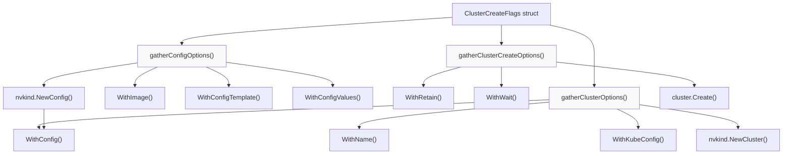

**Diagram: Flag Processing Pipeline**

The flag gathering process uses three separate methods to organize options by their target component:
- `gatherConfigOptions()` - Configuration template and image settings
- `gatherClusterOptions()` - Cluster-level settings including name and kubeconfig
- `gatherClusterCreateOptions()` - KIND-specific creation options

Sources: [cmd/nvkind/cluster_create.go:149-222]()

## Cluster Creation Workflow

The cluster creation process is orchestrated by the `runClusterCreate()` function and involves multiple phases:

```mermaid
flowchart TB
    Start["runClusterCreate()"]
    
    Start --> GatherOpts["Gather cluster options"]
    GatherOpts --> NewCluster["nvkind.NewCluster()"]
    
    NewCluster --> GatherCreate["Gather create options"]
    GatherCreate --> Create["cluster.Create()"]
    
    Create --> GetNodes["cluster.GetNodes()"]
    
    GetNodes --> Loop{{"For each node<br/>with GPUs"}}
    
    Loop --> InstallToolkit["node.InstallContainerToolkit()"]
    InstallToolkit --> ConfigRuntime["node.ConfigureContainerRuntime()"]
    ConfigRuntime --> PatchProc["node.PatchProcDriverNvidia()"]
    
    PatchProc --> Loop
    
    Loop --> PrintInfo["cluster.PrintClusterInfo()"]
    PrintInfo --> RegisterRT["cluster.RegisterNvidiaRuntimeClass()"]
    
    RegisterRT --> End["Cluster ready"]
    
    style Create fill:#ffe1e1
    style InstallToolkit fill:#fff4e1
    style ConfigRuntime fill:#fff4e1
    style PatchProc fill:#fff4e1
    style RegisterRT fill:#e1f5ff
```

**Diagram: Cluster Creation Execution Flow**

Sources: [cmd/nvkind/cluster_create.go:98-147]()

### Phase 1: Cluster Provisioning

The `cluster.Create()` method constructs and executes a KIND command with the following steps:

1. **Command Construction** - Builds the KIND CLI command at [pkg/nvkind/cluster.go:98-113]()
   ```
   kind create cluster --name <name> --config -
   ```

2. **Configuration Marshaling** - Converts the `kind.Cluster` configuration to YAML at [pkg/nvkind/cluster.go:115-118]()

3. **Process Execution** - Executes KIND via subprocess with config piped to stdin at [pkg/nvkind/cluster.go:120-127]()

4. **Config Persistence** - Stores the cluster configuration in a ConfigMap named `nvkind-cluster-config` in the `default` namespace at [pkg/nvkind/cluster.go:129-131]()

Sources: [pkg/nvkind/cluster.go:97-134]()

### Phase 2: GPU Node Configuration

For each node with GPUs, three configuration steps are executed:

1. **`InstallContainerToolkit()`** - Installs the NVIDIA Container Toolkit on the node
2. **`ConfigureContainerRuntime()`** - Configures containerd to use the nvidia runtime
3. **`PatchProcDriverNvidia()`** - Patches `/proc/driver/nvidia` for device visibility

These operations are performed sequentially at [cmd/nvkind/cluster_create.go:123-136]().

Sources: [cmd/nvkind/cluster_create.go:123-136]()

### Phase 3: Cluster Finalization

Two final steps complete the cluster setup:

1. **`PrintClusterInfo()`** - Displays cluster endpoints and node status using `kubectl` at [pkg/nvkind/cluster.go:136-159]()

2. **`RegisterNvidiaRuntimeClass()`** - Creates a `RuntimeClass` object with handler `nvidia` at [pkg/nvkind/cluster.go:161-173]()

Sources: [cmd/nvkind/cluster_create.go:138-144](), [pkg/nvkind/cluster.go:136-173]()

## Creation Scenarios

### Scenario 1: Default Cluster

**Command:**
```bash
nvkind cluster create
```

**Behavior:**
- Generates random cluster name (format: `nvkind-<random>`)
- Creates 1 worker node
- Assigns all host GPUs to the single worker
- Uses built-in default configuration template

**Configuration Source:** Embedded default template in [pkg/nvkind/config.go]()

Sources: [README.md:126-131]()

### Scenario 2: One Worker Per GPU

**Command:**
```bash
nvkind cluster create --config-template=examples/one-worker-per-gpu.yaml
```

**Behavior:**
- Creates N worker nodes (where N = number of GPUs)
- Each worker receives exactly one GPU
- GPU assignment follows host device order (GPU 0 → worker 1, GPU 1 → worker 2, etc.)

**Use Case:** Testing multi-node GPU workloads or simulating GPU-per-pod scenarios

Sources: [README.md:133-139]()

### Scenario 3: Equal Distribution

**Command:**
```bash
nvkind cluster create \
  --name=evenly-distributed-2-by-4 \
  --config-template=examples/equally-distributed-gpus.yaml \
  --config-values=- \
<<EOF
numWorkers: 4
EOF
```

**Behavior:**
- Creates 4 worker nodes
- Distributes 8 GPUs evenly (2 per worker)
- Template uses `numGPUs` function to calculate distribution

**Configuration Processing:**
1. Template is loaded from filesystem
2. Values are read from stdin (`--config-values=-`)
3. Template function `numGPUs` queries NVML for total GPU count
4. Division logic distributes devices evenly

Sources: [README.md:141-153]()

### Scenario 4: Explicit GPU Assignment

**Command:**
```bash
nvkind cluster create \
  --name=explicit-gpus \
  --config-template=examples/explicit-gpus-per-worker.yaml \
  --config-values=- \
<<EOF
workers:
- devices: 0
- devices: [1, 2, 3]
EOF
```

**Behavior:**
- Creates 2 worker nodes
- Worker 1: GPU 0 only
- Worker 2: GPUs 1, 2, 3
- Provides fine-grained control over GPU topology

**Configuration Mechanism:** The template iterates over the `workers` array, creating a KIND node for each entry with `extraMounts` configured for the specified devices.

Sources: [README.md:155-169]()

### Scenario 5: Custom Node Image

**Command:**
```bash
nvkind cluster create \
  --name=custom-image \
  --image=kindest/node:v1.27.0
```

**Behavior:**
- Uses specific Kubernetes version via KIND node image
- Applies to all nodes in the cluster
- Image must be compatible with KIND

**Flag Processing:** The `--image` flag is converted to `nvkind.WithImage()` option at [cmd/nvkind/cluster_create.go:152-154](), which sets the `Image` field in the configuration.

Sources: [cmd/nvkind/cluster_create.go:152-154]()

### Scenario 6: Retain on Failure

**Command:**
```bash
nvkind cluster create --retain
```

**Behavior:**
- On creation failure, KIND containers are not automatically deleted
- Enables debugging by inspecting failed node state
- Passed directly to KIND via `--retain` flag

**Implementation:** The retain flag is appended to the KIND command at [pkg/nvkind/cluster.go:108-110]().

Sources: [pkg/nvkind/cluster.go:108-110]()

## Configuration Values Processing

### Values from File

```bash
nvkind cluster create \
  --config-template=examples/equally-distributed-gpus.yaml \
  --config-values=/path/to/values.yaml
```

The file is read using `os.ReadFile()` at [cmd/nvkind/cluster_create.go:171-174]().

### Values from Stdin

```bash
nvkind cluster create \
  --config-template=examples/equally-distributed-gpus.yaml \
  --config-values=- \
<<EOF
numWorkers: 4
EOF
```

When `--config-values=-` is specified, the function reads from `os.Stdin` using `bufio.Scanner` at [cmd/nvkind/cluster_create.go:165-169]().

Sources: [cmd/nvkind/cluster_create.go:160-178]()

## Code Entity Mapping

```mermaid
graph TB
    subgraph "CLI Layer - cmd/nvkind/cluster_create.go"
        BuildCmd["BuildClusterCreateCommand()"]
        RunCreate["runClusterCreate()"]
        Flags["ClusterCreateFlags"]
        
        GatherConfig["gatherConfigOptions()"]
        GatherCluster["gatherClusterOptions()"]
        GatherCreate["gatherClusterCreateOptions()"]
    end
    
    subgraph "Core Library - pkg/nvkind/"
        NewCluster["NewCluster()"]
        ClusterStruct["Cluster struct"]
        CreateMethod["Cluster.Create()"]
        GetNodesMethod["Cluster.GetNodes()"]
        PrintInfo["Cluster.PrintClusterInfo()"]
        RegisterRT["Cluster.RegisterNvidiaRuntimeClass()"]
        
        NewConfig["NewConfig()"]
        ConfigStruct["Config struct"]
    end
    
    subgraph "Node Operations - pkg/nvkind/"
        NodeStruct["Node struct"]
        InstallToolkit["Node.InstallContainerToolkit()"]
        ConfigRuntime["Node.ConfigureContainerRuntime()"]
        PatchProc["Node.PatchProcDriverNvidia()"]
    end
    
    subgraph "External Commands"
        KindCreate["kind create cluster"]
        KubectlCluster["kubectl cluster-info"]
        KubectlApply["kubectl apply"]
    end
    
    BuildCmd --> Flags
    Flags --> GatherConfig
    Flags --> GatherCluster
    Flags --> GatherCreate
    
    GatherConfig --> NewConfig
    NewConfig --> ConfigStruct
    
    GatherCluster --> NewCluster
    ConfigStruct --> NewCluster
    
    NewCluster --> ClusterStruct
    
    RunCreate --> GatherConfig
    RunCreate --> GatherCluster
    RunCreate --> GatherCreate
    RunCreate --> NewCluster
    
    GatherCreate --> CreateMethod
    ClusterStruct --> CreateMethod
    
    CreateMethod --> KindCreate
    
    ClusterStruct --> GetNodesMethod
    GetNodesMethod --> NodeStruct
    
    NodeStruct --> InstallToolkit
    NodeStruct --> ConfigRuntime
    NodeStruct --> PatchProc
    
    ClusterStruct --> PrintInfo
    PrintInfo --> KubectlCluster
    
    ClusterStruct --> RegisterRT
    RegisterRT --> KubectlApply
```

**Diagram: Code Entity Relationships in Cluster Creation**

This diagram shows the primary code entities involved in cluster creation and their interactions across the CLI layer, core library, and external command execution.

Sources: [cmd/nvkind/cluster_create.go:40-222](), [pkg/nvkind/cluster.go:68-173]()

## KIND Command Construction

The actual KIND command executed by `cluster.Create()` is constructed at [pkg/nvkind/cluster.go:98-113]():

**Base Command:**
```
kind create cluster --name <cluster-name> --config -
```

**Optional Flags:**
- `--retain` - Added when `ClusterCreateOptions.retain` is true
- `--wait <duration>` - Added when `ClusterCreateOptions.wait` is non-zero

**Configuration Input:**
The cluster configuration is marshaled to YAML and piped to KIND's stdin, allowing complex multi-node configurations without temporary files.

Sources: [pkg/nvkind/cluster.go:98-127]()

## ConfigMap Persistence

After cluster creation, the configuration is persisted in a ConfigMap named `nvkind-cluster-config` by the `addConfigBytesToExistingCluster()` function:

**Purpose:**
- Enables retrieval of cluster configuration for existing clusters
- Allows `nvkind cluster print-gpus` to determine GPU allocation
- Supports cluster management operations without re-querying configuration templates

**Implementation Details:**
- Namespace: `default`
- ConfigMap name: `nvkind-cluster-config` (constant at [pkg/nvkind/cluster.go:43]())
- Data key: `config`
- Kubernetes API: Uses `clientset.CoreV1().ConfigMaps("default").Create()`

Sources: [pkg/nvkind/cluster.go:294-326]()

## Error Handling

The cluster creation process can fail at multiple points:

| Failure Point | Error Source | Handling |
|--------------|--------------|----------|
| Option gathering | Invalid flag values | Returns error before cluster creation |
| Config validation | Template processing | Returns error before cluster creation |
| KIND execution | `kind create cluster` failure | Returns error, respects `--retain` flag |
| Node retrieval | `kind get nodes` failure | Returns error, cluster may be partially created |
| Toolkit installation | Node setup commands | Returns error, cluster exists but GPUs not configured |
| Runtime configuration | containerd setup | Returns error, cluster exists but GPUs not functional |
| RuntimeClass registration | `kubectl apply` failure | Returns error, cluster usable but RuntimeClass missing |

All errors are wrapped with context using `fmt.Errorf()` with `%w` verb to preserve error chains.

Sources: [cmd/nvkind/cluster_create.go:98-147]()

## Cluster Name Resolution

The cluster name is determined by the following precedence at [pkg/nvkind/cluster.go:76-78]():

1. Explicit `--name` flag
2. `Config.Name` from configuration
3. KIND's default random generation (when neither is specified)

If a cluster with the specified name already exists, the system retrieves its configuration from the ConfigMap and validates it matches any provided configuration options.

Sources: [pkg/nvkind/cluster.go:68-95](), [pkg/nvkind/cluster.go:252-292]()

---

# Page: Listing Clusters

# Listing Clusters

<details>
<summary>Relevant source files</summary>

The following files were used as context for generating this wiki page:

- [cmd/nvkind/cluster_list.go](cmd/nvkind/cluster_list.go)
- [pkg/nvkind/cluster.go](pkg/nvkind/cluster.go)

</details>


## Purpose and Scope

This page documents the `nvkind cluster list` command, which discovers and displays all existing KIND clusters on the local system. The command lists all KIND clusters regardless of whether they were created with `nvkind` or standard `kind` tooling, and whether they have GPU support configured.

For information about creating clusters, see [Creating Clusters](#3.1). For inspecting GPU allocation within a specific cluster, see [Viewing GPU Information](#3.3).

## Command Usage

The `cluster list` command is invoked as a subcommand of `nvkind cluster`:

```bash
nvkind cluster list
```

The command accepts no flags or arguments. It queries the local Docker environment for all existing KIND clusters and prints their names to standard output.

**Example Output:**
```
gpu-cluster
my-kind-cluster
test-cluster
```

**When No Clusters Exist:**
```
No kind clusters found.
```

Sources: [cmd/nvkind/cluster_list.go:28-34](), [cmd/nvkind/cluster_list.go:45-47]()

## Output Format

The command outputs cluster names as plain text, one per line, sorted alphabetically. The sorting ensures consistent, predictable output across invocations.

| Output Characteristic | Behavior |
|----------------------|----------|
| **Ordering** | Alphabetically sorted |
| **Format** | Plain text, one cluster name per line |
| **Empty State** | Displays "No kind clusters found." |
| **Exit Code** | 0 on success, non-zero on error |

The alphabetical sorting is performed in-memory after retrieving the unsorted cluster list from the underlying storage mechanism.

Sources: [cmd/nvkind/cluster_list.go:42-51]()

## Command Flow Diagram

```mermaid
flowchart TD
    User["User executes:<br/>nvkind cluster list"]
    CLI["BuildClusterListCommand()<br/>cmd/nvkind/cluster_list.go"]
    Handler["runClusterList()<br/>cmd/nvkind/cluster_list.go:36"]
    CoreAPI["nvkind.GetClusterNames()<br/>pkg/nvkind/cluster.go:54"]
    KindCLI["Execute: kind get clusters -q<br/>pkg/nvkind/cluster.go:55-57"]
    Parse["Parse output into sets.Set[string]<br/>pkg/nvkind/cluster.go:65"]
    Sort["Sort cluster names<br/>cluster_list.go:42-43"]
    Output["Print to stdout<br/>cluster_list.go:49-51"]
    
    User --> CLI
    CLI --> Handler
    Handler --> CoreAPI
    CoreAPI --> KindCLI
    KindCLI --> Parse
    Parse --> Handler
    Handler --> Sort
    Sort --> Output
    Output --> User
```

**Command Flow Description:**

1. **CLI Entry Point** - `BuildClusterListCommand()` constructs the command structure using the `urfave/cli` framework
2. **Handler Invocation** - `runClusterList()` executes when the command is invoked
3. **Core Library Call** - Delegates to `nvkind.GetClusterNames()` for cluster discovery
4. **KIND CLI Execution** - Executes `kind get clusters -q` as a subprocess
5. **Result Parsing** - Parses command output into a set data structure
6. **Sorting** - Converts set to sorted slice for deterministic output
7. **Output** - Prints cluster names to stdout

Sources: [cmd/nvkind/cluster_list.go:28-54](), [pkg/nvkind/cluster.go:54-66]()

## Implementation Architecture

### CLI Layer

The CLI command is defined in `BuildClusterListCommand()`, which creates a `cli.Command` structure with minimal configuration:

- **Name**: `list`
- **Usage**: "list all kind clusters (whether they have GPUs on them or not)"
- **Action**: `runClusterList` function handler
- **Flags**: None

The action handler `runClusterList()` implements the following logic:

1. Calls `nvkind.GetClusterNames()` to retrieve cluster names
2. Converts the returned set to an unsorted list
3. Sorts the list alphabetically
4. Handles empty state with a user-friendly message
5. Prints each cluster name to stdout

Sources: [cmd/nvkind/cluster_list.go:28-54]()

### Core Library Layer

The `GetClusterNames()` function in `pkg/nvkind/cluster.go` provides the cluster discovery implementation:

```mermaid
flowchart LR
    GetClusterNames["GetClusterNames()"]
    ExecCommand["exec.Command"]
    KindBinary["kind binary"]
    Output["CombinedOutput()"]
    Parse["strings.Fields()"]
    SetConstruct["sets.New()"]
    Return["Return sets.Set[string]"]
    
    GetClusterNames --> ExecCommand
    ExecCommand --> KindBinary
    KindBinary --> Output
    Output --> Parse
    Parse --> SetConstruct
    SetConstruct --> Return
```

**Implementation Details:**

| Component | Purpose |
|-----------|---------|
| **Command Construction** | Builds `["kind", "get", "clusters", "-q"]` command array |
| **Process Execution** | Uses `exec.Command()` to spawn `kind` subprocess |
| **Output Capture** | `CombinedOutput()` captures both stdout and stderr |
| **Text Parsing** | `strings.Fields()` splits whitespace-separated cluster names |
| **Set Construction** | `sets.New()` creates an unordered set from parsed names |

The function returns `sets.Set[string]` (from `k8s.io/apimachinery/pkg/util/sets`) rather than a slice, providing set semantics and enabling efficient membership testing by callers.

Sources: [pkg/nvkind/cluster.go:54-66]()

## Integration with KIND

The `cluster list` command does not interact directly with Docker or Kubernetes APIs. Instead, it delegates to the `kind` CLI tool's built-in cluster discovery mechanism:

```mermaid
flowchart TD
    nvkind["nvkind cluster list"]
    kind["kind get clusters -q"]
    docker["Docker API"]
    containers["Docker containers<br/>with label io.x-k8s.kind.cluster"]
    
    nvkind --> kind
    kind --> docker
    docker --> containers
    containers --> docker
    docker --> kind
    kind --> nvkind
```

**KIND Discovery Mechanism:**

The `-q` flag (quiet mode) suppresses informational messages, returning only cluster names. KIND's cluster discovery works by:

1. Querying Docker for containers with the label `io.x-k8s.kind.cluster`
2. Extracting unique cluster names from container labels
3. Returning the list of discovered cluster names

This approach means `nvkind cluster list` will discover:
- Clusters created with `nvkind cluster create`
- Clusters created with standalone `kind create cluster`
- Any KIND cluster managed through Docker

It will not discover:
- Kubernetes clusters not managed by KIND
- KIND clusters using non-Docker providers (e.g., Podman)

Sources: [pkg/nvkind/cluster.go:54-66]()

## Error Handling

The command propagates errors from the underlying `kind` subprocess execution:

| Error Condition | Behavior |
|----------------|----------|
| **KIND not in PATH** | Returns error from `exec.Command()` |
| **Docker daemon unavailable** | Returns error from `kind get clusters` |
| **Permission issues** | Returns error from Docker API access |
| **No clusters found** | Prints "No kind clusters found." and exits successfully |

The distinction between "no clusters" and "error discovering clusters" is important: an empty cluster list is a valid state (exit code 0), while command execution failures propagate as errors (non-zero exit code).

Sources: [cmd/nvkind/cluster_list.go:36-54](), [pkg/nvkind/cluster.go:54-66]()

## Relationship to Other Commands

The `cluster list` command serves as a discovery mechanism for other `nvkind` operations:

```mermaid
graph TD
    List["nvkind cluster list"]
    Create["nvkind cluster create<br/>See page 3.1"]
    PrintGPUs["nvkind cluster print-gpus<br/>See page 3.3"]
    GetClusterNames["GetClusterNames()<br/>Core library function"]
    
    List --> GetClusterNames
    Create --> GetClusterNames
    PrintGPUs -.Uses cluster name.-> List
    
    Create -.Check for name conflicts.-> GetClusterNames
```

**Usage Patterns:**

- **Cluster Discovery** - Users run `cluster list` to see available clusters before running `cluster print-gpus`
- **Name Conflict Detection** - The `cluster create` flow internally calls `GetClusterNames()` to detect naming conflicts
- **Automation** - Scripts can parse `cluster list` output to iterate over all clusters

Sources: [cmd/nvkind/cluster_list.go](), [pkg/nvkind/cluster.go:252-256]()

---

# Page: Viewing GPU Information

# Viewing GPU Information

<details>
<summary>Relevant source files</summary>

The following files were used as context for generating this wiki page:

- [cmd/nvkind/cluster_print_gpus.go](cmd/nvkind/cluster_print_gpus.go)
- [pkg/nvkind/cluster.go](pkg/nvkind/cluster.go)

</details>


This page documents the `nvkind cluster print-gpus` command, which displays information about NVIDIA GPUs allocated to nodes in a KIND cluster. This command is useful for verifying GPU distribution after cluster creation and troubleshooting GPU visibility issues.

For information about creating clusters with GPU allocation, see [Creating Clusters](#3.1). For details on GPU distribution strategies, see [GPU Distribution Patterns](#3.4).

## Command Overview

The `print-gpus` command queries an existing nvkind cluster and outputs JSON-formatted information about which GPUs are visible to each node. The command introspects each node's configuration and queries the NVIDIA Management Library (NVML) to retrieve GPU metadata.

**Command Syntax:**
```bash
nvkind cluster print-gpus [--name CLUSTER_NAME] [--kubeconfig PATH]
```

**Sources:** [cmd/nvkind/cluster_print_gpus.go:41-67]()

## Command Flags

| Flag | Environment Variable | Default | Description |
|------|---------------------|---------|-------------|
| `--name` | `KIND_CLUSTER_NAME` | Current kubeconfig context | Name of the cluster to inspect |
| `--kubeconfig` | `KUBECONFIG` | `~/.kube/config` | Path to kubeconfig file |

### Automatic Cluster Name Resolution

If the `--name` flag is not specified, the command automatically determines the cluster name by:
1. Loading the kubeconfig file from the specified path or default location
2. Reading the current context
3. Verifying the context name starts with `kind-` prefix
4. Extracting the cluster name by removing the `kind-` prefix

This allows you to run `nvkind cluster print-gpus` without arguments when working with a single cluster.

**Sources:** [cmd/nvkind/cluster_print_gpus.go:118-145]()

## Output Format

The command outputs a JSON array where each element represents a node with GPU access. Nodes without GPUs are excluded from the output.

### JSON Schema

```json
[
  {
    "node": "string",
    "gpus": [
      {
        "index": 0,
        "uuid": "string",
        "model": "string"
      }
    ]
  }
]
```

### Field Descriptions

| Field | Type | Description |
|-------|------|-------------|
| `node` | string | Kubernetes node name (e.g., `nvkind-worker`, `nvkind-worker2`) |
| `gpus` | array | List of GPU devices visible to this node |
| `gpus[].index` | integer | GPU device index |
| `gpus[].uuid` | string | GPU Universally Unique Identifier |
| `gpus[].model` | string | GPU model name |

**Sources:** [cmd/nvkind/cluster_print_gpus.go:31-34](), [cmd/nvkind/cluster_print_gpus.go:93-107]()

## Usage Examples

### Basic Usage

Print GPUs for the cluster associated with the current kubeconfig context:
```bash
nvkind cluster print-gpus
```

### Specify Cluster Name

Print GPUs for a specific cluster:
```bash
nvkind cluster print-gpus --name my-gpu-cluster
```

### Use Environment Variables

```bash
export KIND_CLUSTER_NAME=my-gpu-cluster
nvkind cluster print-gpus
```

### Example Output

For a cluster with three worker nodes, each assigned one GPU:
```json
[
    {
        "node": "nvkind-worker",
        "gpus": [
            {
                "index": 0,
                "uuid": "GPU-12345678-1234-1234-1234-123456789abc",
                "model": "NVIDIA A100-SXM4-40GB"
            }
        ]
    },
    {
        "node": "nvkind-worker2",
        "gpus": [
            {
                "index": 1,
                "uuid": "GPU-87654321-4321-4321-4321-cba987654321",
                "model": "NVIDIA A100-SXM4-40GB"
            }
        ]
    },
    {
        "node": "nvkind-worker3",
        "gpus": [
            {
                "index": 2,
                "uuid": "GPU-abcdefab-abcd-abcd-abcd-abcdefabcdef",
                "model": "NVIDIA A100-SXM4-40GB"
            }
        ]
    }
]
```

**Sources:** [cmd/nvkind/cluster_print_gpus.go:109-113]()

## Command Execution Flow

```mermaid
flowchart TD
    Start["User executes<br/>print-gpus command"] --> ParseFlags["Parse command flags<br/>--name, --kubeconfig"]
    
    ParseFlags --> UpdateDefaults["updateFlagsWithDefaults()"]
    UpdateDefaults --> CheckName{"Cluster name<br/>provided?"}
    
    CheckName -->|No| LoadKubeconfig["Load kubeconfig file<br/>from path"]
    CheckName -->|Yes| GetClusters["GetClusterNames()"]
    
    LoadKubeconfig --> GetContext["Get current context"]
    GetContext --> ValidateContext{"Context starts<br/>with 'kind-'?"}
    ValidateContext -->|No| ErrorNotKind["Error: not a kind cluster"]
    ValidateContext -->|Yes| ExtractName["Extract cluster name<br/>by removing 'kind-' prefix"]
    
    ExtractName --> GetClusters
    GetClusters --> ValidateExists{"Cluster exists?"}
    ValidateExists -->|No| ErrorUnknown["Error: unknown cluster"]
    ValidateExists -->|Yes| NewCluster["NewCluster(WithName)"]
    
    NewCluster --> GetNodes["cluster.GetNodes()"]
    GetNodes --> IterateNodes["Iterate over nodes"]
    
    IterateNodes --> CheckGPUs{"node.HasGPUs()?"}
    CheckGPUs -->|No| NextNode["Skip node"]
    CheckGPUs -->|Yes| GetGPUInfo["node.GetGPUInfo()"]
    
    GetGPUInfo --> BuildNodeGPUs["Construct NodeGPUs struct<br/>with node name and GPU info"]
    BuildNodeGPUs --> AppendList["Append to nodeGPUsList"]
    
    NextNode --> MoreNodes{"More nodes?"}
    AppendList --> MoreNodes
    MoreNodes -->|Yes| IterateNodes
    MoreNodes -->|No| MarshalJSON["json.MarshalIndent()"]
    
    MarshalJSON --> PrintOutput["Print JSON to stdout"]
    PrintOutput --> End["Command complete"]
    
    ErrorNotKind --> End
    ErrorUnknown --> End
```

**Sources:** [cmd/nvkind/cluster_print_gpus.go:69-116]()

## Internal Architecture

### Command Structure

```mermaid
graph TB
    subgraph "CLI Layer - cmd/nvkind"
        BuildCmd["BuildClusterPrintGPUsCommand()<br/>Returns *cli.Command"]
        RunFunc["runClusterPrintGPUs()<br/>Command execution logic"]
        Flags["ClusterPrintGPUsFlags<br/>Name, KubeConfig"]
        NodeGPUsStruct["NodeGPUs struct<br/>Node string, GPUInfo array"]
    end
    
    subgraph "Core Library - pkg/nvkind"
        GetClusterNamesFunc["GetClusterNames()<br/>Returns set of cluster names"]
        NewClusterFunc["NewCluster(opts)<br/>Creates Cluster object"]
        ClusterType["Cluster type"]
        GetNodesFunc["Cluster.GetNodes()<br/>Returns []Node"]
        NodeType["Node type"]
        HasGPUsFunc["Node.HasGPUs()<br/>Returns bool"]
        GetGPUInfoFunc["Node.GetGPUInfo()<br/>Returns []GPUInfo"]
        GPUInfoType["GPUInfo type<br/>Index, UUID, Model"]
    end
    
    subgraph "External Dependencies"
        KindCLI["kind CLI<br/>get clusters, get nodes"]
        Kubeconfig["~/.kube/config<br/>Kubernetes configuration"]
        NVML["NVIDIA NVML<br/>GPU hardware queries"]
    end
    
    BuildCmd --> Flags
    BuildCmd --> RunFunc
    RunFunc --> Flags
    RunFunc --> NodeGPUsStruct
    
    RunFunc --> GetClusterNamesFunc
    RunFunc --> NewClusterFunc
    NewClusterFunc --> ClusterType
    ClusterType --> GetNodesFunc
    GetNodesFunc --> NodeType
    NodeType --> HasGPUsFunc
    NodeType --> GetGPUInfoFunc
    GetGPUInfoFunc --> GPUInfoType
    
    Flags --> Kubeconfig
    GetClusterNamesFunc --> KindCLI
    GetNodesFunc --> KindCLI
    GetGPUInfoFunc --> NVML
```

**Sources:** [cmd/nvkind/cluster_print_gpus.go:41-67](), [cmd/nvkind/cluster_print_gpus.go:69-116]()

### Node GPU Detection Process

The command uses the following process to determine which GPUs are visible to each node:

```mermaid
sequenceDiagram
    participant CLI as print-gpus command
    participant Cluster as Cluster object
    participant Kind as kind CLI
    participant Node as Node object
    participant NVML as NVIDIA NVML
    
    CLI->>Cluster: GetNodes()
    Cluster->>Kind: kind get nodes --name CLUSTER
    Kind-->>Cluster: List of node names
    Cluster->>Cluster: Match names with config
    Cluster-->>CLI: []Node
    
    loop For each node
        CLI->>Node: HasGPUs()
        Node->>Node: Check extraMounts config
        Node-->>CLI: bool
        
        alt Node has GPUs
            CLI->>Node: GetGPUInfo()
            Node->>NVML: Query GPU devices
            NVML-->>Node: GPU metadata
            Node-->>CLI: []GPUInfo
            CLI->>CLI: Append to output list
        else No GPUs
            CLI->>CLI: Skip node
        end
    end
    
    CLI->>CLI: Marshal to JSON
    CLI->>CLI: Print to stdout
```

**Sources:** [cmd/nvkind/cluster_print_gpus.go:88-107](), [pkg/nvkind/cluster.go:189-250]()

### Type Definitions

The `NodeGPUs` struct is defined specifically for the `print-gpus` command output:

```go
type NodeGPUs struct {
    Node    string           `json:"node"`
    GPUInfo []nvkind.GPUInfo `json:"gpus"`
}
```

This structure aggregates:
- **Node**: The Kubernetes node name from the cluster
- **GPUInfo**: An array of `nvkind.GPUInfo` objects, each containing GPU index, UUID, and model information

The `GPUInfo` type is defined in the core library and represents metadata for a single GPU device.

**Sources:** [cmd/nvkind/cluster_print_gpus.go:31-34]()

## Error Handling

The command performs validation at multiple stages:

### Cluster Validation
- **Unknown cluster error**: Occurs when the specified cluster name does not exist in the KIND cluster list
- **Invalid context error**: Occurs when the current kubeconfig context is not a KIND cluster (doesn't start with `kind-` prefix)
- **No current context error**: Occurs when no kubeconfig context is set

### Runtime Errors
- **Getting cluster names**: Failure to execute `kind get clusters` command
- **Creating cluster object**: Failure to construct cluster representation
- **Getting nodes**: Failure to retrieve node list from cluster
- **Getting GPU info**: Failure to query NVML for GPU metadata on a specific node
- **JSON marshaling**: Failure to serialize output to JSON format

All errors are propagated with context using `fmt.Errorf()` wrapping to provide clear error messages.

**Sources:** [cmd/nvkind/cluster_print_gpus.go:70-116]()

## Integration with Core Library

The `print-gpus` command demonstrates the separation between CLI and library layers:

### CLI Layer Responsibilities
- Flag parsing and validation
- Default value resolution (kubeconfig path, cluster name)
- Output formatting (JSON marshaling and printing)
- User-facing error messages

### Core Library Responsibilities  
- Cluster existence verification via `GetClusterNames()`
- Cluster object construction via `NewCluster()`
- Node list retrieval via `Cluster.GetNodes()`
- GPU detection via `Node.HasGPUs()` and `Node.GetGPUInfo()`
- NVML integration for hardware queries

This separation enables the core library to be reused in other contexts (e.g., programmatic usage, alternative CLI tools, web services) while the CLI provides a user-friendly interface.

**Sources:** [cmd/nvkind/cluster_print_gpus.go:69-116](), [pkg/nvkind/cluster.go:189-250]()

---

# Page: GPU Distribution Patterns

# GPU Distribution Patterns

<details>
<summary>Relevant source files</summary>

The following files were used as context for generating this wiki page:

- [README.md](README.md)
- [examples/equally-distributed-gpus.yaml](examples/equally-distributed-gpus.yaml)
- [examples/explicit-gpus-per-worker.yaml](examples/explicit-gpus-per-worker.yaml)
- [examples/one-worker-per-gpu.yaml](examples/one-worker-per-gpu.yaml)

</details>


## Purpose and Scope

This page describes the four GPU distribution strategies supported by nvkind for allocating GPUs across worker nodes in a KIND cluster. Each pattern addresses different use cases, from simple single-node GPU access to complex multi-node GPU topologies.

For details on the template system that implements these patterns, see [Configuration Template System](#4.1). For step-by-step instructions on creating clusters with these patterns, see [Creating Clusters](#3.1). To verify GPU allocation after cluster creation, see [Viewing GPU Information](#3.3).

---

## Overview of Distribution Patterns

nvkind supports four GPU distribution patterns through configuration templates:

| Pattern | Template File | Use Case | Configuration Complexity |
|---------|---------------|----------|-------------------------|
| All GPUs to One Worker | Default (embedded) | Simple GPU access, development, testing | Low |
| One Worker Per GPU | `examples/one-worker-per-gpu.yaml` | GPU isolation, multi-tenant scenarios | Low |
| Equal Distribution | `examples/equally-distributed-gpus.yaml` | Balanced multi-node workloads | Medium |
| Explicit Assignment | `examples/explicit-gpus-per-worker.yaml` | Custom topologies, heterogeneous configurations | High |

The pattern is selected by specifying the `--config-template` flag when creating a cluster. Additional configuration values can be provided via `--config-values` for patterns that require parameters.

**Sources:** [README.md:126-169](), [README.md:221-226]()

---

## Pattern Comparison Diagram

```mermaid
graph TB
    subgraph "Pattern 1: All GPUs to One Worker (Default)"
        P1_CP["control-plane<br/>(no GPUs)"]
        P1_W1["worker<br/>GPUs: 0,1,2,3,4,5,6,7"]
    end
    
    subgraph "Pattern 2: One Worker Per GPU"
        P2_CP["control-plane<br/>(no GPUs)"]
        P2_W1["worker<br/>GPU: 0"]
        P2_W2["worker2<br/>GPU: 1"]
        P2_W3["worker3<br/>GPU: 2"]
        P2_W4["worker4<br/>GPU: 3"]
        P2_W5["..."]
    end
    
    subgraph "Pattern 3: Equal Distribution (4 workers, 8 GPUs)"
        P3_CP["control-plane<br/>(no GPUs)"]
        P3_W1["worker<br/>GPUs: 0,1"]
        P3_W2["worker2<br/>GPUs: 2,3"]
        P3_W3["worker3<br/>GPUs: 4,5"]
        P3_W4["worker4<br/>GPUs: 6,7"]
    end
    
    subgraph "Pattern 4: Explicit Assignment"
        P4_CP["control-plane<br/>(no GPUs)"]
        P4_W1["worker<br/>GPU: 0"]
        P4_W2["worker2<br/>GPUs: 1,2,3"]
    end
```

**Sources:** [README.md:126-169]()

---

## Pattern 1: All GPUs to One Worker (Default)

### Description

The default pattern creates a cluster with a single worker node that has access to all GPUs available on the host machine. This is the simplest configuration and requires no template specification.

### When to Use

- Development and testing environments
- Single-node GPU workloads
- Simplicity over isolation
- Maximum GPU count per pod (all GPUs accessible from one node)

### Creation Command

```bash
./nvkind cluster create
```

This uses the embedded default template with no additional configuration required.

### GPU Topology

On a host with 8 GPUs, this pattern creates:

```mermaid
graph LR
    Host["Host Machine<br/>8 GPUs: 0-7"]
    CP["control-plane node<br/>(no GPU access)"]
    W1["worker node<br/>Visible GPUs: 0,1,2,3,4,5,6,7"]
    
    Host -.->|"mounts all GPU devices"| W1
```

### Technical Implementation

The default template embeds `extraMounts` configuration that mounts all GPU device references via the nvidia-container-runtime volume mount mechanism. The template uses the `numGPUs` function to determine the total GPU count and iterates over all devices.

**Sources:** [README.md:126-131](), [README.md:221-226]()

---

## Pattern 2: One Worker Per GPU

### Description

This pattern creates one dedicated worker node for each GPU available on the host. Each worker node has exclusive access to exactly one GPU, providing maximum isolation between GPUs.

### When to Use

- Multi-tenant scenarios requiring GPU isolation
- Testing GPU-specific behavior across multiple nodes
- Simulating distributed GPU environments
- Scenarios where workload scheduling must be GPU-aware

### Creation Command

```bash
./nvkind cluster create \
  --config-template=examples/one-worker-per-gpu.yaml
```

### GPU Topology

On a host with 8 GPUs, this pattern creates 8 worker nodes:

```mermaid
graph TB
    Host["Host Machine<br/>8 GPUs"]
    
    CP["control-plane"]
    W1["worker<br/>GPU 0"]
    W2["worker2<br/>GPU 1"]
    W3["worker3<br/>GPU 2"]
    W4["worker4<br/>GPU 3"]
    W5["worker5<br/>GPU 4"]
    W6["worker6<br/>GPU 5"]
    W7["worker7<br/>GPU 6"]
    W8["worker8<br/>GPU 7"]
    
    Host -.->|"device 0"| W1
    Host -.->|"device 1"| W2
    Host -.->|"device 2"| W3
    Host -.->|"device 3"| W4
    Host -.->|"device 4"| W5
    Host -.->|"device 5"| W6
    Host -.->|"device 6"| W7
    Host -.->|"device 7"| W8
```

### Template Implementation

The template [examples/one-worker-per-gpu.yaml:19-27]() uses a range iterator over `numGPUs` to generate worker node definitions. Each iteration creates a worker with a single `extraMount` pointing to `/var/run/nvidia-container-devices/<gpu_index>`.

```yaml
{{- range $gpu := until numGPUs }}
- role: worker
  extraMounts:
    - hostPath: /dev/null
      containerPath: /var/run/nvidia-container-devices/{{ $gpu }}
{{- end }}
```

**Sources:** [README.md:133-139](), [examples/one-worker-per-gpu.yaml:1-28]()

---

## Pattern 3: Equal Distribution

### Description

This pattern distributes GPUs evenly across a specified number of worker nodes. The number of GPUs per worker is calculated as `total_gpus / num_workers`. This pattern requires the `numWorkers` parameter to be specified via `--config-values`.

### When to Use

- Balanced multi-node GPU workloads
- Simulating multi-node GPU clusters with controlled GPU density
- Testing distributed training scenarios with uniform GPU allocation
- When you need multiple GPUs per node but want even distribution

### Creation Command

```bash
./nvkind cluster create \
  --name=evenly-distributed-2-by-4 \
  --config-template=examples/equally-distributed-gpus.yaml \
  --config-values=- \
<<EOF
numWorkers: 4
EOF
```

This example creates 4 worker nodes on a host with 8 GPUs, resulting in 2 GPUs per worker.

### GPU Topology

With `numWorkers: 4` on an 8-GPU host:

```mermaid
graph TB
    Host["Host Machine<br/>8 GPUs: 0-7"]
    
    CP["control-plane"]
    W1["worker<br/>GPUs: 0,1"]
    W2["worker2<br/>GPUs: 2,3"]
    W3["worker3<br/>GPUs: 4,5"]
    W4["worker4<br/>GPUs: 6,7"]
    
    Host -.->|"devices 0,1"| W1
    Host -.->|"devices 2,3"| W2
    Host -.->|"devices 4,5"| W3
    Host -.->|"devices 6,7"| W4
```

### Template Implementation

The template [examples/equally-distributed-gpus.yaml:15-44]() calculates the GPU range for each worker using division and stepping functions:

```yaml
{{- $gpus_per_worker := div numGPUs $.numWorkers }}
{{- range $worker := until $.numWorkers }}
  {{- $gpu_beg_id := mul $worker $gpus_per_worker | int }}
  {{- $gpu_end_id := add $gpu_beg_id $gpus_per_worker | int }}
  {{- $gpus := untilStep $gpu_beg_id $gpu_end_id 1 }}
  {{- range $gpu := $gpus }}
    - hostPath: /dev/null
      containerPath: /var/run/nvidia-container-devices/{{ $gpu }}
  {{- end }}
{{- end }}
```

The template divides the total GPU count by the requested number of workers and assigns consecutive GPU indices to each worker.

### Configuration Parameters

| Parameter | Type | Required | Description |
|-----------|------|----------|-------------|
| `numWorkers` | integer | Yes | Number of worker nodes to create |
| `name` | string | No | Cluster name (can also be set via `--name` flag) |
| `image` | string | No | Node image (can also be set via `--image` flag) |

**Sources:** [README.md:141-153](), [examples/equally-distributed-gpus.yaml:1-45]()

---

## Pattern 4: Explicit GPU Assignment

### Description

This pattern provides complete control over GPU-to-worker mapping. Each worker can be assigned an arbitrary set of GPU devices, allowing for heterogeneous configurations where different workers have different GPU counts.

### When to Use

- Custom GPU topologies required by specific workloads
- Heterogeneous node configurations (e.g., one worker with 1 GPU, another with 3 GPUs)
- Testing specific GPU allocation scenarios
- Simulating real-world cluster configurations with uneven GPU distribution

### Creation Command

```bash
./nvkind cluster create \
  --name=explicit-gpus \
  --config-template=examples/explicit-gpus-per-worker.yaml \
  --config-values=- \
<<EOF
workers:
- devices: 0
- devices: [1, 2, 3]
EOF
```

This example creates two workers: the first with GPU 0, the second with GPUs 1, 2, and 3.

### GPU Topology

With the configuration above:

```mermaid
graph TB
    Host["Host Machine<br/>8 GPUs: 0-7<br/>(4 used, 4 unused)"]
    
    CP["control-plane"]
    W1["worker<br/>GPU: 0"]
    W2["worker2<br/>GPUs: 1,2,3"]
    
    Host -.->|"device 0"| W1
    Host -.->|"devices 1,2,3"| W2
    
    style Host fill:#f9f9f9
```

### Template Implementation

The template [examples/explicit-gpus-per-worker.yaml:25-45]() iterates over the `workers` array in the configuration values. Each worker entry can specify a `devices` field containing either a single GPU index or an array of indices:

```yaml
{{- range $.workers }}
- role: worker
  {{- if hasKey . "devices" }}
  {{- $devices := .devices }}
  {{- if not (kindIs "slice" $devices) }}
    {{- $devices = list .devices }}
  {{- end }}
  extraMounts:
    {{- range $d := $devices }}
    - hostPath: /dev/null
      containerPath: /var/run/nvidia-container-devices/{{ $d }}
    {{- end }}
  {{- end }}
{{- end }}
```

The template handles both scalar and array device specifications by normalizing single values into a list.

### Configuration Parameters

| Parameter | Type | Required | Description |
|-----------|------|----------|-------------|
| `workers` | array | Yes | List of worker configurations |
| `workers[].devices` | int or array | No | GPU device index/indices for this worker (omit for no GPUs) |
| `name` | string | No | Cluster name (can also be set via `--name` flag) |
| `image` | string | No | Node image (can also be set via `--image` flag) |

### Examples of Device Specifications

```yaml
# Single GPU
workers:
- devices: 0

# Multiple GPUs (array syntax)
workers:
- devices: [0, 1, 2]

# Mixed configuration
workers:
- devices: 0           # Worker 1: GPU 0
- devices: [1, 2]      # Worker 2: GPUs 1, 2
- {}                   # Worker 3: No GPUs

# Non-contiguous GPUs
workers:
- devices: [0, 3, 7]   # Worker 1: GPUs 0, 3, 7
```

**Sources:** [README.md:155-219](), [examples/explicit-gpus-per-worker.yaml:1-46]()

---

## Pattern Selection Guide

### Decision Matrix

```mermaid
graph TD
    Start{{"Select GPU Distribution Pattern"}}
    
    Start -->|"Need custom topology?"| Q1{{"Explicit assignment required?"}}
    Start -->|"Simple use case"| Q2{{"Multiple workers needed?"}}
    
    Q1 -->|"Yes"| Explicit["Pattern 4: Explicit Assignment<br/>examples/explicit-gpus-per-worker.yaml"]
    Q1 -->|"No"| Q3{{"Need GPU isolation?"}}
    
    Q2 -->|"No"| Default["Pattern 1: All GPUs to One Worker<br/>(default)"]
    Q2 -->|"Yes"| Q3
    
    Q3 -->|"Maximum isolation"| OnePerGPU["Pattern 2: One Worker Per GPU<br/>examples/one-worker-per-gpu.yaml"]
    Q3 -->|"Balanced distribution"| Equal["Pattern 3: Equal Distribution<br/>examples/equally-distributed-gpus.yaml"]
```

### Comparison Table

| Criteria | Default | One Per GPU | Equal Distribution | Explicit |
|----------|---------|-------------|-------------------|----------|
| Worker count | 1 | = GPU count | Configurable | Configurable |
| GPUs per worker | All | 1 | `total_gpus / num_workers` | Per-worker specification |
| Configuration complexity | None | None | Requires `numWorkers` | Requires `workers` array |
| GPU isolation | None | Maximum | Moderate | Configurable |
| Use case | Development | Multi-tenant | Balanced workloads | Custom topologies |
| Command flags | None | `--config-template` | `--config-template` + `--config-values` | `--config-template` + `--config-values` |

**Sources:** [README.md:126-169]()

---

## GPU Device Injection Mechanism

All patterns use the same underlying mechanism for injecting GPU access into worker nodes. This mechanism leverages the nvidia-container-runtime's volume mount feature.

### Volume Mount Pattern

```mermaid
graph LR
    Template["Configuration Template"]
    ExtraMount["extraMounts configuration"]
    VolumePath["/var/run/nvidia-container-devices/N"]
    Runtime["nvidia-container-runtime"]
    GPU["GPU Device N"]
    
    Template -->|"generates"| ExtraMount
    ExtraMount -->|"mounts /dev/null to"| VolumePath
    VolumePath -->|"triggers"| Runtime
    Runtime -->|"provides access to"| GPU
```

### Technical Details

Each GPU is made visible to a worker node by adding an `extraMount` entry:

```yaml
extraMounts:
  - hostPath: /dev/null
    containerPath: /var/run/nvidia-container-devices/<gpu_index>
```

The nvidia-container-runtime detects these volume mounts and interprets the GPU index, making the corresponding GPU device available inside the container. This requires the `accept-nvidia-visible-devices-as-volume-mounts` configuration flag to be enabled in `/etc/nvidia-container-runtime/config.toml`.

For details on the runtime configuration, see [Prerequisites and Installation](#2.1).

**Sources:** [examples/one-worker-per-gpu.yaml:21-26](), [examples/equally-distributed-gpus.yaml:36-43](), [examples/explicit-gpus-per-worker.yaml:36-43](), [README.md:79-105]()

---

## Verification

After creating a cluster with any GPU distribution pattern, use the `print-gpus` command to verify the GPU allocation:

```bash
./nvkind cluster print-gpus --name=<cluster-name>
```

Example output for an explicit assignment pattern:

```json
[
    {
        "node": "explicit-gpus-worker",
        "gpus": [
            {
                "Index": "0",
                "Name": "NVIDIA A100-SXM4-40GB",
                "UUID": "GPU-4cf8db2d-06c0-7d70-1a51-e59b25b2c16c"
            }
        ]
    },
    {
        "node": "explicit-gpus-worker2",
        "gpus": [
            {
                "Index": "0",
                "Name": "NVIDIA A100-SXM4-40GB",
                "UUID": "GPU-4404041a-04cf-1ccf-9e70-f139a9b1e23c"
            },
            {
                "Index": "1",
                "Name": "NVIDIA A100-SXM4-40GB",
                "UUID": "GPU-79a2ba02-a537-ccbf-2965-8e9d90c0bd54"
            },
            {
                "Index": "2",
                "Name": "NVIDIA A100-SXM4-40GB",
                "UUID": "GPU-662077db-fa3f-0d8f-9502-21ab0ef058a2"
            }
        ]
    }
]
```

Note that GPU indices within each node are renumbered starting from 0, regardless of their host indices. The UUID field provides the mapping back to host GPUs.

For details on the `print-gpus` command, see [Viewing GPU Information](#3.3).

**Sources:** [README.md:172-219]()

---

# Page: Configuration Guide

# Configuration Guide

<details>
<summary>Relevant source files</summary>

The following files were used as context for generating this wiki page:

- [pkg/nvkind/api.go](pkg/nvkind/api.go)
- [pkg/nvkind/config.go](pkg/nvkind/config.go)

</details>


## Purpose and Scope

This guide provides a comprehensive overview of nvkind's configuration system, which uses Go templates to generate KIND cluster configurations with GPU support. The configuration system enables flexible GPU allocation strategies through a template-based approach that queries NVIDIA hardware at configuration time.

This page covers the configuration architecture, the functional options pattern used for configuration, and how templates are processed to produce KIND cluster specifications. For detailed information about specific template patterns, see [Built-in Template Examples](#4.2). For creating your own templates, see [Creating Custom Configurations](#4.3). For the underlying template system mechanics, see [Configuration Template System](#4.1).

---

## Configuration Architecture Overview

The nvkind configuration system is built on three core components: the `Config` struct that represents a cluster configuration, the `ConfigOptions` builder that assembles configuration parameters, and a template processing pipeline that generates KIND-compatible YAML.

```mermaid
graph TB
    subgraph "User Input"
        UserOpts["Configuration Options<br/>(WithConfigTemplate, WithConfigValues, etc.)"]
        DefaultTemplate["defaultConfigTemplate<br/>(embedded in binary)"]
        DefaultValues["defaultConfigValues<br/>(embedded YAML)"]
    end
    
    subgraph "Configuration Builder - NewConfig()"
        OptsBuilder["ConfigOptions struct<br/>(api.go:65-76)"]
        FuncMapBuilder["buildFuncMap()<br/>(config.go:111-122)"]
        TemplateParser["template.Parse()<br/>(Go text/template)"]
    end
    
    subgraph "Template Functions"
        NumGPUs["numGPUs()<br/>(config.go:124-136)"]
        SprigFuncs["Sprig Functions<br/>(sprig.FuncMap)"]
        CustomFuncs["extraFuncMap<br/>(user-provided)"]
    end
    
    subgraph "Template Execution"
        ValuesUnmarshal["yaml.Unmarshal<br/>(config values)"]
        TemplateExec["tmpl.Execute()<br/>(config.go:82-84)"]
        ClusterUnmarshal["yaml.Unmarshal<br/>(kind.Cluster)"]
    end
    
    subgraph "Output"
        ConfigStruct["Config struct<br/>(api.go:35-40)"]
        KindCluster["kind.Cluster<br/>(embedded)"]
    end
    
    UserOpts --> OptsBuilder
    DefaultTemplate --> OptsBuilder
    DefaultValues --> OptsBuilder
    
    OptsBuilder --> FuncMapBuilder
    OptsBuilder --> TemplateParser
    
    NumGPUs --> FuncMapBuilder
    SprigFuncs --> FuncMapBuilder
    CustomFuncs --> FuncMapBuilder
    
    FuncMapBuilder --> TemplateExec
    TemplateParser --> TemplateExec
    ValuesUnmarshal --> TemplateExec
    
    TemplateExec --> ClusterUnmarshal
    ClusterUnmarshal --> KindCluster
    KindCluster --> ConfigStruct
```

**Sources:** [pkg/nvkind/api.go:29-40](), [pkg/nvkind/config.go:32-109]()

---

## Configuration Options and Builder Pattern

The configuration system uses a functional options pattern implemented through `ConfigOption` functions that modify a `ConfigOptions` struct. This pattern provides a flexible API for customizing configuration behavior.

### ConfigOptions Structure

The `ConfigOptions` struct contains all parameters needed to build a configuration:

| Field | Type | Purpose |
|-------|------|---------|
| `defaultName` | `string` | Default cluster name if not specified in template |
| `image` | `string` | Kubernetes node image to use for all nodes |
| `nvml` | `nvml.Interface` | NVML interface for GPU discovery |
| `stdout`, `stderr` | `io.Writer` | Output writers for logging |
| `extraFuncMap` | `template.FuncMap` | Additional template functions |
| `configTemplatePath` | `string` | Path to template file |
| `configTemplate` | `[]byte` | Template content (in-memory) |
| `configValuesPath` | `string` | Path to values file |
| `configValues` | `[]byte` | Values content (in-memory) |

**Sources:** [pkg/nvkind/api.go:65-76]()

### Available Configuration Options

```mermaid
graph LR
    subgraph "ConfigOption Functions"
        WithDefaultName["WithDefaultName(name string)<br/>(api.go:80-84)"]
        WithImage["WithImage(image string)<br/>(api.go:86-90)"]
        WithNvml["WithNvml(nvml nvml.Interface)<br/>(api.go:92-96)"]
        WithFuncMap["WithFuncMap(funcMap template.FuncMap)<br/>(api.go:98-102)"]
        WithConfigTemplate["WithConfigTemplate[T string | []byte]<br/>(api.go:104-113)"]
        WithConfigValues["WithConfigValues[T string | []byte]<br/>(api.go:115-124)"]
        WithOutput["WithOutput(stdout, stderr io.Writer)<br/>(api.go:126-131)"]
    end
    
    subgraph "ConfigOptions Struct"
        OptsStruct["ConfigOptions<br/>(api.go:65-76)"]
    end
    
    WithDefaultName --> OptsStruct
    WithImage --> OptsStruct
    WithNvml --> OptsStruct
    WithFuncMap --> OptsStruct
    WithConfigTemplate --> OptsStruct
    WithConfigValues --> OptsStruct
    WithOutput --> OptsStruct
```

**Sources:** [pkg/nvkind/api.go:78-131]()

### Configuration Defaults

When `NewConfig()` is called, the following defaults are applied if not specified:

| Parameter | Default Value | Source |
|-----------|---------------|--------|
| Cluster name | `nvkind-{random}` (5 characters) | [config.go:37-39]() |
| NVML interface | `nvml.New()` | [config.go:40-42]() |
| stdout/stderr | `os.Stdout`/`os.Stderr` | [config.go:43-48]() |
| Template | `defaultConfigTemplate` (embedded) | [config.go:49-51]() |
| Values | `defaultConfigValues` (embedded) | [config.go:52-54]() |

**Sources:** [pkg/nvkind/config.go:32-68]()

---

## Template Processing Pipeline

The configuration system processes templates through a multi-stage pipeline that combines Go's `text/template` engine with custom functions and YAML processing.

```mermaid
flowchart TD
    Start["NewConfig(opts ...ConfigOption)"] --> ApplyOpts["Apply ConfigOptions<br/>(config.go:32-48)"]
    ApplyOpts --> LoadTemplate{"Template Source?"}
    
    LoadTemplate -->|"configTemplatePath set"| ReadTemplateFile["os.ReadFile(configTemplatePath)<br/>(config.go:55-61)"]
    LoadTemplate -->|"configTemplate set"| UseTemplateBytes["Use configTemplate bytes"]
    LoadTemplate -->|"neither set"| UseDefault["Use defaultConfigTemplate<br/>(api.go:29-30)"]
    
    ReadTemplateFile --> BuildFuncMap["buildFuncMap()<br/>(config.go:111-122)"]
    UseTemplateBytes --> BuildFuncMap
    UseDefault --> BuildFuncMap
    
    BuildFuncMap --> ParseTemplate["template.New().Funcs().Parse()<br/>(config.go:70-73)"]
    
    ApplyOpts --> LoadValues{"Values Source?"}
    LoadValues -->|"configValuesPath set"| ReadValuesFile["os.ReadFile(configValuesPath)<br/>(config.go:62-68)"]
    LoadValues -->|"configValues set"| UseValuesBytes["Use configValues bytes"]
    LoadValues -->|"neither set"| UseDefaultValues["Use defaultConfigValues<br/>(api.go:32-33)"]
    
    ReadValuesFile --> UnmarshalValues["yaml.Unmarshal(values)<br/>(config.go:76-79)"]
    UseValuesBytes --> UnmarshalValues
    UseDefaultValues --> UnmarshalValues
    
    UnmarshalValues --> ConvertMap["convertToMap()<br/>(config.go:79)"]
    
    ParseTemplate --> Execute["tmpl.Execute(buffer, values)<br/>(config.go:81-84)"]
    ConvertMap --> Execute
    
    Execute --> UnmarshalCluster["yaml.Unmarshal(kind.Cluster)<br/>(config.go:86-89)"]
    
    UnmarshalCluster --> SetName{"cluster.Name empty?"}
    SetName -->|"yes"| UseDefaultName["cluster.Name = defaultName<br/>(config.go:91-93)"]
    SetName -->|"no"| ApplyImage
    
    UseDefaultName --> ApplyImage{"image option set?"}
    ApplyImage -->|"yes"| SetNodeImages["Set all nodes[i].Image<br/>(config.go:95-99)"]
    ApplyImage -->|"no"| CreateConfig
    
    SetNodeImages --> CreateConfig["Create Config struct<br/>(config.go:101-108)"]
    CreateConfig --> Return["Return *Config"]
```

**Sources:** [pkg/nvkind/config.go:32-109]()

### Template Function Map Construction

The `buildFuncMap()` method assembles template functions in priority order:

1. **Custom `numGPUs` function** - Queries NVML for GPU count
2. **Extra functions** - User-provided via `WithFuncMap()`
3. **Sprig functions** - Comprehensive template utilities from Sprig library

```mermaid
graph TB
    subgraph "buildFuncMap() - config.go:111-122"
        Start["funcmap := map[string]any{}"]
        AddNumGPUs["funcmap['numGPUs'] = o.numGPUs<br/>(line 113)"]
        AddExtra["Merge o.extraFuncMap<br/>(lines 115-117)"]
        AddSprig["Merge sprig.FuncMap()<br/>(lines 118-120)"]
        Return["return funcmap"]
    end
    
    Start --> AddNumGPUs
    AddNumGPUs --> AddExtra
    AddExtra --> AddSprig
    AddSprig --> Return
    
    subgraph "Function Implementations"
        NumGPUsFunc["numGPUs() (int, error)<br/>(config.go:124-136)"]
        SprigLib["Sprig Template Functions<br/>(github.com/Masterminds/sprig)"]
        UserFuncs["User Custom Functions<br/>(via WithFuncMap)"]
    end
    
    AddNumGPUs -.-> NumGPUsFunc
    AddExtra -.-> UserFuncs
    AddSprig -.-> SprigLib
```

**Sources:** [pkg/nvkind/config.go:111-122]()

---

## GPU Discovery Integration

The `numGPUs()` template function provides runtime GPU detection by querying NVML during template execution. This enables templates to dynamically adjust based on available hardware.

### numGPUs() Function Flow

```mermaid
sequenceDiagram
    participant Template as "Template Execution"
    participant NumGPUs as "numGPUs()<br/>(config.go:124-136)"
    participant NVML as "nvml.Interface<br/>(o.nvml)"
    
    Template->>NumGPUs: Call {{ numGPUs }}
    NumGPUs->>NVML: Init()
    
    alt Init Success
        NVML-->>NumGPUs: SUCCESS
        NumGPUs->>NVML: DeviceGetCount()
        
        alt GetCount Success
            NVML-->>NumGPUs: count, SUCCESS
            NumGPUs->>NVML: Shutdown()
            NumGPUs-->>Template: count (int)
        else GetCount Error
            NVML-->>NumGPUs: -1, ERROR
            NumGPUs->>NVML: Shutdown()
            NumGPUs-->>Template: error
        end
    else Init Error
        NVML-->>NumGPUs: ERROR
        NumGPUs-->>Template: error
    end
```

**Implementation Details:**

| Step | Code Reference | Description |
|------|----------------|-------------|
| Initialize NVML | [config.go:125-127]() | Calls `o.nvml.Init()` to initialize NVIDIA Management Library |
| Ensure cleanup | [config.go:128]() | Deferred `Shutdown()` ensures NVML is properly cleaned up |
| Get device count | [config.go:130-133]() | Calls `o.nvml.DeviceGetCount()` to query GPU count |
| Return result | [config.go:135]() | Returns GPU count or error |

**Sources:** [pkg/nvkind/config.go:124-136]()

---

## Configuration Output

The `Config` struct embeds a `kind.Cluster` object and maintains references to dependencies needed for cluster operations.

### Config Structure

```mermaid
classDiagram
    class Config {
        +*kind.Cluster
        -nvml nvml.Interface
        -stdout io.Writer
        -stderr io.Writer
    }
    
    class kind_Cluster {
        +Name string
        +Nodes []Node
        +Networking Networking
        +FeatureGates map[string]bool
        +RuntimeConfig map[string]string
        +KubeadmConfigPatches []string
        +ContainerdConfigPatches []string
    }
    
    class nvml_Interface {
        +Init() Return
        +Shutdown() Return
        +DeviceGetCount() (int, Return)
        +DeviceGetHandleByIndex(int) (Device, Return)
    }
    
    Config *-- kind_Cluster : embeds
    Config --> nvml_Interface : uses
```

**Field Purposes:**

| Field | Type | Visibility | Purpose |
|-------|------|------------|---------|
| `Cluster` | `*kind.Cluster` | Embedded (public) | KIND cluster specification generated from template |
| `nvml` | `nvml.Interface` | Private | NVML interface for GPU operations during cluster creation |
| `stdout` | `io.Writer` | Private | Output writer for user-facing messages |
| `stderr` | `io.Writer` | Private | Output writer for error messages |

**Sources:** [pkg/nvkind/api.go:35-40]()

### Usage in Cluster Creation

The `Config` struct is passed to cluster creation via the `WithConfig()` option:

```mermaid
graph LR
    NewConfig["NewConfig(opts...)<br/>(config.go:32)"] --> ConfigStruct["*Config"]
    ConfigStruct --> WithConfigOpt["WithConfig(config)<br/>(api.go:148-151)"]
    WithConfigOpt --> NewCluster["NewCluster(opts...)<br/>(cluster.go)"]
    NewCluster --> CreateCluster["cluster.Create()<br/>(cluster.go)"]
```

The embedded `kind.Cluster` is extracted and used to generate KIND configuration YAML, while the private fields provide access to NVML and I/O during cluster operations.

**Sources:** [pkg/nvkind/api.go:35-40](), [pkg/nvkind/api.go:148-151]()

---

## Template and Values Loading Priority

The configuration system supports multiple sources for templates and values, with a clear precedence order:

| Priority | Template Source | Values Source | Specified By |
|----------|-----------------|---------------|--------------|
| 1 | In-memory bytes | In-memory bytes | `WithConfigTemplate([]byte)`, `WithConfigValues([]byte)` |
| 2 | File path | File path | `WithConfigTemplate(string)`, `WithConfigValues(string)` |
| 3 | Embedded default | Embedded default | Built-in (no option specified) |

**Loading Logic:**

1. If `configTemplate` bytes are set → use directly
2. Else if `configTemplatePath` is set → read file via `os.ReadFile()`
3. Else → use `defaultConfigTemplate` (embedded at compile time)

The same logic applies for values. This design allows:
- **CLI usage**: Load from files using paths
- **Library usage**: Pass templates as byte slices
- **Default behavior**: Use embedded defaults with no configuration

**Sources:** [pkg/nvkind/config.go:49-68]()

---

## Advanced: Map Conversion for Template Compatibility

The `convertToMap()` function transforms YAML-unmarshaled data (which uses `map[any]any`) to `map[string]any` for template compatibility:

```mermaid
graph TD
    YAMLUnmarshal["yaml.Unmarshal<br/>(produces map[any]any)"] --> ConvertToMap["convertToMap(data any)<br/>(config.go:138-156)"]
    
    ConvertToMap --> TypeSwitch{"Type?"}
    
    TypeSwitch -->|"map[any]any"| MapConvert["Create map[string]any<br/>Convert keys to string<br/>Recurse on values"]
    TypeSwitch -->|"[]any"| SliceConvert["Create []any<br/>Recurse on items"]
    TypeSwitch -->|"other"| Return["Return value as-is"]
    
    MapConvert --> Return
    SliceConvert --> Return
    
    Return --> TemplateExec["Template Execution<br/>(expects map[string]any)"]
```

This recursive conversion ensures that nested YAML structures are properly formatted for Go template execution, which requires string keys in maps.

**Sources:** [pkg/nvkind/config.go:138-156]()

---

## Summary

The nvkind configuration system provides a flexible, template-based approach to generating KIND cluster configurations with GPU support. Key characteristics:

- **Functional Options Pattern**: Clean API for configuration via `ConfigOption` functions
- **Template Engine**: Go `text/template` with Sprig extensions and custom `numGPUs()` function
- **Multi-Source Support**: Templates and values from embedded defaults, files, or in-memory bytes
- **Runtime GPU Discovery**: NVML integration allows templates to query hardware at configuration time
- **KIND Integration**: Output is a `kind.Cluster` object ready for cluster creation

For specific template patterns and examples, see [Built-in Template Examples](#4.2). For creating custom configurations, see [Creating Custom Configurations](#4.3).

---

# Page: Configuration Template System

# Configuration Template System

<details>
<summary>Relevant source files</summary>

The following files were used as context for generating this wiki page:

- [README.md](README.md)
- [pkg/nvkind/api.go](pkg/nvkind/api.go)
- [pkg/nvkind/config.go](pkg/nvkind/config.go)

</details>


## Purpose and Scope

The Configuration Template System enables flexible creation of KIND cluster configurations with customizable GPU allocation patterns. This system uses Go's `text/template` engine to transform YAML configuration templates into concrete `kind.Cluster` configurations, supporting dynamic GPU distribution across worker nodes.

This page covers the template processing mechanism, built-in functions, and configuration value handling. For information about specific GPU distribution patterns enabled by templates, see [GPU Distribution Patterns](#3.4). For documentation of the built-in template examples, see [Built-in Template Examples](#4.2). For guidance on writing custom templates, see [Creating Custom Configurations](#4.3).

## System Overview

The template system operates as a configuration factory that transforms user-provided or default templates into KIND cluster configurations. It integrates NVIDIA GPU detection through NVML to enable dynamic GPU allocation decisions at cluster creation time.

```mermaid
flowchart TB
    UserInput["User Input<br/>(CLI flags)"]
    
    ConfigOptions["ConfigOptions struct<br/>pkg/nvkind/api.go:65-76"]
    
    subgraph "Template Sources"
        DefaultTemplate["defaultConfigTemplate<br/>embedded via go:embed<br/>pkg/nvkind/api.go:29-30"]
        UserTemplate["User Template File<br/>--config-template flag"]
        DefaultValues["defaultConfigValues<br/>embedded via go:embed<br/>pkg/nvkind/api.go:32-33"]
        UserValues["User Values File<br/>--config-values flag"]
    end
    
    subgraph "Template Processing"
        NewConfig["NewConfig()<br/>pkg/nvkind/config.go:32-109"]
        BuildFuncMap["buildFuncMap()<br/>pkg/nvkind/config.go:111-122"]
        TemplateExec["template.Execute()<br/>pkg/nvkind/config.go:82-84"]
        YAMLUnmarshal["yaml.Unmarshal()<br/>pkg/nvkind/config.go:87-89"]
    end
    
    subgraph "Output"
        ConfigStruct["Config struct<br/>pkg/nvkind/api.go:35-40"]
        KindCluster["kind.Cluster<br/>sigs.k8s.io/kind/pkg/apis/config/v1alpha4"]
    end
    
    UserInput --> ConfigOptions
    ConfigOptions --> NewConfig
    
    DefaultTemplate --> NewConfig
    UserTemplate --> NewConfig
    DefaultValues --> NewConfig
    UserValues --> NewConfig
    
    NewConfig --> BuildFuncMap
    BuildFuncMap --> TemplateExec
    TemplateExec --> YAMLUnmarshal
    YAMLUnmarshal --> ConfigStruct
    
    ConfigStruct --> KindCluster
```

**Sources:** [pkg/nvkind/api.go:29-33](), [pkg/nvkind/api.go:35-40](), [pkg/nvkind/api.go:65-76](), [pkg/nvkind/config.go:32-109]()

## Template Sources

The system supports two types of template sources: embedded defaults and user-provided files.

### Embedded Default Template

The default configuration template is embedded directly into the binary using Go's `//go:embed` directive:

```go
//go:embed default-config-template.yaml
var defaultConfigTemplate []byte
```

This template is used when no `--config-template` flag is provided. The embedded approach ensures nvkind can operate without external file dependencies.

**Location:** [pkg/nvkind/api.go:29-30]()

### User-Provided Templates

Users can override the default template by specifying a file path via the `WithConfigTemplate` option:

```go
func WithConfigTemplate[T string | []byte](arg T) ConfigOption
```

The function accepts either a file path (string) or raw template bytes, providing flexibility for both file-based and programmatic configuration.

**Location:** [pkg/nvkind/api.go:104-113]()

### Configuration Values

Similarly, configuration values can be provided as embedded defaults or user files:

| Value Source | Go Symbol | Usage |
|--------------|-----------|-------|
| Embedded Default | `defaultConfigValues` | Used when no `--config-values` flag provided |
| User File | Passed to `WithConfigValues` | Overrides default values with custom YAML data |
| Stdin | Special file path `-` | Allows inline YAML via heredoc or pipe |

**Sources:** [pkg/nvkind/api.go:32-33](), [pkg/nvkind/api.go:115-124]()

## Template Processing Pipeline

The `NewConfig` function orchestrates the complete template processing pipeline:

```mermaid
flowchart TD
    Start["NewConfig() Entry<br/>pkg/nvkind/config.go:32"]
    
    InitOptions["Apply ConfigOption functions<br/>lines 33-36"]
    
    SetDefaults["Set defaults:<br/>- defaultName (nvkind-<random>)<br/>- nvml instance<br/>- stdout/stderr<br/>lines 37-48"]
    
    LoadTemplate["Load template source:<br/>1. Check configTemplate bytes<br/>2. Else check configTemplatePath<br/>3. Else use defaultConfigTemplate<br/>lines 49-61"]
    
    LoadValues["Load values source:<br/>1. Check configValues bytes<br/>2. Else check configValuesPath<br/>3. Else use defaultConfigValues<br/>lines 52-68"]
    
    ParseTemplate["Parse template with FuncMap<br/>template.New().Funcs().Parse()<br/>lines 70-73"]
    
    UnmarshalValues["Unmarshal YAML values<br/>yaml.Unmarshal(configValues, &values)<br/>lines 75-78"]
    
    ConvertMap["Convert YAML map types<br/>convertToMap(values)<br/>line 79"]
    
    ExecuteTemplate["Execute template with values<br/>tmpl.Execute(&buffer, values)<br/>lines 81-84"]
    
    UnmarshalCluster["Unmarshal to kind.Cluster<br/>yaml.Unmarshal(buffer.Bytes(), &cluster)<br/>lines 86-89"]
    
    ApplyOverrides["Apply overrides:<br/>- Set cluster name if empty<br/>- Apply image to all nodes<br/>lines 91-99"]
    
    CreateConfig["Create Config struct<br/>with cluster, nvml, stdout, stderr<br/>lines 101-106"]
    
    Return["Return *Config"]
    
    Start --> InitOptions
    InitOptions --> SetDefaults
    SetDefaults --> LoadTemplate
    LoadTemplate --> LoadValues
    LoadValues --> ParseTemplate
    ParseTemplate --> UnmarshalValues
    UnmarshalValues --> ConvertMap
    ConvertMap --> ExecuteTemplate
    ExecuteTemplate --> UnmarshalCluster
    UnmarshalCluster --> ApplyOverrides
    ApplyOverrides --> CreateConfig
    CreateConfig --> Return
```

**Sources:** [pkg/nvkind/config.go:32-109]()

### Key Processing Steps

1. **Template Parsing**: The template string is parsed using Go's `text/template` engine with a custom function map
2. **Value Unmarshaling**: YAML values are unmarshaled into a generic `any` type structure
3. **Map Conversion**: YAML's `map[any]any` structures are converted to `map[string]any` for template compatibility (see [pkg/nvkind/config.go:138-156]())
4. **Template Execution**: The template is executed with the values, producing rendered YAML
5. **Cluster Unmarshaling**: The rendered YAML is unmarshaled into a `kind.Cluster` object

## Template Function Map

The template system provides an extended function map combining three sources:

```mermaid
graph TB
    subgraph "Function Map Construction"
        BuildFuncMap["buildFuncMap()<br/>pkg/nvkind/config.go:111-122"]
        
        CustomFuncs["Custom Functions<br/>map[string]any"]
        SprigFuncs["Sprig Functions<br/>sprig.FuncMap()"]
        ExtraFuncs["Extra Functions<br/>o.extraFuncMap"]
    end
    
    subgraph "Custom Functions"
        NumGPUs["numGPUs<br/>Returns GPU count via NVML<br/>lines 124-136"]
    end
    
    subgraph "Sprig Functions"
        SprigList["- String functions (upper, lower, etc.)<br/>- Math functions (add, sub, etc.)<br/>- List functions (range, seq, etc.)<br/>- Logic functions (ternary, default, etc.)<br/>Full Sprig library"]
    end
    
    BuildFuncMap --> CustomFuncs
    BuildFuncMap --> SprigFuncs
    BuildFuncMap --> ExtraFuncs
    
    CustomFuncs --> NumGPUs
    SprigFuncs --> SprigList
    
    style NumGPUs fill:#f9f9f9
    style SprigList fill:#f9f9f9
```

**Sources:** [pkg/nvkind/config.go:111-122](), [README.md:221-226]()

### The `numGPUs` Function

The `numGPUs` function is a custom template function that queries the system's GPU count at template execution time:

| Aspect | Implementation |
|--------|----------------|
| **Function signature** | `func (o *ConfigOptions) numGPUs() (int, error)` |
| **Location** | [pkg/nvkind/config.go:124-136]() |
| **NVML operations** | `nvml.Init()`, `nvml.DeviceGetCount()`, `nvml.Shutdown()` |
| **Return value** | Integer count of available GPUs or error |
| **Usage in templates** | `{{ numGPUs }}` or `{{ $gpuCount := numGPUs }}` |

The function initializes NVML, queries the device count, and ensures proper cleanup with deferred shutdown. This enables templates to make GPU allocation decisions based on actual hardware availability.

**Example template usage:**
```yaml
nodes:
{{ range $i, $_ := until (numGPUs) }}
- role: worker
{{ end }}
```

### Sprig Integration

The system integrates the complete [Sprig function library](https://masterminds.github.io/sprig/) via [pkg/nvkind/config.go:118-120](). This provides over 70 template functions including:

- **String manipulation**: `upper`, `lower`, `trim`, `replace`, `substr`
- **Math operations**: `add`, `sub`, `mul`, `div`, `mod`
- **List operations**: `first`, `last`, `rest`, `append`, `concat`
- **Flow control**: `ternary`, `default`, `empty`, `coalesce`
- **Iteration helpers**: `until`, `untilStep`, `seq`

**Sources:** [pkg/nvkind/config.go:111-122](), [README.md:223-224]()

## Configuration Values Structure

Configuration values are YAML documents that provide data to template execution. The values undergo type conversion to ensure compatibility with Go's `text/template` engine.

### Type Conversion Process

```mermaid
flowchart LR
    YAMLInput["YAML Input<br/>map[any]any from yaml.v2"]
    
    Unmarshal["yaml.Unmarshal()<br/>pkg/nvkind/config.go:76-78"]
    
    ConvertToMap["convertToMap()<br/>pkg/nvkind/config.go:138-156"]
    
    TemplateData["Template Data<br/>map[string]any"]
    
    YAMLInput --> Unmarshal
    Unmarshal --> ConvertToMap
    ConvertToMap --> TemplateData
    
    subgraph "Conversion Rules"
        Rule1["map[any]any → map[string]any<br/>Recursively convert keys"]
        Rule2["[]any → []any<br/>Recursively convert elements"]
        Rule3["Other types<br/>Pass through unchanged"]
    end
    
    ConvertToMap -.-> Rule1
    ConvertToMap -.-> Rule2
    ConvertToMap -.-> Rule3
```

**Sources:** [pkg/nvkind/config.go:76-79](), [pkg/nvkind/config.go:138-156]()

The `convertToMap` function recursively transforms YAML's generic map types into string-keyed maps that the template engine can access using standard field notation (e.g., `.numWorkers` instead of requiring type assertions).

## Configuration Output

The final output of the template system is a `Config` struct containing a fully materialized `kind.Cluster` configuration:

| Field | Type | Purpose |
|-------|------|---------|
| `Cluster` | `*kind.Cluster` | KIND cluster configuration with nodes, networking, and mounts |
| `nvml` | `nvml.Interface` | NVML interface for GPU operations |
| `stdout` | `io.Writer` | Output stream for logging |
| `stderr` | `io.Writer` | Error stream for diagnostics |

**Location:** [pkg/nvkind/api.go:35-40]()

The `kind.Cluster` object contains:
- **Nodes**: Array of node configurations (control-plane and worker nodes)
- **ExtraMounts**: Volume mounts for GPU device injection
- **ContainerRuntime**: Runtime configuration settings
- **Networking**: Cluster networking parameters

This configuration is then consumed by the cluster creation process (see [Creating Clusters](#3.1)) to provision the actual KIND cluster with GPU support.

**Sources:** [pkg/nvkind/api.go:35-40](), [pkg/nvkind/config.go:101-108]()

---

# Page: Built-in Template Examples

# Built-in Template Examples

<details>
<summary>Relevant source files</summary>

The following files were used as context for generating this wiki page:

- [examples/equally-distributed-gpus.yaml](examples/equally-distributed-gpus.yaml)
- [examples/explicit-gpus-per-worker.yaml](examples/explicit-gpus-per-worker.yaml)
- [examples/one-worker-per-gpu.yaml](examples/one-worker-per-gpu.yaml)

</details>


## Purpose and Scope

This document details the three built-in configuration templates provided with nvkind for different GPU allocation patterns. Each template demonstrates a specific strategy for distributing GPUs across worker nodes in a KIND cluster. For information about the underlying template system architecture and custom function support, see [Configuration Template System](#4.1). For guidance on creating your own custom templates, see [Creating Custom Configurations](#4.3).

The three built-in templates are:
- **one-worker-per-gpu.yaml**: One worker node per GPU
- **equally-distributed-gpus.yaml**: Equal GPU distribution across N workers
- **explicit-gpus-per-worker.yaml**: Manual GPU-to-worker assignment

## Template Comparison

The following table summarizes the characteristics and use cases for each built-in template:

| Template | Input Parameters | GPU Distribution | Best Use Case | Complexity |
|----------|-----------------|------------------|---------------|------------|
| `one-worker-per-gpu.yaml` | None | 1 GPU per worker | Testing GPU isolation, parallel workloads | Low |
| `equally-distributed-gpus.yaml` | `numWorkers` | Equal split across workers | Balanced multi-GPU workloads | Medium |
| `explicit-gpus-per-worker.yaml` | `workers[]` with `devices[]` | User-specified | Asymmetric topologies, specific GPU selection | High |

Sources: [examples/one-worker-per-gpu.yaml](), [examples/equally-distributed-gpus.yaml](), [examples/explicit-gpus-per-worker.yaml]()

## Template Processing Flow

```mermaid
graph TB
    User["User invokes 'nvkind cluster create'"]
    TemplateSelect{"Template Selection"}
    NVML["numGPUs() function<br/>queries NVIDIA NVML"]
    
    Template1["one-worker-per-gpu.yaml"]
    Template2["equally-distributed-gpus.yaml"]
    Template3["explicit-gpus-per-worker.yaml"]
    
    Execute1["Template execution<br/>range until numGPUs"]
    Execute2["Template execution<br/>div/mul/untilStep logic"]
    Execute3["Template execution<br/>range $.workers"]
    
    Output["kind.Cluster YAML<br/>with extraMounts"]
    
    User --> TemplateSelect
    
    TemplateSelect -->|Default or -c flag| Template1
    TemplateSelect -->|-c flag| Template2
    TemplateSelect -->|-c flag| Template3
    
    Template1 --> NVML
    Template2 --> NVML
    Template3 --> NVML
    
    NVML --> Execute1
    NVML --> Execute2
    Execute3
    
    Execute1 --> Output
    Execute2 --> Output
    Execute3 --> Output
```

Sources: [examples/one-worker-per-gpu.yaml:19-26](), [examples/equally-distributed-gpus.yaml:15-44](), [examples/explicit-gpus-per-worker.yaml:25-45]()

## one-worker-per-gpu.yaml

### Overview

This template creates a cluster with one worker node per available GPU, where each worker receives exactly one GPU. It is the simplest template and requires no input parameters.

### Template Structure

The template uses the `numGPUs` function to determine the total GPU count, then iterates to create one worker per GPU:

```yaml
{{- range $gpu := until numGPUs }}
- role: worker
  extraMounts:
    - hostPath: /dev/null
      containerPath: /var/run/nvidia-container-devices/{{ $gpu }}
{{- end }}
```

The `extraMounts` configuration injects GPU device visibility using the nvidia-container-runtime mechanism, where the `containerPath` specifies the GPU index (0, 1, 2, etc.).

**Sources:** [examples/one-worker-per-gpu.yaml:19-27]()

### GPU Assignment Pattern

```mermaid
graph LR
    subgraph "Host System"
        GPU0["GPU 0"]
        GPU1["GPU 1"]
        GPU2["GPU 2"]
        GPUN["GPU N-1"]
    end
    
    subgraph "KIND Cluster"
        CP["Control Plane<br/>No GPUs"]
        W0["Worker 0<br/>/var/run/nvidia-container-devices/0"]
        W1["Worker 1<br/>/var/run/nvidia-container-devices/1"]
        W2["Worker 2<br/>/var/run/nvidia-container-devices/2"]
        WN["Worker N-1<br/>/var/run/nvidia-container-devices/N-1"]
    end
    
    GPU0 -.-> W0
    GPU1 -.-> W1
    GPU2 -.-> W2
    GPUN -.-> WN
```

Sources: [examples/one-worker-per-gpu.yaml:19-27]()

### Usage Example

```bash
# Uses one-worker-per-gpu.yaml by default
nvkind cluster create --name gpu-test

# Explicit specification (same result)
nvkind cluster create --name gpu-test \
  -c examples/one-worker-per-gpu.yaml
```

### When to Use

- **GPU isolation testing**: Each GPU operates in its own node environment
- **Parallel experimentation**: Run independent workloads on each GPU
- **Maximum worker count**: Create as many workers as available GPUs
- **Simple topology**: No configuration required

Sources: [examples/one-worker-per-gpu.yaml]()

## equally-distributed-gpus.yaml

### Overview

This template distributes GPUs equally across a specified number of worker nodes. It requires the `numWorkers` parameter and calculates the GPU-per-worker ratio automatically.

### Template Structure

The template performs integer division to determine GPUs per worker, then assigns contiguous GPU ranges:

```yaml
{{- $gpus_per_worker := div numGPUs $.numWorkers }}

{{- range $worker := until $.numWorkers }}
- role: worker
  {{- $gpu_beg_id := mul $worker $gpus_per_worker | int }}
  {{- $gpu_end_id := add $gpu_beg_id $gpus_per_worker | int }}
  {{- $gpus := untilStep $gpu_beg_id $gpu_end_id 1 }}
  extraMounts:
    {{- range $gpu := $gpus }}
    - hostPath: /dev/null
      containerPath: /var/run/nvidia-container-devices/{{ $gpu }}
    {{- end }}
{{- end }}
```

**Key template variables:**
- `$gpus_per_worker`: GPUs allocated to each worker (integer division)
- `$gpu_beg_id`: Starting GPU index for current worker
- `$gpu_end_id`: Ending GPU index (exclusive)
- `$gpus`: Range of GPU indices using Sprig's `untilStep` function

**Sources:** [examples/equally-distributed-gpus.yaml:15-44]()

### GPU Assignment Pattern

```mermaid
graph TB
    subgraph "Template Calculation"
        NumGPUs["numGPUs = 8"]
        NumWorkers["$.numWorkers = 2"]
        Calc["$gpus_per_worker = div 8 2 = 4"]
    end
    
    NumGPUs --> Calc
    NumWorkers --> Calc
    
    subgraph "Worker 0 Assignment"
        W0Calc["$worker = 0<br/>$gpu_beg_id = mul 0 4 = 0<br/>$gpu_end_id = add 0 4 = 4<br/>$gpus = untilStep 0 4 1 = [0,1,2,3]"]
        W0["Worker 0<br/>GPUs: 0, 1, 2, 3"]
    end
    
    subgraph "Worker 1 Assignment"
        W1Calc["$worker = 1<br/>$gpu_beg_id = mul 1 4 = 4<br/>$gpu_end_id = add 4 4 = 8<br/>$gpus = untilStep 4 8 1 = [4,5,6,7]"]
        W1["Worker 1<br/>GPUs: 4, 5, 6, 7"]
    end
    
    Calc --> W0Calc
    Calc --> W1Calc
    
    W0Calc --> W0
    W1Calc --> W1
```

Sources: [examples/equally-distributed-gpus.yaml:15-44]()

### Usage Example

Create a cluster with 3 workers sharing 6 GPUs (2 GPUs per worker):

```bash
nvkind cluster create --name multi-gpu \
  -c examples/equally-distributed-gpus.yaml \
  -v numWorkers=3
```

Create with custom values file:

```yaml
# values.yaml
numWorkers: 4
name: balanced-cluster
image: kindest/node:v1.28.0
```

```bash
nvkind cluster create -c examples/equally-distributed-gpus.yaml \
  -v values.yaml
```

### When to Use

- **Balanced workloads**: Each worker receives equal GPU resources
- **Multi-GPU training**: Distribute model replicas across workers
- **Resource efficiency**: Control worker count independent of GPU count
- **Controlled topology**: Specify exact number of workers needed

### Limitations

- **Integer division**: Remainder GPUs are not allocated (e.g., 7 GPUs / 3 workers = 2 per worker, 1 unused)
- **Contiguous assignment**: GPUs are assigned in sequential blocks

Sources: [examples/equally-distributed-gpus.yaml]()

## explicit-gpus-per-worker.yaml

### Overview

This template provides maximum flexibility by allowing explicit specification of which GPUs are assigned to each worker. It requires a `workers` array in the values, where each worker can define its own `devices` list.

### Template Structure

The template iterates over a user-provided `workers` array and conditionally creates `extraMounts` based on the `devices` field:

```yaml
{{- range $.workers }}
- role: worker
  {{- if hasKey . "devices" }}
  {{- $devices := .devices }}
  {{- if not (kindIs "slice" $devices) }}
    {{- $devices = list .devices }}
  {{- end }}
  extraMounts:
    {{- range $d := $devices }}
    - hostPath: /dev/null
      containerPath: /var/run/nvidia-container-devices/{{ $d }}
    {{- end }}
  {{- end }}
{{- end }}
```

**Key template logic:**
- `hasKey . "devices"`: Checks if worker specifies GPU devices
- `kindIs "slice" $devices`: Handles both single device and device arrays
- `list .devices`: Converts single device to array for uniform processing

**Sources:** [examples/explicit-gpus-per-worker.yaml:25-45]()

### GPU Assignment Pattern

```mermaid
graph TB
    subgraph "Values Input"
        Values["workers:<br/>  - devices: [0, 2]<br/>  - devices: 1<br/>  - devices: [3, 4, 5]<br/>  - {}"]
    end
    
    subgraph "Template Processing"
        Range["range $.workers"]
        Check1["Worker 0: hasKey devices = true<br/>devices = [0, 2]"]
        Check2["Worker 1: hasKey devices = true<br/>devices = [1] (converted to slice)"]
        Check3["Worker 2: hasKey devices = true<br/>devices = [3, 4, 5]"]
        Check4["Worker 3: hasKey devices = false<br/>No extraMounts"]
    end
    
    subgraph "Cluster Output"
        W0["Worker 0<br/>GPUs: 0, 2"]
        W1["Worker 1<br/>GPUs: 1"]
        W2["Worker 2<br/>GPUs: 3, 4, 5"]
        W3["Worker 3<br/>No GPUs"]
    end
    
    Values --> Range
    Range --> Check1
    Range --> Check2
    Range --> Check3
    Range --> Check4
    
    Check1 --> W0
    Check2 --> W1
    Check3 --> W2
    Check4 --> W3
```

Sources: [examples/explicit-gpus-per-worker.yaml:25-45]()

### Usage Example

Create an asymmetric cluster with custom GPU assignments:

```yaml
# custom-topology.yaml
name: asymmetric-cluster
workers:
  - devices: [0, 1]      # Worker 0: GPUs 0 and 1
  - devices: 2           # Worker 1: GPU 2 only
  - devices: [3, 4, 5]   # Worker 2: GPUs 3, 4, 5
  - {}                   # Worker 3: No GPUs (CPU-only)
```

```bash
nvkind cluster create -c examples/explicit-gpus-per-worker.yaml \
  -v custom-topology.yaml
```

### When to Use

- **Asymmetric topologies**: Different GPU counts per worker
- **Specific GPU selection**: Target particular GPU models or capabilities
- **Mixed workloads**: Combine GPU and CPU-only workers
- **Advanced testing**: Simulate complex production topologies
- **GPU exclusion**: Deliberately skip certain GPUs

### Device Specification Formats

The template accepts both single device and array formats:

| Format | Example | Result |
|--------|---------|--------|
| Single integer | `devices: 2` | Converted to `[2]` |
| Array | `devices: [0, 1, 3]` | Used as-is |
| Omitted | `{}` (no devices key) | No GPUs assigned |

**Sources:** [examples/explicit-gpus-per-worker.yaml:31-35]()

## Template Selection Logic

```mermaid
graph TD
    CreateCmd["nvkind cluster create"]
    
    CheckConfigFlag{"--config / -c<br/>flag provided?"}
    
    DefaultPath["Use default template<br/>(embedded in binary)"]
    CustomPath["Load specified template<br/>from file path"]
    
    CheckValues{"--values / -v<br/>flag provided?"}
    
    DefaultVals["Use empty values<br/>map[string]interface{}{}"]
    LoadVals["Parse values from<br/>file or stdin"]
    
    Execute["Template execution:<br/>text/template.Execute()"]
    
    CreateCmd --> CheckConfigFlag
    CheckConfigFlag -->|No| DefaultPath
    CheckConfigFlag -->|Yes| CustomPath
    
    DefaultPath --> CheckValues
    CustomPath --> CheckValues
    
    CheckValues -->|No| DefaultVals
    CheckValues -->|Yes| LoadVals
    
    DefaultVals --> Execute
    LoadVals --> Execute
```

Sources: [examples/one-worker-per-gpu.yaml](), [examples/equally-distributed-gpus.yaml](), [examples/explicit-gpus-per-worker.yaml]()

## Common Template Patterns

### extraMounts Configuration

All three templates use the same `extraMounts` mechanism to inject GPU device visibility:

```yaml
extraMounts:
  - hostPath: /dev/null
    containerPath: /var/run/nvidia-container-devices/{{ $gpu }}
```

**Key points:**
- `hostPath: /dev/null`: Placeholder; actual device binding handled by nvidia-container-runtime
- `containerPath`: Uses special path recognized by nvidia-container-runtime
- `{{ $gpu }}`: GPU index (0-based integer)
- Requires `accept-nvidia-visible-devices-as-volume-mounts = true` in `/etc/nvidia-container-runtime/config.toml`

**Sources:** [examples/one-worker-per-gpu.yaml:21-26](), [examples/equally-distributed-gpus.yaml:36-43](), [examples/explicit-gpus-per-worker.yaml:36-43]()

### Optional Image Specification

All templates support optional node image specification:

```yaml
{{- if hasKey $ "image" }}
image: {{ $.image }}
{{- end }}
```

This allows specifying the Kubernetes version via KIND node images:

```bash
nvkind cluster create -c examples/one-worker-per-gpu.yaml \
  -v image=kindest/node:v1.29.0
```

**Sources:** [examples/equally-distributed-gpus.yaml:24-26](), [examples/explicit-gpus-per-worker.yaml:22-24]()

### Optional Cluster Name

Templates check for and use the `name` field if provided:

```yaml
{{- if hasKey $ "name" }}
name: {{ $.name }}
{{- end }}
```

If omitted, KIND generates a default name (`kind-<timestamp>`).

**Sources:** [examples/one-worker-per-gpu.yaml:17-20](), [examples/equally-distributed-gpus.yaml:19-21](), [examples/explicit-gpus-per-worker.yaml:17-19]()

## Template Function Reference

### Built-in Functions

| Function | Source | Description | Example |
|----------|--------|-------------|---------|
| `numGPUs` | nvkind custom | Returns total GPU count from NVML | `until numGPUs` |
| `div` | Sprig | Integer division | `div numGPUs $.numWorkers` |
| `mul` | Sprig | Multiplication | `mul $worker $gpus_per_worker` |
| `add` | Sprig | Addition | `add $gpu_beg_id $gpus_per_worker` |
| `int` | Sprig | Convert to integer | `mul $worker $gpus_per_worker \| int` |
| `until` | Sprig | Create range [0, N) | `until numGPUs` |
| `untilStep` | Sprig | Create range with step | `untilStep $beg $end 1` |
| `hasKey` | Sprig | Check map key existence | `hasKey $ "name"` |
| `kindIs` | Sprig | Check type | `kindIs "slice" $devices` |
| `list` | Sprig | Create list | `list .devices` |
| `range` | Go template | Iterate collection | `range $.workers` |

For complete template system details, see [Configuration Template System](#4.1).

Sources: [examples/one-worker-per-gpu.yaml:19](), [examples/equally-distributed-gpus.yaml:15-35](), [examples/explicit-gpus-per-worker.yaml:31-35]()

---

# Page: Creating Custom Configurations

# Creating Custom Configurations

<details>
<summary>Relevant source files</summary>

The following files were used as context for generating this wiki page:

- [examples/equally-distributed-gpus.yaml](examples/equally-distributed-gpus.yaml)
- [pkg/nvkind/api.go](pkg/nvkind/api.go)
- [pkg/nvkind/config.go](pkg/nvkind/config.go)

</details>


## Purpose and Scope

This page guides users through creating custom configuration templates for specialized GPU allocation scenarios in nvkind. Custom templates allow you to define arbitrary cluster topologies, GPU distribution patterns, and node configurations beyond the built-in examples.

For an explanation of how the template system works internally, see [Configuration Template System](#4.1). For documentation of the built-in templates, see [Built-in Template Examples](#4.2).

---

## Template File Structure

nvkind configuration templates are standard KIND cluster configuration files enhanced with Go template directives. A valid custom template must produce a `kind.Cluster` object when executed.

### Basic Template Structure

```yaml
kind: Cluster
apiVersion: kind.x-k8s.io/v1alpha4
{{- if hasKey $ "name" }}
name: {{ $.name }}
{{- end }}
nodes:
- role: control-plane
  {{- if hasKey $ "image" }}
  image: {{ $.image }}
  {{- end }}
# Worker nodes with GPU configuration
```

**Sources:** [examples/equally-distributed-gpus.yaml:17-26]()

### Required Components

| Component | Description | Required |
|-----------|-------------|----------|
| `kind: Cluster` | KIND cluster resource type | Yes |
| `apiVersion: kind.x-k8s.io/v1alpha4` | KIND API version | Yes |
| `nodes` array | List of cluster nodes | Yes |
| At least one `control-plane` node | Kubernetes control plane | Yes |
| `extraMounts` for GPU workers | GPU device injection mechanism | For GPU access |

### GPU Device Injection Mechanism

GPUs are injected into worker nodes using the `nvidia-container-runtime` volume mount mechanism. This requires specific `extraMounts` entries:

```yaml
extraMounts:
  - hostPath: /dev/null
    containerPath: /var/run/nvidia-container-devices/<GPU_INDEX>
```

The `nvidia-container-runtime` interprets paths under `/var/run/nvidia-container-devices/` as GPU device indices and mounts the corresponding devices into the container. This mechanism requires `accept-nvidia-visible-devices-as-volume-mounts = true` in `/etc/nvidia-container-runtime/config.toml`.

**Sources:** [examples/equally-distributed-gpus.yaml:36-43]()

---

## Template Function Reference

nvkind templates have access to a rich set of template functions for dynamic configuration generation.

### Built-in Template Functions

```mermaid
graph TB
    subgraph "Template Execution Context"
        Template["Template File<br/>.yaml"]
        Values["Values File<br/>.yaml"]
    end
    
    subgraph "Function Map - buildFuncMap()"
        NumGPUs["numGPUs()<br/>Custom function"]
        Sprig["Sprig Functions<br/>sprig.FuncMap()"]
        Extra["Extra Functions<br/>extraFuncMap"]
    end
    
    subgraph "Function Categories"
        Math["Math: add, sub, mul, div<br/>min, max, mod"]
        String["String: upper, lower<br/>trim, replace"]
        Logic["Logic: and, or, not<br/>hasKey, ternary"]
        Collection["Collection: until<br/>untilStep, range"]
    end
    
    Template --> NumGPUs
    Template --> Sprig
    Template --> Extra
    Values --> Template
    
    NumGPUs --> Math
    Sprig --> Math
    Sprig --> String
    Sprig --> Logic
    Sprig --> Collection
    
    Extra -.Optional.-> Template
```

**Sources:** [pkg/nvkind/config.go:111-122]()

### The numGPUs Function

The `numGPUs` function queries the system's NVIDIA GPUs via NVML and returns the count. This is the primary mechanism for dynamic GPU-aware configuration.

**Function Signature:**
```
numGPUs() -> int
```

**Implementation:**
- Initializes NVML interface ([pkg/nvkind/config.go:125-128]())
- Calls `nvml.DeviceGetCount()` ([pkg/nvkind/config.go:130-133]())
- Returns the count or error ([pkg/nvkind/config.go:135]())

**Example Usage:**
```yaml
{{- $gpus_per_worker := div numGPUs $.numWorkers }}
```

**Sources:** [pkg/nvkind/config.go:124-136](), [examples/equally-distributed-gpus.yaml:15]()

### Sprig Functions

nvkind includes the complete [Sprig v3 template function library](http://masterminds.github.io/sprig/). Commonly used functions include:

| Function | Purpose | Example |
|----------|---------|---------|
| `div` | Integer division | `div numGPUs 2` |
| `mul` | Multiplication | `mul $worker $gpus_per_worker` |
| `add` | Addition | `add $gpu_beg_id $gpus_per_worker` |
| `until` | Generate range [0, n) | `until $.numWorkers` |
| `untilStep` | Generate range with step | `untilStep $beg $end 1` |
| `hasKey` | Check map key existence | `hasKey $ "name"` |
| `int` | Convert to integer | `mul $worker $gpus_per_worker \| int` |

**Sources:** [pkg/nvkind/config.go:118-120]()

---

## Supplying Custom Templates

Custom templates can be provided to nvkind in multiple ways through the configuration API.

### Configuration Options

```mermaid
graph LR
    subgraph "Template Source Options"
        FilePath["File Path<br/>string"]
        ByteArray["Byte Array<br/>[]byte"]
        Default["Default Template<br/>embedded"]
    end
    
    subgraph "API Function - WithConfigTemplate"
        Generic["WithConfigTemplate[T string | []byte]"]
    end
    
    subgraph "ConfigOptions Fields"
        TemplatePath["configTemplatePath<br/>string"]
        TemplateData["configTemplate<br/>[]byte"]
    end
    
    subgraph "Loading Logic - NewConfig()"
        Check{"configTemplate<br/>!= nil?"}
        ReadFile["os.ReadFile()"]
        UseDefault["Use defaultConfigTemplate"]
    end
    
    FilePath --> Generic
    ByteArray --> Generic
    
    Generic --> TemplatePath
    Generic --> TemplateData
    
    TemplatePath --> Check
    TemplateData --> Check
    
    Check -->|Yes| ReadFile
    Check -->|No| UseDefault
```

**Sources:** [pkg/nvkind/api.go:104-113](), [pkg/nvkind/config.go:49-68]()

### Using WithConfigTemplate

The `WithConfigTemplate` function accepts either a file path or raw template bytes:

**From File Path:**
```go
config, err := nvkind.NewConfig(
    nvkind.WithConfigTemplate("/path/to/custom-template.yaml"),
)
```

**From Byte Array:**
```go
templateData := []byte(`
kind: Cluster
apiVersion: kind.x-k8s.io/v1alpha4
...
`)
config, err := nvkind.NewConfig(
    nvkind.WithConfigTemplate(templateData),
)
```

**Implementation Details:**
- The function uses Go generics to accept `string` or `[]byte` ([pkg/nvkind/api.go:104]())
- File paths are stored in `configTemplatePath` and read during `NewConfig()` ([pkg/nvkind/config.go:55-60]())
- Byte arrays are stored directly in `configTemplate` ([pkg/nvkind/api.go:110]())

**Sources:** [pkg/nvkind/api.go:104-113](), [pkg/nvkind/config.go:49-68]()

---

## Supplying Custom Values

Template execution requires a values object that provides data to the template. Custom values can override defaults or provide additional parameters.

### Values File Structure

Values files are YAML documents containing arbitrary key-value pairs accessible in templates via `$`:

```yaml
numWorkers: 3
name: my-custom-cluster
image: kindest/node:v1.27.0
customField: custom-value
```

### Using WithConfigValues

Similar to templates, values can be provided via file path or byte array:

**From File Path:**
```go
config, err := nvkind.NewConfig(
    nvkind.WithConfigTemplate("/path/to/template.yaml"),
    nvkind.WithConfigValues("/path/to/values.yaml"),
)
```

**From Byte Array:**
```go
valuesData := []byte(`
numWorkers: 4
name: gpu-cluster
`)
config, err := nvkind.NewConfig(
    nvkind.WithConfigValues(valuesData),
)
```

**Sources:** [pkg/nvkind/api.go:115-124](), [pkg/nvkind/config.go:52-68]()

### Values Processing

```mermaid
graph TB
    subgraph "Input"
        ValuesFile["Values YAML<br/>File or Bytes"]
    end
    
    subgraph "Processing - NewConfig()"
        Unmarshal1["yaml.Unmarshal<br/>to any"]
        Convert["convertToMap()<br/>Normalize types"]
        Execute["tmpl.Execute()<br/>Render template"]
        Unmarshal2["yaml.Unmarshal<br/>to kind.Cluster"]
    end
    
    subgraph "Type Conversion"
        MapAny["map[any]any"]
        MapString["map[string]any"]
        Arrays["[]any normalized"]
    end
    
    subgraph "Output"
        ClusterObj["kind.Cluster<br/>Configuration Object"]
    end
    
    ValuesFile --> Unmarshal1
    Unmarshal1 --> Convert
    
    Convert --> MapAny
    MapAny --> MapString
    Convert --> Arrays
    
    MapString --> Execute
    Arrays --> Execute
    Execute --> Unmarshal2
    Unmarshal2 --> ClusterObj
```

**Sources:** [pkg/nvkind/config.go:75-89](), [pkg/nvkind/config.go:138-156]()

---

## Common Customization Patterns

### Pattern 1: Variable Number of Workers with Equal GPU Distribution

This pattern creates clusters where the number of workers and GPUs per worker are parameterized:

**Template (custom-equal-gpus.yaml):**
```yaml
{{- $gpus_per_worker := div numGPUs $.numWorkers }}
kind: Cluster
apiVersion: kind.x-k8s.io/v1alpha4
nodes:
- role: control-plane
{{- range $worker := until $.numWorkers }}
- role: worker
  {{- $gpu_beg_id := mul $worker $gpus_per_worker | int }}
  {{- $gpu_end_id := add $gpu_beg_id $gpus_per_worker | int }}
  {{- $gpus := untilStep $gpu_beg_id $gpu_end_id 1 }}
  extraMounts:
    {{- range $gpu := $gpus }}
    - hostPath: /dev/null
      containerPath: /var/run/nvidia-container-devices/{{ $gpu }}
    {{- end }}
{{- end }}
```

**Values (values.yaml):**
```yaml
numWorkers: 3
```

**Sources:** [examples/equally-distributed-gpus.yaml:15-44]()

### Pattern 2: Explicit GPU-to-Worker Mapping

For precise control over which GPUs go to which workers:

**Template:**
```yaml
kind: Cluster
apiVersion: kind.x-k8s.io/v1alpha4
nodes:
- role: control-plane
{{- range $worker := $.workers }}
- role: worker
  extraMounts:
    {{- range $gpu := $worker.gpus }}
    - hostPath: /dev/null
      containerPath: /var/run/nvidia-container-devices/{{ $gpu }}
    {{- end }}
{{- end }}
```

**Values:**
```yaml
workers:
  - gpus: [0, 1]
  - gpus: [2, 3]
  - gpus: [4]
```

### Pattern 3: Conditional GPU Assignment

Assign GPUs only to workers that meet certain criteria:

**Template:**
```yaml
kind: Cluster
apiVersion: kind.x-k8s.io/v1alpha4
nodes:
- role: control-plane
{{- range $worker := $.workers }}
- role: worker
  {{- if $worker.enableGPU }}
  extraMounts:
    {{- range $gpu := $worker.gpus }}
    - hostPath: /dev/null
      containerPath: /var/run/nvidia-container-devices/{{ $gpu }}
    {{- end }}
  {{- end }}
{{- end }}
```

**Values:**
```yaml
workers:
  - enableGPU: true
    gpus: [0, 1]
  - enableGPU: false
    gpus: []
  - enableGPU: true
    gpus: [2]
```

### Pattern 4: Dynamic GPU Distribution Based on System Configuration

Calculate GPU distribution based on detected GPU count:

**Template:**
```yaml
{{- $totalGPUs := numGPUs }}
{{- $workersWithGPU := 2 }}
{{- $gpusPerWorker := div $totalGPUs $workersWithGPU }}
kind: Cluster
apiVersion: kind.x-k8s.io/v1alpha4
nodes:
- role: control-plane
{{- range $worker := until $workersWithGPU }}
- role: worker
  {{- $start := mul $worker $gpusPerWorker | int }}
  {{- $end := add $start $gpusPerWorker | int }}
  extraMounts:
    {{- range $gpu := untilStep $start $end 1 }}
    - hostPath: /dev/null
      containerPath: /var/run/nvidia-container-devices/{{ $gpu }}
    {{- end }}
{{- end }}
{{- range $worker := until $.extraWorkers }}
- role: worker
  # No GPUs for these workers
{{- end }}
```

**Values:**
```yaml
extraWorkers: 1  # Additional workers without GPUs
```

---

## Custom Template Functions

Advanced users can extend the template function map with custom functions using `WithFuncMap`.

### Adding Custom Functions

```go
customFuncs := template.FuncMap{
    "myCustomFunc": func(input string) string {
        return strings.ToUpper(input)
    },
    "calculateGPULayout": func(total, nodes int) [][]int {
        // Custom GPU distribution logic
        // ...
    },
}

config, err := nvkind.NewConfig(
    nvkind.WithConfigTemplate("template.yaml"),
    nvkind.WithFuncMap(customFuncs),
)
```

**Function Map Precedence:**
1. Custom functions (highest priority - can override Sprig)
2. `numGPUs` function
3. Sprig functions (lowest priority)

**Sources:** [pkg/nvkind/api.go:98-102](), [pkg/nvkind/config.go:111-122]()

### Custom Function Requirements

Custom functions must:
- Be compatible with Go's `text/template` package
- Have signatures supported by the template engine (specific input/output types)
- Not cause panics (template execution will fail on panic)
- Return errors appropriately (Go template functions can return `(value, error)`)

---

## Testing and Validation

### Validating Template Syntax

Test template syntax without creating a cluster:

```go
import (
    "fmt"
    "github.com/NVIDIA/nvkind/pkg/nvkind"
)

config, err := nvkind.NewConfig(
    nvkind.WithConfigTemplate("/path/to/template.yaml"),
    nvkind.WithConfigValues("/path/to/values.yaml"),
)
if err != nil {
    fmt.Printf("Template error: %v\n", err)
    return
}

// Inspect resulting configuration
fmt.Printf("Cluster name: %s\n", config.Name)
fmt.Printf("Number of nodes: %d\n", len(config.Nodes))
for i, node := range config.Nodes {
    fmt.Printf("Node %d: role=%s, extraMounts=%d\n", 
        i, node.Role, len(node.ExtraMounts))
}
```

### Common Template Errors

| Error Type | Cause | Solution |
|------------|-------|----------|
| Template parsing error | Invalid Go template syntax | Check `{{`, `}}`, and control structures |
| YAML unmarshal error | Template output is not valid YAML | Ensure template produces valid YAML |
| Missing field access | Template references undefined field | Check values file contains required fields |
| NVML initialization error | `numGPUs` fails to initialize NVML | Verify NVIDIA drivers installed |
| Type mismatch | Incorrect type in template operations | Use `int` filter for numeric operations |

**Sources:** [pkg/nvkind/config.go:70-89]()

### Debugging Template Execution

To debug template execution, examine the intermediate rendered YAML before it's unmarshaled:

```go
// In pkg/nvkind/config.go, the template output is in 'buffer'
// Add debugging by examining buffer.Bytes() before unmarshaling
```

The template execution flow:
1. Parse template string ([pkg/nvkind/config.go:70-73]())
2. Unmarshal values YAML ([pkg/nvkind/config.go:75-78]())
3. Convert values to proper types ([pkg/nvkind/config.go:79]())
4. Execute template into buffer ([pkg/nvkind/config.go:81-84]())
5. Unmarshal buffer into `kind.Cluster` ([pkg/nvkind/config.go:86-89]())

Errors at step 4 indicate template logic issues, while errors at step 5 indicate the rendered YAML is invalid.

**Sources:** [pkg/nvkind/config.go:70-89]()

---

## Integration with CLI

Custom templates can be used via the `nvkind` CLI using the `--config` and `--config-values` flags:

```bash
# Using custom template and values files
nvkind cluster create \
    --config /path/to/custom-template.yaml \
    --config-values /path/to/custom-values.yaml
```

These flags map directly to the `WithConfigTemplate` and `WithConfigValues` options in the API.

**Sources:** [pkg/nvkind/api.go:104-124]()

---

## Best Practices

### 1. Always Validate numGPUs Availability

Ensure your template handles cases where `numGPUs` might return 0 or an error:

```yaml
{{- $gpuCount := numGPUs }}
{{- if gt $gpuCount 0 }}
# GPU configuration
{{- else }}
# Fallback configuration without GPUs
{{- end }}
```

### 2. Use Integer Conversions for Math Operations

Template arithmetic operations on numbers from YAML may not be integers:

```yaml
{{- $result := mul $value1 $value2 | int }}
```

### 3. Provide Default Values

Use `hasKey` to provide defaults when values might be missing:

```yaml
{{- $workers := 1 }}
{{- if hasKey $ "numWorkers" }}
{{- $workers = $.numWorkers }}
{{- end }}
```

### 4. Document Custom Templates

Include comments in templates explaining the expected values structure:

```yaml
# Expected values:
#   numWorkers: int - Number of worker nodes
#   gpuMode: string - "shared" or "isolated"
kind: Cluster
...
```

### 5. Test with Different GPU Counts

Test templates on systems with different GPU configurations to ensure robustness.

**Sources:** [examples/equally-distributed-gpus.yaml:15-44]()

---

## Summary

Custom nvkind configuration templates provide powerful flexibility for creating specialized GPU-enabled Kubernetes clusters. Key capabilities include:

- **Dynamic GPU Detection:** Use `numGPUs` to query available GPUs
- **Rich Template Language:** Leverage Sprig functions for complex logic
- **Flexible Input:** Supply templates and values via files or byte arrays
- **Extensibility:** Add custom template functions via `WithFuncMap`
- **CLI Integration:** Use custom templates directly from the command line

For more information on the template execution engine, see [Configuration Template System](#4.1). For examples of built-in templates, see [Built-in Template Examples](#4.2).

**Sources:** [pkg/nvkind/api.go:1-177](), [pkg/nvkind/config.go:1-157](), [examples/equally-distributed-gpus.yaml:1-45]()

---

# Page: Architecture

# Architecture

<details>
<summary>Relevant source files</summary>

The following files were used as context for generating this wiki page:

- [pkg/nvkind/api.go](pkg/nvkind/api.go)
- [pkg/nvkind/cluster.go](pkg/nvkind/cluster.go)
- [pkg/nvkind/config.go](pkg/nvkind/config.go)

</details>


This document provides a technical overview of nvkind's internal architecture, including its layered design, core abstractions, and integration mechanisms. It explains how the system is structured to enable GPU-enabled KIND cluster creation through clean separation of concerns and well-defined interfaces.

For detailed information about specific architectural components, see:
- System component interactions and data flows: [System Overview](#5.1)
- Core library API and implementation details: [Core Library (pkg/nvkind)](#5.2)
- CLI command structure and flag processing: [CLI Tool (cmd/nvkind)](#5.3)
- NVIDIA GPU integration mechanisms: [GPU Integration Mechanism](#5.4)

## Architectural Overview

nvkind follows a **layered architecture** with clear separation between the user-facing CLI and the reusable core library. This design enables the core library to be consumed programmatically by other Go applications while providing a convenient command-line interface for direct user interaction.

```mermaid
graph TB
    subgraph "CLI Layer"
        Main["cmd/nvkind/main.go<br/>Entry Point"]
        CreateCmd["cluster_create.go<br/>Create Command"]
        ListCmd["cluster_list.go<br/>List Command"]
        PrintGPUsCmd["print_gpus.go<br/>Print GPUs Command"]
    end
    
    subgraph "Core Library - pkg/nvkind"
        API["api.go<br/>Public API Types"]
        Config["config.go<br/>Configuration Builder"]
        Cluster["cluster.go<br/>Cluster Operations"]
    end
    
    subgraph "External Systems"
        KIND["KIND<br/>sigs.k8s.io/kind"]
        K8sClient["Kubernetes Client<br/>client-go"]
        NVML["NVIDIA NVML<br/>go-nvlib/pkg/nvml"]
        Docker["Docker with<br/>nvidia-container-toolkit"]
    end
    
    Main --> CreateCmd
    Main --> ListCmd
    Main --> PrintGPUsCmd
    
    CreateCmd --> API
    ListCmd --> API
    PrintGPUsCmd --> API
    
    API --> Config
    API --> Cluster
    
    Config --> NVML
    Cluster --> KIND
    Cluster --> K8sClient
    Cluster --> NVML
    
    KIND --> Docker
```

**Sources:** [pkg/nvkind/api.go:1-177](), [pkg/nvkind/cluster.go:1-378](), [pkg/nvkind/config.go:1-157]()

## Core Abstractions

The architecture is built around four primary abstractions defined in [pkg/nvkind/api.go:35-63]():

| Type | Purpose | Key Responsibilities |
|------|---------|---------------------|
| `Config` | Configuration builder | Template processing, GPU detection, KIND cluster configuration generation |
| `Cluster` | Cluster lifecycle manager | Cluster creation, node discovery, RuntimeClass registration, configuration persistence |
| `Node` | Node representation | Individual node operations and GPU information retrieval |
| `GPUInfo` | GPU metadata | Stores GPU index, name, and UUID for display and debugging |

```mermaid
classDiagram
    class Config {
        +kind.Cluster
        -nvml.Interface
        -io.Writer stdout
        -io.Writer stderr
    }
    
    class Cluster {
        +string Name
        -kind.Cluster config
        -string kubeconfig
        -nvml.Interface
        -io.Writer stdout
        -io.Writer stderr
        +Create(opts) error
        +GetNodes() []Node
        +RegisterNvidiaRuntimeClass() error
        +PrintClusterInfo() error
    }
    
    class Node {
        +string Name
        -kind.Node config
        -nvml.Interface
        -io.Writer stdout
        -io.Writer stderr
    }
    
    class GPUInfo {
        +string Index
        +string Name
        +string UUID
    }
    
    Config --> Cluster : "creates"
    Cluster --> Node : "contains"
    Node --> GPUInfo : "provides"
```

**Sources:** [pkg/nvkind/api.go:35-63](), [pkg/nvkind/cluster.go:68-95]()

## Functional Options Pattern

nvkind uses the **functional options pattern** extensively to provide flexible, extensible configuration without breaking API compatibility. This pattern is implemented through option types and constructor functions.

```mermaid
graph LR
    subgraph "Config Construction"
        NewConfig["NewConfig(opts...)"]
        ConfigOption["ConfigOption<br/>functions"]
        WithImage["WithImage(image)"]
        WithNvml["WithNvml(nvml)"]
        WithConfigTemplate["WithConfigTemplate()"]
        WithConfigValues["WithConfigValues()"]
        WithOutput["WithOutput(stdout, stderr)"]
    end
    
    subgraph "Cluster Construction"
        NewCluster["NewCluster(opts...)"]
        ClusterOption["ClusterOption<br/>functions"]
        WithName["WithName(name)"]
        WithConfig["WithConfig(config)"]
        WithKubeConfig["WithKubeConfig(path)"]
    end
    
    ConfigOption --> WithImage
    ConfigOption --> WithNvml
    ConfigOption --> WithConfigTemplate
    ConfigOption --> WithConfigValues
    ConfigOption --> WithOutput
    
    WithImage --> NewConfig
    WithNvml --> NewConfig
    WithConfigTemplate --> NewConfig
    WithConfigValues --> NewConfig
    WithOutput --> NewConfig
    
    ClusterOption --> WithName
    ClusterOption --> WithConfig
    ClusterOption --> WithKubeConfig
    
    WithName --> NewCluster
    WithConfig --> NewCluster
    WithKubeConfig --> NewCluster
```

**Example option type definitions:**

| Option Type | Definition Location | Purpose |
|-------------|-------------------|---------|
| `ConfigOption` | [pkg/nvkind/api.go:78]() | Customize configuration generation behavior |
| `ClusterOption` | [pkg/nvkind/api.go:139]() | Customize cluster construction parameters |
| `ClusterCreateOption` | [pkg/nvkind/api.go:164]() | Customize cluster creation behavior (retain, wait) |

**Sources:** [pkg/nvkind/api.go:65-176](), [pkg/nvkind/config.go:32-109](), [pkg/nvkind/cluster.go:68-95]()

## Template Processing Architecture

The configuration system uses Go's `text/template` engine with custom functions to generate KIND cluster configurations dynamically based on GPU availability.

```mermaid
flowchart TD
    Start["NewConfig()"] --> LoadTemplate["Load Template<br/>(embedded or file)"]
    LoadTemplate --> LoadValues["Load Values<br/>(embedded or file)"]
    LoadValues --> BuildFuncMap["buildFuncMap()<br/>Sprig + numGPUs"]
    
    BuildFuncMap --> ParseTemplate["template.Parse()"]
    ParseTemplate --> UnmarshalValues["yaml.Unmarshal(values)"]
    UnmarshalValues --> ExecuteTemplate["template.Execute()"]
    
    ExecuteTemplate --> NumGPUs["numGPUs() function<br/>calls nvml.DeviceGetCount()"]
    NumGPUs --> NVML["NVML Library"]
    
    ExecuteTemplate --> UnmarshalConfig["yaml.Unmarshal()<br/>into kind.Cluster"]
    UnmarshalConfig --> ApplyImageOverride["Apply image override<br/>if specified"]
    ApplyImageOverride --> Return["Return Config"]
```

**Function map composition** ([pkg/nvkind/config.go:111-122]()):
1. Custom `numGPUs` function queries NVML for GPU count
2. User-provided `extraFuncMap` for extensibility
3. Sprig template functions for general-purpose operations

**Sources:** [pkg/nvkind/config.go:32-156](), [pkg/nvkind/api.go:29-33]()

## Integration Architecture

nvkind integrates with external systems through well-defined boundaries, using subprocess execution for CLI tools and Go SDKs for programmatic APIs.

```mermaid
graph TB
    subgraph "nvkind Core"
        ClusterOps["Cluster Operations<br/>cluster.go"]
        ConfigGen["Config Generation<br/>config.go"]
    end
    
    subgraph "CLI Integration"
        KIND_CLI["KIND CLI<br/>subprocess exec"]
        Kubectl_CLI["kubectl CLI<br/>subprocess exec"]
    end
    
    subgraph "SDK Integration"
        K8sClientGo["Kubernetes client-go<br/>ConfigMap persistence"]
        NVML_SDK["go-nvlib NVML<br/>GPU enumeration"]
    end
    
    subgraph "Runtime"
        Docker["Docker with<br/>nvidia-container-toolkit"]
        GPU["Host GPU Devices<br/>/dev/nvidia*"]
    end
    
    ClusterOps -->|"kind create cluster"| KIND_CLI
    ClusterOps -->|"kind get nodes"| KIND_CLI
    ClusterOps -->|"kind get clusters"| KIND_CLI
    
    ClusterOps -->|"kubectl apply"| Kubectl_CLI
    ClusterOps -->|"kubectl cluster-info"| Kubectl_CLI
    
    ClusterOps -->|"ConfigMap CRUD"| K8sClientGo
    ConfigGen -->|"DeviceGetCount()"| NVML_SDK
    
    KIND_CLI --> Docker
    Docker --> GPU
```

**Integration methods:**

| System | Integration Method | Key Functions |
|--------|-------------------|---------------|
| KIND | Subprocess execution | [cluster.go:54-66]() `GetClusterNames()`, [cluster.go:97-134]() `Create()` |
| kubectl | Subprocess execution | [cluster.go:161-173]() `RegisterNvidiaRuntimeClass()` |
| Kubernetes API | client-go SDK | [cluster.go:294-326]() `addConfigBytesToExistingCluster()` |
| NVIDIA NVML | go-nvlib SDK | [config.go:124-136]() `numGPUs()` |

**Sources:** [pkg/nvkind/cluster.go:54-377](), [pkg/nvkind/config.go:124-136]()

## Configuration Persistence

nvkind persists cluster configuration in a Kubernetes ConfigMap to enable retrieval and validation when connecting to existing clusters.

```mermaid
sequenceDiagram
    participant CLI as "CLI Command"
    participant Cluster as "Cluster.Create()"
    participant KIND as "KIND CLI"
    participant K8s as "Kubernetes API"
    
    CLI->>Cluster: Create cluster
    Cluster->>KIND: kind create cluster --config -
    KIND-->>Cluster: Cluster created
    
    Cluster->>K8s: Create ConfigMap<br/>"nvkind-cluster-config"
    Note over K8s: namespace: default<br/>data["config"]: YAML bytes
    K8s-->>Cluster: ConfigMap created
    
    Note over CLI,K8s: Later: Connect to existing cluster
    
    CLI->>Cluster: NewCluster(WithName("existing"))
    Cluster->>K8s: Get ConfigMap<br/>"nvkind-cluster-config"
    K8s-->>Cluster: YAML config bytes
    Cluster->>Cluster: Validate config<br/>if provided
    Cluster-->>CLI: Cluster object
```

**ConfigMap structure:**
- Name: `nvkind-cluster-config` (constant defined at [cluster.go:43]())
- Namespace: `default`
- Data key: `config` containing marshaled `kind.Cluster` YAML

**Sources:** [pkg/nvkind/cluster.go:42-44](), [cluster.go:294-348]()

## Dependency Injection

The architecture uses **dependency injection** for testability and flexibility, particularly for the NVML interface and I/O streams.

**Injectable dependencies:**

| Dependency | Interface/Type | Purpose | Default Value |
|------------|---------------|---------|---------------|
| NVML | `nvml.Interface` | GPU detection and enumeration | `nvml.New()` [config.go:40-42]() |
| stdout | `io.Writer` | Standard output stream | `os.Stdout` [config.go:43-45]() |
| stderr | `io.Writer` | Standard error stream | `os.Stderr` [config.go:46-48]() |

This enables:
- **Unit testing** with mock NVML implementations
- **Output capture** for testing and automation
- **Runtime flexibility** without modifying core logic

**Sources:** [pkg/nvkind/api.go:92-96](), [pkg/nvkind/config.go:40-48]()

## Error Handling Strategy

nvkind follows Go's idiomatic error handling with structured error wrapping using `fmt.Errorf` with `%w` verb for error chain preservation.

**Common error patterns:**
- Template processing errors: [config.go:70-89]()
- Subprocess execution errors: [cluster.go:120-127]()
- Kubernetes API errors: [cluster.go:317-323]()
- NVML operation errors: [config.go:125-133]()

All errors are wrapped with contextual information to provide clear error messages and enable error inspection via `errors.Is()` and `errors.As()`.

**Sources:** [pkg/nvkind/cluster.go:1-378](), [pkg/nvkind/config.go:1-157]()

---

# Page: System Overview

# System Overview

<details>
<summary>Relevant source files</summary>

The following files were used as context for generating this wiki page:

- [README.md](README.md)
- [pkg/nvkind/api.go](pkg/nvkind/api.go)
- [pkg/nvkind/cluster.go](pkg/nvkind/cluster.go)
- [pkg/nvkind/config.go](pkg/nvkind/config.go)

</details>


## Purpose and Scope

This document provides a high-level architectural overview of the nvkind system, describing how the major components fit together and interact with external dependencies. It covers the core abstractions, integration points, and data flow patterns that enable nvkind to create KIND clusters with NVIDIA GPU support.

For detailed documentation of the core library internals, see [Core Library (pkg/nvkind)](#5.2). For CLI-specific architecture, see [CLI Tool (cmd/nvkind)](#5.3). For GPU injection mechanisms, see [GPU Integration Mechanism](#5.4).

## Component Architecture

nvkind is structured as a two-layer system: a reusable core library (`pkg/nvkind`) and a command-line interface (`cmd/nvkind`) that consumes it. The library orchestrates interactions with KIND, Kubernetes, and NVIDIA libraries to enable GPU support in KIND clusters.

```mermaid
graph TB
    subgraph CLI["CLI Layer (cmd/nvkind)"]
        Main["main.go"]
        CreateCmd["cluster_create.go<br/>CreateClusterCommand()"]
        ListCmd["cluster_list.go<br/>ListClustersCommand()"]
        PrintGPUsCmd["cluster_print_gpus.go<br/>PrintGPUsCommand()"]
    end
    
    subgraph CoreLib["Core Library (pkg/nvkind)"]
        API["api.go<br/>Type Definitions"]
        ConfigMod["config.go<br/>NewConfig()"]
        ClusterMod["cluster.go<br/>NewCluster()<br/>GetClusterNames()"]
        NodeMod["node.go<br/>GetGPUInfo()"]
    end
    
    subgraph External["External Dependencies"]
        KIND["KIND CLI<br/>kind create cluster<br/>kind get nodes"]
        Kubectl["kubectl CLI<br/>kubectl apply"]
        K8sClient["kubernetes.Clientset<br/>client-go"]
        NVML["nvml.Interface<br/>go-nvlib"]
    end
    
    Main --> CreateCmd
    Main --> ListCmd
    Main --> PrintGPUsCmd
    
    CreateCmd --> ConfigMod
    CreateCmd --> ClusterMod
    ListCmd --> ClusterMod
    PrintGPUsCmd --> ClusterMod
    PrintGPUsCmd --> NodeMod
    
    ConfigMod --> NVML
    ClusterMod --> KIND
    ClusterMod --> Kubectl
    ClusterMod --> K8sClient
    NodeMod --> NVML
    
    API -.defines.-> ConfigMod
    API -.defines.-> ClusterMod
    API -.defines.-> NodeMod
```

**Sources:** [pkg/nvkind/api.go:35-63](), [pkg/nvkind/cluster.go:54-66](), [pkg/nvkind/config.go:32-109](), [README.md:1-14]()

## Core Abstractions

The library defines three primary abstractions exposed through [pkg/nvkind/api.go]():

```mermaid
graph LR
    subgraph PublicAPI["Public API Types (api.go)"]
        Config["Config struct<br/>Lines 35-40<br/>• kind.Cluster<br/>• nvml.Interface<br/>• stdout/stderr"]
        Cluster["Cluster struct<br/>Lines 42-49<br/>• Name<br/>• config<br/>• kubeconfig<br/>• nvml.Interface"]
        Node["Node struct<br/>Lines 51-57<br/>• Name<br/>• config<br/>• nvml.Interface"]
        GPUInfo["GPUInfo struct<br/>Lines 59-63<br/>• Index<br/>• Name<br/>• UUID"]
    end
    
    subgraph Options["Functional Options Pattern"]
        ConfigOpts["ConfigOption<br/>Lines 78-131<br/>• WithDefaultName()<br/>• WithImage()<br/>• WithNvml()<br/>• WithConfigTemplate()<br/>• WithConfigValues()"]
        ClusterOpts["ClusterOption<br/>Lines 139-157<br/>• WithName()<br/>• WithConfig()<br/>• WithKubeConfig()"]
        CreateOpts["ClusterCreateOption<br/>Lines 164-176<br/>• WithRetain()<br/>• WithWait()"]
    end
    
    ConfigOpts -.configures.-> Config
    ClusterOpts -.configures.-> Cluster
    CreateOpts -.configures.-> Cluster
    Node -.returns.-> GPUInfo
```

**Sources:** [pkg/nvkind/api.go:35-177]()

| Abstraction | Purpose | Key Methods |
|-------------|---------|-------------|
| `Config` | Builds `kind.Cluster` configurations using Go templates and GPU detection | `NewConfig()` in [config.go:32]() |
| `Cluster` | Manages cluster lifecycle and Kubernetes resource operations | `NewCluster()`, `Create()`, `GetNodes()` in [cluster.go:68-250]() |
| `Node` | Represents individual cluster nodes with GPU information | `GetGPUInfo()` in [node.go]() |
| `GPUInfo` | Contains GPU metadata (Index, Name, UUID) | Returned by node GPU queries |

**Sources:** [pkg/nvkind/api.go:35-63](), [pkg/nvkind/cluster.go:68-250]()

## External Integration Points

nvkind integrates with four external systems through well-defined boundaries:

```mermaid
graph TB
    subgraph nvkind["nvkind Core"]
        ConfigBuilder["config.go<br/>buildFuncMap()<br/>numGPUs()"]
        ClusterMgr["cluster.go<br/>Create()<br/>GetNodes()<br/>RegisterNvidiaRuntimeClass()"]
        ConfigPersist["cluster.go<br/>addConfigBytesToExistingCluster()<br/>getConfigBytesFromExistingCluster()"]
    end
    
    subgraph NVIDIA["NVIDIA Integration"]
        NVMLInit["nvml.Init()"]
        DeviceCount["nvml.DeviceGetCount()"]
        DeviceInfo["Device.GetName()<br/>Device.GetUUID()"]
    end
    
    subgraph KIND["KIND Integration"]
        KINDCreate["exec: kind create cluster<br/>--config -"]
        KINDGetNodes["exec: kind get nodes<br/>--name"]
        KINDGetClusters["exec: kind get clusters -q"]
    end
    
    subgraph K8s["Kubernetes Integration"]
        KubectlApply["exec: kubectl apply -f -<br/>context: kind-{name}"]
        ClientGo["kubernetes.Clientset<br/>CoreV1().ConfigMaps()"]
    end
    
    ConfigBuilder -->|"Lines 124-136"| NVMLInit
    ConfigBuilder -->|"Lines 130-133"| DeviceCount
    
    ClusterMgr -->|"Lines 98-127"| KINDCreate
    ClusterMgr -->|"Lines 189-199"| KINDGetNodes
    ClusterMgr -->|"Lines 54-66"| KINDGetClusters
    ClusterMgr -->|"Lines 161-173"| KubectlApply
    
    ConfigPersist -->|"Lines 294-326"| ClientGo
    ConfigPersist -->|"Lines 328-348"| ClientGo
```

**Sources:** [pkg/nvkind/config.go:124-136](), [pkg/nvkind/cluster.go:54-173](), [pkg/nvkind/cluster.go:294-348]()

### Integration Mechanisms

| System | Integration Method | Purpose | Implementation |
|--------|-------------------|---------|----------------|
| **NVIDIA NVML** | `nvml.Interface` dependency injection | GPU detection and metadata retrieval | [config.go:124-136](), [node.go]() |
| **KIND** | Subprocess execution via `exec.Command` | Cluster creation and node management | [cluster.go:98-127, 189-199]() |
| **kubectl** | Subprocess execution via `exec.Command` | RuntimeClass registration | [cluster.go:161-173]() |
| **Kubernetes API** | `client-go` SDK (`kubernetes.Clientset`) | ConfigMap persistence for cluster metadata | [cluster.go:294-348]() |

**Sources:** [pkg/nvkind/cluster.go:98-378](), [pkg/nvkind/config.go:111-136]()

## Cluster Creation Data Flow

The following diagram illustrates the complete data flow during cluster creation, mapping the process to specific code functions:

```mermaid
sequenceDiagram
    participant User
    participant CLI as "CreateClusterCommand()<br/>cmd/nvkind"
    participant ConfigBuilder as "NewConfig()<br/>config.go:32"
    participant NVML as "nvml.Interface<br/>numGPUs():124"
    participant TemplateEngine as "template.Execute()<br/>config.go:82"
    participant ClusterMgr as "cluster.Create()<br/>cluster.go:97"
    participant KIND as "kind create cluster<br/>exec:99-127"
    participant K8s as "Clientset<br/>addConfigBytes:294"
    
    User->>CLI: nvkind cluster create --config-template
    CLI->>ConfigBuilder: NewConfig(opts...)
    ConfigBuilder->>NVML: Init() + DeviceGetCount()
    NVML-->>ConfigBuilder: numGPUs
    ConfigBuilder->>TemplateEngine: Execute(template, values)
    TemplateEngine-->>ConfigBuilder: kind.Cluster config
    ConfigBuilder-->>CLI: Config struct
    
    CLI->>ClusterMgr: NewCluster() + Create()
    ClusterMgr->>KIND: exec: kind create cluster --config -
    KIND-->>ClusterMgr: cluster created
    ClusterMgr->>K8s: ConfigMaps().Create(nvkind-cluster-config)
    K8s-->>ClusterMgr: configmap stored
    ClusterMgr-->>CLI: success
    CLI-->>User: cluster ready
```

**Sources:** [pkg/nvkind/config.go:32-109](), [pkg/nvkind/cluster.go:97-134](), [pkg/nvkind/cluster.go:294-326]()

### Key Steps

1. **Configuration Building** ([config.go:32-109]()): `NewConfig()` loads template and values, queries GPU count via `numGPUs()`, executes Go template with Sprig functions, unmarshals result to `kind.Cluster`

2. **Cluster Provisioning** ([cluster.go:97-127]()): `Create()` marshals config to YAML, pipes to `kind create cluster` subprocess with `--config -` flag

3. **Config Persistence** ([cluster.go:294-326]()): `addConfigBytesToExistingCluster()` stores original config in `nvkind-cluster-config` ConfigMap for later retrieval

4. **RuntimeClass Registration** ([cluster.go:161-173]()): `RegisterNvidiaRuntimeClass()` applies nvidia RuntimeClass YAML via kubectl

**Sources:** [pkg/nvkind/config.go:32-136](), [pkg/nvkind/cluster.go:97-326]()

## Configuration Template System

The configuration system uses Go's `text/template` engine to generate `kind.Cluster` configurations with GPU-aware logic:

```mermaid
graph LR
    subgraph Inputs["Template Inputs"]
        DefaultTpl["defaultConfigTemplate<br/>api.go:29-30<br/>embedded YAML"]
        UserTpl["User Template<br/>--config-template flag<br/>examples/*.yaml"]
        DefaultVals["defaultConfigValues<br/>api.go:32-33<br/>embedded YAML"]
        UserVals["User Values<br/>--config-values flag<br/>YAML/JSON"]
    end
    
    subgraph Engine["Template Processing (config.go)"]
        FuncMap["buildFuncMap():111<br/>• numGPUs():124<br/>• sprig.FuncMap():119<br/>• custom funcs"]
        Parser["template.Parse():70"]
        Executor["template.Execute():82"]
    end
    
    subgraph Output["Generated Config"]
        KindCluster["kind.Cluster struct<br/>Unmarshaled:87<br/>• Name<br/>• Nodes[]<br/>• ExtraMounts"]
    end
    
    DefaultTpl --> Parser
    UserTpl --> Parser
    FuncMap --> Parser
    Parser --> Executor
    DefaultVals --> Executor
    UserVals --> Executor
    Executor --> KindCluster
```

**Sources:** [pkg/nvkind/api.go:29-33](), [pkg/nvkind/config.go:32-109]()

### Template Function Map

The `buildFuncMap()` function at [config.go:111-122]() constructs a template function map by merging:

| Function Source | Purpose | Example |
|----------------|---------|---------|
| `numGPUs()` | Custom function querying NVML for GPU count | `{{ numGPUs }}` |
| `sprig.FuncMap()` | Masterminds/sprig utility functions | `{{ div (numGPUs) 2 }}` |
| `extraFuncMap` | User-provided functions via `WithFuncMap()` | Custom logic |

**Sources:** [pkg/nvkind/config.go:111-136](), [README.md:221-226]()

### GPU Device Injection

Templates leverage the `numGPUs` function and Sprig functions to dynamically configure GPU distribution via `extraMounts` in the KIND node configuration. The actual device injection occurs through volume mounts that trigger the nvidia-container-toolkit, as detailed in [GPU Integration Mechanism](#5.4).

**Sources:** [pkg/nvkind/config.go:111-136](), [README.md:77-105]()

## Configuration Persistence

nvkind persists cluster configurations in Kubernetes ConfigMaps to support operations on existing clusters:

```mermaid
graph TB
    subgraph Create["Cluster Creation Flow"]
        Create1["cluster.Create():97"]
        Create2["yaml.Marshal(config):115"]
        Create3["kind create cluster:120-126"]
        Create4["addConfigBytesToExistingCluster():129"]
        Create5["ConfigMaps().Create():318"]
    end
    
    subgraph Retrieve["Existing Cluster Flow"]
        Ret1["ClusterOptions.setConfig():252"]
        Ret2["GetClusterNames():54"]
        Ret3["getConfigBytesFromExistingCluster():328"]
        Ret4["ConfigMaps().Get():342"]
        Ret5["Unmarshal to kind.Cluster:274"]
    end
    
    subgraph Storage["Kubernetes Storage"]
        CM["ConfigMap<br/>Name: nvkind-cluster-config<br/>Namespace: default<br/>Data: config (YAML)"]
    end
    
    Create1 --> Create2 --> Create3 --> Create4 --> Create5
    Create5 --> CM
    
    Ret1 --> Ret2 --> Ret3 --> Ret4
    CM --> Ret4
    Ret4 --> Ret5
```

**Sources:** [pkg/nvkind/cluster.go:97-134](), [pkg/nvkind/cluster.go:252-292](), [pkg/nvkind/cluster.go:294-348]()

The ConfigMap named `nvkind-cluster-config` (defined at [cluster.go:43]()) stores the original KIND configuration YAML. This enables:

- **Idempotency**: `NewCluster()` can retrieve configs from existing clusters without re-specifying
- **Print Operations**: `print-gpus` command reconstructs node GPU mappings from stored config
- **Config Validation**: Prevents modification of existing cluster configs (deep equality check at [cluster.go:277]())

**Sources:** [pkg/nvkind/cluster.go:42-44](), [pkg/nvkind/cluster.go:252-348]()

---

# Page: Core Library (pkg/nvkind)

# Core Library (pkg/nvkind)

<details>
<summary>Relevant source files</summary>

The following files were used as context for generating this wiki page:

- [pkg/nvkind/api.go](pkg/nvkind/api.go)
- [pkg/nvkind/cluster.go](pkg/nvkind/cluster.go)
- [pkg/nvkind/config.go](pkg/nvkind/config.go)

</details>


## Purpose and Scope

The `pkg/nvkind` package is the core reusable library that implements nvkind's primary functionality. This library provides programmatic APIs for creating KIND clusters with NVIDIA GPU support, managing cluster configurations, and interacting with GPU hardware through NVML. The package is designed to be used both by the nvkind CLI tool and as an embeddable library in other Go applications.

For information about how the CLI tool uses this library, see [CLI Tool (cmd/nvkind)](#5.3). For details on GPU integration mechanisms at the container runtime level, see [GPU Integration Mechanism](#5.4).

## Module Structure and Core Types

The library is organized into three main files that define distinct responsibilities:

```mermaid
graph TB
    subgraph "pkg/nvkind Package"
        API["api.go<br/>Public API Definitions"]
        CONFIG["config.go<br/>Configuration Builder"]
        CLUSTER["cluster.go<br/>Cluster Operations"]
    end
    
    subgraph "Core Types"
        Config["Config<br/>*kind.Cluster + nvml"]
        Cluster["Cluster<br/>Name + config + kubeconfig"]
        Node["Node<br/>Name + config + nvml"]
        GPUInfo["GPUInfo<br/>Index + Name + UUID"]
    end
    
    subgraph "Functional Options"
        ConfigOption["ConfigOption<br/>func(*ConfigOptions)"]
        ClusterOption["ClusterOption<br/>func(*ClusterOptions)"]
        ClusterCreateOption["ClusterCreateOption<br/>func(*ClusterCreateOptions)"]
    end
    
    subgraph "Constructors"
        NewConfig["NewConfig(...ConfigOption)"]
        NewCluster["NewCluster(...ClusterOption)"]
    end
    
    API --> Config
    API --> Cluster
    API --> Node
    API --> GPUInfo
    API --> ConfigOption
    API --> ClusterOption
    API --> ClusterCreateOption
    
    CONFIG --> NewConfig
    CLUSTER --> NewCluster
    
    ConfigOption --> NewConfig
    ClusterOption --> NewCluster
    ClusterCreateOption --> Cluster
    
    NewConfig --> Config
    NewCluster --> Cluster
```

**Sources:** [pkg/nvkind/api.go:35-177](), [pkg/nvkind/config.go:32-109](), [pkg/nvkind/cluster.go:68-95]()

### Public API Types

The library exposes four primary types for external consumption:

| Type | Definition | Purpose |
|------|------------|---------|
| `Config` | `*kind.Cluster` + NVML interface + I/O writers | Configuration object for KIND cluster with GPU support |
| `Cluster` | Name + config + kubeconfig + NVML + I/O | Abstraction for a running KIND cluster with operations |
| `Node` | Name + config + NVML + I/O | Individual node within a cluster |
| `GPUInfo` | Index + Name + UUID | GPU metadata for display and querying |

**Sources:** [pkg/nvkind/api.go:35-63]()

## Configuration System

### NewConfig Constructor and Template Processing

The `NewConfig` function builds a `Config` object by processing Go templates with NVML-queried GPU data:

```mermaid
flowchart TD
    Start["NewConfig(opts...)"] --> ApplyOpts["Apply ConfigOptions"]
    ApplyOpts --> SetDefaults["Set Defaults<br/>defaultName, nvml, stdout/stderr"]
    SetDefaults --> LoadTemplate["Load Template<br/>defaultConfigTemplate or user-provided"]
    LoadTemplate --> LoadValues["Load Values<br/>defaultConfigValues or user-provided"]
    
    LoadValues --> BuildFuncMap["buildFuncMap()<br/>sprig + numGPUs"]
    BuildFuncMap --> ParseTemplate["template.Parse()"]
    ParseTemplate --> UnmarshalValues["yaml.Unmarshal(values)"]
    UnmarshalValues --> ConvertToMap["convertToMap()<br/>map[any]any → map[string]any"]
    
    ConvertToMap --> ExecuteTemplate["tmpl.Execute(buffer, values)"]
    ExecuteTemplate --> UnmarshalCluster["yaml.Unmarshal → kind.Cluster"]
    UnmarshalCluster --> ApplyImage["Apply image override if set"]
    ApplyImage --> Return["Return &Config"]
    
    BuildFuncMap -.numGPUs calls.-> NVML["nvml.Init()<br/>nvml.DeviceGetCount()"]
```

**Sources:** [pkg/nvkind/config.go:32-109](), [pkg/nvkind/config.go:111-136]()

### Template Function Map

The configuration system extends Go's `text/template` with three categories of functions:

| Category | Functions | Source |
|----------|-----------|--------|
| NVML Integration | `numGPUs()` | Custom implementation querying `nvml.DeviceGetCount()` |
| Sprig Library | `default`, `toJson`, `indent`, etc. | Masterminds/sprig/v3 |
| User Extensions | Via `WithFuncMap()` option | Caller-provided |

The function map is built in priority order: custom functions, user extensions, then Sprig functions.

**Sources:** [pkg/nvkind/config.go:111-122](), [pkg/nvkind/config.go:124-136]()

### Embedded Defaults

The library embeds default templates and values at compile time:

```mermaid
graph LR
    DefaultTemplate["defaultConfigTemplate<br/>//go:embed directive"] --> EmbeddedYAML1["default-config-template.yaml"]
    DefaultValues["defaultConfigValues<br/>//go:embed directive"] --> EmbeddedYAML2["default-config-values.yaml"]
    
    DefaultTemplate --> UsedWhen1["Used when no<br/>configTemplate provided"]
    DefaultValues --> UsedWhen2["Used when no<br/>configValues provided"]
```

**Sources:** [pkg/nvkind/api.go:29-33]()

## Cluster Operations

### NewCluster Constructor

The `NewCluster` function creates a `Cluster` object with intelligent defaults and configuration handling:

```mermaid
flowchart TD
    Start["NewCluster(opts...)"] --> ApplyOpts["Apply ClusterOptions"]
    ApplyOpts --> SetConfig["setConfig()"]
    
    SetConfig --> GetExisting["GetClusterNames()"]
    GetExisting --> CheckExists{Cluster exists?}
    
    CheckExists -->|Yes| GetConfigBytes["getConfigBytesFromExistingCluster()"]
    GetConfigBytes --> HasNewConfig{User provided<br/>new config?}
    HasNewConfig -->|Yes| DeepEqual["reflect.DeepEqual()"]
    DeepEqual --> Equal{Configs equal?}
    Equal -->|No| Error["Error: cannot pass<br/>new config to existing cluster"]
    Equal -->|Yes| UseExisting["Use existing config"]
    HasNewConfig -->|No| LoadExisting["NewConfig(WithConfigTemplate(existingBytes))"]
    
    CheckExists -->|No| HasConfig{Has config?}
    HasConfig -->|Yes| UseProvided["Use provided config"]
    HasConfig -->|No| DefaultConfig["NewConfig() with defaults"]
    
    UseExisting --> SetName["Set name/kubeconfig"]
    LoadExisting --> SetName
    UseProvided --> SetName
    DefaultConfig --> SetName
    
    SetName --> Return["Return &Cluster"]
```

**Sources:** [pkg/nvkind/cluster.go:68-95](), [pkg/nvkind/cluster.go:252-292]()

### Cluster.Create Method

The `Create` method orchestrates cluster creation via KIND CLI:

```mermaid
flowchart LR
    Start["Create(opts...)"] --> BuildCmd["Build KIND command<br/>kind create cluster --name X --config -"]
    BuildCmd --> ApplyOptions["Apply ClusterCreateOptions<br/>--retain, --wait"]
    ApplyOptions --> MarshalConfig["yaml.Marshal(c.config)"]
    MarshalConfig --> ExecKind["exec.Command()<br/>stdin = config bytes"]
    ExecKind --> AddConfigMap["addConfigBytesToExistingCluster()"]
    AddConfigMap --> Return["Return nil"]
    
    AddConfigMap -.stores.-> ConfigMap["ConfigMap<br/>nvkind-cluster-config<br/>in default namespace"]
```

**Sources:** [pkg/nvkind/cluster.go:97-134](), [pkg/nvkind/cluster.go:294-326]()

### ConfigMap Persistence

The library persists cluster configuration in Kubernetes for later retrieval:

| Operation | Function | Purpose |
|-----------|----------|---------|
| Store | `addConfigBytesToExistingCluster()` | Saves config YAML to ConfigMap after cluster creation |
| Retrieve | `getConfigBytesFromExistingCluster()` | Loads config YAML from ConfigMap for existing clusters |
| ConfigMap Name | `nvkindClusterConfigName` | Constant: `"nvkind-cluster-config"` |
| Namespace | `"default"` | Fixed namespace for config storage |

**Sources:** [pkg/nvkind/cluster.go:42-44](), [pkg/nvkind/cluster.go:294-348]()

### Cluster.GetNodes Method

The `GetNodes` method maps KIND node names to configuration objects:

```mermaid
flowchart TD
    Start["GetNodes()"] --> ExecKind["kind get nodes --name X"]
    ExecKind --> ParseOutput["Parse output → nodeNamesList"]
    ParseOutput --> SortNames["sort.Strings()"]
    
    SortNames --> GroupByRole["Group by role<br/>ControlPlane vs Worker"]
    GroupByRole --> ExtractConfigRole["Extract configs from<br/>c.config.Nodes by role"]
    
    ExtractConfigRole --> VerifyCount{Node count == Config count<br/>for each role?}
    VerifyCount -->|No| Error["Return error:<br/>mismatch"]
    VerifyCount -->|Yes| CreateNodes["Create []Node<br/>pairing names with configs"]
    
    CreateNodes --> Return["Return []Node"]
```

**Sources:** [pkg/nvkind/cluster.go:189-250]()

### Runtime Class Registration

The library registers NVIDIA runtime class for GPU pod scheduling:

```mermaid
graph LR
    RegisterNvidiaRuntimeClass["RegisterNvidiaRuntimeClass()"] --> BuildYAML["k8sRuntimeClassYaml<br/>const"]
    BuildYAML --> KubectlApply["kubectl --context kind-X apply -f -"]
    KubectlApply --> RuntimeClass["RuntimeClass<br/>handler: nvidia<br/>name: nvidia"]
```

The runtime class YAML is defined as:

```yaml
apiVersion: node.k8s.io/v1
handler: nvidia
kind: RuntimeClass
metadata:
  name: nvidia
```

**Sources:** [pkg/nvkind/cluster.go:46-52](), [pkg/nvkind/cluster.go:161-173]()

## Functional Options Pattern

The library uses functional options extensively for flexible, testable APIs:

### ConfigOption Pattern

```mermaid
graph TB
    subgraph "Config Construction"
        NewConfig["NewConfig(opts...)"]
        ConfigOptions["ConfigOptions struct"]
    end
    
    subgraph "Available Options"
        WithDefaultName["WithDefaultName(string)"]
        WithImage["WithImage(string)"]
        WithNvml["WithNvml(nvml.Interface)"]
        WithFuncMap["WithFuncMap(template.FuncMap)"]
        WithConfigTemplate["WithConfigTemplate[T string|[]byte]"]
        WithConfigValues["WithConfigValues[T string|[]byte]"]
        WithOutput["WithOutput(stdout, stderr)"]
    end
    
    WithDefaultName --> NewConfig
    WithImage --> NewConfig
    WithNvml --> NewConfig
    WithFuncMap --> NewConfig
    WithConfigTemplate --> NewConfig
    WithConfigValues --> NewConfig
    WithOutput --> NewConfig
    
    NewConfig --> ConfigOptions
    ConfigOptions --> Config["*Config"]
```

**Sources:** [pkg/nvkind/api.go:65-131]()

### ClusterOption Pattern

```mermaid
graph TB
    subgraph "Cluster Construction"
        NewCluster["NewCluster(opts...)"]
        ClusterOptions["ClusterOptions struct"]
    end
    
    subgraph "Available Options"
        WithName["WithName(string)"]
        WithConfig["WithConfig(*Config)"]
        WithKubeConfig["WithKubeConfig(string)"]
    end
    
    WithName --> NewCluster
    WithConfig --> NewCluster
    WithKubeConfig --> NewCluster
    
    NewCluster --> ClusterOptions
    ClusterOptions --> Cluster["*Cluster"]
```

**Sources:** [pkg/nvkind/api.go:133-157]()

### ClusterCreateOption Pattern

```mermaid
graph TB
    subgraph "Create Operation"
        Create["Cluster.Create(opts...)"]
        ClusterCreateOptions["ClusterCreateOptions struct"]
    end
    
    subgraph "Available Options"
        WithRetain["WithRetain()"]
        WithWait["WithWait(time.Duration)"]
    end
    
    WithRetain --> Create
    WithWait --> Create
    
    Create --> ClusterCreateOptions
    ClusterCreateOptions --> KindCreate["kind create cluster<br/>--retain --wait"]
```

**Sources:** [pkg/nvkind/api.go:159-176]()

## External System Integration

### Integration Architecture

```mermaid
graph TB
    subgraph "pkg/nvkind Library"
        Config["Config<br/>NewConfig()"]
        Cluster["Cluster<br/>Create(), GetNodes()"]
        NumGPUs["numGPUs() function"]
    end
    
    subgraph "External CLI Tools<br/>(subprocess execution)"
        Kind["KIND CLI<br/>kind create/get/delete"]
        Kubectl["kubectl<br/>apply, get, cluster-info"]
    end
    
    subgraph "Kubernetes API<br/>(client-go SDK)"
        K8sClient["kubernetes.Clientset"]
        ConfigMapOps["ConfigMaps.Create()<br/>ConfigMaps.Get()"]
    end
    
    subgraph "NVIDIA Libraries<br/>(Go interfaces)"
        NVML["nvml.Interface<br/>Init(), DeviceGetCount()"]
    end
    
    Config --> NumGPUs
    NumGPUs --> NVML
    
    Cluster --> Kind
    Cluster --> Kubectl
    Cluster --> K8sClient
    K8sClient --> ConfigMapOps
```

**Sources:** [pkg/nvkind/config.go:124-136](), [pkg/nvkind/cluster.go:97-134](), [pkg/nvkind/cluster.go:161-173](), [pkg/nvkind/cluster.go:294-348]()

### KIND Integration via Subprocess

The library interacts with KIND exclusively through subprocess execution:

| Operation | Function | Command Pattern |
|-----------|----------|-----------------|
| Get cluster names | `GetClusterNames()` | `kind get clusters -q` |
| Create cluster | `Cluster.Create()` | `kind create cluster --name X --config -` |
| Get nodes | `Cluster.GetNodes()` | `kind get nodes --name X` |
| Delete cluster | `Cluster.Delete()` | `kind delete cluster --name X` |

The `runChildProcess()` helper manages subprocess I/O and error handling.

**Sources:** [pkg/nvkind/cluster.go:54-66](), [pkg/nvkind/cluster.go:97-134](), [pkg/nvkind/cluster.go:189-250](), [pkg/nvkind/cluster.go:176-187](), [pkg/nvkind/cluster.go:350-377]()

### Kubernetes API Integration

Direct Kubernetes API access is used for ConfigMap operations:

```mermaid
flowchart LR
    LoadKubeconfig["clientcmd.NewDefaultClientConfigLoadingRules()"] --> SetContext["ConfigOverrides.CurrentContext = kind-X"]
    SetContext --> BuildClient["kubernetes.NewForConfig()"]
    BuildClient --> CoreV1["clientset.CoreV1()"]
    CoreV1 --> ConfigMaps["ConfigMaps(default)"]
    ConfigMaps --> Operations["Create() / Get()"]
```

The library uses `retry.RetryOnConflict()` for resilient ConfigMap creation.

**Sources:** [pkg/nvkind/cluster.go:294-326](), [pkg/nvkind/cluster.go:328-348]()

### NVML Integration via Interface

GPU detection uses the `nvml.Interface` for testability:

```go
type Config struct {
    *kind.Cluster
    nvml   nvml.Interface  // Injected via WithNvml() or defaults to nvml.New()
    // ...
}
```

The `numGPUs()` template function demonstrates the integration:

1. `nvml.Init()` - Initialize NVML library
2. `nvml.DeviceGetCount()` - Query GPU count
3. `nvml.Shutdown()` - Cleanup (deferred)

**Sources:** [pkg/nvkind/api.go:35-40](), [pkg/nvkind/api.go:92-96](), [pkg/nvkind/config.go:40-42](), [pkg/nvkind/config.go:124-136]()

## Design Patterns and Principles

### Dependency Injection

All external dependencies are injectable for testing:

| Dependency | Interface/Type | Injection Method |
|------------|----------------|------------------|
| NVML | `nvml.Interface` | `WithNvml(nvml.Interface)` |
| Output streams | `io.Writer` | `WithOutput(stdout, stderr)` |
| Template functions | `template.FuncMap` | `WithFuncMap(funcMap)` |
| Configuration data | `string` or `[]byte` | `WithConfigTemplate()`, `WithConfigValues()` |

**Sources:** [pkg/nvkind/api.go:92-131]()

### Error Handling

The library consistently wraps errors with context using `fmt.Errorf`:

```go
if err := yaml.Unmarshal(buffer.Bytes(), &cluster); err != nil {
    return nil, fmt.Errorf("unmarshaling YAML: %w", err)
}
```

This pattern appears throughout for subprocess execution, file I/O, and API calls.

**Sources:** [pkg/nvkind/config.go:87-89](), [pkg/nvkind/cluster.go:116-118]()

### Immutability for Existing Clusters

When connecting to existing clusters, the library validates configuration immutability:

```go
if !reflect.DeepEqual(&existingConfig, o.config.Cluster) {
    return fmt.Errorf("cannot pass new config to existing cluster")
}
```

This prevents accidental modification of running cluster configurations.

**Sources:** [pkg/nvkind/cluster.go:277-280]()

### Context-Aware kubectl Commands

All `kubectl` invocations explicitly specify context to prevent race conditions:

```bash
kubectl --context kind-<cluster-name> <command>
```

This design supports concurrent nvkind operations without context conflicts.

**Sources:** [pkg/nvkind/cluster.go:136-157]()

---

# Page: CLI Tool (cmd/nvkind)

# CLI Tool (cmd/nvkind)

<details>
<summary>Relevant source files</summary>

The following files were used as context for generating this wiki page:

- [cmd/nvkind/cluster.go](cmd/nvkind/cluster.go)
- [cmd/nvkind/cluster_create.go](cmd/nvkind/cluster_create.go)
- [cmd/nvkind/cluster_list.go](cmd/nvkind/cluster_list.go)
- [cmd/nvkind/cluster_print_gpus.go](cmd/nvkind/cluster_print_gpus.go)
- [cmd/nvkind/main.go](cmd/nvkind/main.go)

</details>


## Purpose and Scope

This document provides a technical deep dive into the CLI layer of nvkind, located in the `cmd/nvkind` directory. It covers the command structure, flag processing, and how the CLI delegates operations to the core library.

For information about the core library that the CLI uses, see [Core Library (pkg/nvkind)](#5.2). For high-level architecture context, see [System Overview](#5.1).

## Architecture Overview

The nvkind CLI is built using the [urfave/cli/v2](https://github.com/urfave/cli) framework. It acts as a thin wrapper around the core library (`pkg/nvkind`), providing a user-friendly command-line interface for cluster operations. The CLI follows a hierarchical command structure with a single top-level `cluster` command containing three subcommands.

### Command Structure

```mermaid
graph TB
    Main["main()<br/>cmd/nvkind/main.go:29"]
    App["cli.NewApp()<br/>nvkind application"]
    
    ClusterCmd["cluster command<br/>BuildClusterCommand()<br/>cmd/nvkind/cluster.go:23"]
    
    CreateCmd["create subcommand<br/>BuildClusterCreateCommand()<br/>cmd/nvkind/cluster_create.go:40"]
    ListCmd["list subcommand<br/>BuildClusterListCommand()<br/>cmd/nvkind/cluster_list.go:28"]
    PrintGPUsCmd["print-gpus subcommand<br/>BuildClusterPrintGPUsCommand()<br/>cmd/nvkind/cluster_print_gpus.go:41"]
    
    CreateAction["runClusterCreate()<br/>cmd/nvkind/cluster_create.go:98"]
    ListAction["runClusterList()<br/>cmd/nvkind/cluster_list.go:36"]
    PrintGPUsAction["runClusterPrintGPUs()<br/>cmd/nvkind/cluster_print_gpus.go:69"]
    
    Main --> App
    App --> ClusterCmd
    ClusterCmd --> CreateCmd
    ClusterCmd --> ListCmd
    ClusterCmd --> PrintGPUsCmd
    
    CreateCmd --> CreateAction
    ListCmd --> ListAction
    PrintGPUsCmd --> PrintGPUsAction
```

**Sources:** [cmd/nvkind/main.go:29-47](), [cmd/nvkind/cluster.go:23-33](), [cmd/nvkind/cluster_create.go:40-96](), [cmd/nvkind/cluster_list.go:28-34](), [cmd/nvkind/cluster_print_gpus.go:41-67]()

## Entry Point

The CLI application starts in `main()`, which creates and configures the root `cli.App` instance:

| Component | Value | Location |
|-----------|-------|----------|
| Application Name | `nvkind` | [cmd/nvkind/main.go:32]() |
| Usage Description | `kind for use with NVIDIA GPUs` | [cmd/nvkind/main.go:33]() |
| Version | `Version` variable (overridable at build time) | [cmd/nvkind/main.go:27]() |
| Bash Completion | Enabled | [cmd/nvkind/main.go:35]() |

The main function registers the `cluster` command as the only top-level command and delegates execution to the urfave/cli framework via `c.Run(os.Args)`.

**Sources:** [cmd/nvkind/main.go:29-47]()

## Command Hierarchy

### Cluster Command

The `cluster` command is defined by `BuildClusterCommand()` and serves as a grouping command for all cluster operations. It has no action of its own and exists solely to organize subcommands.

```mermaid
graph LR
    ClusterCmd["cluster command"]
    CreateSub["create"]
    ListSub["list"]
    PrintGPUsSub["print-gpus"]
    
    ClusterCmd --> CreateSub
    ClusterCmd --> ListSub
    ClusterCmd --> PrintGPUsSub
```

**Sources:** [cmd/nvkind/cluster.go:23-33]()

## Command Implementations

### Create Command

The `create` command is the most complex, responsible for creating GPU-enabled KIND clusters. It follows a multi-step process:

```mermaid
flowchart TD
    Start["runClusterCreate()"]
    GatherCluster["gatherClusterOptions()<br/>cmd/nvkind/cluster_create.go:183"]
    GatherCreate["gatherClusterCreateOptions()<br/>cmd/nvkind/cluster_create.go:210"]
    
    NewCluster["nvkind.NewCluster()"]
    CreateCluster["cluster.Create()"]
    GetNodes["cluster.GetNodes()"]
    
    InstallLoop["For each node with GPUs"]
    InstallToolkit["node.InstallContainerToolkit()"]
    ConfigRuntime["node.ConfigureContainerRuntime()"]
    PatchProc["node.PatchProcDriverNvidia()"]
    
    PrintInfo["cluster.PrintClusterInfo()"]
    RegisterRT["cluster.RegisterNvidiaRuntimeClass()"]
    Done["Complete"]
    
    Start --> GatherCluster
    GatherCluster --> GatherCreate
    GatherCreate --> NewCluster
    NewCluster --> CreateCluster
    CreateCluster --> GetNodes
    GetNodes --> InstallLoop
    InstallLoop --> InstallToolkit
    InstallToolkit --> ConfigRuntime
    ConfigRuntime --> PatchProc
    PatchProc --> PrintInfo
    PrintInfo --> RegisterRT
    RegisterRT --> Done
```

**Sources:** [cmd/nvkind/cluster_create.go:98-147]()

#### Flags and Options

The create command defines the `ClusterCreateFlags` struct to hold flag values:

| Flag | Type | Environment Variable | Purpose |
|------|------|---------------------|---------|
| `name` | string | `KIND_CLUSTER_NAME` | Cluster name (default: nvkind-<random>) |
| `image` | string | `KIND_CLUSTER_IMAGE` | Node Docker image |
| `retain` | bool | `KIND_CLUSTER_RETAIN` | Retain nodes on failure for debugging |
| `wait` | duration | `KIND_CLUSTER_RETAIN` | Wait for control plane readiness |
| `config-template` | string | `KIND_CLUSTER_CONFIG_TEMPLATE` | Path to custom KIND config template |
| `config-values` | string | `KIND_CLUSTER_CONFIG_VALUES` | Path to template values file (or `-` for stdin) |
| `kubeconfig` | string | `KUBECONFIG` | Path to kubeconfig file |

**Sources:** [cmd/nvkind/cluster_create.go:30-93]()

#### Option Gathering Pattern

The create command uses a three-tier option gathering pattern:

```mermaid
flowchart TD
    Flags["ClusterCreateFlags struct"]
    
    GatherConfig["gatherConfigOptions()<br/>Returns []nvkind.ConfigOption"]
    GatherCluster["gatherClusterOptions()<br/>Returns []nvkind.ClusterOption"]
    GatherCreate["gatherClusterCreateOptions()<br/>Returns []nvkind.ClusterCreateOption"]
    
    ConfigOpts["nvkind.WithImage()<br/>nvkind.WithConfigTemplate()<br/>nvkind.WithConfigValues()"]
    ClusterOpts["nvkind.WithName()<br/>nvkind.WithKubeConfig()<br/>nvkind.WithConfig()"]
    CreateOpts["nvkind.WithRetain()<br/>nvkind.WithWait()"]
    
    NewConfig["nvkind.NewConfig()"]
    NewCluster["nvkind.NewCluster()"]
    ClusterCreate["cluster.Create()"]
    
    Flags --> GatherConfig
    Flags --> GatherCluster
    Flags --> GatherCreate
    
    GatherConfig --> ConfigOpts
    GatherCluster --> ClusterOpts
    GatherCreate --> CreateOpts
    
    ConfigOpts --> NewConfig
    NewConfig --> ClusterOpts
    ClusterOpts --> NewCluster
    CreateOpts --> ClusterCreate
```

This pattern separates configuration-level options (template, values, image) from cluster-level options (name, kubeconfig) and create-time options (retain, wait). Configuration options are first used to create a `Config` object, which is then passed as a cluster option.

**Sources:** [cmd/nvkind/cluster_create.go:149-222]()

##### Configuration Values Handling

The `config-values` flag supports reading from a file or stdin (when set to `-`):

- **File mode**: Values are read using `os.ReadFile()` [cmd/nvkind/cluster_create.go:171-174]()
- **Stdin mode**: Values are read line-by-line using `bufio.Scanner` [cmd/nvkind/cluster_create.go:165-169]()

This allows both `--config-values values.yaml` and `cat values.yaml | nvkind cluster create --config-values -` workflows.

**Sources:** [cmd/nvkind/cluster_create.go:160-178]()

### List Command

The `list` command is a simple read-only operation that displays all KIND clusters:

```mermaid
flowchart TD
    Start["runClusterList()"]
    GetNames["nvkind.GetClusterNames()"]
    Sort["sort.Strings(clusterList)"]
    Check{Clusters found?}
    PrintNone["Print 'No kind clusters found.'"]
    PrintList["Print each cluster name"]
    Done["Complete"]
    
    Start --> GetNames
    GetNames --> Sort
    Sort --> Check
    Check -->|No| PrintNone
    Check -->|Yes| PrintList
    PrintNone --> Done
    PrintList --> Done
```

The command has no flags and simply delegates to `nvkind.GetClusterNames()`, sorts the results alphabetically, and prints them to stdout.

**Sources:** [cmd/nvkind/cluster_list.go:28-54]()

### Print-GPUs Command

The `print-gpus` command outputs JSON-formatted GPU information for a specified cluster:

```mermaid
flowchart TD
    Start["runClusterPrintGPUs()"]
    UpdateDefaults["updateFlagsWithDefaults()"]
    GetNames["nvkind.GetClusterNames()"]
    Validate{Cluster exists?}
    Error["Return error:<br/>'unknown cluster'"]
    
    NewCluster["nvkind.NewCluster()"]
    GetNodes["cluster.GetNodes()"]
    
    Loop["For each node"]
    CheckGPU{node.HasGPUs()?}
    GetGPUInfo["node.GetGPUInfo()"]
    Append["Append to nodeGPUsList"]
    
    Marshal["json.MarshalIndent()"]
    Print["Print JSON to stdout"]
    Done["Complete"]
    
    Start --> UpdateDefaults
    UpdateDefaults --> GetNames
    GetNames --> Validate
    Validate -->|No| Error
    Validate -->|Yes| NewCluster
    NewCluster --> GetNodes
    GetNodes --> Loop
    Loop --> CheckGPU
    CheckGPU -->|No| Loop
    CheckGPU -->|Yes| GetGPUInfo
    GetGPUInfo --> Append
    Append --> Loop
    Loop --> Marshal
    Marshal --> Print
    Print --> Done
```

**Sources:** [cmd/nvkind/cluster_print_gpus.go:69-116]()

#### Flags and Default Resolution

| Flag | Environment Variable | Default Behavior |
|------|---------------------|------------------|
| `name` | `KIND_CLUSTER_NAME` | Derived from current kubeconfig context if not specified |
| `kubeconfig` | `KUBECONFIG` | `~/.kube/config` if home directory available |

The `updateFlagsWithDefaults()` method implements intelligent default resolution:

1. If `kubeconfig` is empty, defaults to `~/.kube/config`
2. If `name` is empty:
   - Loads the kubeconfig file
   - Extracts the current context
   - Verifies it's a KIND cluster (prefix: `kind-`)
   - Strips the `kind-` prefix to get the cluster name

**Sources:** [cmd/nvkind/cluster_print_gpus.go:118-145]()

#### Output Format

The command outputs a JSON array of `NodeGPUs` structures:

| Field | Type | Description |
|-------|------|-------------|
| `node` | string | Node name |
| `gpus` | []nvkind.GPUInfo | Array of GPU information objects |

**Sources:** [cmd/nvkind/cluster_print_gpus.go:31-34]()

## Integration with Core Library

The CLI layer maintains a strict separation from business logic by delegating all operations to the `pkg/nvkind` library:

| CLI Function | Core Library Call | Purpose |
|--------------|------------------|---------|
| `runClusterCreate()` | `nvkind.NewCluster()`, `cluster.Create()` | Cluster creation orchestration |
| `runClusterList()` | `nvkind.GetClusterNames()` | List all KIND clusters |
| `runClusterPrintGPUs()` | `nvkind.NewCluster()`, `cluster.GetNodes()`, `node.GetGPUInfo()` | Query GPU information |

This design allows the core library to be used independently (e.g., in Go programs) while the CLI provides a convenient command-line interface.

**Sources:** [cmd/nvkind/cluster_create.go:98-147](), [cmd/nvkind/cluster_list.go:36-54](), [cmd/nvkind/cluster_print_gpus.go:69-116]()

## Error Handling

All commands use Go's standard error wrapping with `fmt.Errorf()` to provide context:

```
gathering cluster options: %w
creating cluster: %w
getting cluster names: %w
```

Errors are propagated up to the urfave/cli framework, which prints them and exits with a non-zero status code via `klog.Fatalf()` in `main()`.

**Sources:** [cmd/nvkind/main.go:43-46](), [cmd/nvkind/cluster_create.go:98-147](), [cmd/nvkind/cluster_list.go:36-54](), [cmd/nvkind/cluster_print_gpus.go:69-116]()

## Design Patterns

### Functional Options Pattern

The CLI extensively uses the functional options pattern when calling core library functions:

```go
// Configuration options
nvkind.WithImage(f.Image)
nvkind.WithConfigTemplate(f.ConfigTemplate)
nvkind.WithConfigValues(configValues)

// Cluster options
nvkind.WithName(f.Name)
nvkind.WithKubeConfig(f.KubeConfig)
nvkind.WithConfig(config)

// Create options
nvkind.WithRetain()
nvkind.WithWait(f.Wait)
```

This pattern provides flexibility and clarity when translating CLI flags to library options.

**Sources:** [cmd/nvkind/cluster_create.go:149-222]()

### Builder Functions

Each command is constructed using a `Build*Command()` function that returns a `*cli.Command`:

- `BuildClusterCommand()` [cmd/nvkind/cluster.go:23]()
- `BuildClusterCreateCommand()` [cmd/nvkind/cluster_create.go:40]()
- `BuildClusterListCommand()` [cmd/nvkind/cluster_list.go:28]()
- `BuildClusterPrintGPUsCommand()` [cmd/nvkind/cluster_print_gpus.go:41]()

This pattern isolates command construction logic and makes the command hierarchy easier to maintain.

**Sources:** [cmd/nvkind/cluster.go:23-33](), [cmd/nvkind/cluster_create.go:40-96](), [cmd/nvkind/cluster_list.go:28-34](), [cmd/nvkind/cluster_print_gpus.go:41-67]()

---

# Page: GPU Integration Mechanism

# GPU Integration Mechanism

<details>
<summary>Relevant source files</summary>

The following files were used as context for generating this wiki page:

- [README.md](README.md)
- [cmd/nvkind/cluster_create.go](cmd/nvkind/cluster_create.go)
- [examples/one-worker-per-gpu.yaml](examples/one-worker-per-gpu.yaml)
- [pkg/nvkind/cluster.go](pkg/nvkind/cluster.go)

</details>


## Purpose and Scope

This document explains how nvkind injects NVIDIA GPU support into KIND (Kubernetes in Docker) clusters. It covers the technical mechanisms used to expose host GPUs to containerized Kubernetes nodes, the required nvidia-container-toolkit configuration, and the post-creation setup steps that make GPUs accessible to Kubernetes workloads.

For information about the configuration template system that determines GPU allocation patterns, see [Configuration Template System](#4.1). For details on the core library architecture, see [Core Library (pkg/nvkind)](#5.2).

## Overview of GPU Injection Architecture

nvkind employs a multi-stage approach to enable GPU support in KIND clusters, leveraging a feature of nvidia-container-toolkit that allows volume mount paths to control GPU visibility.

```mermaid
flowchart TD
    HostGPU["Host GPU Devices<br/>/dev/nvidia*"]
    
    subgraph "Pre-Cluster Creation"
        NVToolkit["nvidia-container-toolkit<br/>Configuration"]
        VolMountFlag["accept-nvidia-visible-devices-as-volume-mounts=true"]
        DockerRuntime["Docker with nvidia runtime"]
    end
    
    subgraph "Cluster Creation Phase"
        KindConfig["kind.Cluster Configuration"]
        ExtraMounts["extraMounts Specification"]
        VolumePath["/var/run/nvidia-container-devices/{gpu_id}"]
        KindCreate["KIND Cluster Creation"]
    end
    
    subgraph "Post-Creation Phase"
        InstallToolkit["node.InstallContainerToolkit()"]
        ConfigRuntime["node.ConfigureContainerRuntime()"]
        PatchProc["node.PatchProcDriverNvidia()"]
        RegisterRC["cluster.RegisterNvidiaRuntimeClass()"]
    end
    
    subgraph "Result"
        K8sNode["Kubernetes Node with GPU Access"]
        DevicePlugin["GPU Device Plugin Ready"]
    end
    
    NVToolkit --> VolMountFlag
    VolMountFlag --> DockerRuntime
    
    KindConfig --> ExtraMounts
    ExtraMounts --> VolumePath
    VolumePath --> KindCreate
    
    DockerRuntime --> KindCreate
    
    KindCreate --> InstallToolkit
    InstallToolkit --> ConfigRuntime
    ConfigRuntime --> PatchProc
    PatchProc --> RegisterRC
    
    RegisterRC --> K8sNode
    K8sNode --> DevicePlugin
    
    HostGPU -.Accessed via.-> VolumePath
```

**Sources:** [README.md:1-106](), [cmd/nvkind/cluster_create.go:97-147]()

## nvidia-container-toolkit Volume Mount Feature

### Feature Flag Configuration

The core mechanism relies on a feature flag in nvidia-container-toolkit that interprets specific volume mount paths as GPU visibility directives.

**Configuration Command:**
```bash
nvidia-ctk config --set accept-nvidia-visible-devices-as-volume-mounts=true --in-place
```

When this flag is enabled, mounting a volume with `containerPath` of `/var/run/nvidia-container-devices/<gpu_id>` makes the specified GPU(s) visible to the container, regardless of the `hostPath` value.

| Volume Mount Pattern | Effect |
|---------------------|--------|
| `/var/run/nvidia-container-devices/all` | All GPUs visible |
| `/var/run/nvidia-container-devices/0` | GPU 0 visible |
| `/var/run/nvidia-devices/1,2` | GPUs 1 and 2 visible |
| `/var/run/nvidia-container-devices/GPU-<uuid>` | Specific GPU by UUID visible |

**Sources:** [README.md:74-105](), [examples/one-worker-per-gpu.yaml:22-26]()

### How extraMounts Triggers GPU Injection

The KIND configuration's `extraMounts` field is used to specify volume mounts that will be applied to the node container. nvkind templates use this to inject GPU visibility:

```mermaid
graph TD
    Template["Configuration Template<br/>*.yaml"]
    ExtraMounts["extraMounts Field"]
    HostPath["hostPath: /dev/null"]
    ContainerPath["containerPath: /var/run/nvidia-container-devices/{id}"]
    
    KindNode["KIND Node Container"]
    NVRuntime["nvidia-container-runtime"]
    GPUDevices["GPU Devices Mounted"]
    
    Template --> ExtraMounts
    ExtraMounts --> HostPath
    ExtraMounts --> ContainerPath
    
    HostPath --> KindNode
    ContainerPath --> KindNode
    
    KindNode --> NVRuntime
    NVRuntime -- "Interprets containerPath" --> GPUDevices
```

**Example from template:**
```yaml
extraMounts:
  - hostPath: /dev/null
    containerPath: /var/run/nvidia-container-devices/0
```

The `hostPath` is arbitrary (commonly `/dev/null`) because nvidia-container-runtime ignores it when the feature flag is enabled. Only the `containerPath` matters for GPU selection.

**Sources:** [examples/one-worker-per-gpu.yaml:15-27]()

## Cluster Creation Flow with GPU Injection

### Configuration-to-Cluster Pipeline

```mermaid
flowchart LR
    subgraph "nvkind.NewConfig()"
        ConfigOpts["ConfigOption"]
        Template["Load Template"]
        NumGPUs["numGPUs Function"]
        Execute["Template Execution"]
        KindCluster["kind.Cluster Object"]
    end
    
    subgraph "nvkind.NewCluster()"
        ClusterOpts["ClusterOption"]
        ClusterObj["Cluster Object"]
    end
    
    subgraph "cluster.Create()"
        MarshalYAML["yaml.Marshal(config)"]
        KindCLI["kind create cluster --config -"]
        PersistConfig["addConfigBytesToExistingCluster()"]
    end
    
    ConfigOpts --> Template
    Template --> NumGPUs
    NumGPUs --> Execute
    Execute --> KindCluster
    
    KindCluster --> ClusterOpts
    ClusterOpts --> ClusterObj
    
    ClusterObj --> MarshalYAML
    MarshalYAML --> KindCLI
    KindCLI --> PersistConfig
```

The `cluster.Create()` method at [pkg/nvkind/cluster.go:97-134]() executes the KIND CLI with the templated configuration piped to stdin:

```bash
kind create cluster --name <name> --config -
```

The YAML configuration (including `extraMounts` specifications) is marshaled and provided via stdin, ensuring GPU mount directives are passed to KIND.

**Sources:** [pkg/nvkind/cluster.go:97-134]()

## Post-Creation Node Configuration

After cluster creation, nvkind performs three critical configuration steps on each GPU-enabled node. This happens in [cmd/nvkind/cluster_create.go:118-136]():

```mermaid
flowchart TD
    GetNodes["cluster.GetNodes()"]
    FilterGPU{"node.HasGPUs()?"}
    
    Step1["node.InstallContainerToolkit()"]
    Step2["node.ConfigureContainerRuntime()"]
    Step3["node.PatchProcDriverNvidia()"]
    
    GetNodes --> FilterGPU
    FilterGPU -- "Yes" --> Step1
    FilterGPU -- "No" --> Skip["Skip Node"]
    
    Step1 --> Step2
    Step2 --> Step3
    
    Step3 --> Ready["Node Ready for GPU Workloads"]
```

### Configuration Steps

| Step | Method | Purpose |
|------|--------|---------|
| 1 | `node.InstallContainerToolkit()` | Installs nvidia-container-toolkit inside the KIND node container |
| 2 | `node.ConfigureContainerRuntime()` | Configures containerd to use nvidia runtime for GPU containers |
| 3 | `node.PatchProcDriverNvidia()` | Ensures `/proc/driver/nvidia` is accessible inside the node |

These steps are only executed for nodes where `node.HasGPUs()` returns true, which is determined by checking if the node's `extraMounts` configuration includes any `/var/run/nvidia-container-devices/` paths.

**Sources:** [cmd/nvkind/cluster_create.go:118-136]()

### Node Filtering Logic

The `cluster.GetNodes()` method at [pkg/nvkind/cluster.go:189-250]() retrieves node information by:

1. Executing `kind get nodes --name <cluster_name>` to get node container names
2. Matching node names to their configuration from `kind.Cluster.Nodes`
3. Creating `Node` objects that encapsulate both the runtime name and configuration

Each `Node` object contains a reference to its `kind.Node` configuration, which includes the `extraMounts` field used to determine GPU availability.

**Sources:** [pkg/nvkind/cluster.go:189-250]()

## RuntimeClass Registration

After node configuration, nvkind registers a Kubernetes RuntimeClass to enable workloads to explicitly request the nvidia runtime.

### RuntimeClass Definition

The RuntimeClass YAML is defined at [pkg/nvkind/cluster.go:46-52]():

```yaml
apiVersion: node.k8s.io/v1
handler: nvidia
kind: RuntimeClass
metadata:
  name: nvidia
```

This resource is applied via `kubectl apply -f -` in the `cluster.RegisterNvidiaRuntimeClass()` method at [pkg/nvkind/cluster.go:161-173]().

### Usage in Workloads

With the RuntimeClass registered, Kubernetes workloads can specify `runtimeClassName: nvidia` to ensure pods run with the nvidia container runtime, which is necessary for GPU access:

```yaml
spec:
  runtimeClassName: nvidia
  containers:
  - name: gpu-container
    resources:
      limits:
        nvidia.com/gpu: 1
```

This is particularly useful when deploying GPU device plugins like k8s-device-plugin, which can be configured to use this runtime class.

**Sources:** [pkg/nvkind/cluster.go:46-52](), [pkg/nvkind/cluster.go:161-173](), [README.md:234-259]()

## Integration with KIND Architecture

### Docker Runtime Configuration

nvkind requires Docker to be configured with the nvidia runtime as the default runtime. This is configured via:

```bash
nvidia-ctk runtime configure --runtime=docker --set-as-default
```

This ensures that all containers created by KIND (including the node containers) inherit GPU access capabilities.

```mermaid
graph TD
    Docker["Docker Daemon<br/>Default Runtime: nvidia"]
    KindNode["KIND Node Container"]
    ContainerD["containerd in Node"]
    WorkloadPod["GPU Workload Pod"]
    
    Docker -- "Creates with<br/>nvidia runtime" --> KindNode
    KindNode -- "Runs" --> ContainerD
    ContainerD -- "Spawns" --> WorkloadPod
    
    HostGPU["Host GPU Devices"] -.Mounted into.-> KindNode
    KindNode -.Accessible by.-> WorkloadPod
```

**Sources:** [README.md:74-84]()

### Configuration Persistence

The cluster configuration (including GPU mount specifications) is persisted to a ConfigMap in the cluster at [pkg/nvkind/cluster.go:294-326]():

- **ConfigMap Name:** `nvkind-cluster-config`
- **Namespace:** `default`
- **Data Key:** `config`

This allows nvkind to retrieve the configuration when connecting to an existing cluster, ensuring consistency when performing operations on GPU-enabled clusters.

The `getConfigBytesFromExistingCluster()` function at [pkg/nvkind/cluster.go:328-348]() retrieves this stored configuration using the Kubernetes client-go API.

**Sources:** [pkg/nvkind/cluster.go:42-44](), [pkg/nvkind/cluster.go:294-348]()

## End-to-End GPU Visibility Flow

```mermaid
sequenceDiagram
    participant User
    participant nvkind
    participant Config as "Config Template"
    participant KIND
    participant Docker
    participant NVRuntime as "nvidia-container-runtime"
    participant Node as "KIND Node"
    
    User->>nvkind: cluster create
    nvkind->>Config: Execute template with numGPUs
    Config-->>nvkind: kind.Cluster with extraMounts
    nvkind->>KIND: kind create cluster --config -
    KIND->>Docker: Create node container
    Docker->>NVRuntime: Process extraMounts
    NVRuntime->>NVRuntime: Interpret /var/run/nvidia-container-devices/*
    NVRuntime->>Node: Mount GPU devices
    Node-->>KIND: Node container running
    KIND-->>nvkind: Cluster created
    nvkind->>Node: InstallContainerToolkit()
    nvkind->>Node: ConfigureContainerRuntime()
    nvkind->>Node: PatchProcDriverNvidia()
    nvkind->>Node: Apply nvidia RuntimeClass
    Node-->>User: Cluster ready with GPU support
```

**Sources:** [cmd/nvkind/cluster_create.go:98-147](), [pkg/nvkind/cluster.go:97-134]()

## Key Constraints and Requirements

### Prerequisites for GPU Integration

1. **nvidia-driver:** Installed on host system
2. **nvidia-container-toolkit:** Installed and configured for Docker
3. **Feature flag enabled:** `accept-nvidia-visible-devices-as-volume-mounts=true` in `/etc/nvidia-container-runtime/config.toml`
4. **Docker runtime:** nvidia runtime set as default

### Validation Commands

Test nvidia-container-toolkit configuration:
```bash
docker run -v /dev/null:/var/run/nvidia-container-devices/all ubuntu:20.04 nvidia-smi -L
```

This should display all host GPUs, confirming the volume mount feature is working.

**Sources:** [README.md:16-105]()

## GPU Isolation Between Nodes

The `extraMounts` mechanism enables GPU isolation by allowing different worker nodes to have different GPU device specifications:

| Node | extraMounts containerPath | GPUs Visible |
|------|---------------------------|--------------|
| worker | `/var/run/nvidia-container-devices/0` | GPU 0 only |
| worker2 | `/var/run/nvidia-container-devices/1,2` | GPUs 1 and 2 |
| worker3 | `/var/run/nvidia-container-devices/3` | GPU 3 only |

Each node container only sees the GPUs specified in its mount configuration, providing isolation at the Docker container level. This isolation persists to Kubernetes workloads running on those nodes.

**Sources:** [examples/one-worker-per-gpu.yaml:15-27](), [README.md:157-169]()

---

# Page: Development Guide

# Development Guide

<details>
<summary>Relevant source files</summary>

The following files were used as context for generating this wiki page:

- [CONTRIBUTING.md](CONTRIBUTING.md)
- [Makefile](Makefile)

</details>


This guide is for developers and contributors working on nvkind itself. It covers the development environment, build system, testing workflow, and contribution process for the nvkind codebase.

For information on using nvkind as an end-user, see the [User Guide](#3). For architectural details about how nvkind is designed internally, see [Architecture](#5).

## Scope and Organization

This Development Guide is organized into four main sections:

- **[Building from Source](#6.1)**: Instructions for compiling nvkind locally, including Makefile targets and build dependencies
- **[Development Workflow](#6.2)**: Day-to-day development practices including formatting, linting, testing, and local validation
- **[CI/CD Pipeline](#6.3)**: Detailed documentation of GitHub Actions workflows and automated quality gates
- **[Contributing](#6.4)**: Contribution guidelines, DCO requirements, and patch submission process

## Development Environment Overview

nvkind is a Go-based project with a comprehensive build and validation system. The development environment consists of:

- **Build System**: Makefile-based build automation with targets for common development tasks
- **Quality Tools**: `gofmt`, `golangci-lint`, and `go vet` for code quality enforcement
- **Testing Framework**: Go's standard testing package with unit tests throughout the codebase
- **CI/CD Pipeline**: GitHub Actions workflows that mirror local development checks
- **Dependency Management**: Go modules with vendoring support for reproducible builds

### Development Ecosystem

```mermaid
graph TB
    subgraph "Local Development Environment"
        Developer["Developer"]
        IDE["IDE/Editor"]
        Git["Git Repository"]
    end
    
    subgraph "Build System - Makefile"
        MakeFmt["make fmt<br/>gofmt -s -l -w"]
        MakeLint["make lint<br/>golangci-lint run"]
        MakeVet["make vet<br/>go vet"]
        MakeTest["make test<br/>go test"]
        MakeBuild["make build<br/>go build cmd/..."]
        MakeModules["make modules<br/>tidy/vendor/verify"]
    end
    
    subgraph "Quality Gates"
        LocalChecks["Local Validation"]
        PreCommit["Pre-commit Checks"]
        PRValidation["PR Validation"]
    end
    
    subgraph "CI/CD - GitHub Actions"
        BasicChecks[".github/workflows/basic-checks.yaml"]
        GolangWorkflow[".github/workflows/golang.yaml"]
        CodeScanning[".github/workflows/code_scanning.yaml"]
        VariablesWorkflow[".github/workflows/variables.yaml"]
    end
    
    subgraph "Artifacts"
        Binary["nvkind<br/>Binary executable"]
        VendorDir["vendor/<br/>Vendored dependencies"]
        GoModFiles["go.mod<br/>go.sum"]
    end
    
    Developer --> IDE
    IDE --> MakeFmt
    MakeFmt --> MakeLint
    MakeLint --> MakeVet
    MakeVet --> MakeTest
    MakeTest --> MakeBuild
    
    MakeModules --> VendorDir
    MakeModules --> GoModFiles
    
    MakeBuild --> Binary
    Binary --> LocalChecks
    
    LocalChecks --> PreCommit
    PreCommit --> Git
    Git --> PRValidation
    
    PRValidation --> BasicChecks
    BasicChecks --> VariablesWorkflow
    BasicChecks --> GolangWorkflow
    BasicChecks --> CodeScanning
    
    GolangWorkflow --> MakeFmt
    GolangWorkflow --> MakeLint
    GolangWorkflow --> MakeTest
    GolangWorkflow --> MakeBuild
```

**Figure 1: Development Ecosystem - Local Tools to CI/CD**

This diagram shows how local development tools mirror CI/CD checks, enabling developers to catch issues early before submitting pull requests.

Sources: [Makefile](), [.github/workflows/basic-checks.yaml](), [.github/workflows/golang.yaml](), [.github/workflows/code_scanning.yaml](), [.github/workflows/variables.yaml]()

## Build System Architecture

The build system is implemented in a Makefile that provides standardized targets for all development tasks. The primary entry point is the `all` target, which runs `vendor`, `fmt`, and `build` in sequence [Makefile:17]().

### Makefile Targets and Dependencies

| Target | Command | Purpose |
|--------|---------|---------|
| `fmt` | `gofmt -s -l -w` | Format all Go code according to standard conventions [Makefile:22-24]() |
| `lint` | `golangci-lint run ./...` | Run comprehensive linting checks [Makefile:26-27]() |
| `vet` | `go vet` | Run Go's built-in code analysis tool [Makefile:29-30]() |
| `test` | `go test` | Execute all unit tests [Makefile:32-33]() |
| `build` | `go build cmd/...` | Compile all binaries in cmd/ [Makefile:35-36]() |
| `run` | `go run` | Build and execute nvkind in one step [Makefile:38-39]() |
| `modules` | `tidy/vendor/verify` | Update and verify Go module dependencies [Makefile:43-63]() |
| `check-modules` | `git diff` | Verify modules are in sync with git [Makefile:65-69]() |

### Module Management Workflow

The `modules` target performs three operations across all Go modules in the repository:

```mermaid
flowchart LR
    ModulesTarget["make modules"]
    
    subgraph "Module Operations"
        Tidy["go mod tidy<br/>Clean dependencies"]
        Vendor["go mod vendor<br/>Copy to vendor/"]
        Verify["go mod verify<br/>Check integrity"]
    end
    
    subgraph "Validation"
        CheckModules["make check-modules"]
        GitDiff["git diff --exit-code"]
        Success["Modules in sync"]
        Failure["Uncommitted changes"]
    end
    
    ModulesTarget --> Tidy
    Tidy --> Vendor
    Vendor --> Verify
    Verify --> CheckModules
    
    CheckModules --> GitDiff
    GitDiff -->|No changes| Success
    GitDiff -->|Changes detected| Failure
```

**Figure 2: Module Management Workflow**

The `check-modules` target [Makefile:65-69]() is used in CI to ensure that `go.mod`, `go.sum`, and the `vendor/` directory are synchronized with the committed state. This prevents issues where local module changes are not properly committed.

Sources: [Makefile:42-69]()

## Quality Assurance Tools

nvkind enforces code quality through multiple layers of automated checks:

### Code Formatting

- **Tool**: `gofmt` with simplification flag (`-s`)
- **Target**: [Makefile:22-24]()
- **Scope**: All packages under `github.com/NVIDIA/nvkind`
- **Operation**: Formats code in-place with `-w` flag

### Linting

- **Tool**: `golangci-lint`
- **Target**: [Makefile:26-27]()
- **Configuration**: [.golangci.yaml]() (if present)
- **Operation**: Runs comprehensive static analysis across all packages

### Static Analysis

- **Tool**: `go vet`
- **Target**: [Makefile:29-30]()
- **Operation**: Detects suspicious constructs and potential bugs

### Testing

- **Tool**: Go's built-in testing framework
- **Target**: [Makefile:32-33]()
- **Operation**: Executes all `*_test.go` files in the module

## Contribution Requirements

All contributions to nvkind must adhere to the Developer Certificate of Origin (DCO). This requirement is documented in [CONTRIBUTING.md:1-61]().

### DCO Sign-off Process

Every git commit must include a `Signed-off-by` line [CONTRIBUTING.md:52-54]():

```
Signed-off-by: Joe Smith <joe.smith@email.com>
```

This can be added automatically using:

```bash
git commit -s
```

The DCO certifies that contributors have the right to submit their changes under the project's Apache 2.0 license [CONTRIBUTING.md:27-49]().

### Code Quality Standards

Before submitting a pull request, contributors should:

1. Run `make fmt` to ensure code formatting compliance
2. Run `make lint` to catch linting issues
3. Run `make test` to verify all tests pass
4. Run `make modules` to synchronize dependencies
5. Verify the build succeeds with `make build`

These checks are automatically enforced in CI through the GitHub Actions workflows (see [CI/CD Pipeline](#6.3)).

Sources: [CONTRIBUTING.md](), [Makefile]()

## Development File Structure

Understanding where different types of development occurs:

```mermaid
graph TB
    subgraph "Source Code"
        CmdNvkind["cmd/nvkind/<br/>CLI application"]
        PkgNvkind["pkg/nvkind/<br/>Core library"]
    end
    
    subgraph "Build Configuration"
        Makefile["Makefile<br/>Build automation"]
        GoMod["go.mod<br/>Dependencies"]
        GoSum["go.sum<br/>Checksums"]
        Vendor["vendor/<br/>Vendored deps"]
    end
    
    subgraph "CI/CD Configuration"
        Workflows[".github/workflows/<br/>GitHub Actions"]
        Dependabot[".github/dependabot.yaml<br/>Dependency updates"]
    end
    
    subgraph "Documentation"
        Contributing["CONTRIBUTING.md<br/>Contribution guide"]
        License["LICENSE<br/>Apache 2.0"]
        Readme["README.md<br/>Project overview"]
    end
    
    subgraph "Quality Configuration"
        GolangCI[".golangci.yaml<br/>Linter config"]
        Gitignore[".gitignore<br/>Git exclusions"]
    end
    
    Developer["Developer"]
    
    Developer -->|"Modify"| CmdNvkind
    Developer -->|"Modify"| PkgNvkind
    Developer -->|"Run"| Makefile
    
    Makefile -->|"Updates"| GoMod
    Makefile -->|"Updates"| GoSum
    Makefile -->|"Updates"| Vendor
    
    Developer -->|"Follow"| Contributing
    Developer -->|"Configure"| GolangCI
    
    Workflows -->|"Validates"| CmdNvkind
    Workflows -->|"Validates"| PkgNvkind
    Workflows -->|"Checks"| GoMod
```

**Figure 3: Development File Structure**

This diagram maps file locations to their roles in the development process.

Sources: Project directory structure

## Next Steps

For detailed information on specific development topics:

- **Building the Project**: See [Building from Source](#6.1) for complete build instructions and troubleshooting
- **Daily Development**: See [Development Workflow](#6.2) for formatting, linting, testing practices
- **Understanding CI**: See [CI/CD Pipeline](#6.3) for comprehensive workflow documentation
- **Submitting Changes**: See [Contributing](#6.4) for the complete contribution process

---

**Quick Reference Commands**

```bash
# Format code
make fmt

# Run linter
make lint

# Run tests
make test

# Build binary
make build

# Update dependencies
make modules

# Verify everything
make all && make check-modules
```

Sources: [Makefile](), [CONTRIBUTING.md]()

---

# Page: Building from Source

# Building from Source

<details>
<summary>Relevant source files</summary>

The following files were used as context for generating this wiki page:

- [Makefile](Makefile)
- [deployments/devel/Dockerfile](deployments/devel/Dockerfile)
- [hack/golang-version.sh](hack/golang-version.sh)

</details>


This page provides instructions for building the nvkind binary from source code. It covers the build prerequisites, the Makefile-based build system, and the available build targets. This documentation is intended for developers who want to compile nvkind locally for development, testing, or custom deployment scenarios.

For information about setting up a development environment and local development workflows, see [Development Workflow](#6.2). For instructions on installing pre-built nvkind binaries, see [Prerequisites and Installation](#2.1).

## Build Prerequisites

Building nvkind from source requires the following tools installed on your system:

| Prerequisite | Purpose | Version Requirement |
|--------------|---------|---------------------|
| Go compiler | Core build toolchain | 1.22.1 (specified in [deployments/devel/Dockerfile:17]()) |
| make | Build orchestration | Any recent version |
| gofmt | Code formatting (for `make fmt`) | Bundled with Go |
| golangci-lint | Code linting (for `make lint`) | Latest recommended |
| git | Source control for cloning repository | Any recent version |

The Go version requirement is defined in [deployments/devel/Dockerfile:17]() and can be extracted programmatically using [hack/golang-version.sh:20]().

**Sources:** [deployments/devel/Dockerfile:17](), [hack/golang-version.sh:16-22]()

## Cloning the Repository

First, clone the nvkind repository from GitHub:

```bash
git clone https://github.com/NVIDIA/nvkind.git
cd nvkind
```

The repository includes a vendored copy of all Go module dependencies in the `vendor/` directory, so building does not require network access to fetch dependencies.

## Makefile Build System

The nvkind build system is implemented using a Makefile at the repository root. The Makefile defines the module name as `github.com/NVIDIA/nvkind` in [Makefile:15]() and provides several targets for different build operations.

### Primary Build Targets

The following table describes the main Makefile targets available for building and validating nvkind:

| Target | Command | Purpose | Implementation |
|--------|---------|---------|----------------|
| `fmt` | `make fmt` | Format all Go source files using `gofmt` | [Makefile:22-24]() |
| `lint` | `make lint` | Run `golangci-lint` on all packages | [Makefile:26-27]() |
| `vet` | `make vet` | Run `go vet` static analysis | [Makefile:29-30]() |
| `test` | `make test` | Execute all unit tests | [Makefile:32-33]() |
| `build` | `make build` | Compile the nvkind binary | [Makefile:35-36]() |
| `run` | `make run` | Build and run nvkind | [Makefile:38-39]() |
| `all` | `make all` | Run `vendor`, `fmt`, and `build` in sequence | [Makefile:17]() |

**Sources:** [Makefile:17-40]()

### Build Target Details

#### Building the Binary

The `build` target is the primary compilation target. It invokes the Go compiler to build all commands in the `cmd/` directory:

```bash
make build
```

This executes `go build github.com/NVIDIA/nvkind/cmd/...` as defined in [Makefile:35-36](). The resulting binary is named `nvkind` and is placed in the repository root directory.

The build process compiles:
- Main package: `cmd/nvkind/main.go`
- All subcommand packages under `cmd/nvkind/`

**Sources:** [Makefile:35-36]()

#### Formatting Code

The `fmt` target applies standard Go formatting to all source files:

```bash
make fmt
```

This target uses `go list` to find all package directories, then runs `gofmt -s -l -w` on each, as shown in [Makefile:22-24](). The `-s` flag simplifies code, `-l` lists files that differ from gofmt's style, and `-w` writes changes back to files.

**Sources:** [Makefile:22-24]()

#### Linting

The `lint` target runs static analysis using golangci-lint:

```bash
make lint
```

This executes `golangci-lint run ./...` as defined in [Makefile:26-27](). The linter configuration is controlled by `.golangci.yaml` in the repository root.

**Sources:** [Makefile:26-27]()

#### Running Tests

The `test` target executes all unit tests:

```bash
make test
```

This runs `go test github.com/NVIDIA/nvkind/...` as shown in [Makefile:32-33](), which discovers and executes all test files (`*_test.go`) in the repository.

**Sources:** [Makefile:32-33]()

## Go Module Management

The Makefile provides targets for managing Go module dependencies. These targets ensure that `go.mod`, `go.sum`, and the `vendor/` directory remain synchronized.

### Module Targets

| Target | Purpose | Operations |
|--------|---------|------------|
| `modules` | Update and vendor all dependencies | Runs `.mod-tidy`, `.mod-vendor`, `.mod-verify` |
| `check-modules` | Verify module files are synchronized | Runs `modules` then checks for git diff |

**Sources:** [Makefile:42-69]()

### Module Update Process

The `modules` target performs three operations in sequence:

1. **Tidy** (`.mod-tidy` in [Makefile:44-49]()): Runs `go mod tidy` in all module directories to add missing and remove unused dependencies
2. **Vendor** (`.mod-vendor` in [Makefile:51-56]()): Runs `go mod vendor` to copy dependencies into the `vendor/` directory
3. **Verify** (`.mod-verify` in [Makefile:58-63]()): Runs `go mod verify` to ensure downloaded dependencies match checksums

Each operation iterates over all `go.mod` files in the repository, excluding `testdata/`, `third_party/`, and `deployments/` directories.

**Sources:** [Makefile:44-63]()

### Module Verification

The `check-modules` target is used in CI/CD to ensure that module files are synchronized with the source repository:

```bash
make check-modules
```

This target first runs `make modules`, then uses `git diff --exit-code` to verify that no files were modified, as shown in [Makefile:65-69](). If any module files are out of sync, the command exits with a non-zero status.

**Sources:** [Makefile:65-69]()

## Build Process Flow

The following diagram illustrates the complete build process from source code to executable binary, showing how different Makefile targets interact:

**Build Process Execution Flow**

```mermaid
graph TB
    subgraph "Source Code"
        SourceFiles["Go source files<br/>cmd/nvkind/<br/>pkg/nvkind/"]
        GoMod["go.mod<br/>go.sum"]
        Vendor["vendor/ directory"]
    end
    
    subgraph "Build Steps"
        ModTidy["make modules<br/>go mod tidy"]
        ModVendor["go mod vendor"]
        ModVerify["go mod verify"]
        Fmt["make fmt<br/>gofmt -s -l -w"]
        Lint["make lint<br/>golangci-lint run"]
        Vet["make vet<br/>go vet"]
        Test["make test<br/>go test"]
        Build["make build<br/>go build"]
    end
    
    subgraph "Outputs"
        VendorDir["Updated vendor/"]
        FormattedCode["Formatted source"]
        LintReport["Lint results"]
        TestResults["Test results"]
        Binary["nvkind binary"]
    end
    
    SourceFiles --> Fmt
    Fmt --> FormattedCode
    FormattedCode --> Lint
    Lint --> LintReport
    FormattedCode --> Vet
    FormattedCode --> Test
    Test --> TestResults
    
    GoMod --> ModTidy
    ModTidy --> ModVendor
    ModVendor --> ModVerify
    ModVerify --> VendorDir
    
    FormattedCode --> Build
    VendorDir --> Build
    Build --> Binary
```

**Sources:** [Makefile:17-40](), [Makefile:42-63]()

## Makefile Target Dependencies

The following diagram shows the relationships between Makefile targets and their execution order:

**Makefile Target Dependency Graph**

```mermaid
graph TB
    All["make all"]
    Vendor["make vendor<br/>(alias for modules)"]
    Fmt["make fmt"]
    Build["make build"]
    
    Modules["make modules"]
    ModTidy[".mod-tidy<br/>go mod tidy"]
    ModVendor[".mod-vendor<br/>go mod vendor"]
    ModVerify[".mod-verify<br/>go mod verify"]
    
    CheckModules["make check-modules"]
    GitDiff["git diff --exit-code"]
    
    Lint["make lint"]
    Vet["make vet"]
    Test["make test"]
    Run["make run"]
    
    All --> Vendor
    All --> Fmt
    All --> Build
    
    Vendor --> Modules
    Modules --> ModTidy
    Modules --> ModVendor
    Modules --> ModVerify
    
    CheckModules --> Modules
    CheckModules --> GitDiff
    
    Run --> Build
```

**Sources:** [Makefile:17](), [Makefile:19-20](), [Makefile:42-69]()

## Build Output

After running `make build`, the compiled binary is created in the repository root directory:

```
nvkind/
├── nvkind          # Compiled binary (executable)
├── cmd/
│   └── nvkind/
│       └── ...     # Source files
├── pkg/
│   └── nvkind/
│       └── ...     # Library source files
└── ...
```

The binary can be executed directly from this location:

```bash
./nvkind --help
```

Or installed to your system PATH:

```bash
sudo install nvkind /usr/local/bin/
```

**Sources:** [Makefile:35-36]()

## Go Version Management

The Go version used for building nvkind is defined in [deployments/devel/Dockerfile:17](). This approach allows Dependabot to automatically manage Go version updates through pull requests.

The version can be extracted programmatically using the `hack/golang-version.sh` script:

```bash
bash hack/golang-version.sh
# Outputs: 1.22.1
```

The script parses the `FROM golang:` directive in [deployments/devel/Dockerfile:17]() and extracts the version number using grep, as implemented in [hack/golang-version.sh:20]().

**Sources:** [deployments/devel/Dockerfile:15-17](), [hack/golang-version.sh:16-22]()

## Complete Build Workflow

For a complete build including all quality checks, execute the following commands in sequence:

```bash
# Ensure dependencies are current
make modules

# Format code
make fmt

# Run linter
make lint

# Run static analysis
make vet

# Execute tests
make test

# Build binary
make build
```

Alternatively, use the `all` target for a streamlined build:

```bash
make all
```

This executes `vendor`, `fmt`, and `build` in sequence as defined in [Makefile:17]().

**Sources:** [Makefile:17-40]()

## CI/CD Build Process

The build process used in continuous integration mirrors the local build workflow. The GitHub Actions workflows use the same Makefile targets to ensure consistency between local and CI builds. For detailed information about the CI/CD pipeline, see [CI/CD Pipeline](#6.3).

The CI workflow verifies module synchronization using `make check-modules` to ensure that `go.mod`, `go.sum`, and `vendor/` are properly maintained, as shown in [Makefile:65-69]().

**Sources:** [Makefile:65-69]()

---

# Page: Development Workflow

# Development Workflow

<details>
<summary>Relevant source files</summary>

The following files were used as context for generating this wiki page:

- [.github/workflows/golang.yaml](.github/workflows/golang.yaml)
- [.golangci.yaml](.golangci.yaml)
- [Makefile](Makefile)

</details>


## Purpose and Scope

This page documents the local development workflow for contributors working on nvkind source code. It covers the use of Makefile targets for code formatting, linting, testing, and module management, as well as the integration between local development tools and CI validation.

For instructions on building nvkind from source, see [Building from Source](#6.1). For details on the CI/CD pipeline that validates changes, see [CI/CD Pipeline](#6.3). For contribution guidelines and code quality standards, see [Contributing](#6.4).

## Development Workflow Overview

The nvkind development workflow is designed around the principle of "shift-left" quality assurance, where developers run the same checks locally that will be executed in CI. This approach catches issues early in the development cycle and ensures smooth integration.

```mermaid
flowchart LR
    Code["Write/Edit Code"] --> Format["make fmt"]
    Format --> Lint["make lint"]
    Lint --> Test["make test"]
    Test --> Build["make build"]
    Build --> Commit["Git Commit"]
    Commit --> Push["Git Push"]
    Push --> CI["CI Validation"]
    CI -->|Pass| Merge["Ready to Merge"]
    CI -->|Fail| Code
```

**Development Cycle Flow**

The standard development cycle follows a sequential validation approach where each step must pass before proceeding to the next. This mirrors the CI pipeline structure.

Sources: [Makefile:1-70](), [.github/workflows/golang.yaml:1-70]()

## Makefile Targets

The [Makefile:1-70]() provides targets for all common development tasks. These targets are organized into primary development commands and module management commands.

### Primary Development Targets

```mermaid
graph TD
    all["all target"] --> vendor["vendor"]
    all --> fmt["fmt"]
    all --> build["build"]
    
    fmt --> gofmt["gofmt -s -l -w"]
    lint["lint"] --> golangci["golangci-lint run"]
    vet["vet"] --> govet["go vet"]
    test["test"] --> gotest["go test"]
    build --> gobuild["go build cmd/..."]
    run["run"] --> gorun["go run"]
    
    vendor --> modvendor["go mod vendor"]
```

**Makefile Target Dependency Graph**

| Target | Command | Purpose |
|--------|---------|---------|
| `all` | Composite | Runs `vendor`, `fmt`, and `build` in sequence |
| `fmt` | `gofmt -s -l -w` | Formats all Go source files with simplification |
| `lint` | `golangci-lint run` | Runs static analysis checks |
| `vet` | `go vet` | Runs Go's built-in static analyzer |
| `test` | `go test` | Executes unit tests across all packages |
| `build` | `go build` | Compiles the nvkind binary from [cmd/nvkind/]() |
| `run` | `go run` | Builds and executes nvkind |

Sources: [Makefile:17-40]()

### Code Formatting: `make fmt`

The `fmt` target applies consistent formatting across the codebase using `gofmt`:

```bash
make fmt
```

The implementation [Makefile:22-24]() runs `gofmt -s -l -w` on all Go packages:
- `-s`: Simplify code (e.g., replace `[]string{string("a")}` with `[]string{"a"}`)
- `-l`: List files with formatting differences
- `-w`: Write changes back to files

The target uses `go list -f '{{.Dir}}'` to enumerate all package directories under `github.com/NVIDIA/nvkind`, then pipes them to `gofmt`.

Sources: [Makefile:22-24]()

### Static Analysis: `make lint`

The `lint` target runs `golangci-lint`, a meta-linter that aggregates multiple Go linters:

```bash
make lint
```

The implementation [Makefile:26-27]() executes `golangci-lint run ./...` using configuration from [.golangci.yaml:1-52](). 

#### Linter Configuration

The [.golangci.yaml]() enables the following linters:

| Linter | Purpose |
|--------|---------|
| `asciicheck` | Detects non-ASCII identifiers |
| `contextcheck` | Validates context.Context usage patterns |
| `forcetypeassert` | Catches unsafe type assertions |
| `gocritic` | Provides opinionated code suggestions |
| `godot` | Enforces comment punctuation |
| `misspell` | Detects common spelling errors |
| `revive` | Replacement for deprecated golint |
| `staticcheck` | Advanced static analysis |

The configuration also enables formatters:
- `gofmt`: Standard Go formatting (redundant with `make fmt`)
- `goimports`: Manages import statements with local prefix `github.com/NVIDIA/nvkind` [.golangci.yaml:43-45]()

Sources: [Makefile:26-27](), [.golangci.yaml:15-51]()

### Testing: `make test`

The `test` target runs the unit test suite:

```bash
make test
```

The implementation [Makefile:32-33]() executes `go test` across all packages. This command discovers and runs all `*_test.go` files.

Sources: [Makefile:32-33]()

### Building: `make build`

The `build` target compiles the nvkind binary:

```bash
make build
```

The implementation [Makefile:35-36]() runs `go build github.com/NVIDIA/nvkind/cmd/...`, which builds all commands under [cmd/]() (currently only [cmd/nvkind/]()). The binary is output to the current directory as `nvkind`.

Sources: [Makefile:35-36]()

## Module Management

Go module management ensures dependency consistency across development and CI environments. The Makefile provides composite targets for synchronizing `go.mod`, `go.sum`, and the `vendor/` directory.

```mermaid
flowchart TD
    modules["modules target"] --> tidy[".mod-tidy"]
    modules --> vendor[".mod-vendor"]
    modules --> verify[".mod-verify"]
    
    tidy --> tidycmd["go mod tidy<br/>for each go.mod"]
    vendor --> vendorcmd["go mod vendor<br/>for each go.mod"]
    verify --> verifycmd["go mod verify<br/>for each go.mod"]
    
    checkmodules["check-modules target"] --> modules
    checkmodules --> gitdiff["git diff --exit-code<br/>go.mod, go.sum, vendor/"]
```

**Module Management Target Flow**

### `make modules`

The `modules` target synchronizes all Go modules:

```bash
make modules
```

This composite target [Makefile:43]() executes three sub-targets in order:

1. **`.mod-tidy`** [Makefile:44-49](): Runs `go mod tidy` for each `go.mod` file, updating dependencies to match imports
2. **`.mod-vendor`** [Makefile:51-56](): Runs `go mod vendor` to copy dependencies into `vendor/`
3. **`.mod-verify`** [Makefile:58-63](): Runs `go mod verify` to validate checksums in `go.sum`

Each target iterates over all `go.mod` files found by `find`, excluding `testdata/`, `third_party/`, and (for vendor) `deployments/` directories.

Sources: [Makefile:43-63]()

### `make check-modules`

The `check-modules` target validates that module files are synchronized with git:

```bash
make check-modules
```

This target [Makefile:65-69]() first runs `make modules`, then uses `git diff --exit-code` to verify that `go.mod`, `go.sum`, and `vendor/` have no uncommitted changes. This check ensures developers have committed all module updates and is mirrored in CI [.github/workflows/golang.yaml:43-45]().

Sources: [Makefile:65-69](), [.github/workflows/golang.yaml:43-45]()

## Local Development Loop

A typical development session follows this pattern:

```mermaid
sequenceDiagram
    participant Dev as Developer
    participant Local as Local Environment
    participant Git as Git Repository
    participant CI as CI Pipeline
    
    Dev->>Local: Edit source files
    Dev->>Local: make fmt
    Local-->>Dev: Files formatted
    
    Dev->>Local: make lint
    Local-->>Dev: Lint results
    
    alt Lint issues found
        Dev->>Local: Fix issues
        Dev->>Local: make lint (retry)
    end
    
    Dev->>Local: make test
    Local-->>Dev: Test results
    
    alt Tests fail
        Dev->>Local: Debug/fix
        Dev->>Local: make test (retry)
    end
    
    Dev->>Local: make build
    Local-->>Dev: Binary created
    
    Dev->>Local: Manual testing
    
    Dev->>Git: git commit
    Dev->>Git: git push
    Git->>CI: Trigger workflows
    CI->>CI: make lint (check-modules)
    CI->>CI: make test
    CI->>CI: make build
    CI-->>Dev: CI results
```

**Typical Development Workflow Sequence**

### Step-by-Step Workflow

1. **Make changes** to source files in [pkg/nvkind/]() or [cmd/nvkind/]()

2. **Format code**:
   ```bash
   make fmt
   ```

3. **Run linter**:
   ```bash
   make lint
   ```
   Fix any issues reported by the linters configured in [.golangci.yaml]()

4. **Run tests**:
   ```bash
   make test
   ```
   Verify all unit tests pass

5. **Build binary**:
   ```bash
   make build
   ```
   Produces `./nvkind` executable

6. **Test manually** (optional):
   ```bash
   ./nvkind cluster create --config examples/one-worker-per-gpu.yaml
   ```

7. **Update modules** (if dependencies changed):
   ```bash
   make modules
   git add go.mod go.sum vendor/
   ```

8. **Commit and push**:
   ```bash
   git commit -s -m "Description of changes"
   git push origin feature-branch
   ```

Sources: [Makefile:17-40]()

## CI Validation Mirror

The local development tools mirror the CI validation pipeline, ensuring consistency between environments.

```mermaid
graph TB
    subgraph "Local Development"
        L1["make fmt"]
        L2["make lint"]
        L3["make test"]
        L4["make build"]
        L5["make check-modules"]
    end
    
    subgraph "CI Pipeline (golang.yaml)"
        C1["golangci-lint-action"]
        C2["make check-modules"]
        C3["make test"]
        C4["make build"]
    end
    
    L2 -.mirrors.-> C1
    L5 -.mirrors.-> C2
    L3 -.mirrors.-> C3
    L4 -.mirrors.-> C4
    
    subgraph "golangci.yaml Configuration"
        GC["Linters:<br/>asciicheck, contextcheck,<br/>forcetypeassert, gocritic,<br/>godot, misspell,<br/>revive, staticcheck"]
    end
    
    L2 --> GC
    C1 --> GC
```

**Local and CI Validation Mapping**

### CI Workflow Integration

The [.github/workflows/golang.yaml]() workflow defines three jobs that correspond to local Makefile targets:

| CI Job | Makefile Equivalent | Purpose |
|--------|---------------------|---------|
| `check` → Lint step [golang.yaml:36-41]() | `make lint` | Static analysis using golangci-lint |
| `check` → Check modules [golang.yaml:43-45]() | `make check-modules` | Verify module synchronization |
| `test` [golang.yaml:47-57]() | `make test` | Run unit tests |
| `build` [golang.yaml:59-69]() | `make build` | Compile binaries |

The CI workflow uses the same configuration:
- **Go version**: Extracted from `go.mod` by [variables.yaml]() workflow
- **Linter config**: [.golangci.yaml]() with `--timeout 5m` [golang.yaml:40]()
- **Module paths**: Same exclusions as Makefile (testdata, third_party)

Sources: [.github/workflows/golang.yaml:24-69](), [Makefile:26-36](), [.golangci.yaml:1-52]()

## Advanced Makefile Features

### Multi-Module Support

The module management targets support repositories with multiple `go.mod` files using shell loops:

```bash
for mod in $(find . -name go.mod -not -path "./testdata/*" ...); do
    cd $(dirname $mod) && go mod tidy
done
```

This pattern [Makefile:45-48]() enables nvkind to potentially support nested modules in the future without Makefile changes.

### Error Propagation

All Makefile targets use `|| exit 1` to ensure failures propagate correctly:

```bash
cd $(dirname $mod) && go mod tidy \
) || exit 1;
```

This ensures that CI workflows fail immediately when any module operation fails [Makefile:48]().

Sources: [Makefile:44-63]()

## Tool Versions and Installation

The development workflow assumes the following tools are installed:

| Tool | Purpose | Installation |
|------|---------|--------------|
| `go` | Go toolchain | https://golang.org/dl/ |
| `gofmt` | Code formatter | Included with Go |
| `golangci-lint` | Meta-linter | https://golangci-lint.run/usage/install/ |
| `make` | Build automation | System package manager |

The CI workflow [.github/workflows/golang.yaml:31-34]() uses `actions/setup-go` with the version from `go.mod`, and golangci-lint-action [golang.yaml:37-38]() with `version: latest`.

For local development, it's recommended to match the Go version specified in `go.mod` and use a recent version of golangci-lint (the CI uses the latest version).

Sources: [.github/workflows/golang.yaml:31-41]()

---

# Page: CI/CD Pipeline

# CI/CD Pipeline

<details>
<summary>Relevant source files</summary>

The following files were used as context for generating this wiki page:

- [.github/workflows/basic-checks.yaml](.github/workflows/basic-checks.yaml)
- [.github/workflows/ci.yaml](.github/workflows/ci.yaml)
- [.github/workflows/code_scanning.yaml](.github/workflows/code_scanning.yaml)
- [.github/workflows/golang.yaml](.github/workflows/golang.yaml)
- [.github/workflows/variables.yaml](.github/workflows/variables.yaml)

</details>


## Purpose and Scope

This document describes the GitHub Actions-based CI/CD pipeline used by nvkind to ensure code quality, security, and correctness. It covers the five workflow files that orchestrate automated checks on pull requests and pushes, including Go code validation, security scanning, and version management.

For information about local development workflows and Makefile targets that mirror these CI checks, see [Development Workflow](#6.2). For build process details, see [Building from Source](#6.1).

## Pipeline Architecture

The nvkind CI/CD system uses a modular architecture with reusable workflows that can be invoked independently or as part of larger pipelines. This design promotes maintainability and allows workflows to be called from multiple entry points.

**CI/CD Workflow Organization**

```mermaid
graph TB
    subgraph "Entry Points"
        ci["ci.yaml<br/>(on push)"]
        basic["basic-checks.yaml<br/>(on pull_request, workflow_call)"]
    end
    
    subgraph "Reusable Workflows"
        variables["variables.yaml<br/>Extract golang_version & version"]
        golang["golang.yaml<br/>check, test, build jobs"]
        codescan["code_scanning.yaml<br/>analyze job"]
    end
    
    subgraph "External Actions"
        setupgo["actions/setup-go@v5"]
        checkout["actions/checkout@v4"]
        golangcilint["golangci/golangci-lint-action@v6"]
        codeqlinit["github/codeql-action/init@v3"]
        codeqlanalyze["github/codeql-action/analyze@v3"]
    end
    
    ci --> basic
    basic --> variables
    basic --> golang
    basic --> codescan
    
    variables --> golang
    variables --> codescan
    
    golang --> setupgo
    golang --> checkout
    golang --> golangcilint
    
    codescan --> setupgo
    codescan --> checkout
    codescan --> codeqlinit
    codescan --> codeqlanalyze
```

**Sources:** [.github/workflows/ci.yaml:1-26](), [.github/workflows/basic-checks.yaml:1-50](), [.github/workflows/variables.yaml:1-45](), [.github/workflows/golang.yaml:1-70](), [.github/workflows/code_scanning.yaml:1-54]()

## Workflow Triggers

The pipeline is triggered by three types of events, each targeting specific workflows based on the event type and branch patterns.

| Workflow | Trigger Events | Branch Patterns | Notes |
|----------|---------------|-----------------|-------|
| `ci.yaml` | `push` | `main`, `release-*`, `pull-request/[0-9]+` | Main entry for pushes [.github/workflows/ci.yaml:16-21]() |
| `basic-checks.yaml` | `pull_request` (opened, synchronize), `workflow_call` | `main`, `release-*` | Can be called by other workflows [.github/workflows/basic-checks.yaml:16-31]() |
| `variables.yaml` | `workflow_call` | N/A | Reusable only [.github/workflows/variables.yaml:15-23]() |
| `golang.yaml` | `workflow_call` | N/A | Reusable only [.github/workflows/golang.yaml:17-22]() |
| `code_scanning.yaml` | `workflow_call` | N/A | Reusable only [.github/workflows/code_scanning.yaml:16-21]() |

**Trigger Event Flow**

```mermaid
flowchart LR
    subgraph "Events"
        push["push event<br/>(main, release-*, pull-request/[0-9]+)"]
        pr["pull_request event<br/>(opened, synchronize)"]
        manual["workflow_call"]
    end
    
    subgraph "Workflows"
        ci["ci.yaml"]
        basic["basic-checks.yaml"]
    end
    
    push --> ci
    pr --> basic
    manual --> basic
    
    ci --> basic
```

**Sources:** [.github/workflows/ci.yaml:16-21](), [.github/workflows/basic-checks.yaml:16-31]()

## Reusable Workflow Pattern

All workflows except `ci.yaml` use the `workflow_call` trigger, making them reusable components. This pattern allows workflows to accept inputs and produce outputs, enabling data flow between workflows without code duplication.

**Workflow Call Interface Example (variables.yaml)**

The `variables` workflow demonstrates the reusable pattern with typed outputs:

```yaml
on:
  workflow_call:
    outputs:
      version:
        description: "The short SHA to use as a version string"
        value: ${{ jobs.variables.outputs.version }}
      golang_version:
        description: "The golang version for this project"
        value: ${{ jobs.variables.outputs.golang_version }}
```

These outputs are consumed by dependent workflows using the `needs` context:

```yaml
jobs:
  variables:
    uses: ./.github/workflows/variables.yaml
  
  golang:
    needs:
    - variables
    uses: ./.github/workflows/golang.yaml
    with:
      golang_version: ${{ needs.variables.outputs.golang_version }}
```

**Sources:** [.github/workflows/variables.yaml:15-23](), [.github/workflows/basic-checks.yaml:34-42]()

## Variables Workflow

The `variables.yaml` workflow extracts build-time variables required by other workflows. It runs as the first job in the pipeline and provides outputs to dependent jobs.

**Variables Workflow Execution**

```mermaid
graph LR
    subgraph "variables job"
        checkout["actions/checkout@v4"]
        version["Generate Commit Short SHA<br/>echo $GITHUB_SHA | cut -c1-8"]
        golang["Get Golang Version<br/>./hack/golang-version.sh"]
    end
    
    subgraph "Outputs"
        ver_out["version: 8-char SHA"]
        go_out["golang_version: from script"]
    end
    
    checkout --> version
    checkout --> golang
    version --> ver_out
    golang --> go_out
```

| Step | Action | Purpose | Output |
|------|--------|---------|--------|
| Check out code | `actions/checkout@v4` | Clone repository | N/A |
| Generate Commit Short SHA | Shell script | Extract first 8 characters of `$GITHUB_SHA` | `version` |
| Get Golang Version | `./hack/golang-version.sh` | Retrieve Go version from project configuration | `golang_version` |

**Sources:** [.github/workflows/variables.yaml:25-45]()

## Golang Workflow

The `golang.yaml` workflow performs Go-specific quality checks across three parallel jobs: code quality checking, unit testing, and building.

**Golang Workflow Jobs**

```mermaid
graph TB
    subgraph "golang.yaml"
        input["Input:<br/>golang_version"]
        
        subgraph "check job"
            check_checkout["Checkout code"]
            check_go["Install Go<br/>(actions/setup-go@v5)"]
            check_lint["golangci-lint-action@v6<br/>--timeout 5m"]
            check_modules["make check-modules"]
        end
        
        subgraph "test job"
            test_checkout["Checkout code"]
            test_go["Install Go"]
            test_run["make test"]
        end
        
        subgraph "build job"
            build_checkout["Checkout code"]
            build_go["Install Go"]
            build_run["make build"]
        end
    end
    
    input --> check_go
    input --> test_go
    input --> build_go
    
    check_checkout --> check_go
    check_go --> check_lint
    check_go --> check_modules
    
    test_checkout --> test_go
    test_go --> test_run
    
    build_checkout --> build_go
    build_go --> build_run
```

### Check Job

The `check` job validates code formatting and module integrity:

| Step | Command/Action | Purpose | Source |
|------|----------------|---------|--------|
| Checkout code | `actions/checkout@v4` | Clone repository | [.github/workflows/golang.yaml:28]() |
| Install Go | `actions/setup-go@v5` | Set up Go toolchain | [.github/workflows/golang.yaml:31-34]() |
| Lint | `golangci/golangci-lint-action@v6` | Run `golangci-lint` with 5-minute timeout | [.github/workflows/golang.yaml:36-41]() |
| Check golang modules | `make check-modules` | Verify `go.mod` and `go.sum` consistency | [.github/workflows/golang.yaml:43-45]() |

### Test Job

The `test` job executes unit tests:

```bash
make test
```

This runs the test suite defined in the Makefile, ensuring code correctness.

**Sources:** [.github/workflows/golang.yaml:47-57]()

### Build Job

The `build` job verifies the project compiles successfully:

```bash
make build
```

This builds the `nvkind` binary to catch compilation errors.

**Sources:** [.github/workflows/golang.yaml:59-69]()

## Code Scanning Workflow

The `code_scanning.yaml` workflow performs static security analysis using GitHub CodeQL. Results are uploaded to the repository's Security tab.

**CodeQL Analysis Flow**

```mermaid
sequenceDiagram
    participant W as code_scanning.yaml
    participant A as analyze job
    participant CQL as CodeQL Action
    participant S as GitHub Security Tab
    
    W->>A: Start (golang_version input)
    A->>A: actions/checkout@v4
    A->>A: actions/setup-go@v5
    A->>CQL: github/codeql-action/init@v3<br/>(languages: go, build-mode: manual)
    A->>A: make build
    A->>CQL: github/codeql-action/analyze@v3<br/>(category: "/language:go")
    CQL->>S: Upload results
```

**Analyze Job Steps**

| Step | Action | Configuration | Purpose |
|------|--------|---------------|---------|
| Checkout repository | `actions/checkout@v4` | N/A | Clone source code |
| Install Go | `actions/setup-go@v5` | Version from input | Set up Go toolchain |
| Initialize CodeQL | `github/codeql-action/init@v3` | `languages: go`, `build-mode: manual` | Prepare CodeQL database |
| Build | Shell: `make build` | N/A | Compile code for analysis |
| Perform CodeQL Analysis | `github/codeql-action/analyze@v3` | `category: "/language:go"` | Analyze and upload results |

**Permissions Required:**
- `security-events: write` - Upload results to Security tab
- `packages: read` - Access GitHub packages if needed

**Sources:** [.github/workflows/code_scanning.yaml:1-54]()

## Basic Checks Workflow

The `basic-checks.yaml` workflow serves as the main orchestrator, coordinating the execution of `variables`, `golang`, and `code_scanning` workflows. It acts as a reusable workflow that can be called by `ci.yaml` or triggered directly by pull requests.

**Basic Checks Orchestration**

```mermaid
graph TB
    subgraph "basic-checks.yaml"
        trigger["Triggers:<br/>workflow_call, pull_request"]
        
        variables_job["variables job<br/>(uses: ./.github/workflows/variables.yaml)"]
        golang_job["golang job<br/>(uses: ./.github/workflows/golang.yaml)"]
        codescan_job["code-scanning job<br/>(uses: ./.github/workflows/code_scanning.yaml)"]
        
        outputs["Outputs:<br/>version, golang_version"]
    end
    
    trigger --> variables_job
    variables_job --> golang_job
    variables_job --> codescan_job
    variables_job --> outputs
    
    golang_job -.parallel.-> codescan_job
```

**Job Dependencies**

```yaml
jobs:
  variables:
    uses: ./.github/workflows/variables.yaml

  golang:
    needs:
    - variables
    uses: ./.github/workflows/golang.yaml
    with:
      golang_version: ${{ needs.variables.outputs.golang_version }}

  code-scanning:
    needs:
    - variables
    uses: ./.github/workflows/code_scanning.yaml
    with:
      golang_version: ${{ needs.variables.outputs.golang_version }}
```

The `golang` and `code-scanning` jobs run in parallel after `variables` completes, maximizing pipeline efficiency.

**Workflow Outputs**

The `basic-checks` workflow exposes outputs for use by calling workflows:

- `version`: The 8-character short SHA from the commit
- `golang_version`: The Go version extracted by `./hack/golang-version.sh`

**Sources:** [.github/workflows/basic-checks.yaml:1-50]()

## CI Pipeline Workflow

The `ci.yaml` workflow serves as the main entry point for push events. It is intentionally minimal, delegating all work to `basic-checks.yaml`.

**CI Pipeline Structure**

```mermaid
graph LR
    subgraph "Trigger Events"
        push_pr["push to<br/>pull-request/[0-9]+"]
        push_main["push to<br/>main"]
        push_release["push to<br/>release-*"]
    end
    
    subgraph "ci.yaml"
        basic["basic job<br/>(uses: ./.github/workflows/basic-checks.yaml)"]
    end
    
    push_pr --> basic
    push_main --> basic
    push_release --> basic
```

This design allows pull requests and pushes to use the same validation logic, ensuring consistency across different triggering events.

**Sources:** [.github/workflows/ci.yaml:1-26]()

## Workflow Data Flow

The following diagram shows how data flows through the workflow dependency graph, from variable extraction to final checks.

**Data Flow Between Workflows**

```mermaid
flowchart TD
    subgraph "Entry"
        trigger["Push or PR event"]
    end
    
    subgraph "variables.yaml"
        extract["Extract version & golang_version"]
        outputs["Output:<br/>version (SHA)<br/>golang_version"]
    end
    
    subgraph "golang.yaml"
        go_input["Input: golang_version"]
        go_setup["actions/setup-go@v5<br/>(version: golang_version)"]
        go_checks["check, test, build"]
    end
    
    subgraph "code_scanning.yaml"
        scan_input["Input: golang_version"]
        scan_setup["actions/setup-go@v5<br/>(version: golang_version)"]
        scan_analyze["CodeQL analyze"]
    end
    
    trigger --> extract
    extract --> outputs
    outputs --> go_input
    outputs --> scan_input
    go_input --> go_setup
    go_setup --> go_checks
    scan_input --> scan_setup
    scan_setup --> scan_analyze
```

**Key Data Points:**

| Variable | Source | Consumers | Purpose |
|----------|--------|-----------|---------|
| `golang_version` | `./hack/golang-version.sh` in `variables.yaml` | `golang.yaml`, `code_scanning.yaml` | Ensures consistent Go version across all jobs |
| `version` | `$GITHUB_SHA` in `variables.yaml` | Currently unused, available for future use | Provides unique version identifier per commit |

**Sources:** [.github/workflows/variables.yaml:15-45](), [.github/workflows/golang.yaml:17-22](), [.github/workflows/code_scanning.yaml:16-21](), [.github/workflows/basic-checks.yaml:16-50]()

## CI/CD Job Execution Matrix

The following table summarizes all jobs executed across the pipeline:

| Workflow | Job Name | Runner | Timeout | Key Actions | Makefile Target |
|----------|----------|--------|---------|-------------|-----------------|
| `variables.yaml` | `variables` | `ubuntu-latest` | Default | Version extraction | N/A |
| `golang.yaml` | `check` | `ubuntu-latest` | Default | Lint, module check | `check-modules` |
| `golang.yaml` | `test` | `ubuntu-latest` | Default | Unit tests | `test` |
| `golang.yaml` | `build` | `ubuntu-latest` | Default | Binary compilation | `build` |
| `code_scanning.yaml` | `analyze` | `ubuntu-latest` | 360 min | CodeQL security scan | `build` |

**Sources:** [.github/workflows/variables.yaml:26-44](), [.github/workflows/golang.yaml:24-69](), [.github/workflows/code_scanning.yaml:23-54]()

## Integration with Local Development

The CI/CD pipeline mirrors the Makefile targets used in local development, ensuring that developers can catch issues before pushing code:

| CI Check | Makefile Equivalent | Description |
|----------|---------------------|-------------|
| `golangci-lint-action` | `make lint` | Run `golangci-lint` |
| `make check-modules` | `make check-modules` | Verify Go module consistency |
| `make test` | `make test` | Execute unit tests |
| `make build` | `make build` | Compile binary |

Developers should run these Makefile targets locally before creating pull requests to avoid CI failures. See [Development Workflow](#6.2) for detailed local development practices.

**Sources:** [.github/workflows/golang.yaml:36-45]()

## Security Scanning Configuration

CodeQL scanning is configured to analyze Go code using manual build mode, allowing the workflow to control the build process through `make build`.

**CodeQL Configuration Details:**

```yaml
- name: Initialize CodeQL
  uses: github/codeql-action/init@v3
  with:
    languages: go
    build-mode: manual

- shell: bash
  run: |
    make build

- name: Perform CodeQL Analysis
  uses: github/codeql-action/analyze@v3
  with:
    category: "/language:go"
```

Results are categorized as `/language:go` and appear in the repository's Security → Code scanning alerts tab. The workflow requires `security-events: write` permission to upload results.

**Sources:** [.github/workflows/code_scanning.yaml:40-53]()

---

# Page: Contributing

# Contributing

<details>
<summary>Relevant source files</summary>

The following files were used as context for generating this wiki page:

- [.github/dependabot.yml](.github/dependabot.yml)
- [.golangci.yaml](.golangci.yaml)
- [CONTRIBUTING.md](CONTRIBUTING.md)
- [LICENSE](LICENSE)

</details>


This document provides guidelines for contributing to nvkind, including legal requirements, code quality standards, and the contribution workflow. For information about building and testing nvkind locally, see [Development Workflow](#6.2). For details about the automated CI/CD checks that run on contributions, see [CI/CD Pipeline](#6.3). For license information, see [License and Legal](#7.3).

## Purpose and Scope

This page covers:
- Developer Certificate of Origin (DCO) requirements and how to sign commits
- Code quality standards enforced by linting and formatting tools
- Step-by-step contribution workflow from fork to pull request
- Automated quality gates and review process
- Legal and licensing requirements for contributions

## Developer Certificate of Origin

All contributions to nvkind must be signed to certify compliance with the Developer Certificate of Origin (DCO) v1.1. This requirement ensures that contributors have the legal right to submit their code under the Apache 2.0 license.

### DCO Requirements

The DCO certification is defined in [CONTRIBUTING.md:14-49]() and requires contributors to certify that:

| Certification | Description |
|--------------|-------------|
| (a) Original Work | The contribution was created by you with the right to submit under the project's open source license |
| (b) Derived Work | The contribution is based on appropriately licensed previous work that you have the right to modify and submit |
| (c) Third-Party Work | The contribution was provided by someone who certified (a) or (b) and you have not modified it |
| (d) Public Record | You understand the contribution and your personal information become part of the public project record |

### Signing Commits

Each git commit must include a sign-off line as specified in [CONTRIBUTING.md:52-54]():

```
Signed-off-by: Joe Smith <joe.smith@email.com>
```

**Important Requirements**:
- Use your real name (pseudonyms and anonymous contributions are not accepted per [CONTRIBUTING.md:56]())
- Sign-off line must match your git configuration

**Automatic Signing**:
Configure git to sign commits automatically using [CONTRIBUTING.md:58-59]():

```bash
git config user.name "Your Name"
git config user.email "your.email@example.com"
git commit -s
```

The `-s` flag adds the `Signed-off-by` line automatically.

```mermaid
flowchart LR
    Dev["Developer"] -->|"Configure git user"| GitConfig["git config<br/>user.name & user.email"]
    GitConfig -->|"Make changes"| Changes["Modified Files"]
    Changes -->|"git commit -s"| Commit["Signed Commit"]
    Commit -->|"Contains"| SignOff["Signed-off-by: Name <email>"]
    SignOff -->|"Certifies"| DCO["DCO Compliance"]
    
    style DCO fill:#d4f1d4
```

**Diagram: DCO Signing Process**

Sources: [CONTRIBUTING.md:1-60]()

## Code Quality Standards

nvkind enforces strict code quality standards through automated linting and formatting tools. All contributions must pass these checks before being merged.

### Linting Configuration

The project uses `golangci-lint` with configuration defined in [.golangci.yaml:15-51](). The following linters are enabled:

| Linter | Purpose | Configuration Location |
|--------|---------|----------------------|
| `asciicheck` | Ensures no non-ASCII characters in identifiers | [.golangci.yaml:20]() |
| `contextcheck` | Validates proper context.Context usage | [.golangci.yaml:21]() |
| `forcetypeassert` | Flags unchecked type assertions | [.golangci.yaml:22]() |
| `gocritic` | Performance and style checks | [.golangci.yaml:23]() |
| `godot` | Validates comment formatting | [.golangci.yaml:24]() |
| `misspell` | Catches common spelling mistakes | [.golangci.yaml:25]() |
| `revive` | General Go code linting | [.golangci.yaml:26]() |
| `staticcheck` | Advanced static analysis | [.golangci.yaml:27]() |

### Formatting Standards

Code formatting is enforced through [.golangci.yaml:38-51]():

| Tool | Requirement | Configuration |
|------|------------|---------------|
| `gofmt` | Standard Go formatting | Enabled at [.golangci.yaml:40]() |
| `goimports` | Import organization with local prefixes | Local prefix: `github.com/NVIDIA/nvkind` at [.golangci.yaml:44-45]() |

### Exclusions

The following paths are excluded from linting and formatting checks per [.golangci.yaml:34-37]() and [.golangci.yaml:48-51]():
- `third_party$` - Third-party vendored code
- `builtin$` - Built-in generated code
- `examples$` - Example configuration files

### Running Quality Checks Locally

Before submitting a contribution, run local quality checks as documented in [Development Workflow](#6.2):

```bash
make fmt      # Format code with gofmt
make lint     # Run golangci-lint
make test     # Run tests
make build    # Build binary
```

Sources: [.golangci.yaml:1-52]()

## Contribution Workflow

The following workflow outlines the complete process from preparing a contribution to having it merged into the main branch.

```mermaid
flowchart TD
    Fork["Fork Repository<br/>github.com/NVIDIA/nvkind"] --> Clone["Clone Your Fork<br/>git clone"]
    Clone --> Branch["Create Feature Branch<br/>git checkout -b feature-name"]
    Branch --> Changes["Make Code Changes"]
    
    Changes --> LocalChecks{"Local Quality Checks"}
    LocalChecks -->|"make fmt"| Format["gofmt Formatting"]
    LocalChecks -->|"make lint"| Lint["golangci-lint"]
    LocalChecks -->|"make test"| Test["go test"]
    
    Format --> CheckPass{"All Checks Pass?"}
    Lint --> CheckPass
    Test --> CheckPass
    
    CheckPass -->|No| Changes
    CheckPass -->|Yes| SignedCommit["Commit with DCO<br/>git commit -s"]
    
    SignedCommit --> Push["Push to Fork<br/>git push origin feature-name"]
    Push --> PR["Open Pull Request<br/>to main branch"]
    
    PR --> CIChecks["Automated CI Checks<br/>See CI/CD Pipeline #6.3"]
    CIChecks --> CodeReview["Code Review by Maintainers"]
    
    CodeReview -->|"Changes Requested"| Changes
    CodeReview -->|"Approved"| Merge["Merge to main"]
    
    style Merge fill:#d4f1d4
    style CheckPass fill:#fff4e1
```

**Diagram: Contribution Workflow from Fork to Merge**

### Step-by-Step Process

**1. Fork and Clone**
```bash
# Fork the repository on GitHub
# Then clone your fork
git clone https://github.com/YOUR_USERNAME/nvkind.git
cd nvkind
```

**2. Create a Feature Branch**
```bash
git checkout -b feature/your-feature-name
# or
git checkout -b fix/bug-description
```

**3. Make Changes**
- Implement your feature or fix
- Add or update tests as needed
- Update documentation if applicable

**4. Run Local Quality Checks**
```bash
make fmt      # Must pass before commit
make lint     # Must pass before commit
make test     # Must pass before commit
make build    # Verify build succeeds
```

**5. Commit with DCO Sign-off**
```bash
git add .
git commit -s -m "Description of changes

Detailed explanation if needed.

Signed-off-by: Your Name <your.email@example.com>"
```

**6. Push and Create Pull Request**
```bash
git push origin feature/your-feature-name
# Open pull request on GitHub
```

Sources: [CONTRIBUTING.md:1-60]()

## Automated Quality Gates

All pull requests must pass automated quality gates before they can be merged. These checks are defined in the CI/CD workflows documented in [CI/CD Pipeline](#6.3).

### Required Checks

```mermaid
flowchart TB
    PR["Pull Request Opened/Updated"] --> BasicChecks["basic-checks.yaml<br/>Workflow Triggered"]
    
    subgraph "Parallel Execution"
        BasicChecks --> Variables["variables.yaml<br/>Extract Go version<br/>& commit SHA"]
        BasicChecks --> CodeQL["code_scanning.yaml<br/>CodeQL Security Analysis"]
        
        Variables --> Golang["golang.yaml<br/>Go Quality Checks"]
        
        Golang --> GoFmt["gofmt Check<br/>Formatting"]
        Golang --> GoLint["golangci-lint<br/>Linting"]
        Golang --> GoTest["go test<br/>Unit Tests"]
        Golang --> GoBuild["go build<br/>Build Verification"]
        
        CodeQL --> CodeQLInit["Initialize CodeQL"]
        CodeQL --> CodeQLBuild["make build"]
        CodeQL --> CodeQLAnalyze["Security Analysis"]
    end
    
    GoFmt --> AllPass{"All Checks Pass?"}
    GoLint --> AllPass
    GoTest --> AllPass
    GoBuild --> AllPass
    CodeQLAnalyze --> AllPass
    
    AllPass -->|Yes| ReadyForReview["Ready for Review"]
    AllPass -->|No| Failed["Fix Issues"]
    
    Failed --> PR
    
    style ReadyForReview fill:#d4f1d4
    style Failed fill:#ffe1e1
```

**Diagram: Automated CI Quality Gates**

### Quality Check Details

| Check | Workflow File | Purpose | Configuration |
|-------|--------------|---------|---------------|
| Code Formatting | `.github/workflows/golang.yaml` | Ensures consistent code formatting with `gofmt` | [.golangci.yaml:40]() |
| Linting | `.github/workflows/golang.yaml` | Runs `golangci-lint` with project configuration | [.golangci.yaml:18-27]() |
| Unit Tests | `.github/workflows/golang.yaml` | Executes `go test` across all packages | See [Development Workflow](#6.2) |
| Build Verification | `.github/workflows/golang.yaml` | Verifies clean build with `make build` | See [Building from Source](#6.1) |
| Security Scanning | `.github/workflows/code_scanning.yaml` | CodeQL analysis for security vulnerabilities | Documented in [CI/CD Pipeline](#6.3) |

### Dependency Updates

The project uses Dependabot for automated dependency updates as configured in [.github/dependabot.yml:1-26]():

| Ecosystem | Schedule | Target Branch | Special Rules |
|-----------|----------|---------------|---------------|
| Go Modules (`gomod`) | Weekly (Sunday) | `main` | Ignores `k8s.io/*` updates per [.github/dependabot.yml:13]() |
| Docker Images | Daily | `main` | Monitors `/deployments/devel` directory per [.github/dependabot.yml:21]() |

All Dependabot PRs are automatically labeled with `dependencies` per [.github/dependabot.yml:15,25]() and must pass the same quality gates as manual contributions.

Sources: [.github/dependabot.yml:1-26](), [.golangci.yaml:1-52]()

## Pull Request Guidelines

### PR Title and Description

- Use clear, descriptive titles that summarize the change
- Include context and motivation in the description
- Reference any related issues using `Fixes #123` or `Relates to #456`
- Explain what was changed and why

### Commit Messages

- First line should be a concise summary (50 characters or less)
- Include detailed explanation in the body if needed
- Must include DCO sign-off line per [CONTRIBUTING.md:52-59]()
- Reference issues in commit messages when applicable

### Code Review Process

```mermaid
flowchart LR
    Submit["PR Submitted"] --> AutoChecks["Automated Checks<br/>Run"]
    AutoChecks -->|"Pass"| ReviewRequest["Reviewer Assignment"]
    AutoChecks -->|"Fail"| FixIssues["Author Fixes Issues"]
    
    FixIssues --> AutoChecks
    
    ReviewRequest --> CodeReview["Maintainer Review"]
    
    CodeReview -->|"Changes Requested"| AuthorUpdate["Author Updates PR"]
    CodeReview -->|"Approved"| Final["Final Checks"]
    
    AuthorUpdate --> AutoChecks
    
    Final --> Merge["Merge to main"]
    
    style Merge fill:#d4f1d4
```

**Diagram: Code Review and Merge Process**

### Review Criteria

Reviewers evaluate contributions based on:

| Criterion | Requirements |
|-----------|-------------|
| **Functionality** | Code works as intended and solves the stated problem |
| **Code Quality** | Follows Go best practices and project conventions |
| **Tests** | Adequate test coverage for new functionality or bug fixes |
| **Documentation** | User-facing changes include documentation updates |
| **Compatibility** | Changes don't break existing functionality |
| **DCO Compliance** | All commits are properly signed per [CONTRIBUTING.md:52-59]() |
| **CI Checks** | All automated checks pass |

### Addressing Review Feedback

When changes are requested:

1. Make the requested modifications
2. Commit with DCO sign-off: `git commit -s`
3. Push updates: `git push origin feature-name`
4. Respond to review comments explaining changes
5. Re-request review when ready

Sources: [CONTRIBUTING.md:1-60]()

## License Compliance

All contributions must comply with the Apache 2.0 license as specified in [LICENSE:1-203](). Key requirements:

### Contribution License

Per [LICENSE:131-137](), any contribution submitted for inclusion is automatically licensed under the Apache 2.0 License without additional terms or conditions.

### Copyright Headers

All new source files should include the Apache 2.0 copyright header as shown in [.golangci.yaml:1-13]():

```go
// Copyright 2024 NVIDIA CORPORATION.
//
// Licensed under the Apache License, Version 2.0 (the "License");
// you may not use this file except in compliance with the License.
// You may obtain a copy of the License at
//
//     http://www.apache.org/licenses/LICENSE-2.0
//
// Unless required by applicable law or agreed to in writing, software
// distributed under the License is distributed on an "AS IS" BASIS,
// WITHOUT WARRANTIES OR CONDITIONS OF ANY KIND, either express or implied.
// See the License for the specific language governing permissions and
// limitations under the License.
```

### Third-Party Dependencies

When adding new dependencies:
- Ensure they use compatible open source licenses
- Document the dependency purpose and license
- Add to `go.mod` through standard Go module commands
- Dependabot will track updates per [.github/dependabot.yml:6-15]()

For complete license terms and conditions, see [License and Legal](#7.3).

Sources: [LICENSE:1-203](), [.golangci.yaml:1-13](), [.github/dependabot.yml:6-15]()

## Summary

Contributing to nvkind requires:

1. **DCO Compliance**: All commits signed with `git commit -s` per [CONTRIBUTING.md:52-59]()
2. **Code Quality**: Pass `gofmt`, `golangci-lint`, and tests per [.golangci.yaml:18-51]()
3. **License Compliance**: Apache 2.0 headers on new files per [LICENSE:1-203]()
4. **CI Checks**: All automated quality gates must pass
5. **Code Review**: Approval from project maintainers

For development setup and testing, see [Development Workflow](#6.2). For CI/CD details, see [CI/CD Pipeline](#6.3).

Sources: [CONTRIBUTING.md:1-60](), [LICENSE:1-203](), [.golangci.yaml:1-52](), [.github/dependabot.yml:1-26]()

---

# Page: Reference

# Reference

<details>
<summary>Relevant source files</summary>

The following files were used as context for generating this wiki page:

- [LICENSE](LICENSE)
- [go.mod](go.mod)

</details>


## Purpose and Scope

This section provides technical reference documentation for nvkind's dependencies, configuration files, and legal information. It serves as a comprehensive lookup resource for:

- Go module dependencies and their versions
- Configuration file formats and purposes
- Licensing terms and legal compliance requirements

For information about building nvkind from source, see [Building from Source](#6.1). For general contribution guidelines, see [Contributing](#6.4).

## Reference Material Overview

The reference documentation is organized into three subsections:

| Subsection | Content | Primary Files |
|------------|---------|---------------|
| [Dependencies](#7.1) | Go modules, external libraries, version management | `go.mod`, `go.sum` |
| [Configuration Files Reference](#7.2) | Development and CI/CD configuration files | `.gitignore`, `.golangci.yaml`, `.github/*` |
| [License and Legal](#7.3) | Apache 2.0 license, DCO requirements | `LICENSE`, `CONTRIBUTING.md` |

## Dependency Ecosystem

The nvkind project relies on a carefully curated set of Go modules to provide its functionality. The dependency tree is managed through Go modules with vendoring enabled for reproducible builds.

```mermaid
graph TB
    subgraph "nvkind Module"
        Root["github.com/NVIDIA/nvkind<br/>go.mod"]
    end
    
    subgraph "Direct Dependencies"
        KIND["sigs.k8s.io/kind v0.29.0<br/>KIND cluster management"]
        K8sClient["k8s.io/client-go v0.29.3<br/>Kubernetes API client"]
        K8sAPI["k8s.io/api v0.29.3<br/>Kubernetes API types"]
        NVLIB["github.com/NVIDIA/go-nvlib v0.2.0<br/>NVIDIA library wrapper"]
        CLI["github.com/urfave/cli/v2 v2.27.5<br/>CLI framework"]
        Sprig["github.com/Masterminds/sprig/v3 v3.2.3<br/>Template functions"]
        YAML["gopkg.in/yaml.v2 v2.4.0<br/>YAML parsing"]
        KLog["k8s.io/klog/v2 v2.110.1<br/>Kubernetes logging"]
        Apimachinery["k8s.io/apimachinery v0.29.3<br/>Kubernetes machinery"]
    end
    
    subgraph "Transitive Dependencies - NVIDIA"
        NVML["github.com/NVIDIA/go-nvml v0.12.0-3<br/>NVML bindings"]
    end
    
    subgraph "Transitive Dependencies - Kubernetes"
        JSON["sigs.k8s.io/json<br/>JSON utilities"]
        StructMerge["sigs.k8s.io/structured-merge-diff/v4<br/>Merge utilities"]
        KubeOpenAPI["k8s.io/kube-openapi<br/>OpenAPI specs"]
        Utils["k8s.io/utils<br/>Utility functions"]
    end
    
    subgraph "Transitive Dependencies - Utilities"
        UUID["github.com/google/uuid v1.6.0"]
        Protobuf["google.golang.org/protobuf v1.33.0"]
        Crypto["golang.org/x/crypto v0.31.0"]
        Net["golang.org/x/net v0.33.0"]
        Sys["golang.org/x/sys v0.28.0"]
    end
    
    Root --> KIND
    Root --> K8sClient
    Root --> K8sAPI
    Root --> NVLIB
    Root --> CLI
    Root --> Sprig
    Root --> YAML
    Root --> KLog
    Root --> Apimachinery
    
    NVLIB --> NVML
    
    K8sClient --> JSON
    K8sClient --> StructMerge
    K8sClient --> KubeOpenAPI
    K8sClient --> Utils
    
    K8sClient --> UUID
    K8sClient --> Protobuf
    K8sClient --> Crypto
    K8sClient --> Net
    K8sClient --> Sys
```

**Dependency Categories**

The dependencies fall into five functional categories:

1. **Cluster Management**: KIND library for creating and managing Kubernetes clusters in Docker
2. **Kubernetes Integration**: Official Kubernetes client libraries and API types
3. **GPU Integration**: NVIDIA libraries for GPU detection and management via NVML
4. **CLI Framework**: urfave/cli for command-line interface structure
5. **Configuration Management**: YAML parsing and template rendering with Sprig functions

Sources: [go.mod:1-64]()

## Go Module Version Pinning

The project uses specific version constraints to ensure compatibility and stability:

```mermaid
graph LR
    subgraph "Version Alignment Strategy"
        K8sAPI["k8s.io/api<br/>v0.29.3"]
        K8sApimachinery["k8s.io/apimachinery<br/>v0.29.3"]
        K8sClient["k8s.io/client-go<br/>v0.29.3"]
        KIND["sigs.k8s.io/kind<br/>v0.29.0"]
        
        K8sAPI -.->|"Aligned versions"| K8sApimachinery
        K8sApimachinery -.->|"Aligned versions"| K8sClient
        K8sClient -.->|"Compatible KIND version"| KIND
    end
    
    subgraph "NVIDIA Stack"
        NVLIB["go-nvlib v0.2.0<br/>Wrapper library"]
        NVML["go-nvml v0.12.0-3<br/>Low-level bindings"]
        
        NVLIB -->|"Depends on"| NVML
    end
    
    subgraph "Go Language Version"
        GoVersion["Go 1.23.0<br/>Minimum required"]
    end
    
    GoVersion -.->|"Requires"| K8sAPI
    GoVersion -.->|"Requires"| NVLIB
```

**Key Version Decisions**

| Component | Version | Rationale |
|-----------|---------|-----------|
| Go | 1.23.0 | Baseline language version in [go.mod:3]() |
| Kubernetes libraries | v0.29.3 | Aligned versions across api/apimachinery/client-go |
| KIND | v0.29.0 | Compatible with Kubernetes v0.29.x |
| go-nvlib | v0.2.0 | Stable NVIDIA library interface |
| urfave/cli | v2.27.5 | Latest stable v2 release |

Sources: [go.mod:3-15]()

## Configuration File Ecosystem

nvkind uses several configuration files for development, CI/CD, and code quality enforcement:

```mermaid
graph TB
    subgraph "Version Control Configuration"
        GitIgnore[".gitignore<br/>Excluded files and directories"]
    end
    
    subgraph "Code Quality Configuration"
        GolangCI[".golangci.yaml<br/>Linter configuration"]
    end
    
    subgraph "Dependency Management"
        Dependabot[".github/dependabot.yaml<br/>Automated dependency updates"]
    end
    
    subgraph "Development Environment"
        DevDockerfile[".devcontainer/Dockerfile<br/>Development container"]
    end
    
    subgraph "CI/CD Workflows"
        CI[".github/workflows/ci.yaml"]
        BasicChecks[".github/workflows/basic-checks.yaml"]
        Variables[".github/workflows/variables.yaml"]
        Golang[".github/workflows/golang.yaml"]
        CodeScan[".github/workflows/code-scanning.yaml"]
    end
    
    subgraph "Build System"
        Makefile["Makefile<br/>Build and development tasks"]
    end
    
    GitIgnore -.->|"Excludes"| Makefile
    GolangCI -.->|"Used by"| Golang
    Dependabot -.->|"Triggers"| CI
    DevDockerfile -.->|"References"| Makefile
    
    BasicChecks -->|"Orchestrates"| Variables
    BasicChecks -->|"Orchestrates"| Golang
    BasicChecks -->|"Orchestrates"| CodeScan
    CI -->|"Invokes"| BasicChecks
```

**Configuration File Purposes**

| File | Purpose | Key Features |
|------|---------|--------------|
| `.gitignore` | Version control exclusions | Ignores binaries, vendor/, build artifacts |
| `.golangci.yaml` | Linter rules and settings | Configures golangci-lint for code quality |
| `.github/dependabot.yaml` | Dependency updates | Weekly Go modules, daily Docker images |
| `.devcontainer/Dockerfile` | Development environment | Containerized dev environment setup |
| `.github/workflows/*.yaml` | CI/CD automation | Automated testing, linting, security scanning |
| `Makefile` | Build automation | Common development and build tasks |

For detailed information about each configuration file, see [Configuration Files Reference](#7.2).

Sources: Based on typical nvkind repository structure

## Module Import Paths

The following diagram maps the primary Go packages to their import paths and file locations:

```mermaid
graph TB
    subgraph "Module Root"
        ModuleRoot["github.com/NVIDIA/nvkind"]
    end
    
    subgraph "Core Library Package"
        PkgNvkind["github.com/NVIDIA/nvkind/pkg/nvkind<br/>pkg/nvkind/"]
        API["api.go<br/>Public API types and interfaces"]
        Cluster["cluster.go<br/>Cluster operations"]
        Config["config.go<br/>Configuration management"]
        Node["node.go<br/>Node abstractions"]
    end
    
    subgraph "CLI Application Package"
        CmdNvkind["github.com/NVIDIA/nvkind/cmd/nvkind<br/>cmd/nvkind/"]
        Main["main.go<br/>CLI entry point"]
        ClusterCreate["cluster_create.go<br/>create command"]
        ClusterList["cluster_list.go<br/>list command"]
        ClusterPrintGPUs["cluster_printgpus.go<br/>print-gpus command"]
    end
    
    ModuleRoot --> PkgNvkind
    ModuleRoot --> CmdNvkind
    
    PkgNvkind --> API
    PkgNvkind --> Cluster
    PkgNvkind --> Config
    PkgNvkind --> Node
    
    CmdNvkind --> Main
    CmdNvkind --> ClusterCreate
    CmdNvkind --> ClusterList
    CmdNvkind --> ClusterPrintGPUs
    
    Main -.->|"Imports"| PkgNvkind
    ClusterCreate -.->|"Imports"| PkgNvkind
    ClusterList -.->|"Imports"| PkgNvkind
    ClusterPrintGPUs -.->|"Imports"| PkgNvkind
```

**Package Structure**

The codebase is organized into two primary packages:

- **`pkg/nvkind`**: Reusable library providing core functionality. This package can be imported by other Go programs to programmatically manage GPU-enabled KIND clusters.
- **`cmd/nvkind`**: CLI application that wraps the core library and provides user-facing commands.

Sources: [go.mod:1]()

## Licensing and Legal Framework

nvkind is distributed under the Apache License 2.0 with additional Developer Certificate of Origin (DCO) requirements for contributions.

```mermaid
graph TB
    subgraph "License Framework"
        Apache["Apache License 2.0<br/>LICENSE file"]
        Notice["NOTICE file<br/>(if present)"]
    end
    
    subgraph "Contribution Requirements"
        DCO["Developer Certificate of Origin<br/>Sign-off required"]
        CLA["No Contributor License Agreement<br/>DCO is sufficient"]
    end
    
    subgraph "Copyright Holders"
        NVIDIA["NVIDIA Corporation<br/>Primary copyright holder"]
        Contributors["Individual Contributors<br/>Retain copyright with DCO"]
    end
    
    subgraph "License Terms"
        Copyright["Copyright Grant<br/>Perpetual, worldwide, royalty-free"]
        Patent["Patent Grant<br/>Non-exclusive patent license"]
        Redistribution["Redistribution Rights<br/>Source and binary forms"]
        Disclaimer["Warranty Disclaimer<br/>AS-IS basis"]
    end
    
    Apache --> Copyright
    Apache --> Patent
    Apache --> Redistribution
    Apache --> Disclaimer
    
    DCO -.->|"Required for"| Contributors
    
    NVIDIA -.->|"Licensed under"| Apache
    Contributors -.->|"Licensed under"| Apache
```

**License Compliance Requirements**

Users and redistributors must:

1. Include a copy of the Apache License 2.0 ([LICENSE:1-203]())
2. Retain all copyright, patent, trademark, and attribution notices
3. State any modifications made to the original files
4. Include any NOTICE file if redistributing

Contributors must:

1. Sign off commits using the `-s` flag to indicate DCO acceptance
2. Ensure contributions are original work or properly licensed
3. Submit contributions under the same Apache 2.0 license terms

For complete licensing details, see [License and Legal](#7.3).

Sources: [LICENSE:1-203]()

## Transitive Dependency Licenses

While nvkind itself is Apache 2.0 licensed, its dependencies use various open-source licenses:

| Dependency | License Type | Notes |
|------------|--------------|-------|
| Kubernetes libraries | Apache 2.0 | Compatible with nvkind license |
| KIND | Apache 2.0 | Compatible with nvkind license |
| go-nvlib/go-nvml | Apache 2.0 | NVIDIA libraries, Apache licensed |
| urfave/cli | MIT | Permissive, compatible |
| Sprig | MIT | Permissive, compatible |
| golang.org/x/* | BSD-3-Clause | Permissive, compatible |

**License Compatibility**

All direct and transitive dependencies use licenses compatible with Apache 2.0, allowing unrestricted use, modification, and redistribution of nvkind.

Sources: [go.mod:5-64]()

## Reference Documentation Index

The following table provides quick navigation to detailed reference documentation:

| Topic | Subsection | Key Information |
|-------|------------|-----------------|
| Go module dependencies | [Dependencies](#7.1) | Complete dependency list, versions, purposes |
| Development configuration | [Configuration Files Reference](#7.2) | `.gitignore`, `.golangci.yaml`, Dependabot |
| CI/CD workflows | [Configuration Files Reference](#7.2) | GitHub Actions workflow documentation |
| Licensing terms | [License and Legal](#7.3) | Apache 2.0 license, redistribution requirements |
| DCO requirements | [License and Legal](#7.3) | Contribution sign-off process |
| Build configuration | [Configuration Files Reference](#7.2) | Makefile targets and development Dockerfile |

## Next Steps

- For dependency version management and update procedures, see [Dependencies](#7.1)
- For configuration file formats and syntax, see [Configuration Files Reference](#7.2)
- For legal compliance and contribution requirements, see [License and Legal](#7.3)
- For build procedures using these components, see [Building from Source](#6.1)

---

# Page: Dependencies

# Dependencies

<details>
<summary>Relevant source files</summary>

The following files were used as context for generating this wiki page:

- [.github/dependabot.yml](.github/dependabot.yml)
- [go.mod](go.mod)
- [go.sum](go.sum)

</details>


This page provides a comprehensive reference for all Go module dependencies used by nvkind, their purposes, version management strategy, and how they integrate with the codebase. For information about building nvkind from source, see [Building from Source](#6.1). For details about the CI/CD pipeline that validates dependency updates, see [CI/CD Pipeline](#6.3).

**Sources:** [go.mod:1-65](), [.github/dependabot.yml:1-26]()

## Overview

nvkind relies on external dependencies in three major categories: NVIDIA GPU libraries for hardware interaction, Kubernetes ecosystem libraries for cluster management, and utility libraries for CLI and configuration handling. The project uses Go modules for dependency management with automated weekly updates via Dependabot for most packages, while Kubernetes dependencies are intentionally pinned to maintain compatibility with specific KIND versions.

**Sources:** [go.mod:1-65](), [.github/dependabot.yml:1-26]()

## Direct Dependencies

The following table lists all direct dependencies declared in `go.mod`:

| Dependency | Version | Category | Purpose |
|------------|---------|----------|---------|
| `github.com/Masterminds/sprig/v3` | v3.2.3 | Templating | Extended template functions for Go templates |
| `github.com/NVIDIA/go-nvlib` | v0.2.0 | GPU | High-level NVIDIA library wrapper |
| `github.com/urfave/cli/v2` | v2.27.5 | CLI | Command-line interface framework |
| `gopkg.in/yaml.v2` | v2.4.0 | Serialization | YAML parsing and marshaling |
| `k8s.io/api` | v0.29.3 | Kubernetes | Kubernetes API type definitions |
| `k8s.io/apimachinery` | v0.29.3 | Kubernetes | Kubernetes schema and conversion machinery |
| `k8s.io/client-go` | v0.29.3 | Kubernetes | Kubernetes Go client library |
| `k8s.io/klog/v2` | v2.110.1 | Logging | Kubernetes structured logging |
| `sigs.k8s.io/kind` | v0.29.0 | Cluster | KIND cluster management library |

**Sources:** [go.mod:5-15]()

## Dependency Categories and Usage

### NVIDIA GPU Libraries

```mermaid
graph TB
    subgraph "nvkind Code"
        Config["Config<br/>(pkg/nvkind/config.go)"]
        Node["Node<br/>(pkg/nvkind/cluster.go)"]
        API["Public API<br/>(pkg/nvkind/api.go)"]
    end
    
    subgraph "NVIDIA Dependencies"
        GoNvlib["github.com/NVIDIA/go-nvlib<br/>v0.2.0"]
        GoNvml["github.com/NVIDIA/go-nvml<br/>v0.12.0-3<br/>(indirect)"]
    end
    
    Config -->|"numGPUs() function"| GoNvlib
    Node -->|"GPU detection"| GoNvlib
    API -->|"GPUInfo struct"| GoNvlib
    GoNvlib -->|"depends on"| GoNvml
```

**NVIDIA Library Stack:**

- **`github.com/NVIDIA/go-nvlib` (v0.2.0)**: Primary interface for GPU operations. Provides higher-level abstractions over NVML including device discovery and capability querying. Used in [pkg/nvkind/config.go]() for the `numGPUs` template function and in [pkg/nvkind/cluster.go]() for node GPU information.

- **`github.com/NVIDIA/go-nvml` (v0.12.0-3, indirect)**: Low-level NVIDIA Management Library bindings. Automatically pulled as a transitive dependency of `go-nvlib`. Provides direct access to NVML C API for GPU management.

**Sources:** [go.mod:7](), [go.mod:20]()

### Kubernetes Ecosystem

```mermaid
graph TB
    subgraph "nvkind Cluster Management"
        ClusterImpl["Cluster Implementation<br/>(pkg/nvkind/cluster.go)"]
        CreateCluster["Create()<br/>RegisterNvidiaRuntimeClass()"]
        GetNodes["GetNodes()"]
    end
    
    subgraph "KIND Integration"
        KindLib["sigs.k8s.io/kind<br/>v0.29.0"]
        KindCluster["kind.Cluster type"]
    end
    
    subgraph "Kubernetes Client"
        ClientGo["k8s.io/client-go<br/>v0.29.3"]
        K8sAPI["k8s.io/api<br/>v0.29.3"]
        K8sApimachinery["k8s.io/apimachinery<br/>v0.29.3"]
        Klog["k8s.io/klog/v2<br/>v2.110.1"]
    end
    
    ClusterImpl --> KindLib
    ClusterImpl --> ClientGo
    CreateCluster --> K8sAPI
    GetNodes --> K8sAPI
    
    KindLib -.uses.-> ClientGo
    KindLib -.uses.-> K8sAPI
    ClientGo --> K8sApimachinery
    ClientGo --> Klog
```

**Kubernetes Library Components:**

- **`sigs.k8s.io/kind` (v0.29.0)**: Core KIND library used as an API rather than just a CLI tool. Provides `kind.Cluster` configuration types and cluster management functions. nvkind uses this for programmatic cluster creation in [pkg/nvkind/cluster.go:143-165]().

- **`k8s.io/client-go` (v0.29.3)**: Official Kubernetes Go client. Used for interacting with Kubernetes API server to create ConfigMaps, register RuntimeClasses, and query node information. Primary usage in [pkg/nvkind/cluster.go]() for cluster operations.

- **`k8s.io/api` (v0.29.3)**: Kubernetes API type definitions (Pod, ConfigMap, RuntimeClass, etc.). Used throughout nvkind to construct Kubernetes resources.

- **`k8s.io/apimachinery` (v0.29.3)**: Kubernetes schema, conversion, and encoding machinery. Provides meta types like `metav1.ObjectMeta` and runtime type utilities.

- **`k8s.io/klog/v2` (v2.110.1)**: Structured logging library used by Kubernetes components. nvkind inherits this from client-go dependencies.

**Version Pinning:** All `k8s.io/*` dependencies are pinned to v0.29.3 to match KIND v0.29.0's Kubernetes version compatibility. These are explicitly ignored in Dependabot configuration to prevent automatic updates that could break compatibility.

**Sources:** [go.mod:10-14](), [.github/dependabot.yml:13-13]()

### CLI and Configuration

```mermaid
graph TB
    subgraph "CLI Layer"
        Main["main.go"]
        ClusterCreate["cluster_create.go"]
        ClusterList["cluster_list.go"]
        PrintGPUs["print_gpus.go"]
    end
    
    subgraph "Configuration System"
        Config["Config<br/>(pkg/nvkind/config.go)"]
        Templates["Template Execution"]
    end
    
    subgraph "Dependencies"
        UrfaveCLI["github.com/urfave/cli/v2<br/>v2.27.5"]
        Sprig["github.com/Masterminds/sprig/v3<br/>v3.2.3"]
        YAML["gopkg.in/yaml.v2<br/>v2.4.0"]
    end
    
    Main --> UrfaveCLI
    ClusterCreate --> UrfaveCLI
    ClusterList --> UrfaveCLI
    PrintGPUs --> UrfaveCLI
    
    Config --> Sprig
    Config --> YAML
    Templates --> Sprig
    Templates --> YAML
```

**CLI and Configuration Libraries:**

- **`github.com/urfave/cli/v2` (v2.27.5)**: Modern CLI framework for Go. Provides command definition, flag parsing, and help generation. All nvkind commands in [cmd/nvkind]() are built using this framework. Key usage includes the `cli.App` struct in [cmd/nvkind/main.go]() and command definitions in cluster operation files.

- **`github.com/Masterminds/sprig/v3` (v3.2.3)**: Template function library extending Go's `text/template`. Provides 100+ template functions (string manipulation, math, date, etc.). nvkind extends the default template function map with Sprig functions in [pkg/nvkind/config.go]() to enable powerful configuration templates.

- **`gopkg.in/yaml.v2` (v2.4.0)**: YAML v1.1 parser and encoder. Used to unmarshal configuration files and KIND cluster configurations. Primary usage in [pkg/nvkind/config.go]() for parsing template outputs into `kind.Cluster` structs.

**Sources:** [go.mod:6](), [go.mod:8](), [go.mod:9]()

### Key Indirect Dependencies

The following indirect dependencies serve critical supporting roles:

| Dependency | Version | Purpose | Required By |
|------------|---------|---------|-------------|
| `github.com/Masterminds/semver/v3` | v3.2.0 | Semantic version parsing | sprig/v3 |
| `github.com/google/uuid` | v1.6.0 | UUID generation | sprig/v3, KIND |
| `golang.org/x/crypto` | v0.31.0 | Cryptographic operations | Kubernetes client |
| `golang.org/x/net` | v0.33.0 | Network utilities | Kubernetes client |
| `golang.org/x/sys` | v0.28.0 | System calls | go-nvml |
| `google.golang.org/protobuf` | v1.33.0 | Protocol buffer support | Kubernetes API |

**Sources:** [go.mod:17-64]()

## Dependency Management Strategy

```mermaid
graph TB
    subgraph "Dependency Sources"
        GoMod["go.mod<br/>Direct dependencies"]
        GoSum["go.sum<br/>Checksums"]
        Vendor["vendor/<br/>Vendored copies"]
    end
    
    subgraph "Update Mechanisms"
        Dependabot["Dependabot<br/>.github/dependabot.yml"]
        WeeklyGo["Weekly: Sunday<br/>gomod ecosystem"]
        DailyDocker["Daily<br/>docker ecosystem"]
        K8sIgnore["Ignored:<br/>k8s.io/*"]
    end
    
    subgraph "Validation"
        CI["CI Workflow<br/>.github/workflows/ci.yaml"]
        Golang["golang.yaml<br/>make test, build"]
        ModulesCheck["make check-modules"]
    end
    
    Dependabot --> WeeklyGo
    Dependabot --> DailyDocker
    Dependabot -.excludes.-> K8sIgnore
    
    WeeklyGo --> GoMod
    GoMod --> GoSum
    GoMod --> Vendor
    
    GoMod --> CI
    CI --> Golang
    Golang --> ModulesCheck
```

### Automated Updates

nvkind uses GitHub Dependabot to automatically create pull requests for dependency updates:

**Go Module Updates (Weekly):**
- **Schedule:** Every Sunday
- **Target:** `main` branch
- **Scope:** All Go dependencies except `k8s.io/*`
- **Labels:** `dependencies`

Configuration in [.github/dependabot.yml:5-15]():
```yaml
- package-ecosystem: "gomod"
  target-branch: main
  directory: "/"
  schedule:
    interval: "weekly"
    day: "sunday"
  ignore:
  - dependency-name: k8s.io/*
```

**Docker Image Updates (Daily):**
- **Schedule:** Daily
- **Target:** Development Dockerfile
- **Directory:** `/deployments/devel`
- **Labels:** `dependencies`

**Sources:** [.github/dependabot.yml:1-26]()

### Version Pinning Strategy

**Kubernetes Dependencies (Pinned):**
The project pins all `k8s.io/*` dependencies to v0.29.3 to maintain compatibility with KIND v0.29.0. Kubernetes libraries have strict version alignment requirements, and mismatched versions can cause API incompatibilities or runtime errors.

**Rationale:**
- KIND v0.29.0 creates Kubernetes v1.29 clusters
- client-go v0.29.x is the compatible client library version
- All k8s.io/* dependencies must align to the same minor version

**Other Dependencies (Auto-Updated):**
Non-Kubernetes dependencies are automatically updated weekly. This includes:
- NVIDIA libraries (security and feature updates)
- CLI framework (bug fixes and improvements)
- Template libraries (new template functions)
- Utility libraries (performance and security)

**Sources:** [go.mod:10-14](), [.github/dependabot.yml:13-13]()

### Module Verification

The project uses Go module vendoring and verification:

**Vendoring Process:**
```bash
make modules  # Runs: go mod tidy && go mod vendor && go mod verify
```

**CI Validation:**
The CI pipeline checks for module drift with `make check-modules`, which fails if:
- `go.mod` or `go.sum` are out of sync
- `vendor/` directory doesn't match `go.mod`
- Module checksums don't verify

This ensures all pull requests (including Dependabot updates) maintain module integrity.

**Sources:** [Makefile referenced in 6.2]()

## Dependency Update Workflow

```mermaid
sequenceDiagram
    participant D as Dependabot
    participant PR as Pull Request
    participant CI as CI Workflow
    participant G as golang.yaml
    participant R as Reviewer
    
    Note over D: Sunday (weekly)<br/>or Daily (docker)
    D->>PR: Create PR with<br/>dependency update
    PR->>CI: Trigger ci.yaml
    CI->>G: Run golang workflow
    G->>G: make fmt
    G->>G: make lint
    G->>G: make test
    G->>G: make build
    G->>G: make check-modules
    G-->>CI: All checks pass
    CI-->>PR: Status: Success
    R->>PR: Review & Merge
    PR->>D: Update complete
```

**Workflow Steps:**

1. **Detection:** Dependabot scans for new versions weekly (Go modules) or daily (Docker images)
2. **PR Creation:** Dependabot opens a pull request with updated `go.mod` and `go.sum`
3. **CI Validation:** GitHub Actions run the full test suite
   - Code formatting check
   - Linting with golangci-lint
   - Unit tests
   - Build verification
   - Module integrity check
4. **Review:** Human review for breaking changes or security implications
5. **Merge:** Approved updates are merged to main branch

**Sources:** [.github/dependabot.yml:1-26](), [.github/workflows referenced in 6.3]()

## Transitive Dependency Tree

The following diagram shows major transitive dependency relationships:

```mermaid
graph TD
    subgraph "Direct Dependencies"
        Kind["sigs.k8s.io/kind"]
        ClientGo["k8s.io/client-go"]
        GoNvlib["NVIDIA/go-nvlib"]
        Sprig["Masterminds/sprig/v3"]
        UrfaveCLI["urfave/cli/v2"]
    end
    
    subgraph "Kubernetes Ecosystem"
        K8sAPI["k8s.io/api"]
        K8sApimachinery["k8s.io/apimachinery"]
        K8sOpenAPI["k8s.io/kube-openapi"]
        K8sUtils["k8s.io/utils"]
    end
    
    subgraph "NVIDIA Stack"
        GoNvml["NVIDIA/go-nvml"]
    end
    
    subgraph "Utilities"
        Protobuf["google.golang.org/protobuf"]
        YAML["gopkg.in/yaml.v2"]
        YAML3["gopkg.in/yaml.v3"]
        JSONIterator["json-iterator/go"]
        GolangCrypto["golang.org/x/crypto"]
        GolangNet["golang.org/x/net"]
    end
    
    subgraph "Sprig Dependencies"
        Semver["Masterminds/semver/v3"]
        UUID["google/uuid"]
        Copystructure["mitchellh/copystructure"]
    end
    
    Kind --> ClientGo
    Kind --> K8sAPI
    ClientGo --> K8sApimachinery
    ClientGo --> K8sOpenAPI
    ClientGo --> Protobuf
    ClientGo --> GolangCrypto
    ClientGo --> GolangNet
    K8sApimachinery --> K8sUtils
    K8sApimachinery --> YAML
    K8sApimachinery --> JSONIterator
    
    GoNvlib --> GoNvml
    
    Sprig --> Semver
    Sprig --> UUID
    Sprig --> Copystructure
    
    UrfaveCLI --> YAML3
```

**Sources:** [go.mod:17-64]()

## Security and Maintenance

**Security Scanning:**
All dependencies are scanned by GitHub CodeQL and Dependabot security alerts. Critical security updates trigger immediate Dependabot PRs regardless of the weekly schedule.

**Maintenance Considerations:**
- **Breaking Changes:** Major version updates require manual review and testing
- **Kubernetes Alignment:** k8s.io/* updates must be coordinated with KIND version updates
- **NVIDIA Driver Compatibility:** go-nvml versions must support the minimum NVIDIA driver version required by the project
- **API Stability:** Dependencies with unstable APIs (v0.x.x versions) may introduce breaking changes in minor updates

**Sources:** [.github/dependabot.yml:1-26](), [Referenced in 6.3 for CodeQL workflow]()

---

# Page: Configuration Files Reference

# Configuration Files Reference

<details>
<summary>Relevant source files</summary>

The following files were used as context for generating this wiki page:

- [.github/dependabot.yml](.github/dependabot.yml)
- [.gitignore](.gitignore)
- [.golangci.yaml](.golangci.yaml)
- [deployments/devel/Dockerfile](deployments/devel/Dockerfile)

</details>


This document provides reference documentation for all configuration files used in the nvkind project. These files control development tooling, code quality, dependency management, and build environment settings.

For information about nvkind's configuration template system for GPU allocation in KIND clusters, see [Configuration Guide](#4). For CI/CD workflow configuration, see [CI/CD Pipeline](#6.3).

## Scope

This reference covers four categories of configuration files:
- **Git configuration**: `.gitignore` for version control exclusions
- **Linter configuration**: `.golangci.yaml` for code quality enforcement
- **Dependency management**: `.github/dependabot.yml` for automated updates
- **Build environment**: `deployments/devel/Dockerfile` for Go version standardization

---

## Configuration Files Overview

The following diagram shows how configuration files are used throughout the development and CI/CD lifecycle:

```mermaid
graph TB
    subgraph "Configuration Files"
        GitIgnore[".gitignore<br/>Version Control"]
        GolangCI[".golangci.yaml<br/>Linter Settings"]
        Dependabot[".github/dependabot.yml<br/>Dependency Updates"]
        DevDockerfile["deployments/devel/Dockerfile<br/>Go Version"]
    end
    
    subgraph "Developer Workflow"
        DevCommit["git commit"]
        DevLint["make lint"]
        DevBuild["make build"]
    end
    
    subgraph "CI/CD Workflows"
        GolangWorkflow["golang.yaml<br/>Format & Lint Checks"]
        VariablesWorkflow["variables.yaml<br/>Extract Go Version"]
        DependabotPRs["Automated PRs<br/>Weekly & Daily"]
    end
    
    subgraph "Build Artifacts"
        Binary["nvkind binary"]
        VendorDir["vendor/ directory"]
    end
    
    GitIgnore --> DevCommit
    GitIgnore -.excludes.-> Binary
    GitIgnore -.excludes.-> VendorDir
    
    GolangCI --> DevLint
    GolangCI --> GolangWorkflow
    
    DevDockerfile --> VariablesWorkflow
    VariablesWorkflow -.provides.-> GolangWorkflow
    
    Dependabot --> DependabotPRs
    DependabotPRs --> GolangWorkflow
    
    DevBuild --> Binary
```

**Sources:** [.gitignore:1-4](), [.golangci.yaml:1-52](), [.github/dependabot.yml:1-26](), [deployments/devel/Dockerfile:1-18]()

---

## .gitignore

The `.gitignore` file specifies intentionally untracked files that Git should ignore.

### File Structure

| Pattern | Purpose |
|---------|---------|
| `*.swp` | Vim swap files |
| `*.swo` | Vim swap files (alternate) |
| `/nvkind` | Compiled binary output from `make build` |

### Details

**Location:** [.gitignore:1-4]()

The configuration is minimal, excluding only:
- **Editor temporary files**: `*.swp` and `*.swo` patterns exclude Vim editor swap files
- **Build output**: `/nvkind` excludes the compiled binary from version control

The leading `/` in `/nvkind` ensures only the root-level binary is ignored, not any directory or file named `nvkind` in subdirectories.

**Sources:** [.gitignore:1-4]()

---

## .golangci.yaml

The `.golangci.yaml` file configures `golangci-lint`, the linter used for enforcing code quality standards. This configuration is version 2 format.

### Configuration Overview

```mermaid
graph TB
    subgraph "golangci.yaml Configuration"
        Version["version: 2"]
        RunSection["run:<br/>tests: true"]
        
        subgraph "Linters Section"
            EnabledLinters["Enabled Linters"]
            Exclusions["Exclusions"]
        end
        
        subgraph "Formatters Section"
            EnabledFormatters["Enabled Formatters"]
            GoimportsSettings["goimports Settings"]
            FormatterExclusions["Formatter Exclusions"]
        end
    end
    
    subgraph "Enabled Linters Detail"
        Asciicheck["asciicheck<br/>Non-ASCII identifiers"]
        Contextcheck["contextcheck<br/>Context usage"]
        Forcetypeassert["forcetypeassert<br/>Type assertions"]
        Gocritic["gocritic<br/>Go code style"]
        Godot["godot<br/>Comment formatting"]
        Misspell["misspell<br/>Spelling errors"]
        Revive["revive<br/>Fast linter"]
        Staticcheck["staticcheck<br/>Static analysis"]
    end
    
    subgraph "Formatter Tools"
        Gofmt["gofmt<br/>Standard formatting"]
        Goimports["goimports<br/>Import organization"]
        LocalPrefix["local-prefixes:<br/>github.com/NVIDIA/nvkind"]
    end
    
    EnabledLinters --> Asciicheck
    EnabledLinters --> Contextcheck
    EnabledLinters --> Forcetypeassert
    EnabledLinters --> Gocritic
    EnabledLinters --> Godot
    EnabledLinters --> Misspell
    EnabledLinters --> Revive
    EnabledLinters --> Staticcheck
    
    EnabledFormatters --> Gofmt
    EnabledFormatters --> Goimports
    Goimports --> LocalPrefix
```

### Run Configuration

**Location:** [.golangci.yaml:16-17]()

| Setting | Value | Purpose |
|---------|-------|---------|
| `tests` | `true` | Run linters on test files in addition to source files |

### Enabled Linters

**Location:** [.golangci.yaml:18-27]()

| Linter | Purpose |
|--------|---------|
| `asciicheck` | Ensures all identifiers are ASCII characters |
| `contextcheck` | Validates proper context.Context usage |
| `forcetypeassert` | Detects type assertions that could panic |
| `gocritic` | Comprehensive Go code style checker |
| `godot` | Checks comment formatting (periods at end of sentences) |
| `misspell` | Detects spelling mistakes in strings and comments |
| `revive` | Fast, configurable, extensible linter |
| `staticcheck` | Advanced static analysis tool |

### Linter Exclusions

**Location:** [.golangci.yaml:28-37]()

| Exclusion Type | Value | Purpose |
|----------------|-------|---------|
| `generated` | `lax` | Relaxed rules for generated code |
| `presets` | `common-false-positives` | Ignore known false positives |
| `presets` | `legacy` | Ignore legacy code patterns |
| `presets` | `std-error-handling` | Standard error handling patterns |
| `paths` | `third_party$` | Exclude third-party code |
| `paths` | `builtin$` | Exclude builtin packages |
| `paths` | `examples$` | Exclude example code |

### Formatters

**Location:** [.golangci.yaml:38-51]()

| Formatter | Configuration | Purpose |
|-----------|--------------|---------|
| `gofmt` | Default | Standard Go formatting |
| `goimports` | `local-prefixes: github.com/NVIDIA/nvkind` | Import organization with local packages grouped separately |

The `goimports` formatter is configured to recognize `github.com/NVIDIA/nvkind` as a local package prefix, ensuring imports are organized with local packages separated from standard library and external dependencies.

### Formatter Exclusions

The formatters have the same exclusion rules as linters, excluding generated code and specific paths from formatting checks.

### Usage in CI/CD

This configuration file is referenced by:
- **Local development**: `make lint` target
- **CI/CD**: [.github/workflows/golang.yaml]() workflow's `golangci-lint` step

**Sources:** [.golangci.yaml:1-52]()

---

## .github/dependabot.yml

The Dependabot configuration automates dependency updates for Go modules and Docker images.

### File Structure

```mermaid
graph TB
    subgraph "dependabot.yml Structure"
        Version["version: 2"]
        Updates["updates: []"]
    end
    
    subgraph "Go Modules Ecosystem"
        GoMod["package-ecosystem: gomod"]
        GoTarget["target-branch: main"]
        GoDir["directory: /"]
        GoSchedule["schedule:<br/>interval: weekly<br/>day: sunday"]
        GoIgnore["ignore:<br/>k8s.io/*"]
        GoLabels["labels:<br/>dependencies"]
    end
    
    subgraph "Docker Ecosystem"
        Docker["package-ecosystem: docker"]
        DockerTarget["target-branch: main"]
        DockerDirs["directories:<br/>/deployments/devel"]
        DockerSchedule["schedule:<br/>interval: daily"]
        DockerLabels["labels:<br/>dependencies"]
    end
    
    Updates --> GoMod
    Updates --> Docker
    
    GoMod --> GoTarget
    GoMod --> GoDir
    GoMod --> GoSchedule
    GoMod --> GoIgnore
    GoMod --> GoLabels
    
    Docker --> DockerTarget
    Docker --> DockerDirs
    Docker --> DockerSchedule
    Docker --> DockerLabels
```

### Go Modules Configuration

**Location:** [.github/dependabot.yml:6-15]()

| Setting | Value | Purpose |
|---------|-------|---------|
| `package-ecosystem` | `gomod` | Monitor Go module dependencies |
| `target-branch` | `main` | Create PRs against main branch |
| `directory` | `/` | Scan root directory for go.mod |
| `schedule.interval` | `weekly` | Check for updates weekly |
| `schedule.day` | `sunday` | Run checks on Sundays |
| `ignore` | `k8s.io/*` | Exclude Kubernetes dependencies from automatic updates |
| `labels` | `dependencies` | Add `dependencies` label to PRs |

**Rationale for ignoring `k8s.io/*`**: Kubernetes dependencies often require coordinated version updates across multiple packages and may have breaking changes. Manual review is required for these updates.

### Docker Images Configuration

**Location:** [.github/dependabot.yml:17-25]()

| Setting | Value | Purpose |
|---------|-------|---------|
| `package-ecosystem` | `docker` | Monitor Docker base images |
| `target-branch` | `main` | Create PRs against main branch |
| `directories` | `/deployments/devel` | Scan development Dockerfile |
| `schedule.interval` | `daily` | Check for updates daily |
| `labels` | `dependencies` | Add `dependencies` label to PRs |

**Purpose**: The Docker configuration monitors the base `golang` image in `deployments/devel/Dockerfile`. Since this file defines the Go version used throughout the project, daily checks ensure timely security patches.

### Automated Workflow Integration

Dependabot PRs automatically trigger the [basic-checks.yaml workflow](#6.3), which runs:
- Go formatting checks
- Linting via `.golangci.yaml`
- Unit tests
- Build verification
- CodeQL security scanning

This ensures all dependency updates are validated before merge.

**Sources:** [.github/dependabot.yml:1-26]()

---

## deployments/devel/Dockerfile

The development Dockerfile serves a dual purpose: defining the Go version used in CI/CD and providing a containerized development environment.

### File Contents

**Location:** [deployments/devel/Dockerfile:1-18]()

```dockerfile
FROM golang:1.22.1
```

This single-line Dockerfile (excluding copyright header) specifies the Go version used throughout the project.

### Purpose and Usage

| Use Case | Description |
|----------|-------------|
| **CI/CD Go version** | The [variables.yaml workflow](#6.3) extracts `1.22.1` from this file to configure GitHub Actions Go setup |
| **Dependabot monitoring** | Dependabot checks daily for updates to the `golang:1.22.1` base image |
| **Development environment** | Can be used to create a consistent development container |

### Go Version Management Strategy

```mermaid
graph LR
    subgraph "Single Source of Truth"
        Dockerfile["deployments/devel/Dockerfile<br/>FROM golang:1.22.1"]
    end
    
    subgraph "Version Extraction"
        VariablesWorkflow["variables.yaml<br/>Extract Go version"]
    end
    
    subgraph "Version Consumers"
        GolangWorkflow["golang.yaml<br/>Run tests & build"]
        CodeScanWorkflow["code_scanning.yaml<br/>CodeQL analysis"]
        LocalDev["Developer machines<br/>Dockerfile-based env"]
    end
    
    subgraph "Automated Updates"
        DependabotDocker["Dependabot<br/>Daily Docker checks"]
        DependabotPR["PR with new version"]
    end
    
    Dockerfile --> VariablesWorkflow
    VariablesWorkflow --> GolangWorkflow
    VariablesWorkflow --> CodeScanWorkflow
    Dockerfile --> LocalDev
    
    Dockerfile --> DependabotDocker
    DependabotDocker --> DependabotPR
    DependabotPR --> Dockerfile
```

### Architecture Decision

The project uses a Dockerfile as the canonical Go version specification rather than hard-coding versions in workflow files. This design provides:

1. **Single source of truth**: Only one file needs updating when changing Go versions
2. **Automated monitoring**: Dependabot can automatically propose updates
3. **Consistency**: Same Go version in CI/CD and local development
4. **Traceability**: Git history shows exactly when and why Go version changed

The [variables.yaml workflow]() reads this file and outputs the Go version for use by other workflows, ensuring all CI/CD jobs use the same Go version.

**Sources:** [deployments/devel/Dockerfile:1-18]()

---

## Configuration File Relationships

The following diagram shows how configuration files interact with the development workflow:

```mermaid
graph TB
    subgraph "Developer Actions"
        DevEdit["Edit code"]
        DevCommit["git add/commit"]
        DevPush["git push"]
    end
    
    subgraph "Configuration Files"
        GitIgnore[".gitignore"]
        GolangCI[".golangci.yaml"]
        Dependabot[".github/dependabot.yml"]
        DevDockerfile["deployments/devel/Dockerfile"]
    end
    
    subgraph "Local Tooling"
        GitStatus["git status"]
        MakeLint["make lint<br/>golangci-lint run"]
        MakeFmt["make fmt<br/>gofmt -w"]
    end
    
    subgraph "CI/CD"
        PRChecks["basic-checks.yaml"]
        GolangChecks["golang.yaml"]
        VariablesExtract["variables.yaml"]
        DependabotPRs["Automated PRs"]
    end
    
    DevEdit --> GitStatus
    GitStatus --> GitIgnore
    
    DevEdit --> MakeFmt
    DevEdit --> MakeLint
    MakeLint --> GolangCI
    
    DevCommit --> GitIgnore
    DevPush --> PRChecks
    
    PRChecks --> GolangChecks
    PRChecks --> VariablesExtract
    
    GolangChecks --> GolangCI
    VariablesExtract --> DevDockerfile
    
    Dependabot --> DependabotPRs
    DependabotPRs --> PRChecks
```

**Sources:** [.gitignore:1-4](), [.golangci.yaml:1-52](), [.github/dependabot.yml:1-26](), [deployments/devel/Dockerfile:1-18]()

---

## Configuration Best Practices

The nvkind project follows these configuration management practices:

### Version Control

- **Exclude build artifacts**: The `.gitignore` file excludes compiled binaries and editor temporary files but includes all configuration files in version control
- **Minimal exclusions**: Only essential patterns are ignored to ensure all important files are tracked

### Code Quality

- **Consistent linting**: `.golangci.yaml` configuration is used by both `make lint` and CI/CD workflows
- **Path-based exclusions**: Example code and third-party dependencies are excluded from linting
- **Formatter configuration**: `goimports` is configured with local package prefix awareness

### Dependency Management

- **Automated but controlled**: Dependabot provides automated dependency updates with manual review required
- **Different cadences**: Weekly for Go modules (safer, coordinated updates) and daily for Docker images (security patches)
- **Selective ignoring**: Kubernetes dependencies require manual updates due to breaking change risk

### Build Consistency

- **Single Go version source**: The Dockerfile approach ensures consistency across all environments
- **Automated extraction**: Workflows extract the version programmatically rather than duplicating it
- **Daily monitoring**: Docker base image updates are checked daily for security patches

**Sources:** [.gitignore:1-4](), [.golangci.yaml:1-52](), [.github/dependabot.yml:1-26](), [deployments/devel/Dockerfile:1-18]()

---

# Page: License and Legal

# License and Legal

<details>
<summary>Relevant source files</summary>

The following files were used as context for generating this wiki page:

- [CONTRIBUTING.md](CONTRIBUTING.md)
- [LICENSE](LICENSE)

</details>


This page documents the licensing terms, legal requirements, and compliance procedures for the nvkind project. It covers the Apache 2.0 license under which nvkind is distributed, the Developer Certificate of Origin (DCO) requirements for contributions, and practical guidance for legal compliance.

For information about contributing code and development practices, see [Contributing](#6.4). For dependency licenses, see [Dependencies](#7.1).

---

## Apache 2.0 License

nvkind is licensed under the **Apache License, Version 2.0**. The complete license text is available in [LICENSE:1-203]().

### License Summary

The Apache 2.0 license grants users broad permissions while providing clear terms for usage, modification, and distribution:

| Permission | Description |
|------------|-------------|
| **Commercial Use** | Use the software for commercial purposes |
| **Modification** | Modify the source code |
| **Distribution** | Distribute original or modified versions |
| **Patent Grant** | Explicit grant of patent rights from contributors |
| **Private Use** | Use and modify privately without distribution requirements |

### Key Terms and Conditions

**Redistribution Requirements** ([LICENSE:90-129]()):

1. Include a copy of the Apache 2.0 license with any distribution
2. Clearly mark any modified files
3. Preserve copyright, patent, trademark, and attribution notices
4. Include the NOTICE file contents if present (in at least one of: NOTICE file, source documentation, or generated displays)

**Patent Grant** ([LICENSE:74-88]()):

Contributors grant an irrevocable, royalty-free patent license for their contributions. This license terminates if you file patent litigation against the project claiming infringement.

**Warranty Disclaimer** ([LICENSE:144-152]()):

The software is provided "AS IS" without warranties of any kind, including merchantability, fitness for a particular purpose, or non-infringement.

**Liability Limitation** ([LICENSE:154-165]()):

Contributors are not liable for damages arising from use of the software, except as required by applicable law.

Sources: [LICENSE:1-203]()

---

## Developer Certificate of Origin (DCO)

All contributions to nvkind must be signed off using the **Developer Certificate of Origin (DCO)**, version 1.1. This certifies that contributors have the legal right to submit their code under the project's open source license.

### DCO Requirements

The DCO certification ([CONTRIBUTING.md:13-50]()):

```
Developer's Certificate of Origin 1.1

By making a contribution to this project, I certify that:

(a) The contribution was created in whole or in part by me and I
    have the right to submit it under the open source license
    indicated in the file; or

(b) The contribution is based upon previous work that, to the best
    of my knowledge, is covered under an appropriate open source
    license and I have the right under that license to submit that
    work with modifications, whether created in whole or in part
    by me, under the same open source license (unless I am
    permitted to submit under a different license), as indicated
    in the file; or

(c) The contribution was provided directly to me by some other
    person who certified (a), (b) or (c) and I have not modified
    it.

(d) I understand and agree that this project and the contribution
    are public and that a record of the contribution (including all
    personal information I submit with it, including my sign-off) is
    maintained indefinitely and may be redistributed consistent with
    this project or the open source license(s) involved.
```

### Sign-Off Mechanism

**Manual Sign-Off** ([CONTRIBUTING.md:52-54]()):

Add this line to every git commit message:
```
Signed-off-by: Joe Smith <joe.smith@email.com>
```

**Automatic Sign-Off** ([CONTRIBUTING.md:58-59]()):

Configure git and use the `-s` flag:
```bash
git config user.name "Your Name"
git config user.email "your.email@example.com"
git commit -s -m "Your commit message"
```

**Requirements** ([CONTRIBUTING.md:56]()):
- Must use real name (no pseudonyms or anonymous contributions)
- Email must be valid and associated with the contribution

Sources: [CONTRIBUTING.md:1-61]()

---

## Contribution Legal Workflow

### Contribution Process with DCO

```mermaid
flowchart TD
    Developer["Developer"] -->|"Writes code"| LocalChanges["Local Changes"]
    LocalChanges -->|"git commit -s"| SignedCommit["Signed Commit<br/>(with DCO sign-off)"]
    
    SignedCommit -->|"git push"| PR["Pull Request"]
    
    PR --> DCOCheck{"DCO Check<br/>in CI/CD"}
    
    DCOCheck -->|"Missing sign-off"| Failed["PR Blocked<br/>Cannot merge"]
    DCOCheck -->|"Valid sign-off"| CodeReview["Code Review"]
    
    CodeReview -->|"Approved"| Merge["Merge to main"]
    
    Failed -->|"Developer adds sign-off"| Amend["git commit --amend -s<br/>git push --force"]
    Amend --> PR
    
    Merge --> Licensed["Code under<br/>Apache 2.0 License"]
```

**Sign-Off Verification Process**

The DCO sign-off appears in commit messages and is automatically verified:

1. Developer commits with `-s` flag: `git commit -s`
2. Git appends `Signed-off-by: Name <email>` to commit message
3. CI/CD checks verify DCO presence on all commits in PR
4. Missing DCO blocks merge until corrected

Sources: [CONTRIBUTING.md:52-59]()

---

## Legal Compliance for Users and Distributors

### Using nvkind

**As an End User:**
- No special obligations for private use
- Apache 2.0 permits commercial and non-commercial use
- No requirement to release modifications if not distributing

**As a Distributor:**

When redistributing nvkind (original or modified):

| Requirement | Implementation |
|-------------|----------------|
| Include license | Provide [LICENSE:1-203]() file with distribution |
| Mark modifications | Add prominent notices to changed files ([LICENSE:98-99]()) |
| Preserve notices | Retain copyright, patent, and attribution notices ([LICENSE:101-105]()) |
| Attribution | Include NOTICE file contents if present ([LICENSE:107-122]()) |

### Derivative Works

Creating derivative works ([LICENSE:41-47]()):

1. **Definition**: Works based on or derived from nvkind that represent original authorship through modifications
2. **Allowed**: Modification and distribution under Apache 2.0 terms
3. **Requirements**: 
   - Comply with all redistribution requirements
   - May add own copyright to modifications
   - May offer different license for modifications, but must still comply with Apache 2.0 for original work

Sources: [LICENSE:90-129]()

---

## Patent and Trademark Provisions

### Patent Grant and Termination

```mermaid
flowchart LR
    Contributor["Contributor"] -->|"Submits code"| PatentGrant["Automatic Patent Grant<br/>Irrevocable, royalty-free"]
    
    PatentGrant --> User["User/Licensee"]
    
    User -->|"Files patent<br/>litigation"| Termination{"Claims nvkind<br/>infringes?"}
    
    Termination -->|"Yes"| GrantEnds["Patent License<br/>Terminates"]
    Termination -->|"No"| GrantContinues["Patent License<br/>Remains Valid"]
    
    GrantEnds -->|"As of filing date"| NoPatentRights["No patent rights<br/>for that work"]
```

**Patent License Details** ([LICENSE:74-88]()):

- **Scope**: Covers patent claims necessarily infringed by contributions
- **Termination**: License terminates if licensee files patent litigation claiming the work infringes
- **Effect**: Provides defensive protection against patent assertions by licensees

### Trademark Usage

**Restrictions** ([LICENSE:139-142]()):

The Apache 2.0 license does **not** grant permission to use:
- Trade names of NVIDIA or other contributors
- Trademarks
- Service marks  
- Product names

**Permitted Use**: Only for reasonable and customary description of the work's origin and reproducing NOTICE file content

Sources: [LICENSE:74-88](), [LICENSE:139-142]()

---

## Legal Compliance Checklist

### For Contributors

- [ ] Configure git with real name and email ([CONTRIBUTING.md:58-59]())
- [ ] Sign all commits using `git commit -s` ([CONTRIBUTING.md:58-59]())
- [ ] Verify DCO sign-off appears in commit messages
- [ ] Certify compliance with DCO terms (a), (b), (c), and (d) ([CONTRIBUTING.md:27-49]())
- [ ] Ensure you have rights to contribute the code under Apache 2.0

### For Distributors

- [ ] Include complete [LICENSE:1-203]() file
- [ ] Preserve all copyright notices from source files
- [ ] Mark modified files with prominent change notices ([LICENSE:98-99]())
- [ ] Include NOTICE file if present ([LICENSE:107-122]())
- [ ] Document any additional warranty or liability you're offering ([LICENSE:166-175]())

### For Derivative Works

- [ ] Retain original Apache 2.0 license for nvkind code
- [ ] Add own copyright notices to modifications ([LICENSE:124-129]())
- [ ] Comply with all redistribution requirements
- [ ] Do not use NVIDIA trademarks without permission ([LICENSE:139-142]())
- [ ] Include readable copy of attribution notices ([LICENSE:108-122]())

Sources: [LICENSE:1-203](), [CONTRIBUTING.md:1-61]()

---

## Legal Component Relationship

```mermaid
graph TB
    subgraph "Project Legal Framework"
        Apache["Apache License 2.0<br/>LICENSE file"]
        DCO["Developer Certificate<br/>of Origin v1.1"]
        Contributing["CONTRIBUTING.md<br/>Sign-off requirements"]
    end
    
    subgraph "Contributor Obligations"
        SignOff["Commit Sign-off<br/>Signed-off-by: line"]
        Certification["DCO Certification<br/>(a), (b), (c), (d)"]
    end
    
    subgraph "User/Distributor Rights"
        Usage["Usage Rights<br/>Commercial, Private,<br/>Modification"]
        Patents["Patent Grant<br/>Irrevocable license"]
        Distribution["Distribution Rights<br/>Source or Binary"]
    end
    
    subgraph "User/Distributor Obligations"
        IncludeLicense["Include LICENSE file"]
        MarkChanges["Mark modified files"]
        PreserveNotices["Preserve notices"]
        NoTrademark["No trademark use"]
    end
    
    Apache -->|"Defines"| Usage
    Apache -->|"Grants"| Patents
    Apache -->|"Permits"| Distribution
    Apache -->|"Requires"| IncludeLicense
    Apache -->|"Requires"| MarkChanges
    Apache -->|"Requires"| PreserveNotices
    Apache -->|"Restricts"| NoTrademark
    
    DCO -->|"Documented in"| Contributing
    Contributing -->|"Requires"| SignOff
    SignOff -->|"Certifies"| Certification
    Certification -->|"Enables"| Apache
```

**Key Relationships:**

1. **Apache 2.0** is the foundational license granting rights and imposing obligations
2. **DCO** ensures contributors have legal authority to submit code under Apache 2.0
3. **CONTRIBUTING.md** implements DCO through commit sign-off requirements
4. **Sign-off** creates a permanent certification record in git history

Sources: [LICENSE:1-203](), [CONTRIBUTING.md:1-61]()

---

## Frequently Asked Legal Questions

**Q: Can I use nvkind in a commercial product?**  
A: Yes. Apache 2.0 explicitly permits commercial use without royalties ([LICENSE:67-72]()).

**Q: Must I open source my modifications?**  
A: Only if you distribute them. Private modifications require no disclosure ([LICENSE:131-137]()).

**Q: What if I forget to sign off a commit?**  
A: Amend the commit: `git commit --amend -s && git push --force` ([CONTRIBUTING.md:58-59]()).

**Q: Can I use the "NVIDIA" or "nvkind" names in my product?**  
A: The license does not grant trademark rights. Use only for factual description ([LICENSE:139-142]()).

**Q: Does the patent grant cover all my uses?**  
A: It covers patent claims necessarily infringed by the contributions, but terminates if you file patent litigation against the project ([LICENSE:74-88]()).

**Q: Can I relicense nvkind under a different license?**  
A: No. You can add your own license to your modifications, but the original nvkind code remains under Apache 2.0 ([LICENSE:124-129]()).

Sources: [LICENSE:1-203](), [CONTRIBUTING.md:1-61]()