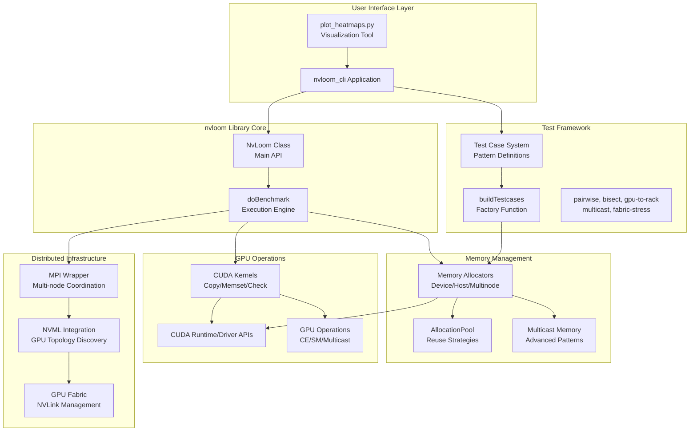
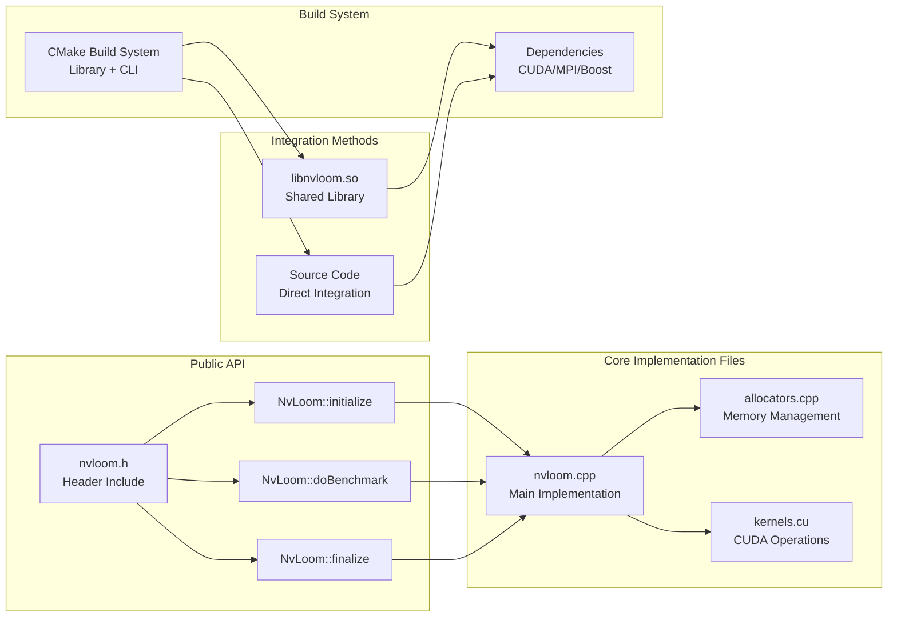
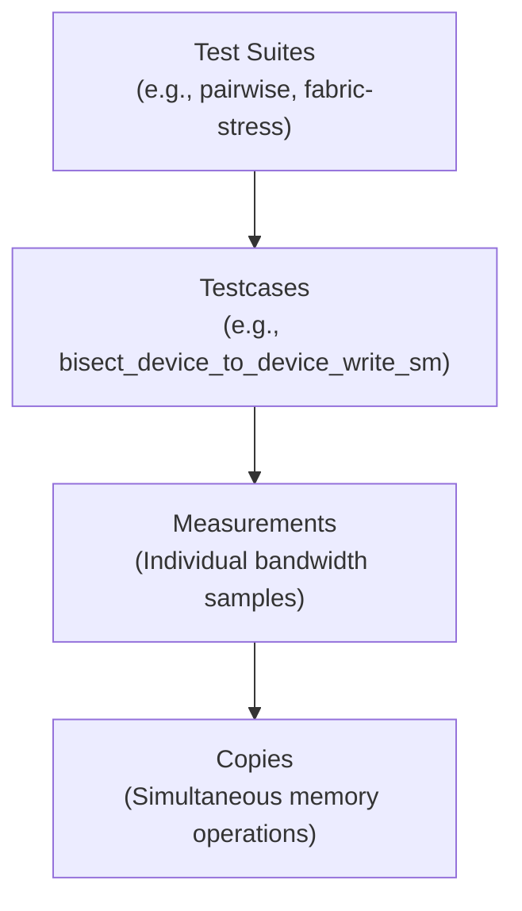
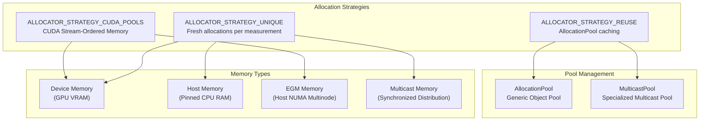

<!-- source: DeepWiki mcp.deepwiki.com · repo NVIDIA/nvloom · page 1 Overview · fetched 2026-10-26 -->

# Overview

<details>
<summary>Relevant source files</summary>

The following files were used as context for generating this wiki page:

- [CHANGELOG.md](CHANGELOG.md)
- [README.md](README.md)

</details>


This document provides a comprehensive introduction to nvloom, a scalable Multi-Node NVLink (MNNVL) fabric testing framework designed for distributed GPU environments. It covers the framework's architecture, core components, and fundamental concepts for testing GPU fabric performance at scale.

For detailed command-line usage information, see [Command Line Interface](#3). For in-depth library integration guidance, see [Core Library](#4). For information about creating custom test patterns, see [Testing Framework](#5).

## Purpose and Capabilities

nvloom is a comprehensive testing framework for evaluating MNNVL fabric performance across distributed GPU systems. The framework consists of a core C++ library for integration into applications and a command-line interface for standalone testing operations.

**Primary Capabilities:**
- Scalable bandwidth testing across multi-node GPU fabrics
- Support for various memory copy patterns (pairwise, fabric-stress, multicast)
- Multiple execution modes (Copy Engine and Streaming Multiprocessor)
- Advanced memory management with pooling and caching strategies  
- Distributed coordination via MPI for multi-node operations
- Comprehensive visualization tools for result analysis

Sources: [README.md:1-47](), [README.md:81-120]()

## System Architecture

The nvloom framework follows a layered architecture with clear separation between user interfaces, core functionality, and low-level GPU operations.

### High-Level Component Architecture



Sources: [README.md:7-43](), [README.md:45-78]()

### Core Library Integration Points



Sources: [README.md:19-43](), [README.md:34-36]()

## Core Components

### NvLoom Library

The `NvLoom` class serves as the primary API entry point, providing initialization, benchmarking execution, and cleanup functionality. The library is designed for integration into larger applications requiring fabric testing capabilities.

**Key Integration Points:**
- **Header**: `nvloom.h` includes all necessary headers
- **Core Files**: `nvloom.cpp`, `allocators.cpp`, `kernels.cu`
- **Build Options**: Shared library (`libnvloom.so`) or source code integration

**Minimum Requirements:**
- CUDA 12.8.1+
- Driver 570.124.06+
- MPI implementation
- C++17 compiler
- CMake 3.20+
- Boost.program_options 1.74+

Sources: [README.md:7-43]()

### Command Line Interface

The `nvloom_cli` application provides a complete standalone interface for fabric testing, organized around test suites and individual testcases.

**Available Test Suites:**

| Suite | Description | Runtime Complexity |
|-------|-------------|-------------------|
| `pairwise` | O(n²) one pair at a time testing | O(n²) |
| `fabric-stress` | All GPUs simultaneously active | O(1) |
| `all-to-one` | Multiple GPUs access single GPU | O(1) |
| `multicast` | Multicast benchmark patterns | O(1) |
| `egm` | EGM pairwise testing | O(n²) |
| `gpu-to-rack` | Randomized sampling per rack | O(n) |
| `rack-to-rack` | Inter-rack communication testing | O(racks²) |

Sources: [README.md:45-97]()

### Visualization Tools

The `plot_heatmaps.py` utility processes `nvloom_cli` output to generate heatmap visualizations for each testcase, supporting customizable color scales, font sizing, and output formats.

Sources: [README.md:199-256]()

## Test Execution Model

### Test Hierarchy

nvloom organizes testing around a hierarchical model:



**Terminology:**
- **Suite**: Collection of related testcases
- **Testcase**: Specific test configuration (memory type + pattern + parameters)
- **Measurement**: Single bandwidth measurement within a testcase
- **Copy**: Individual memory copy operation (potentially simultaneous)

Sources: [README.md:107-119]()

### Memory Copy Parameters

Each testcase is defined by the combination of:

**Execution Mode:**
- **SM (Streaming Multiprocessor)**: Custom memcopy kernel implementation
- **CE (Copy Engine)**: `cuMemcpyAsync` scheduled operations

**Transfer Direction:**
- **Write**: Local source buffer → Remote destination buffer  
- **Read**: Remote source buffer → Local destination buffer

**Transfer Pattern:**
- **Unidirectional**: Single copy X → Y
- **Bidirectional**: Simultaneous copies X ↔ Y (sum reported)

**Memory Types:**
- **Device**: Multinode-NVLink enabled GPU VRAM memory
- **EGM**: GPU accessible CPU RAM memory  
- **Multicast**: VRAM residing simultaneously on all GPUs

Sources: [README.md:259-295]()

## Memory Management System

nvloom implements a sophisticated memory allocation system supporting multiple strategies optimized for different use cases.

### Allocation Strategies



**Strategy Details:**
- **`unique`**: Fresh allocation/deallocation per measurement
- **`reuse`**: Cached allocations via `AllocationPool` class, released per testcase
- **`cudapool`**: CUDA Stream-Ordered Memory Allocator for device/EGM memory

Sources: [README.md:143-152]()

## Test Pattern Implementations

### Pairwise Testing

Traditional O(n²) testing where each GPU pair is measured individually, producing a square bandwidth matrix.

- **Unidirectional**: `NUM_GPU*(NUM_GPU-1)` consecutive measurements
- **Bidirectional**: `NUM_GPU*(NUM_GPU-1)/2` measurements (leveraging symmetry)

### Fabric Stress Testing

All GPUs execute simultaneous copies using bisect pattern:
- GPU `X` communicates with GPU `(X+NUM_GPU/2)%NUM_GPU`
- Divides GPUs into two equal groups with bidirectional traffic
- Completes in approximately O(1) time

### GPU-to-Rack Testing

Linear-time alternative to pairwise testing using statistical sampling:
- Each GPU tested against constant number of randomly selected peers per rack
- Median bandwidth reported (configurable via `--gpuToRackSamples`)
- Effective at identifying problematic GPUs while maintaining O(n) runtime

Sources: [README.md:299-322](), [README.md:81-105]()

## Quick Start Recommendations

### Large MNNVL Domain Testing

For comprehensive fabric evaluation:
```bash
nvloom_cli -s gpu-to-rack rack-to-rack fabric-stress
```

### Quick Fabric Validation

For rapid functionality verification:
```bash
nvloom_cli -t bisect_device_to_device_write_sm
```

This completes in approximately 3 seconds on a 72-GPU domain.

Sources: [README.md:81-105]()

---

