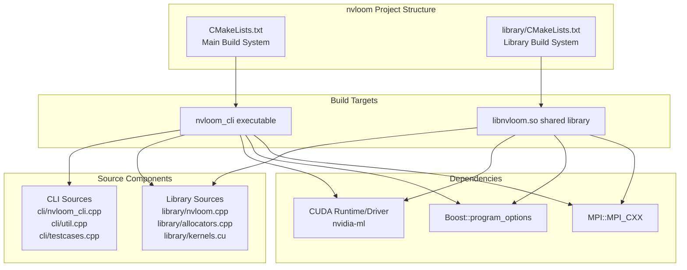
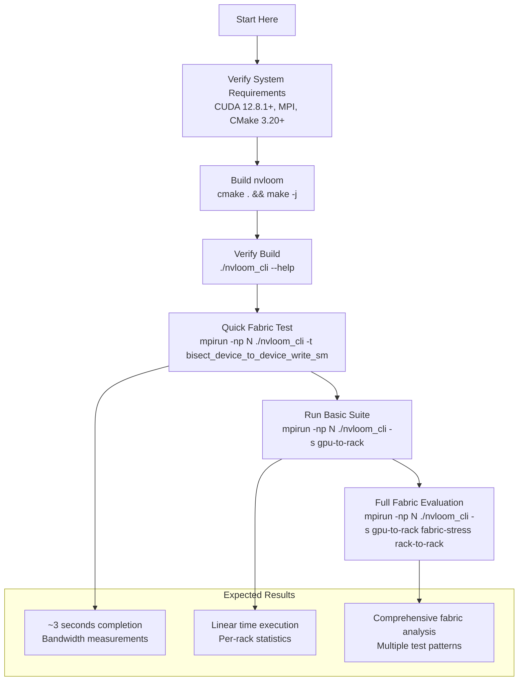

<!-- source: DeepWiki mcp.deepwiki.com · repo NVIDIA/nvloom · page 2 Getting Started · fetched 2026-10-26 -->

# Getting Started

<details>
<summary>Relevant source files</summary>

The following files were used as context for generating this wiki page:

- [CMakeLists.txt](CMakeLists.txt)
- [README.md](README.md)
- [library/CMakeLists.txt](library/CMakeLists.txt)

</details>


This document guides you through installing, building, and running your first nvloom tests. It covers both the standalone command-line tool and library integration approaches for testing Multi-Node NVLink (MNNVL) fabrics.

For detailed information about specific test patterns and suites, see [Testing Framework](#5). For comprehensive CLI options and usage patterns, see [Command Line Interface](#3).

## System Requirements

nvloom requires the following minimum system configuration:

| Component | Minimum Version |
|-----------|----------------|
| CUDA | 12.8.1 |
| GPU Driver | 570.124.06 |
| C++ Standard | C++17 |
| CMake | 3.20 |
| MPI | Any implementation |
| Boost | 1.74 (program_options component) |

**Sources:** [README.md:11-17]()

## Build System Architecture

The nvloom project provides two build targets: a shared library and a command-line application.



**Sources:** [CMakeLists.txt:20-66](), [library/CMakeLists.txt:20-56]()

## Installation Methods

### Method 1: Command-Line Tool (Recommended for Getting Started)

Build the complete application including both library and CLI:

```bash
# Clone and build the complete project
git clone https://github.com/NVIDIA/nvloom
cd nvloom
cmake .
make -j
```

This creates the `nvloom_cli` executable that includes all nvloom functionality.

**Sources:** [README.md:59-61]()

### Method 2: Shared Library

Build only the nvloom library as a shared object:

```bash
# Build library only
cd library
cmake .
make
```

This creates `libnvloom.so` which can be linked into other applications. The library directory can be added as an include directory to access headers.

**Sources:** [README.md:23-29]()

### Method 3: Source Integration

For applications that need to embed nvloom directly, integrate these source files into your build system:

- `library/allocators.cpp`
- `library/kernels.cu` 
- `library/nvloom.cpp`
- All header files from the library directory

Include `nvloom.h` to access all necessary headers.

**Sources:** [README.md:32-39]()

## Quick Start Workflow

The following diagram shows the typical workflow from installation to running your first meaningful test:



**Sources:** [README.md:99-105](), [README.md:85-98]()

## Your First Test

### 1. Verify Installation

```bash
# Check that nvloom_cli was built correctly
./nvloom_cli --help

# List available test cases
./nvloom_cli --listTestcases
```

**Sources:** [README.md:123-129]()

### 2. Quick Fabric Verification

Run a fast test to verify basic MNNVL functionality:

```bash
# Replace N with your GPU count
mpirun -np N ./nvloom_cli -t bisect_device_to_device_write_sm
```

This test completes in approximately 3 seconds on a 72-GPU domain and verifies that all GPUs can communicate simultaneously.

**Sources:** [README.md:99-105]()

### 3. Basic Performance Assessment

For a more comprehensive but still efficient evaluation:

```bash
# Run the recommended suite for large MNNVL domains
mpirun -np N ./nvloom_cli -s gpu-to-rack fabric-stress rack-to-rack
```

This executes three complementary test suites:
- `gpu-to-rack`: Linear-time sampling-based bandwidth measurement
- `fabric-stress`: Simultaneous stress testing across all GPUs  
- `rack-to-rack`: Inter-rack communication benchmarking

**Sources:** [README.md:85-98]()

## Basic Configuration Options

Common options for initial testing:

| Option | Description | Default |
|--------|-------------|---------|
| `-s, --suite` | Run specific test suites | All available |
| `-t, --testcase` | Run specific test cases | All available |
| `-b, --bufferSize` | Size of copy buffer | 512 MiB |
| `-i, --iterations` | Copy operations per measurement | 16 |
| `-a, --allocatorStrategy` | Memory allocation strategy | `reuse` |

**Sources:** [README.md:131-183]()

## Next Steps

After completing your first tests:

1. **Understand Results**: Use the visualization tools to analyze output (see [Visualization Tools](#6))
2. **Explore Test Patterns**: Learn about different test patterns and their use cases (see [Test Patterns and Suites](#5.1))
3. **Library Integration**: If building applications, study the core library API (see [Core Library](#4))
4. **Advanced Features**: Explore multicast operations and distributed GPU features (see [Advanced Topics](#7))

The `nvloom_cli` tool assumes one MPI process per GPU, so ensure your MPI launch matches your GPU topology.

**Sources:** [README.md:117-119]()

---

