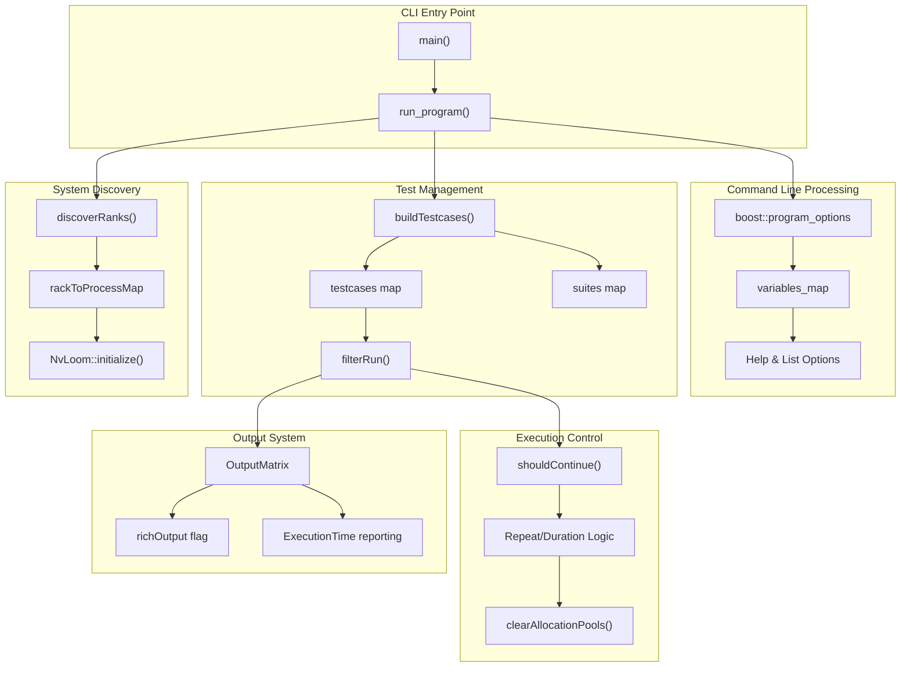
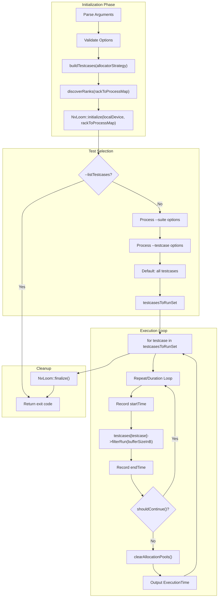
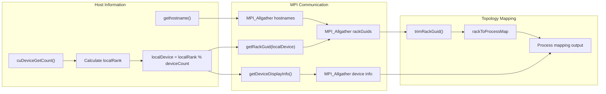
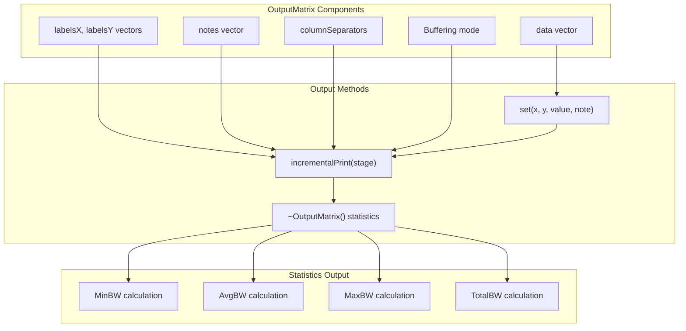
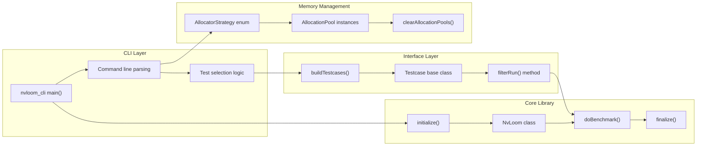

<!-- source: DeepWiki mcp.deepwiki.com · repo NVIDIA/nvloom · page 3 Command Line Interface · fetched 2026-10-26 -->

# Command Line Interface

<details>
<summary>Relevant source files</summary>

The following files were used as context for generating this wiki page:

- [README.md](README.md)
- [cli/nvloom_cli.cpp](cli/nvloom_cli.cpp)
- [cli/util.cpp](cli/util.cpp)
- [cli/util.h](cli/util.h)

</details>


The `nvloom_cli` application provides a comprehensive command-line interface for executing Multi-Node NVLink (MNNVL) fabric benchmarks. This document covers the CLI application's architecture, command-line options, test execution patterns, and integration with the nvloom core library.

For information about the underlying benchmarking engine, see [Core Library](#4). For visualization of benchmark results, see [Visualization Tools](#6). For details about specific test patterns and suites, see [Testing Framework](#5).

## CLI Application Architecture

The `nvloom_cli` application is built around a modular architecture that handles command-line parsing, test discovery, and benchmark execution coordination.



Sources: [cli/nvloom_cli.cpp:54-207](), [cli/util.cpp:59-118](), [cli/util.h:34-137]()

## Command Line Options

The CLI supports a comprehensive set of options for controlling test execution, memory allocation strategies, and output formatting.

| Option | Short | Type | Default | Description |
|--------|-------|------|---------|-------------|
| `--help` | `-h` | flag | - | Display help message |
| `--listTestcases` | `-l` | flag | false | List all available testcases |
| `--testcase` | `-t` | string[] | all | Specific testcase(s) to run |
| `--suite` | `-s` | string[] | all | Test suite(s) to run |
| `--bufferSize` | `-b` | int | 512 | Buffer size in MiB |
| `--allocatorStrategy` | `-a` | string | "reuse" | Memory allocation strategy |
| `--richOutput` | `-r` | flag | false | Show detailed per-measurement data |
| `--gpuToRackSamples` | - | int | 5 | Samples per rack in gpu-to-rack suite |
| `--iterations` | `-i` | int | 16 | Copy iterations per measurement |
| `--repeat` | `-c` | int | 1 | Times to repeat each testcase |
| `--duration` | `-d` | int | -1 | Duration in seconds to repeat testcases |

### Memory Allocation Strategies

The `--allocatorStrategy` option controls how CUDA memory allocations are handled:

- **`unique`**: Fresh allocation/deallocation for each measurement
- **`reuse`**: Pool-based caching via `AllocationPool` class  
- **`cudapool`**: CUDA Stream-Ordered Memory Allocator for device/EGM memory

### Test Suites

The CLI organizes tests into logical suites accessible via `--suite`:

- **`pairwise`**: O(n²) all-pairs testing between GPUs
- **`fabric-stress`**: Simultaneous copies from every GPU
- **`gpu-to-rack`**: Linear-time sampling across racks
- **`rack-to-rack`**: Inter-rack communication patterns
- **`all-to-one`**: Multiple GPUs accessing single GPU memory
- **`multicast`**: One-to-many broadcast patterns
- **`egm`**: Extended GPU Memory (CPU RAM) testing

Sources: [cli/nvloom_cli.cpp:65-78](), [README.md:51-58](), [README.md:143-151]()

## Test Execution Flow

The CLI follows a structured execution pattern that coordinates test discovery, system initialization, and benchmark execution.



Sources: [cli/nvloom_cli.cpp:125-196](), [cli/nvloom_cli.cpp:36-52]()

## System Discovery and Initialization

The CLI performs comprehensive system discovery to map processes to GPUs and rack topology before benchmark execution.

### GPU and Rack Discovery Process



The discovery process outputs detailed topology information:
```
Process  0 (hostname1): device 0: NVIDIA H100 80GB HBM3 (00001234:85:00.0); rackGuid: ABC123
Process  1 (hostname1): device 1: NVIDIA H100 80GB HBM3 (00001234:86:00.0); rackGuid: ABC123
```

Sources: [cli/util.cpp:59-118](), [cli/util.cpp:39-57]()

## Output System and Result Formatting

The CLI provides flexible output formatting through the `OutputMatrix` class and configurable verbosity levels.

### OutputMatrix Structure

The `OutputMatrix` class handles incremental printing and statistical aggregation:



### Rich Output Mode

When `--richOutput` is enabled, the CLI displays detailed per-measurement data instead of aggregated statistics. This is particularly useful for `gpu-to-rack` suite analysis where individual sample measurements are shown with specific GPU pair labels.

Sources: [cli/util.h:34-137](), [cli/util.cpp:120-157](), [README.md:162-168]()

## Integration with Core Library

The CLI serves as a wrapper around the nvloom core library, providing a user-friendly interface to the underlying benchmarking capabilities.

### Library Integration Points



The CLI handles the complete lifecycle:
1. **Initialization**: Calls `NvLoom::initialize()` with discovered topology
2. **Test Execution**: Invokes `filterRun()` on selected testcases
3. **Memory Management**: Manages allocation pools based on strategy
4. **Cleanup**: Calls `clearAllocationPools()` and `NvLoom::finalize()`

Sources: [cli/nvloom_cli.cpp:18-20](), [cli/nvloom_cli.cpp:137](), [cli/nvloom_cli.cpp:176](), [cli/nvloom_cli.cpp:183](), [cli/nvloom_cli.cpp:205]()

---

