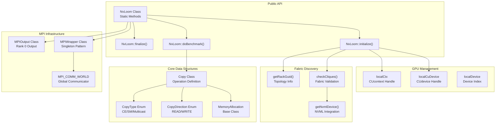
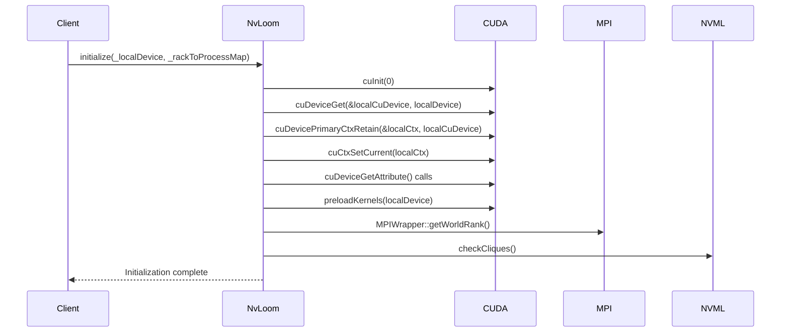
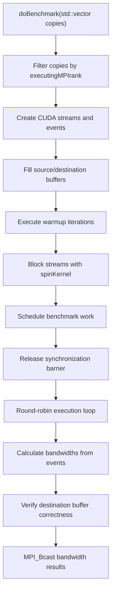
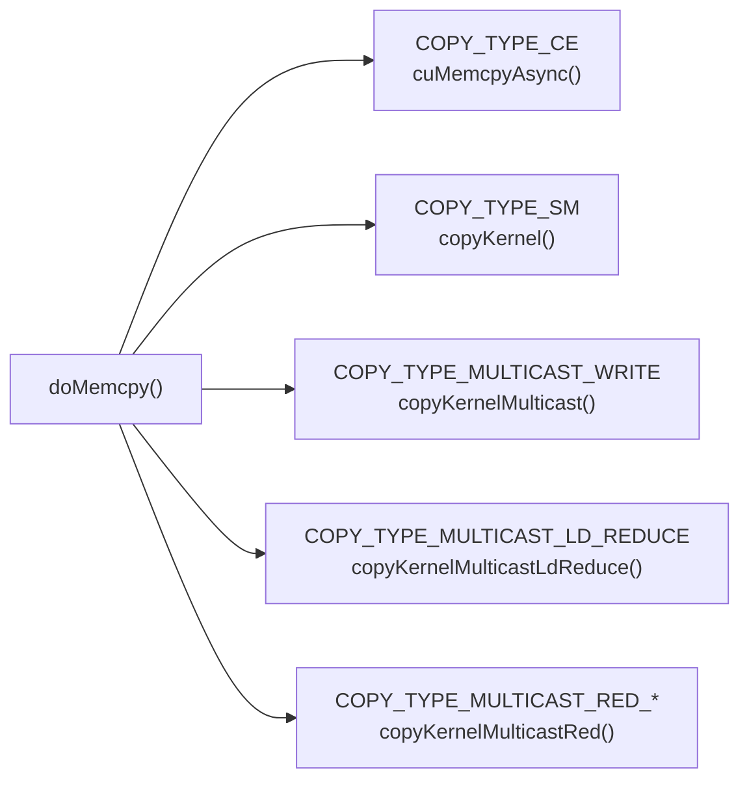
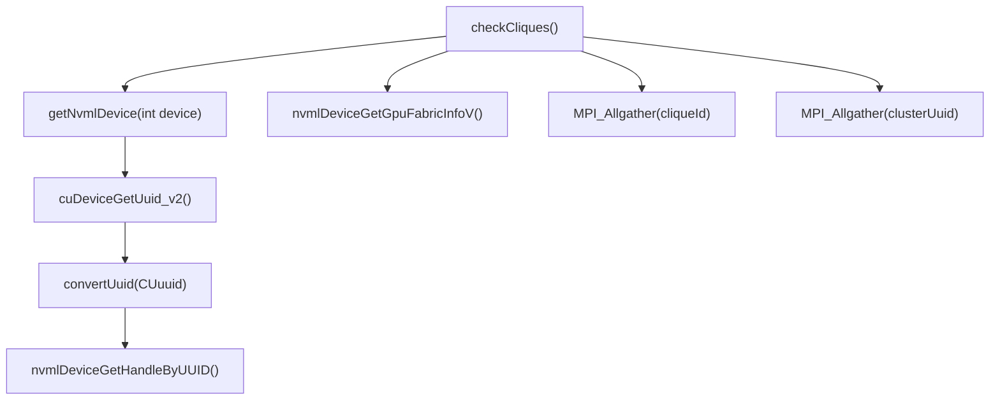

<!-- source: DeepWiki mcp.deepwiki.com · repo NVIDIA/nvloom · page 4 Core Library · fetched 2026-10-26 -->

# Core Library

<details>
<summary>Relevant source files</summary>

The following files were used as context for generating this wiki page:

- [library/README.md](library/README.md)
- [library/nvloom.cpp](library/nvloom.cpp)
- [library/nvloom.h](library/nvloom.h)

</details>


The Core Library provides nvloom's primary API for multi-node GPU fabric benchmarking. It includes the main `NvLoom` class, which orchestrates memory copy operations across distributed GPUs, and supporting infrastructure for MPI coordination, timing measurement, and GPU fabric discovery.

For detailed information about memory allocation strategies and pooling mechanisms, see [Memory Management System](#4.1). For GPU kernel implementations and CUDA operations, see [GPU Operations and CUDA Kernels](#4.2). For error handling and debugging utilities, see [Error Handling and Debugging](#4.3).

## Core Library Architecture



**Core Library Component Architecture**: This diagram shows the main classes and their relationships within the nvloom core library. The `NvLoom` class serves as the primary interface, coordinating MPI operations, GPU management, and fabric discovery.

Sources: [library/nvloom.h:108-146](), [library/nvloom.cpp:48-184](), [library/nvloom.cpp:319-337]()

## NvLoom Class

The `NvLoom` class provides a static interface for all core library operations. It maintains global state for the local GPU device and coordinates distributed benchmarking operations.

| Method | Purpose | Return Type |
|--------|---------|-------------|
| `initialize()` | Initialize CUDA context and MPI coordination | `void` |
| `doBenchmark()` | Execute synchronized memory copy benchmarks | `std::vector<double>` |
| `finalize()` | Clean up MPI resources | `void` |
| `getLocalDevice()` | Get local GPU device index | `int` |
| `getLocalCuDevice()` | Get CUDA device handle | `CUdevice` |
| `getLocalCtx()` | Get CUDA context handle | `CUcontext` |

### Static Member Variables

The `NvLoom` class maintains several static inline variables that store global state:

```cpp
static inline int localDevice;                    // GPU device index
static inline CUdevice localCuDevice;            // CUDA device handle  
static inline CUcontext localCtx;                // CUDA context handle
static inline int localMultiprocessorCount;       // SM count
static inline int localClockRate;                // GPU clock rate
static inline int localCpuNumaNode;              // CPU NUMA node
static inline std::string localHostname;          // Local hostname
static inline std::map<std::string, std::vector<int>> rackToProcessMap;  // Topology map
```

Sources: [library/nvloom.h:108-118](), [library/nvloom.h:134-144]()

## Initialization and Lifecycle

### Initialization Process



**NvLoom Initialization Sequence**: Shows the initialization flow including CUDA context setup, device attribute queries, kernel preloading, and fabric validation.

The `initialize()` method performs several critical setup operations:

1. **CUDA Initialization**: Initializes CUDA driver and retains primary context for the specified device
2. **Device Attribute Queries**: Retrieves SM count, clock rate, and NUMA node information
3. **Kernel Preloading**: Loads CUDA kernels for memory operations
4. **Fabric Validation**: Verifies GPU fabric clique consistency across MPI ranks

Sources: [library/nvloom.cpp:319-337]()

### Lifecycle Management

The `finalize()` method handles cleanup by checking if MPI was initialized and calling `MPI_Finalize()` if necessary. This ensures proper resource cleanup in distributed environments.

Sources: [library/nvloom.cpp:339-345]()

## Benchmarking Execution Engine

### Core Benchmark Workflow



**Benchmark Execution Flow**: The `doBenchmark()` method implements a sophisticated workflow that ensures synchronized execution across multiple MPI ranks and accurate bandwidth measurement.

### Synchronization Strategy

The benchmark engine uses a multi-stage synchronization approach:

1. **Stream Blocking**: Uses `spinKernelMultistage()` to block all CUDA streams
2. **Work Scheduling**: Schedules copy operations while streams are blocked
3. **Synchronized Release**: All ranks reach `MPI_Barrier()` before releasing work
4. **Precise Timing**: CUDA events capture exact execution times

This approach ensures that all memory operations start simultaneously across the distributed system, providing accurate concurrent bandwidth measurements.

Sources: [library/nvloom.cpp:48-184](), [library/nvloom.cpp:102-106](), [library/nvloom.cpp:118-124]()

## Copy Operations Framework

### Copy Class Structure

The `Copy` class encapsulates a memory copy operation with all necessary parameters:

```cpp
class Copy {
public:
    std::shared_ptr<MemoryAllocation> dst;    // Destination memory
    std::shared_ptr<MemoryAllocation> src;    // Source memory  
    CopyDirection copyDirection;               // READ or WRITE
    CopyType copyType;                        // CE, SM, or Multicast
    int executingMPIrank;                     // MPI rank executing copy
    int iterations;                           // Number of iterations
};
```

### Copy Direction and Execution

The `executingMPIrank` is automatically determined based on `copyDirection`:
- **COPY_DIRECTION_READ**: Executed by destination rank (dst->MPIrank)
- **COPY_DIRECTION_WRITE**: Executed by source rank (src->MPIrank)

This design allows flexible control over which GPU initiates each memory transfer.

Sources: [library/nvloom.h:36-58](), [library/nvloom.h:52-56]()

### Copy Type Implementation



**Copy Type Dispatch**: The `doMemcpy()` method dispatches to different implementation strategies based on the `CopyType` enumeration.

Sources: [library/nvloom.cpp:186-202](), [library/nvloom.cpp:204-223]()

## MPI Integration

### MPIWrapper Singleton

The `MPIWrapper` class provides a singleton interface for MPI operations:

```cpp
class MPIWrapper {
private:
    int worldSize;
    int worldRank;
    MPIWrapper();  // Private constructor

public:
    static MPIWrapper& instance();
    static int getWorldSize();
    static int getWorldRank();
};
```

The singleton automatically initializes MPI if not already initialized and caches world size and rank for efficient access.

Sources: [library/nvloom.h:60-88]()

### MPIOutput Class

The `MPIOutput` class ensures that console output only occurs from MPI rank 0, preventing duplicate messages in distributed environments:

```cpp
template<typename T>
MPIOutput& operator<<(T input) {
    if (MPIWrapper::getWorldRank() == 0) std::cout << input;
    return *this;
}
```

This class supports the standard stream operator interface while maintaining single-rank output semantics.

Sources: [library/nvloom.h:90-106]()

## GPU Fabric Discovery

### NVML Integration

The core library integrates with NVML to discover and validate GPU fabric topology:



**NVML Fabric Discovery**: The library uses NVML to query GPU fabric information and validate that all MPI ranks belong to the same fabric clique.

### Rack GUID Discovery

The `getRackGuid()` function extracts rack-level topology information:

```cpp
std::string getRackGuid(int device) {
    nvmlDevice_t nvmlDev = getNvmlDevice(device);
    nvmlPlatformInfo_v2_t platformInfo;
    platformInfo.version = nvmlPlatformInfo_v2;
    NVML_ASSERT(nvmlDeviceGetPlatformInfo(nvmlDev, &platformInfo));
    // Return chassis serial number as rack identifier
}
```

This enables rack-aware test patterns and topology-based optimizations.

Sources: [library/nvloom.cpp:246-258](), [library/nvloom.cpp:260-292](), [library/nvloom.cpp:301-309]()

---

