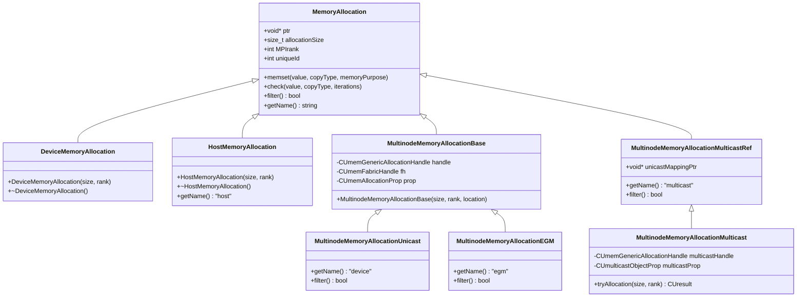
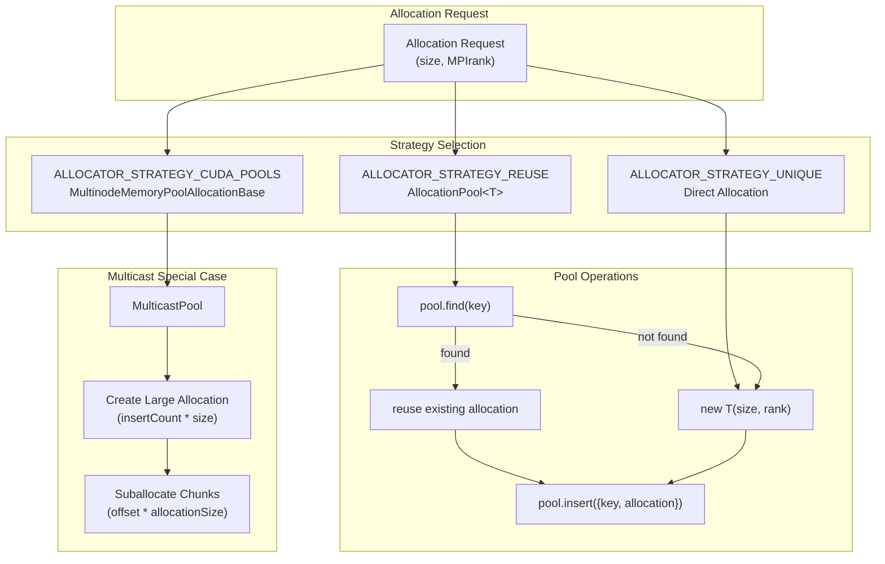
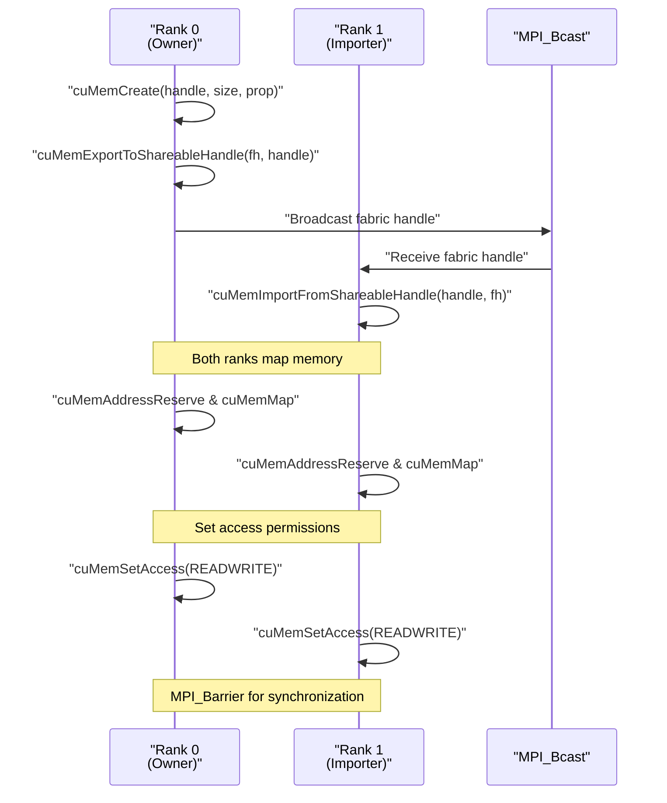

<!-- source: DeepWiki mcp.deepwiki.com · repo NVIDIA/nvloom · page 4.1 Memory Management System · fetched 2026-10-26 -->

# Memory Management System

Relevant source files

The following files were used as context for generating this wiki page:

- [library/allocators.cpp](library/allocators.cpp)
- [library/allocators.h](library/allocators.h)

## Purpose and Scope

The Memory Management System in nvloom provides sophisticated memory allocation capabilities for multi-node GPU fabric testing. This system handles device memory, host memory, and advanced fabric-shared memory across multiple nodes with optimized allocation strategies and pooling mechanisms. The system supports both traditional CUDA memory operations and advanced multicast memory patterns for distributed GPU computing.

For information about GPU operations that work with these allocations, see [GPU Operations and CUDA Kernels](#4.2). For details about test patterns that utilize these memory types, see [Test Patterns and Suites](#5.1).

## Allocation Strategies

nvloom implements three primary allocation strategies to optimize memory usage for different testing scenarios:

| Strategy | Purpose | Implementation |
|----------|---------|----------------|
| `ALLOCATOR_STRATEGY_UNIQUE` | Fresh allocations for each test | Direct allocation/deallocation |
| `ALLOCATOR_STRATEGY_REUSE` | Pool-based memory reuse | Uses `AllocationPool<T>` template |
| `ALLOCATOR_STRATEGY_CUDA_POOLS` | CUDA stream-ordered memory pools | Uses `MultinodeMemoryPoolAllocationBase` |

The strategy selection affects performance characteristics, with unique allocations providing isolation but higher overhead, while pooled strategies optimize for repeated allocations of similar sizes.

**Sources:** [library/allocators.h:190-233](), [library/allocators.cpp:396-487]()

## Memory Allocation Class Hierarchy

This hierarchy shows the inheritance structure where `MemoryAllocation` provides the base interface, with specialized implementations for different memory types and locations. Each class implements device capability filtering through the `filter()` method and provides identification through `getName()`.

**Sources:** [library/allocators.h:26-188](), [library/allocators.cpp:26-394]()

## Memory Types and Characteristics

### Device Memory
- **Class:** `DeviceMemoryAllocation`
- **Location:** GPU VRAM using `cuMemAlloc`
- **Use Case:** Standard GPU-local memory allocations
- **Limitations:** Single-node access only

### Host Memory  
- **Class:** `HostMemoryAllocation`
- **Location:** Pinned CPU memory using `cuMemAllocHost`
- **Use Case:** High-bandwidth host-device transfers
- **Characteristics:** Page-locked for optimal transfer performance

### Fabric Device Memory
- **Class:** `MultinodeMemoryAllocationUnicast`
- **Location:** GPU device memory with fabric handles
- **Use Case:** Cross-node device memory access
- **Requirements:** `CU_DEVICE_ATTRIBUTE_HANDLE_TYPE_FABRIC_SUPPORTED`

### EGM (Extended GPU Memory)
- **Class:** `MultinodeMemoryAllocationEGM` 
- **Location:** Host NUMA memory accessible across nodes
- **Use Case:** Large memory pools shared across fabric
- **Requirements:** `CU_DEVICE_ATTRIBUTE_HOST_NUMA_MULTINODE_IPC_SUPPORTED`

### Multicast Memory
- **Class:** `MultinodeMemoryAllocationMulticast`
- **Location:** Specialized one-to-many memory regions
- **Use Case:** Efficient data distribution patterns
- **Requirements:** `CU_DEVICE_ATTRIBUTE_MULTICAST_SUPPORTED`
- **Special Features:** Dual mapping (unicast and multicast) with retry logic

**Sources:** [library/allocators.cpp:39-275](), [library/allocators.h:56-150]()

## Pool Management System

The pooling system uses different strategies based on memory type:

- **Generic Pools:** `AllocationPool<T>` template manages reuse with key-based lookup using `std::pair<size_t, int>` for size and MPI rank
- **Multicast Pools:** `MulticastPool` creates large allocations and suballocates chunks to amortize multicast setup costs
- **CUDA Memory Pools:** Stream-ordered pools with 1GB release thresholds for optimal performance

**Sources:** [library/allocators.cpp:396-487](), [library/allocators.h:190-234]()

## Fabric Memory and Cross-Node Support

### Fabric Handle Management

Fabric memory enables cross-node memory access through CUDA's fabric handle system:

**Sources:** [library/allocators.cpp:71-134]()

### Multicast Memory with Retry Logic

Multicast allocations include sophisticated error handling for system readiness:

- **Retry Mechanism:** Up to 60 seconds with 15-second intervals for `CUDA_ERROR_SYSTEM_NOT_READY`
- **Collective Retry:** All ranks participate in retry decisions using `MPI_Allreduce`
- **Dual Mapping:** Both unicast and multicast mappings for different access patterns
- **Device Binding:** `cuMulticastAddDevice` and `cuMulticastBindMem` for fabric coordination

**Sources:** [library/allocators.cpp:148-275]()

## Memory Pool Initialization

### CUDA Memory Pools

The system supports fabric-aware CUDA memory pools for optimized multinode allocations:

```mermaid
flowchart LR
    subgraph "Pool Creation"
        CREATE["cuMemPoolCreate<br/>(poolProps)"]
        THRESHOLD["Set 1GB release threshold<br/>CU_MEMPOOL_ATTR_RELEASE_THRESHOLD"]
        EXPORT["cuMemPoolExportToShareableHandle"]
    end
    
    subgraph "Cross-Node Sharing" 
        BCAST["MPI_Bcast fabric handles<br/>across all ranks"]
        IMPORT["cuMemPoolImportFromShareableHandle<br/>for remote pools"]
    end
    
    subgraph "Access Configuration"
        DEVICE_ACCESS["Set device access<br/>CU_MEM_ACCESS_FLAGS_PROT_READWRITE"]
        HOST_ACCESS["Set host NUMA access<br/>(EGM pools only)"]
    end
    
    CREATE --> THRESHOLD
    THRESHOLD --> EXPORT
    EXPORT --> BCAST
    BCAST --> IMPORT
    IMPORT --> DEVICE_ACCESS
    DEVICE_ACCESS --> HOST_ACCESS
```

Pool initialization is lazy and happens once per memory location type (`CU_MEM_LOCATION_TYPE_DEVICE` or `CU_MEM_LOCATION_TYPE_HOST_NUMA`). The system maintains static pool vectors accessible across all allocations.

**Sources:** [library/allocators.cpp:277-381]()

## Allocation Cleanup and Lifecycle

The memory management system provides comprehensive cleanup through the `clearAllocationPools()` function, which clears all template instantiations:

- `AllocationPool<MultinodeMemoryAllocationUnicast>::clear()`
- `AllocationPool<MultinodeMemoryAllocationEGM>::clear()`  
- `AllocationPool<HostMemoryAllocation>::clear()`
- `MulticastPool::clear()`

Each memory allocation type implements proper CUDA resource cleanup in destructors with MPI synchronization barriers to ensure coordinated deallocation across all participating ranks.

**Sources:** [library/allocators.cpp:482-487](), [library/allocators.h:235]()

---

