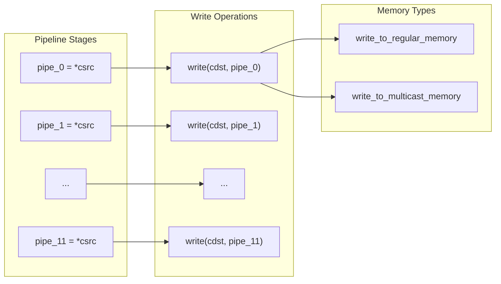
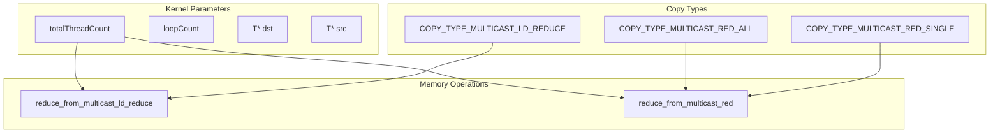
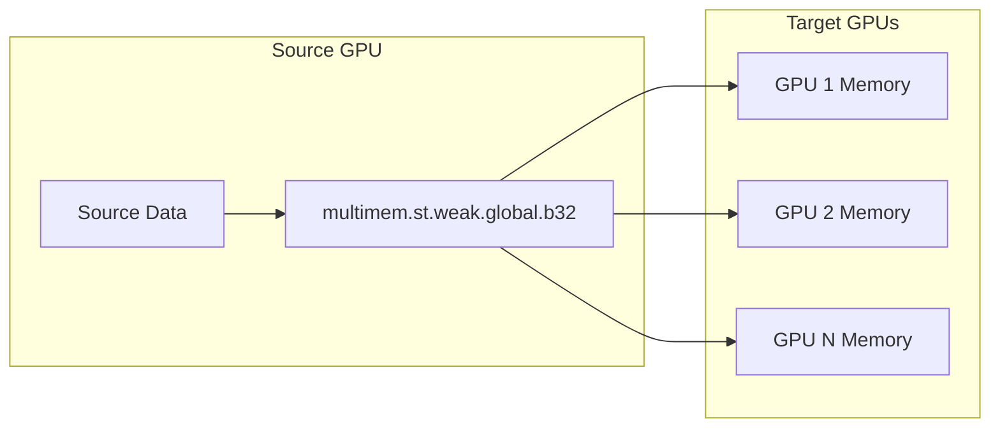
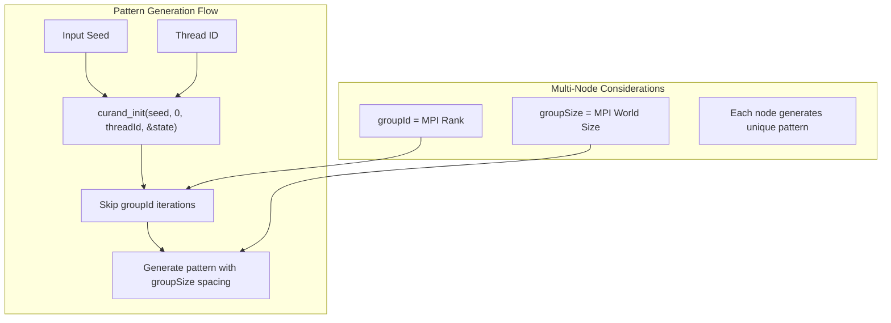
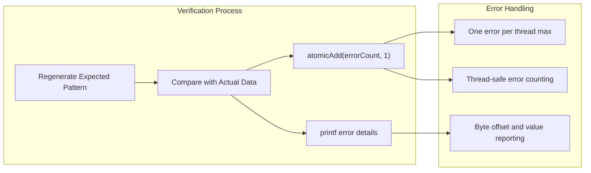
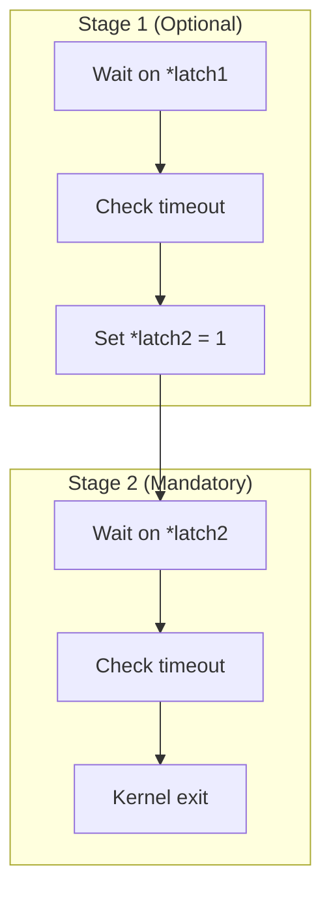
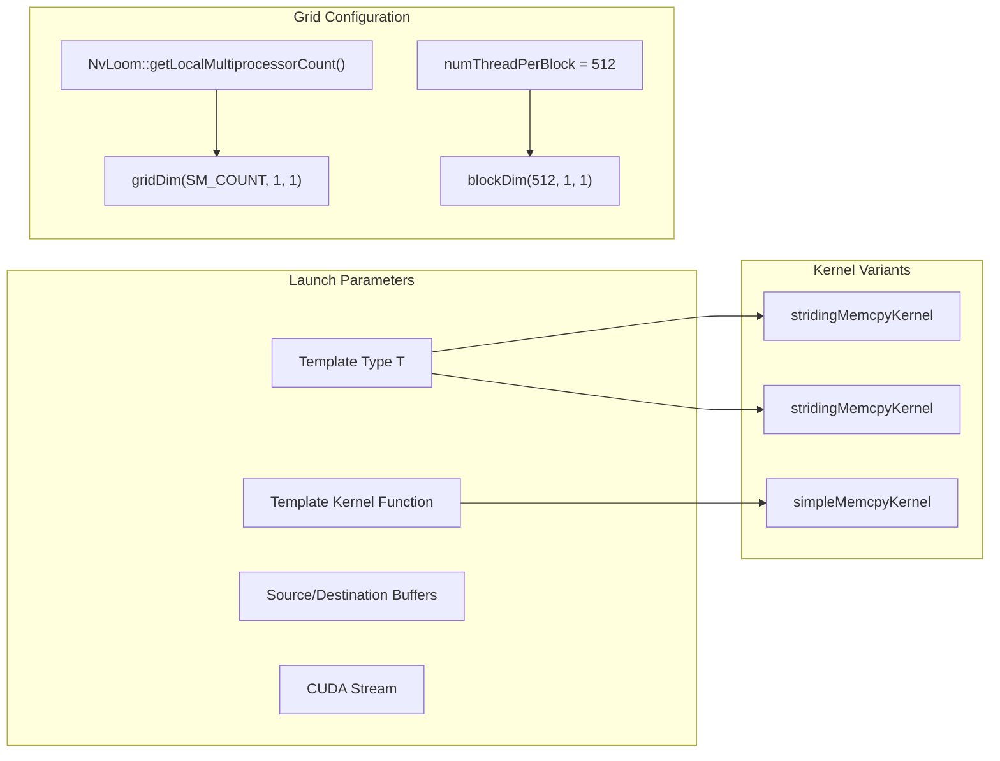

<!-- source: DeepWiki mcp.deepwiki.com · repo NVIDIA/nvloom · page 4.2 GPU Operations and CUDA Kernels · fetched 2026-10-26 -->

# GPU Operations and CUDA Kernels

Relevant source files

The following files were used as context for generating this wiki page:

- [library/kernels.cu](library/kernels.cu)
- [library/kernels.cuh](library/kernels.cuh)

This document covers nvloom's low-level GPU operations and CUDA kernel implementations that perform the actual memory transfers, pattern generation, and synchronization operations during benchmarking. These kernels form the computational foundation that enables nvloom to measure GPU fabric performance across single and multi-node configurations.

For high-level memory allocation strategies and management, see [Memory Management System](#4.1). For how these operations are orchestrated within test patterns, see [Testing Framework](#5).

## GPU Operations Architecture

The kernel system is organized around four primary operation categories, each optimized for different aspects of GPU fabric testing:

```mermaid
graph TB
    subgraph "Kernel Categories"
        COPY_OPS["Copy Operations"]
        MULTICAST_OPS["Multicast Operations"] 
        PATTERN_OPS["Pattern Operations"]
        SYNC_OPS["Synchronization Operations"]
    end
    
    subgraph "Copy Kernel Implementations"
        STRIDING["stridingMemcpyKernel<T>"]
        SIMPLE["simpleMemcpyKernel<T>"]
        COPY_REGULAR["copyKernel"]
        COPY_MC["copyKernelMulticast"]
    end
    
    subgraph "Multicast Kernel Types"
        MC_LD_REDUCE["copyKernelMulticastLdReduce"]
        MC_RED["copyKernelMulticastRed"]
        WRITE_MC["write_to_multicast_memory<T>"]
        REDUCE_MC["reduce_from_multicast_ld_reduce<T>"]
    end
    
    subgraph "Pattern Generation"
        PATTERN_FILL["patternFillKernel"]
        PATTERN_CHECK["patternCheckKernel"]
        MEMSET_BUFFER["memsetBuffer"]
        CHECK_BUFFER["checkBuffer"]
    end
    
    subgraph "Synchronization Primitives"
        SPIN_DEVICE["spinKernelDeviceMultistage"]
        SPIN_HOST["spinKernelMultistage"]
        PRELOAD["preloadKernels"]
    end
    
    COPY_OPS --> STRIDING
    COPY_OPS --> SIMPLE
    COPY_OPS --> COPY_REGULAR
    COPY_OPS --> COPY_MC
    
    MULTICAST_OPS --> MC_LD_REDUCE
    MULTICAST_OPS --> MC_RED
    MULTICAST_OPS --> WRITE_MC
    MULTICAST_OPS --> REDUCE_MC
    
    PATTERN_OPS --> PATTERN_FILL
    PATTERN_OPS --> PATTERN_CHECK
    PATTERN_OPS --> MEMSET_BUFFER
    PATTERN_OPS --> CHECK_BUFFER
    
    SYNC_OPS --> SPIN_DEVICE
    SYNC_OPS --> SPIN_HOST
    SYNC_OPS --> PRELOAD
```

**Sources:** [library/kernels.cu:1-324](), [library/kernels.cuh:1-40]()

## Memory Copy Operations

nvloom implements two primary memory copy kernel architectures optimized for different performance characteristics and memory access patterns.

### Striding Memory Copy Kernel

The `stridingMemcpyKernel` provides the highest performance copy implementation using a 12-stage pipeline to maximize memory bandwidth utilization:

The kernel distributes work across all available streaming multiprocessors and uses stride-based access patterns to ensure coalesced memory transactions:

| Parameter | Description | Implementation |
|-----------|-------------|----------------|
| `totalThreadCount` | `NvLoom::getLocalMultiprocessorCount() * 512` | Full SM utilization |
| `chunkSizeInElement` | `sizeInElement / totalThreadCount` | Per-thread work division |
| `bigChunkSizeInElement` | `chunkSizeInElement / 12` | Pipeline optimization |

**Sources:** [library/kernels.cu:62-112](), [library/kernels.cu:132-143]()

### Simple Memory Copy Kernel 

The `simpleMemcpyKernel` provides a streamlined implementation for reduction operations and scenarios where pipelining overhead exceeds benefits:

**Sources:** [library/kernels.cu:114-130](), [library/kernels.cu:153-158]()

## Multicast Operations

nvloom implements GPU multicast operations using inline assembly for NVIDIA's multicast memory instructions, available on architectures with compute capability 9.0+.

### Multicast Write Operations

The `write_to_multicast_memory` template function uses the `multimem.st.weak.global.b32` instruction for one-to-many memory writes:

### Multicast Reduction Operations

Two reduction patterns are supported for aggregating data across multiple GPUs:

| Operation | Instruction | Description |
|-----------|-------------|-------------|
| `reduce_from_multicast_ld_reduce` | `multimem.ld_reduce.weak.global.add.u32` | Load and reduce from multicast memory |
| `reduce_from_multicast_red` | `multimem.red.global.add.u32` | Direct reduction to multicast memory |

**Sources:** [library/kernels.cu:37-60](), [library/kernels.cu:149-158]()

## Memory Pattern Operations

nvloom uses pseudorandom patterns to verify data integrity across complex memory operations and detect silent data corruption.

### Pattern Generation

The `patternFillKernel` generates deterministic pseudorandom patterns using CUDA's `curand` library:

### Pattern Verification

The `patternCheckKernel` verifies data integrity by regenerating expected patterns and comparing against actual memory contents:

**Sources:** [library/kernels.cu:198-225](), [library/kernels.cu:252-312]()

## Synchronization Operations

nvloom implements multi-stage GPU synchronization primitives to coordinate complex distributed operations across multiple nodes and devices.

### Multi-Stage Spin Kernel

The `spinKernelMultistage` system provides two-phase synchronization with configurable timeouts:

| Component | Function | Implementation |
|-----------|----------|----------------|
| Host Interface | `spinKernelMultistage` | Converts timeout to GPU clocks |
| Device Kernel | `spinKernelDeviceMultistage` | Polls volatile memory locations |
| Timeout Mechanism | `clock64() + timeoutClocks` | Per-stage timeout enforcement |

The synchronization pattern supports both single-stage (latch2 only) and dual-stage (latch1 → latch2) operations:

**Sources:** [library/kernels.cu:161-196](), [library/kernels.cuh:24-31]()

## Kernel Launch Infrastructure

nvloom's kernel launch infrastructure provides a unified interface for deploying kernels across different GPU configurations and operation types.

### Template-Based Launch System

The `launchCopyKernel` template function provides type-safe kernel dispatch with automatic grid configuration:

### Kernel Preloading

The `preloadKernels` function eliminates first-time compilation overhead by triggering CUDA's just-in-time compilation during initialization:

| Preloaded Kernel | Purpose |
|------------------|---------|
| `stridingMemcpyKernel<uint, write_to_multicast_memory>` | Multicast copy operations |
| `stridingMemcpyKernel<uint4, write_to_regular_memory>` | Regular high-bandwidth copy |
| `simpleMemcpyKernel<uint, reduce_from_multicast_ld_reduce>` | Load-reduce operations |
| `simpleMemcpyKernel<uint, reduce_from_multicast_red>` | Direct reduction operations |
| `spinKernelDeviceMultistage` | Synchronization primitives |
| `patternFillKernel` | Pattern generation |
| `patternCheckKernel` | Data verification |

**Sources:** [library/kernels.cu:132-143](), [library/kernels.cu:314-324]()

---

