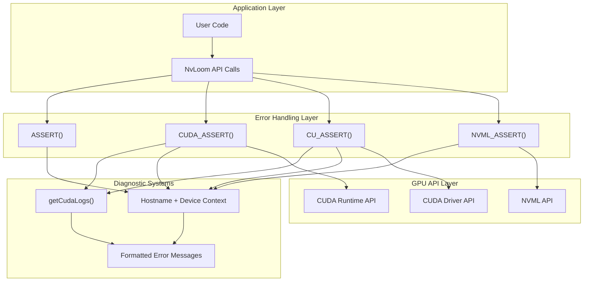
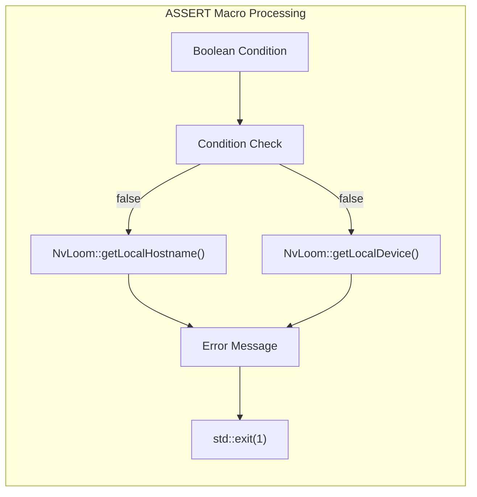
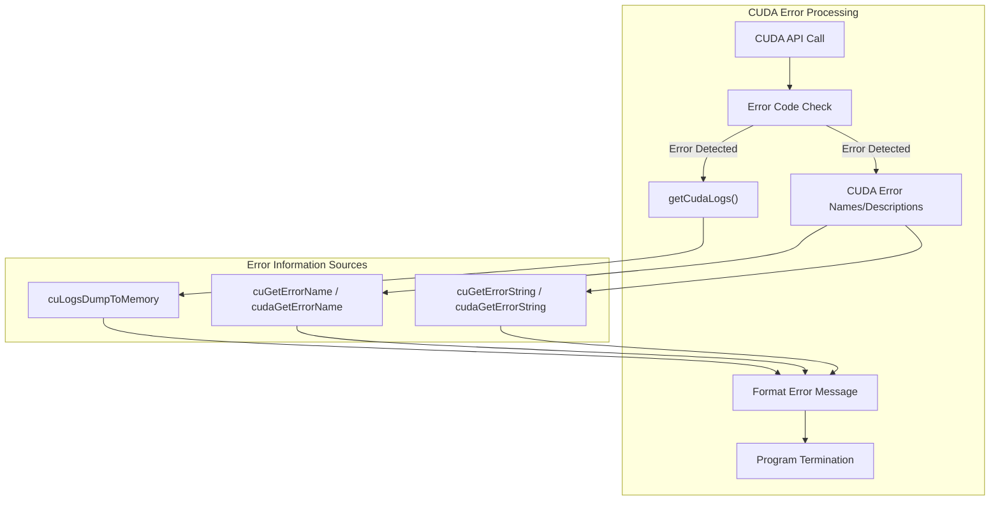
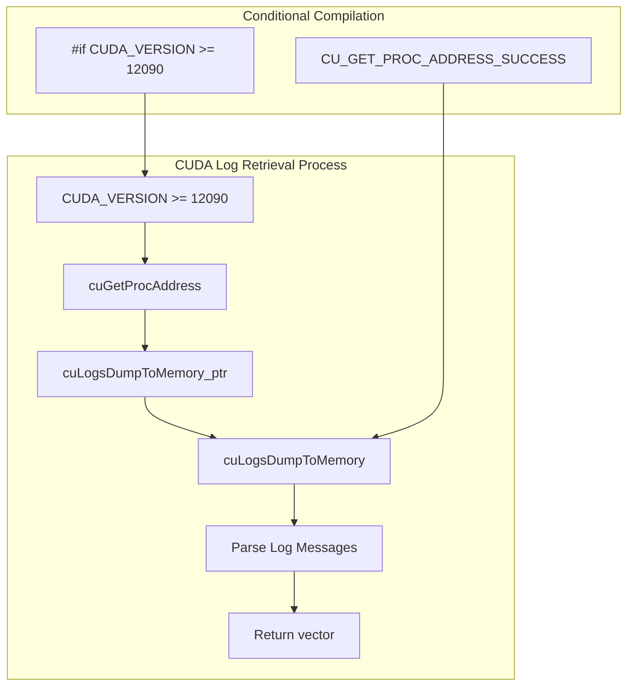
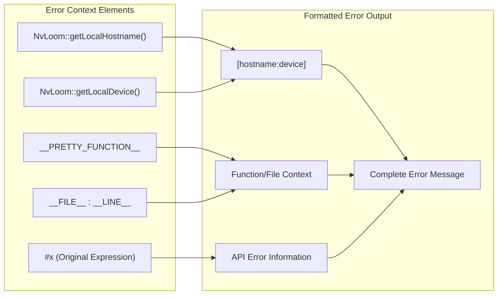
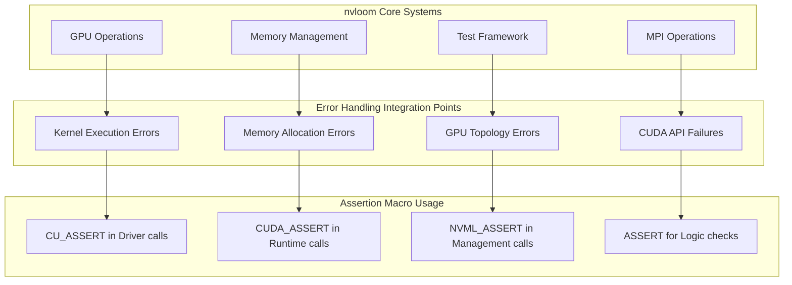

<!-- source: DeepWiki mcp.deepwiki.com · repo NVIDIA/nvloom · page 4.3 Error Handling and Debugging · fetched 2026-10-26 -->

# Error Handling and Debugging

Relevant source files

The following files were used as context for generating this wiki page:

- [library/error.h](library/error.h)

## Purpose and Scope

This document covers nvloom's comprehensive error handling and debugging system, which provides robust assertion macros, CUDA error logging, and detailed context information for troubleshooting distributed GPU operations. The system is designed to handle errors from multiple GPU APIs (CUDA Runtime, CUDA Driver, NVML) and provide meaningful diagnostic information in multi-node environments.

For information about memory allocation error recovery mechanisms, see [Memory Management System](#4.1). For details about test execution and result validation, see [Testing Framework](#5).

## Error Handling Architecture

nvloom implements a layered error handling approach that captures errors from different GPU subsystems and provides consistent diagnostic output across distributed environments.

**Error Handling Flow Architecture**: Shows how application-level errors flow through nvloom's assertion system to capture detailed diagnostic information from GPU APIs.

Sources: [library/error.h:66-103]()

## Assertion Macros

nvloom provides four primary assertion macros, each tailored for different error types and API contexts:

| Macro | Purpose | Error Type | Context Information |
|-------|---------|------------|-------------------|
| `ASSERT` | General assertions | Boolean conditions | Hostname + Device |
| `CUDA_ASSERT` | CUDA Runtime API | `cudaError_t` | Hostname + Device + CUDA Logs |
| `CU_ASSERT` | CUDA Driver API | `CUresult` | Hostname + Device + CUDA Logs |
| `NVML_ASSERT` | NVIDIA ML API | `nvmlReturn_t` | Hostname + Device |

### General Assertion System

The `ASSERT` macro provides basic condition checking with contextual information for multi-node debugging:

**ASSERT Macro Flow**: Shows the execution path when an assertion fails, including context gathering and program termination.

Sources: [library/error.h:66-71]()

### CUDA API Error Handling

The CUDA-specific assertion macros (`CUDA_ASSERT` and `CU_ASSERT`) enhance basic error checking with CUDA logging capabilities:

**CUDA Error Handling Flow**: Shows how CUDA-specific assertions capture comprehensive error information including driver logs and API error details.

Sources: [library/error.h:73-92]()

## CUDA Logging System

nvloom implements an advanced CUDA logging system that captures detailed driver-level diagnostic information when available:

### Log Retrieval Mechanism

The `getCudaLogs()` function provides access to CUDA driver logs for enhanced debugging:

**CUDA Logging System**: Shows the conditional compilation and runtime checks that enable advanced CUDA logging for supported driver versions.

Sources: [library/error.h:39-62]()

### Log Message Processing

The logging system processes raw CUDA driver output into structured messages:

| Component | Function | Purpose |
|-----------|----------|---------|
| Buffer Management | 25601-byte message buffer | Stores raw log data |
| Function Binding | `cuGetProcAddress` | Dynamic linking to logging API |
| Message Parsing | `std::istringstream` | Splits logs into individual messages |
| Output Integration | Error message formatting | Includes logs in assertion output |

Sources: [library/error.h:42-58]()

## Error Context and Multi-Node Support

nvloom's error handling system provides detailed context information essential for debugging distributed GPU applications:

### Context Information Components

**Error Context Assembly**: Shows how nvloom combines multiple information sources to create comprehensive error messages for multi-node debugging.

### Multi-Node Debugging Features

The error handling system includes specific features for distributed environments:

| Feature | Implementation | Benefit |
|---------|---------------|---------|
| Node Identification | `[hostname:device]` prefix | Identifies error source in cluster |
| Device Context | Local GPU device ID | Distinguishes between GPUs on same node |
| Expression Preservation | `#x` macro stringification | Shows exact failing code |
| Function Context | `__PRETTY_FUNCTION__` | Provides call stack information |

Sources: [library/error.h:68-80](), [library/error.h:88-90](), [library/error.h:97-98]()

## Integration with nvloom Systems

The error handling system integrates with nvloom's broader architecture to provide consistent debugging capabilities:

**System Integration**: Shows how error handling macros are used throughout nvloom's subsystems to provide consistent error reporting and debugging capabilities.

The error handling system serves as a foundational component that enables reliable operation and effective debugging across nvloom's distributed GPU testing framework.

Sources: [library/error.h:1-103]()

---

