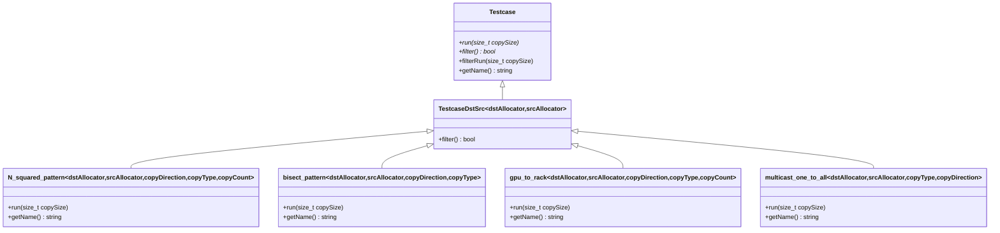
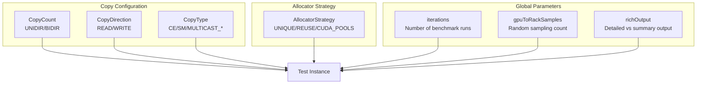
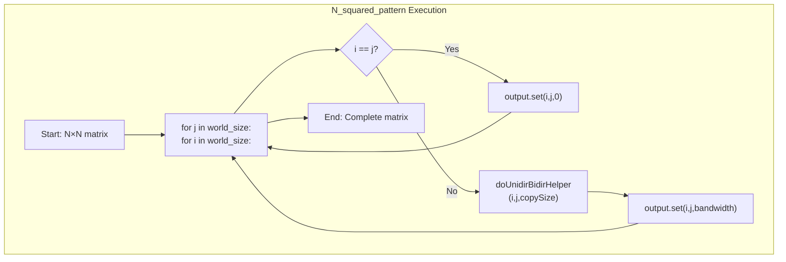
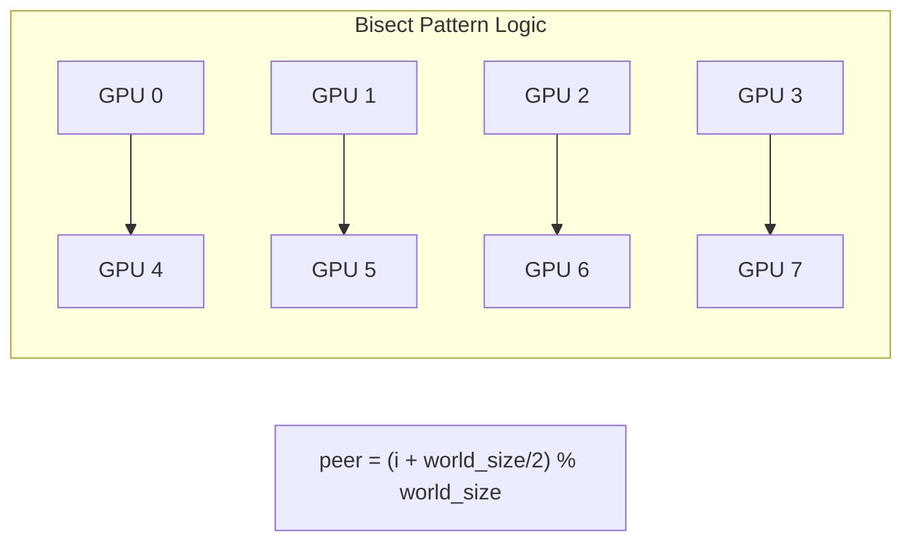
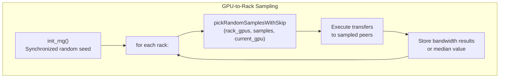
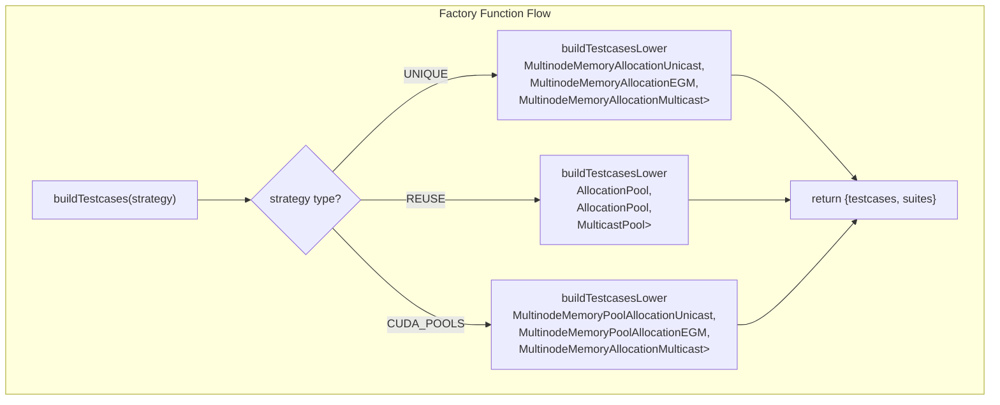
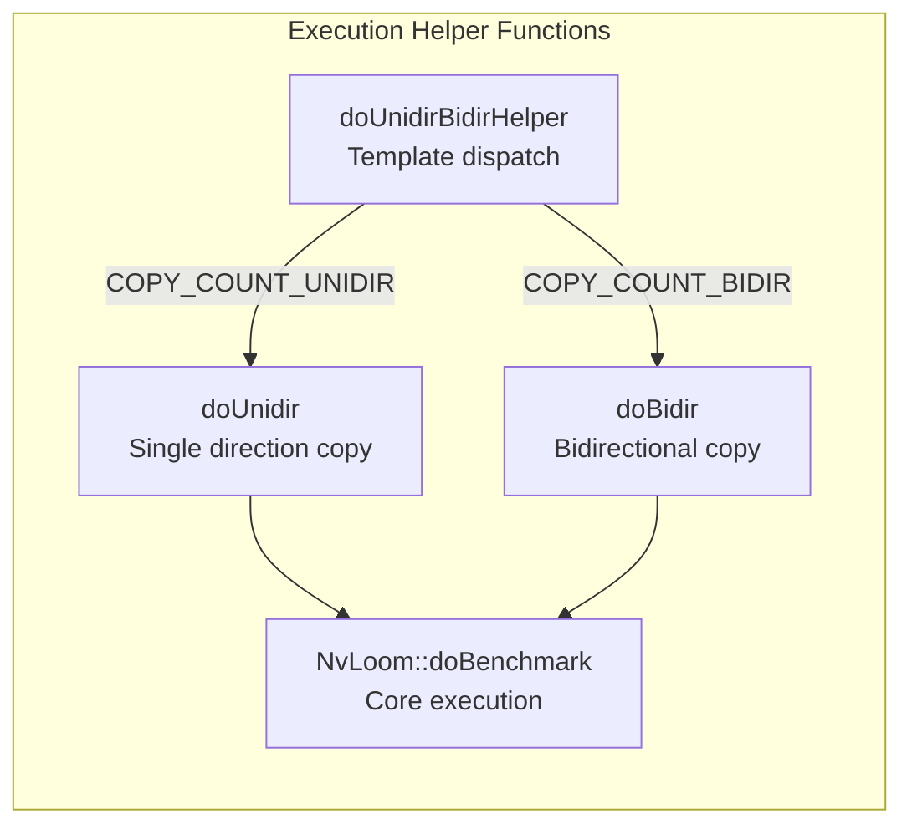

<!-- source: DeepWiki mcp.deepwiki.com · repo NVIDIA/nvloom · page 5 Testing Framework · fetched 2026-10-26 -->

# Testing Framework

Relevant source files

The following files were used as context for generating this wiki page:

- [cli/testcases.cpp](cli/testcases.cpp)
- [cli/testcases.h](cli/testcases.h)

This document covers nvloom's comprehensive testing framework, which defines and executes various communication patterns for GPU fabric benchmarking. The framework provides a systematic way to test different memory transfer patterns across multi-node GPU clusters.

For information about the core benchmarking execution engine, see [Core Library](#4). For details about specific test patterns and suites, see [Test Patterns and Suites](#5.1).

## Test Case Architecture

The testing framework is built around a hierarchical class structure that separates test definition from execution logic.

**Sources:** [cli/testcases.h:34-60](), [cli/testcases.cpp:89-110](), [cli/testcases.cpp:138-166](), [cli/testcases.cpp:379-441](), [cli/testcases.cpp:224-247]()

### Base Classes

The `Testcase` base class defines the interface for all test implementations:

| Method | Purpose |
|--------|---------|
| `run(size_t copySize)` | Execute the test pattern with specified data size |
| `filter()` | Determine if test should run in current environment |
| `filterRun(size_t copySize)` | Execute test only if filter passes |
| `getName()` | Return descriptive name for test output |

The `TestcaseDstSrc` template class provides a common filter implementation that checks for multi-node environment and allocator compatibility.

**Sources:** [cli/testcases.h:34-59]()

## Test Parameters and Configuration

The framework uses several enumerations to configure test behavior:

**Sources:** [cli/testcases.cpp:29-32](), [cli/testcases.h:28-32](), [cli/testcases.h:24-26]()

### Parameter Definitions

| Parameter | Values | Description |
|-----------|--------|-------------|
| `CopyCount` | `UNIDIR`, `BIDIR` | Unidirectional or bidirectional transfers |
| `CopyDirection` | `READ`, `WRITE` | Direction of copy operation |
| `CopyType` | `CE`, `SM`, `MULTICAST_*` | Copy engine, streaming multiprocessor, or multicast |
| `AllocatorStrategy` | `UNIQUE`, `REUSE`, `CUDA_POOLS` | Memory allocation strategy |

**Sources:** [cli/testcases.cpp:29-53](), [cli/testcases.h:28-32]()

## Test Pattern Implementations

The framework includes several core test patterns, each targeting different aspects of GPU fabric performance.

### N-Squared Pattern

The `N_squared_pattern` class implements comprehensive all-pairs testing:

This pattern tests every possible GPU pair combination, creating an N×N bandwidth matrix where N is the number of GPUs in the cluster.

**Sources:** [cli/testcases.cpp:89-110]()

### Bisect Pattern

The `bisect_pattern` class implements fabric stress testing by pairing each GPU with its opposite partner:

This pattern maximizes fabric utilization by ensuring all communications cross the maximum physical distance in the topology.

**Sources:** [cli/testcases.cpp:138-166]()

### GPU-to-Rack Pattern

The `gpu_to_rack` pattern implements randomized sampling across rack boundaries:

This pattern provides statistical sampling of inter-rack communication performance without exhaustive testing.

**Sources:** [cli/testcases.cpp:379-441](), [cli/testcases.cpp:369-376](), [cli/testcases.cpp:332-357]()

## Factory System

The test framework uses a factory pattern to generate test instances with different allocator strategies:

**Sources:** [cli/testcases.cpp:619-634]()

### Test Suite Organization

The `buildTestcasesLower` function organizes tests into logical suites:

| Suite Name | Tests Included | Purpose |
|------------|----------------|---------|
| `pairwise` | N-squared patterns (unidir/bidir, CE/SM, read/write) | Comprehensive pairwise testing |
| `fabric-stress` | Bisect patterns (CE/SM, read/write) | Maximum fabric utilization |
| `all-to-one` | Convergence patterns (CE/SM) | Many-to-one communication |
| `multicast` | Multicast patterns (write/read/reduce) | Advanced multicast operations |
| `egm` | EGM memory patterns | Host NUMA memory testing |
| `gpu-to-rack` | Random sampling patterns | Statistical inter-rack testing |
| `rack-to-rack` | Inter-rack patterns (unidir/bidir) | Rack-level fabric saturation |

**Sources:** [cli/testcases.cpp:546-616]()

## Test Execution Helpers

The framework provides template functions for executing different copy patterns:

**Sources:** [cli/testcases.cpp:55-86]()

### Copy Creation Pattern

Each test creates `Copy` objects that specify:
- Source and destination allocators
- Copy direction (read/write)
- Copy type (CE/SM/multicast)
- Number of iterations

**Sources:** [cli/testcases.cpp:57-76]()

## Multicast Test Patterns

The framework includes specialized patterns for multicast operations:

| Pattern Class | Operation | Description |
|---------------|-----------|-------------|
| `multicast_one_to_all` | Write/Read | Single source to all destinations |
| `multicast_all_to_all` | Write | All sources to all destinations |
| `multicast_all_to_all_ld_reduce` | Load-Reduce | Distributed reduction operation |
| `multicast_all_to_all_red` | Reduce | Aggregation operation |

These patterns test advanced GPU fabric features for efficient collective communication.

**Sources:** [cli/testcases.cpp:224-325]()

---

