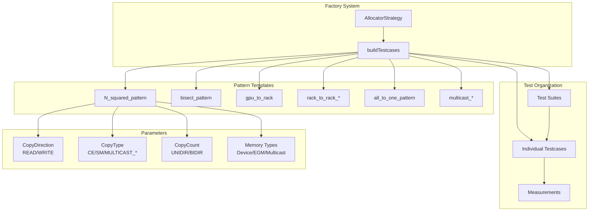
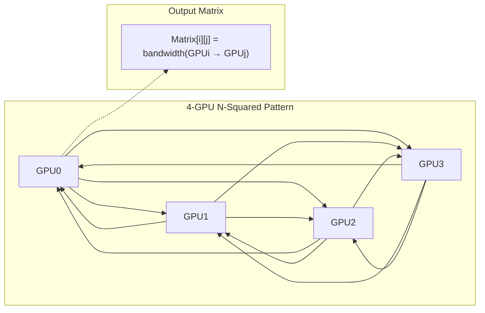
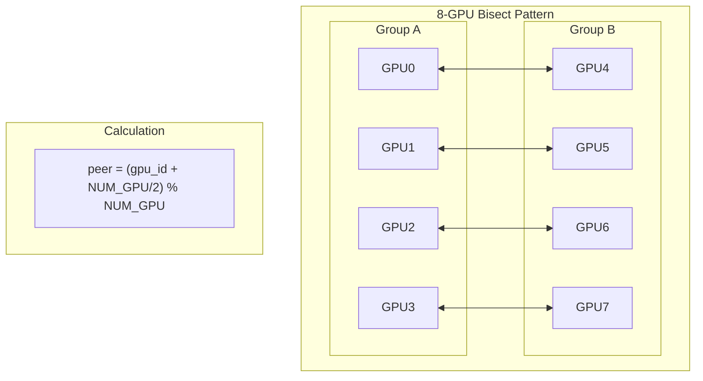
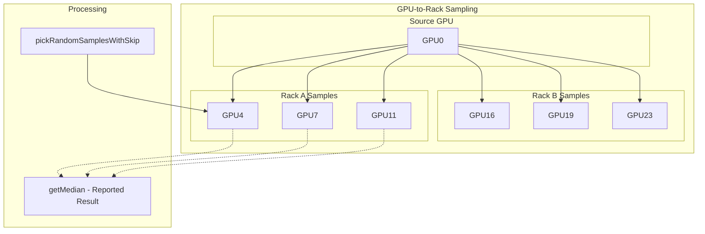
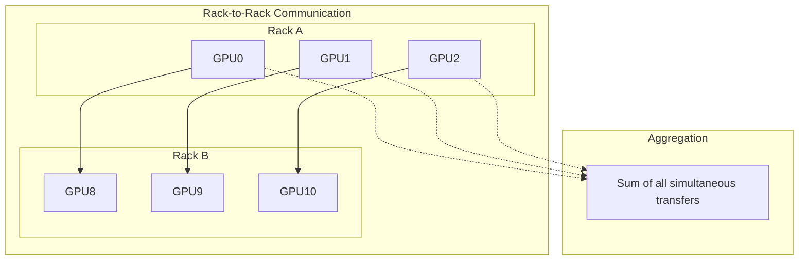
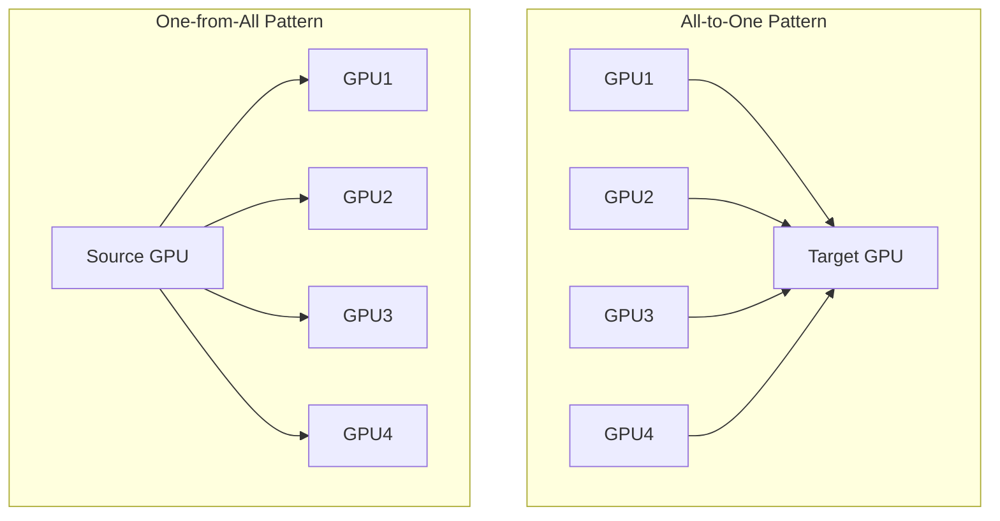
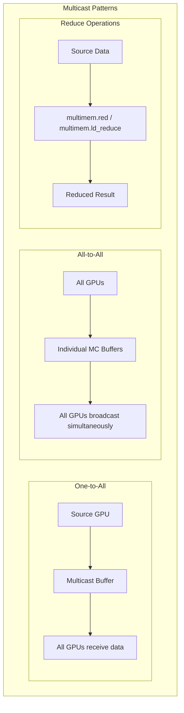
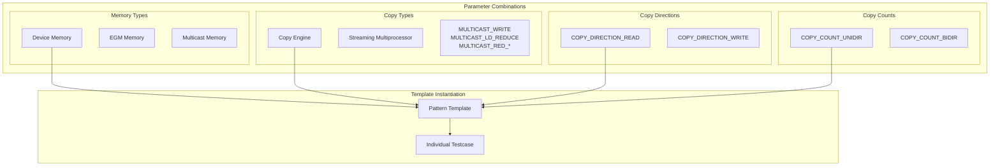

<!-- source: DeepWiki mcp.deepwiki.com · repo NVIDIA/nvloom · page 5.1 Test Patterns and Suites · fetched 2026-10-26 -->

# Test Patterns and Suites

Relevant source files

The following files were used as context for generating this wiki page:

- [README.md](README.md)
- [cli/testcases.cpp](cli/testcases.cpp)

This page documents nvloom's built-in test patterns and test suites, which define the communication topologies and measurement strategies used for benchmarking Multi-Node NVLink (MNNVL) fabrics. Test patterns implement specific GPU-to-GPU communication topologies, while test suites group related test cases for different evaluation scenarios.

For information about the testing framework architecture and how to create custom tests, see [Testing Framework](#5). For details about the core library's execution engine, see [Core Library](#4).

## Test Suite Architecture

nvloom organizes tests using a three-level hierarchy: **suites** contain **testcases**, and each testcase executes one or more **measurements**. The `buildTestcases` factory function creates all available test instances by instantiating pattern templates with different parameter combinations.

**Sources:** [cli/testcases.cpp:619-634](), [cli/testcases.cpp:546-617](), [README.md:109-120]()

## Core Test Patterns

### N-Squared Pattern (Pairwise)

The `N_squared_pattern` template implements exhaustive pairwise testing between all GPU pairs, producing a square matrix of bandwidth measurements. This pattern scales O(n²) with the number of GPUs.

The pattern supports both unidirectional and bidirectional variants. For bidirectional tests, the `N_squared_pattern_bidir` template leverages symmetry to execute only `NUM_GPU*(NUM_GPU-1)/2` measurements while filling both matrix triangles.

**Sources:** [cli/testcases.cpp:88-110](), [cli/testcases.cpp:113-135](), [README.md:299-306]()

### Bisect Pattern

The `bisect_pattern` implements simultaneous communication where each GPU writes to or reads from a peer at distance `NUM_GPU/2`, effectively dividing GPUs into two equal groups with bidirectional traffic between them.

This pattern executes in O(1) time and is recommended for quick fabric validation, as it stresses the fabric with simultaneous cross-domain communication.

**Sources:** [cli/testcases.cpp:137-166](), [README.md:323-331](), [README.md:99-105]()

### GPU-to-Rack Pattern

The `gpu_to_rack` pattern implements sampling-based testing where each GPU is tested against a random subset of peers from each rack, providing linear-time approximation of pairwise results.

The pattern uses `pickRandomSamplesWithSkip` to select random peer GPUs while avoiding self-testing, and reports median bandwidth per rack unless `--richOutput` is enabled.

**Sources:** [cli/testcases.cpp:378-441](), [cli/testcases.cpp:332-357](), [cli/testcases.cpp:359-367](), [README.md:307-322]()

### Rack-to-Rack Pattern

The `rack_to_rack_unidir` and `rack_to_rack_bidir` patterns implement rack-level communication testing by pairing GPUs from different racks and measuring aggregate bandwidth.

The number of simultaneous transfers is limited by `min(rack1.size(), rack2.size())` to ensure balanced communication.

**Sources:** [cli/testcases.cpp:443-483](), [cli/testcases.cpp:485-530](), [README.md:333-340]()

### All-to-One and One-from-All Patterns

These patterns implement convergent and divergent communication where multiple GPUs access memory on a single target GPU.

The `all_to_one_pattern` uses separate target buffers per writing GPU to avoid undefined behavior, while `all_from_one_pattern` allows multiple GPUs to read from the same source buffer.

**Sources:** [cli/testcases.cpp:168-193](), [cli/testcases.cpp:195-220](), [README.md:341-360]()

### Multicast Patterns

nvloom implements several multicast communication patterns using specialized PTX instructions for efficient one-to-many and many-to-one data movement.

**Multicast Pattern Types:**
- `multicast_one_to_all`: Single GPU broadcasts to multicast buffer
- `multicast_all_to_all`: All GPUs broadcast simultaneously  
- `multicast_one_to_all_red`: Single GPU performs reduction operation
- `multicast_all_to_all_red`: All GPUs perform reduction simultaneously
- `multicast_all_to_one_red`: All GPUs reduce data to single target

**Sources:** [cli/testcases.cpp:223-247](), [cli/testcases.cpp:249-272](), [cli/testcases.cpp:274-296](), [cli/testcases.cpp:298-325](), [README.md:361-396]()

## Test Suite Definitions

nvloom groups related test cases into seven predefined suites, each targeting specific evaluation scenarios:

| Suite Name | Primary Patterns | Scaling | Purpose |
|------------|------------------|---------|---------|
| `pairwise` | `N_squared_pattern` | O(n²) | Comprehensive bandwidth matrix |
| `fabric-stress` | `bisect_pattern` | O(1) | Simultaneous fabric saturation |
| `gpu-to-rack` | `gpu_to_rack` | O(n) | Linear-time sampling approximation |
| `rack-to-rack` | `rack_to_rack_*` | O(racks²) | Inter-rack communication |
| `all-to-one` | `all_to_one_pattern`, `all_from_one_pattern` | O(n) | Convergent/divergent patterns |
| `multicast` | `multicast_*` | O(1) | Broadcast and reduction operations |
| `egm` | `N_squared_pattern` with EGM allocators | O(n²) | Extended GPU Memory testing |

### Test Case Parameter Matrix

Each pattern template is instantiated with different parameter combinations to create individual test cases:

**Sources:** [cli/testcases.cpp:550-614](), [cli/testcases.cpp:29-53]()

### Allocator Strategy Integration

The `buildTestcases` function creates different test case variants based on the selected `AllocatorStrategy`:

- **ALLOCATOR_STRATEGY_UNIQUE**: Direct allocator classes (`MultinodeMemoryAllocationUnicast`, `MultinodeMemoryAllocationEGM`, `MultinodeMemoryAllocationMulticast`)
- **ALLOCATOR_STRATEGY_REUSE**: Pooled allocators (`AllocationPool<T>`, `MulticastPool`)  
- **ALLOCATOR_STRATEGY_CUDA_POOLS**: CUDA stream-ordered allocators (`MultinodeMemoryPoolAllocationUnicast`, `MultinodeMemoryPoolAllocationEGM`)

**Sources:** [cli/testcases.cpp:619-634](), [cli/testcases.cpp:621-631]()

---

