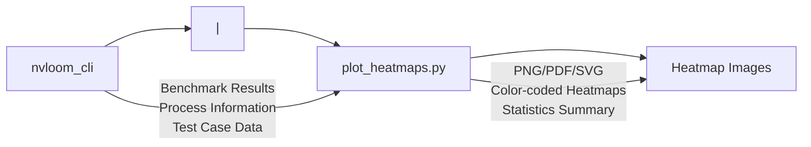
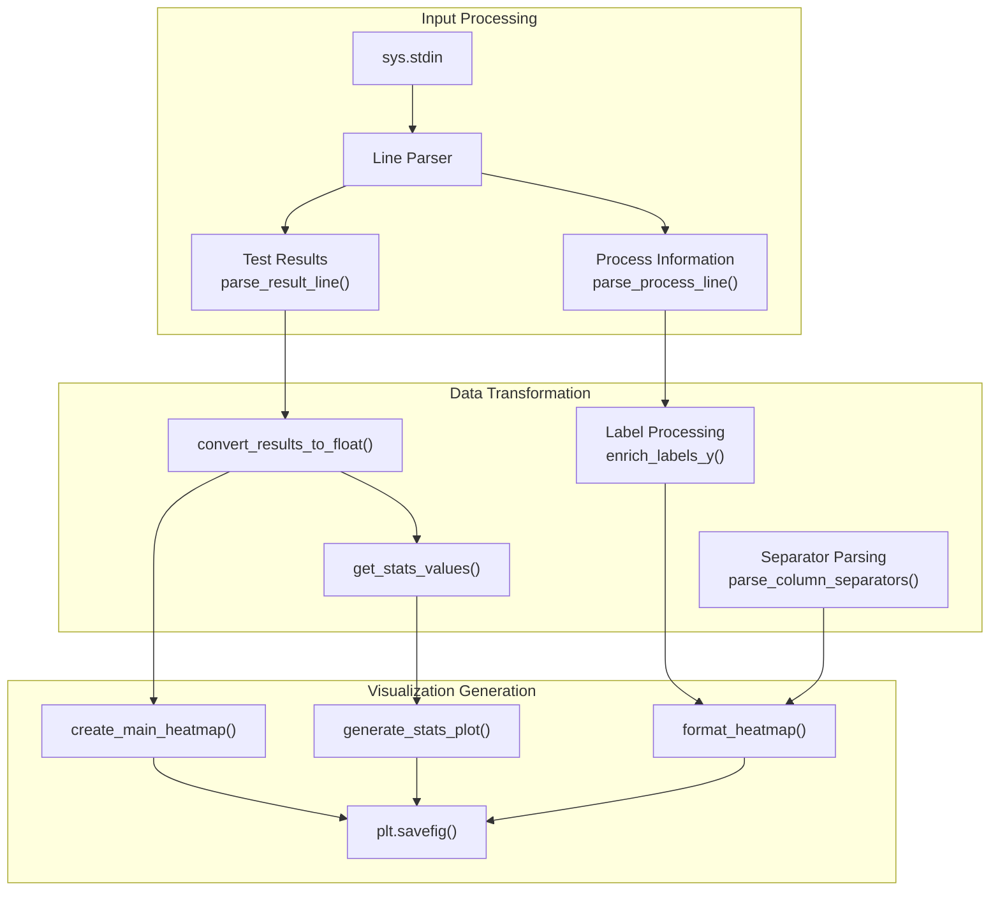
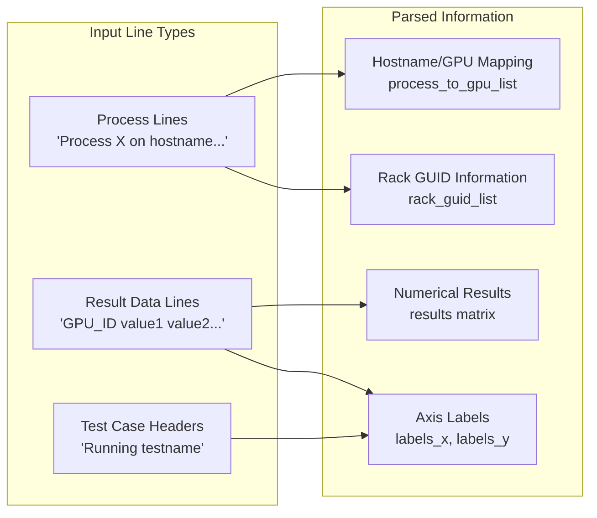
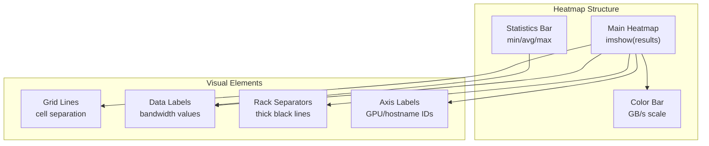

<!-- source: DeepWiki mcp.deepwiki.com · repo NVIDIA/nvloom · page 6 Visualization Tools · fetched 2026-10-26 -->

# Visualization Tools

<details>
<summary>Relevant source files</summary>

The following files were used as context for generating this wiki page:

- [cli/plot_heatmaps.py](cli/plot_heatmaps.py)
- [docs/bisect_testing.png](docs/bisect_testing.png)

</details>


This page documents nvloom's visualization capabilities, specifically the heatmap plotting utility that transforms benchmark results into visual representations. The primary tool is the `plot_heatmaps.py` script, which generates color-coded heatmaps showing bandwidth performance across GPU pairs and test configurations.

For information about the testing framework that generates the data visualized here, see [Testing Framework](#5). For details about the command line interface that produces the input data, see [Command Line Interface](#3).

## Overview

The nvloom visualization system consists of a Python-based heatmap generator that processes text output from `nvloom_cli` and creates visual representations of benchmark results. The tool is designed to handle complex multi-GPU, multi-rack configurations with support for rack separation indicators and customizable formatting.



**Data Flow and Processing Pipeline**

Sources: [cli/plot_heatmaps.py:1-372]()

## Core Components

The visualization system is implemented through several key components that work together to parse benchmark data and generate heatmaps:



**Component Architecture and Data Flow**

Sources: [cli/plot_heatmaps.py:307-371](), [cli/plot_heatmaps.py:205-249](), [cli/plot_heatmaps.py:282-297]()

## Command Line Interface

The `plot_heatmaps.py` script provides extensive customization options through command line arguments:

| Parameter | Default | Description |
|-----------|---------|-------------|
| `--path` | Current directory | Output directory for generated plots |
| `--heatmap_lower_limit` | 0 | Minimum value for color scale |
| `--heatmap_upper_limit` | Auto-calculated | Maximum value for color scale |
| `--title_fontsize` | 32 | Font size for plot titles |
| `--legend_fontsize` | 24 | Font size for axis labels and legends |
| `--data_fontsize_scaling_factor` | 1 | Scaling factor for data value labels |
| `--plot_size` | 32 | Size of generated plots in inches |
| `--file_format` | png | Output format (png, pdf, svg, etc.) |

**Usage Pattern:**
```bash
cat benchmark_output.txt | python3 plot_heatmaps.py --path ./heatmaps --plot_size 24
```

Sources: [cli/plot_heatmaps.py:28-40](), [cli/plot_heatmaps.py:43]()

## Input Data Format

The script expects input in the specific format produced by `nvloom_cli`. The parsing system handles three main types of input lines:



**Input Processing and Data Extraction**

Sources: [cli/plot_heatmaps.py:290-297](), [cli/plot_heatmaps.py:282-287](), [cli/plot_heatmaps.py:324-352]()

## Heatmap Generation

The core visualization functionality creates two-panel plots with a main heatmap and summary statistics:

### Main Heatmap Features

- **Color Mapping**: Uses matplotlib's "YlGn" (Yellow-Green) colormap for bandwidth values
- **Data Labels**: Numerical values overlaid on each cell with automatic color adjustment for readability  
- **Grid Lines**: Minor grid lines separate individual cells
- **Rack Separators**: Horizontal and vertical lines indicate rack boundaries
- **Axis Labels**: Support for both numeric GPU IDs and hostname/GPU combinations

### Statistics Panel

The lower panel displays summary statistics with the same color mapping:
- **Minimum**: Lowest bandwidth value across all measurements
- **Average**: Mean bandwidth across all valid measurements  
- **Maximum**: Highest bandwidth value recorded



**Visual Elements and Layout Structure**

Sources: [cli/plot_heatmaps.py:195-203](), [cli/plot_heatmaps.py:58-77](), [cli/plot_heatmaps.py:130-139]()

## Multi-Rack Support

The visualization system includes sophisticated support for multi-rack configurations, automatically detecting rack boundaries and adding visual separators:

### Rack Detection

- **Process Line Parsing**: Extracts rack GUID information from process description lines
- **Boundary Detection**: Identifies transitions between different rack GUIDs
- **Separator Placement**: Adds horizontal lines between GPU groups from different racks

### Column Separators

The system supports explicit column separators using pipe characters (`|`) in the input data:
- **Parsing**: Detects `|` characters in column headers and removes them from labels
- **Visual Separation**: Adds vertical black lines at specified positions
- **Label Grouping**: Groups related columns under common headers

Sources: [cli/plot_heatmaps.py:251-257](), [cli/plot_heatmaps.py:79-106](), [cli/plot_heatmaps.py:260-279]()

## Adaptive Formatting

The plotting system includes intelligent formatting that adapts to data characteristics:

### Font Size Scaling

Dynamic font size calculation based on:
- **Matrix Dimensions**: Larger matrices use smaller fonts to maintain readability
- **Value Magnitudes**: Font size scales with the maximum value length to prevent overlap
- **User Scaling Factor**: Multiplier for manual font size adjustment

### Color Threshold Calculation

Text color selection for data labels:
- **Automatic Threshold**: Set to 50% of maximum value for optimal contrast
- **Binary Color Selection**: Black text on light backgrounds, white text on dark backgrounds
- **Consistent Application**: Same logic applied to both main heatmap and statistics panel

### Layout Optimization

- **Aspect Ratio**: Height ratios calculated based on matrix dimensions
- **Tight Layout**: Automatic padding adjustment to prevent clipping
- **Size Scaling**: Plot dimensions scale with data complexity

Sources: [cli/plot_heatmaps.py:158-164](), [cli/plot_heatmaps.py:225-238](), [cli/plot_heatmaps.py:166-193]()

## Error Handling and Validation

The visualization system includes robust error handling for common issues:

### Data Validation

- **Limit Validation**: Ensures color scale limits are reasonable relative to data range
- **NaN Handling**: Gracefully skips test cases with all NaN values
- **Directory Creation**: Automatically creates output directories with error handling

### Exception Management

- **File I/O Errors**: Catches and reports file system issues during plot saving
- **Plotting Errors**: Individual test case failures don't stop overall processing
- **Input Format Issues**: Robust parsing with graceful degradation for malformed input

Sources: [cli/plot_heatmaps.py:146-156](), [cli/plot_heatmaps.py:218-220](), [cli/plot_heatmaps.py:314-317](), [cli/plot_heatmaps.py:244-248]()

---

