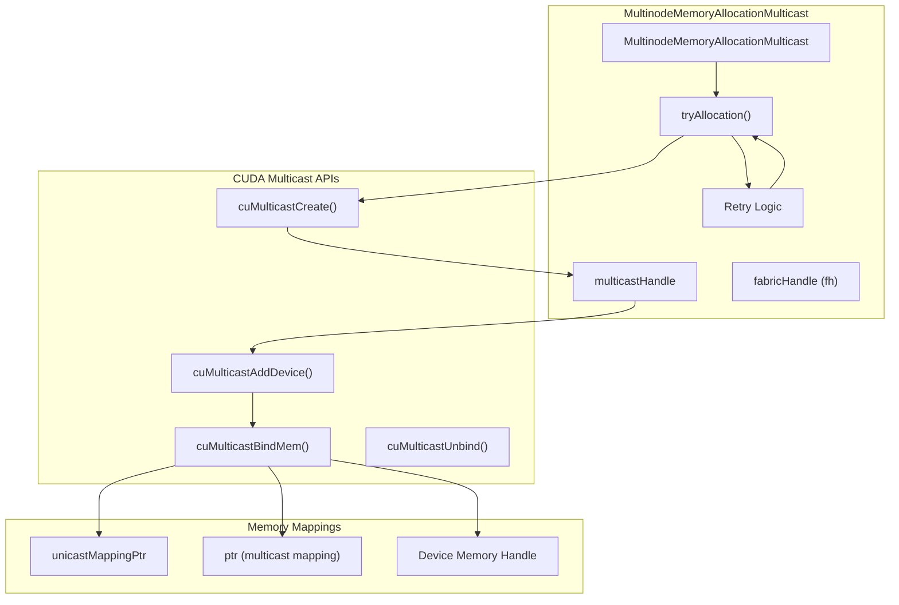
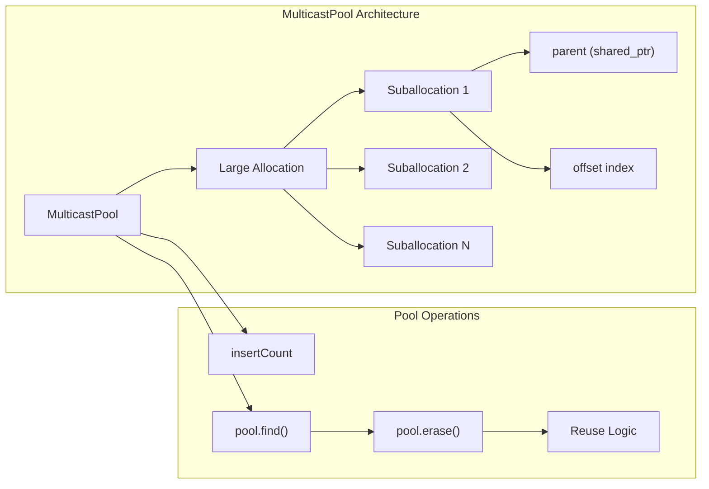
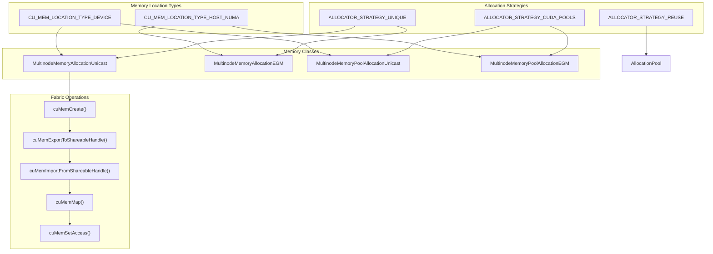
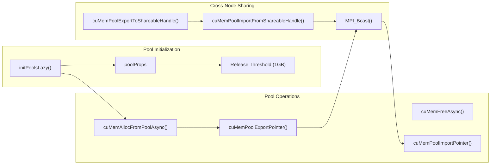
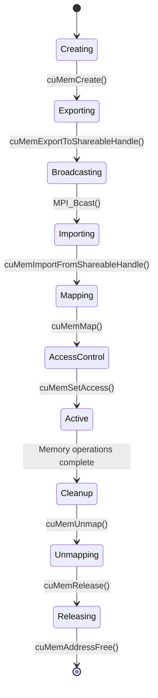
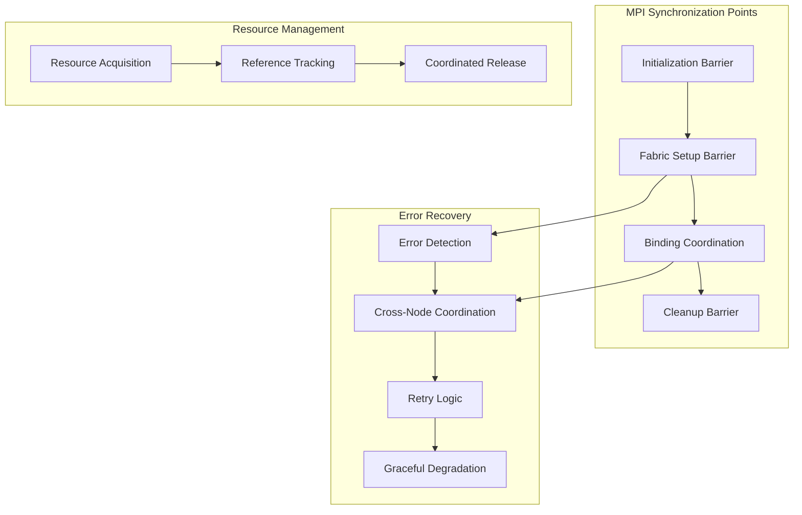

<!-- source: DeepWiki mcp.deepwiki.com · repo NVIDIA/nvloom · page 7 Advanced Topics · fetched 2026-10-26 -->

# Advanced Topics

Relevant source files

The following files were used as context for generating this wiki page:

- [docs/multicast.png](docs/multicast.png)
- [docs/multicast_ld_reduce.png](docs/multicast_ld_reduce.png)
- [docs/multicast_red.png](docs/multicast_red.png)
- [library/allocators.cpp](library/allocators.cpp)

## Purpose and Scope

This document covers advanced nvloom features that enable sophisticated GPU fabric testing scenarios. The topics include multicast memory operations, distributed memory allocation strategies, and GPU fabric management concepts that go beyond basic benchmark execution.

For basic memory management concepts, see [Memory Management System](#4.1). For core benchmarking operations, see [Core Library](#4). For test pattern definitions, see [Testing Framework](#5).

## Multicast Memory Operations

Multicast operations represent nvloom's most advanced feature, enabling one-to-many memory communication patterns across distributed GPU fabrics. These operations allow a single GPU to efficiently broadcast data to multiple target GPUs simultaneously using hardware fabric support.

### Multicast Allocation Architecture

**Multicast Memory Allocation Flow**

The `MultinodeMemoryAllocationMulticast` class implements sophisticated multicast memory management with automatic retry capabilities. The allocation process involves creating both unicast and multicast mappings of the same underlying memory, enabling both individual access and collective operations.

Sources: [library/allocators.cpp:148-249]()

### Multicast Pool Management

**Multicast Pool Optimization Strategy**

The `MulticastPool` class optimizes multicast allocations by creating large shared allocations and suballocating smaller chunks. This approach reduces the overhead of fabric handle creation and improves allocation performance for repeated multicast operations.

Sources: [library/allocators.cpp:437-481]()

### Error Recovery and Retry Logic

The multicast allocation system includes sophisticated error recovery for `CUDA_ERROR_SYSTEM_NOT_READY` conditions:

| Error Handling Stage | Mechanism | Implementation |
|---------------------|-----------|----------------|
| Initial Allocation | `tryAllocation()` | Single attempt with error detection |
| Retry Logic | Sleep and retry | 15-second intervals, 60-second maximum |
| Collective Recovery | MPI coordination | All ranks must agree on retry strategy |
| Resource Cleanup | Automatic cleanup | Handles released on persistent failures |

The retry mechanism ensures robust operation in environments where fabric resources may be temporarily unavailable due to system loading or hardware state transitions.

Sources: [library/allocators.cpp:231-248]()

## Advanced Memory Allocation Strategies

### Fabric-Based Memory Architecture

**Fabric Memory Management Hierarchy**

nvloom implements a sophisticated memory allocation hierarchy that supports different memory locations, allocation strategies, and fabric sharing mechanisms. The system automatically handles fabric handle creation, cross-node sharing, and memory access control.

Sources: [library/allocators.cpp:71-134](), [library/allocators.cpp:277-394]()

### CUDA Memory Pool Integration

The `MultinodeMemoryPoolAllocationBase` class integrates with CUDA's stream-ordered memory pools for improved performance:

**CUDA Pool-Based Allocation Strategy**

The pool-based allocation strategy leverages CUDA's stream-ordered memory allocators with fabric handle sharing capabilities. This approach provides both performance benefits through pool reuse and distributed access through fabric handle export/import mechanisms.

Sources: [library/allocators.cpp:277-322](), [library/allocators.cpp:324-382]()

## Distributed GPU Fabric Management

### Fabric Handle Lifecycle

**Fabric Handle State Management**

The fabric handle lifecycle ensures proper creation, distribution, and cleanup of cross-node memory resources. MPI barriers coordinate state transitions across all participating nodes.

Sources: [library/allocators.cpp:88-134]()

### Device Capability Detection

nvloom includes comprehensive device capability detection for fabric features:

| Capability | Detection Method | Required For |
|-----------|-----------------|--------------|
| Fabric Support | `CU_DEVICE_ATTRIBUTE_HANDLE_TYPE_FABRIC_SUPPORTED` | Unicast operations |
| Host NUMA IPC | `CU_DEVICE_ATTRIBUTE_HOST_NUMA_MULTINODE_IPC_SUPPORTED` | EGM operations |
| Multicast Support | `CU_DEVICE_ATTRIBUTE_MULTICAST_SUPPORTED` | Multicast operations |

The `filter()` methods in allocation classes automatically detect device capabilities and skip unsupported operations, ensuring robust execution across heterogeneous hardware configurations.

Sources: [library/allocators.cpp:136-146](), [library/allocators.cpp:271-275](), [library/allocators.cpp:384-394]()

## Error Handling and Robustness

### Synchronization Strategy

nvloom employs multiple levels of synchronization to ensure correct distributed operation:

**Distributed Synchronization Architecture**

The synchronization strategy ensures that all nodes progress through critical sections together, preventing race conditions and ensuring consistent state across the distributed system.

Sources: [library/allocators.cpp:124-125](), [library/allocators.cpp:173-174](), [library/allocators.cpp:225-226]()

### Resource Cleanup Patterns

The allocation system implements RAII-based resource management with distributed cleanup coordination:

- **Automatic Cleanup**: Destructors ensure proper resource deallocation
- **Cross-Node Coordination**: MPI barriers prevent premature resource release  
- **Exception Safety**: Resource cleanup occurs even in error conditions
- **Pool Management**: The `clearAllocationPools()` function provides centralized cleanup

These patterns ensure that fabric resources are properly managed across complex distributed scenarios, preventing resource leaks and ensuring system stability.

Sources: [library/allocators.cpp:127-134](), [library/allocators.cpp:251-261](), [library/allocators.cpp:482-487]()

---

