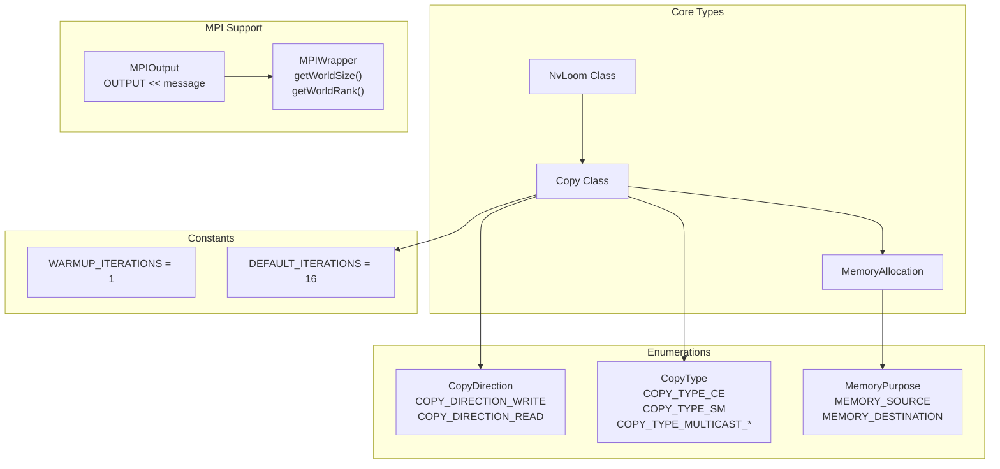
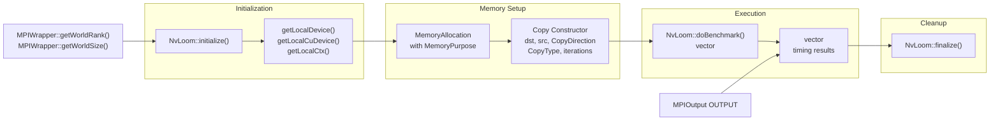

<!-- source: DeepWiki mcp.deepwiki.com · repo NVIDIA/nvloom · page 8 API Reference · fetched 2026-10-26 -->

# API Reference

<details>
<summary>Relevant source files</summary>

The following files were used as context for generating this wiki page:

- [library/enums.h](library/enums.h)
- [library/nvloom.h](library/nvloom.h)

</details>


This document provides complete reference documentation for nvloom's public API, including types, enumerations, constants, and classes. This reference covers the core library interface defined in the main header files.

For usage examples and high-level concepts, see [Core Library](#4). For detailed memory management concepts, see [Memory Management System](#4.1). For testing framework types, see [Testing Framework](#5).

## Constants

The nvloom library defines several key constants that control benchmark behavior and execution parameters.

| Constant | Value | Purpose | Source |
|----------|-------|---------|---------|
| `WARMUP_ITERATIONS` | `1` | Number of warmup iterations before timing measurements | [library/nvloom.h:33]() |
| `DEFAULT_ITERATIONS` | `16` | Default number of benchmark iterations for timing | [library/nvloom.h:34]() |

Sources: [library/nvloom.h:33-34]()

## Enumerations

### CopyDirection

Defines the direction of memory copy operations from the perspective of the executing MPI rank.

| Value | Description |
|-------|-------------|
| `COPY_DIRECTION_WRITE` | Write operation - data flows from source to destination |
| `COPY_DIRECTION_READ` | Read operation - data flows from destination to source |

Sources: [library/enums.h:20-23]()

### CopyType

Specifies the execution mechanism for memory operations, determining which GPU hardware units perform the copy.

| Value | Description |
|-------|-------------|
| `COPY_TYPE_CE` | Copy Engine - Hardware-accelerated DMA transfers |
| `COPY_TYPE_SM` | Streaming Multiprocessor - Custom CUDA kernel execution |
| `COPY_TYPE_MULTICAST_WRITE` | Multicast write operations to multiple destinations |
| `COPY_TYPE_MULTICAST_LD_REDUCE` | Multicast load-reduce operations |
| `COPY_TYPE_MULTICAST_RED_SINGLE` | Single GPU multicast reduce (multimem.red instructions) |
| `COPY_TYPE_MULTICAST_RED_ALL` | All GPUs multicast reduce (multimem.red instructions) |

Sources: [library/enums.h:25-35]()

### MemoryPurpose

Categorizes memory allocations by their intended role in copy operations.

| Value | Description |
|-------|-------------|
| `MEMORY_SOURCE` | Memory serves as source for copy operations |
| `MEMORY_DESTINATION` | Memory serves as destination for copy operations |

Sources: [library/enums.h:37-40]()

## Core Classes

### Copy Class

The `Copy` class represents a single memory copy operation with all necessary parameters for execution and timing.

#### Constructor
```cpp
Copy(std::shared_ptr<MemoryAllocation> _dst, 
     std::shared_ptr<MemoryAllocation> _src, 
     CopyDirection _copyDirection, 
     CopyType _copyType, 
     int _iterations = DEFAULT_ITERATIONS)
```

#### Public Members

| Member | Type | Description |
|--------|------|-------------|
| `dst` | `std::shared_ptr<MemoryAllocation>` | Destination memory allocation |
| `src` | `std::shared_ptr<MemoryAllocation>` | Source memory allocation |
| `copyDirection` | `CopyDirection` | Direction of the copy operation |
| `copyType` | `CopyType` | Execution mechanism for the copy |
| `executingMPIrank` | `int` | MPI rank that will execute this copy |
| `iterations` | `int` | Number of iterations for timing measurement |

The `executingMPIrank` is automatically determined based on `copyDirection`: for `COPY_DIRECTION_READ`, it uses the destination's MPI rank; for `COPY_DIRECTION_WRITE`, it uses the source's MPI rank.

Sources: [library/nvloom.h:36-58]()

### NvLoom Class

The main API class providing static methods for initialization, benchmarking, and accessing system information.

#### Core Methods

| Method | Return Type | Description |
|--------|-------------|-------------|
| `initialize(int _localDevice, std::map<std::string, std::vector<int>> _rackToProcessMap = {})` | `void` | Initialize the library with local device and rack mapping |
| `doBenchmark(std::vector<Copy> copies)` | `std::vector<double>` | Execute benchmark and return timing results |
| `finalize()` | `void` | Clean up library resources |

#### System Information Accessors

| Method | Return Type | Description |
|--------|-------------|-------------|
| `getLocalDevice()` | `int` | Current CUDA device ID |
| `getLocalCuDevice()` | `CUdevice` | CUDA driver API device handle |
| `getLocalCtx()` | `CUcontext` | CUDA driver API context handle |
| `getLocalMultiprocessorCount()` | `int` | Number of SMs on local device |
| `getLocalClockRate()` | `int` | Device clock rate in kHz |
| `getLocalCpuNumaNode()` | `int` | CPU NUMA node for local device |
| `getLocalHostname()` | `std::string` | Hostname of current node |
| `getDefaultIterationCount()` | `unsigned long long` | Default iteration count constant |
| `getRackToProcessMap()` | `std::map<std::string, std::vector<int>>` | Mapping of rack GUIDs to MPI ranks |

Sources: [library/nvloom.h:108-146]()

### MPIWrapper Class

Singleton class providing convenient access to MPI world information.

#### Static Methods

| Method | Return Type | Description |
|--------|-------------|-------------|
| `getWorldSize()` | `int` | Total number of MPI processes |
| `getWorldRank()` | `int` | Current MPI process rank |
| `instance()` | `MPIWrapper&` | Get singleton instance |

The class automatically initializes MPI if not already initialized and maintains world size and rank information.

Sources: [library/nvloom.h:60-88]()

### MPIOutput Class

Thread-safe output class that only prints from MPI rank 0, preventing duplicate output in multi-process environments.

#### Usage
```cpp
extern MPIOutput OUTPUT;
OUTPUT << "message" << std::endl;
```

The class overloads the `<<` operator for both data types and stream manipulators, ensuring output only occurs from rank 0.

Sources: [library/nvloom.h:90-106]()

## Utility Functions

| Function | Return Type | Description | Source |
|----------|-------------|-------------|---------|
| `getRackGuid(int device)` | `std::string` | Get rack GUID for specified device | [library/nvloom.h:148]() |
| `trimRackGuid(std::string rackGuid)` | `std::string` | Trim rack GUID to standard format | [library/nvloom.h:149]() |

Sources: [library/nvloom.h:148-149]()

## API Type Relationships



Sources: [library/nvloom.h:20-151](), [library/enums.h:17-42]()

## API Usage Flow



Sources: [library/nvloom.h:108-146](), [library/nvloom.h:36-58]()

---

