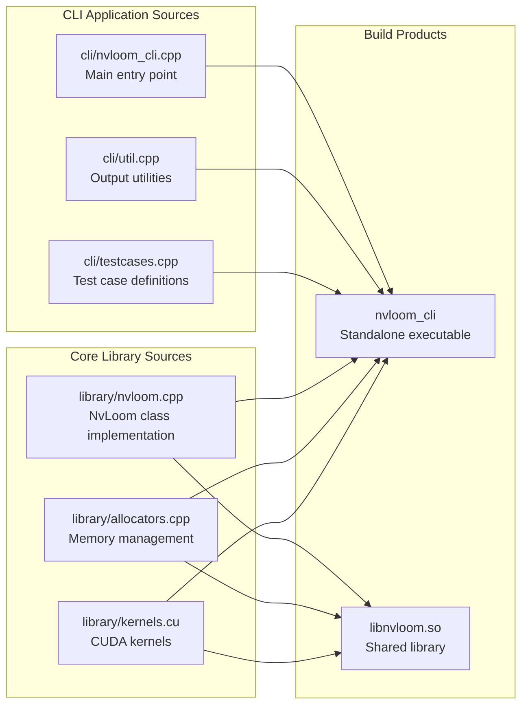
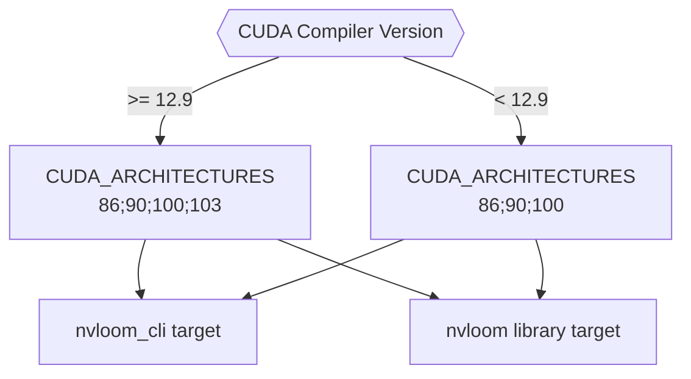

<!-- source: DeepWiki mcp.deepwiki.com · repo NVIDIA/nvloom · page 9 Development Guide · fetched 2026-10-26 -->

# Development Guide

<details>
<summary>Relevant source files</summary>

The following files were used as context for generating this wiki page:

- [CMakeLists.txt](CMakeLists.txt)
- [CONTRIBUTING.md](CONTRIBUTING.md)
- [LICENSE](LICENSE)
- [library/CMakeLists.txt](library/CMakeLists.txt)

</details>


This document provides information for developers who want to understand nvloom's build system, code organization, and development practices. It covers build configuration, development environment setup, and project structure details.

For information about using nvloom's API to create custom applications, see [Core Library](#4). For details about implementing new test patterns, see [Testing Framework](#5).

## Build System Architecture

nvloom uses CMake as its build system and produces two primary build targets: a shared library (`nvloom`) and a command-line application (`nvloom_cli`). The build system is designed to handle complex dependencies including CUDA, MPI, Boost, and NVML.

```mermaid
graph TB
    subgraph "Build Targets"
        CLI[nvloom_cli executable]
        LIB[nvloom shared library]
    end
    
    subgraph "Source Files"
        CLI_SRC["cli/nvloom_cli.cpp<br/>cli/util.cpp<br/>cli/testcases.cpp"]
        LIB_SRC["library/nvloom.cpp<br/>library/allocators.cpp<br/>library/kernels.cu"]
        SHARED_SRC["library/kernels.cu<br/>library/allocators.cpp<br/>library/nvloom.cpp"]
    end
    
    subgraph "Dependencies"
        CUDA["CUDA Runtime/Driver"]
        MPI["MPI (MPI::MPI_CXX)"]
        BOOST["Boost::program_options"]
        NVML["nvidia-ml"]
        GIT["Git (version info)"]
    end
    
    subgraph "Build Configuration"
        CMAKE_FLAGS["-DGIT_COMMIT<br/>-DMULTINODE"]
        CUDA_ARCH["86;90;100;103<br/>(CUDA 12.9+)"]
        CXX_STANDARD["C++17 Standard"]
        BUILD_TYPE["Release (default)"]
    end
    
    CLI_SRC --> CLI
    LIB_SRC --> LIB
    SHARED_SRC --> CLI
    
    CUDA --> CLI
    CUDA --> LIB
    MPI --> CLI
    MPI --> LIB
    BOOST --> CLI
    BOOST --> LIB
    NVML --> CLI
    NVML --> LIB
    GIT --> CLI
    
    CMAKE_FLAGS --> CLI
    CMAKE_FLAGS --> LIB
    CUDA_ARCH --> CLI
    CUDA_ARCH --> LIB
    CXX_STANDARD --> CLI
    CXX_STANDARD --> LIB
    BUILD_TYPE --> CLI
    BUILD_TYPE --> LIB
```



**Sources:** [CMakeLists.txt:1-66](), [library/CMakeLists.txt:1-56]()

## Source File Organization

The nvloom codebase is organized into distinct modules with clear separation between the CLI application and core library functionality.



**Sources:** [CMakeLists.txt:36-43](), [library/CMakeLists.txt:36-40]()

## Dependencies and Requirements

nvloom has several system and library dependencies that must be configured correctly for successful builds.

| Dependency | Version Requirement | Purpose | CMake Configuration |
|------------|-------------------|---------|-------------------|
| CMake | >= 3.20 | Build system | `cmake_minimum_required(VERSION 3.20)` |
| C++ Standard | C++17 | Language standard | `CMAKE_CXX_STANDARD 17` |
| CUDA | >= 12.0 (12.9+ recommended) | GPU programming | `LANGUAGES CUDA CXX` |
| MPI | Any compatible implementation | Multi-node communication | `find_package(MPI REQUIRED)` |
| Boost | program_options component | Command-line parsing | `find_package(Boost COMPONENTS program_options REQUIRED)` |
| NVIDIA ML | System library | GPU topology discovery | `target_link_libraries(...nvidia-ml)` |
| Git | Any version | Version information | `git describe --always --tags` |

**Sources:** [CMakeLists.txt:18-66](), [library/CMakeLists.txt:18-56]()

## CUDA Architecture Configuration

nvloom automatically configures CUDA architectures based on the available CUDA compiler version to support modern GPU generations.



The architecture selection ensures compatibility with:
- **86**: GeForce RTX 30 series, A100, A30
- **90**: H100, H800, GH200
- **100**: B100, B200 
- **103**: GB200 (CUDA 12.9+ only)

**Sources:** [CMakeLists.txt:56-60](), [library/CMakeLists.txt:46-50]()

## Build Configuration Options

nvloom supports several build-time configuration options through CMake variables and preprocessor definitions.

| Configuration | Default Value | Description | Impact |
|--------------|---------------|-------------|---------|
| `CMAKE_BUILD_TYPE` | Release | Build optimization level | Performance and debugging symbols |
| `Boost_USE_STATIC_LIBS` | ON | Static linking for Boost | Deployment dependencies |
| `GIT_COMMIT` | Auto-detected | Git commit hash | Version reporting in CLI |
| `MULTINODE` | Enabled (library only) | Multi-node support flag | Enables distributed features |

The library build specifically includes the `MULTINODE` preprocessor definition, enabling advanced multi-node GPU fabric features not available in single-node configurations.

**Sources:** [CMakeLists.txt:29-31,33,45-50,65](), [library/CMakeLists.txt:29-31,33,55]()

## Development Environment Setup

To set up a development environment for nvloom:

1. **Install Dependencies**
   - CUDA Toolkit (12.0 or later)
   - MPI implementation (OpenMPI, MPICH, etc.)
   - Boost libraries with program_options
   - CMake 3.20 or later

2. **Build Commands**
   ```bash
   # Configure and build from source root
   mkdir build && cd build
   cmake ..
   make -j$(nproc)
   
   # Build library only
   cd library
   mkdir build && cd build
   cmake ..
   make -j$(nproc)
   ```

3. **Verify Installation**
   ```bash
   # Test CLI application
   ./nvloom_cli --help
   
   # Check library linking
   ldd nvloom_cli
   ldd libnvloom.so
   ```

**Sources:** [CMakeLists.txt:1-66](), [library/CMakeLists.txt:1-56]()

## Contribution Policy

nvloom follows a closed-source contribution model. External contributions are not accepted at this time.

> While we appreciate your enthusiasm, we have decided not to accept external contributions.

The project is licensed under the Apache License 2.0, allowing usage and redistribution under the license terms, but development is restricted to the core NVIDIA team.

For questions about nvloom usage, refer to the existing documentation and API reference materials. Feature requests and bug reports should be directed through official NVIDIA channels.

**Sources:** [CONTRIBUTING.md:1](), [LICENSE:1-202]()