# Page: Overview

# Overview

<details>
<summary>Relevant source files</summary>

The following files were used as context for generating this wiki page:

- [CHANGELOG.md](CHANGELOG.md)
- [README.md](README.md)

</details>


This document provides a comprehensive introduction to nvloom, a scalable Multi-Node NVLink (MNNVL) fabric testing framework designed for distributed GPU environments. It covers the framework's architecture, core components, and fundamental concepts for testing GPU fabric performance at scale.

For detailed command-line usage information, see [Command Line Interface](#3). For in-depth library integration guidance, see [Core Library](#4). For information about creating custom test patterns, see [Testing Framework](#5).

## Purpose and Capabilities

nvloom is a comprehensive testing framework for evaluating MNNVL fabric performance across distributed GPU systems. The framework consists of a core C++ library for integration into applications and a command-line interface for standalone testing operations.

**Primary Capabilities:**
- Scalable bandwidth testing across multi-node GPU fabrics
- Support for various memory copy patterns (pairwise, fabric-stress, multicast)
- Multiple execution modes (Copy Engine and Streaming Multiprocessor)
- Advanced memory management with pooling and caching strategies  
- Distributed coordination via MPI for multi-node operations
- Comprehensive visualization tools for result analysis

Sources: [README.md:1-47](), [README.md:81-120]()

## System Architecture

The nvloom framework follows a layered architecture with clear separation between user interfaces, core functionality, and low-level GPU operations.

### High-Level Component Architecture

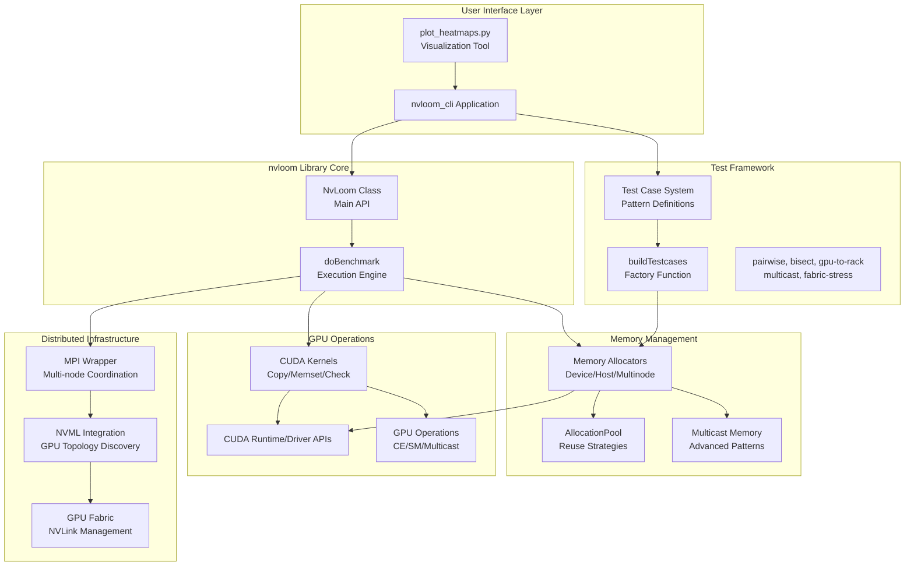

Sources: [README.md:7-43](), [README.md:45-78]()

### Core Library Integration Points

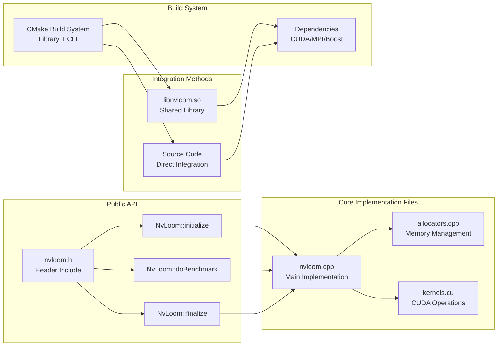

Sources: [README.md:19-43](), [README.md:34-36]()

## Core Components

### NvLoom Library

The `NvLoom` class serves as the primary API entry point, providing initialization, benchmarking execution, and cleanup functionality. The library is designed for integration into larger applications requiring fabric testing capabilities.

**Key Integration Points:**
- **Header**: `nvloom.h` includes all necessary headers
- **Core Files**: `nvloom.cpp`, `allocators.cpp`, `kernels.cu`
- **Build Options**: Shared library (`libnvloom.so`) or source code integration

**Minimum Requirements:**
- CUDA 12.8.1+
- Driver 570.124.06+
- MPI implementation
- C++17 compiler
- CMake 3.20+
- Boost.program_options 1.74+

Sources: [README.md:7-43]()

### Command Line Interface

The `nvloom_cli` application provides a complete standalone interface for fabric testing, organized around test suites and individual testcases.

**Available Test Suites:**

| Suite | Description | Runtime Complexity |
|-------|-------------|-------------------|
| `pairwise` | O(n²) one pair at a time testing | O(n²) |
| `fabric-stress` | All GPUs simultaneously active | O(1) |
| `all-to-one` | Multiple GPUs access single GPU | O(1) |
| `multicast` | Multicast benchmark patterns | O(1) |
| `egm` | EGM pairwise testing | O(n²) |
| `gpu-to-rack` | Randomized sampling per rack | O(n) |
| `rack-to-rack` | Inter-rack communication testing | O(racks²) |

Sources: [README.md:45-97]()

### Visualization Tools

The `plot_heatmaps.py` utility processes `nvloom_cli` output to generate heatmap visualizations for each testcase, supporting customizable color scales, font sizing, and output formats.

Sources: [README.md:199-256]()

## Test Execution Model

### Test Hierarchy

nvloom organizes testing around a hierarchical model:

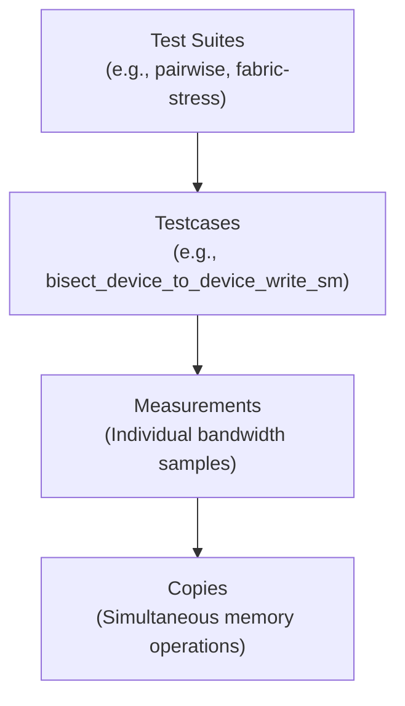

**Terminology:**
- **Suite**: Collection of related testcases
- **Testcase**: Specific test configuration (memory type + pattern + parameters)
- **Measurement**: Single bandwidth measurement within a testcase
- **Copy**: Individual memory copy operation (potentially simultaneous)

Sources: [README.md:107-119]()

### Memory Copy Parameters

Each testcase is defined by the combination of:

**Execution Mode:**
- **SM (Streaming Multiprocessor)**: Custom memcopy kernel implementation
- **CE (Copy Engine)**: `cuMemcpyAsync` scheduled operations

**Transfer Direction:**
- **Write**: Local source buffer → Remote destination buffer  
- **Read**: Remote source buffer → Local destination buffer

**Transfer Pattern:**
- **Unidirectional**: Single copy X → Y
- **Bidirectional**: Simultaneous copies X ↔ Y (sum reported)

**Memory Types:**
- **Device**: Multinode-NVLink enabled GPU VRAM memory
- **EGM**: GPU accessible CPU RAM memory  
- **Multicast**: VRAM residing simultaneously on all GPUs

Sources: [README.md:259-295]()

## Memory Management System

nvloom implements a sophisticated memory allocation system supporting multiple strategies optimized for different use cases.

### Allocation Strategies

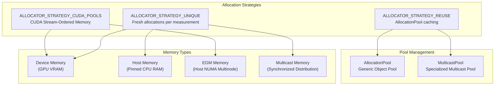

**Strategy Details:**
- **`unique`**: Fresh allocation/deallocation per measurement
- **`reuse`**: Cached allocations via `AllocationPool` class, released per testcase
- **`cudapool`**: CUDA Stream-Ordered Memory Allocator for device/EGM memory

Sources: [README.md:143-152]()

## Test Pattern Implementations

### Pairwise Testing

Traditional O(n²) testing where each GPU pair is measured individually, producing a square bandwidth matrix.

- **Unidirectional**: `NUM_GPU*(NUM_GPU-1)` consecutive measurements
- **Bidirectional**: `NUM_GPU*(NUM_GPU-1)/2` measurements (leveraging symmetry)

### Fabric Stress Testing

All GPUs execute simultaneous copies using bisect pattern:
- GPU `X` communicates with GPU `(X+NUM_GPU/2)%NUM_GPU`
- Divides GPUs into two equal groups with bidirectional traffic
- Completes in approximately O(1) time

### GPU-to-Rack Testing

Linear-time alternative to pairwise testing using statistical sampling:
- Each GPU tested against constant number of randomly selected peers per rack
- Median bandwidth reported (configurable via `--gpuToRackSamples`)
- Effective at identifying problematic GPUs while maintaining O(n) runtime

Sources: [README.md:299-322](), [README.md:81-105]()

## Quick Start Recommendations

### Large MNNVL Domain Testing

For comprehensive fabric evaluation:
```bash
nvloom_cli -s gpu-to-rack rack-to-rack fabric-stress
```

### Quick Fabric Validation

For rapid functionality verification:
```bash
nvloom_cli -t bisect_device_to_device_write_sm
```

This completes in approximately 3 seconds on a 72-GPU domain.

Sources: [README.md:81-105]()

---

# Page: Getting Started

# Getting Started

<details>
<summary>Relevant source files</summary>

The following files were used as context for generating this wiki page:

- [CMakeLists.txt](CMakeLists.txt)
- [README.md](README.md)
- [library/CMakeLists.txt](library/CMakeLists.txt)

</details>


This document guides you through installing, building, and running your first nvloom tests. It covers both the standalone command-line tool and library integration approaches for testing Multi-Node NVLink (MNNVL) fabrics.

For detailed information about specific test patterns and suites, see [Testing Framework](#5). For comprehensive CLI options and usage patterns, see [Command Line Interface](#3).

## System Requirements

nvloom requires the following minimum system configuration:

| Component | Minimum Version |
|-----------|----------------|
| CUDA | 12.8.1 |
| GPU Driver | 570.124.06 |
| C++ Standard | C++17 |
| CMake | 3.20 |
| MPI | Any implementation |
| Boost | 1.74 (program_options component) |

**Sources:** [README.md:11-17]()

## Build System Architecture

The nvloom project provides two build targets: a shared library and a command-line application.

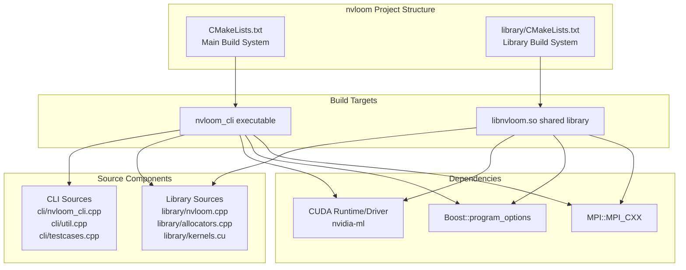

**Sources:** [CMakeLists.txt:20-66](), [library/CMakeLists.txt:20-56]()

## Installation Methods

### Method 1: Command-Line Tool (Recommended for Getting Started)

Build the complete application including both library and CLI:

```bash
# Clone and build the complete project
git clone https://github.com/NVIDIA/nvloom
cd nvloom
cmake .
make -j
```

This creates the `nvloom_cli` executable that includes all nvloom functionality.

**Sources:** [README.md:59-61]()

### Method 2: Shared Library

Build only the nvloom library as a shared object:

```bash
# Build library only
cd library
cmake .
make
```

This creates `libnvloom.so` which can be linked into other applications. The library directory can be added as an include directory to access headers.

**Sources:** [README.md:23-29]()

### Method 3: Source Integration

For applications that need to embed nvloom directly, integrate these source files into your build system:

- `library/allocators.cpp`
- `library/kernels.cu` 
- `library/nvloom.cpp`
- All header files from the library directory

Include `nvloom.h` to access all necessary headers.

**Sources:** [README.md:32-39]()

## Quick Start Workflow

The following diagram shows the typical workflow from installation to running your first meaningful test:

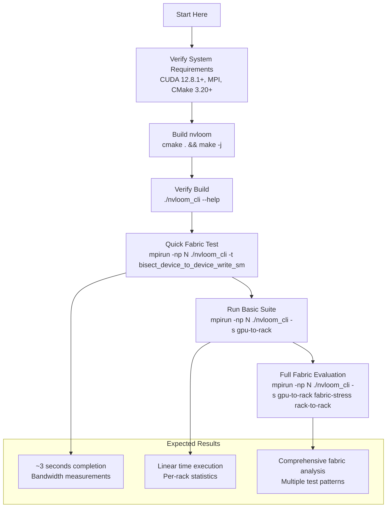

**Sources:** [README.md:99-105](), [README.md:85-98]()

## Your First Test

### 1. Verify Installation

```bash
# Check that nvloom_cli was built correctly
./nvloom_cli --help

# List available test cases
./nvloom_cli --listTestcases
```

**Sources:** [README.md:123-129]()

### 2. Quick Fabric Verification

Run a fast test to verify basic MNNVL functionality:

```bash
# Replace N with your GPU count
mpirun -np N ./nvloom_cli -t bisect_device_to_device_write_sm
```

This test completes in approximately 3 seconds on a 72-GPU domain and verifies that all GPUs can communicate simultaneously.

**Sources:** [README.md:99-105]()

### 3. Basic Performance Assessment

For a more comprehensive but still efficient evaluation:

```bash
# Run the recommended suite for large MNNVL domains
mpirun -np N ./nvloom_cli -s gpu-to-rack fabric-stress rack-to-rack
```

This executes three complementary test suites:
- `gpu-to-rack`: Linear-time sampling-based bandwidth measurement
- `fabric-stress`: Simultaneous stress testing across all GPUs  
- `rack-to-rack`: Inter-rack communication benchmarking

**Sources:** [README.md:85-98]()

## Basic Configuration Options

Common options for initial testing:

| Option | Description | Default |
|--------|-------------|---------|
| `-s, --suite` | Run specific test suites | All available |
| `-t, --testcase` | Run specific test cases | All available |
| `-b, --bufferSize` | Size of copy buffer | 512 MiB |
| `-i, --iterations` | Copy operations per measurement | 16 |
| `-a, --allocatorStrategy` | Memory allocation strategy | `reuse` |

**Sources:** [README.md:131-183]()

## Next Steps

After completing your first tests:

1. **Understand Results**: Use the visualization tools to analyze output (see [Visualization Tools](#6))
2. **Explore Test Patterns**: Learn about different test patterns and their use cases (see [Test Patterns and Suites](#5.1))
3. **Library Integration**: If building applications, study the core library API (see [Core Library](#4))
4. **Advanced Features**: Explore multicast operations and distributed GPU features (see [Advanced Topics](#7))

The `nvloom_cli` tool assumes one MPI process per GPU, so ensure your MPI launch matches your GPU topology.

**Sources:** [README.md:117-119]()

---

# Page: Command Line Interface

# Command Line Interface

<details>
<summary>Relevant source files</summary>

The following files were used as context for generating this wiki page:

- [README.md](README.md)
- [cli/nvloom_cli.cpp](cli/nvloom_cli.cpp)
- [cli/util.cpp](cli/util.cpp)
- [cli/util.h](cli/util.h)

</details>


The `nvloom_cli` application provides a comprehensive command-line interface for executing Multi-Node NVLink (MNNVL) fabric benchmarks. This document covers the CLI application's architecture, command-line options, test execution patterns, and integration with the nvloom core library.

For information about the underlying benchmarking engine, see [Core Library](#4). For visualization of benchmark results, see [Visualization Tools](#6). For details about specific test patterns and suites, see [Testing Framework](#5).

## CLI Application Architecture

The `nvloom_cli` application is built around a modular architecture that handles command-line parsing, test discovery, and benchmark execution coordination.

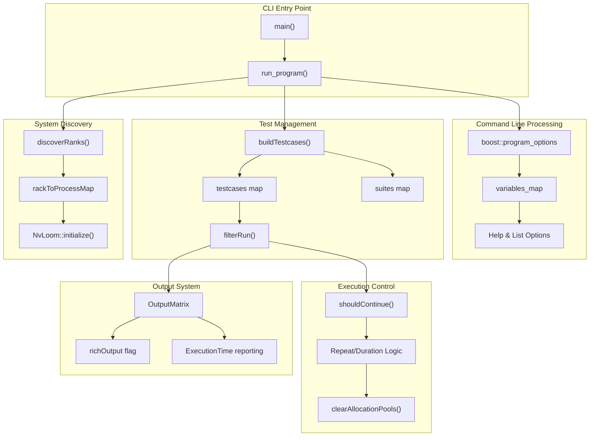

Sources: [cli/nvloom_cli.cpp:54-207](), [cli/util.cpp:59-118](), [cli/util.h:34-137]()

## Command Line Options

The CLI supports a comprehensive set of options for controlling test execution, memory allocation strategies, and output formatting.

| Option | Short | Type | Default | Description |
|--------|-------|------|---------|-------------|
| `--help` | `-h` | flag | - | Display help message |
| `--listTestcases` | `-l` | flag | false | List all available testcases |
| `--testcase` | `-t` | string[] | all | Specific testcase(s) to run |
| `--suite` | `-s` | string[] | all | Test suite(s) to run |
| `--bufferSize` | `-b` | int | 512 | Buffer size in MiB |
| `--allocatorStrategy` | `-a` | string | "reuse" | Memory allocation strategy |
| `--richOutput` | `-r` | flag | false | Show detailed per-measurement data |
| `--gpuToRackSamples` | - | int | 5 | Samples per rack in gpu-to-rack suite |
| `--iterations` | `-i` | int | 16 | Copy iterations per measurement |
| `--repeat` | `-c` | int | 1 | Times to repeat each testcase |
| `--duration` | `-d` | int | -1 | Duration in seconds to repeat testcases |

### Memory Allocation Strategies

The `--allocatorStrategy` option controls how CUDA memory allocations are handled:

- **`unique`**: Fresh allocation/deallocation for each measurement
- **`reuse`**: Pool-based caching via `AllocationPool` class  
- **`cudapool`**: CUDA Stream-Ordered Memory Allocator for device/EGM memory

### Test Suites

The CLI organizes tests into logical suites accessible via `--suite`:

- **`pairwise`**: O(n²) all-pairs testing between GPUs
- **`fabric-stress`**: Simultaneous copies from every GPU
- **`gpu-to-rack`**: Linear-time sampling across racks
- **`rack-to-rack`**: Inter-rack communication patterns
- **`all-to-one`**: Multiple GPUs accessing single GPU memory
- **`multicast`**: One-to-many broadcast patterns
- **`egm`**: Extended GPU Memory (CPU RAM) testing

Sources: [cli/nvloom_cli.cpp:65-78](), [README.md:51-58](), [README.md:143-151]()

## Test Execution Flow

The CLI follows a structured execution pattern that coordinates test discovery, system initialization, and benchmark execution.

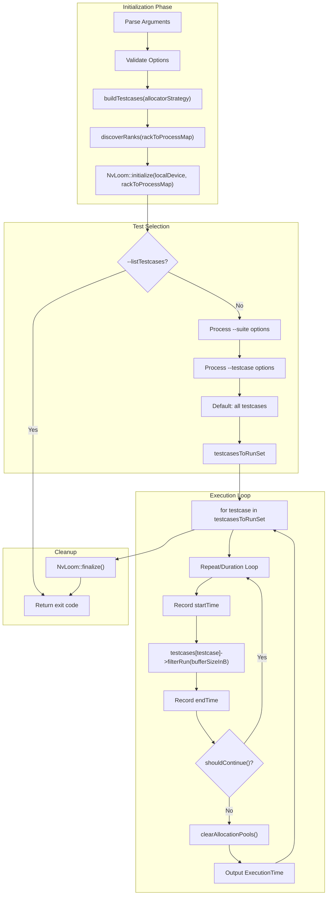

Sources: [cli/nvloom_cli.cpp:125-196](), [cli/nvloom_cli.cpp:36-52]()

## System Discovery and Initialization

The CLI performs comprehensive system discovery to map processes to GPUs and rack topology before benchmark execution.

### GPU and Rack Discovery Process

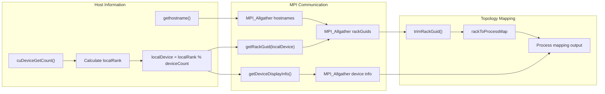

The discovery process outputs detailed topology information:
```
Process  0 (hostname1): device 0: NVIDIA H100 80GB HBM3 (00001234:85:00.0); rackGuid: ABC123
Process  1 (hostname1): device 1: NVIDIA H100 80GB HBM3 (00001234:86:00.0); rackGuid: ABC123
```

Sources: [cli/util.cpp:59-118](), [cli/util.cpp:39-57]()

## Output System and Result Formatting

The CLI provides flexible output formatting through the `OutputMatrix` class and configurable verbosity levels.

### OutputMatrix Structure

The `OutputMatrix` class handles incremental printing and statistical aggregation:

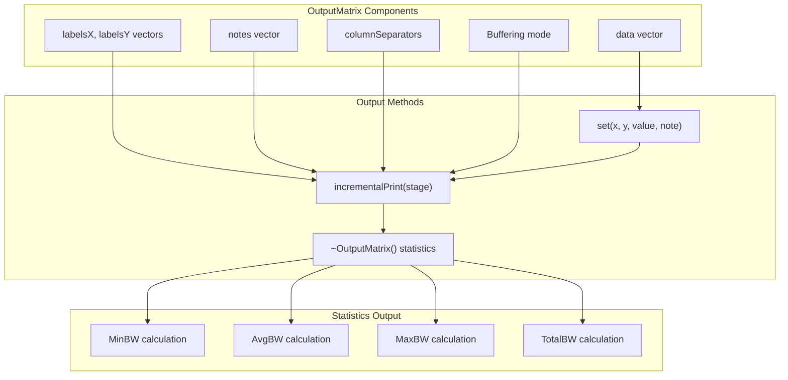

### Rich Output Mode

When `--richOutput` is enabled, the CLI displays detailed per-measurement data instead of aggregated statistics. This is particularly useful for `gpu-to-rack` suite analysis where individual sample measurements are shown with specific GPU pair labels.

Sources: [cli/util.h:34-137](), [cli/util.cpp:120-157](), [README.md:162-168]()

## Integration with Core Library

The CLI serves as a wrapper around the nvloom core library, providing a user-friendly interface to the underlying benchmarking capabilities.

### Library Integration Points

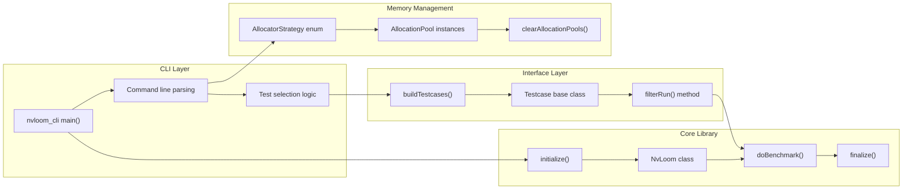

The CLI handles the complete lifecycle:
1. **Initialization**: Calls `NvLoom::initialize()` with discovered topology
2. **Test Execution**: Invokes `filterRun()` on selected testcases
3. **Memory Management**: Manages allocation pools based on strategy
4. **Cleanup**: Calls `clearAllocationPools()` and `NvLoom::finalize()`

Sources: [cli/nvloom_cli.cpp:18-20](), [cli/nvloom_cli.cpp:137](), [cli/nvloom_cli.cpp:176](), [cli/nvloom_cli.cpp:183](), [cli/nvloom_cli.cpp:205]()

---

# Page: Core Library

# Core Library

<details>
<summary>Relevant source files</summary>

The following files were used as context for generating this wiki page:

- [library/README.md](library/README.md)
- [library/nvloom.cpp](library/nvloom.cpp)
- [library/nvloom.h](library/nvloom.h)

</details>


The Core Library provides nvloom's primary API for multi-node GPU fabric benchmarking. It includes the main `NvLoom` class, which orchestrates memory copy operations across distributed GPUs, and supporting infrastructure for MPI coordination, timing measurement, and GPU fabric discovery.

For detailed information about memory allocation strategies and pooling mechanisms, see [Memory Management System](#4.1). For GPU kernel implementations and CUDA operations, see [GPU Operations and CUDA Kernels](#4.2). For error handling and debugging utilities, see [Error Handling and Debugging](#4.3).

## Core Library Architecture

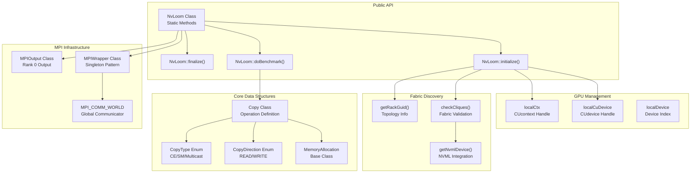

**Core Library Component Architecture**: This diagram shows the main classes and their relationships within the nvloom core library. The `NvLoom` class serves as the primary interface, coordinating MPI operations, GPU management, and fabric discovery.

Sources: [library/nvloom.h:108-146](), [library/nvloom.cpp:48-184](), [library/nvloom.cpp:319-337]()

## NvLoom Class

The `NvLoom` class provides a static interface for all core library operations. It maintains global state for the local GPU device and coordinates distributed benchmarking operations.

| Method | Purpose | Return Type |
|--------|---------|-------------|
| `initialize()` | Initialize CUDA context and MPI coordination | `void` |
| `doBenchmark()` | Execute synchronized memory copy benchmarks | `std::vector<double>` |
| `finalize()` | Clean up MPI resources | `void` |
| `getLocalDevice()` | Get local GPU device index | `int` |
| `getLocalCuDevice()` | Get CUDA device handle | `CUdevice` |
| `getLocalCtx()` | Get CUDA context handle | `CUcontext` |

### Static Member Variables

The `NvLoom` class maintains several static inline variables that store global state:

```cpp
static inline int localDevice;                    // GPU device index
static inline CUdevice localCuDevice;            // CUDA device handle  
static inline CUcontext localCtx;                // CUDA context handle
static inline int localMultiprocessorCount;       // SM count
static inline int localClockRate;                // GPU clock rate
static inline int localCpuNumaNode;              // CPU NUMA node
static inline std::string localHostname;          // Local hostname
static inline std::map<std::string, std::vector<int>> rackToProcessMap;  // Topology map
```

Sources: [library/nvloom.h:108-118](), [library/nvloom.h:134-144]()

## Initialization and Lifecycle

### Initialization Process

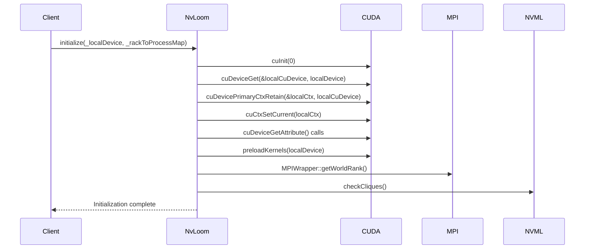

**NvLoom Initialization Sequence**: Shows the initialization flow including CUDA context setup, device attribute queries, kernel preloading, and fabric validation.

The `initialize()` method performs several critical setup operations:

1. **CUDA Initialization**: Initializes CUDA driver and retains primary context for the specified device
2. **Device Attribute Queries**: Retrieves SM count, clock rate, and NUMA node information
3. **Kernel Preloading**: Loads CUDA kernels for memory operations
4. **Fabric Validation**: Verifies GPU fabric clique consistency across MPI ranks

Sources: [library/nvloom.cpp:319-337]()

### Lifecycle Management

The `finalize()` method handles cleanup by checking if MPI was initialized and calling `MPI_Finalize()` if necessary. This ensures proper resource cleanup in distributed environments.

Sources: [library/nvloom.cpp:339-345]()

## Benchmarking Execution Engine

### Core Benchmark Workflow

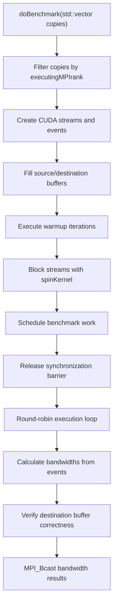

**Benchmark Execution Flow**: The `doBenchmark()` method implements a sophisticated workflow that ensures synchronized execution across multiple MPI ranks and accurate bandwidth measurement.

### Synchronization Strategy

The benchmark engine uses a multi-stage synchronization approach:

1. **Stream Blocking**: Uses `spinKernelMultistage()` to block all CUDA streams
2. **Work Scheduling**: Schedules copy operations while streams are blocked
3. **Synchronized Release**: All ranks reach `MPI_Barrier()` before releasing work
4. **Precise Timing**: CUDA events capture exact execution times

This approach ensures that all memory operations start simultaneously across the distributed system, providing accurate concurrent bandwidth measurements.

Sources: [library/nvloom.cpp:48-184](), [library/nvloom.cpp:102-106](), [library/nvloom.cpp:118-124]()

## Copy Operations Framework

### Copy Class Structure

The `Copy` class encapsulates a memory copy operation with all necessary parameters:

```cpp
class Copy {
public:
    std::shared_ptr<MemoryAllocation> dst;    // Destination memory
    std::shared_ptr<MemoryAllocation> src;    // Source memory  
    CopyDirection copyDirection;               // READ or WRITE
    CopyType copyType;                        // CE, SM, or Multicast
    int executingMPIrank;                     // MPI rank executing copy
    int iterations;                           // Number of iterations
};
```

### Copy Direction and Execution

The `executingMPIrank` is automatically determined based on `copyDirection`:
- **COPY_DIRECTION_READ**: Executed by destination rank (dst->MPIrank)
- **COPY_DIRECTION_WRITE**: Executed by source rank (src->MPIrank)

This design allows flexible control over which GPU initiates each memory transfer.

Sources: [library/nvloom.h:36-58](), [library/nvloom.h:52-56]()

### Copy Type Implementation

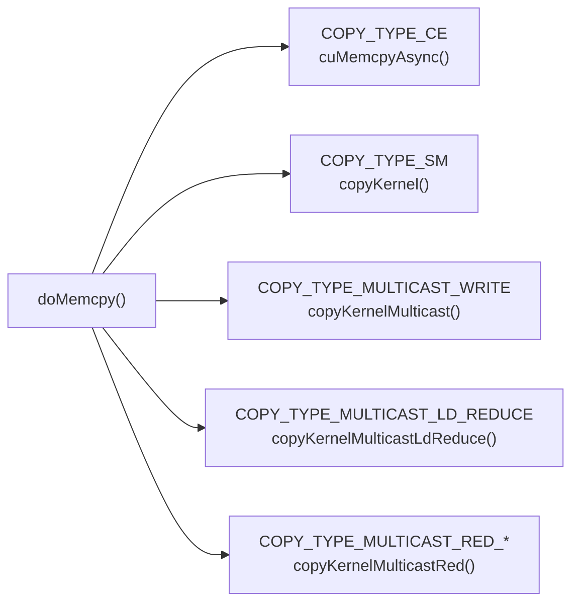

**Copy Type Dispatch**: The `doMemcpy()` method dispatches to different implementation strategies based on the `CopyType` enumeration.

Sources: [library/nvloom.cpp:186-202](), [library/nvloom.cpp:204-223]()

## MPI Integration

### MPIWrapper Singleton

The `MPIWrapper` class provides a singleton interface for MPI operations:

```cpp
class MPIWrapper {
private:
    int worldSize;
    int worldRank;
    MPIWrapper();  // Private constructor

public:
    static MPIWrapper& instance();
    static int getWorldSize();
    static int getWorldRank();
};
```

The singleton automatically initializes MPI if not already initialized and caches world size and rank for efficient access.

Sources: [library/nvloom.h:60-88]()

### MPIOutput Class

The `MPIOutput` class ensures that console output only occurs from MPI rank 0, preventing duplicate messages in distributed environments:

```cpp
template<typename T>
MPIOutput& operator<<(T input) {
    if (MPIWrapper::getWorldRank() == 0) std::cout << input;
    return *this;
}
```

This class supports the standard stream operator interface while maintaining single-rank output semantics.

Sources: [library/nvloom.h:90-106]()

## GPU Fabric Discovery

### NVML Integration

The core library integrates with NVML to discover and validate GPU fabric topology:

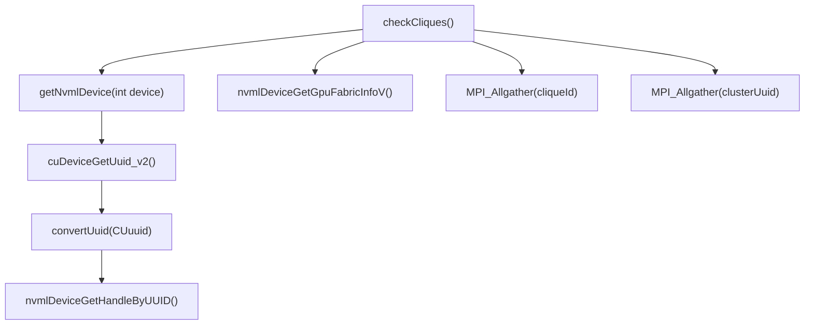

**NVML Fabric Discovery**: The library uses NVML to query GPU fabric information and validate that all MPI ranks belong to the same fabric clique.

### Rack GUID Discovery

The `getRackGuid()` function extracts rack-level topology information:

```cpp
std::string getRackGuid(int device) {
    nvmlDevice_t nvmlDev = getNvmlDevice(device);
    nvmlPlatformInfo_v2_t platformInfo;
    platformInfo.version = nvmlPlatformInfo_v2;
    NVML_ASSERT(nvmlDeviceGetPlatformInfo(nvmlDev, &platformInfo));
    // Return chassis serial number as rack identifier
}
```

This enables rack-aware test patterns and topology-based optimizations.

Sources: [library/nvloom.cpp:246-258](), [library/nvloom.cpp:260-292](), [library/nvloom.cpp:301-309]()

---

# Page: Memory Management System

# Memory Management System

<details>
<summary>Relevant source files</summary>

The following files were used as context for generating this wiki page:

- [library/allocators.cpp](library/allocators.cpp)
- [library/allocators.h](library/allocators.h)

</details>


## Purpose and Scope

The Memory Management System in nvloom provides sophisticated memory allocation capabilities for multi-node GPU fabric testing. This system handles device memory, host memory, and advanced fabric-shared memory across multiple nodes with optimized allocation strategies and pooling mechanisms. The system supports both traditional CUDA memory operations and advanced multicast memory patterns for distributed GPU computing.

For information about GPU operations that work with these allocations, see [GPU Operations and CUDA Kernels](#4.2). For details about test patterns that utilize these memory types, see [Test Patterns and Suites](#5.1).

## Allocation Strategies

nvloom implements three primary allocation strategies to optimize memory usage for different testing scenarios:

| Strategy | Purpose | Implementation |
|----------|---------|----------------|
| `ALLOCATOR_STRATEGY_UNIQUE` | Fresh allocations for each test | Direct allocation/deallocation |
| `ALLOCATOR_STRATEGY_REUSE` | Pool-based memory reuse | Uses `AllocationPool<T>` template |
| `ALLOCATOR_STRATEGY_CUDA_POOLS` | CUDA stream-ordered memory pools | Uses `MultinodeMemoryPoolAllocationBase` |

The strategy selection affects performance characteristics, with unique allocations providing isolation but higher overhead, while pooled strategies optimize for repeated allocations of similar sizes.

**Sources:** [library/allocators.h:190-233](), [library/allocators.cpp:396-487]()

## Memory Allocation Class Hierarchy

```mermaid
classDiagram
    class MemoryAllocation {
        +void* ptr
        +size_t allocationSize
        +int MPIrank
        +int uniqueId
        +memset(value, copyType, memoryPurpose)
        +check(value, copyType, iterations)
        +filter() bool
        +getName() string
    }
    
    class DeviceMemoryAllocation {
        +DeviceMemoryAllocation(size, rank)
        +~DeviceMemoryAllocation()
    }
    
    class HostMemoryAllocation {
        +HostMemoryAllocation(size, rank)
        +~HostMemoryAllocation()
        +getName() "host"
    }
    
    class MultinodeMemoryAllocationBase {
        -CUmemGenericAllocationHandle handle
        -CUmemFabricHandle fh
        -CUmemAllocationProp prop
        +MultinodeMemoryAllocationBase(size, rank, location)
    }
    
    class MultinodeMemoryAllocationUnicast {
        +getName() "device"
        +filter() bool
    }
    
    class MultinodeMemoryAllocationEGM {
        +getName() "egm"
        +filter() bool
    }
    
    class MultinodeMemoryAllocationMulticast {
        -CUmemGenericAllocationHandle multicastHandle
        -CUmulticastObjectProp multicastProp
        +tryAllocation(size, rank) CUresult
    }
    
    class MultinodeMemoryAllocationMulticastRef {
        +void* unicastMappingPtr
        +getName() "multicast"
        +filter() bool
    }

    MemoryAllocation <|-- DeviceMemoryAllocation
    MemoryAllocation <|-- HostMemoryAllocation
    MemoryAllocation <|-- MultinodeMemoryAllocationBase
    MultinodeMemoryAllocationBase <|-- MultinodeMemoryAllocationUnicast
    MultinodeMemoryAllocationBase <|-- MultinodeMemoryAllocationEGM
    MemoryAllocation <|-- MultinodeMemoryAllocationMulticastRef
    MultinodeMemoryAllocationMulticastRef <|-- MultinodeMemoryAllocationMulticast
```

This hierarchy shows the inheritance structure where `MemoryAllocation` provides the base interface, with specialized implementations for different memory types and locations. Each class implements device capability filtering through the `filter()` method and provides identification through `getName()`.

**Sources:** [library/allocators.h:26-188](), [library/allocators.cpp:26-394]()

## Memory Types and Characteristics

### Device Memory
- **Class:** `DeviceMemoryAllocation`
- **Location:** GPU VRAM using `cuMemAlloc`
- **Use Case:** Standard GPU-local memory allocations
- **Limitations:** Single-node access only

### Host Memory  
- **Class:** `HostMemoryAllocation`
- **Location:** Pinned CPU memory using `cuMemAllocHost`
- **Use Case:** High-bandwidth host-device transfers
- **Characteristics:** Page-locked for optimal transfer performance

### Fabric Device Memory
- **Class:** `MultinodeMemoryAllocationUnicast`
- **Location:** GPU device memory with fabric handles
- **Use Case:** Cross-node device memory access
- **Requirements:** `CU_DEVICE_ATTRIBUTE_HANDLE_TYPE_FABRIC_SUPPORTED`

### EGM (Extended GPU Memory)
- **Class:** `MultinodeMemoryAllocationEGM` 
- **Location:** Host NUMA memory accessible across nodes
- **Use Case:** Large memory pools shared across fabric
- **Requirements:** `CU_DEVICE_ATTRIBUTE_HOST_NUMA_MULTINODE_IPC_SUPPORTED`

### Multicast Memory
- **Class:** `MultinodeMemoryAllocationMulticast`
- **Location:** Specialized one-to-many memory regions
- **Use Case:** Efficient data distribution patterns
- **Requirements:** `CU_DEVICE_ATTRIBUTE_MULTICAST_SUPPORTED`
- **Special Features:** Dual mapping (unicast and multicast) with retry logic

**Sources:** [library/allocators.cpp:39-275](), [library/allocators.h:56-150]()

## Pool Management System

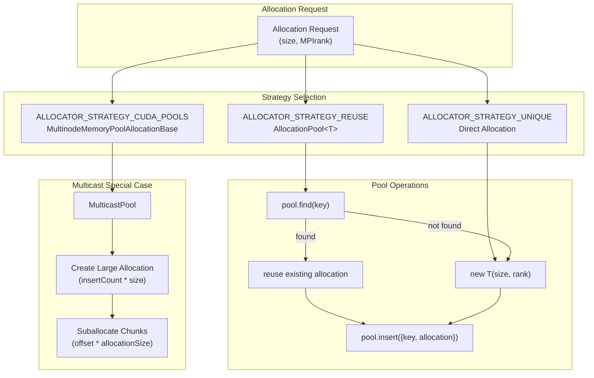

The pooling system uses different strategies based on memory type:

- **Generic Pools:** `AllocationPool<T>` template manages reuse with key-based lookup using `std::pair<size_t, int>` for size and MPI rank
- **Multicast Pools:** `MulticastPool` creates large allocations and suballocates chunks to amortize multicast setup costs
- **CUDA Memory Pools:** Stream-ordered pools with 1GB release thresholds for optimal performance

**Sources:** [library/allocators.cpp:396-487](), [library/allocators.h:190-234]()

## Fabric Memory and Cross-Node Support

### Fabric Handle Management

Fabric memory enables cross-node memory access through CUDA's fabric handle system:

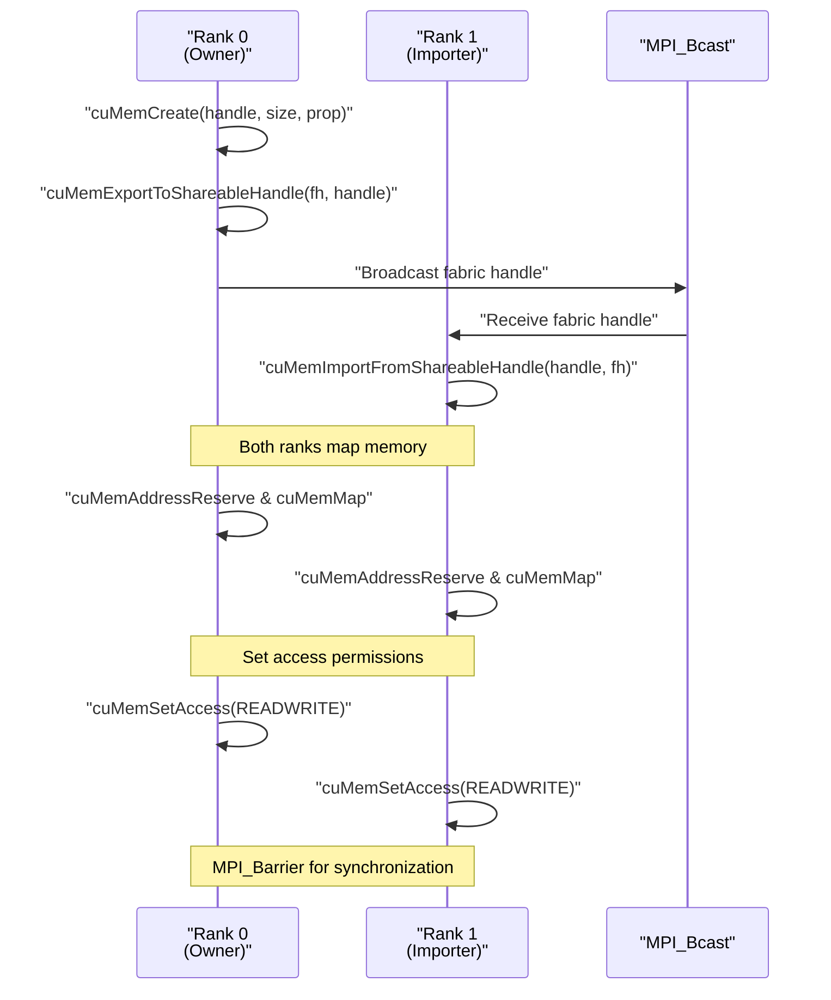

**Sources:** [library/allocators.cpp:71-134]()

### Multicast Memory with Retry Logic

Multicast allocations include sophisticated error handling for system readiness:

- **Retry Mechanism:** Up to 60 seconds with 15-second intervals for `CUDA_ERROR_SYSTEM_NOT_READY`
- **Collective Retry:** All ranks participate in retry decisions using `MPI_Allreduce`
- **Dual Mapping:** Both unicast and multicast mappings for different access patterns
- **Device Binding:** `cuMulticastAddDevice` and `cuMulticastBindMem` for fabric coordination

**Sources:** [library/allocators.cpp:148-275]()

## Memory Pool Initialization

### CUDA Memory Pools

The system supports fabric-aware CUDA memory pools for optimized multinode allocations:

```mermaid
flowchart LR
    subgraph "Pool Creation"
        CREATE["cuMemPoolCreate<br/>(poolProps)"]
        THRESHOLD["Set 1GB release threshold<br/>CU_MEMPOOL_ATTR_RELEASE_THRESHOLD"]
        EXPORT["cuMemPoolExportToShareableHandle"]
    end
    
    subgraph "Cross-Node Sharing" 
        BCAST["MPI_Bcast fabric handles<br/>across all ranks"]
        IMPORT["cuMemPoolImportFromShareableHandle<br/>for remote pools"]
    end
    
    subgraph "Access Configuration"
        DEVICE_ACCESS["Set device access<br/>CU_MEM_ACCESS_FLAGS_PROT_READWRITE"]
        HOST_ACCESS["Set host NUMA access<br/>(EGM pools only)"]
    end
    
    CREATE --> THRESHOLD
    THRESHOLD --> EXPORT
    EXPORT --> BCAST
    BCAST --> IMPORT
    IMPORT --> DEVICE_ACCESS
    DEVICE_ACCESS --> HOST_ACCESS
```

Pool initialization is lazy and happens once per memory location type (`CU_MEM_LOCATION_TYPE_DEVICE` or `CU_MEM_LOCATION_TYPE_HOST_NUMA`). The system maintains static pool vectors accessible across all allocations.

**Sources:** [library/allocators.cpp:277-381]()

## Allocation Cleanup and Lifecycle

The memory management system provides comprehensive cleanup through the `clearAllocationPools()` function, which clears all template instantiations:

- `AllocationPool<MultinodeMemoryAllocationUnicast>::clear()`
- `AllocationPool<MultinodeMemoryAllocationEGM>::clear()`  
- `AllocationPool<HostMemoryAllocation>::clear()`
- `MulticastPool::clear()`

Each memory allocation type implements proper CUDA resource cleanup in destructors with MPI synchronization barriers to ensure coordinated deallocation across all participating ranks.

**Sources:** [library/allocators.cpp:482-487](), [library/allocators.h:235]()

---

# Page: GPU Operations and CUDA Kernels

# GPU Operations and CUDA Kernels

<details>
<summary>Relevant source files</summary>

The following files were used as context for generating this wiki page:

- [library/kernels.cu](library/kernels.cu)
- [library/kernels.cuh](library/kernels.cuh)

</details>


This document covers nvloom's low-level GPU operations and CUDA kernel implementations that perform the actual memory transfers, pattern generation, and synchronization operations during benchmarking. These kernels form the computational foundation that enables nvloom to measure GPU fabric performance across single and multi-node configurations.

For high-level memory allocation strategies and management, see [Memory Management System](#4.1). For how these operations are orchestrated within test patterns, see [Testing Framework](#5).

## GPU Operations Architecture

The kernel system is organized around four primary operation categories, each optimized for different aspects of GPU fabric testing:

```mermaid
graph TB
    subgraph "Kernel Categories"
        COPY_OPS["Copy Operations"]
        MULTICAST_OPS["Multicast Operations"] 
        PATTERN_OPS["Pattern Operations"]
        SYNC_OPS["Synchronization Operations"]
    end
    
    subgraph "Copy Kernel Implementations"
        STRIDING["stridingMemcpyKernel<T>"]
        SIMPLE["simpleMemcpyKernel<T>"]
        COPY_REGULAR["copyKernel"]
        COPY_MC["copyKernelMulticast"]
    end
    
    subgraph "Multicast Kernel Types"
        MC_LD_REDUCE["copyKernelMulticastLdReduce"]
        MC_RED["copyKernelMulticastRed"]
        WRITE_MC["write_to_multicast_memory<T>"]
        REDUCE_MC["reduce_from_multicast_ld_reduce<T>"]
    end
    
    subgraph "Pattern Generation"
        PATTERN_FILL["patternFillKernel"]
        PATTERN_CHECK["patternCheckKernel"]
        MEMSET_BUFFER["memsetBuffer"]
        CHECK_BUFFER["checkBuffer"]
    end
    
    subgraph "Synchronization Primitives"
        SPIN_DEVICE["spinKernelDeviceMultistage"]
        SPIN_HOST["spinKernelMultistage"]
        PRELOAD["preloadKernels"]
    end
    
    COPY_OPS --> STRIDING
    COPY_OPS --> SIMPLE
    COPY_OPS --> COPY_REGULAR
    COPY_OPS --> COPY_MC
    
    MULTICAST_OPS --> MC_LD_REDUCE
    MULTICAST_OPS --> MC_RED
    MULTICAST_OPS --> WRITE_MC
    MULTICAST_OPS --> REDUCE_MC
    
    PATTERN_OPS --> PATTERN_FILL
    PATTERN_OPS --> PATTERN_CHECK
    PATTERN_OPS --> MEMSET_BUFFER
    PATTERN_OPS --> CHECK_BUFFER
    
    SYNC_OPS --> SPIN_DEVICE
    SYNC_OPS --> SPIN_HOST
    SYNC_OPS --> PRELOAD
```

**Sources:** [library/kernels.cu:1-324](), [library/kernels.cuh:1-40]()

## Memory Copy Operations

nvloom implements two primary memory copy kernel architectures optimized for different performance characteristics and memory access patterns.

### Striding Memory Copy Kernel

The `stridingMemcpyKernel` provides the highest performance copy implementation using a 12-stage pipeline to maximize memory bandwidth utilization:

```mermaid
graph LR
    subgraph "Pipeline Stages"
        READ1["pipe_0 = *csrc"]
        READ2["pipe_1 = *csrc"] 
        READ3["..."]
        READ12["pipe_11 = *csrc"]
    end
    
    subgraph "Write Operations"
        WRITE1["write(cdst, pipe_0)"]
        WRITE2["write(cdst, pipe_1)"]
        WRITE3["..."]
        WRITE12["write(cdst, pipe_11)"]
    end
    
    subgraph "Memory Types"
        REGULAR_MEM["write_to_regular_memory<T>"]
        MULTICAST_MEM["write_to_multicast_memory<T>"]
    end
    
    READ1 --> WRITE1
    READ2 --> WRITE2
    READ3 --> WRITE3
    READ12 --> WRITE12
    
    WRITE1 --> REGULAR_MEM
    WRITE1 --> MULTICAST_MEM
```

The kernel distributes work across all available streaming multiprocessors and uses stride-based access patterns to ensure coalesced memory transactions:

| Parameter | Description | Implementation |
|-----------|-------------|----------------|
| `totalThreadCount` | `NvLoom::getLocalMultiprocessorCount() * 512` | Full SM utilization |
| `chunkSizeInElement` | `sizeInElement / totalThreadCount` | Per-thread work division |
| `bigChunkSizeInElement` | `chunkSizeInElement / 12` | Pipeline optimization |

**Sources:** [library/kernels.cu:62-112](), [library/kernels.cu:132-143]()

### Simple Memory Copy Kernel 

The `simpleMemcpyKernel` provides a streamlined implementation for reduction operations and scenarios where pipelining overhead exceeds benefits:

```mermaid
graph TB
    subgraph "Kernel Parameters"
        THREADS["totalThreadCount"]
        LOOPS["loopCount"]
        DST["T* dst"]
        SRC["T* src"]
    end
    
    subgraph "Memory Operations"
        REDUCE_LD["reduce_from_multicast_ld_reduce<T>"]
        REDUCE_RED["reduce_from_multicast_red<T>"]
    end
    
    subgraph "Copy Types"
        LD_REDUCE["COPY_TYPE_MULTICAST_LD_REDUCE"]
        RED_ALL["COPY_TYPE_MULTICAST_RED_ALL"]
        RED_SINGLE["COPY_TYPE_MULTICAST_RED_SINGLE"]
    end
    
    THREADS --> REDUCE_LD
    THREADS --> REDUCE_RED
    
    LD_REDUCE --> REDUCE_LD
    RED_ALL --> REDUCE_RED
    RED_SINGLE --> REDUCE_RED
```

**Sources:** [library/kernels.cu:114-130](), [library/kernels.cu:153-158]()

## Multicast Operations

nvloom implements GPU multicast operations using inline assembly for NVIDIA's multicast memory instructions, available on architectures with compute capability 9.0+.

### Multicast Write Operations

The `write_to_multicast_memory` template function uses the `multimem.st.weak.global.b32` instruction for one-to-many memory writes:

```mermaid
graph LR
    subgraph "Source GPU"
        SRC_DATA["Source Data"]
        MULTICAST_WRITE["multimem.st.weak.global.b32"]
    end
    
    subgraph "Target GPUs"
        GPU1["GPU 1 Memory"]
        GPU2["GPU 2 Memory"]
        GPU3["GPU N Memory"]
    end
    
    SRC_DATA --> MULTICAST_WRITE
    MULTICAST_WRITE --> GPU1
    MULTICAST_WRITE --> GPU2
    MULTICAST_WRITE --> GPU3
```

### Multicast Reduction Operations

Two reduction patterns are supported for aggregating data across multiple GPUs:

| Operation | Instruction | Description |
|-----------|-------------|-------------|
| `reduce_from_multicast_ld_reduce` | `multimem.ld_reduce.weak.global.add.u32` | Load and reduce from multicast memory |
| `reduce_from_multicast_red` | `multimem.red.global.add.u32` | Direct reduction to multicast memory |

**Sources:** [library/kernels.cu:37-60](), [library/kernels.cu:149-158]()

## Memory Pattern Operations

nvloom uses pseudorandom patterns to verify data integrity across complex memory operations and detect silent data corruption.

### Pattern Generation

The `patternFillKernel` generates deterministic pseudorandom patterns using CUDA's `curand` library:

```mermaid
graph TB
    subgraph "Pattern Generation Flow"
        SEED["Input Seed"]
        THREAD_ID["Thread ID"]
        CURAND_INIT["curand_init(seed, 0, threadId, &state)"]
        GROUP_SKIP["Skip groupId iterations"]
        PATTERN_GEN["Generate pattern with groupSize spacing"]
    end
    
    subgraph "Multi-Node Considerations"
        GROUP_ID["groupId = MPI Rank"]
        GROUP_SIZE["groupSize = MPI World Size"]
        UNIQUE_PATTERNS["Each node generates unique pattern"]
    end
    
    SEED --> CURAND_INIT
    THREAD_ID --> CURAND_INIT
    CURAND_INIT --> GROUP_SKIP
    GROUP_SKIP --> PATTERN_GEN
    
    GROUP_ID --> GROUP_SKIP
    GROUP_SIZE --> PATTERN_GEN
```

### Pattern Verification

The `patternCheckKernel` verifies data integrity by regenerating expected patterns and comparing against actual memory contents:

```mermaid
graph LR
    subgraph "Verification Process"
        REGENERATE["Regenerate Expected Pattern"]
        COMPARE["Compare with Actual Data"]
        ERROR_COUNT["atomicAdd(errorCount, 1)"]
        PRINTF["printf error details"]
    end
    
    subgraph "Error Handling"
        ONE_ERROR["One error per thread max"]
        ATOMIC_COUNT["Thread-safe error counting"]
        DETAILED_OUTPUT["Byte offset and value reporting"]
    end
    
    REGENERATE --> COMPARE
    COMPARE --> ERROR_COUNT
    COMPARE --> PRINTF
    ERROR_COUNT --> ONE_ERROR
    ERROR_COUNT --> ATOMIC_COUNT
    PRINTF --> DETAILED_OUTPUT
```

**Sources:** [library/kernels.cu:198-225](), [library/kernels.cu:252-312]()

## Synchronization Operations

nvloom implements multi-stage GPU synchronization primitives to coordinate complex distributed operations across multiple nodes and devices.

### Multi-Stage Spin Kernel

The `spinKernelMultistage` system provides two-phase synchronization with configurable timeouts:

| Component | Function | Implementation |
|-----------|----------|----------------|
| Host Interface | `spinKernelMultistage` | Converts timeout to GPU clocks |
| Device Kernel | `spinKernelDeviceMultistage` | Polls volatile memory locations |
| Timeout Mechanism | `clock64() + timeoutClocks` | Per-stage timeout enforcement |

The synchronization pattern supports both single-stage (latch2 only) and dual-stage (latch1 → latch2) operations:

```mermaid
graph TB
    subgraph "Stage 1 (Optional)"
        LATCH1_WAIT["Wait on *latch1"]
        LATCH1_TIMEOUT["Check timeout"]
        LATCH2_SET["Set *latch2 = 1"]
    end
    
    subgraph "Stage 2 (Mandatory)"
        LATCH2_WAIT["Wait on *latch2"]
        LATCH2_TIMEOUT["Check timeout"]
        KERNEL_EXIT["Kernel exit"]
    end
    
    LATCH1_WAIT --> LATCH1_TIMEOUT
    LATCH1_TIMEOUT --> LATCH2_SET
    LATCH2_SET --> LATCH2_WAIT
    LATCH2_WAIT --> LATCH2_TIMEOUT
    LATCH2_TIMEOUT --> KERNEL_EXIT
```

**Sources:** [library/kernels.cu:161-196](), [library/kernels.cuh:24-31]()

## Kernel Launch Infrastructure

nvloom's kernel launch infrastructure provides a unified interface for deploying kernels across different GPU configurations and operation types.

### Template-Based Launch System

The `launchCopyKernel` template function provides type-safe kernel dispatch with automatic grid configuration:

```mermaid
graph LR
    subgraph "Launch Parameters"
        TEMPLATE_T["Template Type T"]
        TEMPLATE_KERNEL["Template Kernel Function"]
        BUFFER_PTRS["Source/Destination Buffers"]
        STREAM["CUDA Stream"]
    end
    
    subgraph "Grid Configuration"
        SM_COUNT["NvLoom::getLocalMultiprocessorCount()"]
        THREADS_PER_BLOCK["numThreadPerBlock = 512"]
        GRID_DIM["gridDim(SM_COUNT, 1, 1)"]
        BLOCK_DIM["blockDim(512, 1, 1)"]
    end
    
    subgraph "Kernel Variants"
        UINT4_REGULAR["stridingMemcpyKernel<uint4, write_to_regular_memory>"]
        UINT_MULTICAST["stridingMemcpyKernel<uint, write_to_multicast_memory>"]
        REDUCE_VARIANTS["simpleMemcpyKernel<uint, reduce_functions>"]
    end
    
    TEMPLATE_T --> UINT4_REGULAR
    TEMPLATE_T --> UINT_MULTICAST
    TEMPLATE_KERNEL --> REDUCE_VARIANTS
    
    SM_COUNT --> GRID_DIM
    THREADS_PER_BLOCK --> BLOCK_DIM
```

### Kernel Preloading

The `preloadKernels` function eliminates first-time compilation overhead by triggering CUDA's just-in-time compilation during initialization:

| Preloaded Kernel | Purpose |
|------------------|---------|
| `stridingMemcpyKernel<uint, write_to_multicast_memory>` | Multicast copy operations |
| `stridingMemcpyKernel<uint4, write_to_regular_memory>` | Regular high-bandwidth copy |
| `simpleMemcpyKernel<uint, reduce_from_multicast_ld_reduce>` | Load-reduce operations |
| `simpleMemcpyKernel<uint, reduce_from_multicast_red>` | Direct reduction operations |
| `spinKernelDeviceMultistage` | Synchronization primitives |
| `patternFillKernel` | Pattern generation |
| `patternCheckKernel` | Data verification |

**Sources:** [library/kernels.cu:132-143](), [library/kernels.cu:314-324]()

---

# Page: Error Handling and Debugging

# Error Handling and Debugging

<details>
<summary>Relevant source files</summary>

The following files were used as context for generating this wiki page:

- [library/error.h](library/error.h)

</details>


## Purpose and Scope

This document covers nvloom's comprehensive error handling and debugging system, which provides robust assertion macros, CUDA error logging, and detailed context information for troubleshooting distributed GPU operations. The system is designed to handle errors from multiple GPU APIs (CUDA Runtime, CUDA Driver, NVML) and provide meaningful diagnostic information in multi-node environments.

For information about memory allocation error recovery mechanisms, see [Memory Management System](#4.1). For details about test execution and result validation, see [Testing Framework](#5).

## Error Handling Architecture

nvloom implements a layered error handling approach that captures errors from different GPU subsystems and provides consistent diagnostic output across distributed environments.

```mermaid
flowchart TB
    subgraph "Application Layer"
        USER_CODE["User Code"]
        NVLOOM_API["NvLoom API Calls"]
    end
    
    subgraph "Error Handling Layer"
        ASSERT_MACRO["ASSERT()"]
        CUDA_ASSERT_MACRO["CUDA_ASSERT()"]
        CU_ASSERT_MACRO["CU_ASSERT()"]
        NVML_ASSERT_MACRO["NVML_ASSERT()"]
    end
    
    subgraph "Diagnostic Systems"
        CUDA_LOGS["getCudaLogs()"]
        CONTEXT_INFO["Hostname + Device Context"]
        ERROR_OUTPUT["Formatted Error Messages"]
    end
    
    subgraph "GPU API Layer"
        CUDA_RUNTIME["CUDA Runtime API"]
        CUDA_DRIVER["CUDA Driver API"]
        NVML_API["NVML API"]
    end
    
    USER_CODE --> NVLOOM_API
    NVLOOM_API --> ASSERT_MACRO
    NVLOOM_API --> CUDA_ASSERT_MACRO
    NVLOOM_API --> CU_ASSERT_MACRO
    NVLOOM_API --> NVML_ASSERT_MACRO
    
    CUDA_ASSERT_MACRO --> CUDA_LOGS
    CU_ASSERT_MACRO --> CUDA_LOGS
    
    ASSERT_MACRO --> CONTEXT_INFO
    CUDA_ASSERT_MACRO --> CONTEXT_INFO
    CU_ASSERT_MACRO --> CONTEXT_INFO
    NVML_ASSERT_MACRO --> CONTEXT_INFO
    
    CUDA_LOGS --> ERROR_OUTPUT
    CONTEXT_INFO --> ERROR_OUTPUT
    
    CUDA_ASSERT_MACRO --> CUDA_RUNTIME
    CU_ASSERT_MACRO --> CUDA_DRIVER
    NVML_ASSERT_MACRO --> NVML_API
```

**Error Handling Flow Architecture**: Shows how application-level errors flow through nvloom's assertion system to capture detailed diagnostic information from GPU APIs.

Sources: [library/error.h:66-103]()

## Assertion Macros

nvloom provides four primary assertion macros, each tailored for different error types and API contexts:

| Macro | Purpose | Error Type | Context Information |
|-------|---------|------------|-------------------|
| `ASSERT` | General assertions | Boolean conditions | Hostname + Device |
| `CUDA_ASSERT` | CUDA Runtime API | `cudaError_t` | Hostname + Device + CUDA Logs |
| `CU_ASSERT` | CUDA Driver API | `CUresult` | Hostname + Device + CUDA Logs |
| `NVML_ASSERT` | NVIDIA ML API | `nvmlReturn_t` | Hostname + Device |

### General Assertion System

The `ASSERT` macro provides basic condition checking with contextual information for multi-node debugging:

```mermaid
flowchart LR
    subgraph "ASSERT Macro Processing"
        CONDITION["Boolean Condition"]
        CHECK["Condition Check"]
        CONTEXT["NvLoom::getLocalHostname()"]
        DEVICE["NvLoom::getLocalDevice()"]
        OUTPUT["Error Message"]
        EXIT["std::exit(1)"]
    end
    
    CONDITION --> CHECK
    CHECK -->|"false"| CONTEXT
    CHECK -->|"false"| DEVICE
    CONTEXT --> OUTPUT
    DEVICE --> OUTPUT
    OUTPUT --> EXIT
```

**ASSERT Macro Flow**: Shows the execution path when an assertion fails, including context gathering and program termination.

Sources: [library/error.h:66-71]()

### CUDA API Error Handling

The CUDA-specific assertion macros (`CUDA_ASSERT` and `CU_ASSERT`) enhance basic error checking with CUDA logging capabilities:

```mermaid
flowchart TB
    subgraph "CUDA Error Processing"
        CUDA_CALL["CUDA API Call"]
        ERROR_CHECK["Error Code Check"]
        LOG_DUMP["getCudaLogs()"]
        ERROR_STRINGS["CUDA Error Names/Descriptions"]
        FORMAT_OUTPUT["Format Error Message"]
        TERMINATE["Program Termination"]
    end
    
    subgraph "Error Information Sources"
        CUDA_LOGS["cuLogsDumpToMemory"]
        ERROR_NAME["cuGetErrorName / cudaGetErrorName"]
        ERROR_DESC["cuGetErrorString / cudaGetErrorString"]
    end
    
    CUDA_CALL --> ERROR_CHECK
    ERROR_CHECK -->|"Error Detected"| LOG_DUMP
    ERROR_CHECK -->|"Error Detected"| ERROR_STRINGS
    
    LOG_DUMP --> CUDA_LOGS
    ERROR_STRINGS --> ERROR_NAME
    ERROR_STRINGS --> ERROR_DESC
    
    CUDA_LOGS --> FORMAT_OUTPUT
    ERROR_NAME --> FORMAT_OUTPUT
    ERROR_DESC --> FORMAT_OUTPUT
    FORMAT_OUTPUT --> TERMINATE
```

**CUDA Error Handling Flow**: Shows how CUDA-specific assertions capture comprehensive error information including driver logs and API error details.

Sources: [library/error.h:73-92]()

## CUDA Logging System

nvloom implements an advanced CUDA logging system that captures detailed driver-level diagnostic information when available:

### Log Retrieval Mechanism

The `getCudaLogs()` function provides access to CUDA driver logs for enhanced debugging:

```mermaid
flowchart TB
    subgraph "CUDA Log Retrieval Process"
        VERSION_CHECK["CUDA_VERSION >= 12090"]
        PROC_ADDRESS["cuGetProcAddress"]
        FUNC_POINTER["cuLogsDumpToMemory_ptr"]
        MEMORY_DUMP["cuLogsDumpToMemory"]
        LOG_PARSING["Parse Log Messages"]
        RETURN_VECTOR["Return vector<string>"]
    end
    
    subgraph "Conditional Compilation"
        COMPILE_TIME["#if CUDA_VERSION >= 12090"]
        RUNTIME_CHECK["CU_GET_PROC_ADDRESS_SUCCESS"]
    end
    
    VERSION_CHECK --> PROC_ADDRESS
    PROC_ADDRESS --> FUNC_POINTER
    FUNC_POINTER --> MEMORY_DUMP
    MEMORY_DUMP --> LOG_PARSING
    LOG_PARSING --> RETURN_VECTOR
    
    COMPILE_TIME --> VERSION_CHECK
    RUNTIME_CHECK --> MEMORY_DUMP
```

**CUDA Logging System**: Shows the conditional compilation and runtime checks that enable advanced CUDA logging for supported driver versions.

Sources: [library/error.h:39-62]()

### Log Message Processing

The logging system processes raw CUDA driver output into structured messages:

| Component | Function | Purpose |
|-----------|----------|---------|
| Buffer Management | 25601-byte message buffer | Stores raw log data |
| Function Binding | `cuGetProcAddress` | Dynamic linking to logging API |
| Message Parsing | `std::istringstream` | Splits logs into individual messages |
| Output Integration | Error message formatting | Includes logs in assertion output |

Sources: [library/error.h:42-58]()

## Error Context and Multi-Node Support

nvloom's error handling system provides detailed context information essential for debugging distributed GPU applications:

### Context Information Components

```mermaid
flowchart LR
    subgraph "Error Context Elements"
        HOSTNAME["NvLoom::getLocalHostname()"]
        DEVICE_ID["NvLoom::getLocalDevice()"]
        FUNCTION["__PRETTY_FUNCTION__"]
        FILE_LINE["__FILE__ : __LINE__"]
        EXPRESSION["#x (Original Expression)"]
    end
    
    subgraph "Formatted Error Output"
        PREFIX["[hostname:device]"]
        LOCATION["Function/File Context"]
        ERROR_DETAILS["API Error Information"]
        COMPLETE_MESSAGE["Complete Error Message"]
    end
    
    HOSTNAME --> PREFIX
    DEVICE_ID --> PREFIX
    FUNCTION --> LOCATION
    FILE_LINE --> LOCATION
    EXPRESSION --> ERROR_DETAILS
    
    PREFIX --> COMPLETE_MESSAGE
    LOCATION --> COMPLETE_MESSAGE
    ERROR_DETAILS --> COMPLETE_MESSAGE
```

**Error Context Assembly**: Shows how nvloom combines multiple information sources to create comprehensive error messages for multi-node debugging.

### Multi-Node Debugging Features

The error handling system includes specific features for distributed environments:

| Feature | Implementation | Benefit |
|---------|---------------|---------|
| Node Identification | `[hostname:device]` prefix | Identifies error source in cluster |
| Device Context | Local GPU device ID | Distinguishes between GPUs on same node |
| Expression Preservation | `#x` macro stringification | Shows exact failing code |
| Function Context | `__PRETTY_FUNCTION__` | Provides call stack information |

Sources: [library/error.h:68-80](), [library/error.h:88-90](), [library/error.h:97-98]()

## Integration with nvloom Systems

The error handling system integrates with nvloom's broader architecture to provide consistent debugging capabilities:

```mermaid
flowchart TB
    subgraph "nvloom Core Systems"
        MEMORY_MGMT["Memory Management"]
        GPU_OPS["GPU Operations"]
        TEST_FRAMEWORK["Test Framework"]
        MPI_WRAPPER["MPI Operations"]
    end
    
    subgraph "Error Handling Integration Points"
        CUDA_ALLOC["Memory Allocation Errors"]
        KERNEL_EXEC["Kernel Execution Errors"]
        NVML_QUERY["GPU Topology Errors"]
        API_CALLS["CUDA API Failures"]
    end
    
    subgraph "Assertion Macro Usage"
        CU_ASSERT_USAGE["CU_ASSERT in Driver calls"]
        CUDA_ASSERT_USAGE["CUDA_ASSERT in Runtime calls"]
        NVML_ASSERT_USAGE["NVML_ASSERT in Management calls"]
        ASSERT_USAGE["ASSERT for Logic checks"]
    end
    
    MEMORY_MGMT --> CUDA_ALLOC
    GPU_OPS --> KERNEL_EXEC
    TEST_FRAMEWORK --> NVML_QUERY
    MPI_WRAPPER --> API_CALLS
    
    CUDA_ALLOC --> CUDA_ASSERT_USAGE
    KERNEL_EXEC --> CU_ASSERT_USAGE
    NVML_QUERY --> NVML_ASSERT_USAGE
    API_CALLS --> ASSERT_USAGE
```

**System Integration**: Shows how error handling macros are used throughout nvloom's subsystems to provide consistent error reporting and debugging capabilities.

The error handling system serves as a foundational component that enables reliable operation and effective debugging across nvloom's distributed GPU testing framework.

Sources: [library/error.h:1-103]()

---

# Page: Testing Framework

# Testing Framework

<details>
<summary>Relevant source files</summary>

The following files were used as context for generating this wiki page:

- [cli/testcases.cpp](cli/testcases.cpp)
- [cli/testcases.h](cli/testcases.h)

</details>


This document covers nvloom's comprehensive testing framework, which defines and executes various communication patterns for GPU fabric benchmarking. The framework provides a systematic way to test different memory transfer patterns across multi-node GPU clusters.

For information about the core benchmarking execution engine, see [Core Library](#4). For details about specific test patterns and suites, see [Test Patterns and Suites](#5.1).

## Test Case Architecture

The testing framework is built around a hierarchical class structure that separates test definition from execution logic.

```mermaid
classDiagram
    class Testcase {
        +run(size_t copySize)*
        +filter() bool*
        +filterRun(size_t copySize)
        +getName() string
    }
    
    class TestcaseDstSrc~dstAllocator,srcAllocator~ {
        +filter() bool
    }
    
    class N_squared_pattern~dstAllocator,srcAllocator,copyDirection,copyType,copyCount~ {
        +run(size_t copySize)
        +getName() string
    }
    
    class bisect_pattern~dstAllocator,srcAllocator,copyDirection,copyType~ {
        +run(size_t copySize) 
        +getName() string
    }
    
    class gpu_to_rack~dstAllocator,srcAllocator,copyDirection,copyType,copyCount~ {
        +run(size_t copySize)
        +getName() string
    }
    
    class multicast_one_to_all~dstAllocator,srcAllocator,copyType,copyDirection~ {
        +run(size_t copySize)
        +getName() string
    }
    
    Testcase <|-- TestcaseDstSrc
    TestcaseDstSrc <|-- N_squared_pattern
    TestcaseDstSrc <|-- bisect_pattern
    TestcaseDstSrc <|-- gpu_to_rack
    TestcaseDstSrc <|-- multicast_one_to_all
```

**Sources:** [cli/testcases.h:34-60](), [cli/testcases.cpp:89-110](), [cli/testcases.cpp:138-166](), [cli/testcases.cpp:379-441](), [cli/testcases.cpp:224-247]()

### Base Classes

The `Testcase` base class defines the interface for all test implementations:

| Method | Purpose |
|--------|---------|
| `run(size_t copySize)` | Execute the test pattern with specified data size |
| `filter()` | Determine if test should run in current environment |
| `filterRun(size_t copySize)` | Execute test only if filter passes |
| `getName()` | Return descriptive name for test output |

The `TestcaseDstSrc` template class provides a common filter implementation that checks for multi-node environment and allocator compatibility.

**Sources:** [cli/testcases.h:34-59]()

## Test Parameters and Configuration

The framework uses several enumerations to configure test behavior:

```mermaid
graph TB
    subgraph "Copy Configuration"
        CopyCount["CopyCount<br/>UNIDIR/BIDIR"]
        CopyDirection["CopyDirection<br/>READ/WRITE"]  
        CopyType["CopyType<br/>CE/SM/MULTICAST_*"]
    end
    
    subgraph "Allocator Strategy"
        AllocatorStrategy["AllocatorStrategy<br/>UNIQUE/REUSE/CUDA_POOLS"]
    end
    
    subgraph "Global Parameters"
        iterations["iterations<br/>Number of benchmark runs"]
        gpuToRackSamples["gpuToRackSamples<br/>Random sampling count"]
        richOutput["richOutput<br/>Detailed vs summary output"]
    end
    
    CopyCount --> TestInstance["Test Instance"]
    CopyDirection --> TestInstance
    CopyType --> TestInstance
    AllocatorStrategy --> TestInstance
    iterations --> TestInstance
    gpuToRackSamples --> TestInstance
    richOutput --> TestInstance
```

**Sources:** [cli/testcases.cpp:29-32](), [cli/testcases.h:28-32](), [cli/testcases.h:24-26]()

### Parameter Definitions

| Parameter | Values | Description |
|-----------|--------|-------------|
| `CopyCount` | `UNIDIR`, `BIDIR` | Unidirectional or bidirectional transfers |
| `CopyDirection` | `READ`, `WRITE` | Direction of copy operation |
| `CopyType` | `CE`, `SM`, `MULTICAST_*` | Copy engine, streaming multiprocessor, or multicast |
| `AllocatorStrategy` | `UNIQUE`, `REUSE`, `CUDA_POOLS` | Memory allocation strategy |

**Sources:** [cli/testcases.cpp:29-53](), [cli/testcases.h:28-32]()

## Test Pattern Implementations

The framework includes several core test patterns, each targeting different aspects of GPU fabric performance.

### N-Squared Pattern

The `N_squared_pattern` class implements comprehensive all-pairs testing:

```mermaid
graph TD
    subgraph "N_squared_pattern Execution"
        Start["Start: N×N matrix"]
        NestedLoop["for j in world_size:<br/>for i in world_size:"]
        SelfCheck{"i == j?"}
        ZeroSet["output.set(i,j,0)"]
        ExecuteCopy["doUnidirBidirHelper<br/>(i,j,copySize)"]
        SetResult["output.set(i,j,bandwidth)"]
        End["End: Complete matrix"]
    end
    
    Start --> NestedLoop
    NestedLoop --> SelfCheck
    SelfCheck -->|Yes| ZeroSet
    SelfCheck -->|No| ExecuteCopy
    ZeroSet --> NestedLoop
    ExecuteCopy --> SetResult
    SetResult --> NestedLoop
    NestedLoop --> End
```

This pattern tests every possible GPU pair combination, creating an N×N bandwidth matrix where N is the number of GPUs in the cluster.

**Sources:** [cli/testcases.cpp:89-110]()

### Bisect Pattern

The `bisect_pattern` class implements fabric stress testing by pairing each GPU with its opposite partner:

```mermaid
graph LR
    subgraph "Bisect Pattern Logic"
        GPU0["GPU 0"] --> GPU4["GPU 4"]
        GPU1["GPU 1"] --> GPU5["GPU 5"] 
        GPU2["GPU 2"] --> GPU6["GPU 6"]
        GPU3["GPU 3"] --> GPU7["GPU 7"]
    end
    
    Formula["peer = (i + world_size/2) % world_size"]
```

This pattern maximizes fabric utilization by ensuring all communications cross the maximum physical distance in the topology.

**Sources:** [cli/testcases.cpp:138-166]()

### GPU-to-Rack Pattern

The `gpu_to_rack` pattern implements randomized sampling across rack boundaries:

```mermaid
graph TB
    subgraph "GPU-to-Rack Sampling"
        InitRNG["init_rng()<br/>Synchronized random seed"]
        RackLoop["for each rack:"]
        SamplePeers["pickRandomSamplesWithSkip<br/>(rack_gpus, samples, current_gpu)"]
        ExecuteTests["Execute transfers<br/>to sampled peers"]
        StoreResults["Store bandwidth results<br/>or median value"]
    end
    
    InitRNG --> RackLoop
    RackLoop --> SamplePeers
    SamplePeers --> ExecuteTests
    ExecuteTests --> StoreResults
    StoreResults --> RackLoop
```

This pattern provides statistical sampling of inter-rack communication performance without exhaustive testing.

**Sources:** [cli/testcases.cpp:379-441](), [cli/testcases.cpp:369-376](), [cli/testcases.cpp:332-357]()

## Factory System

The test framework uses a factory pattern to generate test instances with different allocator strategies:

```mermaid
graph TD
    subgraph "Factory Function Flow"
        buildTestcases["buildTestcases(strategy)"]
        StrategyCheck{"strategy type?"}
        UniqueTemplate["buildTestcasesLower<br/>MultinodeMemoryAllocationUnicast,<br/>MultinodeMemoryAllocationEGM,<br/>MultinodeMemoryAllocationMulticast>"]
        ReuseTemplate["buildTestcasesLower<br/>AllocationPool<MultinodeMemoryAllocationUnicast>,<br/>AllocationPool<MultinodeMemoryAllocationEGM>,<br/>MulticastPool>"]
        PoolsTemplate["buildTestcasesLower<br/>MultinodeMemoryPoolAllocationUnicast,<br/>MultinodeMemoryPoolAllocationEGM,<br/>MultinodeMemoryAllocationMulticast>"]
        ReturnMaps["return {testcases, suites}"]
    end
    
    buildTestcases --> StrategyCheck
    StrategyCheck -->|UNIQUE| UniqueTemplate
    StrategyCheck -->|REUSE| ReuseTemplate  
    StrategyCheck -->|CUDA_POOLS| PoolsTemplate
    UniqueTemplate --> ReturnMaps
    ReuseTemplate --> ReturnMaps
    PoolsTemplate --> ReturnMaps
```

**Sources:** [cli/testcases.cpp:619-634]()

### Test Suite Organization

The `buildTestcasesLower` function organizes tests into logical suites:

| Suite Name | Tests Included | Purpose |
|------------|----------------|---------|
| `pairwise` | N-squared patterns (unidir/bidir, CE/SM, read/write) | Comprehensive pairwise testing |
| `fabric-stress` | Bisect patterns (CE/SM, read/write) | Maximum fabric utilization |
| `all-to-one` | Convergence patterns (CE/SM) | Many-to-one communication |
| `multicast` | Multicast patterns (write/read/reduce) | Advanced multicast operations |
| `egm` | EGM memory patterns | Host NUMA memory testing |
| `gpu-to-rack` | Random sampling patterns | Statistical inter-rack testing |
| `rack-to-rack` | Inter-rack patterns (unidir/bidir) | Rack-level fabric saturation |

**Sources:** [cli/testcases.cpp:546-616]()

## Test Execution Helpers

The framework provides template functions for executing different copy patterns:

```mermaid
graph LR
    subgraph "Execution Helper Functions"
        doUnidirBidirHelper["doUnidirBidirHelper<br/>Template dispatch"]
        doUnidir["doUnidir<br/>Single direction copy"]
        doBidir["doBidir<br/>Bidirectional copy"]
        NvLoomBenchmark["NvLoom::doBenchmark<br/>Core execution"]
    end
    
    doUnidirBidirHelper -->|COPY_COUNT_UNIDIR| doUnidir
    doUnidirBidirHelper -->|COPY_COUNT_BIDIR| doBidir
    doUnidir --> NvLoomBenchmark
    doBidir --> NvLoomBenchmark
```

**Sources:** [cli/testcases.cpp:55-86]()

### Copy Creation Pattern

Each test creates `Copy` objects that specify:
- Source and destination allocators
- Copy direction (read/write)
- Copy type (CE/SM/multicast)
- Number of iterations

**Sources:** [cli/testcases.cpp:57-76]()

## Multicast Test Patterns

The framework includes specialized patterns for multicast operations:

| Pattern Class | Operation | Description |
|---------------|-----------|-------------|
| `multicast_one_to_all` | Write/Read | Single source to all destinations |
| `multicast_all_to_all` | Write | All sources to all destinations |
| `multicast_all_to_all_ld_reduce` | Load-Reduce | Distributed reduction operation |
| `multicast_all_to_all_red` | Reduce | Aggregation operation |

These patterns test advanced GPU fabric features for efficient collective communication.

**Sources:** [cli/testcases.cpp:224-325]()

---

# Page: Test Patterns and Suites

# Test Patterns and Suites

<details>
<summary>Relevant source files</summary>

The following files were used as context for generating this wiki page:

- [README.md](README.md)
- [cli/testcases.cpp](cli/testcases.cpp)

</details>


This page documents nvloom's built-in test patterns and test suites, which define the communication topologies and measurement strategies used for benchmarking Multi-Node NVLink (MNNVL) fabrics. Test patterns implement specific GPU-to-GPU communication topologies, while test suites group related test cases for different evaluation scenarios.

For information about the testing framework architecture and how to create custom tests, see [Testing Framework](#5). For details about the core library's execution engine, see [Core Library](#4).

## Test Suite Architecture

nvloom organizes tests using a three-level hierarchy: **suites** contain **testcases**, and each testcase executes one or more **measurements**. The `buildTestcases` factory function creates all available test instances by instantiating pattern templates with different parameter combinations.

```mermaid
graph TB
    subgraph "Factory System"
        FACTORY[buildTestcases]
        STRATEGY[AllocatorStrategy]
    end
    
    subgraph "Test Organization"
        SUITES[Test Suites]
        TESTCASES[Individual Testcases]
        MEASUREMENTS[Measurements]
    end
    
    subgraph "Pattern Templates"
        N_SQUARED[N_squared_pattern]
        BISECT[bisect_pattern]
        GPU_RACK[gpu_to_rack]
        RACK_RACK[rack_to_rack_*]
        ALL_TO_ONE[all_to_one_pattern]
        MULTICAST[multicast_*]
    end
    
    subgraph "Parameters"
        COPY_DIR[CopyDirection<br/>READ/WRITE]
        COPY_TYPE[CopyType<br/>CE/SM/MULTICAST_*]
        COPY_COUNT[CopyCount<br/>UNIDIR/BIDIR]
        MEM_TYPE[Memory Types<br/>Device/EGM/Multicast]
    end
    
    FACTORY --> SUITES
    FACTORY --> TESTCASES
    STRATEGY --> FACTORY
    
    SUITES --> TESTCASES
    TESTCASES --> MEASUREMENTS
    
    FACTORY --> N_SQUARED
    FACTORY --> BISECT
    FACTORY --> GPU_RACK
    FACTORY --> RACK_RACK
    FACTORY --> ALL_TO_ONE
    FACTORY --> MULTICAST
    
    N_SQUARED --> COPY_DIR
    N_SQUARED --> COPY_TYPE
    N_SQUARED --> COPY_COUNT
    N_SQUARED --> MEM_TYPE
```

**Sources:** [cli/testcases.cpp:619-634](), [cli/testcases.cpp:546-617](), [README.md:109-120]()

## Core Test Patterns

### N-Squared Pattern (Pairwise)

The `N_squared_pattern` template implements exhaustive pairwise testing between all GPU pairs, producing a square matrix of bandwidth measurements. This pattern scales O(n²) with the number of GPUs.

```mermaid
graph LR
    subgraph "4-GPU N-Squared Pattern"
        GPU0[GPU0] --> GPU1[GPU1]
        GPU0 --> GPU2[GPU2]
        GPU0 --> GPU3[GPU3]
        GPU1 --> GPU0
        GPU1 --> GPU2
        GPU1 --> GPU3
        GPU2 --> GPU0
        GPU2 --> GPU1
        GPU2 --> GPU3
        GPU3 --> GPU0
        GPU3 --> GPU1
        GPU3 --> GPU2
    end
    
    subgraph "Output Matrix"
        MATRIX["Matrix[i][j] = bandwidth(GPUi → GPUj)"]
    end
    
    GPU0 -.-> MATRIX
```

The pattern supports both unidirectional and bidirectional variants. For bidirectional tests, the `N_squared_pattern_bidir` template leverages symmetry to execute only `NUM_GPU*(NUM_GPU-1)/2` measurements while filling both matrix triangles.

**Sources:** [cli/testcases.cpp:88-110](), [cli/testcases.cpp:113-135](), [README.md:299-306]()

### Bisect Pattern

The `bisect_pattern` implements simultaneous communication where each GPU writes to or reads from a peer at distance `NUM_GPU/2`, effectively dividing GPUs into two equal groups with bidirectional traffic between them.

```mermaid
graph TB
    subgraph "8-GPU Bisect Pattern"
        subgraph "Group A"
            GPU0[GPU0]
            GPU1[GPU1]
            GPU2[GPU2]
            GPU3[GPU3]
        end
        
        subgraph "Group B"
            GPU4[GPU4]
            GPU5[GPU5]
            GPU6[GPU6]
            GPU7[GPU7]
        end
        
        GPU0 <--> GPU4
        GPU1 <--> GPU5
        GPU2 <--> GPU6
        GPU3 <--> GPU7
    end
    
    subgraph "Calculation"
        PEER["peer = (gpu_id + NUM_GPU/2) % NUM_GPU"]
    end
```

This pattern executes in O(1) time and is recommended for quick fabric validation, as it stresses the fabric with simultaneous cross-domain communication.

**Sources:** [cli/testcases.cpp:137-166](), [README.md:323-331](), [README.md:99-105]()

### GPU-to-Rack Pattern

The `gpu_to_rack` pattern implements sampling-based testing where each GPU is tested against a random subset of peers from each rack, providing linear-time approximation of pairwise results.

```mermaid
graph TB
    subgraph "GPU-to-Rack Sampling"
        subgraph "Source GPU"
            SRC[GPU0]
        end
        
        subgraph "Rack A Samples"
            R1A[GPU4]
            R1B[GPU7]
            R1C[GPU11]
        end
        
        subgraph "Rack B Samples"
            R2A[GPU16]
            R2B[GPU19]
            R2C[GPU23]
        end
        
        SRC --> R1A
        SRC --> R1B
        SRC --> R1C
        SRC --> R2A
        SRC --> R2B
        SRC --> R2C
    end
    
    subgraph "Processing"
        MEDIAN[getMedian - Reported Result]
        SAMPLES[pickRandomSamplesWithSkip]
    end
    
    R1A -.-> MEDIAN
    R1B -.-> MEDIAN
    R1C -.-> MEDIAN
    SAMPLES --> R1A
```

The pattern uses `pickRandomSamplesWithSkip` to select random peer GPUs while avoiding self-testing, and reports median bandwidth per rack unless `--richOutput` is enabled.

**Sources:** [cli/testcases.cpp:378-441](), [cli/testcases.cpp:332-357](), [cli/testcases.cpp:359-367](), [README.md:307-322]()

### Rack-to-Rack Pattern

The `rack_to_rack_unidir` and `rack_to_rack_bidir` patterns implement rack-level communication testing by pairing GPUs from different racks and measuring aggregate bandwidth.

```mermaid
graph TB
    subgraph "Rack-to-Rack Communication"
        subgraph "Rack A"
            RA0[GPU0]
            RA1[GPU1]
            RA2[GPU2]
        end
        
        subgraph "Rack B"
            RB0[GPU8]
            RB1[GPU9]
            RB2[GPU10]
        end
        
        RA0 --> RB0
        RA1 --> RB1
        RA2 --> RB2
    end
    
    subgraph "Aggregation"
        SUM[Sum of all simultaneous transfers]
    end
    
    RA0 -.-> SUM
    RA1 -.-> SUM
    RA2 -.-> SUM
```

The number of simultaneous transfers is limited by `min(rack1.size(), rack2.size())` to ensure balanced communication.

**Sources:** [cli/testcases.cpp:443-483](), [cli/testcases.cpp:485-530](), [README.md:333-340]()

### All-to-One and One-from-All Patterns

These patterns implement convergent and divergent communication where multiple GPUs access memory on a single target GPU.

```mermaid
graph TB
    subgraph "All-to-One Pattern"
        GPU1[GPU1] --> TARGET[Target GPU]
        GPU2[GPU2] --> TARGET
        GPU3[GPU3] --> TARGET
        GPU4[GPU4] --> TARGET
    end
    
    subgraph "One-from-All Pattern"
        SOURCE[Source GPU] --> GPU5[GPU1]
        SOURCE --> GPU6[GPU2]
        SOURCE --> GPU7[GPU3]
        SOURCE --> GPU8[GPU4]
    end
```

The `all_to_one_pattern` uses separate target buffers per writing GPU to avoid undefined behavior, while `all_from_one_pattern` allows multiple GPUs to read from the same source buffer.

**Sources:** [cli/testcases.cpp:168-193](), [cli/testcases.cpp:195-220](), [README.md:341-360]()

### Multicast Patterns

nvloom implements several multicast communication patterns using specialized PTX instructions for efficient one-to-many and many-to-one data movement.

```mermaid
graph TB
    subgraph "Multicast Patterns"
        subgraph "One-to-All"
            SRC_MC[Source GPU] --> MC_BUF[Multicast Buffer]
            MC_BUF --> ALL1[All GPUs receive data]
        end
        
        subgraph "All-to-All"
            ALL_SRC[All GPUs] --> MC_BUFS[Individual MC Buffers]
            MC_BUFS --> ALL_DST[All GPUs broadcast simultaneously]
        end
        
        subgraph "Reduce Operations"
            RED_SRC[Source Data] --> REDUCE[multimem.red / multimem.ld_reduce]
            REDUCE --> RESULT[Reduced Result]
        end
    end
```

**Multicast Pattern Types:**
- `multicast_one_to_all`: Single GPU broadcasts to multicast buffer
- `multicast_all_to_all`: All GPUs broadcast simultaneously  
- `multicast_one_to_all_red`: Single GPU performs reduction operation
- `multicast_all_to_all_red`: All GPUs perform reduction simultaneously
- `multicast_all_to_one_red`: All GPUs reduce data to single target

**Sources:** [cli/testcases.cpp:223-247](), [cli/testcases.cpp:249-272](), [cli/testcases.cpp:274-296](), [cli/testcases.cpp:298-325](), [README.md:361-396]()

## Test Suite Definitions

nvloom groups related test cases into seven predefined suites, each targeting specific evaluation scenarios:

| Suite Name | Primary Patterns | Scaling | Purpose |
|------------|------------------|---------|---------|
| `pairwise` | `N_squared_pattern` | O(n²) | Comprehensive bandwidth matrix |
| `fabric-stress` | `bisect_pattern` | O(1) | Simultaneous fabric saturation |
| `gpu-to-rack` | `gpu_to_rack` | O(n) | Linear-time sampling approximation |
| `rack-to-rack` | `rack_to_rack_*` | O(racks²) | Inter-rack communication |
| `all-to-one` | `all_to_one_pattern`, `all_from_one_pattern` | O(n) | Convergent/divergent patterns |
| `multicast` | `multicast_*` | O(1) | Broadcast and reduction operations |
| `egm` | `N_squared_pattern` with EGM allocators | O(n²) | Extended GPU Memory testing |

### Test Case Parameter Matrix

Each pattern template is instantiated with different parameter combinations to create individual test cases:

```mermaid
graph TB
    subgraph "Parameter Combinations"
        subgraph "Memory Types"
            DEV[Device Memory]
            EGM[EGM Memory]  
            MC[Multicast Memory]
        end
        
        subgraph "Copy Types"
            CE[Copy Engine]
            SM[Streaming Multiprocessor]
            MC_TYPES[MULTICAST_WRITE<br/>MULTICAST_LD_REDUCE<br/>MULTICAST_RED_*]
        end
        
        subgraph "Copy Directions"
            READ[COPY_DIRECTION_READ]
            WRITE[COPY_DIRECTION_WRITE]
        end
        
        subgraph "Copy Counts"
            UNIDIR[COPY_COUNT_UNIDIR]
            BIDIR[COPY_COUNT_BIDIR]
        end
    end
    
    subgraph "Template Instantiation"
        TEMPLATE[Pattern Template] 
        TESTCASE[Individual Testcase]
    end
    
    DEV --> TEMPLATE
    CE --> TEMPLATE
    READ --> TEMPLATE
    UNIDIR --> TEMPLATE
    TEMPLATE --> TESTCASE
```

**Sources:** [cli/testcases.cpp:550-614](), [cli/testcases.cpp:29-53]()

### Allocator Strategy Integration

The `buildTestcases` function creates different test case variants based on the selected `AllocatorStrategy`:

- **ALLOCATOR_STRATEGY_UNIQUE**: Direct allocator classes (`MultinodeMemoryAllocationUnicast`, `MultinodeMemoryAllocationEGM`, `MultinodeMemoryAllocationMulticast`)
- **ALLOCATOR_STRATEGY_REUSE**: Pooled allocators (`AllocationPool<T>`, `MulticastPool`)  
- **ALLOCATOR_STRATEGY_CUDA_POOLS**: CUDA stream-ordered allocators (`MultinodeMemoryPoolAllocationUnicast`, `MultinodeMemoryPoolAllocationEGM`)

**Sources:** [cli/testcases.cpp:619-634](), [cli/testcases.cpp:621-631]()

---

# Page: Visualization Tools

# Visualization Tools

<details>
<summary>Relevant source files</summary>

The following files were used as context for generating this wiki page:

- [cli/plot_heatmaps.py](cli/plot_heatmaps.py)
- [docs/bisect_testing.png](docs/bisect_testing.png)

</details>


This page documents nvloom's visualization capabilities, specifically the heatmap plotting utility that transforms benchmark results into visual representations. The primary tool is the `plot_heatmaps.py` script, which generates color-coded heatmaps showing bandwidth performance across GPU pairs and test configurations.

For information about the testing framework that generates the data visualized here, see [Testing Framework](#5). For details about the command line interface that produces the input data, see [Command Line Interface](#3).

## Overview

The nvloom visualization system consists of a Python-based heatmap generator that processes text output from `nvloom_cli` and creates visual representations of benchmark results. The tool is designed to handle complex multi-GPU, multi-rack configurations with support for rack separation indicators and customizable formatting.

```mermaid
flowchart LR
    CLI["nvloom_cli"] 
    PIPE["|"]
    PLOT["plot_heatmaps.py"]
    IMG["Heatmap Images"]
    
    CLI --> PIPE
    PIPE --> PLOT
    PLOT --> IMG
    
    CLI --> |"Benchmark Results<br/>Process Information<br/>Test Case Data"| PLOT
    PLOT --> |"PNG/PDF/SVG<br/>Color-coded Heatmaps<br/>Statistics Summary"| IMG
```

**Data Flow and Processing Pipeline**

Sources: [cli/plot_heatmaps.py:1-372]()

## Core Components

The visualization system is implemented through several key components that work together to parse benchmark data and generate heatmaps:

```mermaid
graph TB
    subgraph "Input Processing"
        STDIN["sys.stdin"]
        PARSER["Line Parser"]
        PROC_INFO["Process Information<br/>parse_process_line()"]
        TEST_DATA["Test Results<br/>parse_result_line()"]
    end
    
    subgraph "Data Transformation"
        FLOAT_CONV["convert_results_to_float()"]
        STATS["get_stats_values()"]
        LABELS["Label Processing<br/>enrich_labels_y()"]
        SEPARATORS["Separator Parsing<br/>parse_column_separators()"]
    end
    
    subgraph "Visualization Generation"
        MAIN_PLOT["create_main_heatmap()"]
        STATS_PLOT["generate_stats_plot()"]
        FORMAT["format_heatmap()"]
        SAVE["plt.savefig()"]
    end
    
    STDIN --> PARSER
    PARSER --> PROC_INFO
    PARSER --> TEST_DATA
    
    PROC_INFO --> LABELS
    TEST_DATA --> FLOAT_CONV
    FLOAT_CONV --> STATS
    FLOAT_CONV --> MAIN_PLOT
    
    LABELS --> FORMAT
    SEPARATORS --> FORMAT
    STATS --> STATS_PLOT
    
    MAIN_PLOT --> SAVE
    STATS_PLOT --> SAVE
    FORMAT --> SAVE
```

**Component Architecture and Data Flow**

Sources: [cli/plot_heatmaps.py:307-371](), [cli/plot_heatmaps.py:205-249](), [cli/plot_heatmaps.py:282-297]()

## Command Line Interface

The `plot_heatmaps.py` script provides extensive customization options through command line arguments:

| Parameter | Default | Description |
|-----------|---------|-------------|
| `--path` | Current directory | Output directory for generated plots |
| `--heatmap_lower_limit` | 0 | Minimum value for color scale |
| `--heatmap_upper_limit` | Auto-calculated | Maximum value for color scale |
| `--title_fontsize` | 32 | Font size for plot titles |
| `--legend_fontsize` | 24 | Font size for axis labels and legends |
| `--data_fontsize_scaling_factor` | 1 | Scaling factor for data value labels |
| `--plot_size` | 32 | Size of generated plots in inches |
| `--file_format` | png | Output format (png, pdf, svg, etc.) |

**Usage Pattern:**
```bash
cat benchmark_output.txt | python3 plot_heatmaps.py --path ./heatmaps --plot_size 24
```

Sources: [cli/plot_heatmaps.py:28-40](), [cli/plot_heatmaps.py:43]()

## Input Data Format

The script expects input in the specific format produced by `nvloom_cli`. The parsing system handles three main types of input lines:

```mermaid
graph LR
    subgraph "Input Line Types"
        PROC["Process Lines<br/>'Process X on hostname...'"]
        RUN["Test Case Headers<br/>'Running testname'"]
        DATA["Result Data Lines<br/>'GPU_ID value1 value2...'"]
    end
    
    subgraph "Parsed Information"
        HOSTGPU["Hostname/GPU Mapping<br/>process_to_gpu_list"]
        RACKGUID["Rack GUID Information<br/>rack_guid_list"]
        RESULTS["Numerical Results<br/>results matrix"]
        LABELS["Axis Labels<br/>labels_x, labels_y"]
    end
    
    PROC --> HOSTGPU
    PROC --> RACKGUID
    RUN --> LABELS
    DATA --> RESULTS
    DATA --> LABELS
```

**Input Processing and Data Extraction**

Sources: [cli/plot_heatmaps.py:290-297](), [cli/plot_heatmaps.py:282-287](), [cli/plot_heatmaps.py:324-352]()

## Heatmap Generation

The core visualization functionality creates two-panel plots with a main heatmap and summary statistics:

### Main Heatmap Features

- **Color Mapping**: Uses matplotlib's "YlGn" (Yellow-Green) colormap for bandwidth values
- **Data Labels**: Numerical values overlaid on each cell with automatic color adjustment for readability  
- **Grid Lines**: Minor grid lines separate individual cells
- **Rack Separators**: Horizontal and vertical lines indicate rack boundaries
- **Axis Labels**: Support for both numeric GPU IDs and hostname/GPU combinations

### Statistics Panel

The lower panel displays summary statistics with the same color mapping:
- **Minimum**: Lowest bandwidth value across all measurements
- **Average**: Mean bandwidth across all valid measurements  
- **Maximum**: Highest bandwidth value recorded

```mermaid
graph TB
    subgraph "Heatmap Structure"
        MAIN["Main Heatmap<br/>imshow(results)"]
        STATS["Statistics Bar<br/>min/avg/max"]
        CBAR["Color Bar<br/>GB/s scale"]
    end
    
    subgraph "Visual Elements"
        GRID["Grid Lines<br/>cell separation"]
        LABELS_DATA["Data Labels<br/>bandwidth values"]
        RACK_SEP["Rack Separators<br/>thick black lines"]
        AXIS["Axis Labels<br/>GPU/hostname IDs"]
    end
    
    MAIN --> GRID
    MAIN --> LABELS_DATA
    MAIN --> RACK_SEP
    MAIN --> AXIS
    MAIN --> CBAR
    
    STATS --> LABELS_DATA
```

**Visual Elements and Layout Structure**

Sources: [cli/plot_heatmaps.py:195-203](), [cli/plot_heatmaps.py:58-77](), [cli/plot_heatmaps.py:130-139]()

## Multi-Rack Support

The visualization system includes sophisticated support for multi-rack configurations, automatically detecting rack boundaries and adding visual separators:

### Rack Detection

- **Process Line Parsing**: Extracts rack GUID information from process description lines
- **Boundary Detection**: Identifies transitions between different rack GUIDs
- **Separator Placement**: Adds horizontal lines between GPU groups from different racks

### Column Separators

The system supports explicit column separators using pipe characters (`|`) in the input data:
- **Parsing**: Detects `|` characters in column headers and removes them from labels
- **Visual Separation**: Adds vertical black lines at specified positions
- **Label Grouping**: Groups related columns under common headers

Sources: [cli/plot_heatmaps.py:251-257](), [cli/plot_heatmaps.py:79-106](), [cli/plot_heatmaps.py:260-279]()

## Adaptive Formatting

The plotting system includes intelligent formatting that adapts to data characteristics:

### Font Size Scaling

Dynamic font size calculation based on:
- **Matrix Dimensions**: Larger matrices use smaller fonts to maintain readability
- **Value Magnitudes**: Font size scales with the maximum value length to prevent overlap
- **User Scaling Factor**: Multiplier for manual font size adjustment

### Color Threshold Calculation

Text color selection for data labels:
- **Automatic Threshold**: Set to 50% of maximum value for optimal contrast
- **Binary Color Selection**: Black text on light backgrounds, white text on dark backgrounds
- **Consistent Application**: Same logic applied to both main heatmap and statistics panel

### Layout Optimization

- **Aspect Ratio**: Height ratios calculated based on matrix dimensions
- **Tight Layout**: Automatic padding adjustment to prevent clipping
- **Size Scaling**: Plot dimensions scale with data complexity

Sources: [cli/plot_heatmaps.py:158-164](), [cli/plot_heatmaps.py:225-238](), [cli/plot_heatmaps.py:166-193]()

## Error Handling and Validation

The visualization system includes robust error handling for common issues:

### Data Validation

- **Limit Validation**: Ensures color scale limits are reasonable relative to data range
- **NaN Handling**: Gracefully skips test cases with all NaN values
- **Directory Creation**: Automatically creates output directories with error handling

### Exception Management

- **File I/O Errors**: Catches and reports file system issues during plot saving
- **Plotting Errors**: Individual test case failures don't stop overall processing
- **Input Format Issues**: Robust parsing with graceful degradation for malformed input

Sources: [cli/plot_heatmaps.py:146-156](), [cli/plot_heatmaps.py:218-220](), [cli/plot_heatmaps.py:314-317](), [cli/plot_heatmaps.py:244-248]()

---

# Page: Advanced Topics

# Advanced Topics

<details>
<summary>Relevant source files</summary>

The following files were used as context for generating this wiki page:

- [docs/multicast.png](docs/multicast.png)
- [docs/multicast_ld_reduce.png](docs/multicast_ld_reduce.png)
- [docs/multicast_red.png](docs/multicast_red.png)
- [library/allocators.cpp](library/allocators.cpp)

</details>


## Purpose and Scope

This document covers advanced nvloom features that enable sophisticated GPU fabric testing scenarios. The topics include multicast memory operations, distributed memory allocation strategies, and GPU fabric management concepts that go beyond basic benchmark execution.

For basic memory management concepts, see [Memory Management System](#4.1). For core benchmarking operations, see [Core Library](#4). For test pattern definitions, see [Testing Framework](#5).

## Multicast Memory Operations

Multicast operations represent nvloom's most advanced feature, enabling one-to-many memory communication patterns across distributed GPU fabrics. These operations allow a single GPU to efficiently broadcast data to multiple target GPUs simultaneously using hardware fabric support.

### Multicast Allocation Architecture

```mermaid
graph TD
    subgraph "MultinodeMemoryAllocationMulticast"
        MCALLOC["MultinodeMemoryAllocationMulticast"]
        TRYALLOC["tryAllocation()"]
        RETRY["Retry Logic"]
        HANDLE["multicastHandle"]
        FABRIC["fabricHandle (fh)"]
    end
    
    subgraph "CUDA Multicast APIs"
        MCCREATE["cuMulticastCreate()"]
        MCBIND["cuMulticastBindMem()"]
        MCADDDEV["cuMulticastAddDevice()"]
        MCUNBIND["cuMulticastUnbind()"]
    end
    
    subgraph "Memory Mappings"
        UNICAST["unicastMappingPtr"]
        MULTICAST["ptr (multicast mapping)"]
        DEVMEM["Device Memory Handle"]
    end
    
    MCALLOC --> TRYALLOC
    TRYALLOC --> MCCREATE
    MCCREATE --> HANDLE
    HANDLE --> MCADDDEV
    MCADDDEV --> MCBIND
    MCBIND --> UNICAST
    MCBIND --> MULTICAST
    MCBIND --> DEVMEM
    
    TRYALLOC --> RETRY
    RETRY --> TRYALLOC
```

**Multicast Memory Allocation Flow**

The `MultinodeMemoryAllocationMulticast` class implements sophisticated multicast memory management with automatic retry capabilities. The allocation process involves creating both unicast and multicast mappings of the same underlying memory, enabling both individual access and collective operations.

Sources: [library/allocators.cpp:148-249]()

### Multicast Pool Management

```mermaid
graph LR
    subgraph "MulticastPool Architecture"
        POOL["MulticastPool"]
        LARGE["Large Allocation"]
        SUB1["Suballocation 1"]
        SUB2["Suballocation 2"]
        SUBN["Suballocation N"]
        PARENT["parent (shared_ptr)"]
        OFFSET["offset index"]
    end
    
    subgraph "Pool Operations"
        INSERT["insertCount"]
        FIND["pool.find()"]
        ERASE["pool.erase()"]
        REUSE["Reuse Logic"]
    end
    
    POOL --> LARGE
    LARGE --> SUB1
    LARGE --> SUB2
    LARGE --> SUBN
    SUB1 --> PARENT
    SUB1 --> OFFSET
    
    POOL --> INSERT
    POOL --> FIND
    FIND --> ERASE
    ERASE --> REUSE
```

**Multicast Pool Optimization Strategy**

The `MulticastPool` class optimizes multicast allocations by creating large shared allocations and suballocating smaller chunks. This approach reduces the overhead of fabric handle creation and improves allocation performance for repeated multicast operations.

Sources: [library/allocators.cpp:437-481]()

### Error Recovery and Retry Logic

The multicast allocation system includes sophisticated error recovery for `CUDA_ERROR_SYSTEM_NOT_READY` conditions:

| Error Handling Stage | Mechanism | Implementation |
|---------------------|-----------|----------------|
| Initial Allocation | `tryAllocation()` | Single attempt with error detection |
| Retry Logic | Sleep and retry | 15-second intervals, 60-second maximum |
| Collective Recovery | MPI coordination | All ranks must agree on retry strategy |
| Resource Cleanup | Automatic cleanup | Handles released on persistent failures |

The retry mechanism ensures robust operation in environments where fabric resources may be temporarily unavailable due to system loading or hardware state transitions.

Sources: [library/allocators.cpp:231-248]()

## Advanced Memory Allocation Strategies

### Fabric-Based Memory Architecture

```mermaid
graph TB
    subgraph "Memory Location Types"
        DEVICE["CU_MEM_LOCATION_TYPE_DEVICE"]
        HOST["CU_MEM_LOCATION_TYPE_HOST_NUMA"]
    end
    
    subgraph "Allocation Strategies"
        UNIQUE["ALLOCATOR_STRATEGY_UNIQUE"]
        REUSE["ALLOCATOR_STRATEGY_REUSE"] 
        POOLS["ALLOCATOR_STRATEGY_CUDA_POOLS"]
    end
    
    subgraph "Memory Classes"
        UNICAST["MultinodeMemoryAllocationUnicast"]
        EGM["MultinodeMemoryAllocationEGM"]
        POOLUNI["MultinodeMemoryPoolAllocationUnicast"]
        POOLEGM["MultinodeMemoryPoolAllocationEGM"]
    end
    
    subgraph "Fabric Operations"
        CREATE["cuMemCreate()"]
        EXPORT["cuMemExportToShareableHandle()"]
        IMPORT["cuMemImportFromShareableHandle()"]
        MAP["cuMemMap()"]
        ACCESS["cuMemSetAccess()"]
    end
    
    DEVICE --> UNICAST
    HOST --> EGM
    DEVICE --> POOLUNI
    HOST --> POOLEGM
    
    UNIQUE --> UNICAST
    UNIQUE --> EGM
    REUSE --> AllocationPool
    POOLS --> POOLUNI
    POOLS --> POOLEGM
    
    UNICAST --> CREATE
    CREATE --> EXPORT
    EXPORT --> IMPORT
    IMPORT --> MAP
    MAP --> ACCESS
```

**Fabric Memory Management Hierarchy**

nvloom implements a sophisticated memory allocation hierarchy that supports different memory locations, allocation strategies, and fabric sharing mechanisms. The system automatically handles fabric handle creation, cross-node sharing, and memory access control.

Sources: [library/allocators.cpp:71-134](), [library/allocators.cpp:277-394]()

### CUDA Memory Pool Integration

The `MultinodeMemoryPoolAllocationBase` class integrates with CUDA's stream-ordered memory pools for improved performance:

```mermaid
graph LR
    subgraph "Pool Initialization"
        LAZY["initPoolsLazy()"]
        PROPS["poolProps"]
        THRESHOLD["Release Threshold (1GB)"]
    end
    
    subgraph "Pool Operations"
        ALLOCASYNC["cuMemAllocFromPoolAsync()"]
        FREEASYNC["cuMemFreeAsync()"]
        EXPORT["cuMemPoolExportPointer()"]
        IMPORT["cuMemPoolImportPointer()"]
    end
    
    subgraph "Cross-Node Sharing"
        EXPHANDLE["cuMemPoolExportToShareableHandle()"]
        IMPHANDLE["cuMemPoolImportFromShareableHandle()"]
        BROADCAST["MPI_Bcast()"]
    end
    
    LAZY --> PROPS
    PROPS --> THRESHOLD
    LAZY --> ALLOCASYNC
    ALLOCASYNC --> EXPORT
    EXPORT --> BROADCAST
    BROADCAST --> IMPORT
    
    EXPHANDLE --> IMPHANDLE
    IMPHANDLE --> BROADCAST
```

**CUDA Pool-Based Allocation Strategy**

The pool-based allocation strategy leverages CUDA's stream-ordered memory allocators with fabric handle sharing capabilities. This approach provides both performance benefits through pool reuse and distributed access through fabric handle export/import mechanisms.

Sources: [library/allocators.cpp:277-322](), [library/allocators.cpp:324-382]()

## Distributed GPU Fabric Management

### Fabric Handle Lifecycle

```mermaid
stateDiagram-v2
    [*] --> Creating
    Creating --> Exporting: cuMemCreate()
    Exporting --> Broadcasting: cuMemExportToShareableHandle()
    Broadcasting --> Importing: MPI_Bcast()
    Importing --> Mapping: cuMemImportFromShareableHandle()
    Mapping --> AccessControl: cuMemMap()
    AccessControl --> Active: cuMemSetAccess()
    Active --> Cleanup: Memory operations complete
    Cleanup --> Unmapping: cuMemUnmap()
    Unmapping --> Releasing: cuMemRelease()
    Releasing --> [*]: cuMemAddressFree()
```

**Fabric Handle State Management**

The fabric handle lifecycle ensures proper creation, distribution, and cleanup of cross-node memory resources. MPI barriers coordinate state transitions across all participating nodes.

Sources: [library/allocators.cpp:88-134]()

### Device Capability Detection

nvloom includes comprehensive device capability detection for fabric features:

| Capability | Detection Method | Required For |
|-----------|-----------------|--------------|
| Fabric Support | `CU_DEVICE_ATTRIBUTE_HANDLE_TYPE_FABRIC_SUPPORTED` | Unicast operations |
| Host NUMA IPC | `CU_DEVICE_ATTRIBUTE_HOST_NUMA_MULTINODE_IPC_SUPPORTED` | EGM operations |
| Multicast Support | `CU_DEVICE_ATTRIBUTE_MULTICAST_SUPPORTED` | Multicast operations |

The `filter()` methods in allocation classes automatically detect device capabilities and skip unsupported operations, ensuring robust execution across heterogeneous hardware configurations.

Sources: [library/allocators.cpp:136-146](), [library/allocators.cpp:271-275](), [library/allocators.cpp:384-394]()

## Error Handling and Robustness

### Synchronization Strategy

nvloom employs multiple levels of synchronization to ensure correct distributed operation:

```mermaid
graph TB
    subgraph "MPI Synchronization Points"
        INIT["Initialization Barrier"]
        FABRIC["Fabric Setup Barrier"] 
        BIND["Binding Coordination"]
        CLEANUP["Cleanup Barrier"]
    end
    
    subgraph "Error Recovery"
        DETECT["Error Detection"]
        COORD["Cross-Node Coordination"]
        RETRY["Retry Logic"]
        FALLBACK["Graceful Degradation"]
    end
    
    subgraph "Resource Management"
        ACQUIRE["Resource Acquisition"]
        TRACK["Reference Tracking"]
        RELEASE["Coordinated Release"]
    end
    
    INIT --> FABRIC
    FABRIC --> BIND
    BIND --> CLEANUP
    
    DETECT --> COORD
    COORD --> RETRY
    RETRY --> FALLBACK
    
    ACQUIRE --> TRACK
    TRACK --> RELEASE
    
    FABRIC --> DETECT
    BIND --> COORD
```

**Distributed Synchronization Architecture**

The synchronization strategy ensures that all nodes progress through critical sections together, preventing race conditions and ensuring consistent state across the distributed system.

Sources: [library/allocators.cpp:124-125](), [library/allocators.cpp:173-174](), [library/allocators.cpp:225-226]()

### Resource Cleanup Patterns

The allocation system implements RAII-based resource management with distributed cleanup coordination:

- **Automatic Cleanup**: Destructors ensure proper resource deallocation
- **Cross-Node Coordination**: MPI barriers prevent premature resource release  
- **Exception Safety**: Resource cleanup occurs even in error conditions
- **Pool Management**: The `clearAllocationPools()` function provides centralized cleanup

These patterns ensure that fabric resources are properly managed across complex distributed scenarios, preventing resource leaks and ensuring system stability.

Sources: [library/allocators.cpp:127-134](), [library/allocators.cpp:251-261](), [library/allocators.cpp:482-487]()

---

# Page: API Reference

# API Reference

<details>
<summary>Relevant source files</summary>

The following files were used as context for generating this wiki page:

- [library/enums.h](library/enums.h)
- [library/nvloom.h](library/nvloom.h)

</details>


This document provides complete reference documentation for nvloom's public API, including types, enumerations, constants, and classes. This reference covers the core library interface defined in the main header files.

For usage examples and high-level concepts, see [Core Library](#4). For detailed memory management concepts, see [Memory Management System](#4.1). For testing framework types, see [Testing Framework](#5).

## Constants

The nvloom library defines several key constants that control benchmark behavior and execution parameters.

| Constant | Value | Purpose | Source |
|----------|-------|---------|---------|
| `WARMUP_ITERATIONS` | `1` | Number of warmup iterations before timing measurements | [library/nvloom.h:33]() |
| `DEFAULT_ITERATIONS` | `16` | Default number of benchmark iterations for timing | [library/nvloom.h:34]() |

Sources: [library/nvloom.h:33-34]()

## Enumerations

### CopyDirection

Defines the direction of memory copy operations from the perspective of the executing MPI rank.

| Value | Description |
|-------|-------------|
| `COPY_DIRECTION_WRITE` | Write operation - data flows from source to destination |
| `COPY_DIRECTION_READ` | Read operation - data flows from destination to source |

Sources: [library/enums.h:20-23]()

### CopyType

Specifies the execution mechanism for memory operations, determining which GPU hardware units perform the copy.

| Value | Description |
|-------|-------------|
| `COPY_TYPE_CE` | Copy Engine - Hardware-accelerated DMA transfers |
| `COPY_TYPE_SM` | Streaming Multiprocessor - Custom CUDA kernel execution |
| `COPY_TYPE_MULTICAST_WRITE` | Multicast write operations to multiple destinations |
| `COPY_TYPE_MULTICAST_LD_REDUCE` | Multicast load-reduce operations |
| `COPY_TYPE_MULTICAST_RED_SINGLE` | Single GPU multicast reduce (multimem.red instructions) |
| `COPY_TYPE_MULTICAST_RED_ALL` | All GPUs multicast reduce (multimem.red instructions) |

Sources: [library/enums.h:25-35]()

### MemoryPurpose

Categorizes memory allocations by their intended role in copy operations.

| Value | Description |
|-------|-------------|
| `MEMORY_SOURCE` | Memory serves as source for copy operations |
| `MEMORY_DESTINATION` | Memory serves as destination for copy operations |

Sources: [library/enums.h:37-40]()

## Core Classes

### Copy Class

The `Copy` class represents a single memory copy operation with all necessary parameters for execution and timing.

#### Constructor
```cpp
Copy(std::shared_ptr<MemoryAllocation> _dst, 
     std::shared_ptr<MemoryAllocation> _src, 
     CopyDirection _copyDirection, 
     CopyType _copyType, 
     int _iterations = DEFAULT_ITERATIONS)
```

#### Public Members

| Member | Type | Description |
|--------|------|-------------|
| `dst` | `std::shared_ptr<MemoryAllocation>` | Destination memory allocation |
| `src` | `std::shared_ptr<MemoryAllocation>` | Source memory allocation |
| `copyDirection` | `CopyDirection` | Direction of the copy operation |
| `copyType` | `CopyType` | Execution mechanism for the copy |
| `executingMPIrank` | `int` | MPI rank that will execute this copy |
| `iterations` | `int` | Number of iterations for timing measurement |

The `executingMPIrank` is automatically determined based on `copyDirection`: for `COPY_DIRECTION_READ`, it uses the destination's MPI rank; for `COPY_DIRECTION_WRITE`, it uses the source's MPI rank.

Sources: [library/nvloom.h:36-58]()

### NvLoom Class

The main API class providing static methods for initialization, benchmarking, and accessing system information.

#### Core Methods

| Method | Return Type | Description |
|--------|-------------|-------------|
| `initialize(int _localDevice, std::map<std::string, std::vector<int>> _rackToProcessMap = {})` | `void` | Initialize the library with local device and rack mapping |
| `doBenchmark(std::vector<Copy> copies)` | `std::vector<double>` | Execute benchmark and return timing results |
| `finalize()` | `void` | Clean up library resources |

#### System Information Accessors

| Method | Return Type | Description |
|--------|-------------|-------------|
| `getLocalDevice()` | `int` | Current CUDA device ID |
| `getLocalCuDevice()` | `CUdevice` | CUDA driver API device handle |
| `getLocalCtx()` | `CUcontext` | CUDA driver API context handle |
| `getLocalMultiprocessorCount()` | `int` | Number of SMs on local device |
| `getLocalClockRate()` | `int` | Device clock rate in kHz |
| `getLocalCpuNumaNode()` | `int` | CPU NUMA node for local device |
| `getLocalHostname()` | `std::string` | Hostname of current node |
| `getDefaultIterationCount()` | `unsigned long long` | Default iteration count constant |
| `getRackToProcessMap()` | `std::map<std::string, std::vector<int>>` | Mapping of rack GUIDs to MPI ranks |

Sources: [library/nvloom.h:108-146]()

### MPIWrapper Class

Singleton class providing convenient access to MPI world information.

#### Static Methods

| Method | Return Type | Description |
|--------|-------------|-------------|
| `getWorldSize()` | `int` | Total number of MPI processes |
| `getWorldRank()` | `int` | Current MPI process rank |
| `instance()` | `MPIWrapper&` | Get singleton instance |

The class automatically initializes MPI if not already initialized and maintains world size and rank information.

Sources: [library/nvloom.h:60-88]()

### MPIOutput Class

Thread-safe output class that only prints from MPI rank 0, preventing duplicate output in multi-process environments.

#### Usage
```cpp
extern MPIOutput OUTPUT;
OUTPUT << "message" << std::endl;
```

The class overloads the `<<` operator for both data types and stream manipulators, ensuring output only occurs from rank 0.

Sources: [library/nvloom.h:90-106]()

## Utility Functions

| Function | Return Type | Description | Source |
|----------|-------------|-------------|---------|
| `getRackGuid(int device)` | `std::string` | Get rack GUID for specified device | [library/nvloom.h:148]() |
| `trimRackGuid(std::string rackGuid)` | `std::string` | Trim rack GUID to standard format | [library/nvloom.h:149]() |

Sources: [library/nvloom.h:148-149]()

## API Type Relationships

```mermaid
graph TB
    subgraph "Core Types"
        Copy["Copy Class"]
        NvLoom["NvLoom Class"]
        MemAlloc["MemoryAllocation"]
    end
    
    subgraph "Enumerations"
        CopyDir["CopyDirection<br/>COPY_DIRECTION_WRITE<br/>COPY_DIRECTION_READ"]
        CopyType["CopyType<br/>COPY_TYPE_CE<br/>COPY_TYPE_SM<br/>COPY_TYPE_MULTICAST_*"]
        MemPurpose["MemoryPurpose<br/>MEMORY_SOURCE<br/>MEMORY_DESTINATION"]
    end
    
    subgraph "MPI Support"
        MPIWrapper["MPIWrapper<br/>getWorldSize()<br/>getWorldRank()"]
        MPIOutput["MPIOutput<br/>OUTPUT << message"]
    end
    
    subgraph "Constants"
        WarmupIter["WARMUP_ITERATIONS = 1"]
        DefaultIter["DEFAULT_ITERATIONS = 16"]
    end
    
    Copy --> CopyDir
    Copy --> CopyType
    Copy --> MemAlloc
    Copy --> DefaultIter
    
    NvLoom --> Copy
    
    MemAlloc --> MemPurpose
    
    MPIOutput --> MPIWrapper
```

Sources: [library/nvloom.h:20-151](), [library/enums.h:17-42]()

## API Usage Flow

```mermaid
graph LR
    subgraph "Initialization"
        Init["NvLoom::initialize()"]
        DeviceInfo["getLocalDevice()<br/>getLocalCuDevice()<br/>getLocalCtx()"]
    end
    
    subgraph "Memory Setup"
        MemAlloc["MemoryAllocation<br/>with MemoryPurpose"]
        CopyConstruct["Copy Constructor<br/>dst, src, CopyDirection<br/>CopyType, iterations"]
    end
    
    subgraph "Execution"
        Benchmark["NvLoom::doBenchmark()<br/>vector<Copy>"]
        Results["vector<double><br/>timing results"]
    end
    
    subgraph "Cleanup"
        Finalize["NvLoom::finalize()"]
    end
    
    Init --> DeviceInfo
    DeviceInfo --> MemAlloc
    MemAlloc --> CopyConstruct
    CopyConstruct --> Benchmark
    Benchmark --> Results
    Results --> Finalize
    
    MPIWrapper["MPIWrapper::getWorldRank()<br/>MPIWrapper::getWorldSize()"] --> Init
    OUTPUT["MPIOutput OUTPUT"] --> Results
```

Sources: [library/nvloom.h:108-146](), [library/nvloom.h:36-58]()

---

# Page: Development Guide

# Development Guide

<details>
<summary>Relevant source files</summary>

The following files were used as context for generating this wiki page:

- [CMakeLists.txt](CMakeLists.txt)
- [CONTRIBUTING.md](CONTRIBUTING.md)
- [LICENSE](LICENSE)
- [library/CMakeLists.txt](library/CMakeLists.txt)

</details>


This document provides information for developers who want to understand nvloom's build system, code organization, and development practices. It covers build configuration, development environment setup, and project structure details.

For information about using nvloom's API to create custom applications, see [Core Library](#4). For details about implementing new test patterns, see [Testing Framework](#5).

## Build System Architecture

nvloom uses CMake as its build system and produces two primary build targets: a shared library (`nvloom`) and a command-line application (`nvloom_cli`). The build system is designed to handle complex dependencies including CUDA, MPI, Boost, and NVML.

```mermaid
graph TB
    subgraph "Build Targets"
        CLI[nvloom_cli executable]
        LIB[nvloom shared library]
    end
    
    subgraph "Source Files"
        CLI_SRC["cli/nvloom_cli.cpp<br/>cli/util.cpp<br/>cli/testcases.cpp"]
        LIB_SRC["library/nvloom.cpp<br/>library/allocators.cpp<br/>library/kernels.cu"]
        SHARED_SRC["library/kernels.cu<br/>library/allocators.cpp<br/>library/nvloom.cpp"]
    end
    
    subgraph "Dependencies"
        CUDA["CUDA Runtime/Driver"]
        MPI["MPI (MPI::MPI_CXX)"]
        BOOST["Boost::program_options"]
        NVML["nvidia-ml"]
        GIT["Git (version info)"]
    end
    
    subgraph "Build Configuration"
        CMAKE_FLAGS["-DGIT_COMMIT<br/>-DMULTINODE"]
        CUDA_ARCH["86;90;100;103<br/>(CUDA 12.9+)"]
        CXX_STANDARD["C++17 Standard"]
        BUILD_TYPE["Release (default)"]
    end
    
    CLI_SRC --> CLI
    LIB_SRC --> LIB
    SHARED_SRC --> CLI
    
    CUDA --> CLI
    CUDA --> LIB
    MPI --> CLI
    MPI --> LIB
    BOOST --> CLI
    BOOST --> LIB
    NVML --> CLI
    NVML --> LIB
    GIT --> CLI
    
    CMAKE_FLAGS --> CLI
    CMAKE_FLAGS --> LIB
    CUDA_ARCH --> CLI
    CUDA_ARCH --> LIB
    CXX_STANDARD --> CLI
    CXX_STANDARD --> LIB
    BUILD_TYPE --> CLI
    BUILD_TYPE --> LIB
```

**Sources:** [CMakeLists.txt:1-66](), [library/CMakeLists.txt:1-56]()

## Source File Organization

The nvloom codebase is organized into distinct modules with clear separation between the CLI application and core library functionality.

```mermaid
graph LR
    subgraph "CLI Application Sources"
        CLI_MAIN["cli/nvloom_cli.cpp<br/>Main entry point"]
        CLI_UTIL["cli/util.cpp<br/>Output utilities"]
        CLI_TEST["cli/testcases.cpp<br/>Test case definitions"]
    end
    
    subgraph "Core Library Sources"
        LIB_MAIN["library/nvloom.cpp<br/>NvLoom class implementation"]
        LIB_ALLOC["library/allocators.cpp<br/>Memory management"]
        LIB_KERN["library/kernels.cu<br/>CUDA kernels"]
    end
    
    subgraph "Build Products"
        EXECUTABLE["nvloom_cli<br/>Standalone executable"]
        LIBRARY["libnvloom.so<br/>Shared library"]
    end
    
    CLI_MAIN --> EXECUTABLE
    CLI_UTIL --> EXECUTABLE
    CLI_TEST --> EXECUTABLE
    LIB_MAIN --> EXECUTABLE
    LIB_ALLOC --> EXECUTABLE
    LIB_KERN --> EXECUTABLE
    
    LIB_MAIN --> LIBRARY
    LIB_ALLOC --> LIBRARY
    LIB_KERN --> LIBRARY
```

**Sources:** [CMakeLists.txt:36-43](), [library/CMakeLists.txt:36-40]()

## Dependencies and Requirements

nvloom has several system and library dependencies that must be configured correctly for successful builds.

| Dependency | Version Requirement | Purpose | CMake Configuration |
|------------|-------------------|---------|-------------------|
| CMake | >= 3.20 | Build system | `cmake_minimum_required(VERSION 3.20)` |
| C++ Standard | C++17 | Language standard | `CMAKE_CXX_STANDARD 17` |
| CUDA | >= 12.0 (12.9+ recommended) | GPU programming | `LANGUAGES CUDA CXX` |
| MPI | Any compatible implementation | Multi-node communication | `find_package(MPI REQUIRED)` |
| Boost | program_options component | Command-line parsing | `find_package(Boost COMPONENTS program_options REQUIRED)` |
| NVIDIA ML | System library | GPU topology discovery | `target_link_libraries(...nvidia-ml)` |
| Git | Any version | Version information | `git describe --always --tags` |

**Sources:** [CMakeLists.txt:18-66](), [library/CMakeLists.txt:18-56]()

## CUDA Architecture Configuration

nvloom automatically configures CUDA architectures based on the available CUDA compiler version to support modern GPU generations.

```mermaid
graph TD
    CUDA_VERSION{{"CUDA Compiler Version"}}
    ARCH_NEW["CUDA_ARCHITECTURES<br/>86;90;100;103"]
    ARCH_OLD["CUDA_ARCHITECTURES<br/>86;90;100"]
    
    CUDA_VERSION -->|">= 12.9"| ARCH_NEW
    CUDA_VERSION -->|"< 12.9"| ARCH_OLD
    
    ARCH_NEW --> CLI_TARGET["nvloom_cli target"]
    ARCH_OLD --> CLI_TARGET
    
    ARCH_NEW --> LIB_TARGET["nvloom library target"]
    ARCH_OLD --> LIB_TARGET
```

The architecture selection ensures compatibility with:
- **86**: GeForce RTX 30 series, A100, A30
- **90**: H100, H800, GH200
- **100**: B100, B200 
- **103**: GB200 (CUDA 12.9+ only)

**Sources:** [CMakeLists.txt:56-60](), [library/CMakeLists.txt:46-50]()

## Build Configuration Options

nvloom supports several build-time configuration options through CMake variables and preprocessor definitions.

| Configuration | Default Value | Description | Impact |
|--------------|---------------|-------------|---------|
| `CMAKE_BUILD_TYPE` | Release | Build optimization level | Performance and debugging symbols |
| `Boost_USE_STATIC_LIBS` | ON | Static linking for Boost | Deployment dependencies |
| `GIT_COMMIT` | Auto-detected | Git commit hash | Version reporting in CLI |
| `MULTINODE` | Enabled (library only) | Multi-node support flag | Enables distributed features |

The library build specifically includes the `MULTINODE` preprocessor definition, enabling advanced multi-node GPU fabric features not available in single-node configurations.

**Sources:** [CMakeLists.txt:29-31,33,45-50,65](), [library/CMakeLists.txt:29-31,33,55]()

## Development Environment Setup

To set up a development environment for nvloom:

1. **Install Dependencies**
   - CUDA Toolkit (12.0 or later)
   - MPI implementation (OpenMPI, MPICH, etc.)
   - Boost libraries with program_options
   - CMake 3.20 or later

2. **Build Commands**
   ```bash
   # Configure and build from source root
   mkdir build && cd build
   cmake ..
   make -j$(nproc)
   
   # Build library only
   cd library
   mkdir build && cd build
   cmake ..
   make -j$(nproc)
   ```

3. **Verify Installation**
   ```bash
   # Test CLI application
   ./nvloom_cli --help
   
   # Check library linking
   ldd nvloom_cli
   ldd libnvloom.so
   ```

**Sources:** [CMakeLists.txt:1-66](), [library/CMakeLists.txt:1-56]()

## Contribution Policy

nvloom follows a closed-source contribution model. External contributions are not accepted at this time.

> While we appreciate your enthusiasm, we have decided not to accept external contributions.

The project is licensed under the Apache License 2.0, allowing usage and redistribution under the license terms, but development is restricted to the core NVIDIA team.

For questions about nvloom usage, refer to the existing documentation and API reference materials. Feature requests and bug reports should be directed through official NVIDIA channels.

**Sources:** [CONTRIBUTING.md:1](), [LICENSE:1-202]()