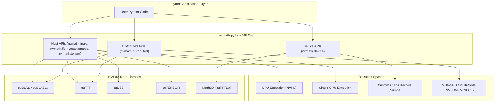
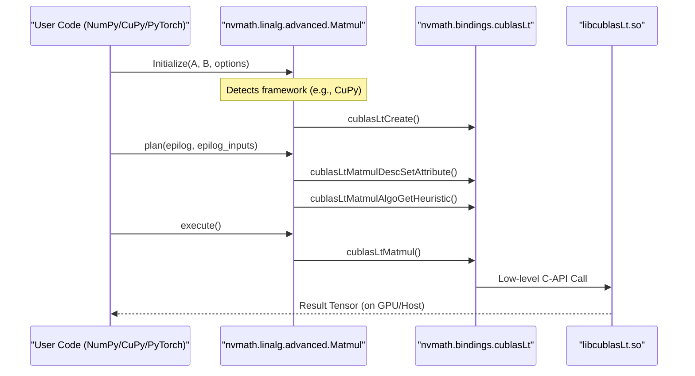

<!-- source: DeepWiki mcp.deepwiki.com · repo NVIDIA/nvmath-python · page 1 Overview · fetched 2026-10-26 -->

# Overview

Relevant source files

The following files were used as context for generating this wiki page:

- [.github/ISSUE_TEMPLATE/feature_request.yml](.github/ISSUE_TEMPLATE/feature_request.yml)
- [DESCRIPTION.rst](DESCRIPTION.rst)
- [README.md](README.md)
- [docs/sphinx/figures/nvmath-python.png](docs/sphinx/figures/nvmath-python.png)

nvmath-python is a high-performance Python library that serves as a comprehensive bridge to NVIDIA's suite of mathematical libraries. It provides intuitive, pythonic APIs that offer developers full access to features provided by NVIDIA's libraries across various execution spaces, including Host, Device, and Distributed environments.

## Purpose and Scope

nvmath-python is designed to bring the performance of NVIDIA's C-based math libraries to the Python ecosystem. It works seamlessly with existing Python array/tensor frameworks such as NumPy, CuPy, and PyTorch, focusing on providing advanced functionality and fine-grained control that is often missing from those frameworks.

The library is organized into three primary API tiers:
1.  **Host APIs**: Called from host code to execute math operations on CPU or GPU.
2.  **Device APIs**: Low-level functions for use within custom CUDA kernels (e.g., via Numba).
3.  **Distributed APIs**: Multi-node, multi-GPU operations for large-scale computations.

Sources: [README.md:7-13](), [README.md:17-18]()

## Three-Tier API Architecture

The architecture is structured to support different levels of abstraction and execution models.

Sources: [README.md:20-204](), [.github/ISSUE_TEMPLATE/feature_request.yml:18-32]()

### 1. Host APIs
Host APIs are the primary entry point for most users. They provide high-level wrappers for operations like Fast Fourier Transforms (FFT), Linear Algebra (linalg), Sparse solvers, and Tensor contractions. A key differentiator is the "stateful" workflow (Create -> Plan -> Execute) which allows for performance tuning and operation fusion.

*   **Linear Algebra**: Uses `nvmath.linalg.advanced.Matmul` to expose cuBLASLt features like mixed-precision and epilog fusion.
*   **FFT**: Uses `nvmath.fft` for batched transforms with support for custom LTO-IR prologs and epilogs.
*   **Sparse**: Uses `nvmath.sparse.advanced.DirectSolver` for high-performance sparse solving via cuDSS.
*   **Tensor**: Uses `nvmath.tensor` for binary and ternary contractions via cuTENSOR.

Sources: [README.md:20-103](), [.github/ISSUE_TEMPLATE/feature_request.yml:25-28]()

### 2. Device APIs
Device APIs (under `nvmath.device`) expose NVIDIA's MathDX (Device Extensions) to Python. These are intended to be called from *within* a CUDA kernel. This enables kernel fusion where, for example, an FFT can be performed on data already residing in registers or shared memory without returning to the host.

*   **Integration**: Works primarily with Numba's `@cuda.jit`.
*   **Key Entities**: `nvmath.device.fft` provides templates for generating device-side FFT functions.

Sources: [README.md:105-196](), [.github/ISSUE_TEMPLATE/feature_request.yml:31-31]()

### 3. Distributed APIs
The `nvmath.distributed` module handles computations that span multiple GPUs or nodes. It integrates with NVSHMEM for Partitioned Global Address Space (PGAS) memory models and NCCL for collective communications.

*   **Data Distribution**: Supports various distribution strategies like `Slab` or `BlockCyclic`.
*   **Operations**: Distributed FFTs and reshapes across process grids.

Sources: [README.md:198-210](), [.github/ISSUE_TEMPLATE/feature_request.yml:29-29]()

## Data Flow and Implementation

The following diagram illustrates how a typical Host API call (like Matrix Multiplication) flows from Python entities down to the native NVIDIA libraries.

Sources: [README.md:28-69](), [DESCRIPTION.rst:5-13]()

## Key Features and Benefits

| Feature | Description |
| :--- | :--- |
| **Full Parameter Access** | Unlike standard wrappers, `nvmath-python` exposes nearly all parameters of the underlying C-APIs (e.g., `MatmulComputeType`). |
| **Operation Fusion** | Support for custom epilogs/prologs via LTO-IR to fuse operations like scaling or bias addition directly into math kernels. |
| **Framework Interop** | Seamlessly accepts and returns tensors from `numpy`, `cupy`, and `torch`. |
| **Stateful Planning** | Separates the expensive planning phase from execution, enabling high-frequency loops with zero overhead. |

Sources: [README.md:20-69](), [README.md:71-103]()

---

