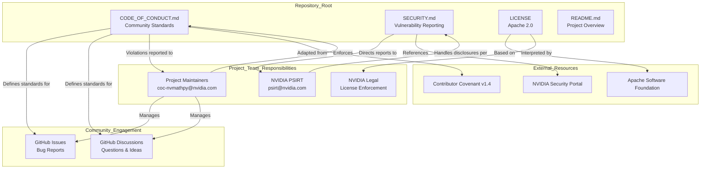
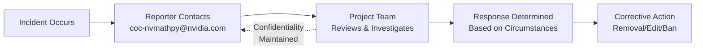
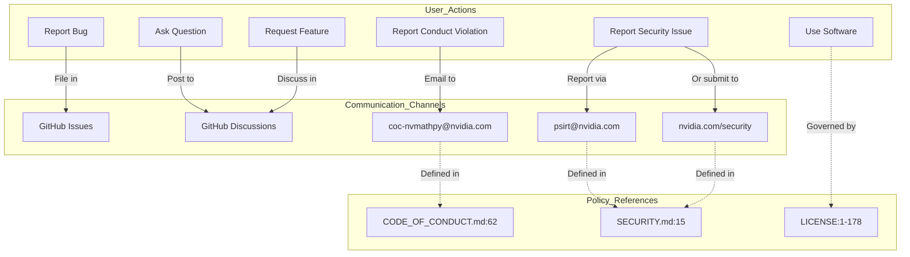

<!-- source: DeepWiki mcp.deepwiki.com · repo NVIDIA/nvmath-python · page 10 Community and Governance · fetched 2026-10-26 -->

# Community and Governance

Relevant source files

The following files were used as context for generating this wiki page:

- [CODE_OF_CONDUCT.md](CODE_OF_CONDUCT.md)
- [LICENSE](LICENSE)
- [SECURITY.md](SECURITY.md)

This document describes the governance model, community standards, security policies, and legal framework that govern the `nvmath-python` project. It provides an overview of how the project maintains community health, handles security issues, and defines usage rights through open-source licensing.

For detailed contribution procedures and development workflows, see [Development Guide](#9). For specific technical setup and code quality requirements, see [Code Quality and Pre-commit Hooks](#9.3) and [Contributing Guidelines](#9.5).

## Purpose and Scope

This page provides a high-level overview of the three primary governance areas for `nvmath-python`:

1.  **Community Standards** - behavioral expectations and enforcement mechanisms.
2.  **Security Policy** - vulnerability reporting and coordinated disclosure procedures.
3.  **Legal Framework** - licensing terms, copyright, and redistribution conditions.

Each area is defined by a specific policy document in the repository root and is detailed in its corresponding child page: [Code of Conduct](#10.1), [Security Policies](#10.2), and [License and Legal](#10.3).

## Governance Structure

The `nvmath-python` project is maintained by NVIDIA and follows a maintainer-led governance model. The project team has responsibility for:

*   Reviewing and investigating community reports.
*   Enforcing behavioral standards defined in [CODE_OF_CONDUCT.md:1-81]().
*   Managing security vulnerability disclosures through NVIDIA's PSIRT team.
*   Clarifying scope and applicability of the Apache 2.0 license.

The following diagram illustrates how the governance framework is organized:

### Governance Framework Overview

**Sources:** [CODE_OF_CONDUCT.md:1-81](), [SECURITY.md:1-36](), [LICENSE:1-178]()

## Policy Document Structure

Each governance area is documented in a dedicated file at the repository root. The table below summarizes their locations and key contact points:

| Policy Area | File | Primary Contact | Purpose |
| :--- | :--- | :--- | :--- |
| Community Standards | `CODE_OF_CONDUCT.md` | `coc-nvmathpy@nvidia.com` | Defines acceptable behavior and enforcement procedures |
| Security Reporting | `SECURITY.md` | `psirt@nvidia.com` | Describes vulnerability disclosure process |
| Licensing | `LICENSE` | N/A (legal text) | Grants usage rights under Apache 2.0 terms |

**Sources:** [CODE_OF_CONDUCT.md:62](), [SECURITY.md:15](), [LICENSE:1-178]()

## Community Standards Overview

The project adopts the [Contributor Covenant](https://www.contributor-covenant.org/) version 1.4 as its code of conduct. This establishes behavioral expectations for all participants in project spaces including repository interactions and official communication channels.

### Pledge and Standards
*   **Pledge**: Commitment to harassment-free participation regardless of personal characteristics ([CODE_OF_CONDUCT.md:7-14]()).
*   **Positive Standards**: Welcoming language, respect for differing viewpoints, and graceful acceptance of criticism ([CODE_OF_CONDUCT.md:18-25]()).
*   **Unacceptable Behavior**: Sexualized content, trolling, harassment, and privacy violations ([CODE_OF_CONDUCT.md:27-36]()).

### Enforcement Mechanism
Violations are handled through a defined escalation process:

### Conduct Violation Escalation

Project maintainers have authority to remove or reject contributions not aligned with the code of conduct and may ban contributors for inappropriate behavior ([CODE_OF_CONDUCT.md:44-49]()).

**Sources:** [CODE_OF_CONDUCT.md:38-70]()

## Security Policy Overview

The project follows NVIDIA's coordinated vulnerability disclosure policy. Security issues must be reported through designated channels rather than public issue trackers ([SECURITY.md:7-8]()).

### Reporting Channels
*   **Web Form**: [Security Vulnerability Submission Form](https://www.nvidia.com/object/submit-security-vulnerability.html) ([SECURITY.md:13-14]()).
*   **Email**: `psirt@nvidia.com` (supports PGP encryption) ([SECURITY.md:15-17]()).

### Required Information
Security reports should include product name/version, vulnerability type (e.g., code execution, DoS), reproduction instructions, and a proof-of-concept ([SECURITY.md:18-24]()).

### PSIRT Process
The NVIDIA Product Security Incident Response Team (PSIRT) coordinates vulnerability disclosure timelines and provides acknowledgement when issues are addressed ([SECURITY.md:26-30]()).

**Sources:** [SECURITY.md:1-36]()

## License Overview

`nvmath-python` is licensed under the Apache License 2.0, a permissive open-source license ([LICENSE:2-5]()).

### Key License Terms
*   **Copyright License**: Perpetual, worldwide, non-exclusive grant to reproduce and distribute ([LICENSE:67-72]()).
*   **Patent License**: Perpetual grant to make, use, and sell the Work, which terminates if patent litigation is initiated against any entity ([LICENSE:74-88]()).
*   **Warranty Disclaimer**: Software is provided "AS IS" without warranties of any kind ([LICENSE:144-152]()).

### Redistribution Conditions
Redistribution requires providing a copy of the license, carrying prominent notices on modified files, and retaining all copyright/patent notices ([LICENSE:90-106]()).

**Sources:** [LICENSE:1-178]()

## Communication and Channel Mapping

The following diagram maps specific user needs to the correct communication channels:

### Communication Channel Map

**Sources:** [CODE_OF_CONDUCT.md:62](), [SECURITY.md:13-15](), [LICENSE:1-178]()

## Summary

`nvmath-python` governance is anchored by:
1.  **[Code of Conduct](#10.1)**: Behavioral standards via `CODE_OF_CONDUCT.md`.
2.  **[Security Policies](#10.2)**: Disclosure procedures via `SECURITY.md`.
3.  **[License and Legal](#10.3)**: Usage rights via the `LICENSE` (Apache 2.0).

For technical development and contribution workflows, refer to the [Development Guide](#9).

---

