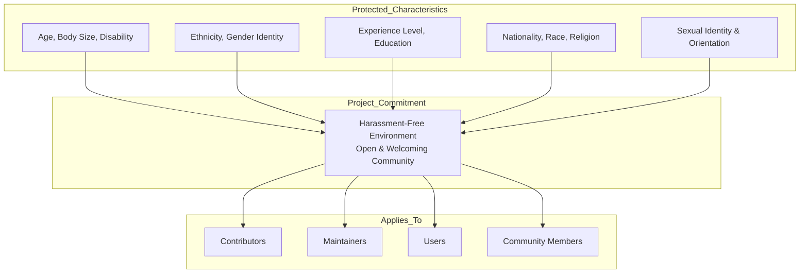
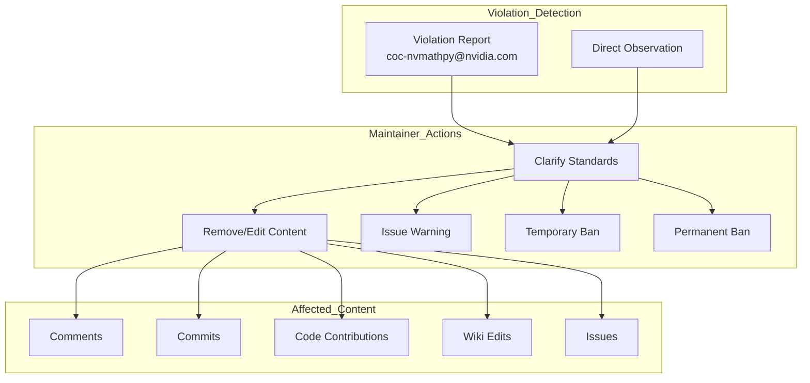
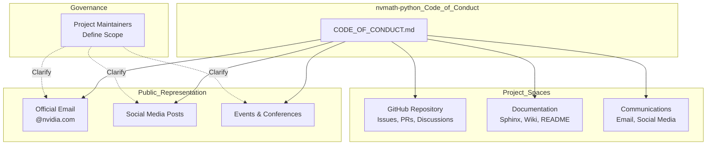
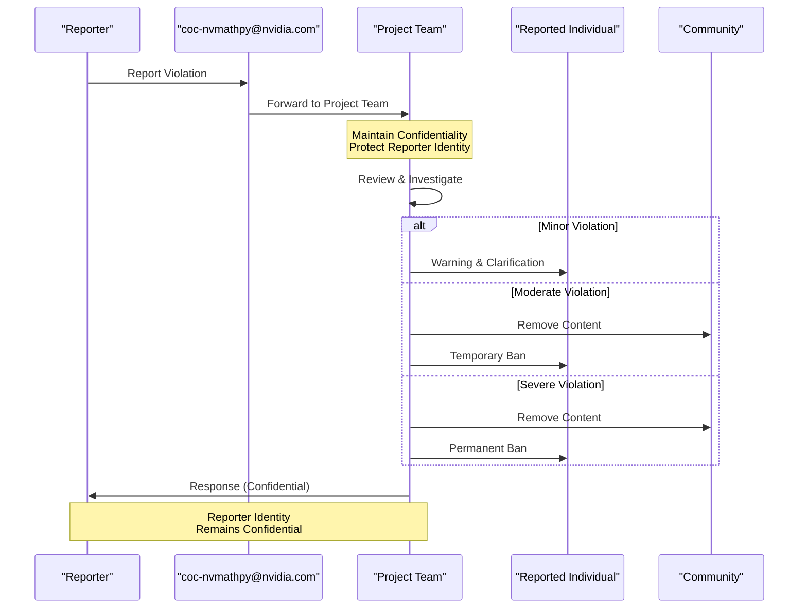
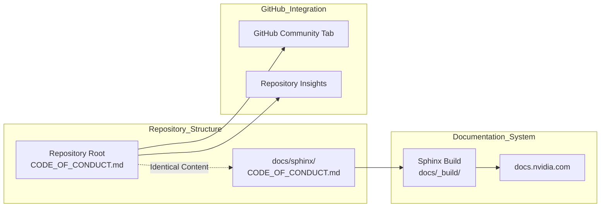

<!-- source: DeepWiki mcp.deepwiki.com · repo NVIDIA/nvmath-python · page 10.1 Code of Conduct · fetched 2026-10-26 -->

# Code of Conduct

Relevant source files

The following files were used as context for generating this wiki page:

- [CODE_OF_CONDUCT.md](CODE_OF_CONDUCT.md)
- [docs/sphinx/CODE_OF_CONDUCT.md](docs/sphinx/CODE_OF_CONDUCT.md)

## Purpose and Scope

This document defines the behavioral standards, enforcement policies, and reporting procedures that govern participation in the nvmath-python project. The Code of Conduct applies to all project spaces including GitHub repositories, issue trackers, pull requests, discussions, and any public representation of the project. For information about contributing code and technical guidelines, see [Contributing Guidelines](#9.5). For security-related concerns, see [Security Policies](#10.2).

The nvmath-python project has adopted the Contributor Covenant version 1.4 as its Code of Conduct framework, with specific enforcement procedures tailored to the project's governance structure.

**Sources:** [CODE_OF_CONDUCT.md:1-81](), [docs/sphinx/CODE_OF_CONDUCT.md:1-81]()

## Core Principles and Pledge

The nvmath-python project pledges to maintain a harassment-free environment for all participants, regardless of personal characteristics including age, body size, disability, ethnicity, sex characteristics, gender identity and expression, level of experience, education, socioeconomic status, nationality, personal appearance, race, religion, or sexual identity and orientation.

This commitment extends to all contributors, maintainers, users, and community members interacting within project spaces or representing the project externally.

**Diagram:** Core pledge structure protecting all participants regardless of personal characteristics.

**Sources:** [CODE_OF_CONDUCT.md:7-14]()

## Behavioral Standards

The Code of Conduct defines two categories of behavior: actions that contribute to a positive community environment and actions that are considered unacceptable.

### Acceptable Behavior

| Behavior | Description |
|----------|-------------|
| **Welcoming Language** | Using inclusive terminology that makes all participants feel valued |
| **Respectful Discourse** | Acknowledging differing viewpoints and experiences without hostility |
| **Constructive Criticism** | Accepting feedback gracefully and providing thoughtful, actionable suggestions |
| **Community Focus** | Prioritizing collective benefit over individual preferences |
| **Empathy** | Demonstrating understanding and consideration for other community members |

**Sources:** [CODE_OF_CONDUCT.md:16-25]()

### Unacceptable Behavior

| Behavior | Description |
|----------|-------------|
| **Sexualized Content** | Use of sexualized language, imagery, or unwelcome sexual attention/advances |
| **Trolling** | Deliberately inflammatory or disruptive comments intended to provoke |
| **Derogatory Comments** | Insulting remarks, personal attacks, or political attacks |
| **Harassment** | Public or private harassment of any form |
| **Privacy Violations** | Publishing private information (physical/electronic addresses) without permission |
| **Professional Misconduct** | Other conduct reasonably considered inappropriate in a professional setting |

**Sources:** [CODE_OF_CONDUCT.md:27-36]()

```mermaid
graph LR
    subgraph "Community_Interaction"
        CONTRIB_ACTION["Contributor Action"]
    end
    
    subgraph "Evaluation"
        CHECK{"Aligns with<br/>Standards?"}
    end
    
    subgraph "Acceptable"
        WELCOME["Welcoming & Inclusive"]
        RESPECT["Respectful"]
        CONSTRUCT["Constructive"]
        EMPATHY["Empathetic"]
    end
    
    subgraph "Unacceptable"
        SEXUALIZED["Sexualized Content"]
        TROLLING["Trolling/Insults"]
        HARASSMENT["Harassment"]
        PRIVACY["Privacy Violation"]
    end
    
    CONTRIB_ACTION --> CHECK
    CHECK -->|"Yes"| WELCOME
    CHECK -->|"Yes"| RESPECT
    CHECK -->|"Yes"| CONSTRUCT
    CHECK -->|"Yes"| EMPATHY
    CHECK -->|"No"| SEXUALIZED
    CHECK -->|"No"| TROLLING
    CHECK -->|"No"| HARASSMENT
    CHECK -->|"No"| PRIVACY
```

**Diagram:** Behavioral evaluation framework for community interactions.

**Sources:** [CODE_OF_CONDUCT.md:18-36]()

## Maintainer Responsibilities

Project maintainers have specific responsibilities for maintaining community standards and enforcing the Code of Conduct.

### Enforcement Authority

Maintainers are authorized to:

- **Clarify Standards**: Define and communicate acceptable behavior expectations.
- **Remove Content**: Delete or edit comments, commits, code, wiki edits, issues, and contributions that violate the Code of Conduct.
- **Temporary Bans**: Temporarily restrict access for contributors exhibiting inappropriate behavior.
- **Permanent Bans**: Permanently remove contributors for severe or repeated violations.
- **Corrective Action**: Take appropriate and fair measures in response to unacceptable behavior.

**Diagram:** Maintainer enforcement workflow showing detection, action, and affected content types.

**Sources:** [CODE_OF_CONDUCT.md:38-48]()

### Maintainer Accountability

Maintainers who fail to enforce the Code of Conduct in good faith may face repercussions determined by the project's leadership. This accountability mechanism ensures consistent and fair application of community standards.

**Sources:** [CODE_OF_CONDUCT.md:68-70]()

## Scope of Application

The Code of Conduct applies across multiple project spaces and contexts:

### Project Spaces

| Space | Examples |
|-------|----------|
| **Repository Interactions** | GitHub issues, pull requests, code reviews, commit comments |
| **Communication Channels** | GitHub Discussions, project mailing lists, official social media |
| **Documentation** | Wiki contributions, documentation edits, API reference updates |
| **Events** | Online meetups, conference presentations, community calls |

### Public Representation

The Code of Conduct also applies when individuals represent the nvmath-python project or its community in public spaces, including:

- Using official project email addresses (`@nvidia.com` in official capacity).
- Posting via official social media accounts.
- Acting as an appointed representative at events (online or offline).

Project maintainers may further define and clarify what constitutes project representation.

**Diagram:** Scope of Code of Conduct application across project spaces and public representation.

**Sources:** [CODE_OF_CONDUCT.md:50-57]()

## Enforcement Process

### Reporting Violations

Instances of abusive, harassing, or otherwise unacceptable behavior should be reported to the project team via email:

**Contact:** `coc-nvmathpy@nvidia.com`

All complaints are reviewed and investigated by the project team. The enforcement process follows these principles:

| Principle | Implementation |
|-----------|----------------|
| **Confidentiality** | Reporter identity is kept confidential throughout the investigation |
| **Timeliness** | All reports receive prompt review and response |
| **Appropriateness** | Responses are proportionate to the circumstances |
| **Investigation** | Thorough examination of reported incidents before action |
| **Response Obligation** | Team must provide a response deemed necessary and appropriate |

**Diagram:** Enforcement workflow from violation report through investigation to resolution.

**Sources:** [CODE_OF_CONDUCT.md:59-66]()

### Enforcement Policies

Specific enforcement policies may be posted separately to provide detailed guidance on how different types of violations are handled. The project team maintains discretion to determine appropriate corrective measures based on:

- Severity of the violation
- Context and intent
- History of the individual
- Impact on the community
- Good faith adherence to the Code of Conduct

**Sources:** [CODE_OF_CONDUCT.md:66-67]()

## File Structure and Integration

The Code of Conduct is maintained in two locations within the repository:

| File Location | Purpose |
|---------------|---------|
| [CODE_OF_CONDUCT.md:1-81]() | Primary Code of Conduct at repository root for GitHub integration |
| [docs/sphinx/CODE_OF_CONDUCT.md:1-81]() | Duplicate in documentation system for Sphinx build and web visibility |

Both files contain identical content to ensure consistency across repository and documentation interfaces.

**Diagram:** Code of Conduct file structure and integration points.

**Sources:** [CODE_OF_CONDUCT.md:1-81](), [docs/sphinx/CODE_OF_CONDUCT.md:1-81]()

## Attribution and Licensing

The nvmath-python Code of Conduct is adapted from the [Contributor Covenant](https://www.contributor-covenant.org), version 1.4, available at https://www.contributor-covenant.org/version/1/4/code-of-conduct.html

### Frequently Asked Questions

For answers to common questions about this Code of Conduct, see the Contributor Covenant FAQ at https://www.contributor-covenant.org/faq

### Relationship to Project License

The Code of Conduct governs community behavior and interactions, while the project's technical content is licensed under Apache 2.0. For license details, see [License and Legal](#10.3).

**Sources:** [CODE_OF_CONDUCT.md:72-80]()

## Summary

The nvmath-python Code of Conduct establishes clear behavioral expectations for all project participants. Key components include:

- **Universal pledge** to maintain a harassment-free environment.
- **Clear standards** defining acceptable and unacceptable behavior.
- **Maintainer authority** to enforce standards through content removal and bans.
- **Broad scope** covering all project spaces and public representation.
- **Confidential reporting** via `coc-nvmathpy@nvidia.com`.
- **Fair enforcement** with investigation and proportionate responses.

All community members are expected to familiarize themselves with these standards and contribute to maintaining a welcoming, professional environment.

**Sources:** [CODE_OF_CONDUCT.md:1-81]()

---

