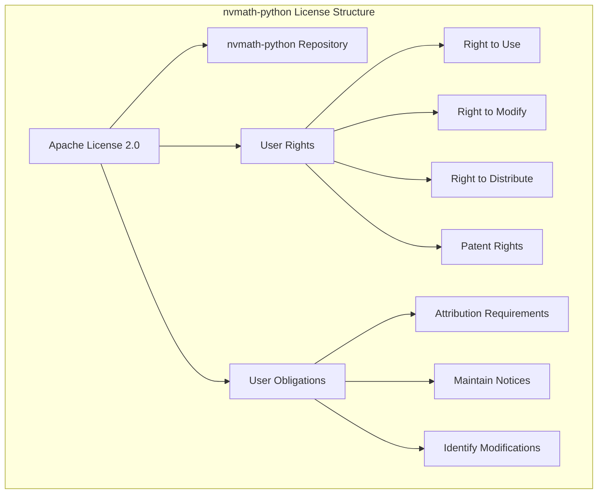
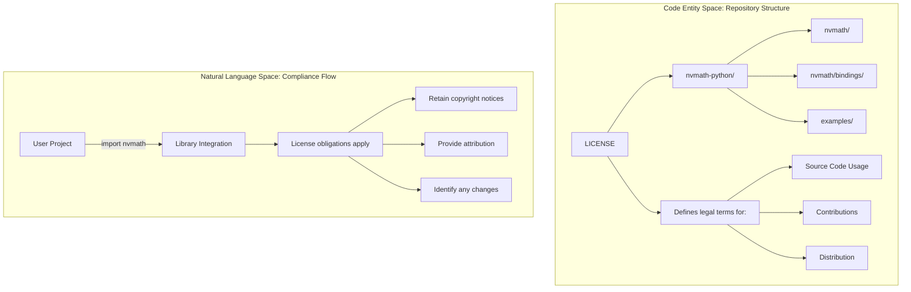
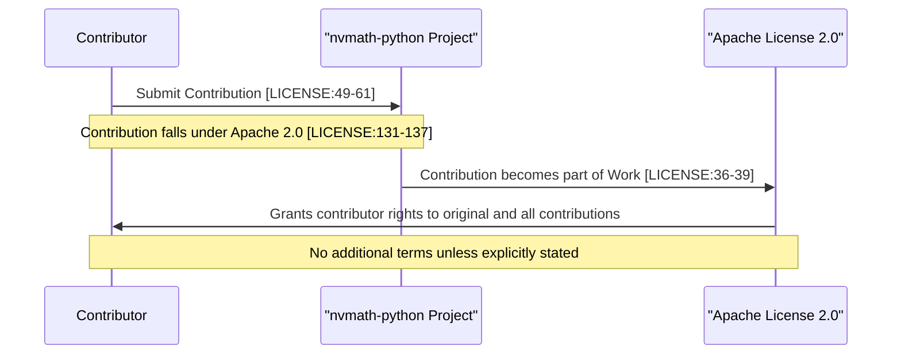
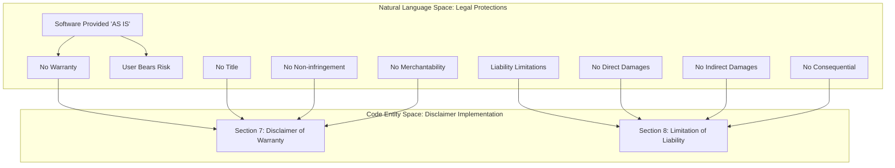
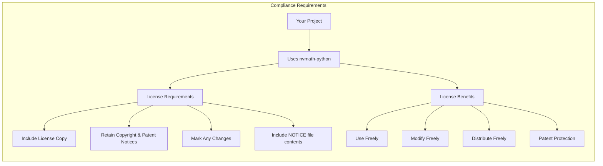

<!-- source: DeepWiki mcp.deepwiki.com · repo NVIDIA/nvmath-python · page 10.3 License and Legal · fetched 2026-10-26 -->

# License and Legal

Relevant source files

The following files were used as context for generating this wiki page:

- [LICENSE](LICENSE)

This document provides detailed information about the licensing and legal aspects of the `nvmath-python` repository. It covers the license under which the software is distributed, the rights it grants to users, and various legal considerations when using, modifying, or distributing the software.

## License Overview

`nvmath-python` is licensed under the Apache License, Version 2.0 (January 2004), a permissive open source license that allows for broad usage, modification, and distribution rights while providing patent grants and requiring preservation of copyright notices.

Sources: [LICENSE:1-177]()

## Key License Terms

The Apache License 2.0 grants several important rights and establishes certain obligations:

### Rights Granted

| Right | Description |
|-------|-------------|
| Use | You can freely use the software for any purpose, commercial or non-commercial [LICENSE:67-72]() |
| Modification | You can modify the software and create derivative works [LICENSE:70-72]() |
| Distribution | You can distribute the original or modified versions of the software [LICENSE:90-93]() |
| Patent License | Contributors grant patent rights for their contributions [LICENSE:74-82]() |
| Sublicensing | You can sublicense to others as long as you comply with the license [LICENSE:71-71]() |

### Obligations

| Obligation | Description |
|------------|-------------|
| License Copy | You must provide a copy of the license with any distribution [LICENSE:95-97]() |
| Attribution | You must retain copyright, patent, and attribution notices [LICENSE:101-105]() |
| Modification Notices | Modified files must carry notices stating you changed the files [LICENSE:98-99]() |
| NOTICE File | If present, the contents must be preserved in distributions [LICENSE:107-111]() |

Sources: [LICENSE:67-129]()

## License Implementation

The following diagram illustrates how the Apache License 2.0 is implemented within the `nvmath-python` project structure and how it relates to user projects.

Sources: [LICENSE:90-129]()

## Contributions and Licensing

When you contribute to `nvmath-python`, your contributions are automatically licensed under the same Apache License 2.0 terms, unless you explicitly state otherwise.

Sources: [LICENSE:49-61](), [LICENSE:131-137]()

## Trademark Provisions

The Apache License 2.0 does not grant permission to use NVIDIA's trade names, trademarks, service marks, or product names beyond what is required for reasonable and customary use in describing the origin of the work and reproducing the `NOTICE` file content.

NVIDIA trademarks, including "NVIDIA" and related product names, should be used in accordance with NVIDIA's trademark guidelines and policies.

Sources: [LICENSE:139-142]()

## Warranty Disclaimer and Liability Limitations

### Disclaimer of Warranty

`nvmath-python` is provided on an "AS IS" basis without warranties or conditions of any kind, either express or implied. This includes, but is not limited to, warranties of:

- Title
- Non-infringement
- Merchantability
- Fitness for a particular purpose

Users are solely responsible for determining the appropriateness of using or redistributing the software and assume all associated risks.

### Limitation of Liability

Contributors to `nvmath-python` are not liable for any damages resulting from the use or inability to use the software, including:

- Direct damages
- Indirect damages
- Special damages
- Incidental damages
- Consequential damages

This limitation applies regardless of the legal theory (tort, contract, etc.) unless required by applicable law or agreed to in writing.

Sources: [LICENSE:144-164]()

## Using nvmath-python in Your Projects

When incorporating `nvmath-python` into your own projects, you must comply with the terms of the Apache License 2.0. The following diagram outlines the compliance requirements:

Sources: [LICENSE:90-129]()

## Additional Legal Considerations

### Patent Litigation Termination

The patent license granted under the Apache License 2.0 will terminate if you initiate patent litigation against any entity alleging that `nvmath-python` or a contribution constitutes patent infringement. This termination clause is an important consideration for commercial users.

### Optional Support and Warranties

While the software is provided "AS IS" without warranties, users may choose to offer and charge for warranties, support, or indemnity when redistributing `nvmath-python`. However, this must be done on their own behalf and responsibility, not on behalf of other contributors.

Sources: [LICENSE:74-88](), [LICENSE:166-175]()

## Summary

`nvmath-python` is licensed under the Apache License 2.0, a permissive open source license that:
- Allows free use, modification, and distribution
- Requires preservation of copyright notices
- Includes patent license grants
- Disclaims warranties
- Limits liability of contributors

Users should review the complete license text in the `LICENSE` file at the root of the repository for comprehensive understanding of their rights and obligations.

Sources: [LICENSE:1-177]()

---

