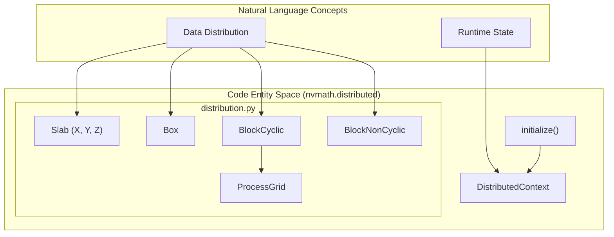
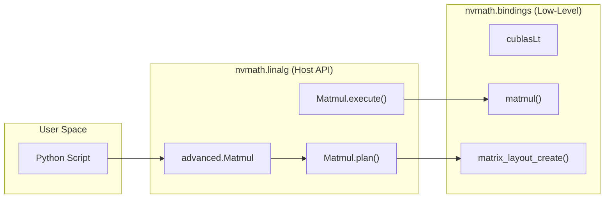

<!-- source: DeepWiki mcp.deepwiki.com · repo NVIDIA/nvmath-python · page 11 Glossary · fetched 2026-10-26 -->

# Glossary

Relevant source files

The following files were used as context for generating this wiki page:

- [.github/ISSUE_TEMPLATE/feature_request.yml](.github/ISSUE_TEMPLATE/feature_request.yml)
- [README.md](README.md)
- [docs/sphinx/bindings/cublas.rst](docs/sphinx/bindings/cublas.rst)
- [docs/sphinx/bindings/cudss.rst](docs/sphinx/bindings/cudss.rst)
- [docs/sphinx/bindings/cufft.rst](docs/sphinx/bindings/cufft.rst)
- [docs/sphinx/bindings/index.rst](docs/sphinx/bindings/index.rst)
- [docs/sphinx/device-apis/index.rst](docs/sphinx/device-apis/index.rst)
- [docs/sphinx/distributed-apis/distribution.rst](docs/sphinx/distributed-apis/distribution.rst)
- [docs/sphinx/distributed-apis/index.rst](docs/sphinx/distributed-apis/index.rst)
- [docs/sphinx/distributed-apis/runtime.rst](docs/sphinx/distributed-apis/runtime.rst)

This glossary defines codebase-specific terms, domain concepts, and technical jargon used within `nvmath-python`. It serves as a reference for the relationship between high-level Python abstractions and the underlying NVIDIA C-API libraries.

## Core Concepts & API Tiers

`nvmath-python` organizes its functionality into three distinct execution spaces, each targeting different developer needs and performance characteristics [README.md:17-18]().

| Term | Definition | Code Namespace |
| :--- | :--- | :--- |
| **Host API** | APIs called from CPU host code that can execute on either CPU or GPU. Provides high-level Pythonic wrappers for operations like FFT and Matmul [README.md:20-23](). | `nvmath.linalg`, `nvmath.fft`, `nvmath.sparse`, `nvmath.tensor` |
| **Device API** | APIs (Dx) designed to be called from *within* custom CUDA kernels (e.g., via Numba). Executes entirely on the GPU [README.md:105-107](). | `nvmath.device` |
| **Distributed API** | APIs for multi-node, multi-GPU systems using an SPMD (Single Program, Multiple Data) model [README.md:198-202](). | `nvmath.distributed` |

**Sources:** [README.md:17-23](), [README.md:105-107](), [README.md:198-202]()

---

## NVIDIA Library Bindings

The `nvmath.bindings` layer provides direct, low-level Cython-based access to NVIDIA's C-libraries. These bindings follow a consistent naming convention where library prefixes (e.g., `cublas`) are stripped and functions follow PEP 8 style [docs/sphinx/bindings/index.rst:56-65]().

### Linear Algebra Libraries
*   **cuBLAS**: Basic Linear Algebra Subprograms (BLAS) on GPU [docs/sphinx/bindings/cublas.rst:3-7]().
*   **cuBLASLt**: A lightweight version of cuBLAS for advanced GEMM (General Matrix Multiply) with heuristics and epilog fusion [docs/sphinx/bindings/index.rst:32-33]().
*   **cuBLASMp**: Multi-process/Distributed BLAS for multi-GPU linear algebra [docs/sphinx/bindings/index.rst:34-35]().
*   **cuDSS**: CUDA Direct Sparse Solver for solving large sparse linear systems [docs/sphinx/bindings/cudss.rst:3-7]().
*   **cuSPARSE**: Primitives for sparse matrix operations [docs/sphinx/bindings/index.rst:46-47]().

### Transform & Math Libraries
*   **cuFFT**: Fast Fourier Transforms on GPU [docs/sphinx/bindings/cufft.rst:3-7]().
*   **cuFFTMp**: Distributed FFT for multi-GPU environments [docs/sphinx/distributed-apis/index.rst:5-6]().
*   **cuRAND**: Pseudo- and quasi-random number generation [docs/sphinx/bindings/index.rst:40-41]().
*   **cuTENSOR**: Tensor linear algebra library [docs/sphinx/bindings/index.rst:28-30]().
*   **MathDx**: A collection containing device-side versions of math libraries (cuFFTDx, cuBLASDx) [docs/sphinx/device-apis/index.rst:10-15]().

**Sources:** [docs/sphinx/bindings/index.rst:13-53](), [docs/sphinx/bindings/cublas.rst:1-7](), [docs/sphinx/bindings/cufft.rst:1-7](), [docs/sphinx/bindings/cudss.rst:1-7]()

---

## Data Distribution & Memory Models

In the Distributed API, global arrays are partitioned across processes. The distribution type defines how the "Global" view maps to the "Local" data held by each rank [docs/sphinx/distributed-apis/distribution.rst:5-9]().

### Distribution Types
*   **Slab**: Partitioning an N-D array along a single dimension. Common aliases include `Slab.X` (axis 0), `Slab.Y` (axis 1), and `Slab.Z` (axis 2) [docs/sphinx/distributed-apis/distribution.rst:30-74]().
*   **Box**: Describing a subsection of a global array via lower and upper corner coordinates. Each process owns a contiguous rectangular subsection [docs/sphinx/distributed-apis/distribution.rst:85-91]().
*   **BlockCyclic**: Splitting an array into blocks and distributing them to a grid of processes in a cyclic pattern to balance load [docs/sphinx/distributed-apis/distribution.rst:128-143]().
*   **BlockNonCyclic**: A special case of BlockCyclic where blocks are distributed contiguously (the block size covers the full partition per process) [docs/sphinx/distributed-apis/distribution.rst:191-195]().

### Memory Concepts
*   **Symmetric Memory**: Memory allocated on a special heap where each process has a corresponding segment at the same virtual address. Required for `nvmath.distributed.fft` and `reshape` [docs/sphinx/distributed-apis/index.rst:27-31]().
*   **LTO-IR**: Link-Time Optimization Intermediate Representation. Used to compile custom Python prolog/epilog functions into a format that can be fused into library kernels (e.g., FFT or Matmul) [README.md:71-73]().

### System Architecture: Distribution to Code Entity
This diagram maps the natural language concept of "Distribution" to the specific classes and initialization routines in the codebase.

**Sources:** [docs/sphinx/distributed-apis/distribution.rst:1-195](), [docs/sphinx/distributed-apis/runtime.rst:10-20](), [docs/sphinx/distributed-apis/runtime.rst:44-56]()

---

## Technical Jargon & Abbreviations

| Term | Meaning | Code Context |
| :--- | :--- | :--- |
| **Epilog** | An operation (like Bias addition or ReLU) applied to the result of a math operation before writing to memory [README.md:50-56](). | `nvmath.linalg.advanced.MatmulEpilog` |
| **Prolog** | An operation applied to input data before it is processed by the main math kernel [README.md:71-73](). | `nvmath.fft.compile_prolog` |
| **SPMD** | Single Program, Multiple Data. The execution model for `nvmath.distributed` where the same script runs on all ranks [docs/sphinx/distributed-apis/index.rst:21-25](). | `nvmath.distributed` |
| **Descriptor** | A C-struct handle (passed as `int` in Python) that stores metadata about a matrix or operation [docs/sphinx/bindings/index.rst:147-152](). | `nvmath.bindings.cublasLt` |
| **Handle** | An opaque pointer to a library context (e.g., cuBLAS handle) [docs/sphinx/bindings/index.rst:147-152](). | `nvmath.bindings.cublas.create()` |

### API Interaction: Host API to Library Bindings
This diagram illustrates how high-level Host API calls traverse into the low-level experimental bindings.

**Sources:** [README.md:20-63](), [docs/sphinx/bindings/index.rst:8-16](), [docs/sphinx/bindings/index.rst:75-84]()