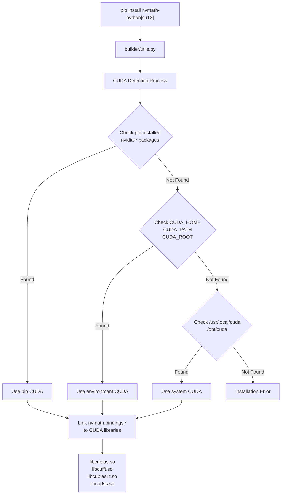
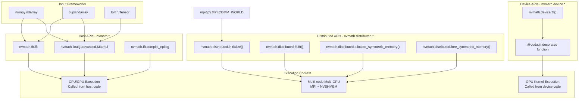

<!-- source: DeepWiki mcp.deepwiki.com · repo NVIDIA/nvmath-python · page 2 Installation & Getting Started · fetched 2026-10-26 -->

# Installation & Getting Started

<details>
<summary>Relevant source files</summary>

The following files were used as context for generating this wiki page:

- [DESCRIPTION.rst](DESCRIPTION.rst)
- [MANIFEST.in](MANIFEST.in)
- [README.md](README.md)

</details>


## Purpose and Scope

This page guides you through installing `nvmath-python`, verifying the installation, and running your first examples with each of the three API categories. For architectural details about how `nvmath-python` is structured internally, see **Architecture Overview**. For in-depth usage of specific API categories, see **Host APIs**, **Device APIs**, and **Distributed APIs**.

## Installation

### Installing via pip

The recommended installation method is via `pip`. `nvmath-python` requires a CUDA installation and ships with different variants depending on your CUDA version:

```bash
# For CUDA 12.x
pip install nvmath-python[cu12]

# For CUDA 11.x
pip install nvmath-python[cu11]
```

The package automatically detects and links against your CUDA installation. The detection logic searches for CUDA in the following order:

1. Pip-installed CUDA packages (`nvidia-*` wheels)
2. Environment variables (`CUDA_HOME`, `CUDA_PATH`, `CUDA_ROOT`)
3. Default system paths (e.g., `/usr/local/cuda`, `/opt/cuda`)

**Sources:** [DESCRIPTION.rst:13-22]()

### System Requirements

`nvmath-python` has the following requirements:

| Component | Requirement |
|-----------|-------------|
| Python | 3.9+ |
| CUDA | 11.x or 12.x |
| GPU | NVIDIA GPU with Compute Capability 7.0+ |
| Operating System | Linux x86_64 |
| Python Frameworks | NumPy, CuPy, or PyTorch |

For distributed operations, additional requirements include:

| Component | Requirement |
|-----------|-------------|
| MPI | MPI implementation (e.g., OpenMPI, MPICH) |
| mpi4py | Python MPI bindings |
| NVSHMEM | Included with nvmath-python |

**Sources:** [README.md:1-14]()

## Installation Flow and CUDA Detection

The following diagram illustrates how `nvmath-python` detects CUDA during installation and runtime:



**Installation and CUDA Detection Flow**

**Sources:** [README.md:1-14](), [DESCRIPTION.rst:13-22](), [MANIFEST.in:1-6]()

## Verifying Installation

After installation, verify that `nvmath-python` can access the CUDA libraries:

```python
import nvmath

# Check that bindings are available
print(f"nvmath version: {nvmath.__version__}")

# Verify CUDA library access
import nvmath.bindings.cublas
import nvmath.bindings.cufft

print("nvmath-python installed successfully")
```

**Sources:** [README.md:1-14]()

## API Categories and Entry Points

`nvmath-python` provides three distinct API categories, each with specific entry points:



**API Categories and Their Entry Points**

**Sources:** [README.md:15-27](), [README.md:105-110](), [README.md:198-202]()

## Quick Start Examples

### Host API: Matrix Multiplication

The Host API allows you to perform GPU-accelerated operations from Python using familiar array frameworks. The `nvmath.linalg.advanced.Matmul` class provides access to all `cuBLASLt` features:

```python
import cupy as cp
import nvmath

# Prepare input matrices
m, n, k = 123, 456, 789
a = cp.random.rand(m, k).astype(cp.float32)
b = cp.random.rand(k, n).astype(cp.float32)
bias = cp.random.rand(m, 1).astype(cp.float32)

# Create Matmul object with mixed-precision compute
mm = nvmath.linalg.advanced.Matmul(
    a,
    b,
    options={
        "compute_type": nvmath.linalg.advanced.MatmulComputeType.COMPUTE_32F_FAST_16F
    },
)

# Plan with epilog operation (bias addition)
mm.plan(
    epilog=nvmath.linalg.advanced.MatmulEpilog.BIAS,
    epilog_inputs={"bias": bias},
)

# Execute
result = mm.execute()
mm.free()

# Synchronize
cp.cuda.get_current_stream().synchronize()
```

**Key Concepts:**
- `nvmath.linalg.advanced.Matmul` is a stateful object for reusable matrix multiplications [README.md:42-48]().
- `options` parameter controls compute precision and algorithm selection [README.md:45-47]().
- `epilog` parameter enables fused operations (e.g., bias addition) without separate kernels [README.md:53-56]().
- Works with `numpy.ndarray`, `cupy.ndarray`, and `torch.Tensor` [README.md:32-33]().

**Sources:** [README.md:20-69]()

### Host API: FFT with Custom Epilog

The FFT Host API supports custom prologs and epilogs compiled to LTO-IR for kernel fusion:

```python
import cupy as cp
import nvmath
import math

# Create batched 1-D FFT data
B, N = 256, 1024
a = cp.random.rand(B, N, dtype=cp.float64) + 1j * cp.random.rand(B, N, dtype=cp.float64)

# Normalization factor for unitary transform
norm_factor = 1.0 / math.sqrt(N)

# Define epilog function
def rescale(data_out, offset, data, user_info, unused):
    data_out[offset] = data * norm_factor

# Compile to LTO-IR
with cp.cuda.Device():
    epilog = nvmath.fft.compile_epilog(rescale, "complex128", "complex128")

# Execute FFT with fused epilog
r = nvmath.fft.fft(a, axes=[-1], epilog={"ltoir": epilog})
```

**Key Concepts:**
- `nvmath.fft.compile_epilog()` compiles Python functions to GPU code [README.md:92-93]().
- Epilogs execute without additional kernel launches (kernel fusion) [README.md:95-96]().
- `nvmath.fft.fft()` accepts `axes` parameter similar to `numpy.fft` and `cupy.fft` [README.md:96]().

**Sources:** [README.md:71-103]()

### Device API: FFT in Numba Kernels

Device APIs allow calling NVIDIA library functions inside custom CUDA kernels:

```python
import numpy as np
from numba import cuda
from nvmath.device import fft

# Create device FFT functions
size = 128
FFT_fwd = fft(
    fft_type="c2c",
    size=size,
    precision=np.float32,
    direction="forward",
    ffts_per_block=1,
    elements_per_thread=2,
    execution="Block",
)

FFT_inv = fft(
    fft_type="c2c",
    size=size,
    precision=np.float32,
    direction="inverse",
    ffts_per_block=1,
    elements_per_thread=2,
    execution="Block",
)

# Define Numba kernel
@cuda.jit
def convolution_kernel(signal, filter):
    # Allocate thread-local and shared memory
    thread_data = cuda.local.array(
        shape=(FFT_fwd.storage_size,), 
        dtype=FFT_fwd.value_type,
    )
    shared_mem = cuda.shared.array(shape=(0,), dtype=FFT_fwd.value_type)
    
    # Load data
    fft_id = cuda.blockIdx.x
    offset = cuda.threadIdx.x
    for i in range(FFT_fwd.elements_per_thread):
        thread_data[i] = signal[fft_id, offset + i * FFT_fwd.stride]
    
    # Call cuFFTDx from device code
    FFT_fwd(thread_data, shared_mem)
    
    # Apply filter
    for i in range(FFT_fwd.elements_per_thread):
        thread_data[i] *= filter[fft_id, offset + i * FFT_fwd.stride]
    
    # Inverse FFT
    FFT_inv(thread_data, shared_mem)
    
    # Store result
    for i in range(FFT_fwd.elements_per_thread):
        signal[fft_id, offset + i * FFT_fwd.stride] = thread_data[i]

# Prepare data and launch kernel
data = np.random.randn(1, size).astype(np.complex64)
filter = np.random.randn(1, size).astype(np.complex64)
data_d = cuda.to_device(data)
filter_d = cuda.to_device(filter)

convolution_kernel[1, FFT_fwd.block_dim, 0, FFT_fwd.shared_memory_size](data_d, filter_d)
cuda.synchronize()
```

**Key Concepts:**
- `nvmath.device.fft()` returns a callable object representing a `cuFFTDx` operation [README.md:129-146]().
- Device functions are called from within `@cuda.jit` decorated kernels [README.md:149-166]().
- Attributes like `storage_size`, `block_dim`, and `shared_memory_size` configure kernel launch [README.md:153-183]().
- `cuda.local.array()` allocates thread-local storage, `cuda.shared.array()` for shared memory [README.md:152-155]().

**Sources:** [README.md:105-196]()

### Distributed API: Multi-node FFT

Distributed APIs enable multi-node, multi-GPU operations using MPI and NVSHMEM:

```python
import cupy as cp
from mpi4py import MPI
import nvmath.distributed
from nvmath.distributed.distribution import Slab

# Initialize MPI and nvmath.distributed
comm = MPI.COMM_WORLD
rank = comm.Get_rank()
nranks = comm.Get_size()
device_id = rank % cp.cuda.runtime.getDeviceCount()
nvmath.distributed.initialize(device_id, comm, backends=["nvshmem"])

# Global FFT size (512, 256, 512), distributed across processes
shape = 512 // nranks, 256, 512

# Allocate symmetric memory (NVSHMEM PGAS)
a = nvmath.distributed.allocate_symmetric_memory(shape, cp, dtype=cp.complex128)

# Initialize data on each rank
with cp.cuda.Device(device_id):
    a[:] = cp.random.rand(*shape, dtype=cp.float64) + 1j * cp.random.rand(*shape, dtype=cp.float64)

# Forward FFT with Slab.X input distribution
# Result has Slab.Y distribution (reshape=False)
b = nvmath.distributed.fft.fft(a, distribution=Slab.X, options={"reshape": False})

# Inverse FFT with Slab.Y input distribution
# Result has Slab.X distribution (reshape=False)
c = nvmath.distributed.fft.ifft(b, distribution=Slab.Y, options={"reshape": False})

# Synchronize
with cp.cuda.Device(device_id):
    cp.cuda.get_current_stream().synchronize()

# Free symmetric memory (collective operation)
nvmath.distributed.free_symmetric_memory(a)
```

**Key Concepts:**
- `nvmath.distributed.initialize()` must be called before distributed operations [README.md:211-216]().
- `nvmath.distributed.allocate_symmetric_memory()` allocates memory on the NVSHMEM symmetric heap [README.md:218-220]().
- `Slab.X` and `Slab.Y` specify how data is distributed across processes [README.md:209-224]().
- Distributed FFT operations are in-place or can redistribute data [README.md:223-228]().
- `free_symmetric_memory()` is a collective operation required for cleanup [README.md:265-270]().

**Sources:** [README.md:198-271]()

## Memory Management Considerations

| API Category | Memory Model | Allocation Method | Deallocation |
|--------------|--------------|-------------------|--------------|
| Host API | Standard Python | Automatic (framework) | Automatic (GC) |
| Host API (Matmul) | Stateful objects | `Matmul()` constructor | `mm.free()` or context manager |
| Device API | Thread-local/Shared | `cuda.local.array()`, `cuda.shared.array()` | Automatic (scope) |
| Distributed API | NVSHMEM Symmetric Heap | `allocate_symmetric_memory()` | `free_symmetric_memory()` (collective) |

**Important:** Distributed API memory is **not** garbage collected. Always call `free_symmetric_memory()` on all ranks to avoid memory leaks [README.md:265-270]().

**Sources:** [README.md:28-69](), [README.md:152-155](), [README.md:265-270]()

---

