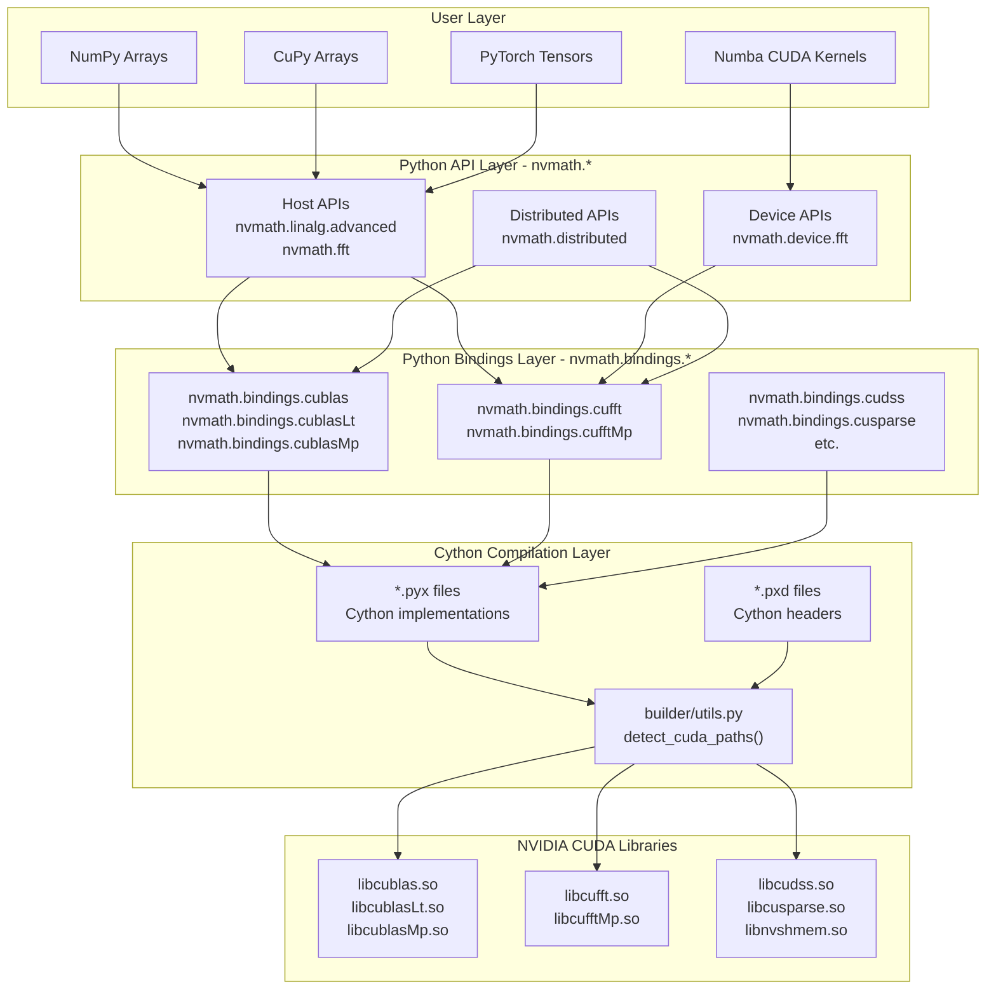
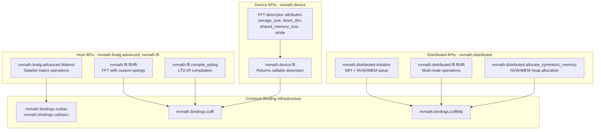
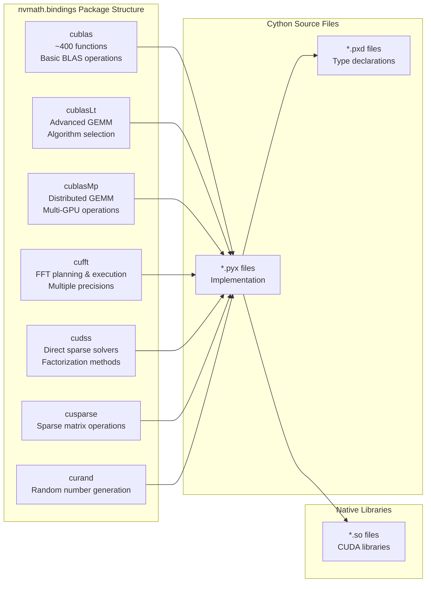
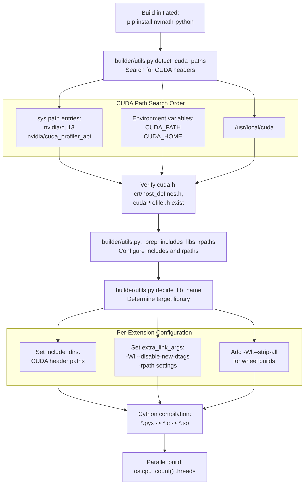

<!-- source: DeepWiki mcp.deepwiki.com · repo NVIDIA/nvmath-python · page 3 Architecture Overview · fetched 2026-10-26 -->

# Architecture Overview

<details>
<summary>Relevant source files</summary>

The following files were used as context for generating this wiki page:

- [README.md](README.md)
- [builder/__init__.py](builder/__init__.py)
- [builder/utils.py](builder/utils.py)

</details>


## Purpose and Scope

This document provides a high-level overview of nvmath-python's internal architecture, explaining how the library bridges Python code to NVIDIA's native CUDA math libraries through a carefully designed layered system. It covers the overall design philosophy, the three-tier API architecture, the Python bindings layer, framework integration patterns, and the build system.

For detailed information about specific topics:
- API category usage patterns and selection criteria: see [API Categories](#3.1)
- Python bindings implementation details: see [Python Bindings Layer](#3.2)
- Host API usage: see [Host APIs](#4)
- Device API usage: see [Device APIs](#5)
- Distributed API usage: see [Distributed APIs](#6)

---

## High-Level Layered Architecture

nvmath-python is structured as a multi-layered architecture that separates concerns between Python API presentation, bindings management, and native library access.

### Overall System Layers



**Sources:** [README.md:1-208](), [builder/utils.py:12-52](), [builder/utils.py:55-75]()

The architecture consists of five distinct layers:

| Layer | Purpose | Key Components |
|-------|---------|----------------|
| **User Layer** | Framework integration | NumPy, CuPy, PyTorch tensors/arrays; Numba kernels |
| **Python API Layer** | High-level Pythonic APIs | `nvmath.linalg.advanced`, `nvmath.fft`, `nvmath.device`, `nvmath.distributed` |
| **Python Bindings Layer** | Low-level library wrapping | `nvmath.bindings.cublas`, `nvmath.bindings.cufft`, etc. |
| **Cython Compilation Layer** | C/Python bridge | `.pyx` implementation files, `.pxd` header files, build utilities |
| **NVIDIA CUDA Libraries** | Native GPU acceleration | `libcublas.so`, `libcufft.so`, `libcudss.so`, etc. |

---

## Three-Tier API Architecture

nvmath-python organizes its functionality into three distinct API categories, each targeting different execution models and use cases.

### API Category Relationships



**Sources:** [README.md:20-215]()

### API Category Characteristics

| API Category | Execution Context | Memory Model | Primary Use Case | Example |
|--------------|------------------|--------------|------------------|---------|
| **Host APIs** | Called from Python, executes on CPU/GPU | Standard array/tensor memory | High-level operations with full control | `nvmath.linalg.advanced.Matmul` |
| **Device APIs** | Called from CUDA kernels, executes on GPU | Thread-local and shared memory | Custom kernel integration | `nvmath.device.fft` in `@cuda.jit` |
| **Distributed APIs** | Called from Python, executes across nodes | NVSHMEM symmetric heap | Multi-node, multi-GPU computing | `nvmath.distributed.fft.fft` |

Each API category builds on the same Python bindings layer but exposes different programming models to address specific execution requirements. See [API Categories](#3.1) for detailed usage guidance.

**Sources:** [README.md:20-215]()

---

## Python Bindings Layer Structure

The Python bindings layer uses Cython to wrap NVIDIA's native CUDA libraries, exposing their functionality to Python with minimal overhead.

### Binding Module Organization



**Sources:** [builder/utils.py:55-75]()

Each binding module follows a consistent pattern:

1. **Cython Implementation (`.pyx`)**: Contains the actual wrapping code that bridges Python and C.
2. **Cython Header (`.pxd`)**: Declares C types, functions, and constants for Cython compilation.
3. **Python Module**: Exposes enumerations, constants, and wrapper functions to Python.

The bindings provide direct function mappings, enumeration classes representing CUDA library enums, and automatic error checking via status code validation.

**Sources:** [builder/utils.py:55-75]()

---

## Build System and CUDA Path Detection

The build system manages the complex task of detecting CUDA installations, configuring compilation flags, and linking against CUDA libraries across different deployment scenarios.

### Build Process Flow



**Sources:** [builder/utils.py:12-52](), [builder/utils.py:55-75](), [builder/utils.py:78-146]()

### CUDA Path Detection Logic

The `detect_cuda_paths()` function [builder/utils.py:12-52]() implements a multi-strategy search:

```python
# Searches in order:
# 1. sys.path entries (for pip wheel installations like nvidia/cu13)
# 2. CUDA_PATH or CUDA_HOME environment variables
# 3. Default /usr/local/cuda location
```

The function verifies headers like `cuda.h`, `crt/host_defines.h`, and `cudaProfiler.h` are accessible to ensure a valid build environment [builder/utils.py:47-51]().

### Library-Specific Configuration

The `decide_lib_name()` function [builder/utils.py:55-75]() maps extension names to library names, including `cublas`, `cufft`, `cudss`, `cusparse`, and others.

The `build_ext` class [builder/utils.py:78-146]() coordinates compilation:
- Parallel compilation using `os.cpu_count()` threads [builder/utils.py:144-145]().
- Automatic binary stripping for wheel size reduction [builder/utils.py:100-102]().
- Proper rpath configuration for runtime library discovery [builder/utils.py:108-128]().

**Sources:** [builder/utils.py:12-146]()

---

## Framework Integration Patterns

nvmath-python integrates with popular Python array frameworks through a unified abstraction layer that detects array types and manages memory across different frameworks.

### Array Framework Support

The framework integration follows these principles:

1. **Type Detection**: Host APIs detect input array types (NumPy, CuPy, PyTorch) automatically [README.md:32-37]().
2. **Zero-Copy Access**: Extract data pointers or interfaces (like `__cuda_array_interface__`) to avoid unnecessary host-device copies.
3. **Stream Management**: Respect framework-specific CUDA streams for asynchronous execution [README.md:64-66]().
4. **Result Consistency**: Return results in the same framework as the inputs [README.md:68-69]().

### Example: Framework-Agnostic Matrix Multiplication

From [README.md:28-69](), the `Matmul` class accepts inputs from any supported framework:

```python
import cupy as cp
import nvmath

# Prepare sample input data (CuPy example)
a = cp.random.rand(m, k).astype(cp.float32)
b = cp.random.rand(k, n).astype(cp.float32)

# nvmath-python handles the underlying library selection (cuBLASLt)
mm = nvmath.linalg.advanced.Matmul(a, b, options={...})
result = mm.execute()
```

**Sources:** [README.md:28-69]()

---

## Summary

nvmath-python's architecture achieves several key design goals:

1. **Layered Abstraction**: Clean separation between high-level Python APIs, binding layer, and native libraries.
2. **Multi-Framework Support**: Seamless integration with NumPy, CuPy, and PyTorch through unified array handling.
3. **Three Execution Models**: Host, Device, and Distributed APIs address different computational paradigms.
4. **Flexible Build System**: Supports pip wheels, custom CUDA paths, and system installations.
5. **Minimal Overhead**: Cython bindings provide near-zero-cost abstractions over native libraries.

For deeper exploration:
- Implementation details of each API category: [API Categories](#3.1)
- Binding layer internals and Cython usage: [Python Bindings Layer](#3.2)
- Practical usage of Host APIs: [Host APIs](#4)
- Device kernel integration: [Device APIs](#5)
- Multi-node computing patterns: [Distributed APIs](#6)

---

