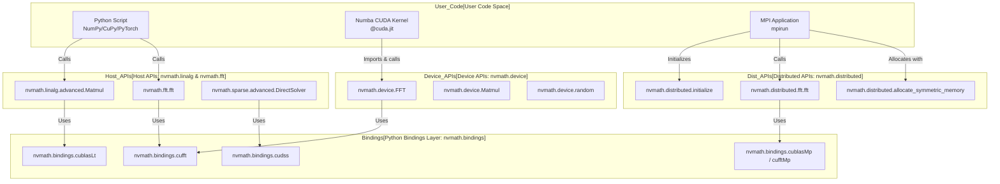
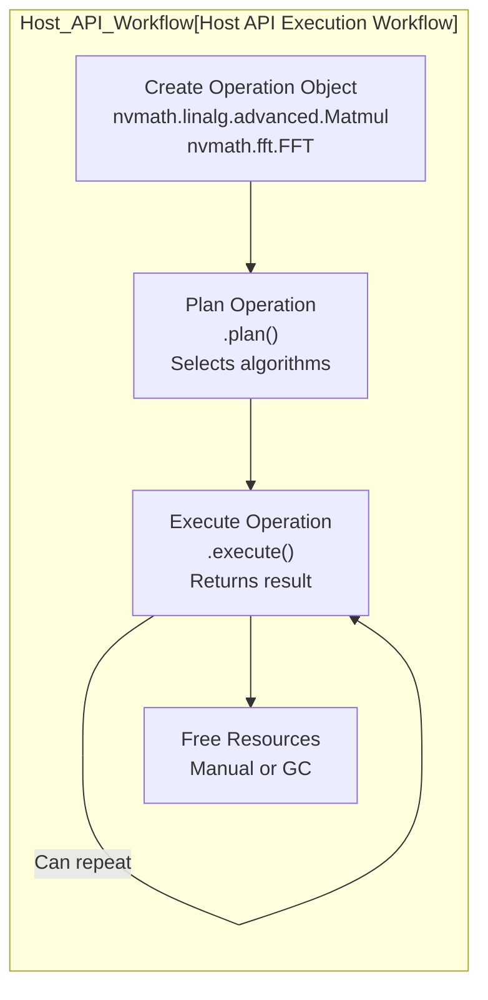
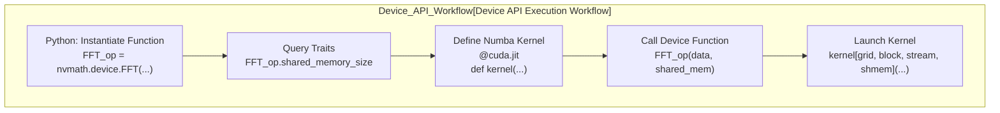
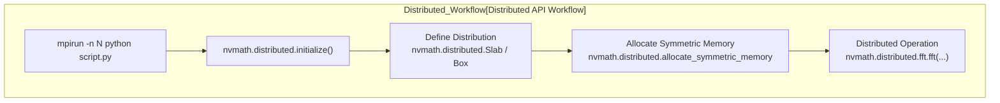

<!-- source: DeepWiki mcp.deepwiki.com · repo NVIDIA/nvmath-python · page 3.1 API Categories · fetched 2026-10-26 -->

# API Categories

Relevant source files

The following files were used as context for generating this wiki page:

- [.github/ISSUE_TEMPLATE/feature_request.yml](.github/ISSUE_TEMPLATE/feature_request.yml)
- [docs/sphinx/bindings/index.rst](docs/sphinx/bindings/index.rst)
- [docs/sphinx/device-apis/index.rst](docs/sphinx/device-apis/index.rst)
- [docs/sphinx/distributed-apis/index.rst](docs/sphinx/distributed-apis/index.rst)

## Purpose and Scope

This document provides a detailed explanation of nvmath-python's three-tier API architecture: Host APIs, Device APIs, and Distributed APIs. Each tier targets different execution models and use cases, allowing developers to select the appropriate abstraction level for their computational needs. This page focuses on the conceptual differences and selection criteria for each API category. For implementation details of specific operations, see [Host APIs](4), [Device APIs](5), and [Distributed APIs](6).

## Overview of the Three-Tier Architecture

nvmath-python organizes its functionality into three distinct API categories, each designed for different execution contexts and levels of control:

| API Category | Execution Context | Primary Use Case | Typical Caller |
|--------------|-------------------|------------------|----------------|
| **Host APIs** | CPU/GPU from Python | High-level operations on array frameworks | Python scripts, notebooks |
| **Device APIs** | GPU device code | Custom kernel integration | Numba `@cuda.jit` functions |
| **Distributed APIs** | Multi-node multi-GPU | Distributed computing | MPI applications |

**Three-Tier API Architecture**

Sources: [docs/sphinx/bindings/index.rst:13-53](), [docs/sphinx/device-apis/index.rst:10-16](), [docs/sphinx/distributed-apis/index.rst:5-8]()

## Host APIs

Host APIs are invoked from Python host code and provide high-level operations on array-like objects from NumPy, CuPy, PyTorch, and other compatible frameworks. These APIs execute on either CPU or GPU depending on the input operand locations.

### Execution Model

Host APIs often follow a **plan-then-execute** pattern for advanced interfaces (like `nvmath.linalg.advanced.Matmul` or `nvmath.fft.FFT`), while providing stateless convenience functions (like `nvmath.fft.fft`) for simpler use cases.

**Host API Execution Pattern**

### Module Organization

Host APIs are organized into several primary modules:

| Module | Purpose | Key Classes/Functions |
|--------|---------|----------------------|
| `nvmath.linalg` | Linear algebra operations | `advanced.Matmul`, `generic.matmul` |
| `nvmath.fft` | Fast Fourier Transforms | `fft()`, `ifft()`, `FFT` class |
| `nvmath.sparse` | Sparse direct solvers | `advanced.DirectSolver` (cuDSS) |
| `nvmath.tensor` | Tensor contractions | `einsum()`, `Contract` class (cuTENSOR) |

### Framework Interoperability

Host APIs accept operands from multiple array frameworks. Pointer addresses are extracted and passed to the underlying C-bindings layer [docs/sphinx/bindings/index.rst:116-143]().

- **NumPy**: Used for host memory [docs/sphinx/bindings/index.rst:101-102]().
- **CuPy**: Used for device memory and lightweight array manipulation [docs/sphinx/bindings/index.rst:112-114]().
- **PyTorch**: Supported for both host and device tensors.

### Use Cases

Host APIs are appropriate when:
- Working with high-level array frameworks (NumPy, CuPy, PyTorch).
- Needing fine-grained control over NVIDIA library parameters (e.g., epilogs, compute types) [docs/sphinx/bindings/index.rst:75-85]().
- Requiring custom epilog/prolog operations fused with FFT or Matmul computations.
- Optimizing performance through algorithm selection and heuristics.

Sources: [docs/sphinx/bindings/index.rst:92-115](), [.github/ISSUE_TEMPLATE/feature_request.yml:25-28]()

## Device APIs

Device APIs enable calling NVIDIA library functions from within custom CUDA kernels. These APIs execute entirely on the GPU device within user-defined kernels and are typically used with Numba or other JIT compilers [docs/sphinx/device-apis/index.rst:10-16]().

### Execution Model

Device APIs follow an **instantiate-then-invoke** pattern. A device function is instantiated with configuration parameters at the Python level (querying traits like shared memory requirements), then invoked from within CUDA device code [docs/sphinx/device-apis/index.rst:20-22]().

**Device API Execution Pattern**

### Module Organization

Device APIs are organized under `nvmath.device` [docs/sphinx/device-apis/index.rst:6]():

| Module | Purpose | Underlying Library |
|--------|---------|-------------------|
| `nvmath.device.cublas` | Device-side BLAS | cuBLASDx |
| `nvmath.device.cufft` | Device-side FFT | cuFFTDx |
| `nvmath.device.curand` | Device-side RNG | cuRAND (device) |

### Use Cases

Device APIs are appropriate when:
- Implementing custom CUDA kernels with Numba's `@cuda.jit` [docs/sphinx/device-apis/index.rst:20-22]().
- Needing to fuse NVIDIA library operations (like FFT or GEMM) with custom device code to avoid global memory round-trips.
- Optimizing memory transfers by keeping computations entirely in shared or registers.
- Implementing specialized algorithms requiring fine-grained GPU control (e.g., thread-block level operations) [docs/sphinx/device-apis/index.rst:16]().

Sources: [docs/sphinx/device-apis/index.rst:1-42]()

## Distributed APIs

Distributed APIs facilitate multi-node, multi-GPU operations using libraries like cuBLASMp and cuFFTMp. These APIs execute on a multi-node multi-GPU system using an SPMD (Single Program, Multiple Data) model [docs/sphinx/distributed-apis/index.rst:5-25]().

### Execution Model

Distributed APIs require launching one process per GPU, typically via MPI [docs/sphinx/distributed-apis/index.rst:16-19]().

**Distributed API Execution Pattern**

### Key Concepts

1.  **Symmetric Memory**: Some operations like FFT and Reshape require GPU operands to be in symmetric memory (PGAS model via NVSHMEM) [docs/sphinx/distributed-apis/index.rst:27-31]().
2.  **Operand Distribution**: Users specify how global data is partitioned across processes (e.g., Slab, Box) [docs/sphinx/distributed-apis/index.rst:21-25]().
3.  **Local Partition**: Each process operates on its local portion of the global data [docs/sphinx/distributed-apis/index.rst:21-22]().

### Use Cases

Distributed APIs are appropriate when:
- Operating on data too large for a single GPU memory.
- Performing multi-node computations across GPU clusters.
- Leveraging cuBLASMp or cuFFTMp for distributed linear algebra or FFTs [docs/sphinx/distributed-apis/index.rst:5-7]().

Sources: [docs/sphinx/distributed-apis/index.rst:1-50]()

## API Category Selection Guide

| Feature | Host APIs | Device APIs | Distributed APIs |
| :--- | :--- | :--- | :--- |
| **Caller** | Python Interpreter | `@cuda.jit` Kernel | MPI-launched Process |
| **Data Scope** | Local (CPU or single GPU) | Local (GPU registers/shared) | Global (distributed across nodes) |
| **Complexity** | Low (standard Python) | Medium (requires CUDA knowledge) | High (requires MPI/Symmetric memory) |
| **Backend Libs** | cuBLAS, cuFFT, cuDSS, cuTENSOR | cuBLASDx, cuFFTDx, cuRAND | cuBLASMp, cuFFTMp |

Sources: [docs/sphinx/bindings/index.rst:30-51](), [docs/sphinx/device-apis/index.rst:10-15](), [docs/sphinx/distributed-apis/index.rst:5-7]()

---

