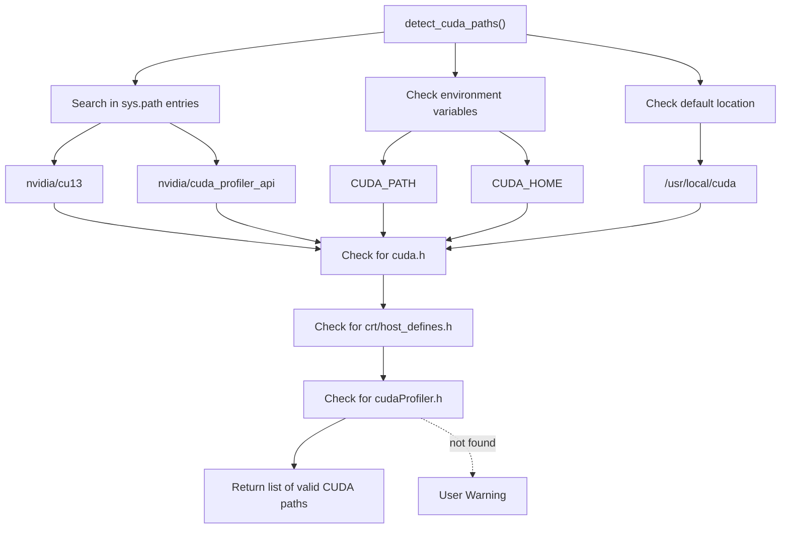
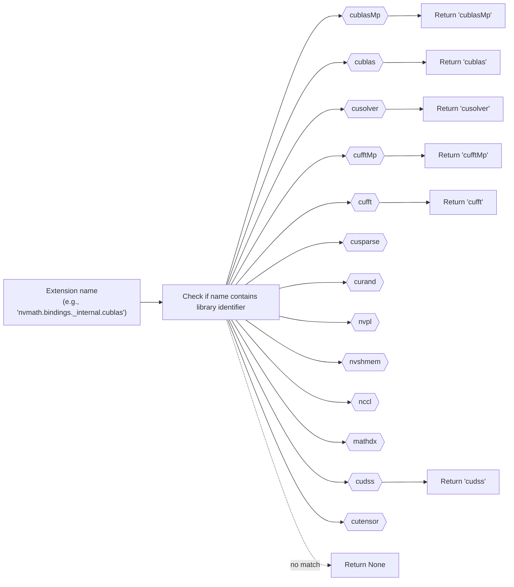
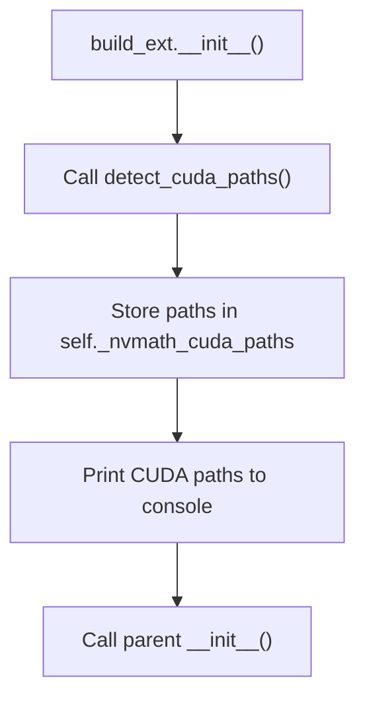
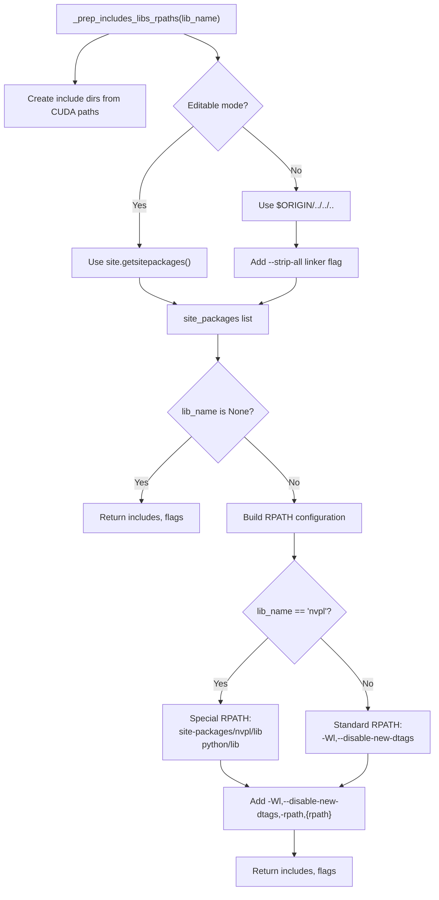
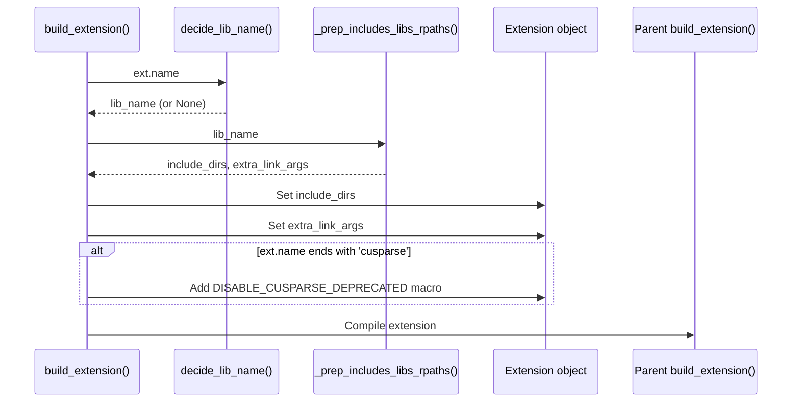
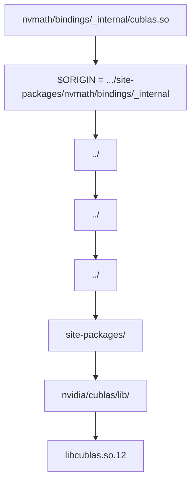

<!-- source: DeepWiki mcp.deepwiki.com · repo NVIDIA/nvmath-python · page 3.2 Python Bindings Layer · fetched 2026-10-26 -->

# Python Bindings Layer

<details>
<summary>Relevant source files</summary>

The following files were used as context for generating this wiki page:

- [MANIFEST.in](MANIFEST.in)
- [builder/__init__.py](builder/__init__.py)
- [builder/utils.py](builder/utils.py)

</details>


## Purpose and Scope

The Python Bindings Layer is the foundational component that bridges Python code with NVIDIA's native CUDA mathematics libraries. This layer uses Cython to create performant, type-safe Python interfaces to C APIs exposed by libraries like cuBLAS, cuFFT, cuDSS, and others. This document explains the technical mechanisms behind the bindings: Cython compilation, CUDA path detection, runtime linking strategies, and the build system integration.

For information about the high-level API categories that consume these bindings, see [API Categories](). For detailed reference documentation of individual binding modules, see [Python Bindings Reference]().

---

## Architectural Overview

The bindings layer consists of Cython source files (`.pyx` implementation and `.pxd` header files) that directly wrap the C APIs of NVIDIA's CUDA libraries. The build system compiles these into native Python extension modules (`.so` files on Linux) that can be imported and used from Python code.

### Binding Layer Structure

```mermaid
graph TB
    subgraph "Python Layer"
        PY_HOST["Host APIs<br/>(nvmath.linalg, nvmath.fft)"]
        PY_DEVICE["Device APIs<br/>(nvmath.device)"]
        PY_DIST["Distributed APIs<br/>(nvmath.distributed)"]
    end
    
    subgraph "Python Bindings Layer"
        BINDINGS_PKG["nvmath/bindings/"]
        
        subgraph "Binding Modules"
            CUBLAS_PYX["cublas.pyx"]
            CUBLASLT_PYX["cublasLt.pyx"]
            CUBLASMP_PYX["cublasMp.pyx"]
            CUFFT_PYX["cufft.pyx"]
            CUFFTMP_PYX["cufftMp.pyx"]
            CUDSS_PYX["cudss.pyx"]
            CUSPARSE_PYX["cusparse.pyx"]
            CURAND_PYX["curand.pyx"]
        end
        
        subgraph "Header Declarations"
            CUBLAS_PXD["cublas.pxd"]
            CUBLASLT_PXD["cublasLt.pxd"]
            CUFFT_PXD["cufft.pxd"]
            OTHER_PXD["...other .pxd files"]
        end
    end
    
    subgraph "Build System"
        BUILDER_UTILS["builder/utils.py"]
        BUILD_EXT["build_ext class"]
        DETECT_CUDA["detect_cuda_paths()"]
        PREP_INCLUDES["_prep_includes_libs_rpaths()"]
        DECIDE_LIB["decide_lib_name()"]
    end
    
    subgraph "Native CUDA Libraries"
        LIBCUBLAS["libcublas.so"]
        LIBCUBLASLT["libcublasLt.so"]
        LIBCUBLASMP["libcublasMp.so"]
        LIBCUFFT["libcufft.so"]
        LIBCUFFTMP["libcufftMp.so"]
        LIBCUDSS["libcudss.so"]
    end
    
    PY_HOST --> CUBLAS_PYX
    PY_HOST --> CUBLASLT_PYX
    PY_HOST --> CUFFT_PYX
    PY_DEVICE --> CUFFT_PYX
    PY_DIST --> CUBLASMP_PYX
    PY_DIST --> CUFFTMP_PYX
    
    CUBLAS_PYX --> CUBLAS_PXD
    CUBLASLT_PYX --> CUBLASLT_PXD
    CUFFT_PYX --> CUFFT_PXD
    
    BUILDER_UTILS --> DETECT_CUDA
    BUILDER_UTILS --> BUILD_EXT
    BUILD_EXT --> PREP_INCLUDES
    BUILD_EXT --> DECIDE_LIB
    
    BUILD_EXT -.->|"compiles"| CUBLAS_PYX
    BUILD_EXT -.->|"compiles"| CUBLASLT_PYX
    BUILD_EXT -.->|"compiles"| CUFFT_PYX
    BUILD_EXT -.->|"compiles"| CUDSS_PYX
    
    CUBLAS_PYX -->|"links to"| LIBCUBLAS
    CUBLASLT_PYX -->|"links to"| LIBCUBLASLT
    CUBLASMP_PYX -->|"links to"| LIBCUBLASMP
    CUFFT_PYX -->|"links to"| LIBCUFFT
    CUFFTMP_PYX -->|"links to"| LIBCUFFTMP
    CUDSS_PYX -->|"links to"| LIBCUDSS
```



**Sources:** [builder/utils.py:1-146](), [MANIFEST.in:1-7]()

---

## Cython Source Files

The bindings are implemented using two types of Cython files:

### `.pyx` Files (Implementation)

These files contain the Python-visible function implementations that wrap the C API calls. They handle:
- Argument marshaling between Python and C types
- Error checking and exception raising
- Memory management for opaque handle types
- Enum value exposure

The package manifest explicitly includes these files in source distributions: [MANIFEST.in:3]()

### `.pxd` Files (Header Declarations)

These files declare the C function signatures and types from the native CUDA libraries using Cython's `cdef extern` syntax. They act as interface files, similar to C header files, allowing `.pyx` files to call into C libraries.

The manifest includes all `.pxd` files: [MANIFEST.in:2]()

### Build Artifact Management

Cython generates intermediate `.cpp` files during compilation, but these are explicitly excluded from source distributions since they can be regenerated: [MANIFEST.in:4-6]()

**Sources:** [MANIFEST.in:1-7]()

---

## Build System Integration

### CUDA Path Detection

The build system must locate CUDA headers and libraries across multiple installation scenarios. The `detect_cuda_paths()` function implements a comprehensive search strategy:



**Implementation Details:**

The search prioritizes paths in this order:
1. **Pip wheel installations**: Searches for `nvidia/cu13` and `nvidia/cuda_profiler_api` in `sys.path` [builder/utils.py:23-27]()
2. **Environment variables**: Checks `CUDA_PATH` then `CUDA_HOME` [builder/utils.py:28]()
3. **System default**: Falls back to `/usr/local/cuda` [builder/utils.py:28]()

The function validates each potential path by checking for required headers:
- `cuda.h` - Core CUDA runtime header [builder/utils.py:47]()
- `crt/host_defines.h` - Host compiler integration [builder/utils.py:48]()
- `cudaProfiler.h` - Profiler API (required by internal bindings) [builder/utils.py:51]()

If a required header is missing from all searched paths, the function issues a `warnings.warn` alerting the user that compilation may fail [builder/utils.py:41-45]().

**Sources:** [builder/utils.py:12-52]()

---

## Library Naming Convention

The `decide_lib_name()` function determines which native CUDA library corresponds to each binding module by analyzing the extension name:



The function checks for these library identifiers in order: `cublasMp`, `cublas`, `cusolver`, `cufftMp`, `cufft`, `cusparse`, `curand`, `nvpl`, `nvshmem`, `nccl`, `mathdx`, `cudss`, `cutensor` [builder/utils.py:57-71](). The order matters because `cublas` would match `cublasMp` if checked first.

**Sources:** [builder/utils.py:55-75]()

---

## Custom Build Extension Class

The `build_ext` class extends setuptools' standard extension builder to inject CUDA-specific configuration:

### Initialization



During initialization, the class:
1. Detects all CUDA installation paths [builder/utils.py:80]()
2. Stores them in `self._nvmath_cuda_paths` [builder/utils.py:80]()
3. Prints the detected paths to console for debugging [builder/utils.py:81-84]()
4. Invokes the parent class constructor [builder/utils.py:85]()

**Sources:** [builder/utils.py:78-85]()

---

## Include Paths and Linker Configuration

The `_prep_includes_libs_rpaths()` method configures compiler and linker flags for each extension:

### Include Directories

For all extensions, include directories are constructed from detected CUDA paths:
```python
cuda_incl_dir = [os.path.join(p, "include") for p in self._nvmath_cuda_paths]
```
[builder/utils.py:91]()

### Runtime Library Search Paths (RPATH)

The build system must ensure that compiled extensions can locate CUDA libraries at runtime, whether installed via:
- **Pip wheels**: Libraries in `site-packages/nvidia/{library}/lib/`
- **System installation**: Libraries in `/usr/local/cuda/lib64/`
- **Custom paths**: User-specified locations



**Key Implementation Details:**

| Scenario | `site_packages` Value | Purpose |
|----------|----------------------|---------|
| **Wheel installation** | `$ORIGIN/../../..` | Relative path from binding `.so` location to `site-packages` [builder/utils.py:94]() |
| **Editable installation** | `site.getsitepackages()` | Absolute paths to Python site-packages directories [builder/utils.py:98]() |

**RPATH Construction:**
- For most libraries: The flag `-Wl,--disable-new-dtags` is added [builder/utils.py:116]().
- For `nvpl`: Special handling with two search paths [builder/utils.py:117-127]():
  1. `{pth}/{lib_name}/lib` - NVPL library location
  2. `{pth}/../../` - Location for MKL dependencies in the Python `lib` directory

**Binary Stripping:**
When building wheels (not editable mode), the `-Wl,--strip-all` linker flag removes debug symbols to reduce wheel size [builder/utils.py:102]().

**Sources:** [builder/utils.py:87-130]()

---

## Extension Compilation Process

### Per-Extension Build



For each extension:
1. **Determine library name**: Call `decide_lib_name()` with the extension name [builder/utils.py:133]()
2. **Configure paths**: Call `_prep_includes_libs_rpaths()` to get include directories and linker flags [builder/utils.py:134]()
3. **Set extension properties**: Update the extension object with configuration [builder/utils.py:134]()
4. **Special case handling**: For `cusparse`, define `DISABLE_CUSPARSE_DEPRECATED` to suppress deprecation warnings [builder/utils.py:135-139]()
5. **Invoke parent**: Call the parent class's `build_extension()` to perform actual compilation [builder/utils.py:141]()

**Sources:** [builder/utils.py:132-141]()

---

## Parallel Compilation

The `build_extensions()` method enables parallel compilation across CPU cores:

```python
def build_extensions(self):
    self.parallel = os.cpu_count()
    super().build_extensions()
```
[builder/utils.py:143-145]()

This sets the number of parallel build jobs to match the available CPU cores, significantly speeding up compilation of multiple binding modules.

**Sources:** [builder/utils.py:143-145]()

---

## Supported CUDA Libraries

The binding layer currently supports the following NVIDIA CUDA mathematics libraries:

| Library | Binding Module | Purpose |
|---------|----------------|---------|
| **cuBLAS** | `nvmath.bindings.cublas` | Basic Linear Algebra Subprograms (~400 functions) |
| **cuBLASLt** | `nvmath.bindings.cublasLt` | Advanced GEMM with algorithm selection |
| **cuBLASMp** | `nvmath.bindings.cublasMp` | Distributed multi-GPU linear algebra |
| **cuFFT** | `nvmath.bindings.cufft` | Fast Fourier Transform |
| **cuFFTMp** | `nvmath.bindings.cufftMp` | Distributed multi-GPU FFT |
| **cuSPARSE** | `nvmath.bindings.cusparse` | Sparse matrix operations |
| **cuSOLVER** | `nvmath.bindings.cusolver` | Dense and sparse linear solvers |
| **cuRAND** | `nvmath.bindings.curand` | Random number generation |
| **cuDSS** | `nvmath.bindings.cudss` | Direct Sparse Solver |
| **cuTENSOR** | `nvmath.bindings.cutensor` | Tensor contractions and operations |
| **NVSHMEM** | Internal bindings | Partitioned Global Address Space (PGAS) |
| **NCCL** | Internal bindings | Collective communications |
| **MathDx** | Internal bindings | Device-side mathematics operations |
| **NVPL** | `nvmath.bindings.nvpl` | NVIDIA Performance Libraries |

The list is maintained in `decide_lib_name()` [builder/utils.py:57-71]() and determines linking behavior for each library.

**Sources:** [builder/utils.py:55-75]()

---

## Runtime Linking Strategy

### Installation Layout

When installed via pip wheel, the nvmath-python package and CUDA library wheels have this structure:

```
site-packages/
├── nvmath/
│   └── bindings/
│       └── _internal/
│           ├── cublas.so          # $ORIGIN
│           ├── cublasLt.so
│           ├── cufft.so
│           └── ... (other bindings)
└── nvidia/
    ├── cublas/
    │   └── lib/
    │       └── libcublas.so.12    # $ORIGIN/../../../nvidia/cublas/lib/
    ├── cufft/
    │   └── lib/
    │       └── libcufft.so.11
    └── ... (other CUDA libraries)
```

### RPATH Resolution

The `$ORIGIN` variable in RPATH is resolved by the dynamic linker at runtime to the directory containing the `.so` file:



For editable installations, absolute paths are used instead since the binding location may not follow the standard structure [builder/utils.py:95-98]().

**Sources:** [builder/utils.py:87-130]()

---

## Summary

The Python Bindings Layer provides the essential infrastructure connecting Python code to NVIDIA's CUDA libraries:

| Component | Location | Purpose |
|-----------|----------|---------|
| **Cython source** | `*.pyx`, `*.pxd` files | Define Python wrappers for C APIs |
| **Build utilities** | `builder/utils.py` | CUDA detection, compilation configuration |
| **Custom build class** | `builder.utils.build_ext` | Extends setuptools with CUDA-specific logic |
| **Package manifest** | `MANIFEST.in` | Controls source distribution contents |

The architecture supports multiple installation scenarios (pip wheels, system CUDA, custom paths) through comprehensive path detection and flexible RPATH configuration. Parallel compilation and binary stripping optimize build time and wheel size. The result is a robust foundation that enables the high-level Host, Device, and Distributed APIs to leverage NVIDIA's GPU-accelerated mathematics libraries from Python.

For detailed API documentation of specific binding modules, see the Reference sections of the documentation.

---

