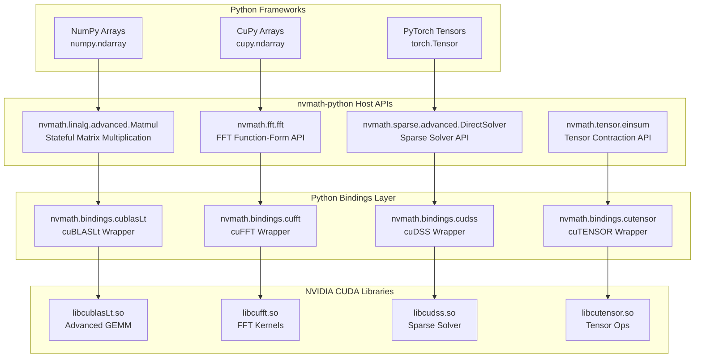
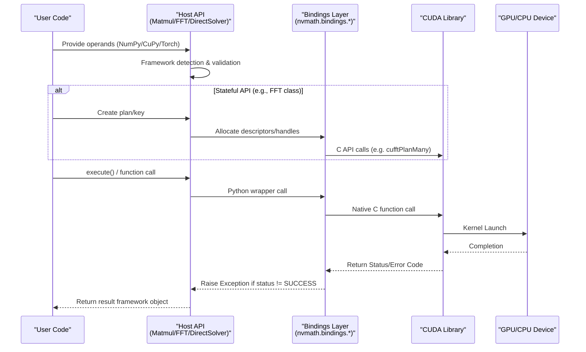
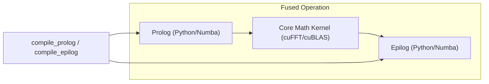

<!-- source: DeepWiki mcp.deepwiki.com · repo NVIDIA/nvmath-python · page 4 Host APIs · fetched 2026-10-26 -->

# Host APIs

Relevant source files

The following files were used as context for generating this wiki page:

- [docs/sphinx/bindings/index.rst](docs/sphinx/bindings/index.rst)
- [docs/sphinx/host-apis/fft/index.rst](docs/sphinx/host-apis/fft/index.rst)

## Purpose and Scope

This page documents the Host APIs provided by `nvmath-python`, which are Python functions and classes designed to be called from host (CPU) code but can execute on GPU devices. Host APIs accept standard Python array and tensor objects (NumPy, CuPy, PyTorch) and provide fine-grained control over NVIDIA's math libraries while maintaining a pythonic interface.

Host APIs cover four main domains:
- **Linear Algebra Operations**: Detailed information on matrix multiplication and related operations. See [Linear Algebra Operations](#4.1).
- **FFT Operations**: Comprehensive coverage of Fast Fourier Transforms with custom prologs/epilogs and CPU/GPU execution. See [FFT Operations](#4.2).
- **Sparse Linear Algebra**: High-level interface for sparse direct solvers via cuDSS. See [Sparse Linear Algebra](#4.3).
- **Tensor Contractions**: Advanced binary and ternary tensor contractions using cuTENSOR. See [Tensor Contractions](#4.4).

For device-side APIs that can be called from within custom CUDA kernels, see [Device APIs](#5). For distributed multi-node operations, see [Distributed APIs](#6).

**Sources:** [docs/sphinx/host-apis/fft/index.rst:10-32](), [docs/sphinx/bindings/index.rst:13-53]()

## Architecture Overview

Host APIs form the highest level of abstraction in `nvmath-python`, sitting above the Python bindings layer and providing intuitive interfaces to NVIDIA's CUDA libraries.

### Host API Architecture

**Sources:** [docs/sphinx/bindings/index.rst:24-51](), [docs/sphinx/host-apis/fft/index.rst:10-22]()

### Data Flow for Host API Operations

**Sources:** [docs/sphinx/bindings/index.rst:59-70](), [docs/sphinx/bindings/index.rst:119-143](), [docs/sphinx/host-apis/fft/index.rst:23-26]()

## Framework Compatibility

Host APIs are designed to work seamlessly with multiple Python array and tensor frameworks. The APIs automatically detect the input framework and return results in the same framework format.

| Framework | Array Type | Memory Space | Notes |
|-----------|------------|----------------|-------|
| **NumPy** | `numpy.ndarray` | Host | Used for CPU execution or host-side data |
| **CuPy** | `cupy.ndarray` | Device | Native GPU execution, zero-copy operations |
| **PyTorch** | `torch.Tensor` | Host/Device | Supports both CPU and CUDA tensors |

**Sources:** [docs/sphinx/bindings/index.rst:100-114](), [docs/sphinx/host-apis/fft/index.rst:103-108]()

## Execution Model

Host APIs support execution on both NVIDIA GPUs and CPUs. By default, the execution space is selected based on the memory space of the operand, but it can be explicitly controlled.

### Execution Characteristics

| Aspect | GPU Execution | CPU Execution |
|--------|-------------------|----------------------------------|
| **Library** | cuBLAS, cuFFT, cuDSS, cuTENSOR | NVPL (ARM), MKL (x86), FFTW3 |
| **Stream/Thread** | CUDA Stream (Asynchronous) | Host Threads (Synchronous) |
| **Dependencies** | CUDA Toolkit, cu12/cu13 extras | `nvmath-python[cpu]` extra |
| **OS Support** | Linux, Windows | Linux (Windows not supported for CPU) |

**Sources:** [docs/sphinx/host-apis/fft/index.rst:103-112](), [docs/sphinx/host-apis/fft/index.rst:116-134]()

## Usage Patterns

### Stateful vs. Function-Form APIs

Host APIs provide two usage patterns depending on the performance requirements:

| Pattern | Use Case | Example API | Lifecycle |
|---------|----------|-------------|-----------|
| **Stateful** | Repeated operations, plan caching | `nvmath.fft.FFT` | Create → [Plan] → Execute → Free |
| **Function-Form** | Single operation, simple code | `nvmath.fft.fft` | Single function call |

**Sources:** [docs/sphinx/host-apis/fft/index.rst:10-22](), [docs/sphinx/host-apis/fft/index.rst:23-26]()

### Callback and Fusion Patterns

The FFT and Linear Algebra modules support kernel fusion via callbacks. This allows user-defined Python functions to be compiled and executed on-device as part of the math operation.

**Sources:** [docs/sphinx/host-apis/fft/index.rst:27-32](), [docs/sphinx/host-apis/fft/index.rst:46-60]()

## Memory Management

### Pointer and Data Lifetime
In `nvmath-python`, memory management is handled through Python proxy objects (NumPy/CuPy). To pass data to low-level bindings, pointer addresses are passed as Python `int`.

- **Host Pointers**: Obtained via `buf.ctypes.data` (NumPy).
- **Device Pointers**: Obtained via `buf.data.ptr` or `buf.ptr` (CuPy).
- **Automatic Conversion**: For readonly host arrays, Python sequences (lists) can often be passed directly; the library handles conversion.

**Sources:** [docs/sphinx/bindings/index.rst:98-118](), [docs/sphinx/bindings/index.rst:153-168]()

## Child Pages

For deep technical details on specific domains, refer to the following sub-pages:

*   **[Linear Algebra Operations](#4.1)**: Detailed guide on `nvmath.linalg.advanced.Matmul`, including algorithm selection, compute types, and epilog operations.
*   **[FFT Operations](#4.2)**: Guide on `nvmath.fft`, covering N-dimensional transforms, LTO-IR callbacks, and CPU execution via NVPL/MKL.
*   **[Sparse Linear Algebra](#4.3)**: Documentation for `nvmath.sparse.advanced.DirectSolver` and sparse matrix support.
*   **[Tensor Contractions](#4.4)**: Guide on `nvmath.tensor` for binary/ternary contractions and `einsum` notation.

**Sources:** [docs/sphinx/host-apis/fft/index.rst:1-32](), [docs/sphinx/bindings/index.rst:1-53]()

---

