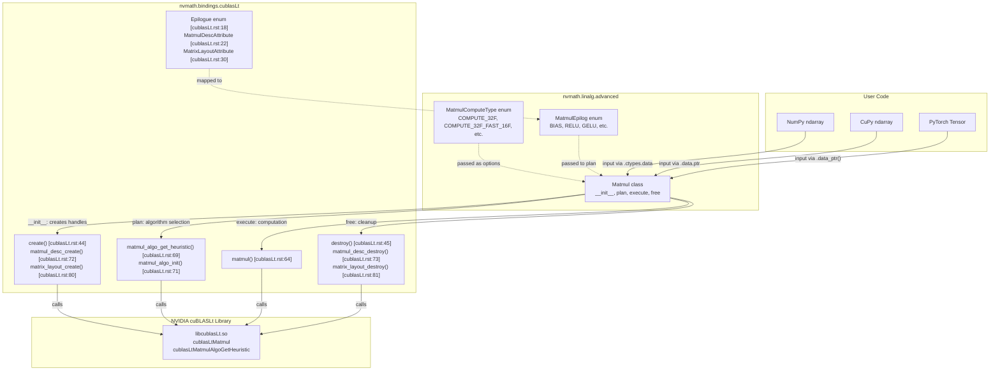
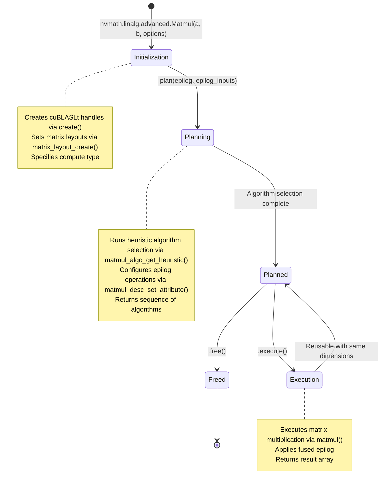
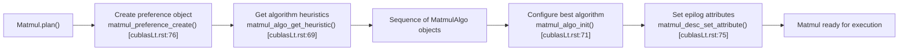
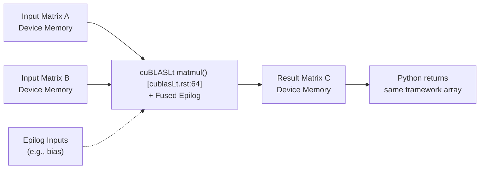

<!-- source: DeepWiki mcp.deepwiki.com · repo NVIDIA/nvmath-python · page 4.1 Linear Algebra Operations · fetched 2026-10-26 -->

# Linear Algebra Operations

<details>
<summary>Relevant source files</summary>

The following files were used as context for generating this wiki page:

- [docs/sphinx/bindings/cublas.rst](docs/sphinx/bindings/cublas.rst)
- [docs/sphinx/bindings/cublasLt.rst](docs/sphinx/bindings/cublasLt.rst)
- [docs/sphinx/bindings/index.rst](docs/sphinx/bindings/index.rst)

</details>


This page documents the Host API for linear algebra operations in nvmath-python, specifically focusing on the `nvmath.linalg.advanced.Matmul` class and the `nvmath.linalg.generic` interface. This interface provides fine-grained control over matrix multiplication operations with access to advanced features from NVIDIA's cuBLASLt library.

For FFT operations using Host APIs, see [FFT Operations](#4.2). For lower-level Python bindings to cuBLAS and cuBLASLt, see [cuBLAS Bindings](#7.1) and [cuBLASLt Bindings](#7.2).

**Sources:** [docs/sphinx/bindings/index.rst:1-187]()

## Overview

The `nvmath.linalg.advanced` module provides a high-level stateful interface for performing matrix multiplication with advanced capabilities including:

- **Algorithm selection**: Choose from multiple cuBLASLt algorithms optimized for different matrix sizes and hardware configurations.
- **Mixed-precision computation**: Perform computations in lower precision for speed while maintaining acceptable accuracy.
- **Fused epilog operations**: Apply operations like bias addition, activation functions, or scaling directly to the multiplication result without separate kernel launches.
- **Multi-framework support**: Works seamlessly with NumPy, CuPy, and PyTorch tensors through the use of pointer-based memory management.
- **Persistent planning**: Create a `Matmul` object once and reuse it for multiple executions with the same problem dimensions.

The primary interface is the `Matmul` class, which wraps NVIDIA's cuBLASLt library through the `nvmath.bindings.cublasLt` module.

**Sources:** [docs/sphinx/bindings/cublasLt.rst:1-89](), [docs/sphinx/bindings/index.rst:92-181]()

## Architecture

**Diagram: Linear Algebra Host API Architecture**



The `Matmul` class provides a stateful Python interface that manages the complete lifecycle of a matrix multiplication operation. It internally creates and manages cuBLASLt descriptors, layouts, and algorithm selections through the bindings layer.

**Sources:** [docs/sphinx/bindings/cublasLt.rst:1-89](), [docs/sphinx/bindings/index.rst:92-181]()

## Matmul Workflow

**Diagram: Matmul Object Lifecycle**



The workflow consists of four distinct phases:

1. **Initialization**: Create the `Matmul` object with input operands and options.
2. **Planning**: Select algorithms and configure epilog operations.
3. **Execution**: Perform the computation (can be called multiple times).
4. **Cleanup**: Free resources when finished.

**Sources:** [docs/sphinx/bindings/cublasLt.rst:44-89]()

## Creating a Matmul Object

The `Matmul` constructor accepts input matrices and configuration options. It relies on passing memory pointers as Python `int` to the underlying bindings.

```python
import cupy as cp
import nvmath

a = cp.random.rand(m, k).astype(cp.float32)
b = cp.random.rand(k, n).astype(cp.float32)

mm = nvmath.linalg.advanced.Matmul(
    a,
    b,
    options={
        "compute_type": nvmath.linalg.advanced.MatmulComputeType.COMPUTE_32F_FAST_16F
    },
)
```

**Constructor Parameters:**
- **a, b**: Input matrices (NumPy ndarray, CuPy ndarray, or PyTorch Tensor).
- **options** (dict): Configuration dictionary with keys including:
  - `compute_type`: Precision mode for the computation.
  - Additional cuBLASLt configuration parameters mapped to `MatmulDescAttribute`.

During initialization, the `Matmul` object:
1. Creates a cuBLASLt handle via `nvmath.bindings.cublasLt.create()` [docs/sphinx/bindings/cublasLt.rst:44]().
2. Creates matrix layout descriptors via `nvmath.bindings.cublasLt.matrix_layout_create()` [docs/sphinx/bindings/cublasLt.rst:80]().
3. Creates a matmul descriptor via `nvmath.bindings.cublasLt.matmul_desc_create()` [docs/sphinx/bindings/cublasLt.rst:72]().
4. Validates operand dimensions and types.

**Sources:** [docs/sphinx/bindings/cublasLt.rst:10-89](), [docs/sphinx/bindings/index.rst:116-143]()

## Compute Types

The `MatmulComputeType` enum specifies the precision used for internal computations. This enables mixed-precision operations where inputs and outputs can be in one precision while computations occur in another.

| Compute Type | Description |
|-------------|-------------|
| `COMPUTE_32F` | Single-precision (FP32) computation |
| `COMPUTE_32F_FAST_16F` | FP32 computation with FP16 tensor core acceleration |
| `COMPUTE_32F_FAST_16BF` | FP32 computation with BF16 tensor core acceleration |
| `COMPUTE_32F_FAST_TF32` | FP32 computation with TensorFloat-32 acceleration |
| `COMPUTE_64F` | Double-precision (FP64) computation |
| `COMPUTE_16F` | Half-precision (FP16) computation |

The compute type maps to the `nvmath.bindings.cublas.ComputeType` enum [docs/sphinx/bindings/cublas.rst:16]() which is passed to cuBLASLt via `matmul_desc_set_attribute()` [docs/sphinx/bindings/cublasLt.rst:75]().

**Sources:** [docs/sphinx/bindings/cublas.rst:16](), [docs/sphinx/bindings/cublasLt.rst:75]()

## Planning and Algorithm Selection

The `plan()` method triggers algorithm selection and configures epilog operations:

```python
mm.plan(
    epilog=nvmath.linalg.advanced.MatmulEpilog.BIAS,
    epilog_inputs={"bias": bias},
)
```

**Planning Process:**



**Plan Parameters:**
- **epilog** (enum): Type of fused operation to apply, mapping to `nvmath.bindings.cublasLt.Epilogue` [docs/sphinx/bindings/cublasLt.rst:18]().
- **epilog_inputs** (dict): Additional tensors required by the epilog (e.g., bias vector).
- **algorithm** (optional): Manually specify algorithm instead of using heuristic via `MatmulAlgo` [docs/sphinx/bindings/cublasLt.rst:19]().

The planning phase calls `nvmath.bindings.cublasLt.matmul_algo_get_heuristic()` [docs/sphinx/bindings/cublasLt.rst:69]() which returns multiple candidate algorithms ranked by estimated performance.

**Sources:** [docs/sphinx/bindings/cublasLt.rst:18-79]()

## Epilog Operations

Epilog operations are fused computations applied to the matrix multiplication result without launching separate kernels. This fusion reduces memory traffic and improves performance.

**Common Epilog Types (from `nvmath.bindings.cublasLt.Epilogue`):**

| Epilog | Operation | Required Inputs |
|--------|-----------|----------------|
| `BIAS` | `C = alpha * A @ B + bias` | `bias` vector |
| `RELU` | `C = relu(alpha * A @ B + beta * C)` | None |
| `GELU` | `C = gelu(alpha * A @ B + beta * C)` | None |
| `GELU_AUX` | GELU with auxiliary output | None |
| `DGELU` | GELU gradient | Auxiliary input |

The epilog configuration is passed to cuBLASLt through `nvmath.bindings.cublasLt.matmul_desc_set_attribute()` [docs/sphinx/bindings/cublasLt.rst:75]() using the `Epilogue` attribute enum.

**Sources:** [docs/sphinx/bindings/cublasLt.rst:18, 75]()

## Execution

After planning, call `execute()` to perform the matrix multiplication. This internally calls `nvmath.bindings.cublasLt.matmul()` [docs/sphinx/bindings/cublasLt.rst:64]().

**Execution Characteristics:**

**Diagram: Execution Data Flow**



**Execution Details:**
- **Non-blocking**: Execution is asynchronous for GPU operands.
- **Pointer Passing**: Memory addresses are passed as `int` via `buf.data.ptr` (CuPy) or `buf.ctypes.data` (NumPy) [docs/sphinx/bindings/index.rst:116-143]().
- **Stream-ordered**: Operations occur on the CUDA stream associated with the input arrays, which can be managed via `nvmath.bindings.cublas.set_stream()` [docs/sphinx/bindings/cublas.rst:341]().

**Sources:** [docs/sphinx/bindings/cublasLt.rst:64](), [docs/sphinx/bindings/index.rst:116-143](), [docs/sphinx/bindings/cublas.rst:341]()

## Resource Management

The `Matmul` object holds CUDA resources that must be explicitly freed to avoid leaks.

**Cleanup Process:**
The `free()` method calls corresponding destroy functions:
- `nvmath.bindings.cublasLt.destroy()` for the cuBLASLt handle [docs/sphinx/bindings/cublasLt.rst:45]().
- `nvmath.bindings.cublasLt.matrix_layout_destroy()` for layout descriptors [docs/sphinx/bindings/cublasLt.rst:81]().
- `nvmath.bindings.cublasLt.matmul_desc_destroy()` for the matmul descriptor [docs/sphinx/bindings/cublasLt.rst:73]().
- `nvmath.bindings.cublasLt.matmul_preference_destroy()` for the preference object [docs/sphinx/bindings/cublasLt.rst:77]().

**Sources:** [docs/sphinx/bindings/cublasLt.rst:44-89]()

## Relationship to cuBLAS Bindings

While `nvmath.linalg.advanced.Matmul` uses cuBLASLt, the library also provides extensive bindings for the standard cuBLAS API.

**Comparison:**

| Feature | nvmath.linalg.advanced.Matmul | nvmath.bindings.cublas |
|---------|-------------------------------|------------------------|
| API Level | High-level, stateful | Low-level, function-based |
| Functions | `Matmul.execute` | `cublas.sgemm`, `cublas.dgemm`, etc. |
| Algorithm Selection | Automatic heuristic | Manual (via `GemmAlgo`) |
| Epilog Fusion | Supported | Not supported |
| Target Library | cuBLASLt | cuBLAS |

The `nvmath.bindings.cublas` module exposes over 400 functions, including 64-bit indexing variants (e.g., `sgemm_64`) and batched operations (e.g., `sgemm_batched`) [docs/sphinx/bindings/cublas.rst:53-428]().

**Sources:** [docs/sphinx/bindings/cublas.rst:53-428](), [docs/sphinx/bindings/cublasLt.rst:1-89]()

---

