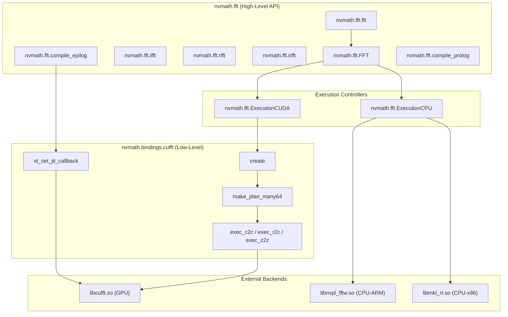
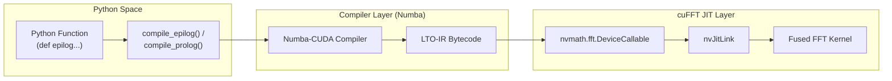

<!-- source: DeepWiki mcp.deepwiki.com · repo NVIDIA/nvmath-python · page 4.2 FFT Operations · fetched 2026-10-26 -->

# FFT Operations

Relevant source files

The following files were used as context for generating this wiki page:

- [docs/sphinx/bindings/cufft.rst](docs/sphinx/bindings/cufft.rst)
- [docs/sphinx/host-apis/fft/index.rst](docs/sphinx/host-apis/fft/index.rst)

## Purpose and Scope

The `nvmath.fft` module provides a high-level Host API for performing Fast Fourier Transforms (FFT) leveraging NVIDIA's math libraries. It supports N-dimensional transformations, including complex-to-complex (C2C), real-to-complex (R2C), and complex-to-real (C2R) transforms. A key feature of this module is the support for kernel fusion via custom prolog and epilog functions compiled to LTO-IR, allowing for efficient pre- and post-processing directly within the FFT execution.

This module acts as a bridge, accepting operands from NumPy, CuPy, or PyTorch, and can execute on either NVIDIA GPUs (via cuFFT) or CPUs (via NVPL or MKL).

Sources: [docs/sphinx/host-apis/fft/index.rst:7-33](), [docs/sphinx/host-apis/fft/index.rst:103-108]()

---

## Architecture and Data Flow

The FFT module is structured to provide both stateless functional APIs for quick transforms and stateful class-based APIs for performance-critical scenarios where plan caching is beneficial.

**FFT System Entity Map**

Sources: [docs/sphinx/host-apis/fft/index.rst:10-25](), [docs/sphinx/host-apis/fft/index.rst:55-60](), [docs/sphinx/host-apis/fft/index.rst:116-118](), [docs/sphinx/bindings/cufft.rst:27-90]()

---

## Host API Interface

### Functional vs. Stateful APIs
The module provides four primary functions for N-dimensional transforms, mimicking the behavior of `numpy.fft.fftn` rather than the 1D/2D specific variants to ensure consistency in batch dimension handling.

| Function | Description | Corresponding cuFFT Type |
| :--- | :--- | :--- |
| `nvmath.fft.fft` | N-D forward C2C transform | `Type.CUFFT_C2C` / `Type.CUFFT_Z2Z` |
| `nvmath.fft.ifft` | N-D inverse C2C transform | `Type.CUFFT_C2C` / `Type.CUFFT_Z2Z` |
| `nvmath.fft.rfft` | N-D forward R2C transform | `Type.CUFFT_R2C` / `Type.CUFFT_D2Z` |
| `nvmath.fft.irfft` | N-D inverse C2R transform | `Type.CUFFT_C2R` / `Type.CUFFT_Z2D` |

For repeated operations on the same shapes, the `nvmath.fft.FFT` class should be used to manage plan lifetime and caching via `create_key`.

Sources: [docs/sphinx/host-apis/fft/index.rst:17-25](), [docs/sphinx/host-apis/fft/index.rst:34-41](), [docs/sphinx/bindings/cufft.rst:15-25]()

### Execution Space Control
By default, the execution space is inferred from the operand's memory location. However, users can force execution using `ExecutionCUDA` or `ExecutionCPU`.

*   **GPU Execution**: Powered by `libcufft`.
*   **CPU Execution**: Utilizes `NVPL` (NVIDIA Performance Libraries) on ARM/Grace or `MKL` on x86_64. Custom FFTW3-compatible libraries can be specified via the `NVMATH_FFT_CPU_LIBRARY` environment variable.

Sources: [docs/sphinx/host-apis/fft/index.rst:103-108](), [docs/sphinx/host-apis/fft/index.rst:116-154]()

---

## FFT Callbacks and Kernel Fusion

`nvmath.fft` supports fusing pre-processing (prolog) and post-processing (epilog) operations with the FFT kernel using Link-Time Optimization (LTO). This is implemented via the cuFFT LTO callback system.

### Compilation Workflow
Users define callbacks in Python, which are then compiled to LTO-IR using Numba. These compiled callbacks are passed as `DeviceCallable` objects to the FFT execution.

**Callback Data Flow**

Sources: [docs/sphinx/host-apis/fft/index.rst:49-60](), [docs/sphinx/host-apis/fft/index.rst:85-92]()

### Implementation Requirements
*   **Software**: cuFFT 11.3+ (CUDA 12.6 U2+), `nvJitLink` from the same toolkit, and `numba-cuda` 0.18.1+.
*   **Hardware**: Compute Capability 7.0+ (7.5+ for CTK 13).
*   **OS**: Currently not supported on Windows.

Sources: [docs/sphinx/host-apis/fft/index.rst:65-67](), [docs/sphinx/host-apis/fft/index.rst:83-95]()

---

## Performance Optimization

### Plan Management
The `nvmath.fft.FFT` class allows for fine-tuned performance through:
1.  **Plan Caching**: Avoiding the overhead of `cufftMakePlan` for every call.
2.  **Work Area Control**: Managing the temporary memory used by cuFFT via `set_work_area` and `xt_set_work_area_policy`.
3.  **Property Tuning**: Using `set_plan_property_int64` to adjust internal cuFFT heuristics.

### Binding Layer Integration
The Host API is built upon the `nvmath.bindings.cufft` layer, which exposes the full suite of cuFFT functionality, including the Xt (Extended) APIs for multi-GPU support and advanced memory layouts.

| Binding Function | Role in Optimization |
| :--- | :--- |
| `xt_set_gpus` | Configures multi-GPU execution for a single plan. |
| `xt_set_work_area_policy` | Controls how cuFFT allocates temporary buffers. |
| `get_size_many64` | Provides precise memory requirements for large-scale batches. |
| `set_auto_allocation` | Disables internal cuFFT allocations for manual memory management. |

Sources: [docs/sphinx/bindings/cufft.rst:46-68](), [docs/sphinx/bindings/cufft.rst:85-89]()

---

## Error Handling
The module uses `nvmath.bindings.cufft.check_status` to translate cuFFT return codes into Python exceptions. Common errors include `cuFFTError` for library-specific failures and `UnsupportedLayoutError` when the input array strides do not conform to cuFFT requirements.

Sources: [docs/sphinx/bindings/cufft.rst:16](), [docs/sphinx/bindings/cufft.rst:33](), [docs/sphinx/host-apis/fft/index.rst:177]()

---

