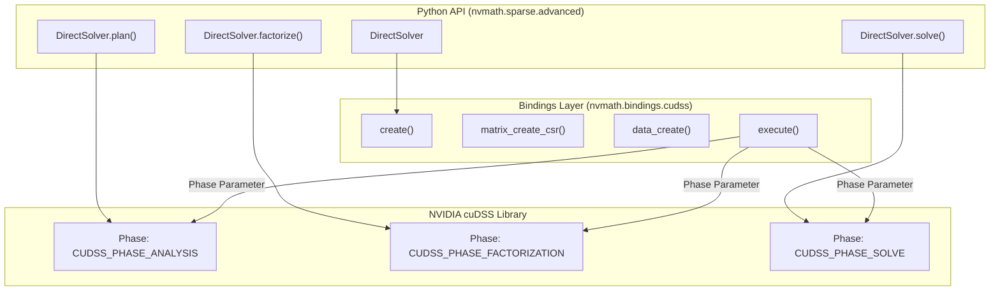
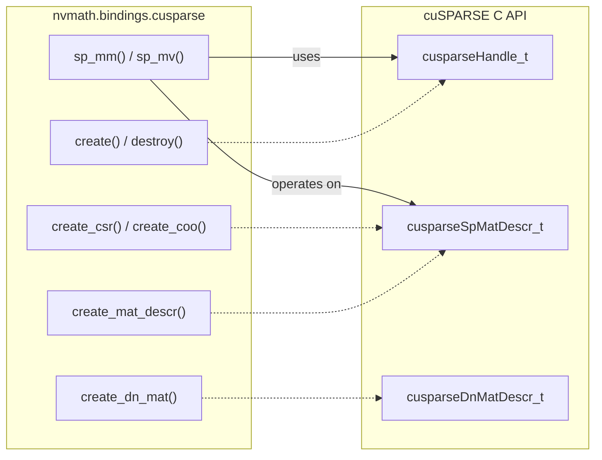

<!-- source: DeepWiki mcp.deepwiki.com · repo NVIDIA/nvmath-python · page 4.3 Sparse Linear Algebra · fetched 2026-10-26 -->

# Sparse Linear Algebra

Relevant source files

The following files were used as context for generating this wiki page:

- [docs/sphinx/bindings/cudss.rst](docs/sphinx/bindings/cudss.rst)
- [docs/sphinx/bindings/cusparse.rst](docs/sphinx/bindings/cusparse.rst)

The `nvmath-python` library provides high-performance sparse linear algebra capabilities primarily through the `nvmath.sparse` module. This module leverages the **cuDSS** library for direct sparse solving and **cuSPARSE** for various sparse matrix operations. The centerpiece of the advanced sparse API is the `DirectSolver`, which provides a stateful interface for solving linear systems of the form $Ax = b$, where $A$ is a sparse matrix.

## Direct Sparse Solving with cuDSS

The `nvmath.sparse.advanced.DirectSolver` class implements a lifecycle-managed approach to sparse direct solving. Unlike iterative solvers, direct solvers factorize the matrix into simpler forms (like LU or LDLt), which allows for efficient solutions, especially when dealing with multiple right-hand sides or multiple systems with the same sparsity pattern.

### Solver Lifecycle

The `DirectSolver` follows a structured lifecycle to optimize performance by reusing intermediate results:

1.  **Setup/Plan**: Configuration of the solver, including matrix type (e.g., symmetric, hermitian) and algorithm selection.
2.  **Analysis**: Reordering of the sparse matrix to minimize fill-in during factorization.
3.  **Factorization**: Numerical decomposition of the matrix (e.g., $A = LU$).
4.  **Solve**: Application of the factors to solve for $x$ given $b$.

#### Direct Solver Data Flow
The following diagram illustrates the interaction between the Python high-level API and the underlying cuDSS bindings.

"DirectSolver Data Flow and Lifecycle"

Sources: [docs/sphinx/bindings/cudss.rst:25-25](), [docs/sphinx/bindings/cudss.rst:40-46]()

### Supported Matrix Types and Layouts

The `DirectSolver` supports various matrix properties and storage formats via the `nvmath.bindings.cudss` enums:

*   **Matrix Formats**: Primarily CSR (Compressed Sparse Row) via `matrix_create_csr` [docs/sphinx/bindings/cudss.rst:53-53]() and `matrix_create_batch_csr` [docs/sphinx/bindings/cudss.rst:51-51]().
*   **Matrix Types**: General, Symmetric, and Hermitian types are supported via `MatrixType` [docs/sphinx/bindings/cudss.rst:22-22]().
*   **Data Layouts**: Support for both standard and batched dense matrices (for right-hand sides) via `matrix_create_dn` [docs/sphinx/bindings/cudss.rst:54-54]() and `matrix_create_batch_dn` [docs/sphinx/bindings/cudss.rst:52-52]().

### Hybrid CPU-GPU Execution

A key feature of the underlying cuDSS library is the ability to handle large sparse systems that may exceed GPU memory. The solver can offload parts of the computation or memory to the host (CPU) while maintaining GPU acceleration for the compute-intensive factorization phases. This is managed through configuration parameters such as `ConfigParam` [docs/sphinx/bindings/cudss.rst:16-16]() and memory handlers set via `set_device_mem_handler` [docs/sphinx/bindings/cudss.rst:66-66]().

## Low-level Sparse Operations (cuSPARSE)

While `DirectSolver` handles complex linear systems, `nvmath.bindings.cusparse` provides granular access to the cuSPARSE library for primitive operations.

### Key cuSPARSE Functionality

| Category | Functions |
| :--- | :--- |
| **Matrix Conversion** | `csr2csc_ex2`, `coo2csr`, `dense_to_sparse_convert` |
| **Sparse-Dense BLAS** | `sp_mv` (Matrix-Vector), `sp_mm` (Matrix-Matrix), `sddmm` (Sampled Dense-Dense Matrix Multiplication) |
| **Triangular Solvers** | `sp_sv_solve` (Sparse Solve), `sp_sm_solve` (Sparse Multiple Solve) |
| **Reordering/Sorting** | `xcsrsort`, `xcoosort_by_row`, `xcscsort` |

Sources: [docs/sphinx/bindings/cusparse.rst:120-132](), [docs/sphinx/bindings/cusparse.rst:191-191](), [docs/sphinx/bindings/cusparse.rst:237-257](), [docs/sphinx/bindings/cusparse.rst:266-276]()

### cuSPARSE Entity Mapping
The diagram below maps the Python binding functions to the cuSPARSE operational logic.

"cuSPARSE Binding Architecture"

Sources: [docs/sphinx/bindings/cusparse.rst:95-112](), [docs/sphinx/bindings/cusparse.rst:133-138](), [docs/sphinx/bindings/cusparse.rst:237-243]()

## Configuration and Management

Both `cuDSS` and `cuSPARSE` bindings allow for fine-grained control over execution environments:

*   **Stream Management**: Users can set the CUDA stream for asynchronous execution using `set_stream` [docs/sphinx/bindings/cudss.rst:67-67]() or [docs/sphinx/bindings/cusparse.rst:199-199]().
*   **Memory Handling**: Integration with external memory pools (like RMM or CuPy) is possible via `set_device_mem_handler` [docs/sphinx/bindings/cudss.rst:66-66]().
*   **Logging and Error Handling**: `check_status` [docs/sphinx/bindings/cudss.rst:35-35]() is used internally to validate return codes against the `Status` [docs/sphinx/bindings/cudss.rst:27-27]() and `cuDSSError` [docs/sphinx/bindings/cudss.rst:17-17]() enums. cuSPARSE provides similar logging controls via `logger_set_level` [docs/sphinx/bindings/cusparse.rst:180-180]().

Sources: [docs/sphinx/bindings/cudss.rst:1-69](), [docs/sphinx/bindings/cusparse.rst:1-305]()

---

