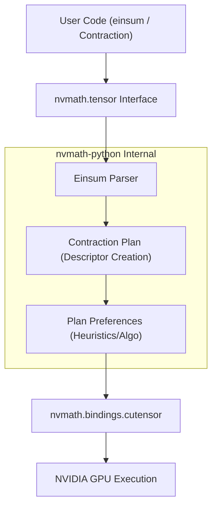
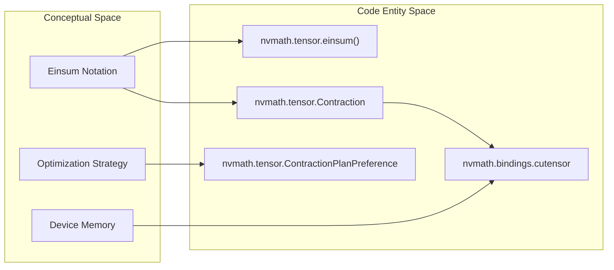

<!-- source: DeepWiki mcp.deepwiki.com · repo NVIDIA/nvmath-python · page 4.4 Tensor Contractions · fetched 2026-10-26 -->

# Tensor Contractions

Relevant source files

The following files were used as context for generating this wiki page:

- [docs/sphinx/bindings/index.rst](docs/sphinx/bindings/index.rst)

The `nvmath.tensor` module provides high-performance tensor contraction capabilities by leveraging the **cuTENSOR** library. It supports binary (two-input) and ternary (three-input) contractions, offering both a simplified "stateless" API for ease of use and a "stateful" API for performance-critical scenarios where planning overhead should be minimized.

### Overview of Tensor Operations

Tensor contractions in `nvmath-python` are primarily expressed using **einsum** (Einstein summation) notation. The library handles the complex logic of mapping these notations to optimized cuTENSOR calls, managing descriptors, and selecting the best algorithms based on hardware capabilities and user preferences.

Key features include:
*   **Support for Multiple Frameworks**: Seamlessly operates on CuPy, PyTorch, and NumPy arrays.
*   **Algorithm Selection**: Control over the heuristics used to select contraction algorithms.
*   **Stateful Planning**: The ability to create a `Contraction` object once and execute it multiple times with different data to amortize planning costs.
*   **Qualifiers**: Support for conjugate and complex transformations via tensor qualifiers.

---

### Data Flow and Architecture

The contraction process involves transitioning from a high-level symbolic representation (einsum string) to a concrete execution plan.

#### Contraction Execution Flow
The following diagram illustrates the path from a user's einsum call to the execution on the GPU via the cuTENSOR backend.

**Contraction Logic Path**

Sources: [docs/sphinx/bindings/index.rst:13-16](), [docs/sphinx/bindings/index.rst:59-70]()

---

### Stateless vs. Stateful APIs

`nvmath-python` provides two primary ways to perform contractions:

#### 1. Stateless API (`nvmath.tensor.einsum`)
This is a drop-in replacement for `numpy.einsum` or `cupy.einsum`. It is convenient for one-off calculations where the overhead of creating a plan is negligible compared to the execution time.

*   **Behavior**: Every call performs descriptor creation, workspace allocation, and algorithm selection.
*   **Usage**: Ideal for interactive scripts and high-level modeling.

#### 2. Stateful API (`nvmath.tensor.Contraction`)
For applications where the same contraction (same shapes and data types) is performed repeatedly, the stateful API is preferred.

*   **Behavior**: The user creates a `Contraction` object. This object pre-calculates the execution plan and allocates necessary workspaces. Subsequent `.execute()` calls only trigger the GPU kernel.
*   **Benefits**: Significantly reduces CPU-side overhead in loops.

---

### Key Entities and Mappings

The following diagram bridges the conceptual tensor operations to the specific classes and modules implemented in the codebase.

**Entity Mapping: Concepts to Code**

Sources: [docs/sphinx/bindings/index.rst:28-47](), [docs/sphinx/bindings/index.rst:75-84]()

---

### Advanced Configuration

#### Plan Preferences and Algorithms
When performing a contraction, users can specify a `ContractionPlanPreference`. This allows fine-grained control over:
*   **Algorithm Selection**: Choosing between different cuTENSOR contraction algorithms (e.g., GETT, JIT-compiled kernels).
*   **Workspace Limits**: Restricting the amount of device memory cuTENSOR can use for intermediate calculations.
*   **Heuristics**: Controlling how much time the library spends searching for the optimal kernel.

#### Tensor Qualifiers
Qualifiers allow users to modify the behavior of input tensors without changing the underlying data. Common qualifiers include:
*   **Conjugate**: Automatically applies a complex conjugate to the tensor during the contraction.
*   **Transformations**: Handling permutations or scaling factors directly within the cuTENSOR operation.

---

### Implementation Details: Bindings Layer

The `nvmath.tensor` module relies on the low-level `nvmath.bindings.cutensor` layer. This layer follows specific conventions to map C APIs to Python:

*   **Prefix Stripping**: The C function `cutensorContraction` is exposed as `cutensor.contraction` [docs/sphinx/bindings/index.rst:62-63]().
*   **Pointer Management**: Memory addresses for CuPy or PyTorch tensors are passed as Python integers (`int`) to the underlying C API [docs/sphinx/bindings/index.rst:68-68]().
*   **Error Handling**: Instead of returning C error codes, the bindings raise Python exceptions if a cuTENSOR operation fails [docs/sphinx/bindings/index.rst:69-69]().

| Feature | C API Component | Python Binding |
| :--- | :--- | :--- |
| Handle | `cutensorHandle_t` | Passed as `int` |
| Descriptor | `cutensorTensorDescriptor_t` | Managed internally by `Contraction` |
| Operation | `cutensorContraction` | `nvmath.bindings.cutensor.contraction` |

Sources: [docs/sphinx/bindings/index.rst:13-16](), [docs/sphinx/bindings/index.rst:59-70](), [docs/sphinx/bindings/index.rst:147-152]()

---

### Memory Management

Since `nvmath-python` does not manage device memory directly, it relies on the user to provide pointers from established libraries like CuPy or PyTorch.

1.  **Host Memory**: Typically managed via NumPy `ndarray`. Pointer is accessed via `buf.ctypes.data` [docs/sphinx/bindings/index.rst:121-125]().
2.  **Device Memory**: Managed via CuPy `ndarray` or PyTorch tensors. Pointer is accessed via `buf.data.ptr` [docs/sphinx/bindings/index.rst:130-135]().
3.  **Contiguity**: Tensors must generally be contiguous in memory unless specific strides are provided to the descriptor [docs/sphinx/bindings/index.rst:144-145]().

Sources: [docs/sphinx/bindings/index.rst:98-102](), [docs/sphinx/bindings/index.rst:116-118](), [docs/sphinx/bindings/index.rst:172-176]()

---

