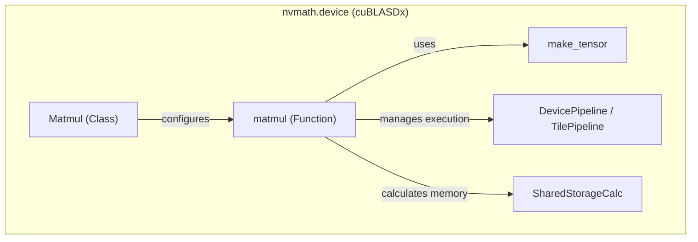
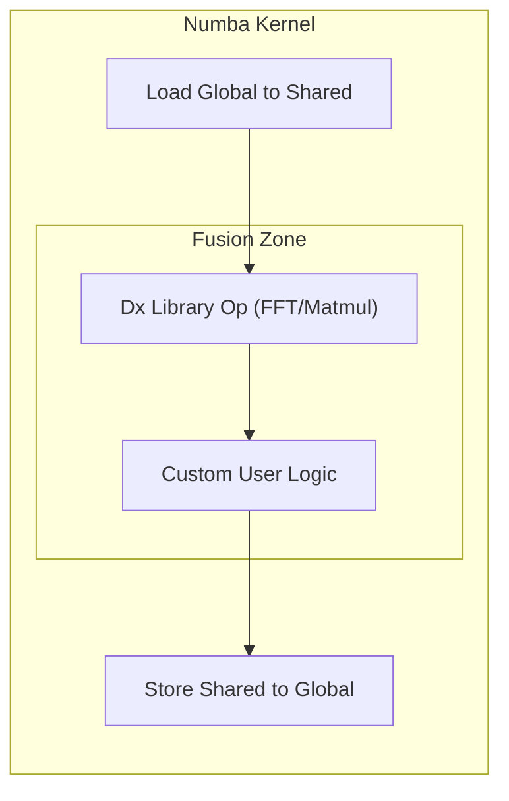

<!-- source: DeepWiki mcp.deepwiki.com · repo NVIDIA/nvmath-python · page 5 Device APIs · fetched 2026-10-26 -->

# Device APIs

Relevant source files

The following files were used as context for generating this wiki page:

- [docs/sphinx/device-apis/cublas.rst](docs/sphinx/device-apis/cublas.rst)
- [docs/sphinx/device-apis/cufft.rst](docs/sphinx/device-apis/cufft.rst)
- [docs/sphinx/device-apis/curand.rst](docs/sphinx/device-apis/curand.rst)
- [docs/sphinx/device-apis/index.rst](docs/sphinx/device-apis/index.rst)

## Purpose and Scope

The `nvmath.device` module provides integration with NVIDIA's high-performance computing libraries through device APIs for **cuFFTDx**, **cuBLASDx**, and **cuRAND**. These APIs are designed to be called directly from CUDA device or kernel code, executing on the GPU. This enables developers to fuse library operations with custom device code, eliminating intermediate global memory round-trips and reducing kernel launch overhead.

**Sources:** [docs/sphinx/device-apis/index.rst:10-16]()

---

## Overview

Device APIs bridge Python and device code primarily through two approaches:
1.  **Numba Extensions**: Accessing device APIs via Numba utilizing specific extensions to query device traits and call functions.
2.  **Third-party JIT Compilers**: Utilizing low-level interfaces for advanced users working with raw device code.

### Supported Libraries
| Library | Module | Documentation Reference |
| :--- | :--- | :--- |
| **cuBLASDx** | `nvmath.device` | [docs/sphinx/device-apis/cublas.rst:11-13]() |
| **cuFFTDx** | `nvmath.device` | [docs/sphinx/device-apis/cufft.rst:11-13]() |
| **cuRAND** | `nvmath.device.random` | [docs/sphinx/device-apis/curand.rst:11-15]() |

**Sources:** [docs/sphinx/device-apis/index.rst:10-24]()

---

## cuBLASDx APIs

The cuBLASDx integration provides device-side matrix multiplication (GEMM) capabilities. It currently supports cuBLASDx 0.4.1 (MathDx 25.06).

### Key Entities
The `Matmul` class and `matmul` function are the primary entry points for device-side linear algebra.

**Diagram: cuBLASDx Device Entity Relationship**

### Reference Components
- **Operations**: `axpby`, `copy`, `copy_fragment`, `clear`, `copy_wait`.
- **Data Structures**: `OpaqueTensor`, `Layout`, `Accumulator`.
- **Metadata**: `LeadingDimension`, `TransposeMode`.

**Sources:** [docs/sphinx/device-apis/cublas.rst:17-54]()

---

## cuFFTDx APIs

The cuFFTDx integration allows performing Fast Fourier Transforms within a CUDA kernel. It currently supports cuFFTDx 1.5.1. Note that C++ APIs requiring a workspace argument are not currently supported in `nvmath-python`.

### API Reference
- `nvmath.device.fft`: Function to initiate FFT operations.
- `nvmath.device.FFT`: Class for managing FFT state and configuration.

**Sources:** [docs/sphinx/device-apis/cufft.rst:17-35]()

---

## cuRAND Device APIs

The `nvmath.device.random` module provides access to cuRAND device-side random number generation.

### Bit Generators and States
The API supports various generators through state classes:
- `StatesXORWOW`, `StatesPhilox4_32_10`
- `StatesMRG32k3a`
- `StatesSobol32`, `StatesSobol64` (including Scrambled variants)

### Distribution Sampling
Users can sample from multiple distributions directly on the device:
- **Normal**: `normal`, `normal_double`, `normal2`, `normal4`
- **Log-Normal**: `log_normal`, `log_normal2`, etc.
- **Uniform**: `uniform`, `uniform_double`, `uniform4`
- **Poisson**: `poisson`, `poisson4`

### Utility and Helper APIs
- **Skip Ahead**: `skipahead`, `skipahead_sequence`, `skipahead_subsequence`.
- **Host Helpers**: `nvmath.device.random_helpers` provides functions like `get_direction_vectors32/64` and `get_scramble_constants32/64` to prepare generator data on the host before kernel execution.

**Sources:** [docs/sphinx/device-apis/curand.rst:33-101]()

---

## Integration Patterns

### Memory Management and Kernel Fusion
Device APIs are designed to work with Numba's memory model. A typical fusion pattern involves:
1.  **Shared Memory**: Using `SharedStorageCalc` (for cuBLASDx) or `FFT` attributes to determine required shared memory.
2.  **Thread-Local Storage**: Managing fragments or local arrays for high-performance register-level operations.
3.  **Pipeline Management**: Using `DevicePipeline` or `TilePipeline` to orchestrate data movement between global and shared memory while overlapping computation.

**Diagram: Device API Fusion Pattern**

**Sources:** [docs/sphinx/device-apis/cublas.rst:45-48](), [docs/sphinx/device-apis/index.rst:20-22]()

---

## Summary Table

| Feature | cuBLASDx | cuFFTDx | cuRAND |
| :--- | :--- | :--- | :--- |
| **Main Object** | `Matmul` | `FFT` | `States[Type]` |
| **Primary Task** | Matrix Multiplication | Fourier Transform | Random Generation |
| **Execution** | Pipeline-based | Block-level | Thread-level |
| **Version** | 0.4.1 | 1.5.1 | cuRAND Device |

**Sources:** [docs/sphinx/device-apis/cublas.rst:17-19](), [docs/sphinx/device-apis/cufft.rst:17-19](), [docs/sphinx/device-apis/curand.rst:11-15]()

---

