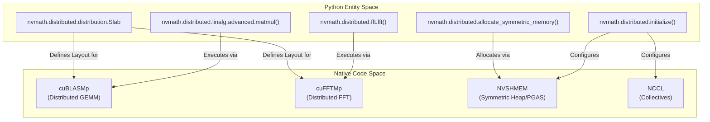
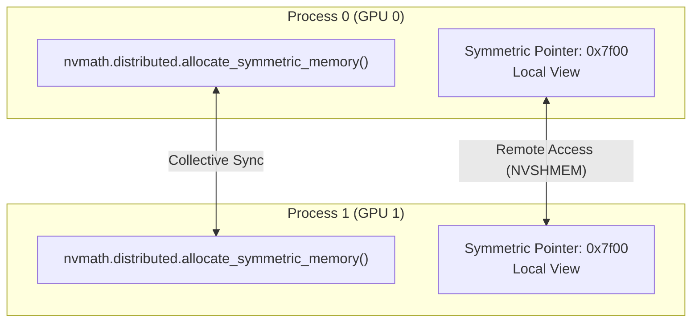

<!-- source: DeepWiki mcp.deepwiki.com · repo NVIDIA/nvmath-python · page 6 Distributed APIs · fetched 2026-10-26 -->

# Distributed APIs

Relevant source files

The following files were used as context for generating this wiki page:

- [docs/sphinx/distributed-apis/distribution.rst](docs/sphinx/distributed-apis/distribution.rst)
- [docs/sphinx/distributed-apis/fft/index.rst](docs/sphinx/distributed-apis/fft/index.rst)
- [docs/sphinx/distributed-apis/index.rst](docs/sphinx/distributed-apis/index.rst)
- [docs/sphinx/distributed-apis/linalg/index.rst](docs/sphinx/distributed-apis/linalg/index.rst)
- [docs/sphinx/distributed-apis/runtime.rst](docs/sphinx/distributed-apis/runtime.rst)

## Purpose and Scope

The `nvmath.distributed` module provides high-level APIs for multi-node, multi-GPU operations by integrating with NVIDIA's distributed math libraries, including **cuBLASMp** for linear algebra and **cuFFTMp** for Fast Fourier Transforms. These APIs enable scaling computations across hundreds of GPUs using a Partitioned Global Address Space (PGAS) model and collective communication backends.

For detailed information on runtime initialization and distribution types, see [Distributed Runtime and Data Distribution](#6.1). For specifics on multi-GPU FFT and data movement, see [Distributed FFT and Reshape](#6.2).

**Sources:** [docs/sphinx/distributed-apis/index.rst:5-35](), [docs/sphinx/distributed-apis/linalg/index.rst:10-15](), [docs/sphinx/distributed-apis/fft/index.rst:10-22]()

---

## Overview

Distributed APIs in `nvmath-python` follow a Single Program, Multiple Data (SPMD) model where each process manages a local partition of global operands.

### Key Characteristics

| Characteristic | Description |
|---------------|-------------|
| **Process Model** | One process per GPU, typically launched via MPI (e.g., `mpirun`) [docs/sphinx/distributed-apis/index.rst:17-19]() |
| **Memory Model** | Operands often require **Symmetric Memory** (NVSHMEM heap) [docs/sphinx/distributed-apis/index.rst:27-32]() |
| **Data Distribution** | Users specify how global arrays are partitioned (Slab, Box, Block-Cyclic) [docs/sphinx/distributed-apis/distribution.rst:5-18]() |
| **Library Backends** | Powered by cuBLASMp, cuFFTMp, NCCL, and NVSHMEM [docs/sphinx/distributed-apis/runtime.rst:27-28]() |

**Sources:** [docs/sphinx/distributed-apis/index.rst:13-35](), [docs/sphinx/distributed-apis/runtime.rst:10-28]()

---

## System Architecture

The following diagrams illustrate the relationship between high-level Python entities and the underlying distributed infrastructure.

**Distributed API Entity Mapping**

**Sources:** [docs/sphinx/distributed-apis/index.rst:5-35](), [docs/sphinx/distributed-apis/runtime.rst:10-28](), [docs/sphinx/distributed-apis/linalg/index.rst:10-15]()

---

## Distributed Runtime and Data Distribution

To use distributed APIs, the runtime must be initialized using `nvmath.distributed.initialize()`. This process involves bootstrapping via MPI and setting up communication backends like NVSHMEM and NCCL.

### Operand Distribution Types
Data partitioning is central to distributed operations. `nvmath-python` supports several distribution abstractions:
*   **Slab**: Partitioning along a single dimension (e.g., `Slab.X`, `Slab.Y`).
*   **Box**: Contiguous N-D rectangular subsections.
*   **Block-Cyclic**: Standard PBLAS distribution for load balancing in dense linear algebra.

For details on initialization and visual diagrams of these distributions, see [Distributed Runtime and Data Distribution](#6.1).

**Sources:** [docs/sphinx/distributed-apis/runtime.rst:10-21](), [docs/sphinx/distributed-apis/distribution.rst:30-146]()

---

## Distributed Linear Algebra

The `nvmath.distributed.linalg.advanced` module provides distributed matrix multiplication (GEMM) using **cuBLASMp**.

### Characteristics
*   **Layout Requirements**: cuBLASMp requires **Fortran-order** (Column-Major) memory layout [docs/sphinx/distributed-apis/linalg/index.rst:42-43]().
*   **Distributions**: Natively supports `BlockCyclic` and `BlockNonCyclic`. `Slab` is compatible if partition sizes are uniform [docs/sphinx/distributed-apis/linalg/index.rst:32-37]().
*   **Qualifiers**: Users must specify if matrices are transposed using `matrix_qualifiers_dtype` [docs/sphinx/distributed-apis/linalg/index.rst:50-65]().
*   **Algorithms**: Supports communication-overlap algorithms like AllGather+GEMM and GEMM+ReduceScatter [docs/sphinx/distributed-apis/linalg/index.rst:75-80]().

**Sources:** [docs/sphinx/distributed-apis/linalg/index.rst:10-105]()

---

## Distributed FFT and Reshape

The `nvmath.distributed.fft` module leverages **cuFFTMp** for large-scale transformations.

### Characteristics
*   **Symmetric Memory**: GPU operands **must** be allocated on the symmetric heap via NVSHMEM for cuFFTMp operations [docs/sphinx/distributed-apis/fft/index.rst:38-41]().
*   **In-Place Operations**: All distributed FFT transforms (C2C, R2C, C2R) are performed in-place [docs/sphinx/distributed-apis/fft/index.rst:43-45]().
*   **Reshape/Redistribution**: The `nvmath.distributed.reshape` API and the `reshape` option in FFT calls allow moving data between different distributions (e.g., Slab.X to Slab.Y) [docs/sphinx/distributed-apis/fft/index.rst:95-104]().

For a full guide on FFT signatures and symmetric memory management, see [Distributed FFT and Reshape](#6.2).

**Sources:** [docs/sphinx/distributed-apis/fft/index.rst:10-53](), [docs/sphinx/distributed-apis/fft/index.rst:114-124]()

---

## Symmetric Memory Management

Distributed operations, particularly FFT and Reshape, rely on the **NVSHMEM Symmetric Heap**. This allows GPUs in different processes to access each other's memory directly.

**Symmetric Heap Allocation Logic**

**Sources:** [docs/sphinx/distributed-apis/runtime.rst:33-39](), [docs/sphinx/distributed-apis/fft/index.rst:38-41](), [docs/sphinx/distributed-apis/index.rst:27-32]()

---

## Child Pages

*   [Distributed Runtime and Data Distribution](#6.1) — Detailed guide on `nvmath.distributed.initialize`, backends (NVSHMEM/NCCL), and distribution types (Slab, Box, BlockCyclic).
*   [Distributed FFT and Reshape](#6.2) — Deep dive into `nvmath.distributed.fft`, in-place transform requirements, and `nvmath.distributed.reshape` for data redistribution.

**Sources:** [docs/sphinx/distributed-apis/index.rst:41-49]()

---

