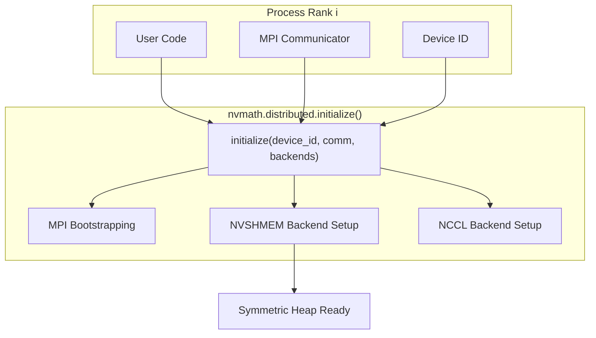
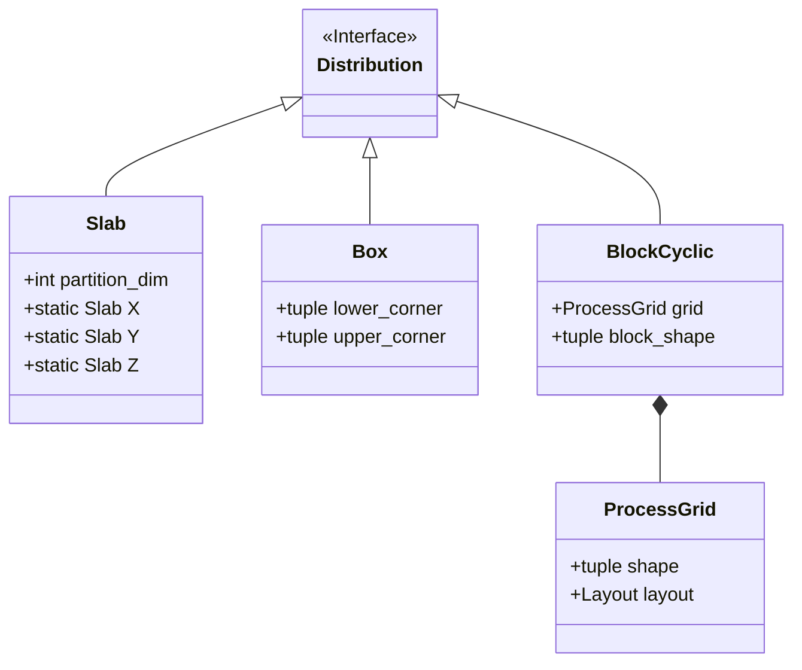
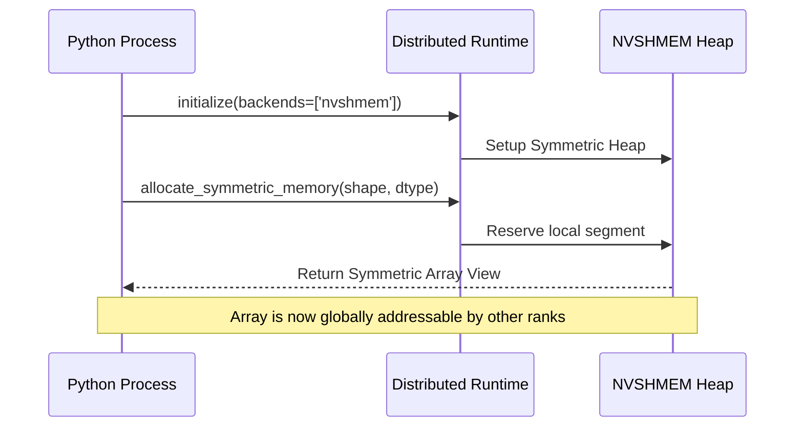

<!-- source: DeepWiki mcp.deepwiki.com · repo NVIDIA/nvmath-python · page 6.1 Distributed Runtime and Data Distribution · fetched 2026-10-26 -->

# Distributed Runtime and Data Distribution

<details>
<summary>Relevant source files</summary>

The following files were used as context for generating this wiki page:

- [docs/sphinx/distributed-apis/distribution.rst](docs/sphinx/distributed-apis/distribution.rst)
- [docs/sphinx/distributed-apis/figures/1d-block-cyclic-example.png](docs/sphinx/distributed-apis/figures/1d-block-cyclic-example.png)
- [docs/sphinx/distributed-apis/figures/2d-block-cyclic-example.png](docs/sphinx/distributed-apis/figures/2d-block-cyclic-example.png)
- [docs/sphinx/distributed-apis/figures/box-example.png](docs/sphinx/distributed-apis/figures/box-example.png)
- [docs/sphinx/distributed-apis/figures/slab-example.png](docs/sphinx/distributed-apis/figures/slab-example.png)
- [docs/sphinx/distributed-apis/runtime.rst](docs/sphinx/distributed-apis/runtime.rst)

</details>


## Purpose and Scope

The `nvmath.distributed` module provides a high-level interface for multi-GPU and multi-node computations. It serves as a bridge to NVIDIA's distributed math libraries, primarily **cuFFTMp** (distributed FFT) and **cuBLASMp** (distributed BLAS). This page details the initialization of the distributed runtime, the management of symmetric memory via **NVSHMEM**, and the various data distribution types supported by the library.

**Sources:** [docs/sphinx/distributed-apis/runtime.rst:1-13](), [docs/sphinx/distributed-apis/distribution.rst:5-18]()

---

## Distributed Runtime Initialization

To use distributed APIs, every participating process must initialize the runtime. This process involves bootstrapping via MPI and setting up communication backends like **NCCL** and **NVSHMEM**.

### Initialization Workflow

Each process provides a local CUDA device ID, an MPI communicator, and a list of desired backends.

| Component | Role |
| :--- | :--- |
| **MPI** | Used for initial bootstrapping and process coordination [docs/sphinx/distributed-apis/runtime.rst:24-25](). |
| **NVSHMEM** | Required for **symmetric memory** operations and PGAS-based communication [docs/sphinx/distributed-apis/runtime.rst:34-35](). |
| **NCCL** | High-performance collective communication library used by underlying math backends. |


**Sources:** [docs/sphinx/distributed-apis/runtime.rst:10-21](), [docs/sphinx/distributed-apis/runtime.rst:24-35]()

---

## Data Distribution Types

nvmath-python supports several distribution types to describe how a global N-dimensional array is partitioned across a set of processes.

### 1. Slab Distribution
`Slab` partitions an N-D array along a **single dimension**. 
- **Convenience Aliases**: `Slab.X` (axis 0), `Slab.Y` (axis 1), and `Slab.Z` (axis 2).
- **Native Support**: Recommended for best performance in **cuFFTMp**.

**Slab Partitioning Diagram (2D Array, 4 Processes, Axis 0)**
```mermaid
grid
    subgraph "Global Array (MxN)"
        P0["Process 0 (Slab 0)"]
        P1["Process 1 (Slab 1)"]
        P2["Process 2 (Slab 2)"]
        P3["Process 3 (Slab 3)"]
    end
```
**Sources:** [docs/sphinx/distributed-apis/distribution.rst:30-49](), [docs/sphinx/distributed-apis/distribution.rst:62-78]()

### 2. Box Distribution
A `Box` describes a contiguous rectangular subsection of a global array using lower and upper corners. Each process is associated with a specific box.
- **Usage**: Natively supported by **cuFFTMp** and the **Reshape** APIs.

**Sources:** [docs/sphinx/distributed-apis/distribution.rst:85-121]()

### 3. Block-Cyclic Distributions
Used primarily by **cuBLASMp** to balance computational load and optimize memory locality.

| Type | Description |
| :--- | :--- |
| `BlockCyclic` | Global array is split into blocks of shape `(B, B)` and distributed cyclically over a `ProcessGrid`. |
| `BlockNonCyclic` | A special case of `BlockCyclic` where blocks are assigned contiguously (non-cyclically). |

**Entity Mapping: Distribution Code Space**

**Sources:** [docs/sphinx/distributed-apis/distribution.rst:128-166](), [docs/sphinx/distributed-apis/distribution.rst:191-192]()

---

## Symmetric Memory Allocation

Certain distributed operations (FFT and Reshape) require GPU operands to be allocated on a **symmetric memory heap**. This memory is managed via NVSHMEM and allows different GPUs to access remote memory directly.

- **Initialization**: Requires `backends=["nvshmem"]` during `initialize()`.
- **API**: Use `nvmath.distributed.allocate_symmetric_memory` (and corresponding `free`).
- **Context**: The `DistributedContext` managed by `get_context()` tracks these allocations.


**Sources:** [docs/sphinx/distributed-apis/runtime.rst:34-39](), [docs/sphinx/distributed-apis/runtime.rst:51-55]()

---

## Distribution Compatibility

While different libraries have native formats, `nvmath-python` performs implicit conversions where possible.

| Library | Native Distribution | Compatible nvmath-python Types |
| :--- | :--- | :--- |
| **cuFFTMp** | Slab / Box | `Slab`, `Box` [docs/sphinx/distributed-apis/distribution.rst:77-118]() |
| **cuBLASMp** | 2D Block-Cyclic | `BlockCyclic`, `Slab` (if uniform partition) [docs/sphinx/distributed-apis/distribution.rst:12-18]() |

**Sources:** [docs/sphinx/distributed-apis/distribution.rst:10-18](), [docs/sphinx/distributed-apis/distribution.rst:77-78](), [docs/sphinx/distributed-apis/distribution.rst:186-188]()

---

